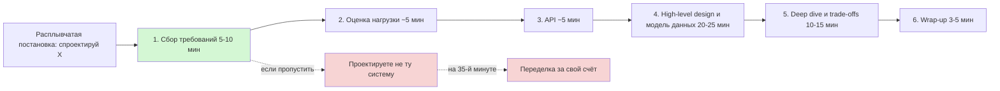
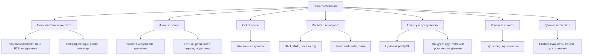
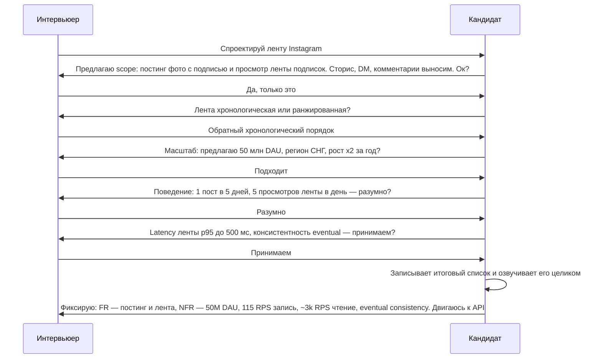

# Уточняющие вопросы и сбор требований

Первые 5–10 минут System Design собеседования решают, что именно вы будете проектировать
оставшиеся 40. Этап сбора требований — единственная часть интервью, где вопросы задаёте
вы, а не интервьюер, и где проверяется главный рабочий навык инженера: умение принимать
решения в условиях неопределённости. Этот файл — про то, какие вопросы задавать, в каком
порядке, как фиксировать ответы и когда вопросы начинают работать против вас.

## Почему этот этап вообще существует

Задачи на System Design специально формулируются расплывчато: «спроектируй Twitter»,
«спроектируй Uber», «спроектируй ленту Instagram». Это не лень интервьюера — это тест.
В реальной работе требования тоже не приходят в виде ТЗ на 40 страниц: приходится самому
выяснять, кто пользователи, какой масштаб, что важно бизнесу, а что можно отложить.

Что интервьюер оценивает на этом этапе:

- **Умеете ли вы структурировать хаос.** Превратить «спроектируй Авито» в список из 3–4
  фич и пары чисел — это и есть работа.
- **Не прыгаете ли вы в решение.** Начать рисовать микросервисы, не выяснив, что
  проектировать, — красный флаг номер один почти во всех гайдах и моках. В разборе
  «Почему все проваливают System Design» это прямо называется главной причиной провалов:
  кандидат проектирует не ту систему, интервьюер говорит «вы делаете абсолютно не то»,
  и приходится возвращаться, теряя самый дорогой ресурс — время.
- **Умеете ли вы отличать важное от неважного.** Задача этапа — не собрать *все*
  требования, а собрать *те, что влияют на архитектуру*, и явно вынести остальное за
  скобки.
- **Ведёте ли вы интервью.** Сильный кандидат ведёт интервьюера за собой («берёт его на
  экскурсию»): проговаривает каждый шаг, озвучивает допущения, сверяется. Это
  коммуникационный скилл, который и нанимают.

Действует правило 1:10:100 из инженерной практики: ошибка, найденная на этапе требований,
стоит условную единицу; на этапе дизайна — десять; в проде — сто. На собеседовании вы
платите не деньгами, а минутами: переделать требования на 5-й минуте бесплатно, переделать
архитектуру на 35-й — почти фатально.

## Тайминг этапа

В типичном слоте 45–60 минут реального времени на дизайн — 35–45 минут (знакомство и
вопросы к компании съедают по 5 минут с каждого края). Ориентиры, которые сходятся
в нескольких независимых источниках (ByteByteGo, российские моки от тимлидов Яндекса):

| Этап | Время | Выход этапа |
|---|---|---|
| Сбор и формализация требований | 5–10 мин, **не более 10** | Список фич + ключевые NFR, согласованные с интервьюером |
| Оценка нагрузки | ~5 мин | QPS, storage, bandwidth, пиковый фактор |
| Проектирование API | ~5 мин | 3–5 endpoint'ов, покрывающих functional requirements |
| High-level design + модель данных | 20–25 мин | Схема, покрывающая все фичи end-to-end |
| Deep dive + trade-offs | 10–15 мин | 2–3 узких места с вариантами решений |
| Wrap-up | 3–5 мин | Резюме решений, открытые вопросы |

Практический совет из российских моков: поставьте интервальный таймер (или хотя бы
держите в голове контрольные точки). Если требования формализованы за 7 минут — хорошо,
идёте дальше. Если на 10-й минуте вы всё ещё выясняете детали — останавливайтесь,
фиксируйте допущения сами и двигайтесь к дизайну.



## Functional vs Non-functional требования

Это базовая ось, по которой раскладывается весь сбор требований. Интервьюер ждёт, что вы
сами разделите разговор на эти две части — в хороших моках кандидат буквально говорит:
«начнём с функциональных требований… теперь перейдём к нефункциональным».

| | Functional (FR) | Non-functional (NFR) |
|---|---|---|
| Что отвечает | Что система **делает** | Насколько **хорошо** она это делает |
| Примеры | Постить фото, читать ленту, отправлять сообщение, искать объявление | DAU/QPS, latency p95, доступность 99.9%, консистентность, retention данных |
| Как собирать | Перечислить use cases, выбрать top-3, выкинуть остальное | Числа: масштаб, рост, профиль нагрузки, SLO |
| Ошибка | Пытаться покрыть все фичи реального продукта | Не спросить про масштаб вообще |
| Влияние на дизайн | Определяет API и набор сервисов | Определяет всё интересное: sharding, кэши, очереди, репликацию |

Ключевая мысль, которую стоит проговорить интервьюеру: функциональные требования у
большинства задач простые («постить и читать ленту» может описать и джун). Систему делает
интересной именно NFR: Twitter-клон на 200 пользователей тривиален, Twitter на 200 млн
пользователей с селебрити-аккаунтами по 50 млн подписчиков — это проблема fanout'а,
горячих ключей и кэширования. Чем сеньорнее позиция, тем больше веса интервьюер даёт
именно нефункциональным требованиям и вашему умению их обрабатывать.

Типичные NFR, которые стоит уметь различать и называть:

- **Scale**: DAU/MAU, QPS read/write, объём хранения, рост (x2 за год?).
- **Latency**: среднее vs p95/p99 (хвостовые задержки важнее среднего), целевые сотни миллисекунд для user-facing API.
- **Availability**: девятки (99.9% ≈ 8.8 ч даунтайма в год, 99.99% ≈ 53 мин), что хуже — даунтайм или потеря данных.
- **Consistency**: strong vs eventual; где нужна какая (деньги — strong, лайки и лента — eventual).
- **Durability / retention**: сколько храним данные (сообщения навсегда? объявления 10 лет? логи 30 дней?).
- **Read:write ratio**: система читающая (лента новостей ~100:1) или пишущая (метрики, GPS-трекинг)?
- **География**: один регион, СНГ, весь мир — влияет на CDN, мультирегион, законодательство.
- **Cost**: для некоторых задач (ML, видео) стоимость хранения/трафика — первоклассное требование.

## Универсальный чек-лист вопросов

Ниже — скелет, который покрывает 90% задач. Не нужно задавать все вопросы: выбирайте
те, что влияют на дизайн конкретной системы. На всё, что не спросили, — озвучьте
допущение сами.



### Пользователи и контекст

- «Кто наши пользователи? Только мобильные клиенты или ещё web/API?»
- «География — один регион, страна, весь мир?» (Ответ решает вопрос CDN и мультирегиона.)
- «Это новая система с нуля или встраиваемся в существующую?» (Сильный вопрос из гайдов:
  если система часть большего продукта, нужно уточнить, с какими компонентами интегрируемся.)
- «Какие клиенты: приложение, бот, партнёрский API?»

### Фичи (functional scope)

- «Из всего, что умеет реальный продукт X, какие сценарии проектируем сегодня?»
- «Есть ли роли пользователей?» (в Uber: пассажир и водитель — два разных флоу).
- «Нужны ли [группы / сторис / комментарии / лайки / поиск]?» — и сразу предложить выкинуть.
- «Что делает пользователь в первую очередь — какой сценарий номер один?»

Главный приём: **предложить список фич самому и попросить подтвердить**. Не «а что
проектировать?», а «я вижу core-сценарии такими: A, B, C. Это то, что вы хотите, или
что-то добавить/убрать?». Интервьюер должен явно согласиться с финальным списком — это
ваш контракт на оставшиеся 40 минут.

### Масштаб

- «Сколько пользователей: DAU? Сколько из них активны одновременно?»
- «Какой рост закладываем? x2 за год?» (Этот вопрос из мока про WhatsApp сразу
  подсвечивает горизонтальное масштабирование и autoscaling как требование.)
- «Какая доля пишет, какая читает? Как выглядит типичный пользователь: сколько действий
  в день?» (В моке Яндекса по ленте Instagram договорились: 1 пост в 5 дней, 5 просмотров
  ленты в день — этого хватило для всех расчётов.)
- «Есть ли пики: сезонность, время суток, hot users / селебрити?»

### Latency и доступность

- «Какая целевая задержка — сотни миллисекунд? Для какого перцентиля?» Сильная
  формулировка из мока про WhatsApp: «хочу p90/p95 в районе сотен миллисекунд, а не
  среднее, — иначе половина запросов может идти сколь угодно долго; мониторить будем
  именно хвостовые задержки».
- «Что хуже для пользователя: система недоступна или данные устарели на минуту?»
- «Есть ли требования реального времени?» (чат, аукцион, такси — да; отчёты — нет).

### Консистентность

- «Насколько критично, чтобы [счётчик / баланс / лента] был строго актуален?»
- «Где приемлем eventual consistency?» Почти всегда правильный ответ для соцсетей: лента,
  лайки, счётчики подписчиков — eventual; деньги, бронирования, остатки — strong.
- «Что происходит при гонке: два пользователя покупают последний товар?» (Вопрос самому
  себе для e-commerce/билетов — определяет, нужны ли транзакции и блокировки.)

### Данные

- «Из чего состоит основная сущность?» В моке Яндекса интервьюер специально поймал
  кандидата: «мы всё время говорим про посты, но не формализовали, что такое пост».
  Договорились: описание до 100 символов, одна картинка ~0.5 МБ. Это сразу дало размеры
  для расчёта хранения.
- «Сколько храним данные: навсегда, год, 30 дней?»
- «Какой размер медиа? Нужны ли превью/транскодинг?»
- «Нужно ли удаление / редактирование?» (В моке сознательно упростили: «кто запостил —
  остаётся с нами навсегда».)

## Как считать на лету: формулы для этапа требований

Оценки здесь грубые — задача попасть в порядок величины, а не в точное число. Всё, что
нужно, — три формулы и два мнемонических правила.

```text
Секунд в сутках ≈ 100 000          (на самом деле 86 400 — округление ускоряет счёт)
Запросов в секунду (QPS) = DAU × действий_на_юзера_в_день / 100 000
Пиковый QPS = средний QPS × 2..5   (суточный паттерн + событийные всплески)
Storage в день = записей_в_день × размер_записи
```

Разобранный пример из мока «Design WhatsApp/Telegram» (бывший EM Google в роли кандидата):

```text
Требование: 10 млрд сообщений в день, удвоение за год, сообщение ~100 байт.

QPS:        10 млрд / 100 000 = 100 000 сообщений/с
Пик:        ~500 000/с  (×5 на дневной паттерн)
Через год:  ~1 млн/с → горизонтальное масштабирование + autoscaling — обязательны
Серверов:   500k / 10k RPS на сервер ≈ 50 штук на фронтенд
Storage:    10 млрд × 100 байт = 1 ТБ/день → ~365 ТБ/год → ~1 ПБ за 3 года
```

Обратите внимание на приём: каждое число кандидат озвучивал и сверял с интервьюером —
«давайте возьмём пик 500k, это разумно?», «100 байт на сообщение — нормально?».
Интервьюер подтверждал, и расчёт превращался в совместно согласованные вводные, а не
в ваши фантазии.

Второй пример, из мока тимлида Яндекса (лента Instagram, 50 млн DAU, СНГ):

```text
Запись: 1 пост на юзера в 5 дней → 50 млн / 5 = 10 млн постов/день
RPS на запись: 10 млн / 86 400 ≈ 115 RPS
Чтение: 5 просмотров ленты в день → 250 млн запросов/день ≈ 2 900 RPS (пик ~10k)
Пост: текст 100 символов × 2 байта + 1 картинка ~0.5 МБ
Storage: 10 млн × 0.5 МБ = 5 ТБ/день только на картинки
```

Третий пример — мок «Проектируем Uber»: 10 млн поездок в сутки ≈ 100 новых поездок
в секунду; из 10 млн водителей активных берём ~30% → 3 млн водителей шлют координаты —
это сразу определяет write-heavy геосервис.

## Формат диалога: как это звучит на хорошем собеседовании

Ниже — типовой паттерн, собранный из реальных моков. Обратите внимание на роли:
кандидат задаёт *наводящие* вопросы с предложенным ответом, интервьюеру остаётся только
подтвердить или поправить.



### Разбор: почему этот диалог сильный

1. **Каждый вопрос закрытого типа или с предложенным ответом.** Не «сколько у нас
   пользователей?» (интервьюеру приходится придумывать), а «предлагаю 50 млн DAU — ок?».
   Это экономит время и показывает, что у вас есть референсы масштабов.
2. **Out of scope проговорён явно.** «Сторис и DM выносим» — интервьюер видит, что вы
   понимаете полную картину продукта и сознательно её режете.
3. **Допущения превращены в требования.** «1 пост в 5 дней» — это не факт из жизни,
   это совместно согласованная модель поведения, на которую опираются все расчёты.
4. **Финальная рекапитуляция.** Кандидат прочитал список обратно и получил подтверждение.
   С этого момента любое расхождение — предмет разговора, а не сюрприз на 40-й минуте.

### Пример слабого диалога (антиверсия)

> — Спроектируй WhatsApp.
> — А какие там должны быть фичи?
> — Ну, как в WhatsApp.
> — А двухфакторную аутентификацию делаем? А звонки? А статусы? А каналы? А ботов?
> — …давайте просто сообщения.
> — А какого размера сообщения? А точно? А лимит символов какой?
> — Ну не знаю, как вам?
> — Ну давайте 4000. Или 4096? Или…

Ошибки: открытые вопросы без предложений, сбор фич «которых от вас не ждут» (как в
разборе ошибок: кандидат тащит двухфакторную аутентификацию в задачу про ленту),
уход в микродетали без влияния на архитектуру, отсутствие фиксации. Через 15 минут такого
диалога на дизайн не остаётся ни времени, ни терпения интервьюера.

## Приёмы, которые звучат сильно

Готовые формулировки, адаптированные из моков с положительным исходом:

- «Я буду вести заметки по ходу — сначала формализую требования, потом перейду к оценке
  нагрузки, API и дизайну. Если буду тратить слишком много времени на детали — поправьте
  меня». (Заявляет структуру и даёт интервьюеру руль.)
- «Telegram — большая система, давайте я задам несколько вопросов, чтобы сузить задачу
  до того, что реально спроектировать за 45 минут». (Из мока с бывшим EM Google.)
- «Я бэкенд-инженер, поэтому предлагаю считать входной точкой системы API, а не UI —
  подходит?» (Честно обозначает границы экспертизы, превращая слабость в договорённость.)
- «Предлагаю считать, что сообщение — это текст ~100 байт, медиа выносим за скобки. Ок?»
- «Пиковый трафик возьму как 5x от среднего — согласны?»
- «Давайте зафиксирую: если где-то ошибся в допущениях — прервите меня, поправим на месте,
  это дешевле, чем переделывать дизайн».
- «Этот вопрос важен для дизайна, но давайте я отвечу на него сам: ограничим заголовок
  255 символами — нормально, идём дальше». (Техника «сам спросил — сам ответил» из
  разбора ошибок: не ждите, что интервьюер решит за вас длину заголовка объявления.)
- «У нас осталось 2 нефункциональных требования, которые я считаю критичными:
  горизонтальное масштабирование из-за роста x2 и eventual consistency для ленты.
  Остальное отмечу как nice-to-have».

## Когда вопросы раздражают интервьюера

Уточняющие вопросы — инструмент, а не ритуал. Вот когда они работают против вас.

### 1. Вопросы ради вопросов

Если вы вычитали, что «надо задавать вопросы», и задаёте их по списку независимо от
ответов, это видно сразу. Вопрос «а нужна ли авторизация?» в задаче про публичную ленту
картинок не добавляет информации — он тратит минуту из ваших десяти. Правило: задавайте
вопрос только если ответ **изменит дизайн**.

### 2. Сбор требований, которых от вас не ждут

Из разбора «ошибки, которые тебя топят»: кандидат в задаче «подача объявления» начинает
предлагать двухфакторную аутентификацию, модерацию, антифрод. Каждое такое «а давайте
ещё» увеличивает задачу в 2–3 раза по сложности и съедает время на обсуждение «а можем,
а не можем, а давайте сделаем». Цель — не спроектировать конкурента Авито, а показать
дизайн-мышление на минимальной достаточной задаче.

### 3. Луп микродеталей

«А сколько символов в заголовке? А в описании? А сколько фоток? А какого разрешения?» —
пять вопросов подряд про одну сущность. Интервьюер не продукт-менеджер, он не знает (и не
хочет знать) эти числа. Техника выхода из лупа: ответьте сами. «Заголовок — пусть 255
символов, описание 1000, 10 фото по 0.5 МБ. С этим можно работать, иду дальше».

### 4. Вопросы-отговорки и прокрастинация

Заметно, когда кандидат цепляется к этапу требований, потому что боится переходить к
дизайну. Интервьюер это читает: 15 минут вопросов — и ноль нарисованных прямоугольников.
Жёсткий лимит — 10 минут — защищает в первую очередь вас.

### 5. Игнорирование подсказок

Интервьюер подталкивает: «а что если пользователей станет в 10 раз больше?» — а кандидат
продолжает по своему списку. Подсказки важнее вашего плана. Из гайдов: если интервьюер
тянет в сторону, идите туда — именно этот аспект он и хочет проверить.

### 6. Споры о вкусовщине

Уходить в полемику «PostgreSQL vs MongoDB» на этапе требований (и вообще до выбора
хранилища) — потеря времени. Из разбора ошибок: спокойно пресекайте — «выбор СУБД
отложим до модели данных, там и сравним».

## Красные флаги и типичные ошибки

| Ошибка | Как выглядит | Как правильно |
|---|---|---|
| Прыжок в решение | «Спроектируй Twitter» — и сразу рисует Kafka | 5–10 минут требований, потом схема |
| Задумался молча | Минуты тишины, потом выдаёт список требований | Думает вслух, интервьюер в курсе каждого шага |
| Открытые вопросы | «Какие фичи нужны?» | «Предлагаю A, B, C — подтвердите или поправьте» |
| Нет out of scope | Пытается втиснуть весь продукт | Явно выносит 70% фич за скобки |
| Требования не записаны | К 30-й минуте забывает, о чём договаривались | Все договорённости — в угол доски/документа |
| Нет NFR | Обсуждает только фичи | DAU, QPS, latency, consistency — минимум |
| Нет сверки | Проектировал 40 минут не то | Рекапитуляция списка + «всё верно?» перед дизайном |
| Детали без влияния | Точная длина поля, цвет кнопки | Только то, что меняет архитектуру |
| Меняет требования молча | В середине дизайна «вспомнил» и переделал | Изменение требований проговаривается с интервьюером |
| Забыл про рост | Спроектировал на сегодняшний день | «x2 за год» сразу в требованиях |

Отдельный паттерн из мока про Uber: кандидат «в моменте переобулся» — начал строить флоу
записи координат водителей, потом вспомнил, что в требованиях этого не было, и перестроил
схему на ходу, не проговорив. Интервьюер поймал: сервис получился с нарушенным single
responsibility. Вывод: если меняете понимание требований в середине — озвучьте это:
«стоп, я сюда притащил флоу, которого нет в нашем scope, убираю его».

## Чек-лист перед переходом к дизайну

Прежде чем сказать «переходим к API», убедитесь:

- [ ] Есть согласованный список из 2–4 функциональных требований
- [ ] Out of scope проговорён явно и записан
- [ ] Основная сущность формализована (поля, размеры, медиа)
- [ ] Известен масштаб: DAU, read:write ratio, рост
- [ ] Посчитаны QPS (средний и пиковый), storage/день
- [ ] Понятны latency-цели (p95/p99) и требования доступности
- [ ] Решено, где нужна strong consistency, а где хватит eventual
- [ ] Всё записано на доске/в документе и зачитано интервьюеру обратно
- [ ] Потрачено не больше 10 минут

Если какой-то пункт не закрыт, а время вышло — закройте его допущением: «не успеваю
уточнить, беру X, если что — поправьте». Это честно и не останавливает движение.

## Частые вопросы

**«А если интервьюер отвечает уклончиво — "как хотите"?»**
Это нормально и даже хорошо: вам дают право зафиксировать требования самому. Назначьте
разумные числа с референсом («возьмём 10% от DAU Instagram — это порядка 100 млн»),
проговорите их и двигайтесь дальше. Интервьюеры признаются, что иногда специально
молчат или давят вопросами — проверяют, растеряетесь ли вы. Ваша задача — вести
интервью самостоятельно.

**«А если я не знаю предметную область — например, биржу?»**
Скажите прямо: «с биржами не работал, давайте я уточню базовую механику: матчинг заявок —
это X, верно?». Честный вопрос о домене не минус; минус — проектировать систему, смысл
которой вы не поняли.

**«Можно ли задавать вопросы позже, в deep dive?»**
Да, и нужно. Сбор требований не закрывается раз и навсегда: на этапе deep dive уместно
«а насколько критично, если счётчик лайков отстанет на минуту? — от ответа зависит,
берём ли мы кэш с write-through или write-behind». Главное — не выяснять в deep dive
то, что меняет сам scope.

**«Сколько вопросов — нормально?»**
Ориентир: 6–10 содержательных вопросов за 5–10 минут, из которых половина — с
предложенным вами же ответом. Двадцать вопросов — уже луп. Ноль вопросов — красный флаг.

## Источники и видео по теме

- [Собеседование по системному проектированию: пошаговое руководство](https://www.youtube.com/watch?v=i7twT3x5yv8) — 4-шаговый фреймворк ByteByteGo: 5 минут на требования, red flag «прыгнуть в решение», фокус NFR на scale и performance.
- [Как отвечать на вопросы собеседования по системному проектированию (полное руководство)](https://www.youtube.com/watch?v=L9TfZdODuFQ) — сужение scope, проговаривание допущений, «ведите интервьюера на экскурсию», не тоните в требованиях.
- [Почему все проваливают собеседование по System Design?](https://www.youtube.com/watch?v=HRPcPNJ5zTg) — тайминг этапов (требования ≤10 минут), правило 1:10:100, внимание только важному.
- [System Design на собеседовании: ошибки, которые тебя топят](https://www.youtube.com/watch?v=MKNg7gwnUX0) — ошибки сбора требований: фичи, которых не ждут, луп микродеталей, техника «сам спросил — сам ответил», записывать всё.
- [Mock-собеседование по System Design от Team Lead из Яндекса](https://www.youtube.com/watch?v=9_8ShTF6aQA) — живой диалог сбора требований: формализация сущности «пост», 50 млн DAU, расчёт RPS, иллюзия бесконечной ленты.
- [Проектируем Uber, Яндекс Такси / System Design Mock-интервью](https://www.youtube.com/watch?v=A6lsDx4lXk0) — интервьюер сам даёт требования и спрашивает «хочешь уточнить?»; цена «переобувки» требований в молчании.
- [Пробное собеседование по системному проектированию: «Разработка WhatsApp или Telegram»](https://www.youtube.com/watch?v=M6UZ7pVD-rQ) — эталонный диалог: сужение scope, вводные с подтверждением, расчёт 100k msg/s и 1 ПБ за 3 года, p95 latency и мониторинг хвостовых задержек.
