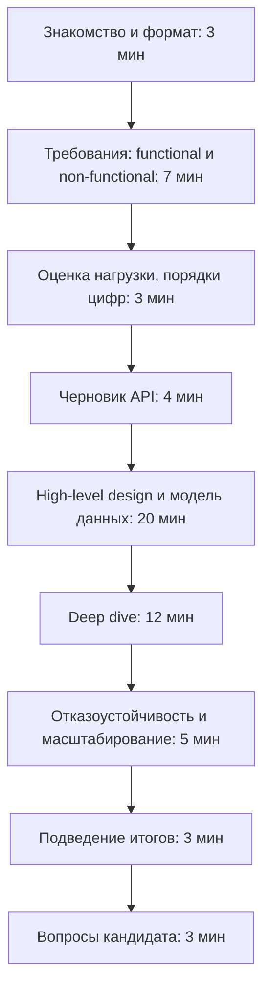
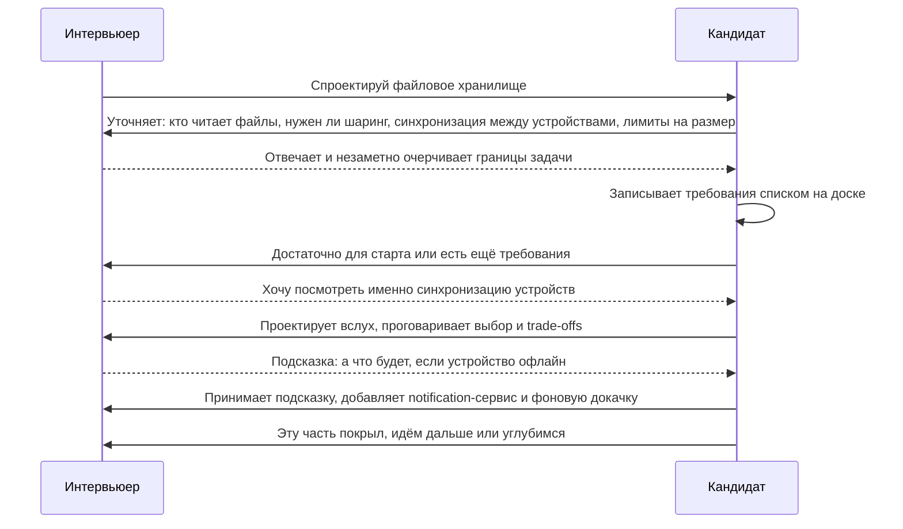
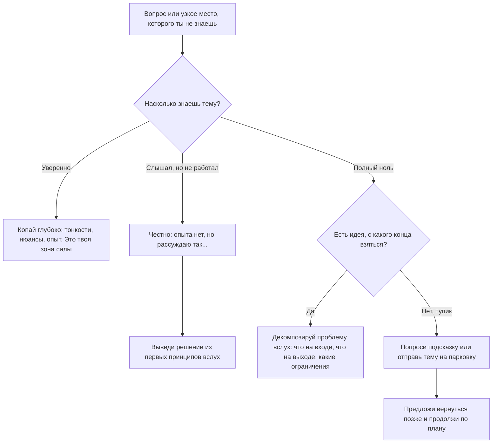

# Коммуникация с интервьюером и типичные ошибки

<!-- learning-nav:start -->
[← Все разделы](../README.md) · [Предыдущая тема](estimation.md) · [Следующая тема →](../05-question-bank/fundamentals.md)
<!-- learning-nav:end -->

<!-- toc:start -->

Показать темы и вопросы

- [Что интервьюер оценивает (и записывает)](#что-интервьюер-оценивает-и-записывает)
- [Управление временем: главный дефицитный ресурс](#управление-временем-главный-дефицитный-ресурс)
- [Думай вслух: главный навык секции](#думай-вслух-главный-навык-секции)
- [Кто ведёт интервью: инициатива и синхронизация](#кто-ведёт-интервью-инициатива-и-синхронизация)
- [Уточняющие вопросы: как, что и сколько](#уточняющие-вопросы-как-что-и-сколько)
- [Реакция на подсказки и наводящие вопросы](#реакция-на-подсказки-и-наводящие-вопросы)
- [Если не знаешь ответ](#если-не-знаешь-ответ)
- [Красные флаги: за что реально режут](#красные-флаги-за-что-реально-режут)
- [Senior-подход против middle: в чём разница](#senior-подход-против-middle-в-чём-разница)
- [Чек-лист: до, в начале, по ходу, в конце](#чек-лист-до-в-начале-по-ходу-в-конце)
- [Видео по теме](#видео-по-теме)

<!-- toc:end -->

System Design секция проверяет не только hard skills. По признанию интервьюеров, проводивших сотни таких собеседований (Авито, Ozon, Яндекс), на ней оценивают и soft skills: как кандидат мыслит, как принимает решения в условиях неопределённости, как коммуницирует. Два кандидата с одинаковой итоговой архитектурой получают разные оценки — решает то, **как** они к ней пришли и как этот путь показали.

Интервью имитирует реальный рабочий процесс: два коллеги за час проектируют систему по расплывчатой задаче. Идеального решения не существует — два staff-инженера, проектируя одну и ту же систему, получат разные дизайны, и это нормально. Поэтому важен не финальный квадрат на доске, а процесс: как вы собираете требования, что отсекаете, как обосновываете выбор, как реагируете, когда вас тормозят или разворачивают.

Этот файл — про коммуникативную сторону секции: как думать вслух, держать тайминг, задавать вопросы, реагировать на подсказки, вести себя в тупике — и про красные флаги, из-за которых кандидатов режут даже при неплохом дизайне.

---

## Что интервьюер оценивает (и записывает)

В большинстве компаний после секции заполняется матрица оценки: каждый этап оценивается с весом. Типичные оси оценки:

- **Сбор и формализация требований** — понял ли, что делать, до того как начал делать.
- **Системность** — есть ли структура решения или набор разрозненных идей.
- **Принятие решений** — делает ли выбор в условиях неопределённости или вечно «можно так, а можно эдак».
- **Обоснование** — почему именно этот вариант, какие trade-offs.
- **Коммуникация** — понятно ли излагает, слушает ли, идёт ли на диалог.
- **Глубина** — есть ли хотя бы одна зона, где кандидат копает глубже шпаргалки.

Интервьюер одновременно ищет и **отрицательные сигналы**: overengineering, молчание, игнорирование наводящих вопросов, зазубренные ответы. Хороший интервьюер — не фильтр-экзаменатор, а союзник: его задача — помочь вам показать максимум. Но будьте готовы, что попадётся и «камень», который молчит и ждёт, что вы всё сделаете сами. Под оба типа стратегия одна — вести интервью самому.

---

## Управление временем: главный дефицитный ресурс

На секцию выделяется 50–60 минут. Из них вычтите знакомство и вопросы в конце — в сухом остатке 45–50 минут на проектирование. Время — единственный ресурс, которым вы «платите» за каждую ошибку: переделать решение на 40-й минуте стоит катастрофически дорого. Поздно найденная ошибка в требованиях может потребовать перестройки нескольких частей схемы; это практическая эвристика, а не точный закон стоимости.

Пример бюджета для 60-минутной секции; все строки вместе дают 60 минут:

| Этап | Время | Артефакт на выходе |
|---|---|---|
| Формат и границы | 3 мин | Понимание: HLD или LLD, что входит в скоуп |
| Сбор требований (functional + non-functional) | 7 мин | Список требований на доске |
| Оценка нагрузки | 3 мин | Порядки: RPS, DAU, объёмы, read/write ratio |
| API (черновик) | 4 мин | 3–5 основных контрактов |
| High-level design + модель данных | 20 мин | Схема компонентов и потоков данных |
| Deep dive в критичный компонент | 12 мин | Детализация 1–2 узких мест |
| Отказоустойчивость и масштабирование | 5 мин | Проговорённый разбор «что умрёт при отказе X» |
| Подведение итогов | 3 мин | Покрытые требования, выбор и ограничения |
| Вопросы кандидата | 3 мин | 1–2 осмысленных вопроса |

Практические приёмы:

- **Поставьте таймер.** На моках рекомендуют телефон рядом с мигающим будильником на границах этапов. Если вы пересидели на требованиях 20 минут — вы уже расплатились временем из deep dive.
- **Проговаривайте бюджет вслух:** «У нас осталось 25 минут, предлагаю 15 потратить на high-level схему и 10 — на самый нагруженный компонент». Это показывает управляемость и синхронизирует вас с интервьюером.
- **Сами решайте, куда углубляться, но спросите разрешение:** «Я бы детально разобрал очередь доставки — это самое горячее место. Или вам интереснее другое?» У интервьюера часто есть заранее заготовленная тема для deep dive — дайте ему шанс направить вас.
- **Нарушение тайминга — само по себе красный флаг.** Кандидат, детально проработавший один компонент и не построивший систему целиком, почти всегда получает отказ: лучше готовая абстрактная архитектура, чем один идеально проработанный сервис.

---

## Думай вслух: главный навык секции

Интервьюер не ясновидящий. Он не видит, как вы принимаете решения, — видит только то, что вы проговорили. «Размышление в голове» входит в топ ошибок во всех разборах: кандидат молча рисует квадраты, соединяет их стрелками, и по итогу невозможно оценить ни ход мысли, ни глубину.

Что именно проговаривать:

- **Варианты и выбор:** «Вижу два варианта хранения: Postgres и Cassandra. Postgres закрывает транзакционность. Начну с primary и резервирования; необходимость шардирования проверю по объёму, RPS и времени восстановления».
- **Причины, а не только решения.** Фраза «возьму Postgres, пойдём дальше» без «почему» — минус балл. Опыт команды — полезный аргумент среди подходящих вариантов, но он не заменяет проверку требований к данным, задержке и восстановлению.
- **Проверку покрытия требований:** «Так, возвращаюсь к списку: запись покрыл, чтение покрыл, шаринг — вот этот поток. Осталась синхронизация между устройствами». Это держит контекст и вас, и интервьюера.
- **Допущения:** «Считаю, что пиковый RPS на запись — порядка тысяч; если у вас другая цифра, поправьте».

Классический пример из разборов: интервьюер спрашивает «какие алгоритмы балансировки знаешь?» — кандидат молчит и отвечает «никакие». Но стоит переформулировать — «пришёл запрос, как распределишь по серверам?» — и тот же кандидат выдаёт round robin, балансировку по нагрузке, по гео. Знания были, не было навыка их достать. Вывод: рассуждайте от задачи, а не от термина. Даже если вы не помните названия, вывод решения из первых принципов оценивается **выше**, чем заученный термин: на разборах рассказывают о кандидате без теоретической базы, который за разговор сам изобрёл шардирование и consistent hashing — и это был один из лучших результатов.

Сильные формулировки:

- «Я не знаю, как это делается стандартно, но если рассуждать: нам нужно... значит...»
- «Прежде чем нарисовать, зафиксирую: правильно ли я понял, что...»
- «Здесь есть компромисс: либо X с таким-то минусом, либо Y с таким-то. Для нашего случая важнее Z, поэтому беру X».

---

## Кто ведёт интервью: инициатива и синхронизация

Обычно от кандидата ждут инициативы: он предлагает ход решения и переходы между этапами. Senior-позиция предполагает leadership — вас проверяют в том числе на это. Вы должны «брать интервьюера за ручку»: говорить, что будете делать дальше, а не спрашивать «а что мне теперь делать?».

Но вести — не значит игнорировать. Второе ключевое качество — **умение слушать**. Интервьюер почти никогда не говорит «просто так»: если он задаёт вопрос или предлагает направление («а давай посмотрим, как ты сделаешь мониторинг»), он хочет туда завести интервью. Проигнорируете — минус в матрице.

Механика синхронизации — **контрольные точки**. После каждого логического блока: «Это покрыл, идём дальше или стоит углубиться?» Это одна фраза, которая: (1) показывает, что вы управляете процессом; (2) даёт интервьюеру легальный способ направить вас; (3) страхует от ситуации «он молча кивал, а в фидбэке написал, что часть системы не реализована».

Родственный приём — **«парковка»**. Частая ошибка в разборах — уплывание в мыслях: «а давайте ещё картинки, и видео, и CDN, и двухфакторку...». Контекст разрастается, решение распадается на разрозненные идеи. Лечение: заведите на доске раздел «парковка», идею записали — и пошли дальше по плану. Вернуться к парковке можно в конце, если останется время. Это же демонстрирует системность мышления.

### Типы интервьюеров и как под них подстраиваться

Интервьюеры ведут секцию очень по-разному — это ещё одна причина смотреть моки разных людей, а не одного. Условно выделим три типа:

- **«Камень».** Сидит молча и ждёт, что вы выдадите всё сами. Страшнее всего для новичков: тишину легко прочитать как неодобрение. Стратегия: не ждите обратной связи, ведите по своему плану, но периодически провоцируйте реакцию прямыми вопросами — «достаточно деталей здесь или идём глубже?», «это то, что вы хотели увидеть?». Молчание интервьюера — не сигнал, что вы ошиблись; часто это просто его формат.
- **«Союзник».** Разговаривает, направляет, помогает достать из вас знания. Его задача — оценить максимум, а не поймать. Стратегия: принимайте помощь без защитной реакции, превращайте секцию в совместную работу — именно это и имитирует реальное проектирование в паре.
- **«Душнила».** Требует посчитать каждый килобайт, спорит о REST-чистоте вашего API («почему здесь POST?»), просит железо. Стратегия: не спорьте о вкусовщине, но и не позволяйте утонуть в деталях. Отработанный ход — «предлагаю считать это черновиком и вернуться к деталям, если останется время». С расчётами — грубо и быстро: степени десятки, «пи равно трём, лучше больше, чем меньше».

Важно: «душнилу» легко спровоцировать самому. Если вы начинаете раздувать скоуп (авторизация, лайки, бейджи), даже уставший от рутины интервьюер с удовольствием подхватит интересную тему — и вы получите плотную зарубу на задаче втрое сложнее исходной. Не подкармливайте.

### Что говорить интервьюеру: формулировки по этапам

Готовые реплики, которые звучат сильно, потому что одновременно двигают процесс и демонстрируют зрелость:

| Этап | Что сказать |
|---|---|
| Старт | «Прежде чем начать, уточню: нас интересует high-level design целиком или углубление в конкретную часть?» |
| Скоуп | «Предлагаю взять ядро — публикацию и чтение, а авторизацию, лайки и модерацию вынести за скобки. ОК?» |
| Допущение | «Не уточнял объёмы: возьму максимальный файл 50 ГБ и 10 млн DAU. Если у вас другие цифры — поправьте» |
| Микродеталь | «Заголовок ограничим 255 символами, куда уж больше. Пошли дальше» |
| План | «У нас 45 минут. Предлагаю: 10 на требования, 5 на нагрузку, 20 на схему, остаток — на самое горячее место» |
| Переход | «Эту часть покрыл: запись, чтение, шаринг. Идём к синхронизации или здесь хочется углубиться?» |
| Сверка | «Возвращаюсь к списку требований: это покрыл, это покрыл, осталась фоновая докачка» |
| Выбор | «Выбираю Postgres: нужна транзакционность. По текущей оценке хватит primary с резервированием; пределы и следующий шаг проверю отдельно» |
| Парковка | «Идея с CDN хорошая, записываю в парковку, вернёмся, если останется время» |
| Тупик | «Застрял на выборе ключа шардирования, дайте 30 секунд подумать вслух» / «Можете дать наводку — я ушёл не туда?» |
| Незнание | «С rate limiter напрямую не работал, но рассуждал бы так: счётчик на пользователя в Redis, окно в минуту...» |
| Финал | «Подведу итог: покрыли все требования из списка, в парковке осталась синхронизация папок, риск — горячие ключи в кэше» |

Обратите внимание на общий паттерн: почти каждая реплика заканчивается либо решением, либо конкретным вопросом — но не «а что мне делать?».

---

## Уточняющие вопросы: как, что и сколько

Вопросы на старте — обязательны. Отсутствие вопросов («Давай спроектируем сервис фотографий» — «Давай!» — и сразу рисовать) — типичный провал: через 15 минут выясняется, что проектировали-то хранилище RAW-файлов для профессиональных фотографов, а не очередную галерею, и архитектура совсем другая.

Что уточнять в первую очередь:

- **Формат секции:** high-level или low-level design? Кандидаты, не спросившие это, прыгают в диаграмму классов, когда от них ждут систему целиком. Уточните у рекрутера заранее, есть ли у компании описание формата.
- **Функциональный скоуп:** «Проектируем весь Uber или конкретную фичу?» — от ответа архитектура меняется полностью.
- **Масштаб:** чат для компании на 50 человек и WhatsApp на миллиард — разные системы. Спросите про DAU, read/write ratio, требования к задержкам, retention данных.
- **Границы:** «Что точно НЕ входит в скоуп?»

При этом вопросы — это не допрос. Два антипаттерна:

1. **Собирать требования, которых от вас не ждут.** «А давайте ещё двухфакторную аутентификацию, лайки, бейджи...» Часть интервьюеров радостно подхватит — им тоже скучно — и ваша задача вырастет в 2–3 раза по сложности, а время останется тем же. Сами отсекайте: «Авторизацию и лайки за скобки, берём голую подачу объявления. ОК?»
2. **Зависать в лупе микродеталей.** «А сколько символов максимум в заголовке?» — не ждите ответа, **сами отвечайте на свои вопросы**: «Заголовок — ограничим 255 символами, нормально? Пошли дальше». Цель — не склонировать Авито, а очертить решаемую задачу.

Хорошие приёмы этого этапа: выписывать требования списком на доске (потеряете — не вспомните), выделять глаголы из требований для определения доменов («публиковать», «искать», «отдавать медиа» → домены: объявления, поиск, медиа), и возвращаться к списку по ходу интервью, отмечая покрытие.

---

## Реакция на подсказки и наводящие вопросы

Подсказка — это не обвинение, а приглашение. Интервьюеры прямо говорят: если я что-то спросил или куда-то намекнул — мне это нужно, подстройся. «Упрямые» кандидаты, которым нужно пять раз повторить «давай не будем это делать», получают красный флаг за неспособность к диалогу — на работе с таким человеком будет так же тяжело.

Как реагировать:

- **Услышали — перефразируйте и примите:** «Понял, вы предлагаете обсудить асинхронную репликацию. Проверю допустимую потерю подтверждённых данных и отставание чтения, затем скорректирую схему». Не соглашайтесь с техническим изменением, пока не проверили его последствия.
- **Подсказка про вашу ошибку — не защищайтесь рефлекторно.** Проверьте: если правда ошибка, честно исправьте («Да, вы правы, при таком ключе шардирования получим горячий шард — переделаю на hash от user_id»). Способность дёшево менять решение ценится выше, чем способность его отстаивать любой ценой.
- **Не согласны — защищайте аргументами, один раз.** «Понимаю предложение. У нас 95% повторных чтений небольшой горячей выборки и разрешено отставание на 30 секунд; сравню выигрыш кэша с индексом по измерениям». Отстоять решение аргументированно — это плюс; отстоять его упрямством — минус.
- **Намёк не поняли — спросите прямо:** «Вы к тому, что здесь проблема с консистентностью, или куда-то ещё?» Это в разы лучше, чем кивать и продолжать не туда.

---

## Если не знаешь ответ

Всё знать невозможно, и интервьюеры это понимают лучше кандидатов. Конкретные технологии устаревают быстро, оценивается не энциклопедия, а умение мыслить. Алгоритм действий:

Ключевые правила:

- **Формула честного незнания:** «Я не знаю, как строится rate limiter, но если бы мне нужно было его сделать, я бы рассуждал так: ограничить число запросов за окно, значит нужен счётчик на пользователя, хранить — в чём-то быстром типа Redis...». Такой ответ **повышает** оценку: вы показали, что знаете, чего не знаете, и умеете рассуждать. Придумывание на ходу с уверенным видом — наоборот: интервьюер заметит, и доверие ко всему остальному упадёт.
- **Не молчите в тупике.** Интервьюер не различает «думает» и «застрял» — для него оба варианта выглядят одинаково: тишина. Молчание дольше 30–60 секунд сжигает время. Если застряли — скажите: «Я зашёл в тупик с выбором ключа шардирования, дайте минуту» или попросите подсказку. Попросить помощи — не стыдно; тихо сгореть — провал.
- **Не казаться умнее, чем есть.** Если вы не работали с MongoDB — так и скажите: «Монгу не знаю, рассматривать не буду». Начнёте рассуждать о технологии, которую «читали на Хабре», — с высокой вероятностью ошибётесь и потеряете больше, чем приобрели бы экскурсом. Симметрично: там, где у вас реальная экспертиза, не стесняйтесь показать глубину — тонкости, инциденты, нюансы.
- **Выбирайте знакомое.** На вопрос «насколько ты уверен в этой технологии?» правильного ответа нет, но стратегия есть: берите то, что знаете, и ведите себя уверенно. Уверенность в собственном решении — часть образа senior; только не путайте её с блефом.

---

## Красные флаги: за что реально режут

Сводка типичных ошибок из разборов (250+ проведённых интервью у одного из авторов, 16 ошибок — у другого):

| Красный флаг | Почему это фейл | Как не попасть |
|---|---|---|
| Молчаливое рисование | Невозможно оценить мышление; вывод — «делает всё сам, не командный» | Диктуйте ход мысли по мере работы |
| Игнор подсказок | Интервьюер не говорит просто так; вывод — «не слышит коллег» | Перефразируйте подсказку и отреагируйте |
| Overengineering | «Давайте 2FA, лайки, бейджи» — задача х3, время то же | Отсекайте скоуп сами, всё лишнее — на парковку |
| Попытка сделать всё идеально | Один проработанный компонент вместо целой системы | Сначала абстрактная схема целиком, потом deep dive |
| Варианты вместо решения | «Можно MySQL, можно Postgres» — и тишина | Выбирайте и фиксируйте: «беру Postgres, потому что...» |
| Решение без обоснования | «Возьму Postgres, поехали» — почему? | Всегда добавляйте «потому что», хотя бы про свой опыт |
| Зазубренная архитектура | Один наводящий вопрос вбок — и лёд проваливается | Учите принципы (кэш, шардирование, очереди), а не решения |
| Требования собраны и забыты | RPS посчитали, выводов не сделали; фича из скоупа не реализована | Список требований на доске + сверка вслух по ходу |
| Счёт битиков и байтиков | 10 минут арифметики ради точности в процентах | Порядки и степени десятки: 10³, 10⁶. Пи = 3, лучше больше, чем меньше |
| Игнор тайминга | Застрял на этапе — не хватило времени на остальное | Таймер + бюджеты на этапы вслух |
| Только happy path | Не подумали про corner cases и отказы | «А что будет, если узел упал / устройство офлайн / пользователь в туннеле?» |
| Нет API | Непонятно, какие контракты система предоставляет | Черновик: «POST /ads — создаёт, GET /ads/{id} — отдаёт», псевдокод ОК — спросите разрешения |
| Схема — «бред сумасшедшего» | Артефакт не доведён до конца, по нему не защитить решение | Всё проговорённое вносите в схему; в конце она должна читаться без вас |
| Переспрашивание | Интервьюер сказал — кандидат забыл — потратил время ещё раз | Конспектируйте ответы сразу |
| Отсутствие самостоятельности | «А что мне дальше делать?» | Ведите: «Дальше я сделаю X, потому что Y. ОК?» |
| Претензия на всезнание | Блеф палится, доверие рушится | Честное «не работал, но рассуждаю так» |
| Нет вопросов в конце | Нулевая заинтересованность | Заготовьте 2–3 вопроса: как у вас устроено проектирование, кто владеет архитектурой |

Отдельно про **расчёты**: многие интервьюеры сами против дотошного счёта RPS и серверов. Считайте грубо и быстро, но обязательно **сделайте выводы**: «записей мало, чтений в 100 раз больше → проверю повторяемость запросов, hit rate и допустимую свежесть; для публичных медиа рассмотрю CDN». Частота операций не разрешает ослабить консистентность: это отдельное бизнес-требование. Цифры без выводов — потерянное время.

---

## Senior-подход против middle: в чём разница

Одна и та же задача, два грейда — и интервьюер видит разницу в первые 10 минут:

| Аспект | Middle | Senior |
|---|---|---|
| Старт | Ждёт ТЗ, начинает рисовать сразу | Очерчивает границы: скоуп, масштаб, формат секции |
| Требования | Собирает всё подряд или ничего | Выделяет критическое, остальное сознательно выносит за скобки |
| Неопределённость | Задаёт вопросы и ждёт ответов | Выдвигает гипотезы: «предположу X; если не так — поправьте» |
| Решения | Перечисляет варианты, не выбирает | Выбирает, фиксирует, называет цену выбора |
| Trade-offs | «Это хорошая технология» | «Это хорошо при read-heavy; у нас write-heavy, поэтому не подходит» |
| Ошибки | Защищается или не замечает | Находит сам («стоп, здесь горячий шард»), дёшево исправляет |
| Подсказки | Слышит только прямые указания | Ловит намёки и уточняет: «вы про консистентность?» |
| Тайминг | Увязает в интересном компоненте | Держит бюджеты этапов, сам инициирует переходы |
| Corner cases | Happy path | Офлайн-устройства, отказ узла, гонки, дубли сообщений |
| Глубина | Ровно по шпаргалке везде | Поверхностно везде + глубоко в своей зоне экспертизы |
| Незнание | Блефует или молчит | «Не знаю, но выведу из первых принципов» |
| Финал | Заканчивает, когда кончилось время | Сам подводит итог: что покрыто, что в парковке, где риски |

Суть senior-подхода в трёх пунктах: **самостоятельность** (ведёшь процесс, а не участвуешь в нём), **осознанность** (каждое решение имеет цену, и ты её называешь), **управляемость** (требования, время и артефакты под контролем). Заметьте: ни один пункт не про количество заученных технологий.

---

## Чек-лист: до, в начале, по ходу, в конце

**До интервью:**

- Уточните у рекрутера формат секции, длительность и платформу (например, Miro или FigJam). Освойте инструмент заранее — разбираться с доской по ходу = сжечь 10 минут.
- Подготовьте таймер и шаблон доски: зоны «Требования», «Оценки», «API», «Схема», «Парковка».
- Освежите базу-кирпичики: кэширование, балансировка, БД, очереди, репликация, шардирование — это 20% знаний, закрывающие 80% интервью.
- Прогоните 2–3 мока с таймером: навык проектирования ≠ навык прохождения собеседования. Записывайте себя и разбирайте, как отвечали и как на это реагировали.

**В первые 3 минуты:**

- Уточните: HLD или LLD, какой скоуп, какой масштаб.
- Проговорите план и бюджеты времени вслух.

**По ходу:**

- Думайте вслух; каждое решение — с «потому что».
- Сверяйтесь со списком требований; идеи вне плана — в парковку.
- После каждого блока: «идём дальше или углубимся?».
- Подсказку услышали — перефразировали, приняли, внесли в схему.

**В конце (последние 3–5 минут):**

- Сами подведите итог: какие требования покрыты, что в парковке, какие риски и узкие места остались.
- Задайте 1–2 вопроса о процессах и архитектуре в компании.
- Убедитесь, что схема читается без вашего сопровождения — это артефакт, по которому о вас напишут фидбэк.

---

## Видео по теме

- [Как пройти System Design Интервью? 4 этапа, 2 важных качества кандидата](https://www.youtube.com/watch?v=KhfeYD0VBOY)
- [Как пройти System Design интервью: взгляд со стороны интервьювера и кандидата](https://www.youtube.com/watch?v=P3im7VW0mnw)
- [System Design на собеседовании: ошибки, которые тебя топят](https://www.youtube.com/watch?v=MKNg7gwnUX0)
- [Ошибки на system design interview: что допускают 90% кандидатов](https://www.youtube.com/watch?v=WzotXf9YAK8)
- [5 советов на System Design Interview [SD]](https://www.youtube.com/watch?v=FG-JwPQYQdw)
- [Собеседование по системному проектированию — советы и рекомендации. Главные ошибки, которых следует избегать](https://www.youtube.com/watch?v=4Q2fokImKfM)
- [Кирилл Розов — Как пройти архитектурную секцию собеседования](https://www.youtube.com/watch?v=p7QIEzIFzdQ)
