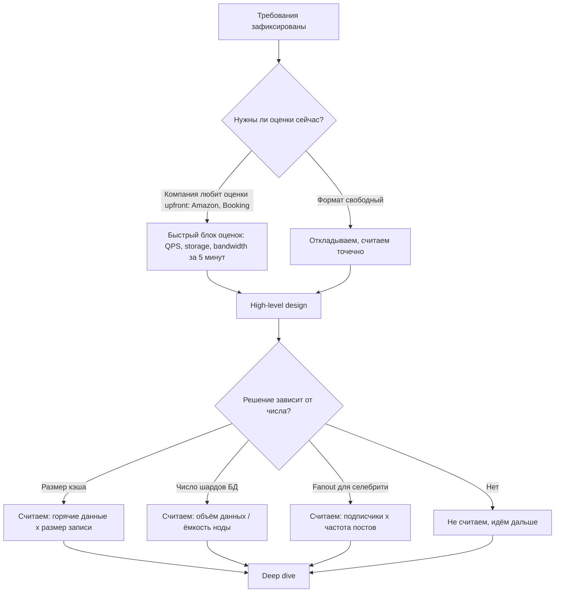
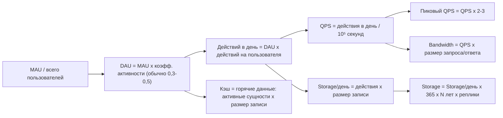
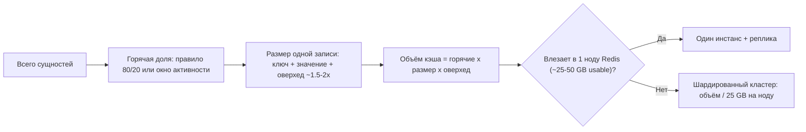

# Back-of-envelope расчёты на собеседовании

> Оценки «на салфетке» (back-of-the-envelope estimations) — это блок, где вы за 5–10 минут прикидываете порядки величин: QPS, объём хранилища, bandwidth, память под кэш. Цель не в том, чтобы получить точную цифру, а в том, чтобы показать: вы понимаете масштаб системы, умеете отделять существенное от несущественного и принимаете дизайн-решения на основе чисел, а не на ощущениях.

## Зачем вообще считают на собеседовании

Интервьюер смотрит на три вещи:

1. **Вы понимаете порядки.** 10 RPS и 100 000 RPS — это разные архитектуры. Если вы не посчитали нагрузку, любой ваш выбор (шардировать или нет, нужен ли кэш, сколько нод в кластере Kafka) повисает в воздухе.
2. **Вы умеете упрощать.** Реальные цифры никто не знает — ни вы, ни интервьюер. Важно, чтобы каждое допущение вы проговорили вслух («пусть пользователь в среднем делает 50 поисков в день») и округлили до числа, с которым удобно считать.
3. **Оценка влияет на дизайн.** Вывод «read-heavy система, соотношение чтение/запись 100:1, значит, делаем кэш и read replicas» — это сигнал senior-уровня. Вывод «много» — это сигнал джуна.

Важный нюанс из реальных моков: экс-Meta интервьюер в разборе Uber прямо говорит, что оценки «для галочки» сразу после требований — частая трата времени. Кандидат считает DAU, bandwidth, storage, смотрит на цифры и говорит «окей, это много» — и идёт дальше. Он знал, что система масштабная, ещё до расчётов, поэтому интервьюер не узнал о нём ничего нового, а 5 минут из 35 потрачены. Рабочая стратегия — считать в тот момент, когда результат **меняет решение**: размер кэша, число шардов, нужен ли push- или pull-fanout.

### Что говорить интервьюеру

Если не уверены, требуются ли оценки в вашей компании/формате, спросите прямо — это выглядит сильно, а не слабо:

> «Многие кандидаты делают back-of-envelope расчёты на этом этапе. Я бы предпочёл отложить их и считать точечно по ходу дизайна — там, где результат напрямую повлияет на решение. Вас устроит такой подход?»

99% интервьюеров согласятся. Если попался 1%, который хочет оценки сразу — ну что ж, делайте оценки сразу, вы к этому готовы.

## Когда считать: карта мест в интервью



## Базовые числа, которые нужно знать наизусть

### Время

| Величина | Точно | Округление для доски |
|---|---|---|
| Секунд в минуте | 60 | 60 |
| Секунд в часе | 3 600 | ~4 000 (или 3,6 тыс.) |
| Секунд в сутках | 86 400 | **~100 000 (10⁵)** |
| Секунд в 30-дневном месяце | 2 592 000 | **~2,5 млн (2,5 × 10⁶)** |
| Секунд в году | 31 536 000 | ~30 млн (3 × 10⁷) |
| Дней в месяце | 30 | 30 |
| Дней в году | 365 | ~350–400, смотря что считаете |

Приём «~100 000 секунд в день» — главный рабочий инструмент: делить на 10⁵ — это просто сдвиг запятой. 50 млн событий в день / 10⁵ = 500 событий в секунду. Считается в уме за две секунды, точности ±15% для оценок достаточно.

### Объёмы данных

| Единица | В байтах | На доске |
|---|---|---|
| 1 KB | 10³ | символ ~1 байт, твит с метаданными ~1 KB |
| 1 MB | 10⁶ | фото со смартфона ~2–5 MB, сжатая картинка ~100–500 KB |
| 1 GB | 10⁹ | час видео 720p ~1–2 GB |
| 1 TB | 10¹² | диск одной ноды |
| 1 PB | 10¹⁵ | годовое хранилище крупной площадки |

Считайте в степенях десятки (KB = 10³), а не в KiB (2¹⁰) — разница 2,4% на порядок роли не играет, а арифметика становится тривиальной.

### Ориентиры по железу (порядки, не догма)

| Компонент | Ориентир |
|---|---|
| Один app-сервер | ~1 000–10 000 RPS на чтение, ~200–1 000 RPS на запись (зависит от логики) |
| Redis на одной ноде | ~100 000 простых GET/SET в секунду |
| PostgreSQL на хорошей ноде | ~10 000 простых SELECT, ~1 000–5 000 INSERT/UPDATE |
| Репликация/бэкап | закладывайте ×2–×3 на избыточность |
| Рост данных | закладывайте планирование на 2–3 года вперёд |

Эти числа нужны не для точности, а чтобы ответить на вопрос «а сколько нод вам нужно?» чем-то осмысленным: «~12 000 RPS на чтение, берём по 2 000 RPS на ноду с запасом — это 6–8 нод плюс реплики».

### Пиковый коэффициент

Средняя нагрузка ≠ пиковая. Стандартное допущение: **пик = среднее × 2–3**. Для систем с резкими всплесками (часы распродаж, новогодняя ночь, выход сериала) — ×5–×10, и это стоит проговорить отдельно.

## Универсальный пайплайн оценки

Почти любая оценка на собеседовании строится по одной цепочке:



Каждый шаг — одна строчка на доске и одна фраза вслух. Не молчите, пока считаете: интервьюер оценивает ход рассуждений, а не финальную цифру.

## Сквозной пример 1: URL shortener (TinyURL)

Классика, где оценки напрямую определяют дизайн: размер ключевого пространства и объём кэша.

**Дано (уточняем у интервьюера):** 100 млн новых ссылок в месяц, соотношение чтение/запись 100:1, ссылки храним 5 лет.

### Оформление на доске

```
URL SHORTENER — ESTIMATES
─────────────────────────────────────────────────
Writes:  100M links/month
         100M / (30d × ~100K s) ≈ 100M / 2.5M s... 
         проще: 100M/мес ÷ 2.5M с/мес ≈ 40 RPS write
Peak:    ×3 → ~120 RPS write

Reads:   40 RPS × 100 = 4 000 RPS read
Peak:    ×3 → ~12 000 RPS read

Storage/record:
  short_url   7 B
  long_url    ~100 B (avg, до 2 KB)
  user_id     8 B
  created_at  8 B
  expiry      8 B
  ─────────────
  ~130 B → округляем 200 B с индексами/оверхедом

Storage total:
  100M/мес × 60 мес (5 лет) = 6B записей
  6B × 200 B = 1.2 TB  → помещается на 1-2 нодах БД!

Key space:
  base62 [a-zA-Z0-9], 7 символов = 62⁷ ≈ 3.5 × 10¹²
  нужно 6 × 10⁹ → используем < 0.2% пространства. OK.

Cache (память):
  20% ссылок дают 80% трафика.
  Горячие: 20% от 6B = 1.2B... много. Реалистичнее:
  кэшируем суточную активность: 4 000 RPS × 100K s
  ≈ 400M чтений/день, уникальных горячих ссылок ~10-20M
  20M × 200 B ≈ 4 GB → один Redis-инстанс справляется.
```

**Выводы, которые озвучиваем интервьюеру:**

- Система read-heavy (100:1) → кэш перед БД обязателен, БД можно шардировать позже.
- 1,2 TB за 5 лет — это **не** big data; шардирование на старте не нужно, достаточно primary + read replicas.
- 7 символов base62 дают огромный запас ключевого пространства — не нужна сложная схема генерации.

## Сквозной пример 2: Twitter / лента новостей

Здесь оценки решают главный архитектурный вопрос: fanout-on-write (push) против fanout-on-read (pull).

**Дано:** 500 млн пользователей, 200 млн DAU, 50 млн твитов в день, пользователь читает ~100 твитов в день, в среднем 200 подписчиков на аккаунт, есть селебрити со 100 млн подписчиков.

### Оформление на доске

```
TWITTER — ESTIMATES
─────────────────────────────────────────────────
Tweets:   50M/day → 50M / 100K s ≈ 500 tweets/s write
          Peak ×2-3 → ~1.5K tweets/s
          (реальный Twitter: ~5.7K avg, 12K peak при 500M твитов/день —
           порядок тот же, масштаб x10)

Reads:    200M DAU × 100 tweets = 20B reads/day
          20B / 100K s ≈ 200K reads/s
          Соотношение read:write ≈ 400:1 → read-heavy!

Tweet size: текст 140 символов + метаданные (user, ts, id)
          ≈ 1 KB (без медиа; медиа — отдельно в object storage)

Storage:  50M × 1 KB = 50 GB/day текста
          × 365 × 3 года ≈ 55 TB + реплики ×2 → ~110 TB

Fanout проблема:
  Push: 500 tweets/s × 200 followers = 100K вставок/с в ленты
  Селебрити: 1 твит → 100M вставок. Даже за 10K inserts/s
  это ~3 часа. Неприемлемо для push-only.
  → Гибрид: push для обычных, pull-on-read для селебрити.

Timeline cache:
  Лента пользователя: 800 твитов × 1 KB ≈ 800 KB
  Горячие (активны за 3 дня): ~100M пользователей
  100M × 800 KB ≈ 80 TB → кластер Redis, шардируем по user_id.
```

**Выводы для дизайна:**

- 400:1 read:write → оптимизируем чтение: precomputed timelines в кэше, а не сборка ленты на лету.
- Расчёт fanout показал узкое место push-модели — селебрити. Это и есть обоснование гибридной схемы, и его можно получить **только** из цифр.
- 55 TB текста — много для одной БД, значит, шардируем (по user_id или по времени), медиа — в object storage с CDN.

## Сквозной пример 3: YouTube / видеоплатформа

Здесь доминирует storage и bandwidth, а не QPS — и это нужно показать.

**Дано:** 1 млн загрузок видео в день, 100 млн DAU, среднее видео 10 минут после транскодинга ~50 MB на вариант качества (1080p), 5 вариантов качества + превью.

### Оформление на доске

```
YOUTUBE — ESTIMATES
─────────────────────────────────────────────────
Uploads:  1M/day → 1M / 100K s ≈ 10 uploads/s
Views:    100M DAU × 5 видео = 500M views/day
          500M / 100K s ≈ 5K views/s (avg), peak ~15K

Storage (uploads):
  1 видео ≈ 50 MB × 5 качеств + 10 MB превью ≈ 260 MB
  Сырой файл тоже храним: +50 MB → ~300 MB на видео
  1M × 300 MB = 300 TB/day (!)
  × 365 ≈ 110 PB/год → object storage (S3-подобное),
  lifecycle-политики, холодные тиры.

Bandwidth (просмотры):
  5K views/s × 50 MB ≈ 250 GB/s egress
  = 2 Tbps. Ни один ДЦ не отдаст сам → CDN обязателен,
  origin отдаёт только cache miss'ы (5-10%).

Metadata (БД):
  1M видео/день × 1 KB метаданных ≈ 1 GB/day
  ≈ 365 GB/год → обычная шардированная SQL справляется.
```

**Выводы для дизайна:**

- Главная проблема — **не QPS, а egress-трафик и хранилище**. Отсюда: CDN как центральный элемент, адаптивный стриминг (HLS/DASH) для низких bandwidth, транскодинг асинхронно через очередь.
- Метаданные крошечные по сравнению с медиа → разделяем: метаданные в SQL, бинарники в object storage. Никогда не храним видео в БД.
- Загрузка 300 TB/день делает дешёвое холодное хранилище старых видео осмысленной темой deep dive.

## Сквозной пример 4: маркетплейс (Авито-подобный)

Пример из русскоязычного разбора: полный расчёт от действий пользователя до стоимости инфраструктуры.

**Дано:** 7 млн DAU. Действия на пользователя в день (допущения!): 0,05 объявления, 2 отклика, 5 сообщений в чате, 0,1 редактирования объявления; на чтение — 50 поисков и 100 просмотров объявлений.

### Оформление на доске

```
MARKETPLACE — ESTIMATES
─────────────────────────────────────────────────
Writes/день:
  объявления:    7M × 0.05 = 350K
  отклики:       7M × 2    = 14M
  сообщения:     7M × 5    = 35M
  редактирования: 7M × 0.1 = 700K
  ─────────────────────────────
  Итого ≈ 50M writes/day
  50M / 86.4K s ≈ 580 write RPS, peak ×3 ≈ 1.8K RPS

Reads/день:
  7M × (50 поисков + 100 просмотров) = 7M × 150 ≈ 1B reads/day
  1B / 86.4K s ≈ 12K read RPS, peak ×3 ≈ 36K RPS
  → read:write ≈ 20:1

Traffic:
  поиск: запрос ~1 KB + ответ ~50 KB (20 объявлений) = 51 KB
  12K RPS × ~150 KB (усреднённо по типам) ≈ 2 GB/s
  peak ×3 ≈ 6 GB/s egress
  При цене ~2-5 коп/ГБ (крупная площадка, прямые договоры):
  ~30 коп/сек → ~26 тыс. руб/день → ~1 млн руб/мес
  (стартовая компания в облаке платит в 30-70 раз дороже за ГБ!)

Storage:
  1 объявление ≈ 6 MB (текст + метаданные + чаты + 10 фото × 500 KB)
  350K объявлений/день × 6 MB ≈ 2 TB/день
  ≈ 63 TB/мес ≈ ~0.8-1 PB/год
```

**Выводы для дизайна:**

- Чтение доминирует → кэш поисковых выдач и карточек объявлений, read replicas.
- 2 TB/день прироста → фото в object storage + CDN; в БД только метаданные и тексты.
- Оценка стоимости трафика — приятный бонус: мало кто из кандидатов умеет перевести bandwidth в деньги, а это очень «приземляет» разговор.

## Сквозной пример 5: мессенджер (WhatsApp-подобный)

Короткий, но важный кейс: нагрузка определяется не числом пользователей, а числом **одновременных соединений**.

**Дано:** 500 млн DAU, 40 сообщений на пользователя в день, средний размер сообщения ~100 байт, до 1 млн участников в группе нет, но групповые чаты до 1 000 участников есть.

```
MESSENGER — ESTIMATES
─────────────────────────────────────────────────
Messages: 500M × 40 = 20B messages/day
          20B / 100K s ≈ 200K msg/s, peak ×2 ≈ 400K msg/s

Storage:  20B × 100 B = 2 TB/day текста
          (+метаданные/индексы ×2 → ~4 TB/day)
          Медиа — отдельно, в object storage.

Connections: из 500M DAU одновременно онлайн ~10% = 50M
          → 50M long-lived соединений (WebSocket)
          1 нода держит ~50-100K соединений
          → ~500-1000 нод connection-слоя. Это и есть масштаб.

Fanout в группах: 1 сообщение в группу 1000 чел.
          = до 1000 доставок. При 200K msg/s, если 10%
          групповые со средним размером группы 50:
          20K × 50 = 1M доставок/s — отдельный delivery-слой.
```

**Вывод:** главные числа, которые стоит озвучить, — 200K msg/s и 50M одновременных соединений. Именно второе число обосновывает отдельный stateful-слой connection-нод и pub/sub для доставки.

## Оценка памяти под кэш

Отдельный навык, который спрашивают часто: «Сколько памяти нужно под кэш?» Алгоритм всегда один:



Типичные подводные камни:

- **Не кэшируйте всё.** 20% сущностей дают 80% обращений. Кэшировать 6 млрд ссылок TinyURL — расточительство; кэшировать суточную горячую выборку — 4 GB.
- **Считайте оверхед.** Redis на каждую запись тратит ~50–90 байт служебных данных плюс ключ. Запись «твит 1 KB» в кэше весит ближе к 1,3–1,5 KB.
- **Привязывайте к окну активности.** «Пользователи, онлайн последние 3 дня», «заказы за последний час» — такое определение горячих данных выглядит зрелее, чем «закэшируем популярное».
- **Помните про eviction.** Кэш — это не полная копия БД, а вытесняемое подмножество (LRU/LFU). Если вы посчитали 80 TB «горячих» лент Twitter — это уже не кэш одной ноды, а шардированный кластер, и стоит сказать об этом прямо.

## Как оценка превращается в решение: таблица порогов

Главный тест на зрелость — связать число с конкретным архитектурным выбором. Примеры таких связок:

| Если посчитали... | Порог, о котором говорим | Решение, которое обосновываем |
|---|---|---|
| write QPS < 1K, storage < 5 TB | одна нода БД тянет | Не шардировать. Primary + 2 read replicas, точка |
| write QPS > 5–10K или storage > 10 TB | одна нода не тянет | Шардирование, выбор shard key — отдельный разговор |
| read:write > 50:1 | чтение доминирует | Кэш + read replicas; запись не трогаем |
| Горячие данные < 50 GB | влезает в одну ноду Redis | Один кэш-инстанс, не строим кластер |
| Горячие данные > 100 GB | не влезает | Шардированный Redis Cluster по ключу сущности |
| Egress > 100 Gbps | ДЦ не отдаст сам | CDN как обязательный элемент, origin только на miss |
| Fanout селебрити > 1M вставок на событие | push не успевает | Гибрид push/pull, pull-on-read для крупных аккаунтов |
| Прирост > 1 TB/день | диски БД дорого | Медиа/логи в object storage, lifecycle в холодные тиры |
| Пик ×10 и предсказуемый (распродажа) | постоянная ёмкость впустую | Autoscaling, pre-warming кэша, очередь как буфер |

Не заучивайте пороги как догму — проговаривайте логику: «при таком объёме одна нода справляется, поэтому я не буду усложнять систему шардированием, но оставлю это как явный следующий шаг при росте в N раз».

## Репетиция: как тренировать расчёты

Оценки — навык скорости, а не знания. Рабочий формат тренировки:

1. Возьмите знакомый продукт (доставка еды, стриминг музыки, трекер посылок).
2. Засеките 7 минут и на листке выпишите: DAU-допущение → действия в день → QPS read/write → пик → storage/год → bandwidth → кэш.
3. Проверьте себя: каждая цифра должна быть следствием предыдущей, без чисел «с потолка» в середине цепочки.
4. Сформулируйте вслух 2–3 вывода для дизайна из своих цифр. Если выводов нет — вы только что сделали ту самую ошибку «окей, это много».

Пять задач для разминки: (1) сервис коротких ссылок, 50 млн редиректов в день; (2) лента новостей, 10 млн DAU; (3) трекинг курьеров, точка геолокации раз в 5 секунд от 100K курьеров; (4) API rate limiter для 10K RPS; (5) система поиска по 100 млн документов. На каждую — не больше 10 минут.

## Типичные ошибки и красные флаги

| Ошибка | Как выглядит | Как правильно |
|---|---|---|
| Оценки ради оценок | Посчитал QPS, сказал «много», пошёл дальше | Каждая цифра заканчивается словами «поэтому мы...» |
| Точность до третьего знака | «86 400 секунд, получаем 578,7 RPS» | «~10⁵ секунд, округлим до 600 RPS» |
| Молчаливый счёт | 2 минуты тишины, потом готовая цифра | Проговаривать каждое допущение вслух |
| Путаница read/write | Один общий QPS на всё | Разделять: запись дороже (репликация, индексы), чтение масштабируется проще |
| Забыть пик | Проектирует на среднее | Пик ×2–3 (а для распродаж — отдельный разговор про ×10) |
| Единицы без смысла | «Нам нужно 12 000 RPS» — и всё | «12K RPS → при 2K на ноду это 6–8 нод плюс реплики» |
| Медиа в БД | Считает storage видео как часть БД | Медиа → object storage + CDN; в БД только метаданные |
| Игнорировать read:write ratio | Не делает вывода из соотношения | 100:1 → кэш и replicas; 1:1 → думать про очередь записи |
| Не знать DAU/MAU | Путает 350 млн MAU с 150 млн DAU | Расчёты нагрузки — только от DAU и действий в день |

## Уточняющие вопросы перед расчётами

Прежде чем считать, снимите неопределённость (это само по себе плюс):

- «Есть ли у нас целевые цифры — DAU, число действий на пользователя? Или мне взять разумные допущения?»
- «Какое ожидается соотношение чтения к записи?»
- «Какой горизонт хранения считаем — год, пять лет, бессрочно?»
- «Есть ли сезонность или события с резкими пиками (распродажи, релизы)?»
- «Считаем глобальный трафик или один регион?»

Если интервьюер говорит «возьмите сами» — берите круглые числа и **фиксируйте их на доске**, чтобы потом ссылаться: «помните, мы договорились про 200M DAU — отсюда...»

## Мини-шпаргалка формул

```
QPS           = (DAU × действий/день) / 10⁵
Peak QPS      = QPS × 2-3
Storage/год   = записей/день × размер записи × 365 × реплики(×2-3)
Bandwidth     = QPS × (размер запроса + размер ответа)
Кэш           = горячие сущности × размер записи × оверхед(×1.5-2)
Нод           = нагрузка / ёмкость одной ноды (с запасом ×2)
Секунд в дне  ≈ 10⁵ ; в месяце ≈ 2.5 × 10⁶
```

## Что спросят дополнительно

- «А если DAU вырастет в 10 раз — что сломается первым?» (Правильный ответ: пройтись по своим же цифрам — сначала ёмкость БД на запись, потом bandwidth, кэш обычно масштабируется линейно.)
- «Почему вы взяли коэффициент пика ×3, а не ×10?» (Сезонность и профиль нагрузки: у мессенджера суточная волна плавная, у ритейла в Чёрную пятницу — нет.)
- «Как ваши оценки изменятся, если 30% трафика — боты?»
- «Посчитайте то же самое, но для одного региона / для мобильных клиентов с плохой сетью.»
- «Где в ваших расчётах самое слабое допущение?» (Сильный ответ — назвать его самому: «число действий на пользователя я взял с потолка, но даже ошибка в 2 раза не меняет выводов: порядок тот же».)

## Источники и видео по теме

- [Урок 17. Расчет нагрузки на IT систему / Most important System Design for Project manager](https://www.youtube.com/watch?v=CGDDXfhRqEU)
- [Разработка Uber с участием бывшего инженера-разработчика Meta: разбор интервью по системному проектированию](https://www.youtube.com/watch?v=lsKU38RKQSo)
- [Дизайн Twitter — Интервью по системному проектированию](https://www.youtube.com/watch?v=o5n85GRKuzk)
- [Twitter System Design / System Design Interview Question](https://www.youtube.com/watch?v=EkudBdvbDhs)
- [System Design Interview: Design YouTube w/ a Ex-Meta Staff Engineer](https://www.youtube.com/watch?v=IUrQ5_g3XKs)
- [Кэширование в интервью по системному проектированию с инженером Meta Staff](https://www.youtube.com/watch?v=1NngTUYPdpI)
