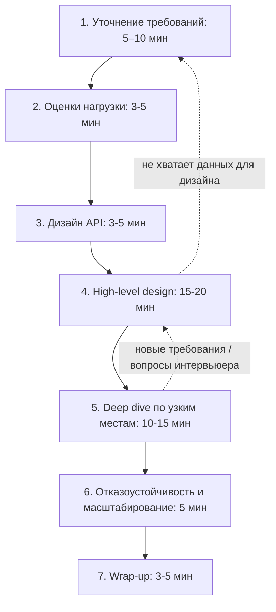
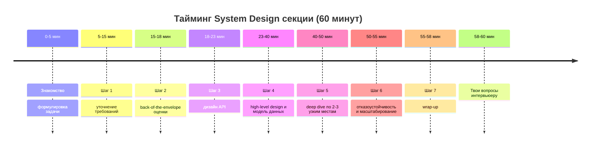

# Пошаговый фреймворк прохождения System Design интервью

<!-- learning-nav:start -->
[← Все разделы](../README.md) · [Следующая тема →](clarifying-questions.md)
<!-- learning-nav:end -->

<!-- toc:start -->
<details>
<summary>Показать темы и вопросы</summary>

- [Зачем нужен фреймворк](#зачем-нужен-фреймворк)
- [Что оценивает интервьюер](#что-оценивает-интервьюер)
- [Обзор: 7 шагов](#обзор-7-шагов)
- [Тайминг: 45–60 минут по шагам](#тайминг-4560-минут-по-шагам)
- [Шаг 1. Уточнение требований (5–10 минут)](#шаг-1-уточнение-требований-510-минут)
- [Шаг 2. Оценки нагрузки / back-of-the-envelope (3–5 минут)](#шаг-2-оценки-нагрузки--back-of-the-envelope-35-минут)
- [Шаг 3. Дизайн API (3–5 минут)](#шаг-3-дизайн-api-35-минут)
- [Шаг 4. High-level design (15–20 минут)](#шаг-4-high-level-design-1520-минут)
- [Шаг 5. Deep dive по узким местам (10–15 минут)](#шаг-5-deep-dive-по-узким-местам-1015-минут)
- [Шаг 6. Отказоустойчивость и масштабирование (5 минут)](#шаг-6-отказоустойчивость-и-масштабирование-5-минут)
- [Шаг 7. Wrap-up (3–5 минут)](#шаг-7-wrap-up-35-минут)
- [Красные флаги и типичные ошибки](#красные-флаги-и-типичные-ошибки)
- [Как тренироваться](#как-тренироваться)
- [Чек-лист накануне интервью](#чек-лист-накануне-интервью)
- [Видео по теме](#видео-по-теме)

</details>
<!-- toc:end -->

System Design секция — это не экзамен на знание «правильной архитектуры», а симуляция рабочей сессии проектирования под жёстким таймингом: за 45–60 минут нужно из размытой формулировки («спроектируй мессенджер») получить согласованный с интервьюером дизайн. Задача специально даётся расплывчатой — так проверяют, умеешь ли ты структурировать хаос, а не зазубрил ли чужие схемы.

Главная причина провалов — отсутствие структуры. Кандидат без фреймворка тратит драгоценные минуты на второстепенное, молча рисует квадратики или углубляется в детали до того, как понял, что вообще строит. Фреймворк ниже собран из практики мок-собеседований (Яндекс, Ozon, Avito, FAANG) и разборов «со стороны интервьюера»: это 7 шагов, которые работают как чек-лист и как «safety net» — когда не знаешь, с чего начать, просто иди по шагам.

## Зачем нужен фреймворк

- **Время — главный ресурс.** В интервью 45–60 минут, из которых ~5 уходит на знакомство и ~5 на вопросы интервьюеру в конце. «Мяса» остаётся 35–50 минут. Без плана эти минуты съедаются бесполезной детализацией.
- **Интервьюер должен следить за ходом мысли.** Неструктурированный монолог невозможно оценить — в большинстве компаний есть матрица оценки, где каждый этап оценивается отдельно. Фреймворк помогает проверить полноту ответа, но конкретные критерии зависят от формата компании.
- **Цена поздней ошибки.** Ошибка в требованиях обычно затрагивает больше частей работы, если найдена после построения схемы; точные множители здесь не нужны. На собеседовании «валютой» является время: скачок к решению без требований почти всегда заканчивается переделкой всей схемы под конец секции.
- **Стресс съедает импровизацию.** Под давлением «белой доски и молчащего интервьюера» даже опытный инженер бланкует. Заученная последовательность шагов снимает вопрос «что делать дальше» и освобождает голову для самой задачи.

## Что оценивает интервьюер

В большинстве компаний после секции заполняется **матрица оценки**: взвешенные баллы по каждому этапу (требования, расчёты, архитектура, deep dive, коммуникация). Это значит, что нельзя «выиграть» интервью одним сильным куском — незакрытая строка матрицы тянет итог вниз. Отсюда следствие: равномерность важнее гениального прорыва в одной точке.

Три столпа, на которых стоит оценка кандидата:

- **Clarity of thought (ясность мышления).** Если ты можешь понятно изложить дизайн интервьюеру — ты так же понятно изложишь его команде. Это прямой прокси рабочей коммуникации.
- **Flexibility (гибкость).** Требования будут менять в середине секции — специально. Реакция «ок, тогда пересобираем так-то» оценивается выше, чем красивая, но зацементированная схема.
- **Knowledge (кругозор).** Знание готовых building blocks и реальных технологий (и их ограничений) показывает, что ты не будешь изобретать велосипед на работе.

Два тренируемых качества, которые RU-интервьюеры называют ключевыми:

1. **Умение слушать.** Интервьюер роняет подсказки постоянно: «а вы не думали про…?», «хм, а давайте вернёмся к нагрузке». Каждая такая реплика — бесплатная навигация. Кандидат, который продолжает гнуть свою линию после третьего намёка, проигрывает не технически, а по коммуникации.
2. **Инициатива.** Старший инженер ведёт процесс сам: предлагает план, фиксирует решения, двигается дальше без разрешения. Вопросы «а что мне теперь делать?» после каждого этапа — сигнал незрелости.

Что отличает strong hire от среднего кандидата:

- проговаривает **corner cases и exceptional flows**, а не только happy path;
- подкрепляет решения **числами**, а не «это популярная технология»;
- честно показывает **компромиссы**: «выбираю availability ценой строгой консистентности, потому что требование X»;
- сам находит слабые места своего дизайна раньше интервьюера.

## Обзор: 7 шагов



Два управляющих принципа, которые держат весь фреймворк:

1. **Инициатива — на кандидате.** Ты предлагаешь ход решения: задаёшь вопросы, предлагаешь следующий шаг, фиксируешь решения. Позиция senior+ предполагает leadership — «берёшь интервьюера за руку и ведёшь по своему процессу», а не ждёшь, что тебе скажут, что делать дальше.
2. **Думай вслух и синхронизируйся.** Молчаливый кандидат неотличим от застрявшего. Проговаривай рассуждения («рассматриваю push vs pull модель фида: push быстрее на чтение, но дорог для аккаунтов с миллионами подписчиков») и регулярно сверяйся: «Ок, если не возражаете, дальше углублюсь в X». После каждого существенного утверждения делай микро-паузу — интервьюер либо подтвердит, либо перенаправит. Молчание не подтверждает критичное требование: инварианты, границы scope и изменение гарантий лучше коротко сверить явно.

## Тайминг: 45–60 минут по шагам

Пример распределения слота. Времена ниже согласованы внутри 60 минут; это тренировочный бюджет, а не универсальное правило компании:



| Шаг | 45-мин слот | 60-мин слот | Гибкость |
|---|---|---|---|
| Знакомство | 3 мин | 5 мин | уточнить формат |
| 1. Требования | 5 мин | 10 мин | зависит от полноты постановки |
| 2. Оценки нагрузки | 3 мин | 3 мин | можно слить с шагом 1 |
| 3. API | 3 мин | 5 мин | иногда пропускают по просьбе интервьюера |
| 4. High-level design | 12 мин | 17 мин | ядро интервью |
| 5. Deep dive | 8 мин | 10 мин | растёт с грейдом |
| 6. HA / масштабирование | 3 мин | 5 мин | абстрактно и быстро |
| 7. Wrap-up | 3 мин | 3 мин | короткий, по делу |
| Вопросы интервьюеру | 5 мин | 2 мин | резерв по формату секции |

Практические правила тайминга:

- **Поставь таймер.** На тренировках проходи секции с мигающим таймером и замеряй, сколько реально занимает каждый шаг. Игнорирование тайминга — одна из самых частых ошибок: перерасход на одном этапе означает незакрытые этапы в конце, а матрица оценки этого не прощает.
- **Расписка о границах.** Скажи вслух в начале: «Предлагаю такой план: 5 минут на требования, потом прикинем нагрузку, набросаем high-level дизайн и углубимся в пару компонентов. Вам такой формат подходит?» Это одновременно фиксирует план, демонстрирует структурность и даёт интервьюеру шанс скорректировать приоритеты.
- **Если увяз — сокращай, а не растягивай.** Перерасход 5 минут на шаге 1? Соедини оценки с API. Лучше готовая абстрактная архитектура целиком, чем один идеально проработанный компонент и пустая доска вокруг.

## Шаг 1. Уточнение требований (5–10 минут)

Самый недооценённый шаг. Красный флаг номер один — сразу рисовать решение, не поняв, что строим. «Спроектируй чат» — это WhatsApp (1:1 и малые группы), Slack (рабочие пространства, каналы, поиск по истории) или Discord (серверы на сотни тысяч участников)? У них разные узкие места, и дизайн будет принципиально разным.

### Что делать

- Раздели требования на **функциональные** (что система делает: постить, фолловить, искать, шарить) и **нефункциональные** (как система себя ведёт: availability, latency, масштаб, durability). Именно NFR делают задачу интересной: Twitter-клон на 200 пользователей тривиален, на 200 млн с «селебрити»-аккаунтами — нет. Чем выше грейд, тем больше веса NFR в оценке.
- Найди 2–4 ключевые фичи и договорись о приоритете. Требований может быть сотня — как в реальной работе, задача выделить самое важное и «забить» на остальное (например, детали аутентификации, аналитики или модерации можно вынести за скобки после согласования, сохранив базовые права доступа и необходимые гарантии).
- Веди конспект на доске: список фич + список NFR. Забыть озвученное требование и не реализовать его в дизайне — гарантированный минус в матрице («часть системы не была реализована»).
- Фиксируй допущения явно: «Интервьюер не уточнил — предположу, что…».

### Что говорить вслух (примеры формулировок)

- «Прежде чем рисовать, уточню скоуп. Это чат 1:1 или ещё групповые чаты? Какой максимальный размер группы?»
- «Из функционального я бы взял три фичи: отправку сообщений, доставку в реальном времени и статус прочтения. Историю поиска и вложения предлагаю вынести за скобки — ок?»
- «Давай зафиксирую нефункциональные: low latency доставки (< 500 мс), высокая доступность важнее строгой консистентности, 10 млн DAU. Поправьте, если я неверно расставил приоритеты.»
- «Это достаточный скоуп для проектирования, или есть что-то ещё, что система должна уметь?» — финальный чек перед переходом дальше.

### Уточняющие вопросы (универсальный чек-лист)

- Кто пользователи и какой сценарий использования основной?
- Какие фичи в приоритете? Что точно out of scope?
- Масштаб: DAU, пиковая нагрузка, география (один регион или мульти-регион)?
- Соотношение read/write? (Определяет половину архитектурных решений.)
- Требования к консистентности: нужна строгая или eventual consistency достаточна?
- Ограничения по latency? Real-time или допустима задержка?
- Есть ли требования по безопасности, оффлайн-режиму, поддержке устройств?

### Пример: как выглядит хорошее уточнение (мок «файловое хранилище»)

Из реального мок-собеседования — формулировка «сделай систему хранения файлов, денег мало». Кандидат за 5 минут вытащил скоуп серией вопросов:

- «Предполагаю: запись файлов в систему и их чтение. Верно?» — подтверждение базовой гипотезы вместо открытого вопроса.
- «Читать файлы могут только те, кто их записал, или можно шарить?» → шаринг по ссылке оказался ключевой фичей.
- «Нужна ли синхронизация между устройствами пользователя?» → да, и это добавило notification flow.
- «Маунтить файловую систему на диск — это основное требование или можно вторым этапом?» → приоритизация: сначала загрузка через веб/мобайл по форме, маунт выносится.
- «Какой максимальный размер файла?» → договорились о 50 ГБ — и это сразу определило выбор в пользу blob storage вместо самописного решения («нанять команду и писать своё хранилище дороже и дольше, чем взять готовое с рынка и платить по мере роста»).

Обрати внимание на паттерн: каждый вопрос заканчивается предложением фиксации — «зафиксирую: 50 ГБ максимум», «выносим маунт за скобки». Это и есть формализация требований, а не анкетирование.

### Антипаттерн на этом шаге

Пытаться собрать «полные» требования. Кандидаты, которые тратят 15 минут на вопросы про аватарки, темы оформления и GDPR, не доходят до архитектуры. Договорились о 2–4 фичах и 3–4 NFR — и двигаемся.

## Шаг 2. Оценки нагрузки / back-of-the-envelope (3–5 минут)

Цель — **порядок величин**, а не точная арифметика. «Проектировать систему без чисел — как ехать в дорогу без карты»: 1K RPS и 100K RPS — это принципиально разные архитектуры, и это нужно понять до того, как поставлен первый квадратик на доске.

### Что считать

- **QPS / RPS** по чтению и записи отдельно: `DAU × операций на пользователя в день / 86 400`, умножить на 2–3 для пика.
- **Хранилище**: объём записи × записей в день × срок хранения (согласованный срок retention).
- **Bandwidth**: размер ответа × read QPS (важно для медиа-систем).

Пример проговаривания: «10 млн DAU, каждый отправляет в среднем 20 сообщений в день — это 200 млн сообщений/день ≈ 2.3K RPS на запись, в пике ~7K. Сообщение ~1 КБ с метаданными — ~200 ГБ новых данных в день, ~70 ТБ в год. Чтение предположим в 50 раз выше записи — отдельно оценю повторяемость ключей и допустимую свежесть перед выбором кэша».

### Правила

- Округляй до степеней и половинок: 86 400 сек/день ≈ 100K сек/день, 2.5 млн запросов в сутки ≈ 30 RPS. Никто не ждёт «битиков и байтиков» — ждут правильный порядок и осмысленные выводы из него.
- Каждое число должно проверять конкретное решение: «50 ТБ/год — проверю retention, физический размер и время восстановления», «write QPS 1M/сек — сравню батчи, разбиение по ключу и проверенную ёмкость выбранного хранилища». Объём или название SQL/NoSQL сами по себе не доказывают необходимость конкретной технологии.
- Ошибся в арифметике на порядок — переделаешь всю архитектуру. Перепроверь ключевое число вслух: «Порядок сходится: десятки тысяч RPS на запись».

### Опорные числа, которые должны быть в голове

| Величина | Порядок | Зачем |
|---|---|---|
| Секунд в сутках | ~100K (86 400) | перевод «операций в день» в RPS |
| Запросов в день при 1 млн DAU × 10 оп. | ~10 млн/день ≈ ~120 RPS | базовая формула QPS |
| Пиковый множитель | ×2–3 от среднего | оценка пиковой нагрузки |
| Размер текстовой записи с метаданными | ~1 КБ | оценка хранилища |
| Одна нода БД | только учебное допущение: ~1–10K простых запросов/сек | реальную ёмкость измерять при SLO |
| RAM одной ноды кэша | выбранная конфигурация минус служебный запас | сколько горячих данных влезает |
| 1 млрд | 10^9 ≈ 2^30 | быстрые степени для ID (срок исчерпания зависит от выделенных битов и скорости генерации) |

Полезные формулы под рукой:

```text
QPS          = DAU × ops_per_user_per_day / 86 400        (×2-3 на пик)
Storage/day  = writes_per_day × record_size
Storage 5y   = Storage/day × 365 × 5                      (+ репликация ×3, если просят)
Bandwidth    = read_QPS × response_size
Cache        = уникальные горячие ключи × размер записи с overhead
               (реплики и запас процесса считать отдельно)
```

Важный нюанс из практики: даже если числа неточные, интервьюеру нужна **ясность рассуждений** — оценивается процесс вывода, а не совпадение с «правильным» ответом. Проговаривай каждое допущение: «возьму 10 операций на пользователя в день — разумно для мессенджера».

## Шаг 3. Дизайн API (3–5 минут)

API — это контракт между клиентом и бэкендом; после шага 1 он обычно очевиден. Top-down подход: сначала контракты, потом внутренности. Ошибка — спроектировать «красивую» систему компонентов, а потом обнаружить, что пользовательские сценарии ей не покрываются.

### Что делать

- Перечисли эндпоинты по одному на функциональное требование. По умолчанию — RESTful-конвенция, если не оговорено иное.
- Раздели read и write API: `GET /v1/feed`, `GET /v1/search` против `POST /v1/tweets`, `POST /v1/follow`. Чёткие API = чёткая коммуникация = чёткий дизайн.
- Для каждого эндпоинта коротко: входные параметры, формат ответа, ключевые коды ошибок. Пагинация (cursor vs offset) упоминается вполслова — не разводи на ней 10 минут.
- **Не вводи API, не привязанные к требованиям.** Каждый лишний эндпоинт — это время и вопрос «а зачем?».
- Если нужен real-time (чат, live-комментарии, совместное редактирование) — здесь же зафиксируй транспорт: WebSocket (stateful, сложно масштабировать — будь готов обсудить в deep dive), long polling, SSE или gRPC-streaming.

### Пример записи на доске

```text
POST /v1/messages        {chat_id, text, client_ts}  -> 201 {message_id}
GET  /v1/messages        ?chat_id=&cursor=&limit=50  -> 200 {messages[], next_cursor}
POST /v1/chats           {type: direct|group, members[]}
WS   /v1/realtime        доставка сообщений и статусов
```

Нюанс от интервьюеров: иногда интервьюер *не хочет* этап API — он хочет смотреть схему данных или архитектуру. Поэтому спроси: «Предлагаю зафиксировать API в три строчки и перейти к high-level дизайну, ок?» — и двигайся туда, куда ведут.

## Шаг 4. High-level design (15–20 минут)

Ядро интервью. Задача — абстрактная, но **сквозная** схема: все согласованные фичи покрыты end-to-end, видно, как данные текут по системе от клиента до хранилища и обратно.

### Как строить

1. **Начни с точки входа**: клиент → DNS → load balancer / API gateway → stateless сервисы приложения.
2. **Выдели логические ответственности** из требований (upload, feed, notification). Они могут быть модулями одного приложения или отдельными сервисами: число пользователей не обязывает выбирать микросервисы. Покажи независимые потоки и данные, затем обоснуй границы деплоя, масштабирования и владения.
3. **Добавь слой хранения**: для каждой ответственности — понятное владение данными и путь доступа (БД, object storage для бинарных данных, кэш). Отдельная физическая БД на каждый квадратик не обязательна. Конкретную технологию на этом этапе называть необязательно — «key-value store с высоким write throughput» честнее, чем бездумное «Cassandra».
4. **Прогони happy path по каждой фиче** вслух, пальцем по стрелкам: «пользователь загружает файл → LB → upload service → object storage, метаданные → в БД → notification service рассылает событие остальным устройствам → они скачивают файл по ссылке через download service». Это проверяет полноту схемы и даёт интервьюеру уверенность, что система «заведётся».
5. **Модель данных и схема** — здесь же, но кратко: основные сущности, ключи, паттерны доступа, read/write ratio. Если моделирование данных — ключ к NFR (а это так для фидов, поиска, гео), оставь детали в deep dive, сказав это явно.

### Правила выживания на этом шаге

- **Веди список «обсудить позже».** Каждый раз, когда рука тянется в деталь (heartbeat-протокол, конкретный кодек, схема индекса), запиши пункт в уголке доски и возвращайся к общей картине. Не закапывайся, пока нет полного сквозного дизайна.
- **Не имей «готовой» архитектуры в голове.** Кандидаты, выучившие «как устроен Twitter», ломаются на первом же изменённом требовании — а требования меняют специально, чтобы проверить гибкость. У WhatsApp и Uber разные архитектуры, потому что разные задачи.
- **Сверяйся со списком требований.** Периодически возвращайся к конспекту из шага 1 и отмечай галочками закрытые фичи. Интервьюер может кивать «ок-ок-ок» — и потом записать, что фича не реализована.
- **KISS.** Если одна часть схемы раздулась, а остальные — тонкие ниточки, это сигнал: либо ты закопался, либо компонент (heartbeat, аналитика, мониторинг) стоит обобщить на всю систему. Делай шаг назад и смотри на доску целиком каждые пару минут.

## Шаг 5. Deep dive по узким местам (10–15 минут)

Здесь средний кандидат становится сильным. Цель — показать, что ты умеешь находить проблемные места в собственном дизайне, предлагать несколько решений и взвешивать trade-offs. Чем выше грейд, тем больше вес этого этапа.

### Как выбрать, куда углубляться

- Спроси интервьюера: «Вижу два-три горячих места: X и Y. Куда интереснее копнуть?» — deep dive делается **вместе** с интервьюером, он может знать, что хочет проверить (например, «а теперь построй систему мониторинга для всего этого»).
- Самостоятельный приоритет: самый высоконагруженный компонент или компонент с самой сложной бизнес-логикой.
- Читай комнату: если интервьюер морщится на какой-то узел схемы или дважды возвращается к одному вопросу — это и есть точка для deep dive. Игнорировать наводящие вопросы — типичная ошибка «упрямых» кандидатов.

### Мини-протокол для каждого узкого места

1. **Сформулируй проблему с числами.** «Write QPS 1M/сек в БД геолокаций — сравню с проверенной ёмкостью узла; read replicas не увеличивают ёмкость записи primary».
2. **Предложи минимум два решения.** «Вариант А: снизить частоту апдейтов с батчированием на клиенте — режем нагрузку в 10 раз. Вариант Б: перейти на NoSQL с LSM-tree под высокий write throughput. Вариант В: шардирование по user_id».
3. **Обсуди trade-offs каждого** — обязательно с опорой на числа из шага 2.
4. **Выбери и зафиксируй решение.** «Свежесть до 5 секунд допускает короткие батчи; сравню их задержку и throughput с шардированной записью. Выбираю разбиение по driver_id, поскольку обновления независимы; объясню маршрутизацию и горячие ключи». Варианты вместо решения — отдельный пункт в списке ошибок: «можно MySQL, можно Postgres, пойдём дальше» — это не ответ. Опыт с Postgres полезен при выборе между подходящими вариантами, но не заменяет проверку требований.

За типичное интервью успеваешь проработать 2–3 проблемы — этого достаточно. Типовой арсенал для deep dive: шардирование и партиционирование, выбор ключа шарда и hot partitions, стратегии кэширования (cache-aside, TTL, инвалидация), очереди сообщений и асинхронная обработка, индексы (B-tree, гео, инвертированные), fanout на чтение vs запись, push vs pull модели.

## Шаг 6. Отказоустойчивость и масштабирование (5 минут)

Короткий, почти ритуальный этап — но его отсутствие заметно. Не прорабатывай детально, пройдись критическим взглядом по схеме.

### Чек-лист проговаривания

- **По каждому компоненту**: «что будет, если он упадёт?» Stateless-сервисы → экземпляры за LB с запасом ёмкости; прерванные запросы требуют безопасного восстановления. БД → репликация и failover по допустимой потере данных. WebSocket-гейты → reconnect, восстановление сессии и маршрута; hashing сам не переносит живое TCP-соединение.
- **Single point of failure**: найди оставшиеся SPOF на схеме и назови их — лучше ты сам, чем интервьюер.
- **Масштабирование**: сервисы stateless → горизонтально за балансировщиком; БД → read-реплики для допустимых чтений; для записи сравнить оптимизацию, вертикальный рост и шардирование; статика и медиа → CDN.
- **Corner cases и exceptional flows** — сильнейший способ выделиться: «что если пользователь в туннеле и оффлайн — сообщения буферизуются и доставляются при reconnect», «что если загрузка файла оборвалась на 90% — resumable upload по chunk'ам». Большинство кандидатов рисует только happy path.
- **Мониторинг** одной фразой: «на ключевые сервисы — метрики latency и error rate, алерты, по ним же решение об автоскейлинге».

## Шаг 7. Wrap-up (3–5 минут)

Короткое резюме — не пересказ всей схемы, а акцент на том, что уникально в твоём решении:

- «Итого: спроектировали систему X под Y млн DAU. Закрыли требования A, B, C (галочки по списку). Ключевые решения: шардирование по user_id из-за write-нагрузки, fanout-on-write для фида с гибридом pull для селебрити, eventual consistency как осознанный компромисс ради доступности».
- **Честно назови слабые места**: «Слабая точка — cold start кэша при падении Redis-кластера; в продакшене я бы добавил запасной слой и rate limiting на БД». Признание ограничений дизайна читается как зрелость, а не как провал.
- Оставь время на вопросы интервьюеру — и задай их. Даже если это одна из секций воронки и ты не попадёшь в команду этого интервьюера: «Как у вас устроен процесс проектирования? Кто владеет архитектурными решениями?» Подготовь 2–3 вопроса заранее — заинтересованность тоже оценивается.

## Красные флаги и типичные ошибки

Собрано из разборов «16 типичных ошибок» и наблюдений интервьюеров FAANG/RU-бигтеха:

| # | Ошибка | Чем опасна | Как избежать |
|---|---|---|---|
| 1 | Прыжок к решению без требований | Строишь не ту систему; переделка в конце | Шаг 1 священен, минимум 5 минут вопросов |
| 2 | Молчание за доской | Интервьюер не отличит «думает» от «застрял» | Нарратив вслух + паузы на фидбек |
| 3 | Преждевременная детализация | Узкий кусок детально, остальная система — никак | Список «обсудить позже», top-down всегда |
| 4 | Зазубренная архитектура | Ломается на первом изменении требований | Учи принципы и building blocks, не готовые схемы |
| 5 | Утверждения без обоснования | «Возьму Cassandra» — «почему?» — тишина | Каждое решение = проблема + 2 варианта + trade-off + выбор |
| 6 | Варианты вместо решения | Senior обязан принимать решения в неопределённости | Фиксируй выбор, даже с оговоркой про экспертизу |
| 7 | Оверинжиниринг под нагрузку | 1K URL/день → микросервисы + шардирование + CDN | «Начну с простого, покажу, как масштабируется» |
| 8 | Попытка сделать всё | Не закрыт ни один этап полностью | 2–4 фичи, 2–3 deep dive, остальное за скобками |
| 9 | Игнор наводящих вопросов | Интервьюер ничего не спрашивает просто так | Услышал намёк — перестройся, не спорь |
| 10 | Нет конспекта требований | Забытая фича = минус в матрице | Пиши список на доске, сверяйся |
| 11 | Игнор тайминга | Перерасход на одном этапе, провал остальных | Таймер на тренировках, план вслух |
| 12 | Страх попросить помощи | Застрял и молчишь — горит время | «Я застрял между вариантами A и B, что вам важнее?» |
| 13 | Вид «всё знаю» | Легко ловится одним уточняющим вопросом | Честно: «читал, руками не трогал» — и покажи сильные места |
| 14 | Медленные/неверные расчёты | Ошибка на порядок = вся архитектура мимо | Тренируй back-of-the-envelope до автоматизма |
| 15 | Только happy path | Средний кандидат | Corner cases: оффлайн, обрывы, дубли, гонки |
| 16 | Нет вопросов в конце | Выглядит как отсутствие интереса | 2–3 заготовленных вопроса о команде и процессах |

## Как тренироваться

- **Мок-собеседования** — способ проверить целостный навык: алгоритмы нарешиваются на LeetCode, а system design полезно проверять с партнёром, который играет интервьюера, меняет вводные и задаёт уточняющие вопросы.
- **Таймер на каждую тренировку.** Цель — уложить шаги 1–7 в 45 минут автоматически, не глядя на часы.
- **Освой инструмент заранее.** Если секция в Excalidraw/Miro — потренируйся рисовать «квадратик-стрелочку» до интервью; 10 минут возни с редактором — это треть слота и испорченное первое впечатление.
- **Знай готовые технологии.** Умение назвать конкретику (Postgres, Cassandra, Redis, Kafka, RabbitMQ, S3-compatible storage, ZooKeeper) с обоснованием — сигнал, что ты сэкономишь компании время на внедрении. Но см. ошибку №5: название без обоснования работает против тебя.
- **Пересматривай свои моки** как интервьюер: по какой строке матрицы потерял баллы?

## Чек-лист накануне интервью

- [ ] Помню 7 шагов и тайминг каждого
- [ ] Могу за 3 минуты прикинуть QPS/хранилище/bandwidth для любой системы
- [ ] У меня есть 5–6 универсальных уточняющих вопросов на старте
- [ ] Знаю trade-offs 5–6 пар технологий (SQL/NoSQL, push/pull, sync/async, cache-aside/write-through, WebSocket/polling)
- [ ] Отрепетировал фразы-синхронизации: «предлагаю план», «фиксирую допущение», «куда копнуть глубже?»
- [ ] Заготовил 2–3 вопроса интервьюеру в конец

<a id="источники-и-видео-по-теме"></a>

## Видео по теме

- [Собеседование по системному проектированию: пошаговое руководство (ByteByteGo)](https://www.youtube.com/watch?v=i7twT3x5yv8)
- [How to Answer Any System Design Interview (My 7-Step FAANG Framework)](https://www.youtube.com/watch?v=sngWrkymU-c)
- [Как пройти System Design Интервью? 4 этапа, 2 важных качества кандидата](https://www.youtube.com/watch?v=KhfeYD0VBOY)
- [Как пройти System Design интервью: взгляд со стороны интервьювера и кандидата](https://www.youtube.com/watch?v=P3im7VW0mnw)
- [Кирилл Розов — Как пройти архитектурную секцию собеседования](https://www.youtube.com/watch?v=p7QIEzIFzdQ)
- [5 Tips for System Design Interviews](https://www.youtube.com/watch?v=CtmBGH8MkX4)
- [System Design Interview – BIGGEST Mistakes to Avoid](https://www.youtube.com/watch?v=OvufRkoD-D0)
