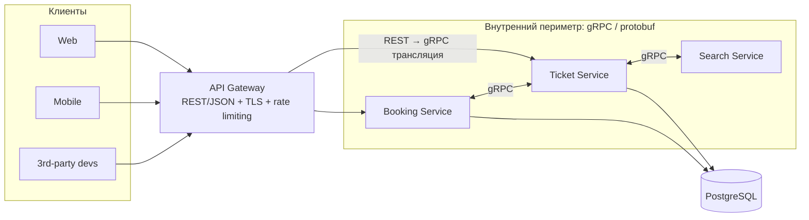
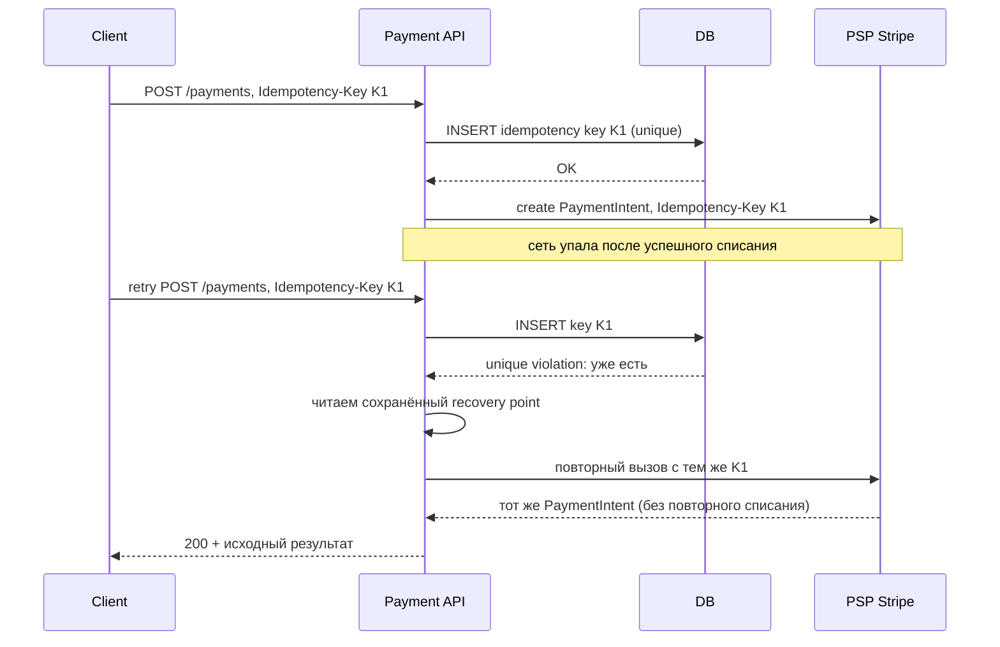
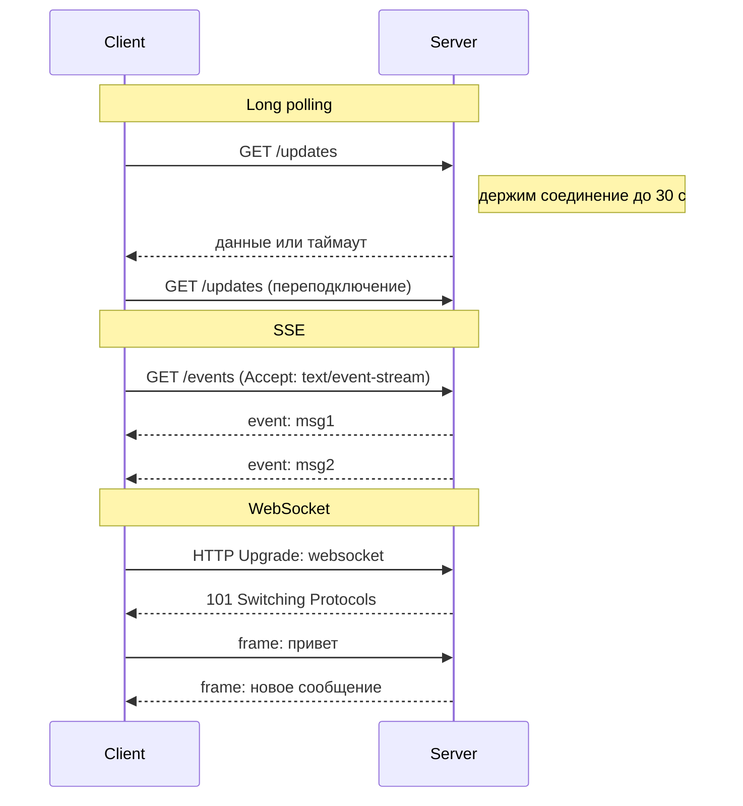

# Дизайн API на System Design интервью

API — это первое, что вы рисуете после сбора требований, и первое место, где интервьюер проверяет «взрослость» кандидата. Ошибка здесь дешёвая: REST-эндпоинт с глаголом в URL или `userId` в теле запроса — и интервьюер уже мысленно поставил минус. Хорошая новость: секция API — самая шаблонная часть интервью, её можно подготовить заранее почти идеально.

Разбор ниже покрывает: выбор протокола (REST vs gRPC vs GraphQL), идемпотентность и idempotency keys, версионирование, пагинацию, real-time доставку (long polling / SSE / WebSocket) и контракты ошибок.

---

## Где API-секция живёт в структуре интервью

Типовой фреймворк (HelloInterview-style, его же используют интервьюеры Meta):

1. Требования (functional / non-functional)
2. Core entities — существительные системы (events, bookings, users)
3. **API — маппинг entities на эндпоинты**
4. High-level design
5. Deep dives

Ключевое правило из моков: **API — это 3–5 минут, не больше**. Не выписывайте все поля ответа — договоритесь с интервьюером: «`GET /events` возвращает список Event, структуру Event детализируем в data model». Самая частая ошибка — утонуть в JSON-схемах и не оставить времени на deep dive, который и определяет грейд.

## Уточняющие вопросы перед дизайном API

- «API публичный для сторонних разработчиков или только для наших клиентов (web/mobile)?» — определяет REST vs gRPC и требования к версионированию.
- «Нужен ли real-time, или клиент может опрашивать сервер?» — определяет polling vs WebSocket.
- «Какие операции критичны к дублям — платежи, бронирования, заказы?» — где нужна идемпотентность.
- «Есть ли клиенты с сильно разными потребностями в данных (мобильный vs веб)?» — аргумент за/против GraphQL.
- «Есть ли вообще внешний API?» В backend-heavy задачах (поисковая инфраструктура, пайплайн индексации) клиентского API может не быть — скажите это явно и предложите описать внутренние сервисные контракты. Спросите интервьюера, что он предпочитает.

---

## REST vs gRPC vs GraphQL

### Эвристика по умолчанию

Формулировка, которая звучит сильно на интервью:

> «Для клиент-facing API я беру REST — это дефолт, который все клиенты понимают без специальной настройки. Для общения между микросервисами внутри периметра — gRPC, потому что мы контролируем обе стороны и нам важна эффективность. GraphQL имеет смысл, если у нас несколько разнородных клиентов и проблема over/under-fetching реально болит».

Интервьюеры Meta прямо говорят: если сомневаетесь — берите REST, в ~95% случаев это правильный ответ.

### Таблица trade-off

| Критерий | REST | gRPC | GraphQL |
|---|---|---|---|
| Транспорт | HTTP/1.1–3, JSON текст | HTTP/2, Protocol Buffers (бинарный) | HTTP, JSON, один эндпоинт `POST /graphql` |
| Модель | Ресурсы (существительные) + HTTP-методы | Вызов методов на удалённом сервисе, как локальная функция | Клиент описывает нужные поля в query |
| Скорость/размер | Базовая | В 5–10 раз компактнее по байтам за счёт бинарного формата | Как REST, но меньше round-trip'ов |
| Контракт | OpenAPI (опционально) | `.proto` файлы, кодогенерация клиентов и серверов под разные языки | Строгая схема, introspection |
| Over/under-fetching | Есть (фиксированные ответы) | Нет | Решает — клиент запрашивает точные поля |
| Кэширование | HTTP-кэш из коробки (ETag, Cache-Control, CDN) | Нет HTTP-семантики кэша | Только application-level (persisted queries, normalized cache) |
| Браузер | Нативно | Нужен gRPC-Web proxy | Нативно |
| Кому подходит | Внешние публичные API, разнородные клиенты | Внутренний service-to-service в микросервисах | Много клиентов с разными потребностями, сложные связанные данные |



### Почему не gRPC для клиентов

Естественный вопрос интервьюера: «Если gRPC такой быстрый, почему не использовать его наружу?» Ответ:

- Клиенты разнородны — браузеры, мобильные приложения, сторонние разработчики. REST поверх HTTP понимает всё без специальной настройки, проходит сквозь корпоративные файрволы и прокси, JSON читается глазами в curl и DevTools.
- gRPC требует, чтобы обе стороны договорились о `.proto`-контракте и бинарном формате. Это отлично работает, когда вы контролируете обе стороны (свои микросервисы), и превращается в кошмар для внешнего клиента.
- Браузер не умеет HTTP/2 trailers и полный gRPC — нужен gRPC-Web и транслирующий proxy (Envoy), т.е. вы всё равно строите REST-подобный фасад.

Типичный продакшн-паттерн: снаружи REST, внутри gRPC, а API Gateway транслирует REST-ответы в JSON и обратно.

### GraphQL: когда и о чём спросят

GraphQL придумали в Facebook в 2012-м под мобильную революцию: медленные сети, и для загрузки одного экрана ленты требовалось несколько REST-запросов, каждый из которых тащил лишние поля. Решение — клиент в одном запросе описывает, какие поля и какие вложенные сущности ему нужны.

Пример: вместо `GET /events/123` + `GET /events/123/tickets` + `GET /venues/42` клиент шлёт один запрос:

```graphql
query {
  event(id: "123") {
    name
    date
    venue { name address }
    tickets { section price available }
  }
}
```

Что спросят обязательно, если вы предложили GraphQL:

- **N+1 problem.** Запрос «топ-100 событий + venue каждого» — это 1 запрос за событиями и затем 100 запросов за venue, если резолверы написаны в лоб. Ответ: **DataLoader** — батчинг: собираем все venue_id из первого запроса и делаем один `SELECT ... WHERE id IN (...)`.
- **Кэширование.** REST кэшируется на уровне HTTP (CDN, reverse proxy), у GraphQL один endpoint и всё через POST — HTTP-кэш не работает, нужен application-level кэш или persisted queries.
- **Авторизация.** В REST защищают целый эндпоинт. В GraphQL авторизация на уровне полей в резолверах (можно показать `event.name` всем, а `event.revenue` — только владельцу). Это и плюс (гибкость), и минус (легко забыть закрыть поле).
- **Стоимость запросов.** Клиент может написать произвольно глубокий запрос. Нужны query depth limiting и cost analysis, иначе один запрос положит БД.

---

## REST: как спроектировать эндпоинты, чтобы не придраться

### Ресурсы и URL

Ресурсы = core entities из предыдущего шага фреймворка. Правила:

- **Всегда множественное число, существительные**: `/events`, `/bookings`, `/venues`.
- **Никогда глаголы в URL**: `POST /events/create` — красный флаг. Действие выражает HTTP-метод, а не путь.
- Вложенность для связей: `GET /events/{eventId}/tickets`.

Честная ремарка из моков: большинство интервьюеров не будут «грызть» вас за идеальный REST — это не главная часть дизайна. Но есть REST-пуристы, и поправить это стоит ноль усилий — бесплатные очки.

### HTTP-методы и их идемпотентность

| Метод | Назначение | Идемпотентен | Пример |
|---|---|---|---|
| GET | Чтение | Да (+ safe: не меняет состояние) | `GET /events/123` |
| POST | Создание / неидемпотентные операции | **Нет** — повтор создаст вторую запись | `POST /events` |
| PUT | Полная замена ресурса | Да — повтор перезаписывает ту же строку | `PUT /events/123` |
| PATCH | Частичное обновление | Формально нет, на практике обычно да | `PATCH /events/123` |
| DELETE | Удаление | Да — повторное удаление ничего не меняет | `DELETE /events/123` |

Совет из моков: не тратьте время интервью на холивар PUT vs PATCH — реально вы будете использовать GET и POST. Достаточно одной фразы: «для частичного обновления возьму PATCH, полная замена была бы PUT».

### Три места для входных данных

| Куда | Когда | Пример |
|---|---|---|
| Path parameter | Обязательный идентификатор ресурса, без него запрос бессмысленен | `GET /events/123` |
| Query parameter | Опциональные фильтры, сортировка, пагинация | `GET /events?city=la&date=2026-01-01` |
| Request body | Данные для создания/обновления (POST/PUT/PATCH) | `{ "title": "...", "date": "..." }` |

Правило одной строкой: идентифицирует ресурс → path, фильтрует → query, является данными → body.

### Аутентификация и типичный провал

Проговаривайте, какие эндпоинты требуют аутентификации, а какие — роли: «просматривать события может любой, `POST /events` — только admin». JWT или session token едут в заголовке `Authorization`.

**Классическая ошибка кандидата** (её ловят интервьюеры):

```http
POST /tweets
{ "text": "hello", "userId": 42 }
```

Если `userId` берётся из тела — любой может написать твит от чужого имени. Правильно: identity берём **из токена в заголовке**, в теле только данные самого ресурса. Проговорите это вслух — интервьюер специально ждёт.

---

## Идемпотентность и idempotency keys

### Постановка проблемы

Сети ненадёжны: клиент отправил `POST /payments`, сервер платёж провёл, но ответ потерялся по таймауту. Клиент ретраит — и списывает деньги дважды. То же на уровне очередей: брокеры гарантируют at-least-once доставку, значит консьюмер **обязан** быть идемпотентным — дубликаты сообщений это норма, а не исключение.

Сильная формулировка для интервью:

> «Любой ретрай — клиентский, сетевой, или редоставка из очереди — превращает неидемпотентный POST в деньги/заказы-дубликаты. Поэтому все мутации, критичные к дублям, я делаю идемпотентными через idempotency key».

### Как работает idempotency key

1. Клиент генерирует UUID на операцию (не на запрос! ретрай несёт тот же ключ) и шлёт в заголовке `Idempotency-Key: 9f2c...`.
2. Сервер по ключу смотрит в хранилище:
   - ключа нет → выполняем операцию, сохраняем ключ + результат, возвращаем результат;
   - ключ есть, операция завершена → возвращаем **сохранённый ответ**, не выполняя работу повторно;
   - ключ есть, операция в процессе → `409 Conflict` (идёт конкурентная обработка);
   - ключ есть, но **тело запроса отличается** → `422 Unprocessable Entity` (переиспользование ключа с другими параметрами — ошибка клиента).
3. Ключ хранится ограниченное время (Stripe — от 24 часов до 40 дней), потом запись можно удалять.



### Схема хранения: из реального разбора платёжной системы

```sql
CREATE TABLE idempotency_keys (
    key             UUID PRIMARY KEY,          -- сам idempotency key
    payment_id      UUID REFERENCES payments,  -- ссылка на созданную сущность
    customer_id     UUID NOT NULL,
    request_path    TEXT NOT NULL,
    request_hash    TEXT NOT NULL,             -- хэш тела: защита от reuse с другими параметрами
    recovery_point  TEXT NOT NULL,             -- STARTED / PAYMENT_CREATED / PSP_CALLED / FINISHED
    response_body   JSONB,                     -- сохранённый ответ для ретраев
    created_at      TIMESTAMPTZ NOT NULL DEFAULT now()
);
```

Два неочевидных момента, за которые цепляются сеньорные интервьюеры:

- **Recovery point (atomic phases).** Многошаговая операция (создали платёж локально → вызвали Stripe → записали ответ) может упасть между шагами. Разбиваем её на фазы, после каждой коммитим прогресс в `recovery_point`. Ретрай возобновляется с последней зафиксированной фазы, а не с нуля. Самый тяжёлый кейс — падение между записью idempotency-ключа и вызовом провайдера; решается тем, что провайдер тоже принимает тот же ключ (Stripe принимает `Idempotency-Key` заголовок), и повторный вызов безопасен.
- **Идемпотентность на всех слоях.** Входной API (ключ клиента) → вызов внешнего провайдера (тот же ключ дальше) → входящие webhooks (провайдер шлёт события at-least-once, поэтому таблица `processed_webhook_events(event_id PK)` и skip дублей). Если говорите про платежи и покрыли все три слоя — это уровень strong hire.

- Первый уровень защиты — `UNIQUE` constraint в БД, а не проверка `SELECT` перед `INSERT` (race condition между двумя параллельными запросами с одним ключом разрулит только constraint).

---

## Версионирование

### Способы

| Способ | Пример | Плюсы | Минусы |
|---|---|---|---|
| В пути URL | `/api/v1/events` | Явно, кэшируется, видно в логах и CDN | «Загрязняет» URL |
| Заголовок | `Accept: application/vnd.myapi.v2+json` | Чистые URL | Невидимо в браузере, сложнее кэшировать |
| Query param | `/events?version=2` | Просто | Не по REST-канону, плохо кэшируется |

На собеседовании дефолт — версия в пути: `/api/v1/...`. Одной фразы достаточно.

### Зачем и как отвечать

- Ломающее изменение (убрали поле, поменяли тип, переименовали) → новая версия `v2`, старая живёт параллельно: клиенты мигрируют независимо, ничего не ломается на проде.
- Не-ломающие изменения (добавили необязательное поле в ответ, новый эндпоинт) → версию не поднимаем. Совместимость: клиенты должны игнорировать неизвестные поля (tolerant reader).
- Жизненный цикл: announce deprecation → заголовок `Sunset`/`Deprecation` → мониторинг остаточного трафика v1 → выключение.

### Версионирование вне REST

- **GraphQL**: канонически — эволюция схемы без версий: новые поля добавляются, старые помечаются `@deprecated`, но не удаляются. На практике встречается версионирование полей (`followersV2`).
- **gRPC/protobuf**: версионирование на уровне номеров полей. Правила: никогда не переиспользовать номер поля, не менять его тип; удалённое поле помечать `reserved`. Обратная/прямая совместимость — бесплатно, если не нарушать это.

---

## Пагинация: offset vs cursor

Любой эндпоинт, возвращающий коллекцию, должен быть пагинирован — вернуть миллион событий одним JSON это гигантский payload и высокая латентность. Follow-up про пагинацию — один из двух самых частых вопросов к API-секции (второй — про security).

### Offset-based

```http
GET /events?page=2&limit=25
-- или эквивалентно:
GET /events?offset=25&limit=25
```

```sql
SELECT * FROM events ORDER BY id LIMIT 25 OFFSET 25;
```

Плюсы: просто, можно прыгнуть на произвольную страницу («сразу на 40-ю»), легко показать «страница 2 из 100».

Минусы:

- **Нестабильность при активных записях.** Пока вы листаете, в начало ленты вставили 3 новых события — сдвинулся offset, и вы увидите дубли или пропустите элементы. Для лент с высокой частотой записи это ломает UX.
- **Деградация на больших offset.** `OFFSET 1000000` заставляет БД физически прочитать и отбросить миллион строк — запрос становится всё медленнее с каждой страницей.

### Cursor-based (keyset)

```http
GET /events?limit=25&cursor=evt_01J8X3
→ 200 { "data": [...], "nextCursor": "evt_01J9KQ", "hasMore": true }
```

```sql
SELECT * FROM events WHERE id > :cursor ORDER BY id LIMIT 25;
```

Курсор — это «закладка»: обычно ID (или составной ключ сортировки, например `(created_at, id)`) последнего элемента предыдущей страницы, часто закодированный в base64. Запрос всегда бьёт по индексу — **O(limit)** независимо от глубины, и вставки новых записей не ломают последовательность.

Минусы: нельзя прыгнуть на произвольную страницу, только «вперёд/назад»; сложнее сортировки по нескольким полям (нужен составной курсор и составной индекс); нельзя показать «страница N из M».

### Что выбрать на интервью

| Сценарий | Выбор |
|---|---|
| Админка, внутренний дашборд, нужен «прыжок на страницу», данных немного | Offset — «обычно это достаточно хороший ответ» |
| Лента, чат, поиск, infinite scroll, частые записи, большие объёмы | Cursor |
| API для третьих лиц | Cursor (предсказуемая производительность для всех клиентов) |

Фраза, которая показывает глубину: «Cursor должен быть opaque для клиента — я кладу туда ID последнего элемента и кодирую в base64, чтобы клиенты не завязывались на внутренние детали сортировки, и я мог потом поменять реализацию».

---

## Long polling vs SSE vs WebSocket

Вопрос «как клиент узнает о новых событиях» возникает в каждой задаче про чат, уведомления, live-обновления, статус заказа.

| | Short polling | Long polling | SSE (Server-Sent Events) | WebSocket |
|---|---|---|---|---|
| Модель | Клиент спрашивает раз в N сек | Клиент спрашивает, сервер **держит** запрос до появления данных или таймаута (~30 c) | Постоянное HTTP-соединение, сервер пушит события текстом | Постоянное полнодуплексное соединение поверх TCP |
| Направление | Клиент → сервер | Клиент → сервер | Сервер → клиент (односторонне) | Обе стороны |
| Overhead | Огромный: много пустых ответов | Средний: переподключение + заголовки на каждый цикл | Низкий после установки | Минимальный после upgrade (фреймы без HTTP-заголовков) |
| Инфраструктура | Stateless, тривиально | Почти stateless | HTTP, работает через прокси/LB, авто-реконнект из коробки | Stateful, сложно: sticky sessions / pub-sub для роутинга между нодами |
| Когда | Редкие обновления, статус задачи | Простое ожидание результата (webhook-замена) | Лента, нотификации, котировки — пуши только от сервера | Чат, игры, collaborative editing — частый двусторонний обмен |



### Аргументы, которые ценят интервьюеры

- **Не берите WebSocket по умолчанию.** Частая ошибка кандидатов — тянуть WebSocket туда, где хватает polling/SSE. WebSocket требует серьёзной инфраструктуры: соединения inherently stateful, а system design мы стараемся строить stateless. Скажите вслух: «сначала рассмотрю polling или SSE, WebSocket — только если нужен частый двусторонний обмен».
- **WebSocket — это не request-response.** Не проектируйте на нём RPC-стиль «запрос-ответ» с корреляцией — если нужен request/response, оставайтесь на HTTP. WebSocket — поток сообщений, «упорядоченный обмен бинарными фреймами с гарантией доставки на уровне TCP».
- **Деградация и реконнект.** Соединения рвутся: деплои, сети, мобильный клиент ушёл в фон. Нужны heartbeat/ping-pong, exponential backoff на реконнект, fallback в long polling, и — ключевое — **resync через cursor/lastEventId**: после переподключения клиент шлёт ID последнего полученного события и догружает пропущенное (те же cursor-пагинация, что и выше).
- **Масштабирование.** Миллионы соединений держат отдельные gateway-ноды (stateful слой на периферии дизайна); маршрутизация «в какой ноде сидит пользователь» — через pub/sub (Redis/Kafka) или connection registry. Heartbeat: на 1 млн соединений ping раз в 30 c ≈ 33k сообщений/сек — только на keep-alive, это надо учитывать в оценках.
- **SSE недооценён.** Если поток односторонний (нотификации, статус доставки, тикер цен), SSE проще WebSocket: обычный HTTP, автоматический реконнект и `Last-Event-ID` в браузере из коробки, дружит с LB и HTTP/2.

---

## Форматы ошибок и контракты

### Статус-коды: достаточно корзин

На интервью не нужно помнить весь RFC — группируйте и называйте ключевые:

| Код | Когда |
|---|---|
| 200 / 201 / 204 | Успех / создано (ответ на POST) / успех без тела (DELETE) |
| 400 | Невалидный запрос: битый JSON, не прошла валидация полей |
| 401 | Не аутентифицирован (нет/просрочен токен) |
| 403 | Аутентифицирован, но нет прав (не admin, не владелец ресурса) |
| 404 | Ресурс не найден |
| 409 | Конфликт состояния: дубль по unique constraint, конкурентный idempotency key в процессе |
| 422 | Семантическая ошибка (idempotency key переиспользован с другим телом) |
| 429 | Rate limit превышен (+ заголовок `Retry-After`) |
| 500 / 502 / 503 | Внутренняя ошибка / упал апстрим / сервис недоступен |

Важно не перепутать 401 и 403 и помнить, что 5xx — это «клиент всё сделал правильно, проблема у нас», ретраить 4xx бессмысленно (запрос не исправится сам), а 429 и 5xx — с backoff.

### Тело ошибки: RFC 7807 (problem+json)

Проговорите, что ошибка — это не `{ "error": "something failed" }`, а машиночитаемый контракт:

```json
{
  "type": "https://api.example.com/errors/insufficient-funds",
  "title": "Insufficient funds",
  "status": 422,
  "detail": "Balance is 10.00 USD, requested 25.00 USD",
  "instance": "/payments/9f2c1",
  "traceId": "b7ad6b7169203331"
}
```

- `type` — стабильный идентификатор класса ошибки, на него завязывается клиентский код (не на текст `detail`!).
- `traceId` в ответе — чтобы по нему искать в логах (привязка к observability звучит очень взросло).
- Никогда не утекать наружу stack trace и внутренние детали — снаружи `type/title/status`, внутри — логи.

### Контракты: что проговорить

- **OpenAPI** как источник правды для REST; **.proto** для gRPC; **схема** для GraphQL. Контракт-first разработка: сначала контракт, потом реализация, codegen клиентов.
- **Tolerant reader**: клиенты игнорируют неизвестные поля → добавление полей не ломает никого.
- **Consistent naming**: один casing (`snake_case` или `camelCase`) во всём API, предсказуемость — «лучший API тот, который можно использовать, не читая документацию».
- **Backward compatibility** как обязательство: не удалять и не переименовывать поля в минорных изменениях; ломающее — только через новую версию.

---

## API Gateway: поставил и пошёл дальше

В микросервисном дизайне рисуйте API Gateway без долгих обсуждений — это ожидание по умолчанию, а не предмет дизайна. Одна фраза: «Gateway делает TLS termination, проверку токенов, rate limiting, роутинг по routing map и, при необходимости, трансляцию REST→gRPC для внутренних сервисов». Интервьюеры прямо говорят: единственная ошибка здесь — потратить на gateway слишком много времени. Managed-варианты: AWS API Gateway, Azure API Management; open-source: Kong, Tyk, Envoy.

Отдельный момент: middleware на gateway ходит в Redis (rate limiting) или auth-сервис **на каждый запрос** — это должно быть быстро, локальный кэш токенов/ключей уместен.

---

## Красные флаги и типичные ошибки кандидатов

- Глаголы в URL: `POST /events/create`, `GET /getUser`.
- `userId` (или любая identity) в теле запроса вместо извлечения из токена — интервьюер молча ставит галочку «security hole».
- Выписывание всех полей JSON-ответов и 15-минутная API-секция — не осталось времени на deep dive.
- WebSocket «на всякий случай» без обоснования двусторонности — и без слов про stateful-сложности.
- Пагинация только offset для ленты с частыми записями, без понимания дублей/пропусков.
- «Платёжный POST идемпотентен, потому что клиент не будет ретраить» — будет: таймауты, дабл-клики, мобильные сети. Дубли — это вопрос «когда», а не «если».
- Ошибки в свободной форме: текст, на который клиент вынужден парсить `detail` вместо стабильного `type`/кода.
- Идемпотентность через `SELECT` перед `INSERT` без unique constraint — race condition на ровном месте.
- Холивар PUT vs PATCH на 5 минут. Одна фраза — и дальше.
- Кандидат вводит GraphQL и не может ответить про N+1 и кэширование — лучше тогда не вводить.

## Что говорить интервьюеру: готовые формулировки

- «REST — мой дефолт для внешнего API; если увидите причину для GraphQL или gRPC — поправьте, обсудим».
- «Эндпоинты мапятся на core entities: `GET /events`, `POST /events`, `GET /events/{id}/tickets`. Полную схему Event развернём в data model».
- «Этот POST критичен к дублям, поэтому принимаю `Idempotency-Key` в заголовке, храню в таблице с unique constraint и возвращаю сохранённый ответ на повтор».
- «Для ленты с частыми записями offset-пагинация даст дубли и деградацию на глубоких страницах — беру cursor по `(created_at, id)`, курсор opaque для клиента».
- «Обновления здесь односторонние, сервер → клиент, поэтому SSE проще WebSocket; WebSocket взял бы только для чата с частым двусторонним обменом».
- «Ошибки возвращаю в формате RFC 7807 со стабильным `type` и `traceId` для поиска в логах».

## Deep dive: чек-лист для самопроверки

Если осталось время, интервьюер может копнуть любой из этих углов — будьте готовы раскрыть каждый за 2–3 минуты:

1. **Идемпотентность сквозная**: клиентский ключ → ваш сервис → внешний провайдер → входящие webhooks (`processed_events`). Плюс recovery points для многошаговых операций.
2. **Cursor-пагинация**: составной курсор, обратная пагинация (`before`), детерминированная сортировка (tie-breaker по id), составной индекс в БД.
3. **WebSocket на масштабе**: connection registry, pub/sub fanout между gateway-нодами, heartbeat-нагрузка, graceful drain при деплое.
4. **GraphQL в проде**: DataLoader, persisted queries (allow-list запросов), depth/cost limiting, field-level authorization в резолверах.
5. **Эволюция контракта**: tolerant reader, `reserved` в protobuf, deprecation-политика и sunset-заголовки.

---

## Источники и видео по теме

- [API Design in System Design Interviews w/ Meta Staff Engineer](https://www.youtube.com/watch?v=DQ57zYedMdQ)
- [How to Design APIs Like a Senior Engineer (REST, GraphQL, Auth, Security)](https://www.youtube.com/watch?v=7iHl71nt49o)
- [Design a Payment System Like a Senior Engineer](https://www.youtube.com/watch?v=Mqalc-nRMB0)
- [System Design 8: Design Chat Application like Whatsapp / Messenger / HLD / LLD](https://www.youtube.com/watch?v=3HXFy_7M12E)
- [Networking Essentials for System Design Interviews w/ Ex Meta Senior Manager](https://www.youtube.com/watch?v=SHkbPm1Wrno)
- [API Gateways in System Design Interviews w/ Ex-Meta Staff Engineer](https://www.youtube.com/watch?v=7-6F3b14baA)
- [Design Microservice Architectures the Right Way](https://www.youtube.com/watch?v=j6ow-UemzBc)
