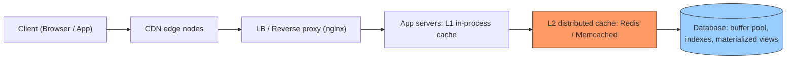
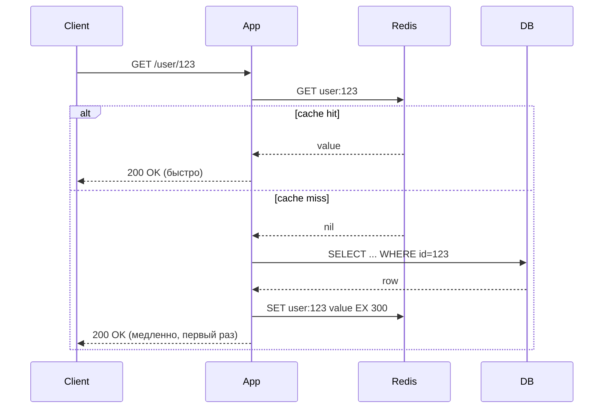
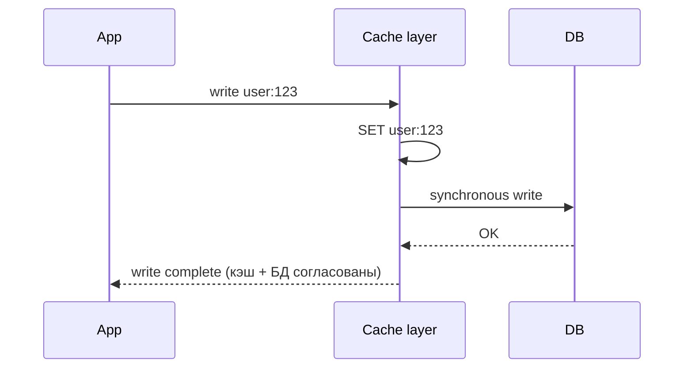

# Кэширование

> Кэш — это временное хранилище копий часто запрашиваемых данных в более быстром слое,
> чтобы не ходить каждый раз в медленный источник истины. Кэширование — один из самых
> частых «building blocks» на System Design интервью: интервьюеры любят копать в
> консистентность, hot keys и thundering herd. Этот файл покрывает всё, что нужно,
> чтобы говорить о кэше уверенно и с цифрами.

## Зачем кэшировать: четыре честные причины

На собеседовании кэш нельзя ставить «просто потому что всегда ставят». Нужно назвать
конкретный bottleneck и показать, как кэш его снимает. Четыре легитимные причины:

1. **Сокращение latency.** Разница в скорости доступа — порядки:
   чтение с SSD ≈ 1 мс, чтение из RAM ≈ 100 нс — то есть память быстрее примерно
   в **10 000 раз**. Сетевой round-trip через полмира (например, клиент в Австралии,
   origin в Вирджинии) — 300–350 мс против 20–40 мс до ближайшего edge-сервера CDN.
2. **Снятие нагрузки с нижележащих слоёв.** БД деградирует под read-heavy трафиком —
   кэш принимает hit'ы на себя. Важно: БД должна **выживать и без кэша** (пусть и
   медленнее), иначе вы построили систему, где падение кэша = падение всего сервиса.
3. **Переиспользование дорогих вычислений.** Персональная лента новостей требует
   join'ов постов, подписок и лайков по нескольким таблицам — считаем один раз,
   кладём в кэш с TTL 60 секунд, раздаём из Redis. Ночные рекомендации, топы товаров —
   та же история.
4. **Живучесть при кратковременных отказах.** Если внешний API (курсы валют,
   сторонний сервис) лёг, можно какое-то время отдавать устаревшие данные из кэша
   вместо ошибок. Классика — директива `proxy_cache_use_stale` в nginx: upstream умер,
   а пользователи продолжают получать ответы, пока он поднимается.

### Когда кэшировать НЕ надо

- **Данные меняются очень часто (раз в секунды)** и должны быть актуальными:
  баланс счёта, лимиты, счётчик просмотров «вживую». Инвалидация съест всю выгоду.
- **Критична строгая консистентность:** права доступа, ролевая модель. Окно
  устаревания = окно для эксплойта.
- **Читать из БД и так дёшево:** маленький справочник на одну страницу с индексом.
  Такие данные проще закэшировать прямо в памяти приложения, чем тащить Redis.
- **Данные короткоживущие:** стоимость постоянной инвалидации выше выигрыша.

Эмпирическое правило: кэшируем то, что **часто читается, редко пишется**, где
допустимо небольшое расхождение по консистентности и где выигрыш больше стоимости
проектирования, обслуживания и инвалидации.

### Базовый словарь (без него никуда)

| Термин | Значение |
|---|---|
| Cache hit | Данные нашлись в кэше — отдали быстро |
| Cache miss | В кэше пусто — идём в источник (зря сходили в кэш + поход в БД) |
| Hit ratio | `hits / (hits + misses)` — главная метрика эффективности кэша |
| TTL (time-to-live) | Время жизни записи, после которого она считается протухшей |
| Stale data | Устаревшие данные в кэше относительно источника истины |
| Hot key | Ключ, на который приходится непропорционально много запросов (профиль Тейлор Свифт) |
| Прогрев (cache warming) | Наполнение пустого кэша данными до/при старте |

Отдельный трюк, который любят на собеседованиях: **негативное кэширование** — кэшировать
не только данные, но и факт их отсутствия (и даже ошибки, например 403). Иначе запросы
к несуществующим ключам каждый раз пробивают кэш и идут в БД. Это и есть вектор
атаки **cache penetration / cache-miss attack**: злоумышленник генерирует запросы к
несуществующим ключам, всё летит мимо кэша в БД, и БД, которая «жила за счёт кэша»,
ложится. Защита — плейсхолдер «пусто» с коротким TTL или Bloom filter перед кэшем.
Осторожно: не кэшируйте 503 — сервис восстановится, а вы продолжите раздавать ошибку.

## Уровни кэша: от браузера до базы

Правило: **чем ближе кэш к пользователю, тем раньше мы перехватываем запрос**, тем
меньше конкурентных запросов гуляет по системе и тем ниже latency. Двигаясь от клиента
к БД, растут точность и надёжность данных — но и время ответа и нагрузка на нижние слои.

### 1. Клиентский кэш (browser / mobile)

- Что храним: JS/CSS-бандлы, шрифты, картинки; на мобиле — данные для offline-режима
  (как Strava кэширует трек пробежки и синкает при появлении сети).
- Управление: HTTP-заголовки `Cache-Control`, `ETag`, версионирование имён файлов
  (`app.v3.js` — content hash в имени, и можно ставить бесконечный TTL).
- Плюс: ноль сетевых запросов. Минус: почти нет контроля — инвалидация и свежесть
  на совести клиента. На собеседовании вспоминается редко, в основном для offline-first
  и client-heavy задач.

### 2. CDN

- Географически распределённые edge-узлы: оптимизируем не «память против диска»,
  а **сетевую задержку** (300 мс → 20–40 мс).
- Что храним: медиа (картинки, видео, статика), публичные API-ответы, HTML.
  Современные CDN умеют и edge-логику (персонализация на краю).
- Работает по паттерну read-through: промах → CDN сам идёт на origin (S3),
  кэширует и отдаёт.
- В интервью: упоминать для любой задачи с глобальными пользователями и медиа
  (ленты, видео, картинки товаров). Разгружает origin по трафику.

### 3. LB / reverse proxy (nginx, Varnish)

- Кэш HTTP-ответов на балансировщике/прокси. Killer-фича — `stale-while-revalidate`
  и `proxy_cache_use_stale`: отдаём протухший ответ, пока в фоне обновляем,
  или пока upstream лежит.

### 4. Кэш приложения (L1, in-process)

- Данные в памяти самого процесса (Caffeine/Guava в Java, `functools.lru_cache` в Python).
- **Самый быстрый кэш из возможных** — нет даже сетевого хопа до Redis.
  Современные app-серверы — жирные машины с сотнями ГБ RAM; грех не пользоваться.
- Что храним: конфиги, фича-флаги, маленькие справочники, lookup-таблицы, которые
  нужны каждому запросу.
- Минусы: каждый инстанс видит только свой кэш → рассинхрон между инстансами и
  дублирование памяти. Сервис становится частично stateful: запрос на разные ноды
  может вернуть разные ответы, что ломает модель «роутим куда угодно».
- Когда поднимать в интервью: ultra-low latency, конфиги на каждый запрос,
  и как **второй уровень защиты от hot keys** (об этом ниже).

### 5. Распределённый кэш (L2: Redis, Memcached)

- Отдельный компонент со своей памятью, общий для всех app-серверов: один инстанс
  прогрел ключ — остальные сразу получают hit. Это главный уровень, о котором
  говорят на собеседованиях.
- Что храним: результаты тяжёлых запросов (персональные ленты, топы), ответы
  сторонних API, сессии, объекты «часто читается — редко пишется».

### 6. База данных

- Источник истины. Дошли сюда — значит, промахнулись по всем слоям (или нам нужны
  строго консистентные данные: баланс, права).
- У самой БД тоже есть «кэши»: buffer pool, кэш планов запросов, индексы,
  материализованные представления — по сути, кэширование на уровне хранилища.

### Ловушка многослойности: одни данные под разными ключами

Классический баг из продакшена: пользователь меняет адрес в профиле, обновляет
страницу — всё ок; переходит в корзину — там старый адрес. Причина: адрес лежит
под ключами `profile:user:123` и `cart:user:123` в разных слоях, а инвалидировали
только часть. Абсолютной cache coherence не существует — всегда есть лаг. Поэтому
на этапе требований договоритесь: **какие окна устаревания допустимы для каждого
домена системы** (профиль — 5 минут ок, баланс — 0).

## Паттерны работы с кэшем

Паттерн определяет порядок чтений/записей между приложением, кэшем и БД.
Дефолт на собеседовании — **cache-aside**. Важно: интервьюерам не важны названия —
важно, чтобы вы чётко описали поведение («сначала смотрю в кэш, промах — иду в БД,
кладу в кэш, возвращаю»). Но названия знать приятно.

### Cache-Aside (Lazy Loading) — дефолт

Приложение само координирует кэш и БД.

На записи: **сначала пишем в БД, потом инвалидируем ключ в кэше** (delete, не update —
см. «Инвалидацию» ниже). Плюсы: просто, прозрачно, кэш «худой» — в него попадает
только то, что реально запрашивают; работает с голым Redis/Memcached без фреймворков.
Минусы: cache miss стоит три хопа (кэш → БД → кэш); логика размазана по приложению —
легко забыть инвалидировать часть ключей (баг с корзиной выше).

### Read-Through

То же, что cache-aside, но кэш сам (через библиотеку/proxy/sidecar) ходит в БД при
промахе: приложение видит только кэш. Так работают CDN (промах → поход на origin).
Плюс: централизованная логика, меньше дублирования. Минус: запись в БД никак не
влияет на кэш → stale data до промаха или истечения TTL; нужен специальный фреймворк
(Hazelcast, Spring Cache) или sidecar. В интервью поднимайте в основном в контексте CDN.

### Write-Through

Все записи идут через кэш-слой, который синхронно пишет в БД; запись считается
завершённой, когда обновлены оба. Плюс: чтения всегда свежие. Минусы:

- запись дороже по latency (два синхронных пути);
- кэш-слой становится **критичным для записи**: упал — не пишем вообще;
- засоряем кэш данными, которые, возможно, никто не прочитает;
- **dual write problem**: одна из двух записей может упасть → рассинхрон, нужны
  ретраи и компенсации, а идеальной консистентности в распределённой системе нет.

Redis/Memcached это нативно не поддерживают — нужен фреймворк (Spring Cache,
Hazelcast) или ручная запись в оба места. Когда упоминать: только если чтения обязаны
быть строго свежими и запись редкая. Перед этим честно проверьте, что cache-aside +
инвалидация на записи вас не устраивает.

### Write-Behind (Write-Back)

Приложение пишет только в кэш; кэш асинхронно (батчами, через очередь сообщений)
сливает в БД. Плюсы: очень быстрые записи, высокий write-throughput, агрегация
батчей (накопили 500 записей → один insert в ClickHouse). Минусы:

- риск потери данных: кэш упал до сброса — данные пропали;
- eventual consistency и дубликаты при ретраях;
- запись в БД может упасть на constraint — и как тогда «отозвать» данные из кэша
  и предупредить пользователя?
- операционная сложность: брокер, ретраи, идемпотентность, порядок сообщений.

Применение: аналитика, метрики, кликстримы — где потеря малой доли событий допустима.
Совет из практики интервью: если вы не готовы уверенно защитить write-behind,
не предлагайте его — он открывает больше вопросов, чем закрывает.

### Сводная таблица

| Паттерн | Чтение | Запись | Консистентность | Когда брать |
|---|---|---|---|---|
| Cache-aside | miss = кэш + БД + запись в кэш | В БД + invalidate ключа | Окно stale до инвалидации/TTL | **Дефолт почти всегда** |
| Read-through | Как aside, но БД ходит кэш | Отдельно, кэш не в курсе | Stale до промаха/TTL | CDN, фреймворки, sidecar |
| Write-through | Всегда свежее | Медленная, через кэш в БД | Максимальная из кэшей | Редкие записи, строгая свежесть |
| Write-behind | Свежее из кэша | Мгновенная, БД — async батчами | Eventual, риск потерь | Аналитика, метрики, high write QPS |

## Инвалидация: самая тяжёлая часть

«There are only two hard things in Computer Science: cache invalidation and naming
things». Стратегий три, они **не взаимоисключающие — комбинируйте**:

1. **TTL only.** Ничего явно не инвалидируем, просто ставим TTL на каждую запись.
   Плюс — максимально просто. Минус — stale data не просто возможна, а гарантирована
   (максимум на длину TTL), и разные слои протухают с разной скоростью → разные
   версии «правды» одновременно. Подходит для маловажных данных (список товаров).
   **TTL ставьте всегда**, даже при других стратегиях — иначе получите «forever cache»,
   который месяцами раздаёт древние данные.
2. **Event-based.** Записали в БД → опубликовали событие → подписчики инвалидируют
   каждый свой слой. Централизованная логика, меньше человеческих ошибок. Цена —
   брокер и асинхронный лаг.
3. **Tag-based.** Помечаем связанные ключи одним тегом (`profile:user:123` и
   `cart:user:123` → тег `user:123`) и инвалидируем пачкой по тегу. Есть во многих
   фреймворках; снимает риск «забыл инвалидировать один из ключей».

И **версионирование ключей** для совместимости релизов: при canary/blue-green две
версии приложения живут одновременно, и если старая пишет в кэш одну структуру,
а новая — другую (удалили поле), они ломают друг друга. Решение — версия в ключе
(`user:v2:123`) и принцип expand → migrate → contract, как при миграциях схем БД:
сначала обе версии совместимы, потом старую отрезаем.

Мониторинг: метрика **stale read rate** — отдельный воркер периодически сверяет
выборку данных между БД и слоями кэша. Растёт — где-то теряем инвалидацию или TTL.

## Eviction: что вытеснять, когда память кончилась

Память не бесконечна: весь датасет в кэш обычно не влезает. Политика вытеснения
(eviction policy) решает, что выкинуть при вставке нового элемента.

| Политика | Идея | Когда уместна | Подводные камни |
|---|---|---|---|
| **LRU** (least recently used) | Вытесняем самый давно неиспользованный | Дефолт; временнáя локальность спроса | Scan/sequential access вымывает весь кэш: один полный проход по таблице вытесняет «горячее» |
| **LFU** (least frequently used) | Вытесняем реже всего запрашиваемое | Сильно скошенный доступ: немного ключей читают на порядки чаще | Холодные новые ключи вытесняются раньше, чем «накопят» счётчик; старые хиты «застревают» |
| **FIFO** | Вытесняем самый старый | Почти никогда; простота | Не учитывает популярность вообще |
| **TTL-based** | Вытесняем протухшее / с минимальным TTL | Свежесть важнее частоты (сессии, API-ответы) | Одновременное истечение множества ключей → avalanche (см. jitter) |
| **No eviction** | Ничего не вытесняем, новые записи падают с ошибкой | Кэш как хранилище (сессии, которые терять нельзя) | Плохой выбор для «классического» кэша — ручное разгребание |

Детали для deep dive:

- **LRU за O(1)** = hash map + doubly linked list. При обращении элемент двигается
  в голову; вытесняем из хвоста. Это стандартная coding-задача — уметь нарисовать
  структуру стоит даже на system design.
- **Redis не делает точный LRU**: он сэмплирует несколько ключей (`maxmemory-samples`,
  дефолт 5) и вытесняет худший из выборки — приближённый LRU/LFU, зато без
  дополнительных структур на каждый ключ. Политики Redis: `allkeys-lru`,
  `volatile-lru` (только среди ключей с TTL), `allkeys-lfu`, `volatile-lfu`,
  `volatile-ttl`, `allkeys-random`, `noeviction`. Дефолт — `noeviction`.
- **LFU в Redis**: счётчик с логарифмическим ростом и затуханием по времени
  (`lfu-decay-time`), чтобы старые хиты не жили вечно.
- Продвинутые варианты, о которых можно обмолвиться: **2Q** (два FIFO + LRU —
  защита от разового сканирования), **segmented LRU** (probation/protected сегменты,
  как в Caffeine), **time-aware LRU** (LRU + TTL на элемент), **LRU-K** (учитываем
  K последних обращений, а не одно). Достаточно упомянуть название и идею —
  это уровень «плюс в карму».

## Redis vs Memcached

| | Redis | Memcached |
|---|---|---|
| Модель исполнения | Однопоточный event loop (плюс фоновые потоки для I/O и persistence) | Многопоточный |
| Структуры данных | String, Hash, List, Set, **Sorted Set**, Bitmap, HyperLogLog, Stream, geohash | Только key→string |
| Persistence | RDB-снапшоты + AOF (append-only file) | Нет |
| Репликация / HA | Master-replica, Sentinel, Redis Cluster | Нет из коробки (реплика через клиентов/proxy, напр. mcrouter) |
| Эвикшн | Настраиваемые политики (`allkeys-lru` и др.) | Только LRU внутри slab-классов |
| CAS / транзакции | `WATCH/MULTI/EXEC`, Lua-скрипты, атомарные `INCR` | `gets/cas` |
| Типичные роли | Кэш + сессии, rate limiter, leaderboard'ы (sorted set), pub/sub, очереди, distributed locks | Простой «тупой и быстрый» кэш объектов |

Как рассуждать на собеседовании:

- **Почему однопоточный Redis так быстр?** Всё в памяти, O(1)/O(log n) структуры,
  event loop с I/O multiplexing (epoll/kqueue), нет переключений контекста и
  блокировок; узкое место — сеть, а не CPU. Одна нода на нормальном железе держит
  порядка **100k+ простых операций/сек**; p99 latency — субмиллисекунды.
- **Следствие однопоточности**: горячий ключ/медленная команда (`KEYS *`, большой
  `SMEMBERS`, `LRANGE` на миллион) блокирует всех остальных. Поэтому никаких `KEYS`
  в проде — только `SCAN`.
- **Масштабирование Redis**: сначала один инстанс → реплики для чтения и HA
  (primary принимает записи, реплики — read-трафик) → client-side sharding, когда
  упёрлись в запись/память (клиент хэширует ключ и выбирает ноду; для статического
  кластера хватит `hash mod N`, для динамического — consistent hashing, библиотеки
  типа Ketama) → Redis Cluster, когда нужны автоматический шардинг и failover
  (16384 hash-слота, клиент знает топологию). Падение ноды при cache-использовании =
  просто cache miss для её ключей, пока кэш не переполнится.
- **Когда Memcached**: нужен максимально простой распределённый key-value кэш без
  персистентности и структур, с линейным масштабированием по CPU-ядрам. Классика —
  Facebook: сотни серверов Memcached как «тупой» кэш перед MySQL.
- **Когда Redis**: нужны структуры (leaderboard на sorted set, rate limiter на
  `INCR`+TTL, счётчики), persistence, репликация, Lua-атомарность. На практике
  дефолт индустрии сейчас — Redis; но уметь назвать trade-off'ы Memcached — плюс.

## Типовые проблемы и как их решать

Именно здесь интервьюеры «копают». Называйте проблему сами до того, как спросили.

### Thundering herd (cache stampede, «грохочущее стадо»)

Популярный ключ истекает по TTL → тысячи одновременных запросов получают miss →
все ломятся в БД пересчитывать одно и то же значение → БД ложится. Пример: лента
закэширована на 60 секунд, при 100k RPS истечение одного ключа превращает один
запрос в БД в 100 000. Два сценария: истёк один супергорячий ключ **или** много
ключей истекли одновременно. Решения (комбинировать):

- **Request coalescing / single-flight**: только первый запрос идёт в БД, остальные
  ждут и читают готовый результат. В Go — `singleflight`, в Redis — короткий lock
  на ключ пересчёта (`SET lock:key NX EX 10`).
- **Early refresh / cache warming**: отдельный воркер обновляет горячие ключи до
  истечения TTL (на 55-й секунде из 60) — ключ не протухает никогда.
- **Stale-while-revalidate**: протухшее значение отдаём сразу, обновляем в фоне.
  Осознанный трейд-офф консистентности на доступность (так умеет nginx).
- **Jitter на TTL**: не `TTL=180s` ровно, а `180s ± random(0..10s)` — размазываем
  моменты истечения, лечит сценарий «много ключей разом».
- **Probabilistic early expiration (XFetch)**: каждый запрос с растущей к истечению
  вероятностью инициирует пересчёт заранее — стадо «размазывается» само.

### Cache avalanche и холодный старт

Родственная проблема: лёг весь кластер кэша **или** массовое одновременное истечение
**или** рестарт с пустым кэшем → вся нагрузка мгновенно на БД. Пользователи ещё и
жмут F5, усугубляя. Чем отличается от stampede: stampede — много запросов на
**один** ключ, avalanche — на **много разных** ключей. Решения:

- circuit breaker перед БД — отсекаем запросы, пока система перегружена;
- HA кэш-кластер с репликами, чтобы «весь кэш» не падал разом;
- **прогрев**: active warmup (скрипт наполняет кэш заранее) или shadow warmup
  (новой версии даём копию трафика — она прогревает свой кэш реальными запросами);
- jitter на TTL (см. выше);
- принцип «БД должна выживать без кэша» — кэш ускоряет, а не держит систему.

Отдельный коварный случай: **деплой новой версии** выглядит как avalanche — у новых
подов пустой L1/несовместимый кэш, и все запросы идут в БД. Отсюда же — версионирование
ключей.

### Hot keys

Один ключ (профиль Тейлор Свифт, товар-распродажа) получает миллионы RPS — перегревает
одну ноду/шард Redis даже при отличном общем hit ratio. А из-за однопоточности Redis
тяжёлый трафик на один ключ мешает остальным запросам этой ноды. Решения:

- **Репликация горячего ключа** на несколько нод (`taylor:1..N`) + балансировка
  чтений между ними — или просто read-реплики шарда.
- **Локальный L1-кэш в приложении**: супергорячие значения читаются из памяти
  процесса и вообще не доходят до Redis (короткий TTL, секунды).
- Отдельный Redis-инстанс под горячие ключи с маршрутизацией на него.
- **Обнаружение**: мониторинг hit ratio и RPS **по ключам** (Redis `MONITOR` в проде
  нельзя — используйте `redis-cli --hotkeys` с LFU, sampled keys, клиентские метрики).
  Без мониторинга вы hot key просто не увидите.

### Stale data и гонки

Читаем из кэша, пишем в БД → всегда есть окно, где кэш отдаёт старое. Что делать:

- **Invalidate on write**: пишем в БД → `DEL` ключа (не `SET`! при update-on-write
  два конкурентных писателя могут оставить в кэше устаревшее значение; delete идемпотентен).
  Порядок «БД, потом delete» важен: при «delete, потом БД» гонка чтения может
  вернуть в кэш старое значение. Для параноиков — **delayed double delete**:
  удалить ключ повторно через ~500 мс после записи.
- **Короткие TTL**, если минутная несвежесть допустима (и это нормальный ответ на
  собесе: «профиль с TTL 5 минут — часть пользователей видит старую аватарку,
  бизнесу ок»).
- Принять eventual consistency явно и записать это в требования.
- **Гонки при записи в кэш**: оптимистичная блокировка через `WATCH/MULTI/EXEC`
  (CAS в Redis) или версия в значении (`INCR user:123:ver`, пишем `user:123:v42`).
  При низкой конкуренции — достаточно. При высокой — постоянные ретраи, и тогда
  пессимистичная блокировка через Redlock/ZooKeeper/etcd, но на собесе до этого
  обычно не доходят — упомянуть границу применимости уже хорошо.

### Cache poisoning и cache deception

Кэш — ещё и поверхность атаки:

- **Poisoning**: злоумышленник (или вы сами по ошибке) кладёт в кэш неправильное
  значение, которое разъезжается по всей системе.
- **Deception**: публичный слой кэша (CDN) начинает считать приватный контент
  (страницу аккаунта) публичным и раздаёт чужие персональные данные. Защита:
  строгий контроль того, что кэшируется на каждом слое (`Cache-Control: private,
  no-store` для персонального), валидация типов данных, наблюдаемость — аномально
  выросший hit ratio на публичном кэше как симптом.

## Как говорить о кэше на собеседовании

### Когда поднимать тему

Кэш логично вводить на этапе deep dive, когда обсуждаете **масштаб и latency**
из non-functional requirements. Четыре триггера:

1. **Read-heavy нагрузка душит БД.** «100M DAU × 20 запросов = 2 млрд чтений в сутки
   (~23k RPS средних, в пике ×3–5). БД столько не выдержит — ставим кэш перед ней».
2. **Дорогие запросы.** «Лента — это join постов, подписок и лайков; считать на
   каждый запрос дорого, кэшируем готовую ленту с TTL 60 секунд».
3. **Жёсткое SLO по latency.** «На endpoint стоит 100 мс p99 — запрос с join'ами
   не укладывается, значит, отдаём из Redis».
4. **Защита внешних зависимостей.** «У стороннего API rate limit — вычитываем курс
   одним воркером раз в минуту, раздаём из кэша».

Антипаттерн: молча нарисовать квадратик «Cache» между сервисом и БД. Даже если это
правильно, отсутствие обоснования — красный флаг.

### Фреймворк из 5 шагов (проговорить вслух, по порядку)

1. **Назвать bottleneck с цифрой** (см. выше).
2. **Что кэшируем: ключи и значения.** Будьте конкретны: «ключ `feed:{user_id}`,
   значение — сериализованный список из 50 post_id, TTL 60 с». Формулировка
   «добавлю кэш, и всё решится» без ответа на вопрос «какой у тебя cache key?» —
   типичный провал junior/mid-кандидатов.
3. **Паттерн.** «Cache-aside: читаем из Redis, miss — ходим в Postgres, пишем в
   Redis, возвращаем. На записи — пишем в БД и инвалидируем ключ».
4. **Eviction и TTL.** «LRU через `allkeys-lru` + TTL 5 минут против stale данных;
   память кэша ~20% от горячего датасета».
5. **Обратная сторона.** Сами назовите 1–2 релевантных риска: «здесь возможен
   thundering herd на ключе ленты — добавлю single-flight и early refresh; профили
   селебрити — hot keys, продублирую на read-реплики и L1 в приложении».

Такой проход по пяти пунктам занимает две минуты и выглядит как продакшен-опыт.

### Уточняющие вопросы интервьюеру (до того, как ставить кэш)

- Какое соотношение read/write? (Кэш на write-heavy системе — сомнительная идея.)
- Какие требования к свежести данных в каждом домене? Где допустимо окно устаревания
  и какое? (Профиль — минуты, баланс — ноль.)
- Какой объём горячего датасета? Влезает ли в память, какой hit ratio реалистичен?
- Есть ли глобальные пользователи и тяжёлая статика? (Повод для CDN.)
- Как ведут себя данные: есть ли «селебрити»/hot spots в распределении ключей?

### Красные флаги и типичные ошибки кандидатов

- Кэш «для галочки» без bottleneck и цифр.
- Не может назвать cache key и что лежит в value.
- Update-on-write вместо invalidate-on-write; порядок «сначала удалил из кэша, потом
  записал в БД».
- Кэш без TTL вообще (forever cache) или одинаковый TTL на всё без jitter.
- Система, где БД без кэша мгновенно умирает, и кандидат считает это нормой.
- «Redis — многопоточный» / использование `KEYS *` в проде.
- Предлагает write-behind/write-through, не сумев объяснить dual write problem
  и риск потери данных.
- Забывает про инвалидацию связанных ключей (профиль vs корзина) и про совместимость
  форматов при деплое.
- Путает stampede (один ключ) и avalanche (много ключей / весь кластер).

### Что спросят дополнительно (готовьте ответы)

- «Как реализовать LRU за O(1)?» — hash map + doubly linked list.
- «Почему Redis быстрый, хотя однопоточный?» — in-memory, event loop, нет локов.
- «Как пережить падение всего кэш-кластера?» — circuit breaker, прогрев, БД держит
  нагрузку, HA-топология.
- «Как инвалидировать кэш в нескольких ДЦ?» — события через брокер / CDC (Debezium
  → Kafka → invalidate), TTL как safety net.
- «Как найти hot keys в проде?» — per-key метрики, `--hotkeys` с LFU, sampling.
- «Кэш или денормализация/материализованные вьюхи?» — уметь сравнить: view живёт
  в БД, консистентнее, но грузит саму БД; кэш гибче, но добавляет слой и инвалидацию.

## Источники и видео по теме

- [Кэширование в интервью по системному проектированию с инженером Meta Staff](https://www.youtube.com/watch?v=1NngTUYPdpI)
- [Продвинутое кэширование System Design](https://www.youtube.com/watch?v=_96AOLES_6M)
- [Теория кэширования - System Design](https://www.youtube.com/watch?v=Rk1w1ouzE58)
- [Как кэшировать данные / Теория кэширования - System Design](https://www.youtube.com/watch?v=iLMlYgQoTIE)
- [Ловушки кэширования, о которых должен знать каждый разработчик](https://www.youtube.com/watch?v=wh98s0XhMmQ)
- [Что представляет собой Redis на самом деле? Почему он так популярен?](https://www.youtube.com/watch?v=z_NbVtbgBJw)
- [System Design Interview - Distributed Cache](https://www.youtube.com/watch?v=iuqZvajTOyA)
- [Глубокое погружение в Redis с бывшим старшим менеджером Meta](https://www.youtube.com/watch?v=fmT5nlEkl3U)
