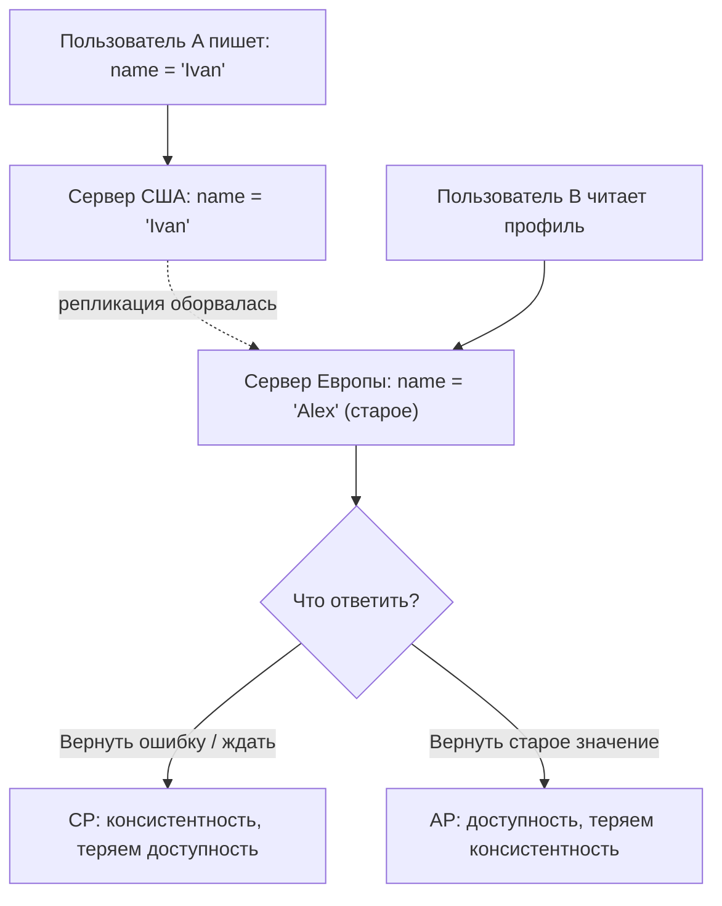
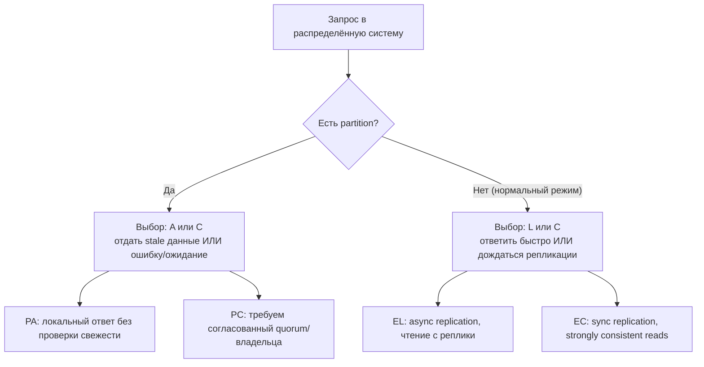
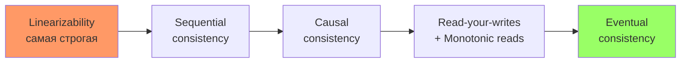
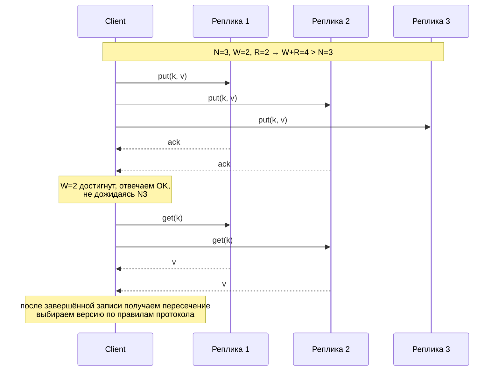

# CAP, PACELC и модели консистентности

<!-- learning-nav:start -->
[← Все разделы](../README.md) · [Предыдущая тема](databases.md) · [Следующая тема →](sharding.md)
<!-- learning-nav:end -->

> Что нужно уметь на собеседовании: за 2–3 минуты объяснить CAP без зауми,
> осознанно выбрать между consistency и availability под конкретную задачу,
> назвать уровни консистентности (linearizability → eventual) и объяснить,
> как кворумы `R + W > N` управляют trade-off'ом. Этот разговор почти всегда
> возникает на этапе non-functional requirements и влияет на весь дальнейший дизайн.

## Оглавление

<!-- toc:start -->

Показать темы и вопросы

- [Зачем это на собеседовании](#зачем-это-на-собеседовании)
- [CAP-теорема простым языком](#cap-теорема-простым-языком)
- [Почему «выбери 2 из 3» — упрощение](#почему-выбери-2-из-3--упрощение)
- [PACELC: что CAP не сказал про latency](#pacelc-что-cap-не-сказал-про-latency)
- [Спектр моделей консистентности](#спектр-моделей-консистентности)
- [Linearizability под капотом](#linearizability-под-капотом)
- [Кворумы: R + W &gt; N](#кворумы-r--w--n)
- [Как системы достигают консистентности](#как-системы-достигают-консистентности)
- [Как обсуждать trade-off на собеседовании](#как-обсуждать-trade-off-на-собеседовании)
- [Красные флаги и типичные ошибки](#красные-флаги-и-типичные-ошибки)
- [Deep dive: конфликты и восстановление после partition](#deep-dive-конфликты-и-восстановление-после-partition)
- [Что спросят дополнительно](#что-спросят-дополнительно)
- [Видео по теме](#видео-по-теме)

<!-- toc:end -->

---

## Зачем это на собеседовании

Первое, что вы делаете после сбора functional requirements, — это фиксация
non-functional requirements. И самый первый вопрос там: **что для системы важнее —
консистентность или доступность?** Это не абстрактная теория: от ответа зависят
выбор БД, схема репликации, API-контракты и весь deep dive.

Типичный ход интервьюера:

1. «Какие non-functional requirements у нашей системы?» — ждёт, что вы сами
   поднимете тему consistency vs availability, а не будете ждать подсказки.
2. «Что будет, если два пользователя одновременно...» — провокация на тему
   гонок, stale reads, double booking.
3. «Почему ты выбрал Cassandra/Postgres/DynamoDB?» — правильный ответ почти
   всегда упирается в модель консистентности, которую вы только что выбрали.

Сильный сигнал для senior-уровня: показать, что consistency — это не бинарный
переключатель, а спектр, и что **разные части одной системы могут выбирать
разные точки спектра** (бронирование мест — strong consistency, описание
события — eventual consistency).

---

## CAP-теорема простым языком

Формулировка: в распределённой системе при сетевом разделении (partition)
приходится выбирать между консистентностью (Consistency) и доступностью
(Availability). Все три свойства одновременно недостижимы.

| Буква | Свойство | Простыми словами |
|---|---|---|
| **C** | Consistency | Операции эквивалентны единой копии с порядком, согласованным с реальным временем: linearizability. Физические копии могут временно различаться, если протокол не отдаёт устаревший ответ. |
| **A** | Availability | Каждый запрос к неотказавшему узлу в конце концов получает корректный для операции ответ. В формальной CAP нет фиксированной границы latency; бесконечное ожидание и ответ «недоступно» не удовлетворяют A. |
| **P** | Partition tolerance | Система продолжает работать, когда сеть между узлами рвётся: пакеты теряются, задерживаются, дата-центры изолируются. |

Ключевой мысленный эксперимент (его удобно рисовать на доске): два сервера —
в США и в Европе. Пользователь A обновил имя в профиле на сервере в США.
Данные реплицируются в Европу. Теперь **разрываем сеть между серверами до того,
как реплика прошла**. Пользователь B в Европе читает профиль. У системы ровно
два варианта:

- **Вернуть ошибку** («данные могут быть неактуальны, попробуйте позже») →
  выбрали **C**, пожертвовали **A**.
- **Вернуть старое имя** → выбрали **A**, пожертвовали **C**.

Третьего варианта нет — в этом и есть вся теорема.

### Почему P — не опция

Важный нюанс, который любят проверять: в распределённой системе **partition
tolerance — это не выбор, а данность**. Сети падают: теряются пакеты, ломаются
коммутаторы, облачные регионы изолируются. Поэтому реальный выбор всегда звучит
так: «**при** partition мы берём C **или** A», а не «выбираем 2 из 3».

Термин CA имеет смысл только в модели, исключающей разделение сети. Это не синоним «один узел» и не обещание пережить partition. Для распределённого сервиса полезнее явно сказать, какие операции продолжатся на каждой стороне разрыва, а какие будут ждать или возвращать ошибку.

---

## Почему «выбери 2 из 3» — упрощение

Чтобы применить CAP к задаче, уточните требуемую гарантию чтения, модель сетевого отказа и поведение каждой операции.

**1. Практические требования шире бинарных свойств теоремы.**

- В теореме availability задана как свойство завершения всех запросов к живым узлам. Процент успешных запросов и uptime — отдельные эксплуатационные SLO.
- В теореме C — linearizability; в дизайне можно выбрать более слабую модель, но это уже изменение гарантии, а не «частичная CAP C».
- Даже «partition» не бинарна: хикап сети на 200 мс — это partition или нет?
  Таймаут задаёт момент реакции протокола, но не доказывает partition: медленный процесс и задержанная сеть выглядят одинаково. В асинхронной модели нельзя надёжно отличить их только по отсутствию ответа.

**2. CAP говорит только о поведении во время partition.**

Частота разделений зависит от инфраструктуры; CAP не задаёт её числом. Теорема не говорит,
что оптимизировать в это время. Современная трактовка: **в нормальном режиме учитываем latency, изоляцию и стоимость; поведение при partition проектируем заранее** —
как runtime-решение, а не как вечную идентичность системы («мы AP-система»).

**3. Треугольник скрывает, что система живёт «внутри», а не в вершинах.**

Разные операции в одной системе могут иметь разные ответы на вопрос «что делать,
если прямо сейчас нет связи с остальным миром?»:

| Операция | Поведение при partition | Почему |
|---|---|---|
| Чтение профиля пользователя | Разрешить (из локального кэша) | Ничего не ломается, максимум stale данные |
| Регистрация email | Заблокировать | Email должен быть глобально уникален — проверить нельзя |
| Снятие денег в банкомате | Разрешить до лимита (например, $200) | Риск ограничен, инвариант «баланс ≥ 0» можно нарушить контролируемо |
| Списание с кредитки | Поставить в очередь до восстановления | Внешнее действие, которое нельзя отменить |

Представьте банкомат в автономном режиме. При потере связи он может выдавать деньги в пределах заранее согласованного лимита и записывать операции в локальный журнал. После восстановления связи банк сверяет журнал с балансом. Два автономных банкомата не видят выдач друг друга, поэтому возможный перерасход входит в цену такого режима.
Формула: **принять операцию → ограничить риск → обнаружить нарушение →
скомпенсировать**. Это и есть зрелый ответ на вопрос «что делает ваша система,
когда не может иметь всё сразу».

---

## PACELC: что CAP не сказал про latency

CAP молчит про latency, а ведь вся суть CAP разыгрывается именно в таймауте:
узел A записал данные и ждёт подтверждения от узла B; B тормозит — нагрузка,
сеть или реальный отказ, со стороны A неотличимо. В какой-то момент A решает:
отменить (страдает A) или продолжить без подтверждения (страдает C). Ждать
бесконечно = «консистентность с бесконечной latency».

Эту дыру закрыл Daniel Abadi, предложив **PACELC** (блог 2010, формализация 2012):

> **P**artition → **A**vailability **o**r **C**onsistency;
> **E**lse (в нормальном режиме) → **L**atency **o**r **C**onsistency.

Вторая половина напоминает: координация и ожидание реплик добавляют latency даже без отказов. Это полезная модель trade-off, но не утверждение, что любое ускорение обязательно ослабляет консистентность.

PACELC проявляется буквально в конфигах и счетах за облако:

- **DynamoDB**: strongly consistent read стоит **в 2 раза больше read capacity
  units** и медленнее — consistency буквально продаётся как строка в биллинге.
- **MongoDB**: `readPreference` (`primary` vs `nearest` / `secondaryPreferred`)
  и write concern (`w: 1` vs `w: "majority"`).
- **Cassandra**: `ConsistencyLevel` (`ONE`, `QUORUM`, `ALL`) на каждый запрос.
- **Репликация**: ожидание нужных ACK увеличивает latency; sync/async сами по себе не определяют CAP-класс, если не описаны read path и failover.

Условные примеры по PACELC (классифицируется операция и конфигурация, не бренд):

| Система | При partition | В норме (Else) | Класс |
|---|---|---|---|
| Чтение доступной локальной реплики без проверки свежести | A | L | **PA/EL** |
| etcd linearizable read/write через большинство | C | C (координация) | **PC/EC** |
| Согласованная запись через межрегиональный consensus | C | C | **PC/EC** |
| Одна БД с разными read/write concerns | Зависит от операции | Зависит от операции | Требует отдельного разбора |

---

## Спектр моделей консистентности

Когда на собеседовании говорят «consistency» в контексте CAP — почти всегда
имеют в виду **strong consistency** (все чтения видят последнюю запись). Но
между «полная строгость» и «когда-нибудь сойдётся» есть полезные промежуточные
уровни. Знание спектра — то, что отличает senior-ответ от джунского.

Модели ниже не являются универсальной линейкой всех свойств: session guarantees (read-your-writes, monotonic reads), сходимость и транзакционная изоляция — разные оси. Диаграмма показывает полезные для обсуждения ослабления, а не полную классификацию.

| Модель | Гарантия | Пример из жизни | Цена |
|---|---|---|---|
| **Linearizability** | Каждая операция выглядит так, будто выполнилась мгновенно в одной точке времени; есть единый глобальный порядок операций, уважающий реальное время | Атомарный conditional reserve места 6A; отдельные linearizable read и write без условности всё ещё допускают гонку | Максимальная: consensus на запись, выше latency, ниже доступность при partition |
| **Sequential** | Есть единый порядок всех операций, сохраняющий программный порядок каждого клиента, но не обязанный сохранять порядок реального времени | Редко обсуждается на собеседовании; упомянуть «знаю, что есть» достаточно | Высокая |
| **Causal** | Причинно связанные события видны всем в одном порядке; несвязанные — могут расходиться | Комментарий-ответ никогда не виден раньше комментария, на который отвечают | Средняя: нужны version vectors / метаданные причинности |
| **Read-your-writes** | Пользователь всегда видит результат собственной записи; другие могут видеть старое | Обновил аватар — сам сразу видишь новый, остальные докатят через секунды | LSN/version barrier либо чтение с актуального лидера |
| **Monotonic reads** | Если клиент прочитал значение, он никогда не увидит более старое | Лента не «откатывается» назад при повторном запросе | Контроль минимальной версии; sticky routing требует правил failover |
| **Eventual** | Если записи прекратились, все реплики **когда-нибудь** сойдутся к одному значению. Без верхней границы «когда» | Счётчик лайков, DNS, описание ролика на YouTube | Минимальная: максимум доступности и скорости |

Два уточнения, которые поднимают ответ:

1. **«Eventual» — не «никогда».** Формальная гарантия сходимости предполагает доставку и восстановление, но верхней границы времени не задаёт. Если бизнес требует bounded staleness, нужны измерение и read policy: ждать, переключать источник или отказывать при превышении границы. Один алерт такую гарантию не создаёт.
2. **Выбор availability не доказывает eventual convergence.** Сходимость обеспечивают доставка, хранение версий, repair и правило разрешения конфликтов. Их нужно проектировать явно.

---

## Linearizability под капотом

Формально: система линеаризуема, если для истории операций существует такой
порядок, что (а) он согласован с реальным временем (если операция X завершилась
до старта Y, то X идёт перед Y) и (б) каждое чтение возвращает результат
последней записи в этом порядке.

Интуиция «на пальцах» для доски: **снаружи система выглядит как одна копия
данных**, даже если внутри реплик десятки. Recency-гарантия: чтение, начатое после подтверждённой записи, не может вернуть предшествующее ей значение (если более поздняя запись уже не заменила его). Для конкурентных операций допустим любой согласованный порядок.

Как это достигается на практике:

- **Single-leader replication + чтение только с лидера.** Все записи идут
  через лидера, лидер задаёт порядок. Ловушка: чтение со stale-реплики ломает
  гарантию, а два «лидера» после partition (split brain) ломают её катастрофически —
  поэтому выборы, подтверждение записей и fencing должны образовывать безопасный протокол. Лидер после partition также проверяет своё актуальное право на linearizable read (например, quorum/read-index или корректный lease), а не просто читает локальную память.
- **Consensus-протоколы (Raft, Paxos, ZAB).** Запись считается committed,
  когда её подтвердило большинство (quorum) узлов. Так работают etcd,
  ZooKeeper, Consul, Spanner-подобные системы.
- **Single-threaded execution.** Последовательное выполнение отдельных команд на одном Redis-узле упрощает атомарность, но не делает составной `GET` → `SET` атомарным и не гарантирует linearizability через async-failover.

Цена (важно озвучить):

- **Latency**: запись ждёт round-trip до большинства реплик; cross-region
  linearizable-запись легко стоит 100–300 мс.
- **Доступность**: при partition меньшинство не может писать вовсе.
- **Throughput**: consensus — это сериализация, она не масштабируется шардированием
  внутри одной группы (масштабируют шардированием *между* группами consensus).

---

## Кворумы: R + W > N

Если consensus — «тяжёлая» дорога к строгости, то кворумы — тюнингуемый
механизм Dynamo-стиля (Cassandra, Riak, DynamoDB, ScyllaDB). Модель:

- `N` — число реплик каждой записи (обычно 3);
- `W` — сколько реплик должны подтвердить запись, чтобы она считалась успешной;
- `R` — сколько реплик опрашиваем при чтении.

**Если `W + R > N`, множества успешной записи и чтения пересекаются**, когда оба набраны из одного фиксированного набора N реплик. Чтобы прочитать последнюю завершённую запись, нужны ещё корректное версионирование, выбор самой новой версии и отсутствие более позднего конфликта; пересечение само не даёт linearizability. При `W + R ≤ N` множества могут не пересечься, но это не означает обязательный stale read.

`W > N/2` обеспечивает пересечение любых двух write quorums. Оно **не запрещает обеим конкурентным записям успешно завершиться**: общая реплика может принять обе. Для условного обновления и защиты read-modify-write нужен протокол сериализации, например Cassandra LWT, а не одна арифметика.

Типовые конфигурации при N=3:

| W | R | W+R | Поведение | Когда брать |
|---|---|---|---|---|
| 2 | 2 | 4 > 3 | Пересечение read/write quorums; одна недоступная реплика допустима | Пример `QUORUM` при RF=3, не утверждение о настройке по умолчанию |
| 1 | 3 | 4 > 3 | Быстрая запись, медленное чтение | Write-heavy нагрузки (логи, события) |
| 3 | 1 | 4 > 3 | Быстрое чтение, дорогая запись; запись падает, если любая реплика недоступна | Read-heavy, но на практике редко |
| 1 | 1 | 2 ≤ 3 | Максимальная скорость и доступность, eventual consistency | Метрики, счётчики просмотров |
| 3 (`ALL`) | 1 | 4 > 3 | Пересечение, но запись недоступна при падении любой реплики; конкурентные конфликты всё ещё возможны | Когда цена ожидания всех реплик приемлема |

Нюансы, которые спросят на deep dive:

- **Это не linearizability бесплатно.** `W + R > N` само по себе не спасает от
  конкурентных записей (last-write-wins может потерять апдейт) и от stale-read
  в момент незавершённой записи. Полноценную строгость дают lightweight
  transactions / Paxos-расширения (Cassandra LWT), и они заметно дороже.
- **Sloppy quorum и hinted handoff**: если «своя» реплика недоступна, запись
  временно принимает соседний узел и возвращает её, когда реплика оживёт.
  Доступность выше, но строгость `W + R > N` размывается (кворум набран не из
  «родных» реплик).
- **Read repair**: при чтении протокол сравнивает версии и восстанавливает
  отставшие копии (синхронность и охват зависят от реализации) — окно рассинхрона сжимается само при трафике чтений.
- **Анти-энтропия (merkle trees)**: фоновая сверка реплик целиком — закрывает
  «хвост» рассинхрона для данных, которые никто не читает.

---

## Как системы достигают консистентности

Свяжите выбор модели консистентности с конкретными механизмами — интервьюер
ждёт именно этот мостик:

| Механизм | Что даёт | Цена | Где встречается |
|---|---|---|---|
| **Sync replication** (лидер ждёт заданный remote ACK) | Flush-ACK защищает долговечность в модели отказов, apply-ACK — видимость на подтвердившей реплике; failover требует отдельного протокола | Ожидание выбранного числа реплик; доступность зависит от политики ACK | PostgreSQL synchronous_commit, MySQL semi-sync |
| **Async replication** | Запись подтверждается сразу | Replication lag, потеря последних записей при падении лидера | Дефолт в большинстве БД |
| **Replica ACK policy** | Задаёт, кто и что должен подтвердить; majority и ISR — разные механизмы | Latency и допустимые отказы зависят от конкретного протокола | Kafka `acks=all` ждёт ISR, `min.insync.replicas` — порог допуска записи; MongoDB `w: "majority"` — большинство |
| **Consensus (Raft/Paxos)** | Linearizable-записи, безопасный failover без split brain | Round-trip на большинство, сложность | etcd, ZooKeeper, Consul, Spanner |
| **Distributed transactions (2PC)** | Атомарный исход у поддерживающих prepare/commit ресурсов; изоляция задаётся отдельно | Блокировки, координатор — точка отказа, latency | XA-транзакции; в современных системах чаще заменяют на outbox + eventual consistency |
| **CDC (change data capture)** | Асинхронная передача изменений в кэш/поиск/аналитику | Без read barrier возможен stale read; сходимость требует delivery/recovery | Debezium, Kafka Connect |

Про CDC важно назвать контракт чтения: в связке «БД → CDC → Elasticsearch/кэш» чтение производной без проверки прогресса допускает stale-данные. Сама асинхронная доставка не доказывает сходимость — нужны сохранность изменений, повторы и recovery. Более сильные read guarantees могут обеспечиваться ожиданием version/position barrier, проверкой версии или fallback к источнику; такой протокол нужно описать отдельно.

---

## Как обсуждать trade-off на собеседовании

### Скрипт на этапе non-functional requirements

1. Спросите себя (вслух): «**Будет ли катастрофой, если два пользователя в один
   момент увидят разное состояние системы?**»
2. Если да → приоритизируем consistency (CP): бронирование, платежи, инвентарь
   с остатком «последний экземпляр», финансовые данные, matching в дейтинге.
3. Если нет → приоритизируем availability (AP): ленты, профили, каталоги,
   описания, счётчики, поиск. Это — подавляющее большинство случаев.
4. Зафиксируйте решение словами: «Для этой системы я выбираю availability с
   eventual consistency, потому что stale данные на N секунд — приемлемы, а
   отказ обслуживать пользователей — нет». Или: «Здесь нужна strong
   consistency, готов платить latency и доступностью».

### Формулировки, которые звучат сильно

- «Partition tolerance у нас не опциональна, поэтому реальный вопрос — C или A
  при разрыве; и это решение я предлагаю принимать per-operation, а не per-system».
- «Eventual consistency здесь — осознанный компромисс: окно рассинхрона —
  секунды, и я предлагаю его измерить и мониторить через replication lag».
- «Для контура booking берём strong consistency и платим latency; для
  контура просмотра событий — eventual consistency и CDC из той же БД».
- «`W + R > N` даёт пересечение кворумов при одном наборе реплик; версионирование, конкурентные обновления и защиту от
  конкурентных записей отдельно закроем LWT / условными апдейтами».

### Разное для разных частей системы (must для senior+)

Классические примеры, которые удобно приводить:

| Система | Consistency-контур | Availability-контур |
|---|---|---|
| Ticketmaster | Бронирование мест (double booking недопустим) | CRUD и просмотр событий (stale описание — не страшно) |
| Tinder | Matching (свайп → мгновенный match у обоих) | Просмотр/редактирование профилей |
| Amazon / маркетплейс | Остаток «последняя штука», платежи | Каталог, отзывы, рекомендации |
| YouTube | Монетизация/права на видео | Счётчики просмотров, лайки, описания |

### Уточняющие вопросы интервьюеру

- «Насколько критично, если пользователь увидит данные с задержкой в X секунд?
  Какое X приемлемо?»
- «Что хуже для бизнеса: показать устаревшие данные или показать ошибку?»
- «Какие операции должны быть строго сериализуемыми — есть ли инварианты вида
  "не продать одно место дважды"?»
- «Где находятся пользователи — один регион или multi-region?» (cross-region
  strong consistency стоит 100+ мс на запись — это меняет дизайн).

---

## Красные флаги и типичные ошибки

1. **«Моя система — CA».** Такое описание требует явно исключить partition из модели. Оно не отвечает на вопрос, что произойдёт при реальном разрыве сети.
2. **«Возьмём strong consistency везде, чтобы не думать».** Это не «безопасный»
   ответ, а отказ проектировать: вы платите latency, доступностью и деньгами
   (consistent reads в DynamoDB ×2) там, где бизнесу это не нужно. Интервьюер
   ждёт ровно обратного — осознанного выбора под каждый контур.
3. **Путать consistency из CAP с C из ACID.** В ACID consistency — это
   про инварианты приложения (баланс не уходит в минус), в CAP — про linearizable-поведение операций; копии физически могут различаться. Разные вещи, частая подмена.
4. **Думать, что partition — бинарное событие.** Хикап на 200 мс — partition
   или нет? Таймаут определяет реакцию протокола, но отсутствие ответа не доказывает сетевой разрыв.
5. **Назвать чтение CDC/кэша/поискового индекса strongly consistent без описания read path.** Чтение асинхронной производной без проверки прогресса допускает stale-данные; stronger read guarantees требуют barrier/fallback и отдельного протокола. Delivery и recovery для сходимости тоже должны быть обеспечены.
6. **«NoSQL = eventual consistency, SQL = strong».** Устаревшая картина:
   DynamoDB имеет strongly consistent reads, MongoDB — `w: "majority"` и
   linearizable reads на primary, а Postgres с async-репликами читает со
   stale-реплик. Смотрите на конфигурацию, а не на ярлык.
7. **`W + R > N` как серебряная пуля.** Не защищает от потери конкурентных
   записей и read во время in-flight записи. Если нужна настоящая
   сериализация конфликтующих апдейтов — это LWT/Paxos, а не кворумы.
8. **Игнорировать recovery.** Спроектировать поведение «во время partition»
   и забыть «после»: две истории изменений нужно сливать (merge), часть
   операций уже показана пользователям и неотменяема. План восстановления —
   отдельный артефакт дизайна, а не «само ресинхронизируется».

---

## Deep dive: конфликты и восстановление после partition

Зрелый дизайн AP-системы опирается на три режима: **normal mode** (всё подключено, оптимизируем common case),
**partition mode** (узел недоступен — детектирован осознанно, по заранее
написанным правилам для каждой операции) и **recovery mode** (связь
восстановилась, но состояния разошлись — это НЕ возврат в normal mode).

Ключевая проблема recovery: на каждой стороне partition накопилась своя
история операций, и часть её уже показана пользователям — тихо «откатить»
нельзя. Стратегии слияния:

| Стратегия | Идея | Плюсы | Минусы |
|---|---|---|---|
| **Last-Write-Wins (LWW)** | Побеждает запись с бо́льшим timestamp | Просто, быстро | Теряет конкурентные апдейты; зависит от синхронизации часов (clock skew) |
| **Version vectors** | Каждая реплика хранит вектор версий; конфликт = несравнимые векторы | Точно детектирует конфликт | Нужна разметка; конфликт всё равно надо чем-то разрешать |
| **CRDT** | Структуры данных, которые сливаются без конфликтов (counters, G-Set, LWW-Map) | Автоматический merge, strong eventual consistency | Ограниченный набор структур; не подходит для инвариантов «баланс ≥ 0» |
| **Компенсации на уровне приложения** | Принять расхождение, обнаружить, скомпенсировать (overdraft fee у банкомата) | Работает лишь там, где последствия нарушения допустимо компенсировать | Нужен дизайн компенсаций заранее |

Практическое правило для собеседования: если данные **коммутативны**
(счётчики лайков, множества тегов, корзина) — CRDT/merge решают проблему
элегантно; если есть **инвариант** (место не продано дважды, баланс ≥ 0) —
обычный merge не исправит уже нарушенный инвариант. Нужны координация либо заранее распределённые ограниченные права (escrow): например, каждому региону выделено своё непересекающееся множество мест.

Про часы: LWW при расхождении часов (clock skew) может выбрать «не ту» запись
как последнюю. Spanner решает это через TrueTime (GPS + атомные часы, границы
неопределённости ~мс) — можно упомянуть как пример того, во что превращается
«просто взять timestamp» на глобальном масштабе.

---

## Что спросят дополнительно

- **«Как добиться read-your-writes в системе с async-репликами?»**
  Sticky routing сам по себе не доказывает, что реплика применила запись. Используйте чтение «своих» данных с
  лидера; либо клиент запоминает LSN/версию своей записи и читает только с
  реплик, догнавших её.
- **«Что такое split brain и как его избежать?»** Два узла считают себя
  лидерами после partition → две расходящиеся истории. Лечится
  majority-кворумом (меньшинство не может избрать лидера) и fencing-токенами
  (монотонный epoch от consensus-хранилища проверяется самим защищаемым ресурсом, и команда stale-лидера отвергается).
- **«Почему consensus не бесплатен при высоком RPS?»** Каждая запись —
  round-trip до большинства; throughput одной consensus-группы ограничен.
  Масштабируют шардированием: отдельная Raft-группа на шард (так устроены
  TiKV, CockroachDB).
- **«Eventual consistency — это насколько eventual?»** Формально без границы;
  на практике меряют replication lag (p50/p99), алертят при превышении SLO.
  Если бизнесу нужна граница — это уже не eventual, а bounded staleness
  (как в Cosmos DB).
- **«Как сделать strong consistency в multi-region?»** Consensus через регионы
  (latency 100–300 мс на запись), либо гео-партиционирование: каждый регион —
  владелец своего среза данных, cross-region только eventual (так делают
  большинство глобальных систем).
- **«Где в твоём дизайне eventual consistency, которую ты не назвал?»**
  Кэш перед БД, поисковый индекс, CDC-потоки, материализованные вьюхи,
  аналитика — перечислите сами, пока не спросили.

---

## Видео по теме

- [CAP Theorem in System Design Interviews](https://www.youtube.com/watch?v=VdrEq0cODu4)
- [Are you Using CAP Theorem Wrong?](https://www.youtube.com/watch?v=5XOgPeChuE4)
- [Effective System Design using CAP theorem / Software Architecture Conference](https://www.youtube.com/watch?v=67a4WRNwi_A)
- [Data Consistency and Tradeoffs in Distributed Systems](https://www.youtube.com/watch?v=m4q7VkgDWrM)
- [Highload 6. Базы данных. Репликация. Шардинг](https://www.youtube.com/watch?v=GQGTIP3QY8s)
- [Репликация, часть 1. Репликация с лидером.](https://www.youtube.com/watch?v=N4KjjVkHhi0)
