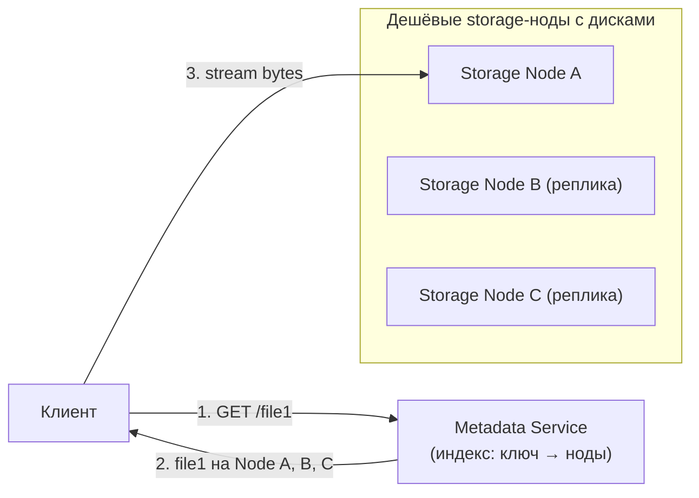
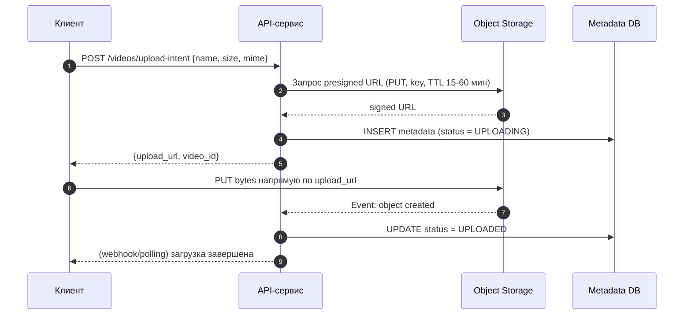
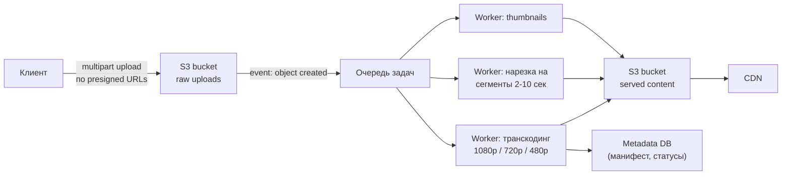
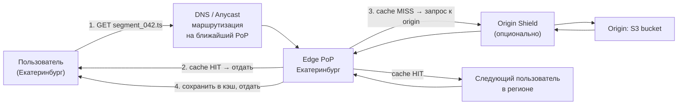
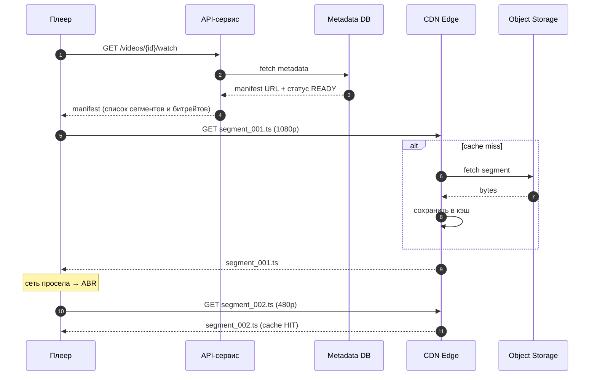

# CDN и хранение файлов (Blob Storage)

> Building block, который всплывает почти в каждой задаче на системный дизайн: YouTube, Instagram, WhatsApp (медиа-вложения), Dropbox, любой статический контент. Если в дизайне есть файлы больше пары мегабайт или геораспределённые пользователи — без объектного хранилища и CDN вас с места не отпустят.

## Оглавление

- [Когда в дизайне появляются CDN и blob storage](#когда-в-дизайне-появляются-cdn-и-blob-storage)
- [Почему файлы нельзя хранить в реляционной БД](#почему-файлы-нельзя-хранить-в-реляционной-бд)
- [S3-подобные объектные хранилища](#s3-подобные-объектные-хранилища)
- [Загрузка файлов: presigned URLs и multipart upload](#загрузка-файлов-presigned-urls-и-multipart-upload)
- [CDN: как работает](#cdn-как-работает)
- [Cache invalidation в CDN](#cache-invalidation-в-cdn)
- [Раздача видео и картинок](#раздача-видео-и-картинок)
- [Уточняющие вопросы интервьюеру](#уточняющие-вопросы-интервьюеру)
- [Что говорить интервьюеру: сильные формулировки](#что-говорить-интервьюеру-сильные-формулировки)
- [Красные флаги и типичные ошибки кандидатов](#красные-флаги-и-типичные-ошибки-кандидатов)
- [Deep dive: куда интервьюер может копнуть](#deep-dive-куда-интервьюер-может-копнуть)
- [Источники и видео по теме](#источники-и-видео-по-теме)

---

## Когда в дизайне появляются CDN и blob storage

Триггеры, при которых вы **обязаны** явно нарисовать оба компонента на диаграмме:

| Триггер в условии задачи | Что добавляем |
|---|---|
| Пользователи загружают файлы (фото, видео, документы, аватарки) | Object storage + presigned URL upload |
| Файлы крупные (>10–100 МБ) или их много | Multipart upload, отдельный upload path |
| Read-heavy контент: лента, каталог, стриминг | CDN перед object storage |
| Пользователи в нескольких регионах / планете | CDN с edge PoP, геомаршрутизация |
| Статика сайта (JS/CSS/картинки) | Object storage + CDN |
| Требование «низкая задержка старта видео» | CDN + сегментированное стриминг (HLS/DASH) |

Эвристика из моков: как только кандидат в задаче про YouTube/Instagram говорит «сохраним картинку в базе» или «отдадим файл через наш API-сервер» — интервьюер тут же спрашивает «а почему не S3? а почему не CDN?». Правильная последовательность наоборот: **сначала** произносите «медиа кладём в объектное хранилище, метаданные — в БД, раздачу фронтит CDN», и только потом углубляетесь.

Когда CDN **не нужен**: B2B-система в одном регионе, внутренний документооборот, данные с жёсткой персонализацией на каждый запрос (каждый ответ уникален — кэшировать нечего), либо файлы маленькие и их мало (проще отдать с бэкенда). Умение сказать «здесь CDN не нужен, потому что...» ценится не меньше, чем умение его нарисовать.

---

## Почему файлы нельзя хранить в реляционной БД

Классическая ошибка джунов и мидлов на собеседовании — положить `photo BLOB` в таблицу `users`. Разбор на пальцах, почему это плохо:

1. **Страничное хранение.** PostgreSQL упаковывает строки в страницы по 8 КБ. Картинка на 4 МБ растянется на ~500 страниц. Простой запрос `SELECT ... LIMIT 50` вынужден таскать за собой мегабайты страниц с блобами → давление на buffer pool, медленные запросы, вымывание кэша БД мусором.
2. **Репликация.** Каждая запись реплицируется на все реплики. 4 МБ блоб при каждой вставке раздувает WAL и replication lag, жрёт bandwidth между нодами.
3. **Бэкапы.** Ночной бэкап раздут статическими файлами, которые никогда не меняются. Восстановление, которое должно занимать минуты, превращается в часы — а вы в это время сидите с лежащей базой и злыми пользователями.
4. **Стоимость.** Гигабайт в управляемой БД стоит в разы дороже гигабайта в object storage.

**Вывод, который нужно проговорить вслух:** реляционные/OLTP-базы построены для маленьких, часто меняющихся записей с богатыми запросами (join, фильтры). Большие, в основном статичные файлы — не их работа.

**Правильное разделение:**

- **Файлы (blobs)** → объектное хранилище (S3, GCS, Azure Blob, MinIO).
- **Метаданные** (id, владелец, размер, mime-type, URL/ключ объекта, статус) → обычная БД.

Важный нюанс, на котором заваливаются кандидаты: метаданные в объектное хранилище **не кладём**. Технически возможно, но против индустриального стандарта — по object storage нельзя быстро искать («дай последние 20 постов пользователя»), оно про ключи, а не про запросы.

---

## S3-подобные объектные хранилища

### Модель данных

- **Bucket** — логический namespace верхнего уровня (например, `videos-prod`).
- **Object** = ключ (строка, например `u/42/v/7f3a/master.mp4`) + байты + метаданные (mime-type, ETag, пользовательские теги).
- **Плоское адресное пространство.** Никаких директорий нет — «папки» в консоли S3 это UI-сахар, под капотом просто строка ключа с `/`. За счёт плоского namespace объект находится по ключу за O(1) lookup в индексе, без обхода дерева.
- **Immutable writes.** Нельзя поменять байты в середине объекта — только перезаписать целиком или создать новую версию. Это осознанный дизайн: не нужны локи и разруливание race conditions на уровне хранилища → проще, быстрее, дешевле.

### Упрощённая внутренняя архитектура

1. Клиент спрашивает у metadata service, где лежит объект.
2. Metadata service по индексу находит ноды с репликами.
3. Клиент стримит байты напрямую с ноды (или через gateway / по presigned URL).

На собеседовании такую схему рисовать **не требуется** — S3 обычно чёрный ящик. Но понимание «metadata service + дешёвые ноды с дисками» спасает, когда спрашивают «а как бы вы сами спроектировали S3?».

### Durability и надёжность

- **11 девяток durability** (99.999999999%) — визитная карточка S3. Достигается тем, что каждый объект либо **полностью реплицируется** (replication factor ≥ 3), либо **erasure coded** (например, схема 10+4: объект режется на 10 фрагментов данных + 4 парити-фрагмента, переживает потерю любых 4) по разным нодам, стойкам, а часто и дата-центрам.
- Потеря ноды — штатное событие: данные читаются с другой реплики, в фоне идёт reheal.
- Важно не путать: **durability** (не потерять данные) ≠ **availability** (всегда отвечать). У S3 durability 11 девяток, а availability SLA — «всего» 3–4 девятки.
- Консистентность: современный S3 даёт strong read-after-write consistency для PUT новых объектов. Но на собеседовании, если проектируете «свой S3», eventual consistency между репликами — нормальное допущение, которое стоит проговорить.

### Стоимость и классы хранения

- Object storage дёшево именно потому, что оптимизировано под **хранение больших объёмов**, а не под частое чтение. Из мока TeamLead Avito: «storage обычно из коробки не рассчитан на то, чтобы из него постоянно читать» — читающий трафик должен гаситься CDN, иначе счёт за egress и запросы съест всё.
- Классы: Standard (горячие данные), Infrequent Access, Glacier/Archive (холодные, восстановление минуты–часы). В дизайне полезно упомянуть lifecycle-политики: «сырые загрузки через 30 дней уезжают в IA, через год — в архив».

### Провайдеры

| Провайдер | Сервис | Когда упоминать |
|---|---|---|
| AWS | **S3** | Дефолт на собеседовании; если не знаете, что выбрать — говорите S3 |
| Google Cloud | Cloud Storage | То же API-модель, signed URLs |
| Azure | Blob Storage | Аналог |
| Self-hosted | MinIO, Ceph | Если компания on-prem / data sovereignty |

У всех одинаковая механика: presigned URLs, multipart upload, события (event notifications) при записи объекта.

### События записи (object created notifications)

Объектные хранилища умеют публиковать событие «в бакет записан объект» в очередь (S3 → SQS/SNS/Lambda, Yandex Object Storage → trigger). Это стандартный способ запустить пост-обработку: транскодинг видео, генерация превью, антивирус, модерация. Если конкретное хранилище триггеров не поддерживает — API-сервис сам пишет задачу в очередь после завершения загрузки (по сути outbox-подход).

---

## Загрузка файлов: presigned URLs и multipart upload

### Наивный путь и почему он плох

Наивный дизайн: клиент шлёт файл на API-сервер, сервер перекладывает его в S3. Проблемы:

- Двойной трафик: файл проходит через ваши серверы дважды (in и out) → bandwidth, деньги.
- API-инстансы заняты долгоживущими соединениями и стримингом гигабайтов вместо своей работы.
- Лимиты на размер запроса по всей цепочке: браузеры, LB, API Gateway (типичный лимит ~10 МБ на body).

### Presigned URL: паттерн прямой загрузки

Индустриальный стандарт: сервер не трогает байты вообще, а только **выдаёт разрешение**.

Ключевые свойства:

- Presigned URL — это обычный HTTPS URL с криптоподписью в query-параметрах: ключ объекта, операция (PUT/GET), expiry (обычно 15 минут — 1 час), иногда ограничения на размер и Content-Type.
- Сервер просит у хранилища: «дай URL, по которому клиент сможет залить файл такого-то типа и размера в течение N минут». Дальше у клиента прямая линия с хранилищем.
- То же работает на скачивание приватных файлов: подписанный GET URL вместо проксирования через бэкенд. Для публичного контента подпись не нужна — CDN отдаёт как есть.

### Multipart upload

Для больших файлов одного PUT мало:

- В S3 один PUT ограничен 5 ГБ (а на практике всё, что больше ~100 МБ, стоит грузить частями).
- Обрыв соединения на 90% файла в 10 ГБ не должен обнулять прогресс.

Механика (S3 multipart upload):

1. Клиент сообщает намерение → сервер инициирует multipart upload, получает `upload_id` и **набор presigned URLs по одному на каждую часть** (для файла в 5 ГБ и частях по 5 МБ это ~1000 URL).
2. Клиент режет файл на части (AWS SDK умеет это сам) и грузит части **параллельно** прямыми PUT в S3.
3. Каждая часть получает ETag. Клиент собирает список `{part_number, etag}`.
4. Клиент вызывает **complete multipart upload** → S3 сшивает части в один объект.
5. Если всё сдохло — `abort multipart upload`, иначе недособранные части висят и стоят денег (на практике вешают lifecycle-правило на автозачистку незавершённых загрузок).

Бонусы бесплатно: **resumable upload** (повторно шлём только недогруженные части), параллелизм (несколько частей одновременно → утилизация канала).

### Загрузка видео: эталонный pipeline из моков

Из разборов «Design YouTube» (Ex-Meta Staff Engineer, TeamLead Avito) складывается каноническая схема:

- Upload-сервис делает ровно одно: принять сырой файл в durable storage и сразу ответить пользователю «загрузка завершена». Вся тяжёлая работа — асинхронно.
- Очередь между загрузкой и обработкой — буфер: если транскодеры перегружены, задачи копятся, а не роняют систему (decoupling).
- Транскодинг распараллеливается как DAG задач: один worker пилит 1080p, другой 720p, третий превью — одновременно.
- Статус в metadata DB: `UPLOADING → UPLOADED → PROCESSING → READY`. Клиент либо поллит, либо получает push/webhook.

Масштаб для калибровки: на YouTube загружается порядка **500 часов видео в минуту / ~500 ТБ в день**. Даже если в вашей задаче цифры на 3 порядка меньше, архитектура та же, проще только capacity planning.

---

## CDN: как работает

CDN (Content Delivery Network) — глобальная сеть кэширующих серверов (**edge servers**, сгруппированы в **PoP — Points of Presence**), которые хранят копии контента физически близко к пользователям. Аналогия: вместо поездки за книгой в центральную библиотеку в другом городе вы идёте в районный филиал.

### Зачем: три эффекта

1. **Latency.** RTT Москва → дата-центр в Вирджинии ~120–150 мс; Москва → местный PoP ~5–15 мс. Для видео это разница между «крутится буфер» и «играет мгновенно».
2. **Разгрузка origin.** Хранилище не рассчитано на прямую раздачу всем пользователям. Cache hit ratio 90–95%+ означает, что до origin долетают единицы процентов запросов.
3. **Пропускная способность и стоимость.** Трафик edge ↔ пользователь дешевле и ближе, чем transcontinental трафик из origin.

### Pull-модель (lazy caching) — дефолт

- Первый запрос в регионе — **cache miss**: edge идёт в origin (S3), забирает объект, кладёт в локальный кэш, отдаёт пользователю.
- Дальнейшие запросы — **cache hit**, origin не трогаем.
- Важная деталь: edge сам авторизуется перед origin (у CDN прямой доступ к бакету), presigned URLs для связки CDN → origin не нужны.
- **Origin shield** — промежуточный кэширующий слой между сотнями PoP и origin: при miss сто PoP не долбят S3 поодиночке, а сходятся в одну точку. Сильный ответ на вопрос «а что, если популярный файл промахнулся мимо кэша во всех регионах разом?».
- Кэш естественно отражает региональный спрос: в России кэшируется в основном русскоязычный контент, на другом конце планеты он просто не попадёт в кэш — и это нормально, не нужно хранить всё везде. Реплицировать «везде и всё» — очень дорого.
- Оптимизация при miss: edge может не ждать полного скачивания с origin, а проксировать поток с соседнего PoP, где объект уже есть, и параллельно фоново заполнять свой кэш.

### Push-модель

- Контент **заранее** загружается на edge-узлы (push CDN / proactive caching), не дожидаясь первого запроса.
- Когда оправдано: контент известен заранее и горяч (релиз игры, премьера сериала, раздача обновления ОС на миллионы устройств в час X), либо origin очень слабый.
- Цена: сложнее инвалидация, нужно предсказывать спрос, тратится место на то, что, возможно, никто не скачает.

| Критерий | Pull (lazy) | Push (proactive) |
|---|---|---|
| Первый запрос | Медленный (miss → origin) | Быстрый (уже на edge) |
| Заполнение кэша | По спросу, «само» | Нужно продумывать и скриптовать |
| Прогноз спроса | Не нужен | Критичен |
| Заполнение дисков edge | Только востребованным | Мусором тоже |
| Когда выбирать | Дефолт, UGC, длинный хвост | Заранее известные горячие релизы |

Из мока по видеостримингу: trade-off «lazy loading vs proactive caching» — это прямо тот вопрос, который интервьюер предлагает обсудить, когда базовый дизайн готов. Произнесите эту пару сами до того, как спросят.

### Маршрутизация на ближайший PoP

- **Anycast**: один IP анонсируется из множества PoP, BGP сам ведёт пакеты в ближайший.
- **GeoDNS**: DNS-резолвер отдаёт разные адреса в зависимости от региона клиента.
- На собеседовании достаточно фразы: «DNS/anycast направит клиента на ближайший PoP, детали реализации отдаём CDN-провайдеру».

### Свой CDN или провайдер

- Провайдеры: Cloudflare, Akamai, Fastly, CloudFront, Selectel/EdgeЦентр (RU).
- Свой CDN строят только на масштабе YouTube/Netflix (Open Connect): когда трафик такой, что экономия на провайдере окупает эксплуатацию тысяч своих серверов по всему миру. Честный ответ из мока: «свой CDN рисовать я не успею — берём внешний; у YouTube на таком масштабе, скорее всего, свой». На коленке «свой CDN» — это просто кэширующий reverse proxy (nginx/Varnish) в паре регионов; так и называйте.

---

## Cache invalidation в CDN

Есть две сложные вещи в Computer Science: cache invalidation, именование и off-by-one ошибки. В CDN инвалидация особенно болезненна: копии размазаны по сотням PoP по всей планете.

| Стратегия | Как работает | Плюсы | Минусы |
|---|---|---|---|
| **TTL** | `Cache-Control: max-age=...`, объект протухает сам | Просто, нулевая операционная нагрузка | До истечения TTL пользователи видят старое |
| **Purge/invalidate API** | Явный вызов «выкинь ключ X из кэша» (CloudFront invalidation, Cloudflare purge) | Точечно, быстро (секунды–минуты) | Платно/рейтлимитно, не атомарно по всем PoP |
| **Versioned URLs (cache busting)** | Контент иммутабелен, новая версия = новый URL: `app.v3.js`, `video/7f3a/720p/` | Инвалидация не нужна вообще; TTL = год | Нужно обновлять ссылки (манифест/БД), не работает для «того же URL» |

**Золотое правило:** по возможности делайте контент адресуемым по версии/хэшу (`style.a1b2c3.css`) и ставьте огромный TTL. Purge — запасной выход для «горячих правок» и юридических takedown'ов.

Типовые TTL:

- Видеосегменты, иммутабельные ассеты: 24 ч — 1 год (они не меняются никогда).
- Манифесты HLS/DASH для VOD: минуты; для live: секунды (live-манифест — единственное, что реально меняется).
- HTML-страницы: секунды–минуты или вообще не кэшируем.
- API-ответы с персонализацией: не кэшируем (или private cache).

Eviction на edge: LRU/LFU по локальному диску PoP — хвост непопулярного контента просто вытесняется, это нормально.

---

## Раздача видео и картинок

### Почему нельзя просто отдать MP4 целиком

Наивный протокол: сервер скачивает весь файл из хранилища и отдаёт клиенту → между запросом и стартом воспроизведения проходят минуты. Улучшения по нарастающей:

1. **HTTP Range requests**: клиент запрашивает байтовый диапазон (`Range: bytes=0-104857599`), воспроизведение стартует после первого куска. Это то, как работает обычный `<video>` с MP4.
2. **Сегментированное стриминг (HLS/DASH)**: видео заранее нарезано на сегменты по **2–10 секунд** + есть манифест (плейлист). Плеер качает сегменты по одному — перемотка мгновенная, старт быстрый.
3. **Adaptive Bitrate (ABR)**: каждый сегмент лежит в нескольких битрейтах/разрешениях (1080p/720p/480p). Плеер мониторит скорость скачивания и переключается между версиями на лету: сеть просела — следующий сегмент берём в 480p вместо 1080p, буферизация не случается.

### HLS vs MPEG-DASH

- Оба — не форматы видео, а протоколы доставки поверх HTTP: манифест + сегменты; кодек (H.264, H.265, AV1) выбираете сами.
- **HLS** — Apple, манифест `.m3u8`, сегменты `.ts`/`.fMP4`. Обязателен для iOS/Safari.
- **MPEG-DASH** — открытый стандарт, манифест `.mpd`. Всё остальное.
- Практика: поддерживают оба (YouTube, Netflix). На собеседовании достаточно сказать «HLS/DASH, сегменты 2–10 сек, манифест в metadata DB, сегменты в object storage за CDN».

### Кодеки: честный trade-off

- **H.264** — играет везде, но файлы крупнее. «Old reliable».
- **H.265/HEVC, AV1** — на 30–50% меньше при том же качестве, но не все устройства играют и транскодинг дороже (AV1 особенно CPU-тяжёл).
- Практика: генерируют несколько вариантов и отдают по capability клиента.

### Цена ABR: storage multiplication

Хранить N битрейтов × M сегментов — значит держать несколько копий каждого видео. Затраты на хранение вырастают заметно, но низкие битрейты весят меньше, и опыт пользователя (no buffering) окупает. Если нужно экономить — не храните все лесенки битрейтов для хвоста непопулярных видео (транскодируйте «на лету» или только top-K).

### Поток чтения видео целиком

Заметьте: сегменты — иммутабельный контент с уникальными URL → TTL огромный, инвалидация не нужна, cache hit ratio стремится к 100% на популярном контенте.

### Картинки

- Оригинал в object storage, метаданные в БД — как с видео.
- **Превью/ресайзы**: генерация либо при загрузке (worker по событию, как thumbnails у YouTube), либо on-the-fly на edge (Cloudflare Images, imgix, lambda@edge). Набор размеров фиксированный (avatar 64px, preview 512px, full) — иначе кэш CDN разбивается на бесконечные варианты.
- URL вида `cdn.example.com/img/{id}/{size}.webp` — размер и формат в ключе, иммутабельно.
- Форматы: WebP/AVIF вместо JPEG — на 25–50% меньше при том же качестве.
- Порядок чтения: сначала лёгкий blur-up placeholder (LQIP, сотни байт), потом полная картинка — UX-трюк, который приятно упомянуть.

---

## Уточняющие вопросы интервьюеру

Прежде чем рисовать S3 и CDN, уточните:

1. Какие типы файлов и их размеры? (Аватарки 100 КБ и видео 10 ГБ — разные дизайны загрузки.)
2. Сколько загрузок в день и какой read:write ratio? (UGC-платформа: чтений на 2–3 порядка больше записей.)
3. Где пользователи — один регион или планета?
4. Контент публичный или приватный? (Определяет: публичный CDN vs signed URLs / signed cookies.)
5. Нужна ли обработка после загрузки (транскодинг, превью, модерация)? Какой допустимый лаг до публикации?
6. Нужен ли seek/streaming или файл скачивается целиком?
7. Требования к durability и удалению (GDPR «право на забвение» → purge из CDN)?
8. Лимиты: максимальный размер файла, рейтлимиты на загрузку?

---

## Что говорить интервьюеру: сильные формулировки

- «Байты — в object storage, метаданные — в БД. Смешивать их нельзя: Postgres упакует 4 МБ картинку в 500 страниц и убьёт и запросы, и репликацию, и бэкапы».
- «Клиент грузит напрямую в S3 по presigned URL — мы не пропускаем гигабайты через свои серверы и не упираемся в лимит API Gateway на размер body».
- «Файл больше 100 МБ — multipart upload: части по 5–100 МБ, параллельно, с resume; S3 сшивает по complete-вызову».
- «После записи объекта хранилище кидает событие в очередь — транскодинг и превью делаем асинхронно, upload path остаётся тонким».
- «Object storage из коробки не рассчитан на постоянное чтение — читающий трафик гасим CDN, cache hit ratio целимся в 90%+».
- «Берём pull CDN: кэш заполняется по спросу и естественно отражает региональные предпочтения. Push-модель — только для заранее известных горячих релизов».
- «Сегменты видео иммутабельны и адресуются по версии — TTL ставим на год, инвалидация не нужна. Меняется только манифест, ему TTL в секунды».
- «ABR: каждый сегмент храним в 3–4 битрейтах. Платим лишним хранилищем, получаем отсутствие буферизации на слабых сетях».
- «Свой CDN строить не будем — это оправдано только на масштабе Netflix/YouTube; берём провайдера».

---

## Красные флаги и типичные ошибки кандидатов

- **Хранить файлы в реляционной БД** (BLOB-колонка). См. разбор выше — страницы, репликация, бэкапы.
- **Хранить метаданные в object storage.** Частая ошибка мидлов, прямо отмечена экс-Meta интервьюером: искать по файлам как по ключам нельзя, метаданные — в БД.
- **Проксировать загрузку/скачивание через API-сервер**, когда есть presigned URLs.
- **Забыть multipart** для больших файлов: один PUT на 10 ГБ не взлетит и не возобновится после обрыва.
- **Синхронная обработка в upload path**: «после загрузки сразу транскодируем и отвечаем юзеру» — нет, отвечаем сразу, обрабатываем через очередь.
- **Отдавать медиа напрямую из S3 всем пользователям** без CDN — origin не выдержит и счёт за egress будет космическим.
- **Инвалидация через purge для всего** вместо versioned URLs — признак, что кандидат не сталкивался с ценой и неатомарностью purge.
- **Один битрейт видео** в задаче про стриминг — сразу вопрос «а что будет на мобильной сети?».
- **CDN там, где нечего кэшировать** (персонализированные ответы на каждый запрос).
- Путать **durability и availability**: «11 девяток» — это про непотерю данных, а не про uptime.

---

## Deep dive: куда интервьюер может копнуть

1. **Как работает presigned URL под капотом?** HMAC-подпись от секрета провайдера по ключу, операции, expiry и (опционально) условиям — размер, Content-Type. Хранилище проверяет подпись без обращения к вашему сервису. Для скачивания приватного контента через CDN — signed cookies / signed URLs уже на уровне CDN (CloudFront signed URLs).
2. **Как спроектировать сам S3?** Metadata service (индекс ключ → список нод) + дешёвые storage-ноды; запись на W из N реплик, чтение с R, W + R > N; erasure coding для холодных объектов; фоновый reheal; дедупликация по хэшу содержимого (как в Dropbox — одинаковые файлы не храним дважды).
3. **Дедупликация и content addressing.** Ключ = хэш содержимого (SHA-256): идемпотентные повторные загрузки, мгновенный «upload» уже существующего файла, естественная защита от коллизий версий.
4. **Согласованность «файл + метаданные».** Гонка: объект записан, а строка в БД ещё нет (или наоборот). Решения: статус-машина в БД (`UPLOADING → READY`), сверка по событию object-created, фоновый reaper, который подтирает объекты-сироты (есть файл — нет метаданных) и незавершённые multipart-загрузки.
5. **Горячий объект / thundering herd на miss.** Вирусное видео, кэш пуст: тысячи запросов одновременно летят в origin. Митигации: request coalescing (edge схлопывает одинаковые in-flight запросы в один к origin), origin shield, stale-while-revalidate.
6. **Репликация между регионами.** Кросс-региональная репликация бакета — дорого; реалистичный дизайн: origin в 1–2 регионах + CDN как распределённый кэш чтения. «Хранить везде и всё — очень дорого» (из мока Avito).
7. **Live-стриминг.** Другой зверь: сегменты пишутся в реальном времени, манифест обновляется каждые пару секунд (TTL ~1 с), латенси HLS 15–30 с, LL-HLS/LL-DASH — 2–5 с. CDN всё равно обязателен: миллион зрителей смотрит одни и те же свежие сегменты — идеальный cache hit.
8. **Удаление и compliance.** Удалил видео → удалить из S3 (lifecycle на versions), purge из CDN (или короткий TTL + versioned ключи), tombstone в БД. Для GDPR — SLA на полное стирание.

---

## Источники и видео по теме

- [Object Storage in System Design Interviews w/ Ex-Meta Staff Engineer](https://www.youtube.com/watch?v=RvaMHMxHjp4) — почему не БД, flat namespace, immutable writes, 11 девяток, presigned URLs, multipart upload
- [System Design Interview: Design YouTube w/ a Ex-Meta Staff Engineer](https://www.youtube.com/watch?v=IUrQ5_g3XKs) — multipart upload с presigned URLs на каждую часть, chunker, сегменты 2–10 с, манифест в метаданных
- [Video Streaming & Sharing Service (YouTube): System Design Interview (Stripe & Amazon Offers)](https://www.youtube.com/watch?v=XAZqmLXy4kY) — cache miss → origin, прямой доступ CDN к бакету без presigned URLs, lazy loading vs proactive caching
- [System Design Youtube / TeamLead Avito](https://www.youtube.com/watch?v=L9Lt0KEPcDc) — выбор object storage, триггеры на запись объекта → очередь, CDN как внешняя технология, региональное заполнение кэша, цена репликации
- [How YouTube Works Behind the Scenes / Video Upload, Transcoding & CDN Streaming Explained](https://www.youtube.com/watch?v=Wbj8R8-iuNo) — 500 ТБ/день, асинхронный upload pipeline, DAG транскодинга, CDN и ABR
- [Разработка протокола потоковой передачи видео (HLS, DASH) / Проектирование системы](https://www.youtube.com/watch?v=v6qvrIY5Tgs) — range requests, сегментирование, adaptive bitrate, цена хранения нескольких битрейтов, HLS vs MPEG-DASH
