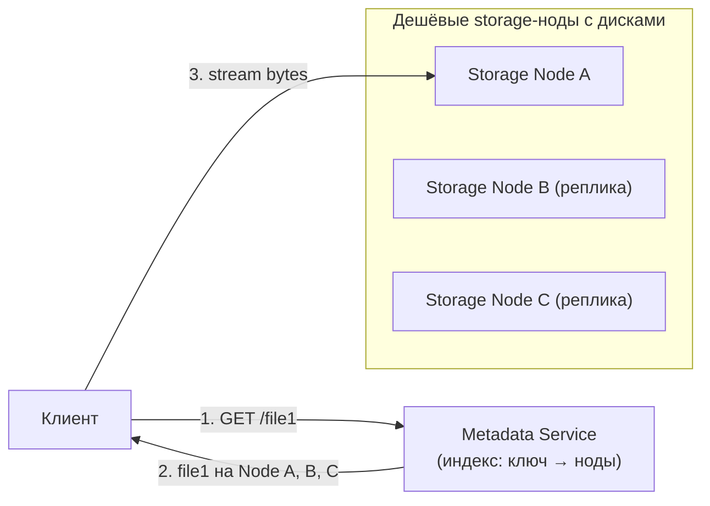
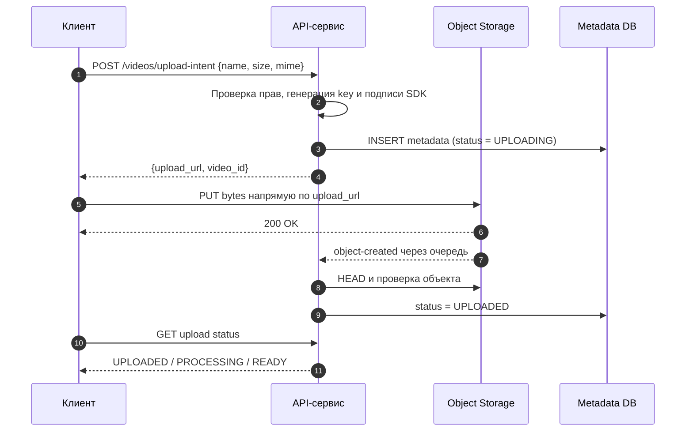
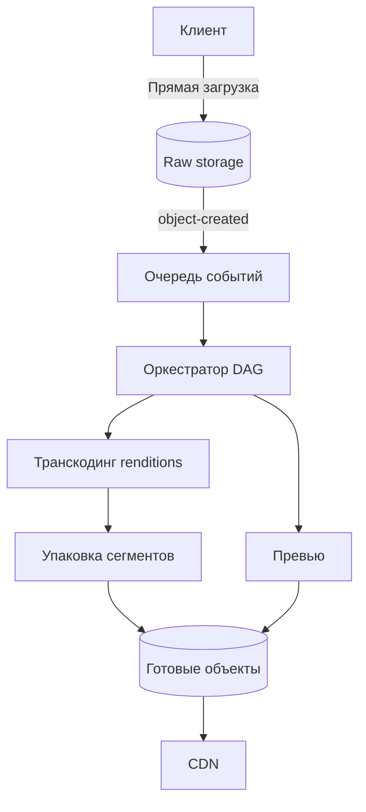
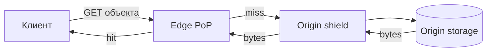
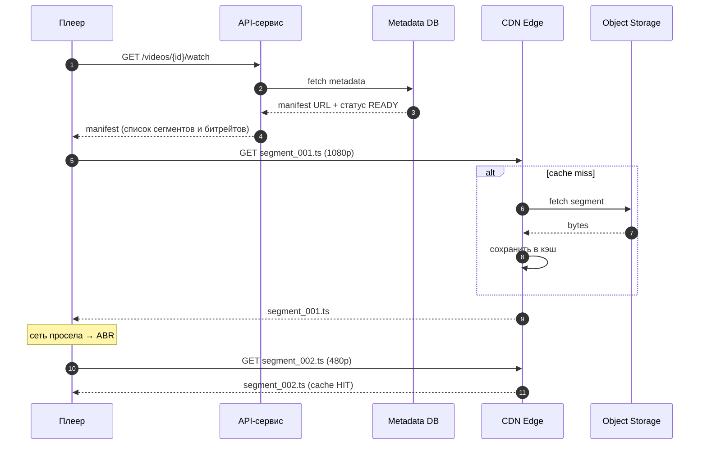

# CDN и хранение файлов (Blob Storage)

<!-- learning-nav:start -->
[← Все разделы](../README.md) · [Предыдущая тема](rate-limiting.md) · [Следующая тема →](reliability-and-operations.md)
<!-- learning-nav:end -->

> Building block, который всплывает почти в каждой задаче на системный дизайн: YouTube, Instagram, WhatsApp (медиа-вложения), Dropbox, любой статический контент. Объектное хранилище и CDN решают разные задачи: долговечное хранение байтов и доставку копий ближе к пользователю. Их необходимость определяется объёмом, доступом, географией и стоимостью.

## Оглавление

<!-- toc:start -->

Показать темы и вопросы

- [Когда в дизайне появляются CDN и blob storage](#когда-в-дизайне-появляются-cdn-и-blob-storage)
- [Почему файлы нельзя хранить в реляционной БД](#почему-файлы-нельзя-хранить-в-реляционной-бд)
- [S3-подобные объектные хранилища](#s3-подобные-объектные-хранилища)
- [Загрузка файлов: presigned URLs и multipart upload](#загрузка-файлов-presigned-urls-и-multipart-upload)
- [CDN: как работает](#cdn-как-работает)
- [Cache invalidation в CDN](#cache-invalidation-в-cdn)
- [Раздача видео и картинок](#раздача-видео-и-картинок)
- [Уточняющие вопросы интервьюеру](#уточняющие-вопросы-интервьюеру)
- [Что говорить интервьюеру: сильные формулировки](#что-говорить-интервьюеру-сильные-формулировки)
- [Красные флаги и типичные ошибки кандидатов](#красные-флаги-и-типичные-ошибки-кандидатов)
- [Deep dive: куда интервьюер может копнуть](#deep-dive-куда-интервьюер-может-копнуть)
- [Видео по теме](#видео-по-теме)

<!-- toc:end -->

---

## Когда в дизайне появляются CDN и blob storage

Сценарии, в которых стоит рассмотреть эти компоненты:

| Триггер в условии задачи | Что добавляем |
|---|---|
| Пользователи загружают файлы (фото, видео, документы, аватарки) | Object storage + presigned URL upload |
| Файлы крупные (>10–100 МБ) или их много | Multipart upload, отдельный upload path |
| Read-heavy контент: лента, каталог, стриминг | CDN перед object storage |
| Пользователи в нескольких регионах / планете | CDN с edge PoP, геомаршрутизация |
| Статика сайта (JS/CSS/картинки) | Object storage + CDN |
| Требование «низкая задержка старта видео» | CDN + сегментированное стриминг (HLS/DASH) |

Эвристика из моков: как только кандидат в задаче про YouTube/Instagram говорит «сохраним картинку в базе» или «отдадим файл через наш API-сервер» — интервьюер тут же спрашивает «а почему не S3? а почему не CDN?». Правильная последовательность наоборот: **сначала** произносите «медиа кладём в объектное хранилище, метаданные — в БД, раздачу фронтит CDN», и только потом углубляетесь.

CDN может не окупаться для небольшого внутреннего сервиса в одном регионе или уникальных ответов без повторного использования. Даже без кэша edge иногда полезен для TLS, защиты и маршрутизации — это другое обоснование. Private content тоже можно раздавать через CDN при проверке доступа.

---

## Почему файлы нельзя хранить в реляционной БД

Хранить BLOB в реляционной БД **можно**. Для небольших документов и требований
атомарно записать строку вместе с байтами это иногда проще отдельного storage.
При больших объёмах медиа обычно выбирают object storage по другим причинам:

1. **Нагрузка на БД.** Байты увеличивают объём хранения, WAL, репликации и
   резервного копирования. Медиа конкурируют с OLTP за I/O и ёмкость.
2. **Путь доставки.** Object storage удобен для прямой загрузки, range requests,
   lifecycle и раздачи через CDN; SQL-сервер для этого не обязателен.
3. **Эксплуатация и стоимость.** Отдельное хранение позволяет независимо
   масштабировать метаданные и объём байтов; сравнивают также запросы и egress.

Неверный аргумент: «4 МБ растянутся на 500 страниц строки, и любой SELECT потащит
весь файл». PostgreSQL не растягивает tuple через страницы: большие `bytea/text`
сжимает и/или выносит в TOAST, а ненужное out-of-line значение может не читать.
`SELECT id, owner_id` не равнозначен `SELECT *` с выгрузкой BLOB.

**Правильное разделение:**

- **Файлы (blobs)** → объектное хранилище (S3, GCS, Azure Blob, MinIO).
- **Метаданные** (id, владелец, размер, mime-type, URL/ключ объекта, статус) → обычная БД.

Object storage тоже хранит метаданные (Content-Type, checksum, пользовательские поля/теги). БД нужна для **продуктового индекса**: владелец, права, статус, сортировка «последние 20 постов пользователя». Поиск таких сущностей не стоит строить на полном listing бакета. Хранить копию метаданных рядом с объектом допустимо — определите источник истины.

---

## S3-подобные объектные хранилища

### Модель данных

- **Bucket** — логический namespace верхнего уровня (например, `videos-prod`).
- **Object** = ключ (строка, например `u/42/v/7f3a/master.mp4`) + байты + метаданные (mime-type, ETag, пользовательские теги).
- **Плоское адресное пространство.** Никаких директорий нет — «папки» в консоли S3 это UI-сахар, под капотом просто строка ключа с `/`. Это модель general-purpose bucket; она не доказывает O(1) lookup: внутренняя индексация — деталь реализации. Специальные directory buckets имеют другую модель.
- **Объект как единица записи.** Для обычных S3 general-purpose buckets приложение обычно заменяет объект целиком или создаёт новый key/version; не рассчитывайте на файловый random write. Конкурентные PUT всё равно конфликтуют по бизнес-смыслу: используйте уникальные ключи, versioning и conditional writes, например `If-None-Match: *` или `If-Match`.

### Упрощённая внутренняя архитектура

1. Клиент спрашивает у metadata service, где лежит объект.
2. Metadata service по индексу находит ноды с репликами.
3. Клиент стримит байты напрямую с ноды (или через gateway / по presigned URL).

Это учебная архитектура **собственного** storage, а не публичный протокол AWS S3: обычный клиент обращается к S3 endpoint и не получает адреса внутренних дисков. Presigned URL тоже указывает на endpoint объекта, а не на storage-ноду. Для managed S3 этот внутренний слой обычно оставляют чёрным ящиком.

### Durability и надёжность

- **11 девяток durability** (99.999999999% в год) — проектная характеристика ряда классов S3, не обещание нулевой потери и не описание конкретного replication factor. В собственном storage используют репликацию или erasure coding: условная MDS-схема 10+4 переживает потерю до четырёх фрагментов. Размещение по зонам и восстановление тоже входят в гарантию.
- Потеря ноды — штатное событие: данные читаются с другой реплики, в фоне идёт reheal.
- **Durability** (не потерять байты) отличается от **availability** (успешно обслужить запрос). Design availability и контрактный SLA зависят от storage class; их нельзя подменять одной общей цифрой S3.
- S3 даёт strong read-after-write для операций с объектами, включая новые записи, перезаписи и удаления, а также согласованный LIST. Это не транзакция над несколькими объектами и вашей БД, не свежесть CDN и не синхронность cross-region replication. Для собственного storage гарантии задают отдельно.

### Стоимость и классы хранения

- S3 Standard рассчитан и на частое чтение; archive-классы имеют другие задержки и плату за retrieval. CDN добавляют ради latency, повторного использования копий и экономики трафика. Невыгодность прямой раздачи доказывают расчётом запросов/байтов, а не утверждением «storage не умеет читать».
- Классы: Standard (горячие данные), Infrequent Access; для редко читаемого архива **S3 Glacier Instant Retrieval** даёт миллисекундный доступ без предварительного restore. **Glacier Flexible Retrieval** требует асинхронного восстановления (минуты–часы), **Deep Archive** — часы; срок зависит от retrieval tier. Lifecycle-политики выбирают с учётом доступа и цены: например, «сырые загрузки через 30 дней уезжают в IA, через год — в подходящий архивный класс».

### Провайдеры

| Провайдер | Сервис | Когда упоминать |
|---|---|---|
| AWS | **S3** | Дефолт на собеседовании; если не знаете, что выбрать — говорите S3 |
| Google Cloud | Cloud Storage | То же API-модель, signed URLs |
| Azure | Blob Storage | Аналог |
| Self-hosted | MinIO, Ceph | Если компания on-prem / data sovereignty |

У провайдеров похожие возможности, но API подписей, resumable/multipart upload, ограничения и семантика событий различаются. Не переносите конкретные лимиты S3 на GCS/Azure.

### События записи (object created notifications)

Объектные хранилища умеют публиковать событие «в бакет записан объект» в очередь (S3 → SQS/SNS/Lambda, Yandex Object Storage → trigger). Это стандартный способ запустить пост-обработку: транскодинг видео, генерация превью, антивирус, модерация. События S3 Event Notifications доставляются at least once и могут задерживаться: обработчик должен дедуплицировать их и проверять версию объекта. Если API завершает загрузку сам, статус и outbox-задание фиксируют вместе в БД, затем публикуют в очередь; сам по себе вызов `publish` после PUT не является outbox и имеет окно потери.

---

## Загрузка файлов: presigned URLs и multipart upload

### Наивный путь и почему он плох

Наивный дизайн: клиент шлёт файл на API-сервер, сервер перекладывает его в S3. Проблемы:

- Двойной трафик: файл проходит через ваши серверы дважды (in и out) → bandwidth, деньги.
- API-инстансы заняты долгоживущими соединениями и стримингом гигабайтов вместо своей работы.
- Лимиты на размер запроса по всей цепочке: браузеры, LB, API Gateway (типичный лимит ~10 МБ на body).

### Presigned URL: паттерн прямой загрузки

Индустриальный стандарт: сервер не трогает байты вообще, а только **выдаёт разрешение**.

Ключевые свойства:

- Presigned URL — это обычный HTTPS URL с криптоподписью в query-параметрах: ключ объекта, операция (PUT/GET), expiry (обычно 15 минут — 1 час), иногда ограничения на размер и Content-Type.
- Backend обычно **локально подписывает** URL с помощью SDK и своих IAM credentials; отдельный запрос «дай подпись» в S3 не нужен. Подписант должен иметь право на операцию. URL действует до expiry или более раннего истечения временных credentials.
- URL — bearer capability: любой получивший его может использовать разрешение до истечения срока, обычно неоднократно. Для приватной раздачи через CDN используют подпись CDN; S3 presign и CDN signed URL — разные механизмы.

### Multipart upload

Для больших файлов стоит рассмотреть multipart:

- Для S3 single PUT ограничен 5 GB; у других storage лимит проверяют отдельно. AWS рекомендует multipart начиная примерно со 100 МБ; размер части S3 — 5 MiB–5 GiB (последняя может быть меньше), максимум 10 000 частей.
- Обрыв соединения на 90% файла в 10 ГБ не должен обнулять прогресс.

Механика (S3 multipart upload):

1. Клиент сообщает намерение → сервер инициирует multipart upload, получает `upload_id` и **набор presigned URLs по одному на каждую часть** (например, 5 GiB частями по 16 MiB — 320 частей). Необязательно выдавать все URL сразу: можно подписывать ограниченные пакеты по мере загрузки.
2. Клиент режет файл на части (AWS SDK умеет это сам) и грузит части **параллельно** прямыми PUT в S3.
3. Каждая часть получает ETag. Клиент собирает список `{part_number, etag}`.
4. Клиент или backend вызывает **complete multipart upload** со списком частей. Перед публикацией backend сверяет ожидаемые размер, checksum и ownership; ETag multipart не следует автоматически считать MD5 всего файла.
5. Если всё сдохло — `abort multipart upload`, иначе недособранные части висят и стоят денег (на практике вешают lifecycle-правило на автозачистку незавершённых загрузок).

Бонусы бесплатно: **resumable upload** (повторно шлём только недогруженные части), параллелизм (несколько частей одновременно → утилизация канала).

### Загрузка видео: эталонный pipeline из моков

Из разборов «Design YouTube» (Ex-Meta Staff Engineer, TeamLead Avito) складывается каноническая схема:

Одна очередь с конкурирующими consumers не рассылает каждое событие всем типам
workers. Оркестратор создаёт отдельные задания, учитывает зависимости и retries.
Статус READY публикуется после проверки обязательных outputs.

- Upload-сервис делает ровно одно: принять сырой файл в durable storage и сразу ответить пользователю «загрузка завершена». Вся тяжёлая работа — асинхронно.
- Очередь между загрузкой и обработкой — буфер: если транскодеры перегружены, задачи копятся, а не роняют систему (decoupling).
- Транскодинг распараллеливается как DAG задач: один worker пилит 1080p, другой 720p, третий превью — одновременно.
- Статус в metadata DB: `UPLOADING → UPLOADED → PROCESSING → READY`. Клиент либо поллит, либо получает push/webhook.

Пример оценки: **500 часов/мин** при среднем размере исходника **3 ГБ/час** дают
`500 × 1440 × 3 = 2 160 000 ГБ/день`, то есть около **2.16 ПБ/день**. Это
условия задачи, а не актуальная статистика YouTube. Часы без битрейта не
позволяют получить байты; обработанные renditions считают отдельно.

---

## CDN: как работает

CDN (Content Delivery Network) — глобальная сеть кэширующих серверов (**edge servers**, сгруппированы в **PoP — Points of Presence**), которые хранят копии контента физически близко к пользователям. Аналогия: вместо поездки за книгой в центральную библиотеку в другом городе вы идёте в районный филиал.

### Зачем: три эффекта

1. **Latency.** Условный пример: origin RTT 150 мс, edge RTT 15 мс. CDN сокращает сетевую задержку; startup видео зависит также от cache miss, манифеста, сегмента и буфера плеера. Числа требуют измерения для конкретного маршрута.
2. **Разгрузка origin.** При request hit ratio 90–95% до origin доходит 5–10% запросов, если нет дополнительных shield/revalidation. По байтам доля может отличаться: редкие большие файлы способны доминировать в egress.
3. **Пропускная способность и стоимость.** Трафик edge ↔ пользователь дешевле и ближе, чем transcontinental трафик из origin.

### Pull-модель (lazy caching) — дефолт

DNS/Anycast выбирает адрес edge до HTTP-запроса; DNS не пересылает сам GET.

- Первый запрос в регионе — **cache miss**: edge идёт в origin (S3), забирает объект, кладёт в локальный кэш, отдаёт пользователю.
- Дальнейшие запросы — **cache hit**, origin не трогаем.
- Важная деталь: edge сам авторизуется перед origin (у CDN прямой доступ к бакету), presigned URLs для связки CDN → origin не нужны.
- **Origin shield** — промежуточный кэширующий слой между сотнями PoP и origin: при miss сто PoP не долбят S3 поодиночке, а сходятся в одну точку. Сильный ответ на вопрос «а что, если популярный файл промахнулся мимо кэша во всех регионах разом?».
- Кэш естественно отражает региональный спрос: в России кэшируется в основном русскоязычный контент, на другом конце планеты он просто не попадёт в кэш — и это нормально, не нужно хранить всё везде. Реплицировать «везде и всё» — очень дорого.
- Оптимизация при miss: edge может не ждать полного скачивания с origin, а проксировать поток с соседнего PoP, где объект уже есть, и параллельно фоново заполнять свой кэш.

### Push-модель

- Контент **заранее** загружается на edge-узлы (push CDN / proactive caching), не дожидаясь первого запроса.
- Когда оправдано: контент известен заранее и горяч (релиз игры, премьера сериала, раздача обновления ОС на миллионы устройств в час X), либо origin очень слабый.
- Цена: сложнее инвалидация, нужно предсказывать спрос, тратится место на то, что, возможно, никто не скачает.

| Критерий | Pull (lazy) | Push (proactive) |
|---|---|---|
| Первый запрос | Медленный (miss → origin) | Быстрый (уже на edge) |
| Заполнение кэша | По спросу, «само» | Нужно продумывать и скриптовать |
| Прогноз спроса | Не нужен | Критичен |
| Заполнение дисков edge | Только востребованным | Мусором тоже |
| Когда выбирать | Дефолт, UGC, длинный хвост | Заранее известные горячие релизы |

Из мока по видеостримингу: trade-off «lazy loading vs proactive caching» — это прямо тот вопрос, который интервьюер предлагает обсудить, когда базовый дизайн готов. Произнесите эту пару сами до того, как спросят.

### Маршрутизация на ближайший PoP

- **Anycast**: один IP анонсируется из множества PoP; BGP выбирает предпочтительный сетевой маршрут, не обязательно минимальную географическую дистанцию.
- **GeoDNS**: DNS-резолвер отдаёт разные адреса в зависимости от региона клиента.
- На собеседовании достаточно фразы: «DNS/anycast направит клиента на ближайший PoP, детали реализации отдаём CDN-провайдеру».

### Свой CDN или провайдер

- Провайдеры: Cloudflare, Akamai, Fastly, CloudFront, Selectel/EdgeЦентр (RU).
- Свой CDN строят только на масштабе YouTube/Netflix (Open Connect): когда трафик такой, что экономия на провайдере окупает эксплуатацию тысяч своих серверов по всему миру. Честный ответ из мока: «свой CDN рисовать я не успею — берём внешний; у YouTube на таком масштабе, скорее всего, свой». На коленке «свой CDN» — это просто кэширующий reverse proxy (nginx/Varnish) в паре регионов; так и называйте.

---

## Cache invalidation в CDN

Есть две сложные вещи в Computer Science: cache invalidation, именование и off-by-one ошибки. В CDN инвалидация особенно болезненна: копии размазаны по сотням PoP по всей планете.

| Стратегия | Как работает | Плюсы | Минусы |
|---|---|---|---|
| **TTL** | `Cache-Control: max-age=...`, объект протухает сам | Просто, нулевая операционная нагрузка | До истечения TTL пользователи видят старое |
| **Purge/invalidate API** | Явный вызов «выкинь ключ X из кэша» (CloudFront invalidation, Cloudflare purge) | Точечно, быстро (секунды–минуты) | Платно/рейтлимитно, не атомарно по всем PoP |
| **Versioned URLs (cache busting)** | Контент иммутабелен, новая версия = новый URL: `app.v3.js`, `video/7f3a/720p/` | Новый контент не требует purge старой версии; TTL может быть долгим | Нужно обновлять ссылки (манифест/БД), не работает для «того же URL» |

По возможности адресуйте immutable-контент по версии/хэшу (`style.a1b2c3.css`) и ставьте долгий TTL. Это упрощает обновление, но **не отзывает** старую копию при запрете доступа или удалении: для этого нужны отдельные механизмы и окно распространения.

Типовые TTL:

- Видеосегменты, иммутабельные ассеты: 24 ч — 1 год (они не меняются никогда).
- Манифесты HLS/DASH для VOD: минуты; для live: секунды (live-манифест — единственное, что реально меняется).
- HTML-страницы: секунды–минуты или вообще не кэшируем.
- API-ответы с персонализацией: не кэшируем (или private cache).

Eviction на edge: LRU/LFU по локальному диску PoP — хвост непопулярного контента просто вытесняется, это нормально.

---

## Раздача видео и картинок

### Почему нельзя просто отдать MP4 целиком

Один MP4 можно воспроизводить прогрессивно, не дожидаясь всего файла: важны
расположение metadata (`moov`, fast start), поддержка range и buffering плеера.
Полная предварительная загрузка на API-сервер действительно задерживает старт,
но не является обязательным свойством MP4. Варианты доставки:

1. **HTTP Range requests**: клиент запрашивает байтовый диапазон (`Range: bytes=0-104857599`), воспроизведение стартует после первого куска. Это то, как работает обычный `<video>` с MP4.
2. **Сегментированное стриминг (HLS/DASH)**: видео заранее нарезано на сегменты по **2–10 секунд** + есть манифест (плейлист). Плеер качает сегменты по одному — перемотка мгновенная, старт быстрый.
3. **Adaptive Bitrate (ABR)**: каждый сегмент лежит в нескольких битрейтах/разрешениях (1080p/720p/480p). Плеер оценивает bandwidth и buffer level и переключает renditions: сеть просела — следующий сегмент берём в 480p вместо 1080p. Это снижает риск rebuffering, но не исключает его при резком обрыве или ошибке оценки.

### HLS vs MPEG-DASH

- Оба — не форматы видео, а протоколы доставки поверх HTTP: манифест + сегменты; кодек (H.264, H.265, AV1) выбираете сами.
- **HLS** — манифест `.m3u8`, обычно MPEG-TS или fragmented MP4 сегменты; широко поддерживается в Apple ecosystem.
- **MPEG-DASH** — манифест `.mpd`; поддержку проверяют по плееру, браузеру, DRM и кодеку. Нельзя делить весь мир строго на «iOS = HLS, остальное = DASH».
- Практика: поддерживают оба (YouTube, Netflix). На собеседовании достаточно сказать «HLS/DASH, сегменты 2–10 сек, манифест в metadata DB, сегменты в object storage за CDN».

### Кодеки: честный trade-off

- **H.264** — играет везде, но файлы крупнее. «Old reliable».
- **H.265/HEVC, AV1** могут уменьшать размер при сопоставимом качестве; выигрыш зависит от контента, encoder preset и метрики качества. Учитывайте аппаратное декодирование, лицензирование и стоимость транскодинга.
- Практика: генерируют несколько вариантов и отдают по capability клиента.

### Цена ABR: storage multiplication

Хранить N битрейтов × M сегментов — значит держать несколько копий каждого видео. Затраты на хранение вырастают заметно, но низкие битрейты весят меньше, и опыт пользователя (no buffering) окупает. Если нужно экономить — не храните все лесенки битрейтов для хвоста непопулярных видео (транскодируйте «на лету» или только top-K).

### Поток чтения видео целиком

Immutable-сегменты с уникальными URL можно долго кэшировать без invalidation при обычном обновлении версии. Hit ratio зависит от регионального спроса, размера кэша, вариантов bitrate и cache key; близость к 100% не гарантирована.

### Картинки

- Оригинал в object storage, метаданные в БД — как с видео.
- **Превью/ресайзы**: генерация либо при загрузке (worker по событию, как thumbnails у YouTube), либо on-the-fly на edge (Cloudflare Images, imgix, lambda@edge). Набор размеров фиксированный (avatar 64px, preview 512px, full) — иначе кэш CDN разбивается на бесконечные варианты.
- URL вида `cdn.example.com/img/{id}/{size}.webp` — размер и формат в ключе, иммутабельно.
- Форматы: сравните JPEG/WebP/AVIF на своём наборе изображений при целевом качестве, поддержке устройств и стоимости encoding; фиксированный процент экономии не гарантирован.
- Порядок чтения: сначала лёгкий blur-up placeholder (LQIP, сотни байт), потом полная картинка — UX-трюк, который приятно упомянуть.

---

## Уточняющие вопросы интервьюеру

Прежде чем рисовать S3 и CDN, уточните:

1. Какие типы файлов и их размеры? (Аватарки 100 КБ и видео 10 ГБ — разные дизайны загрузки.)
2. Сколько загрузок в день и какой read:write ratio? (UGC-платформа: чтений на 2–3 порядка больше записей.)
3. Где пользователи — один регион или планета?
4. Контент публичный или приватный? (Определяет: публичный CDN vs signed URLs / signed cookies.)
5. Нужна ли обработка после загрузки (транскодинг, превью, модерация)? Какой допустимый лаг до публикации?
6. Нужен ли seek/streaming или файл скачивается целиком?
7. Требования к durability и удалению (GDPR «право на забвение» → purge из CDN)?
8. Лимиты: максимальный размер файла, рейтлимиты на загрузку?

---

## Что говорить интервьюеру: сильные формулировки

- «Для нашего объёма медиа вынесу байты в object storage, продуктовый индекс — в БД: это разделяет масштабирование и разгружает WAL/backup. Небольшие BLOB в БД сами по себе допустимы».
- «Клиент грузит напрямую в S3 по presigned URL — мы не пропускаем гигабайты через свои серверы и не упираемся в лимит API Gateway на размер body».
- «Файл больше 100 МБ — multipart upload: части по 5–100 МБ, параллельно, с resume; S3 сшивает по complete-вызову».
- «После записи объекта хранилище кидает событие в очередь — транскодинг и превью делаем асинхронно, upload path остаётся тонким».
- «CDN сокращает latency и origin-трафик; ожидаемый hit ratio проверю по распределению спроса, а стоимость — по байтам и запросам».
- «Берём pull CDN: кэш заполняется по спросу и естественно отражает региональные предпочтения. Push-модель — только для заранее известных горячих релизов».
- «Сегменты видео иммутабельны и адресуются по версии — TTL ставим на год, инвалидация не нужна. Меняется только манифест, ему TTL в секунды».
- «ABR: каждый сегмент храним в 3–4 битрейтах. Платим лишним хранилищем, получаем отсутствие буферизации на слабых сетях».
- «Свой CDN строить не будем — это оправдано только на масштабе Netflix/YouTube; берём провайдера».

---

## Красные флаги и типичные ошибки кандидатов

- Выбирать BLOB в БД для большого медиакорпуса без оценки WAL, backup, доставки и стоимости.
- Пытаться обслуживать продуктовые выборки полным listing бакета вместо подходящего индекса; запрещать любые метаданные объекта тоже неверно.
- **Проксировать загрузку/скачивание через API-сервер**, когда есть presigned URLs.
- **Забыть multipart** для больших файлов: один PUT на 10 ГБ не взлетит и не возобновится после обрыва.
- **Синхронная обработка в upload path**: «после загрузки сразу транскодируем и отвечаем юзеру» — нет, отвечаем сразу, обрабатываем через очередь.
- Игнорировать географию и экономику раздачи; direct S3 допустим, но для глобально популярного контента сравните его с CDN.
- **Инвалидация через purge для всего** вместо versioned URLs — признак, что кандидат не сталкивался с ценой и неатомарностью purge.
- **Один битрейт видео** в задаче про стриминг — сразу вопрос «а что будет на мобильной сети?».
- **CDN там, где нечего кэшировать** (персонализированные ответы на каждый запрос).
- Путать **durability и availability**: «11 девяток» — это про непотерю данных, а не про uptime.

---

## Deep dive: куда интервьюер может копнуть

1. **Как работает presigned URL под капотом?** Например, AWS SigV4 подписывает canonical request производным от credentials ключом: метод, путь, query и подписанные headers. Секрет не передают в URL. Ограничение Content-Type не проверяет содержимое файла; диапазон размера можно задавать POST policy (`content-length-range`) либо проверять после PUT. Хранилище проверяет подпись без обращения к вашему сервису. Для скачивания приватного контента через CDN — signed cookies / signed URLs уже на уровне CDN (CloudFront signed URLs).
2. **Как спроектировать сам S3?** Metadata service (индекс ключ → список нод) + дешёвые storage-ноды; согласованная запись metadata и размещения реплик; quorum intersection `W + R > N` полезен, но без протокола версий/конкурентных записей не доказывает linearizability; erasure coding для холодных объектов; фоновый reheal; дедупликация по хэшу содержимого (как в Dropbox — одинаковые файлы не храним дважды).
3. **Дедупликация и content addressing.** Ключ = хэш содержимого (SHA-256): идемпотентные повторные загрузки, мгновенный «upload» уже существующего файла, естественная защита от коллизий версий.
4. **Согласованность «файл + метаданные».** Гонка: объект записан, а строка в БД ещё нет (или наоборот). Решения: статус-машина в БД (`UPLOADING → READY`), сверка по событию object-created, фоновый reaper, который подтирает объекты-сироты (есть файл — нет метаданных) и незавершённые multipart-загрузки.
5. **Горячий объект / thundering herd на miss.** Вирусное видео, кэш пуст: тысячи запросов одновременно летят в origin. Митигации: request coalescing (edge схлопывает одинаковые in-flight запросы в один к origin), origin shield, stale-while-revalidate.
6. **Репликация между регионами.** Кросс-региональная репликация бакета — дорого; реалистичный дизайн: origin в 1–2 регионах + CDN как распределённый кэш чтения. «Хранить везде и всё — очень дорого» (из мока Avito).
7. **Live-стриминг.** Другой зверь: сегменты пишутся в реальном времени, манифест обновляется каждые пару секунд (TTL ~1 с), латенси HLS 15–30 с, LL-HLS/LL-DASH — 2–5 с. CDN всё равно обязателен: миллион зрителей смотрит одни и те же свежие сегменты — идеальный cache hit.
8. **Удаление и политика хранения.** Tombstone в БД блокирует выдачу новых ссылок, затем удаляются объекты/версии/производные копии и выполняется CDN purge. Versioned URL сам по себе старый контент не отзывает: прямой URL может оставаться доступным. Учтите срок signed URL, browser cache, backups и storage retention. Требуемое окно удаления задаётся отдельно.

---

### Безопасная публикация прямой загрузки

Presigned URL разрешает операцию с объектом, но не означает «проверенный файл
готов к публичной раздаче». Backend выбирает непредсказуемый key внутри области
пользователя, проверяет квоту и выдаёт короткое разрешение. Raw-объект остаётся
приватным до проверки размера, checksum, реального формата, модерации/антивируса.
Нельзя доверять только заявленному MIME. READY устанавливают после обработки;
выдача URL клиентом не должна сама подтверждать успех загрузки.

Пример ошибки: пользователь повторно использовал ещё действующий PUT URL после
проверки и заменил опубликованный объект. Защита — immutable served key,
публикация проверенной версии объекта, conditional write и минимальный TTL
разрешения. Версию включают в задания и идемпотентные выходные ключи. Фоновая
сверка убирает брошенные intent/multipart и находит расхождения БД/storage.

Для private CDN отдельно проверяют право **до** выдачи bytes, независимо от hit.
Cache key обязан различать варианты контента, но добавление произвольного токена
в key не является авторизацией. Origin закрывают от обхода CDN, если политика
доступа реализована только там.

## Видео по теме

- [Object Storage in System Design Interviews w/ Ex-Meta Staff Engineer](https://www.youtube.com/watch?v=RvaMHMxHjp4) — почему не БД, flat namespace, immutable writes, 11 девяток, presigned URLs, multipart upload
- [System Design Interview: Design YouTube w/ a Ex-Meta Staff Engineer](https://www.youtube.com/watch?v=IUrQ5_g3XKs) — multipart upload с presigned URLs на каждую часть, chunker, сегменты 2–10 с, манифест в метаданных
- [Video Streaming & Sharing Service (YouTube): System Design Interview (Stripe & Amazon Offers)](https://www.youtube.com/watch?v=XAZqmLXy4kY) — cache miss → origin, прямой доступ CDN к бакету без presigned URLs, lazy loading vs proactive caching
- [System Design Youtube / TeamLead Avito](https://www.youtube.com/watch?v=L9Lt0KEPcDc) — выбор object storage, триггеры на запись объекта → очередь, CDN как внешняя технология, региональное заполнение кэша, цена репликации
- [How YouTube Works Behind the Scenes / Video Upload, Transcoding & CDN Streaming Explained](https://www.youtube.com/watch?v=Wbj8R8-iuNo) — асинхронный upload pipeline, DAG транскодинга, CDN и ABR; численные оценки требуют проверки битрейта
- [Разработка протокола потоковой передачи видео (HLS, DASH) / Проектирование системы](https://www.youtube.com/watch?v=v6qvrIY5Tgs) — range requests, сегментирование, adaptive bitrate, цена хранения нескольких битрейтов, HLS vs MPEG-DASH
