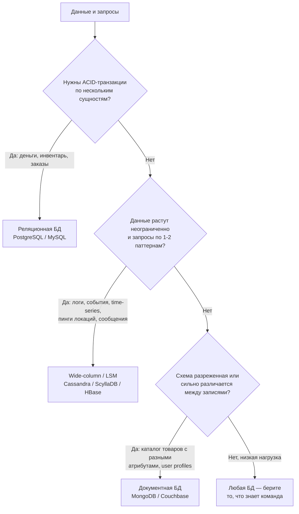
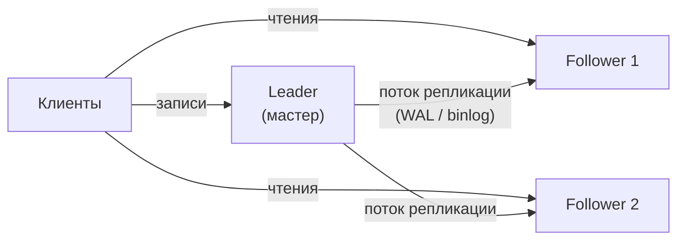
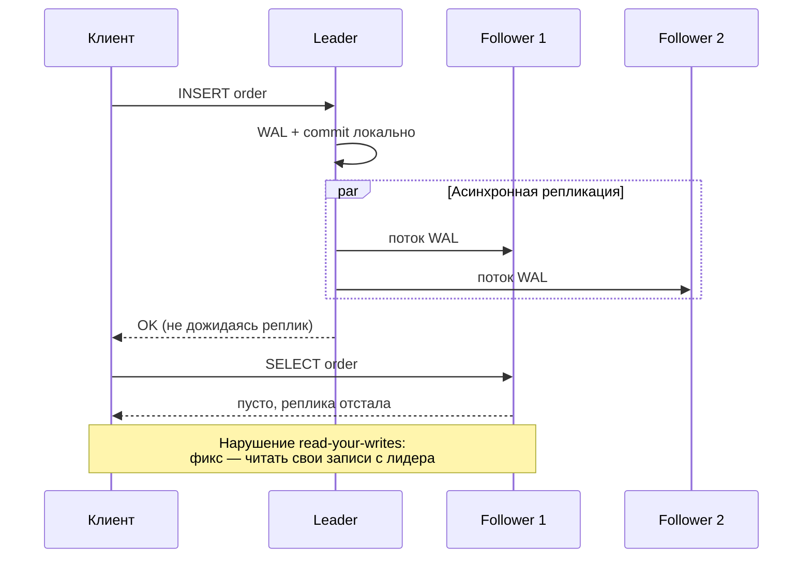
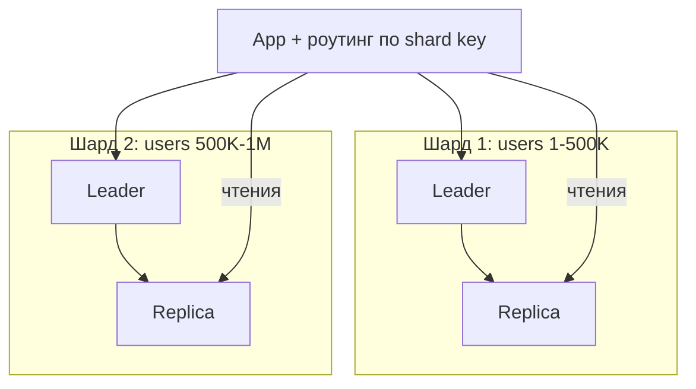

# Базы данных на System Design интервью

Выбор и масштабирование базы данных — почти гарантированная часть любого System Design интервью. Интервьюер проверяет не «знаешь ли ты, что такое MongoDB», а умение **обосновать выбор через требования**: паттерн нагрузки (read-heavy / write-heavy), требования к консистентности, транзакциям, объёму и росту данных. Этот файл — фреймворк для разговора о БД: SQL vs NoSQL, индексы, репликация, read replicas, connection pooling и кратко партиционирование (подробно — в [sharding.md](sharding.md)).

---

## Как рассуждать о БД на интервью: фреймворк

Рабочий алгоритм, который хорошо звучит вслух (собран из разборов мок-интервью):

1. **Тип нагрузки**: OLTP (пользователи читают/пишут в реалтайме) или OLAP (аналитика, агрегации по большим объёмам)?
2. **Движок хранения**: write-heavy → LSM-tree; read-heavy с range-запросами → B+tree.
3. **Требования к транзакциям и консистентности**: нужны ACID-транзакции и строгая согласованность → репликация с лидером и реляционная модель; нужна максимальная доступность и переживаем eventual consistency → leaderless.
4. **Масштаб**: помещаются ли данные и нагрузка на одну ноду? Если нет — репликация для чтений, партиционирование/шардирование для объёма и записей.
5. **Модель данных** (в последнюю очередь): реляционная, документная, key-value, wide-column, графовая.

> Сильная формулировка: «Сначала я выберу характеристики хранилища — движок, репликацию, консистентность — а конкретную СУБД назову в конце. Если я правильно определил требования, под них останется 2–3 кандидата, и выбор между ними уже не принципиален».

Пример применения (мессенджер на сотни миллионов пользователей): интенсивные записи → LSM; высокая доступность → leaderless-репликация и consistent hashing; ACID не нужен, строгая консистентность не критична (сообщение пишет один клиент) → **Cassandra/ScyllaDB**. Контрпример (тикет-система типа Jira): записей мало, простой на секунды переживаем, одни и те же данные правят разные пользователи → нужны транзакции и строгая консистентность → **репликация с лидером + реляционная модель (PostgreSQL/MySQL)**.

### Уточняющие вопросы интервьюеру

- Какой соотношение reads/writes? (100:1 — это read replicas и кэш; 1:1 или write-heavy — другой разговор о движке.)
- Есть ли требования к транзакциям между несколькими сущностями? (перевод денег, инвентарь, бронирование)
- Что важнее при сетевом разделении: доступность или консистентность? (по сути вопрос про CAP)
- Какой объём данных сейчас и темп роста? Данные append-only (логи, заказы, события) или mutable?
- Какие паттерны запросов: точечные по ключу, range-сканы, полнотекстовый поиск, гео, агрегации?

---

## SQL vs NoSQL

### Честное сравнение

| Критерий | SQL (PostgreSQL, MySQL) | NoSQL (Cassandra, MongoDB, DynamoDB) |
|---|---|---|
| Модель данных | Таблицы, схема, связи | Документ / key-value / wide-column |
| Транзакции | Полноценный ACID, multi-row, multi-table | Обычно single-row / single-partition atomicity |
| Консистентность | Строгая по умолчанию | Часто eventual, тюнится (кворумы) |
| Масштабирование записей | Сложно: шардирование — ручная работа | Встроено из коробки (партиционирование по ключу) |
| Джойны | Да | Нет / эмулируются денормализацией |
| Схема | Жёсткая, миграции | Гибкая (schemaless на записи) |
| Зрелость экосистемы | Десятилетия, проверено | Зависит от конкретной СУБД |

### Как обосновать выбор (а не перечислять плюсы/минусы)

Рабочее дерево решений:

Ключевые аргументы, которые звучат сильно:

- **ACID — главный, а не единственный аргумент за SQL.** Пример: inventory management в e-commerce — 10 пользователей покупают последний товар, только одна транзакция должна закоммититься. Это constraint + транзакция в RDBMS, а в NoSQL — самописная логика на приложении.
- **«Ever-increasing data» — главный аргумент за wide-column.** Заказы, события, пинги локаций водителей: данные только растут (и быстрее линейного), удалять нельзя (legal), паттернов запросов 1–2 («все локации водителя X»). Cassandra/HBase созданы ровно под это.
- **Гибрид — норма, а не компромисс.** Пример из разбора: свежие заказы живут в RDBMS (нужны транзакции, статусы меняются), доставленные переливаются в Cassandra (append-only архив, растёт вечно). На интервью «возьму Postgres для X и Cassandra для Y» звучит сильнее, чем «возьму одну БД на всё».
- **Если данных мало и запросы простые — скажите это прямо.** «Тут выбор БД не важен, возьму Postgres как дефолт и перейду к узкому месту системы» — это признак зрелости, а не слабый ответ.

### Красные флаги

- «Возьму MongoDB, потому что она быстрая» — быстрая в чём? На каком паттерне? За счёт чего?
- «NoSQL масштабируется, SQL — нет» — Postgres шардируют Citus'ом, Vitess шардирует MySQL на планетарном масштабе (YouTube). Правильная формулировка: «у SQL масштабирование записей требует ручной работы и ломает кросс-шардовые транзакции».
- Выбирать БД до уточнения требований. Сначала вопросы, потом выбор.
- Забыть, что у выбранной NoSQL тоже бывают транзакции (MongoDB multi-doc, DynamoDB transactions) — но с оговорками по цене/перформансу.

---

## Индексы: B-tree vs LSM (и не только)

### Зачем вообще обсуждать движок хранения

Интервьюер не ждёт, что вы реализуете B-tree на доске. Он ждёт, что вы:

1. заметите, **какой запрос будет неэффективен** (full table scan на миллиарде строк);
2. скажете, **какой индекс и на какую колонку** повесите;
3. объясните **цену индекса** (замедление записей, место на диске);
4. для write-heavy нагрузки упомянете, что B-tree на записи деградирует, и есть LSM.

### Как данные лежат на диске (база для разговора)

Таблица — это файл (в InnoDB, например, table-per-file), файл разбит на **pages** фиксированного размера (4/8/16 КБ, в Postgres — 8 КБ). Page — логическая единица чтения/записи и лочения: БД читает с диска не строку, а страницу целиком. Отсюда следует всё остальное: индекс — это структура, которая позволяет найти нужные pages, не читая все.

### B+tree

- Сбалансированное дерево с большим fanout (сотни указателей из ноды), поиск — `O(log_m n)`, глубина реально 3–4 уровня даже на миллиардах записей.
- Значения — только в листьях; листья **связаны указателями** → range-скан («все id от 271 до 761») идёт слева направо по листьям без возвратов наверх. Именно поэтому в проде используется B+tree, а не B-tree.
- **Цена записи**: вставка в заполненную ноду → split ноды, перераздача ключей, обновление указателей у родителя, в худшем случае — каскад до корня с лочением страниц. При высокой write-нагрузке это больно: random writes, write amplification, contention на лочении.

### LSM-tree

- Запись идёт в WAL (журнал на диске, для durability) и в **memtable** (in-memory отсортированная структура, обычно skip-list). Чтение: сначала memtable, потом immutable memtable, потом **SSTable**'ы на диске (от новых к старым).
- Когда memtable заполняется — флашится на диск как неизменяемый SSTable. Фоновая **compaction** мержит SSTable'ы, выкидывая перезаписанные и удалённые (tombstones) ключи.
- Все записи на диск — **append-only, последовательные** → на запись LSM быстрее B-tree в разы. Чтение дороже: ключ может лежать в нескольких SSTable'ах (на помощь — bloom filters и разряженные индексы по SSTable).

| | B+tree | LSM-tree |
|---|---|---|
| Чтение (точечное) | Отлично | Хорошо (bloom filter помогает) |
| Range-сканы | Отлично (связанные листья) | Хуже, нужен merge по SSTable |
| Запись | Средне (splits, random I/O, write amplification) | Отлично (sequential I/O) |
| Write amplification | Высокая на обновлениях | Ниже, но compaction ест I/O в фоне |
| Примеры | InnoDB/MySQL, PostgreSQL, SQLite | Cassandra, ScyllaDB, RocksDB, LevelDB, HBase, ClickHouse (отчасти), TiKV |

> Фраза для интервью: «Мессенджер/чат/логирование — write-heavy нагрузка, поэтому выберу хранилище на LSM: Cassandra или Scylla. Записи там append-only и последовательные, B-tree бы уперся в splits и write amplification. Платим за это более дорогим чтением и фоновой compaction».

### Другие индексы — знать одной фразой «когда»

- **Hash-индекс** — O(1) точечный lookup, но бесполезен для range-запросов (`id BETWEEN x AND y` перебирает всё). Пример: `MEMORY`-engine в MySQL, Redis как внешний KV.
- **Инвертированный индекс** — токен → список документов. Обязателен для полнотекстового поиска: B-tree по строкам отсортирован лексикографически, поэтому `LIKE '%pizza%'` — это full scan, а префиксный `LIKE 'pizza%'` B-tree потянет. Elasticsearch, Solr, Postgres full-text search.
- **Гео-индексы** — R-tree и производные (PostGIS в Postgres), либо geohash/quadtree/S2. Композитный B-tree по (lat, lon) не работает: индекс «не понимает» связь двух измерений.
- **Bitmap-индекс** — колонка с малым числом значений (gender, статус, грейд L1–L5): битовые маски + побитовые AND/OR. Классика аналитических БД (Druid, ClickHouse-подобные).
- **Разряженный (sparse) индекс** — мапит не каждую запись, а блоки: меньше память, чуть дольше поиск внутри блока (так работают SSTable и ClickHouse primary index).
- **Кластерный vs некластерный**: в InnoDB primary key — кластерный индекс (строки физически упорядочены по PK, в листьях лежат сами данные); secondary index хранит значение PK, и lookup идёт в два прыжка. Отсюда практический вывод: в MySQL выгодны короткие монотонные PK.

### Составные и покрывающие индексы

Это то, о чём спрашивают follow-up'ом «а какой именно индекс вы создадите?».

- **Порядок колонок имеет значение (leftmost prefix)**: индекс `(user_id, created_at)` обслуживает запросы `WHERE user_id = ?` и `WHERE user_id = ? ORDER BY created_at`, но **не** обслуживает `WHERE created_at > ?` по полному диапазону. Правило: сначала equality-колонки, потом range-колонка, в конце — колонки сортировки.
- **Covering index**: если индекс содержит все колонки запроса, БД вообще не ходит за строками (index-only scan). Пример: для ленты `SELECT message_id, created_at FROM messages WHERE chat_id = ? ORDER BY created_at DESC LIMIT 50` индекс `(chat_id, created_at DESC) INCLUDE (message_id)` в Postgres читает только индекс.
- **Частичный индекс** (`WHERE status = 'active'`) — когда горячий запрос фильтрует по малому подмножеству: индекс в разы меньше и быстрее.
- **Как проверять**: `EXPLAIN ANALYZE`. Фраза «я бы проверил план запроса через EXPLAIN — ищу Seq Scan на большой таблице и высокий rows estimate vs actual» — признак практики.

### Типичные ошибки кандидатов

- Рисовать схему данных и не сказать ни слова про индексы, хотя по требованиям есть очевидный hot query.
- Вешать индекс «на всё»: каждый индекс — это запись во все индексы при INSERT/UPDATE + место. На write-heavy таблице 5–6 индексов могут убить throughput.
- Не знать про составные индексы и порядок колонок: `(user_id, created_at)` покрывает «ленту пользователя», `(created_at, user_id)` — нет (leftmost prefix).
- Предлагать Elasticsearch как primary storage — это поисковый движок поверх инвертированного индекса, источником истины должна быть основная БД (синк через CDC/outbox).
- UUIDv4 как первичный ключ в кластерном индексе InnoDB: случайные значения размазывают вставки по всему дереву → постоянные page splits и фрагментация. Лечится монотонными ID (snowflake, UUIDv7) или тем, что UUID уходит в secondary, а PK — автоинкремент.

---

## Репликация

Репликация решает три задачи: **читающая масштабируемость** (размазать reads), **отказоустойчивость** (пережить падение ноды/ДЦ) и **география** (данные ближе к пользователям). Цена — проблемы консистентности, которые и есть любимая тема вопросов.

### Leader-follower (single-leader)

- Все записи идут на лидера; лидер пишет в локальный лог (WAL в Postgres, binlog в MySQL), фолловеры подтягивают лог и применяют у себя. Чтения — с лидера и фолловеров.
- Failover: при падении лидера один из фолловеров promote'ится. Автоматические выборы — это уже **консенсус** (Raft/Paxos в etcd/ZooKeeper, либо встроенный, как в MongoDB replica set). Консенсус нужен не только для выборов, но и чтобы разрешить расхождения логов (апдейт A дошёл до одной реплики, апдейт B — до другой: какую оставить?).
- Минус, который называют редко: операции в логе **сериализуются** — пропускная способность на запись ограничена одним лидером и не масштабируется добавлением реплик.

### Sync vs async репликация

| | Синхронная | Асинхронная | Полусинхронная |
|---|---|---|---|
| Ответ клиенту | После применения на реплике | Сразу после записи на лидере | После ack от ≥1 реплики |
| Потеря данных при падении лидера | Нет | До нескольких секунд записей | Нет (если жива та реплика) |
| Латентность записи | = latency самой медленной синк-реплики | Минимальная | Средняя |
| Доступность записи | Падает при недоступности реплики | Высокая | Деградирует мягче |
| Где уместна | Деньги, конфигурация, ledger | Лайки, просмотры, каталог, ленты | Компромисс по умолчанию |

**Практическое правило**: между дата-центрами синхронная репликация почти невозможна — RTT в десятки миллисекунд превратит запись 1 мс в запись 100+ мс (галера-кластер через ДЦ — классический антипример). Поэтому георезервирование почти всегда = асинхронная репликация между ДЦ + синхронная (или полусинхронная) внутри ДЦ.

### Что ломается при async: аномалии, которые спрашивают

- **Read-your-writes**: пользователь обновил профиль, перечитал с отставшей реплики — своих изменений не видит. Решения: читать «свои» данные с лидера; sticky-сессия; читать с реплики, догнавшей LSN записи; фреймворковые хаки («после записи в сессии все чтения идут на мастер»). Пример из практики: цена из реплики 1 рубль, в корзине уже 2 рубля — чтение после записи обязано идти с мастера.
- **Monotonic reads**: пользователь видит данные, потом «откатывается» на более старую реплику при следующем запросе. Решение: роутить пользователя всегда на одну реплику (по hash(user_id)).
- **Replication lag под нагрузкой**: реплика не успевает применять лог (особенно если replay однопоточный, а запись на лидере параллельная) — lag растёт минутами. Мониторинг lag'а — обязателен; про это любят спрашивать «а как вы поймёте, что реплика отстала?».
- **Split brain при failover**: старый лидер «воскрес», а новый уже принял записи → две версии правды. Отсюда fencing (STONITH), epochs/terms, кворумные подтверждения.

### Multi-leader

- Несколько лидеров (обычно по одному на ДЦ) принимают записи и реплицируют друг между другом. Применение: multi-region write, офлайн-клиенты (CouchDB), collaborative editing.
- Главная боль — **конфликты записей** одного ключа в разных лидерах: нужны стратегии разрешения (last-write-wins по timestamp, CRDT, merge на приложении, очередь конфликтов для ручного разбора).
- На интервью: предлагайте multi-leader только когда есть реальная причина (география записей). «Просто для надёжности» — красный флаг: вы купили конфликты, которых у single-leader нет.

### Leaderless (Dynamo-style: Cassandra, ScyllaDB, Riak, DynamoDB)

- Лидера нет: клиент (или координатор) пишет сразу в N реплик, успех = **W** подтверждений; читает из **R** реплик. При `W + R > N` (например, N=3, W=2, R=2 — QUORUM) получаем кворумную консистентность.
- Плюсы: нет единой точки отказа, нет failover'а, настраиваемый trade-off латентность/консистентность на уровне запроса.
- Минусы: eventual consistency, конфликты (read repair, hinted handoff, anti-entropy), **нет строгой консистентности при конкурентных апдейтах от разных клиентов** и нет полноценных multi-key транзакций.
- Когда выбрать: высокая доступность записей важнее строгой консистентности + данные пишет в основном один владелец (сообщения пользователя, телеметрия). Когда НЕ выбрать: тикет-система/банкинг, где одну запись правят разные пользователи и нужны транзакции.

---

## Read replicas

Частный случай leader-follower, но на интервью его обсуждают отдельно как «первый шаг масштабирования чтений».

- **Когда предлагать**: read:write ratio 10:1 и выше, БД упёрлась в CPU/connections на чтениях. Каталог, лента, профили — классика. Реально 80–90% read-трафика можно увести с мастера (но не 100%: чтения после записей и транзакционные чтения останутся).
- **Как встроить**: приложение/прокси (ProxySQL, pgBouncer с routing, RDS Proxy) шлёт writes на primary, reads — на пул реплик с health-check'ами.
- **Что назвать ценой**: replication lag → устаревшие данные; усложнение приложения (какие запросы можно на реплику, какие нет); реплика не спасает от роста записей — write-throughput как был на одном лидере, так и остался.
- **Красный флаг**: «добавим реплики» в ответ на write-heavy проблему. Реплики масштабируют только чтение (и дают failover). Записи масштабируются шардированием или сменой движка/очередями.

---

## Connection pooling

Тема всплывает в вопросе «а почему у вас БД лежит, хотя CPU 20%?».

- TCP + auth handshake на новое соединение — миллисекунды и нагрузка на БД; само соединение в Postgres — это **процесс** с памятью (~5–10 МБ), в MySQL — тред. Тысячи одновременных соединений убивают БД без всякой нагрузки на запросы.
- **Пул** держит N готовых соединений, приложение берёт/возвращает. Правило размера: `pool_size ≈ (core_count × 2) + effective_spindle_count` (формула из PostgreSQL wiki) — обычно **десятки, не тысячи**. Больше соединений ≠ больше throughput: лишние ждут и мешают друг другу.
- Уровни: пул в приложении (HikariCP в Java — дефолт), внешний пулер (**pgBouncer** в transaction mode, ProxySQL, RDS Proxy). Внешний нужен, когда инстансов приложения много: 50 подов × пул по 20 = 1000 соединений в Postgres, которому комфортно с парой сотен.
- Serverless (Lambda, Cloud Functions) + реляционная БД = почти всегда внешний пулер (RDS Proxy), иначе каждый холодный старт открывает соединение.
- На интервью упоминать в связке: «масштабирую app-тиер горизонтально → ставлю pgBouncer/ProxySQL перед БД, чтобы мультиплексировать соединения; плюс read replicas за ним».

---

## Партиционирование (кратко)

Подробный разбор — в [sharding.md](sharding.md); здесь — минимум, чтобы связать темы.

- **Вертикальное партиционирование**: разнести таблицы по разным БД (users туда, orders сюда) или колонки (жирные BLOB'ы отдельно). Просто, но упирается в размер самой большой таблицы.
- **Горизонтальное партиционирование / шардирование**: строки одной таблицы по разным нодам по shard key — по диапазону, по хэшу ключа или через consistent hashing. Это единственный способ масштабировать **записи** и **объём** горизонтально.
- Цена: нет кросс-шардовых джойнов и транзакций (или есть через 2PC — дорого), hotspot'ы (celebrity problem), сложный resharding.
- Важно не путать на интервью: **репликация ≠ шардирование**. Репликация — одни и те же данные на нескольких нодах (надёжность + чтения). Шардирование — разные данные на разных нодах (объём + записи). Боевые системы почти всегда используют оба: каждый шард — это свой leader-follower кластер.

### Лестница масштабирования БД (порядок важен)

1. Оптимизация запросов и индексов, пул соединений — почти бесплатно.
2. Вертикальное масштабирование — дорого, но просто; современный сервер с сотнями ГБ RAM покрывает больше, чем кажется.
3. Кэш (Redis) перед БД — снимает горячие чтения.
4. Read replicas — масштабирование чтений + failover.
5. Партиционирование по таблицам/сервисам (разнести по доменам).
6. Шардирование — последний шаг, когда одна нода не держит записи/объём. Дорого в эксплуатации, не предлагать «с порога».

> Красный флаг на интервью — начать с шардирования для системы на 10К RPS чтений. Сильный ход — проговорить лестницу вслух и остановиться на минимально достаточной ступени.

---

## Deep dive: что спросят дополнительно

- **Почему B-tree медленно пишет?** — splits нод, random I/O, лочение страниц при ребалансировке, write amplification. Чем это лечит LSM — append-only + отложенный merge (compaction).
- **Как работает failover и что может пойти не так?** — обнаружение (heartbeats, timeout'ы), выборы через консенсус, promote лаговой реплики → потеря данных; split brain без fencing.
- **Что такое replication slot / почему реплика «отвалилась навсегда»?** — если WAL на мастере ротируется быстрее, чем реплика его забирает, реплику придётся перезаливать с нуля (snapshot + catch-up).
- **Logical vs physical replication**: physical копирует страницы/WAL (быстро, но привязано к версии движка), logical — строки/изменения (гибче: миграции между версиями, репликация подмножества таблиц, CDC в Kafka).
- **Как выбрать pool size и что будет, если пул мал?** — запросы ждут соединения, растёт латентность при живой БД; симптом — `connection acquisition timeout` при низком CPU.
- **Почему Cassandra быстро пишет?** — LSM (append-only), отсутствие лидера и консенсуса на пути записи, партиционирование по ключу.

---

## Чек-лист перед ответом про БД

- [ ] Назвал соотношение reads/writes и вывод из него (реплики? кэш? LSM?)
- [ ] Обосновал SQL/NoSQL через транзакции, модель данных и рост объёма — а не «потому что популярна»
- [ ] Назвал индексы под конкретные запросы из требований и цену этих индексов
- [ ] Сказал, где будет строгая консистентность, а где eventual — и какие аномалии из-за этого увидит пользователь
- [ ] Упомянул connection pooling при горизонтально масштабируемом app-тиере
- [ ] Идёт по лестнице масштабирования снизу вверх, а не сразу шардирует

---

## Источники и видео по теме

- [База по Базам Данных - Storage (Индексы, Paging, LSM, B+-Tree, R-Tree) / Влад Тен Систем Дизайн](https://www.youtube.com/watch?v=i-FFVM4cIXQ)
- [Репликации БД, Или 7 способов выстрелить себе в ногу](https://www.youtube.com/watch?v=v_3vbpY-71E)
- [Как выбрать базу данных](https://www.youtube.com/watch?v=ATUi0Fmrfs4)
- [Репликация, часть 1. Репликация с лидером](https://www.youtube.com/watch?v=N4KjjVkHhi0)
- [Советы по проектированию баз данных / Выбор лучшей базы данных на собеседовании по системному проектированию](https://www.youtube.com/watch?v=cODCpXtPHbQ)
- [System design interview: Database Scaling](https://www.youtube.com/watch?v=qjsuOUXxD64)
- [DB Indexing in System Design Interviews - B-tree, Geospatial, Inverted Index, and more!](https://www.youtube.com/watch?v=BHCSL_ZifI0)
