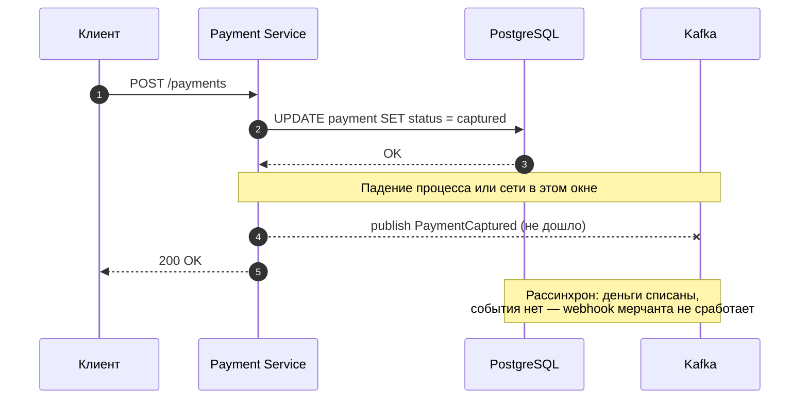
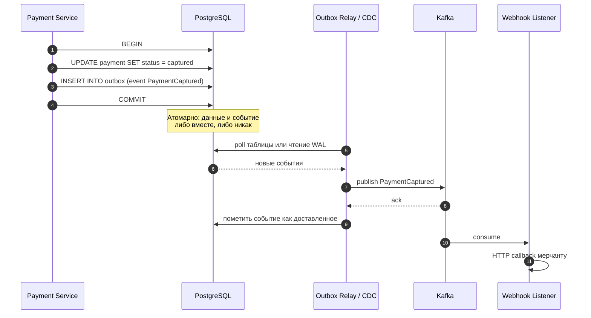
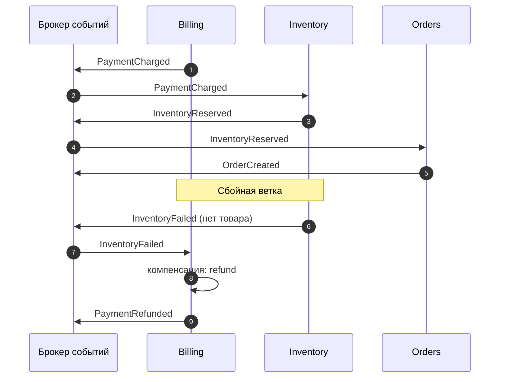
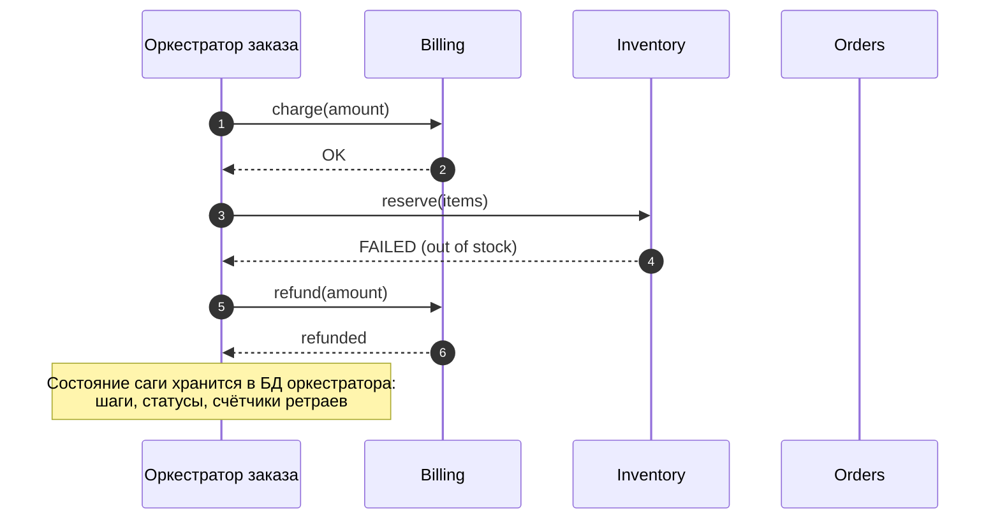
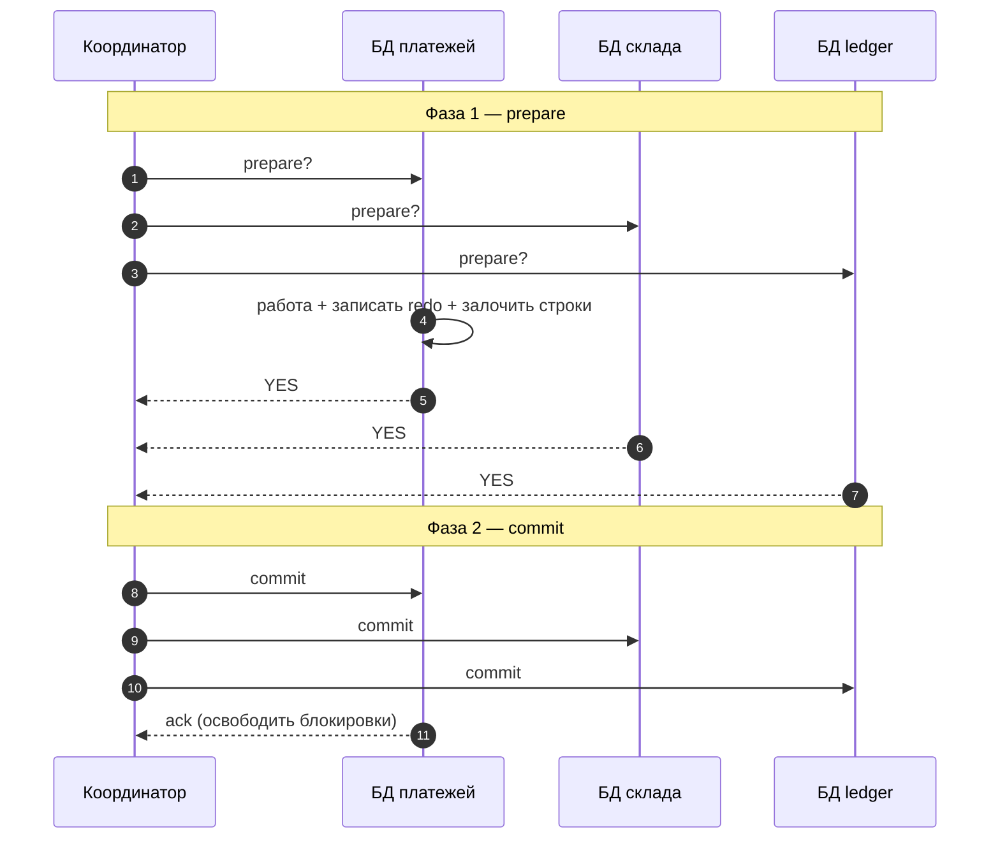
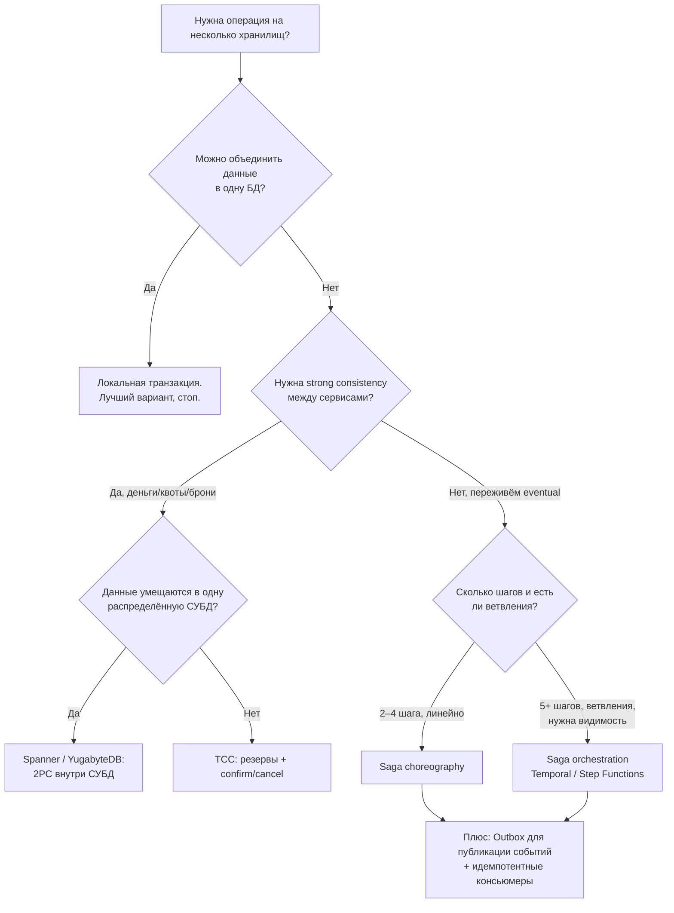

# Распределённые транзакции и надёжность данных

> Как гарантировать согласованность, когда одна логическая операция затрагивает несколько баз данных, сервисов и брокеров сообщений. Тема стабильно всплывает на системных собеседованиях в моках уровня Яндекс/Ozon/Stripe: интервьюер специально «роняет» сервис посередине флоу и смотрит, заметит ли кандидат окно неконсистентности.

## Оглавление

- [Постановка проблемы: от ACID к распределённой системе](#постановка-проблемы-от-acid-к-распределённой-системе)
- [Проблема dual write](#проблема-dual-write)
- [Transactional Outbox](#transactional-outbox)
- [Saga: orchestration vs choreography](#saga-orchestration-vs-choreography)
- [2PC / XA и почему его не используют между сервисами](#2pc--xa-и-почему-его-не-используют-между-сервисами)
- [Идемпотентные консьюмеры](#идемпотентные-консьюмеры)
- [Миф exactly-once](#миф-exactly-once)
- [Сравнительная таблица подходов](#сравнительная-таблица-подходов)
- [Как выбирать подход: дерево решений](#как-выбирать-подход-дерево-решений)
- [Что говорить интервьюеру](#что-говорить-интервьюеру)
- [Уточняющие вопросы](#уточняющие-вопросы)
- [Красные флаги и типичные ошибки кандидатов](#красные-флаги-и-типичные-ошибки-кандидатов)
- [Deep dive: что спросят дополнительно](#deep-dive-что-спросят-дополнительно)
- [Источники и видео по теме](#источники-и-видео-по-теме)

---

## Постановка проблемы: от ACID к распределённой системе

В монолите с одной базой транзакции — бесплатная роскошь. Клиент оформляет заказ: списать деньги, зарезервировать товар, записать запись в ledger. Оборачиваем всё в одну транзакцию БД — и получаем:

- **Атомарность**: либо все три записи зафиксированы, либо ни одной. Не существует мира, где карта списана, а товар не зарезервирован.
- **Изоляцию**: никто не видит «полуфабрикат» — промежуточное состояние транзакции.

Дальше система растёт: базу шардируют, монолит режут на микросервисы — у каждого своя база. Тот же платёжный флоу превращается в три независимые операции на трёх машинах: платёжная база, база склада, база бухгалтерии. Общей транзакции между ними нет — базы друг о друге не знают.

**Распределённая транзакция** — это одна логическая операция, которая затрагивает несколько независимых хранилищ/сервисов, где все шаги должны либо успеть вместе, либо быть корректно «убраны» при сбое. При тысячах таких операций в секунду частичные сбои — не edge case, а рутина.

Классика даёт два семейства решений:

1. **Тяжёлые протоколы** (2PC, 3PC, TCC) — стремятся к атомарности между участниками ценой сложности, блокировок и задержек.
2. **Процессные паттерны** (Saga, Outbox, event-driven) — принимают временную рассогласованность как норму и гарантируют сходимость (eventual consistency).

Индустрия подавляюще выбрала второй путь для межсервисного взаимодействия. Пат Хелланд ещё в 2007-м в статье «Life Beyond Distributed Transactions» сформулировал почему: распределённые транзакции между автономными сервисами не работают на интернет-масштабе. Но 2PC спрашивают на собеседованиях постоянно — как «академический базис», поэтому разбирать нужно оба подхода.

Прежде чем тянуть в дизайн saga или 2PC, задайте главный вопрос: **а нужна ли распределённая транзакция вообще?** Если данные, которые изменяются вместе, можно положить в одну базу — сделайте это. Локальная транзакция проще, быстрее и надёжнее любой распределённой альтернативы. Это всегда лучший ответ, если он доступен.

---

## Проблема dual write

**Dual write** — ситуация, когда сервис в рамках одной логической операции должен записать в две независимые системы: например, обновить свою БД **и** опубликовать событие в Kafka. Между этими системами нет общей транзакции, поэтому гарантии «обе или ни одной» не существует.

Классический сценарий из платёжного мока: Payment Service поменял статус транзакции на `captured` в базе, но упал до публикации события в Kafka. Мерчант не получил webhook, клиент не получил товар, а деньги уже списаны. Обратный порядок не лучше: событие ушло, а запись в базу упала — даунстрим-сервисы реагируют на то, чего в реальности не произошло.



Почему «просто ретраить» не работает: после успешного коммита в БД у сервиса нет записи о том, что событие *ещё нужно* отправить. Если процесс умер — намерение отправить событие умерло вместе с ним. Это и есть корневая причина, ради которой существует outbox.

Варианты «решений», которые на самом деле не решают:

- **Публиковать в Kafka сначала, писать в БД потом** — зеркальная проблема: событие о факте, которого не было.
- **2PC между БД и брокером** — Kafka не участвует в XA-транзакциях с внешней СУБД; такой связки в проде не делают.
- **«Вероятность маленькая, забьём»** — при 10k TPS «маленькая вероятность» превращается в десятки инцидентов в день.

---

## Transactional Outbox

Идея: вместо записи в две системы проталкиваем транзакционность внутрь одной базы. В **одной локальной транзакции** пишем и бизнес-данные, и само событие — в специальную таблицу `outbox`. Либо обе записи закоммичены, либо ни одной — атомарность снова бесплатная. Отдельный процесс (релей) асинхронно переносит события из `outbox` в брокер.



Схема таблицы (типичный минимум):

```sql
CREATE TABLE outbox (
    id            BIGSERIAL PRIMARY KEY,
    aggregate_id  TEXT        NOT NULL,   -- id заказа/платежа, ключ партиционирования
    event_type    TEXT        NOT NULL,   -- payment.captured
    payload       JSONB       NOT NULL,   -- тело события
    created_at    TIMESTAMPTZ NOT NULL DEFAULT now(),
    published_at  TIMESTAMPTZ             -- NULL = ещё не доставлено
);

CREATE INDEX idx_outbox_unpublished
    ON outbox (created_at)
    WHERE published_at IS NULL;  -- частичный индекс: читаем только недоставленное
```

### Два способа доставки из outbox в брокер

| Подход | Как работает | Плюсы | Минусы |
|---|---|---|---|
| **Polling publisher** | Фоновый процесс раз в N мс делает `SELECT ... WHERE published_at IS NULL` | Просто, работает с любой СУБД | Задержка до интервала опроса; лишняя нагрузка на БД; конкуренция нескольких инстансов релея (`FOR UPDATE SKIP LOCKED`) |
| **CDC (Change Data Capture)** | Debezium / Kafka Connect читает WAL (журнал транзакций) PostgreSQL и превращает вставки в outbox в события | Задержка ~миллисекунды; нет нагрузки запросами; порядок по WAL | Операционная сложность: коннекторы, слоты репликации, мониторинг отставания |

### Подводные камни, о которых спрашивают

1. **Гарантия — at-least-once, а не exactly-once.** Релей может опубликовать событие в Kafka и упасть до того, как отметил его доставленным. После рестарта он отправит дубликат. Поэтому outbox **обязан** дополняться идемпотентными консьюмерами (см. ниже) — иначе вы просто переместили проблему на один хоп дальше.
2. **Горячая таблица.** Каждая запись в системе трогает outbox; при высоком RPS база может держать её в памяти целиком. Частые `INSERT` + `DELETE` порождают tombstones и раздувание таблицы (особенно больно в PostgreSQL — autovacuum может не успевать).
3. **Удалять или помечать?** Удаление после публикации держит таблицу маленькой, но маркировка (`published_at`) даёт аудит и возможность переотправки. Компромисс: помечать + архивировать/чистить по расписанию.
4. **Порядок событий.** При параллельных релеях события по одному агрегату могут уйти не по порядку. Решение: партиционировать по `aggregate_id` и публиковать из одного партициона последовательно.
5. **Дополнительная задержка.** Outbox — это всегда eventual consistency с лагом от миллисекунд (CDC) до секунд (polling). Для синхронного ответа клиенту это невидимо, для связанных флоу — учитывайте.

### Альтернативы, которые стоит упомянуть

- **Listen to yourself**: сервис публикует событие и сам же его консьюмит, чтобы обновить БД. Работает, но переворачивает приоритеты (брокер становится источником истины) и усложняет расследования.
- **Event Sourcing**: события и есть состояние, dual write исчезает по построению. Цена — полностью другая модель хранения, редко оправдана только ради надёжной публикации.

---

## Saga: orchestration vs choreography

Сага исходит из другой посылки, чем 2PC: сквозная атомарность между сервисами не нужна — нужен способ **в конце концов** прийти в согласованное состояние. Работа разбивается на цепочку локальных транзакций `T1, T2, ..., Tn`, каждая коммитится в свою базу на своих условиях. Откатить уже закоммиченный шаг нельзя — вместо rollback выполняется **компенсирующая транзакция** `Ci`: возврат денег вместо отмены списания, отмена брони вместо release lock.

Ключевые свойства:

- Компенсация — это **бизнес-операция**, видимая пользователю: клиент увидит списание, а через секунды — возврат (и пуш от банка про оба события). Это не «невидимая уборка» уровня БД.
- Компенсация не обязана быть симметричной обратной операцией. Нельзя «разотправить» email; нельзя гарантировать, что внешняя система обработает отмену вебхука. Иногда корректная компенсация — задача менеджеру в CRM и человек, который разрулит кейс.
- Компенсации сами могут падать → нужны ретраи → ретраи требуют идемпотентности (иначе двойной refund). **К отказоустойчивости компенсаций предъявляются те же требования, что к happy path.**
- Сага даёт eventual consistency: система может быть временно неконсистентна, но сходится и никого не блокирует на время сходимости.

### Choreography (хореография)

Децентрализованный вариант: сервисы обмениваются событиями через брокер, каждый сам решает, как реагировать.



**Когда уместна**: 2–4 шага, сервисы действительно независимы, нет ветвлений, не нужна централизованная видимость состояния. Классический пример — уведомления: `OrderPlaced` независимо триггерит email/push.

**Где ломается**: на 5–6 сервисах, обменивающихся событиями, понять состояние конкретной транзакции становится археологией — «где именно упало? какие компенсации уже отработали? прошёл ли refund?» — приходится сшивать логи десятка сервисов. Плюс циклические зависимости событий и сложность тестирования.

### Orchestration (оркестрация)

Отдельный сервис-оркестратор ведёт флоу пошагово: командует участникам, ждёт подтверждений, при сбое запускает компенсации в правильном порядке.



Критичное отличие оркестратора саги от координатора 2PC: **при падении он не оставляет блокировок в системе**. Оркестратор дурабелен — своё состояние хранит в базе, после рестарта читает его и продолжает с того же шага. Участники в это время работают в обычном режиме, никаких строк не залочено.

Инструменты, которые стоит называть на собеседовании: **Temporal** (от автора Uber Cadence), **AWS Step Functions**, Camunda/Zeebe. Их используют для платёжных и фулфилмент-флоу; saga с оркестрацией — фактический стандарт в Uber, Netflix, Amazon, DoorDash.

### Orchestration vs Choreography: trade-off

| Критерий | Choreography | Orchestration |
|---|---|---|
| Порог входа | Низкий — только брокер | Нужен оркестратор + его инфраструктура |
| Видимость состояния | Размазана по логам и топикам | Централизована: «на каком шаге заказ №123» — один запрос |
| Ветвления, таймауты, SLA шагов | Очень больно | Нативно поддерживаются |
| Компенсации | Разбросаны по сервисам | Собраны в одном месте |
| Связанность | Сервисы знают только о событиях | Сервисы знают об оркестраторе; риск «божественного сервиса» |
| Типичная эволюция | Стартуют здесь | Переезжают сюда по мере роста сложности |

### TCC (Try-Confirm-Cancel) — для полноты картины

Прикладной паттерн из той же семьи: координатор вызывает у участников три вида операций — `Try` (зарезервировать ресурс: холд денег, слот брони), `Confirm` (зафиксировать, если все `Try` успешны), `Cancel` (снять резерв при сбое). В отличие от 2PC, блокировок СУБД нет — «подготовленное состояние» живёт в бизнес-данных. Требует от каждого сервиса отдельных endpoint'ов, хранения резервов с TTL и идемпотентности повторных вызовов. Применяется, где цена ошибки высока: финтех, бронирование, биллинг, квоты. Минусы — заметный рост сложности: больше состояний, очистка протухших резервов, строгая дисциплина контрактов.

---

## 2PC / XA и почему его не используют между сервисами

Two-Phase Commit — классический протокол распределённой транзакции. Появляется новый компонент — **координатор**, задача которого добиться, чтобы все участники согласовали исход до того, как кто-либо зафиксирует изменения.



Если хотя бы один голосует `NO` — координатор рассылает `abort`, все откатываются и отпускают блокировки. На бумаге — та же strong consistency, что в одиночной базе: нет окна, где система в частичном состоянии.

### Почему в проде между сервисами это не работает

1. **Блокирующий протокол.** Координатор собрал все `YES` и упал, не успев разослать решение. Участники застряли: строки залочены, решения нет. Коммитить самим нельзя (вдруг решение было `abort`), откатываться нельзя (вдруг `commit`, и остальные уже зафиксировали). Все транзакции, которым нужны те же строки, встают в очередь.
2. **Скорость системы = скорость самого медленного участника.** Ledger-сервис отвечает на `prepare` 10 секунд — платёжный и складской сервисы всё это время сидят с блокировками. Хвост задержек определяется самой медленной нодой и состоянием сети.
3. **Сетевой разрыв неразличим с отказом.** Координатор не может отличить «участник не получил сообщение» от «получил, но ответ потерялся» — безопасного дефолта нет.
4. **Ручная разборка.** «Подготовлено у части участников, но не закоммичено» после инцидента — это ручная операция на проде.

**3PC** добавляет фазу pre-commit, чтобы участник, не дождавшийся финального решения, мог завершиться самостоятельно. Но протокол опирается на нереалистичные допущения о сети (малые прогнозируемые задержки, отсутствие разделений) и всё равно не выживает в реальном проде. Спрашивают на собеседованиях как теорию — знайте, в проде не встретите.

**XA** — это стандартизованный интерфейс 2PC (X/Open): `XADataSource`, глобальные транзакции в Java EE/Spring через JTA. Живёт внутри одного датацентра, между «родными» ресурсами; между микросервисами с разными циклами деплоя — антипаттерн.

### Где 2PC реально живёт

- **Внутри распределённых СУБД**: Google Spanner, YugabyteDB, CockroachDB — координатор и участники жёстко связаны в одной системе, сложность спрятана от вызывающего.
- **Внутри Kafka**: транзакционный продюсер оборачивает запись в несколько партиций/топиков в 2PC с транзакционным координатором брокера — фундамент exactly-once semantics в Kafka Streams.
- **Внутри кластера одной базы или между шардами одной СУБД** — да. Между автономными сервисами — нет.

Если eventual consistency действительно недопустима для куска системы — правильный ответ: положить эти данные в одну распределённую СУБД со строгой согласованностью внутри, а не строить 2PC поверх независимых сервисов.

---

## Идемпотентные консьюмеры

Раз доставка по факту at-least-once, дубликаты — вопрос «когда», а не «если». Идемпотентность — свойство операции давать один и тот же результат при однократном и десятикратном выполнении. В платёжных моках это первое, что проверяют: «ретрай не должен привести к двойному списанию».

Типичные точки дублирования:

- клиент ретраит HTTP-запрос после таймаута (а запрос на самом деле выполнился);
- релей outbox отправил событие повторно;
- консьюмер обработал сообщение, упал до коммита офсета и получил его заново;
- ночной settlement-джоб случайно запустили дважды.

### Паттерн idempotency key (API-уровень)

Клиент генерирует уникальный ключ операции (UUID) и шлёт его в заголовке (`Idempotency-Key` — так делает Stripe). Сервер хранит ключ вместе с результатом первой обработки:

```sql
CREATE TABLE idempotency_keys (
    key           TEXT PRIMARY KEY,
    request_hash  TEXT NOT NULL,         -- защита от переиспользования ключа с другим телом
    status        TEXT NOT NULL,         -- processing | completed | failed
    response      JSONB,                 -- закэшированный ответ
    created_at    TIMESTAMPTZ NOT NULL DEFAULT now(),
    expires_at    TIMESTAMPTZ NOT NULL   -- TTL, у Stripe — 24 часа
);
```

Логика обработки:

1. Ключа нет → вставить запись со статусом `processing` (вставка по PK — естественный мьютекс от гонки двух параллельных ретраев), выполнить операцию, сохранить ответ и статус `completed`.
2. Ключ есть, статус `completed` → вернуть сохранённый ответ, **не выполняя** операцию повторно.
3. Ключ есть, но `request_hash` другой → `422`: ключ переиспользован с другими параметрами.
4. Ключ есть, статус `processing` → запрос уже обрабатывается: `409` или подождать.

### Паттерн dedup на консьюмере (уровень сообщений)

Консьюмер ведёт таблицу обработанных `message_id` **в той же БД и той же транзакции**, что и бизнес-запись:

```sql
BEGIN;
INSERT INTO processed_messages (message_id) VALUES (:mid);  -- PK: дубликат = ошибка вставки
-- бизнес-операция
UPDATE orders SET status = 'paid' WHERE id = :order_id;
COMMIT;
```

Дубликат сообщения упрётся в primary key `processed_messages`, транзакция откатится — повторной записи не будет. Именно связка «дедуп-запись и бизнес-запись в одной транзакции» даёт эффективную однократность обработки.

### Структурные приёмы, снижающие цену дубликатов

- **Строгий state machine в БД**: переходы только `pending → authorized → settled`, никогда назад и не через состояние. Оптимистичные блокировки (`version`/`WHERE status = 'authorized'`) отсекают конфликтующие параллельные апдейты: из двух воркеров успеет один.
- **Batch token для джобов**: каждому прогону settlement-джоба — уникальный `batch_id`, каждая обработанная запись помечается им. Повторный прогон видит уже помеченные записи и пропускает — двойное списание невозможно даже при случайном перезапуске.
- **Естественная идемпотентность операций**: `SET balance = 100` вместо `balance = balance + 100`; upsert вместо insert; PUT вместо POST там, где семантика позволяет.

---

## Миф exactly-once

Формально exactly-once доставка в распределённой системе невозможна: консьюмер может обработать сообщение и упасть до ack — отправитель обязан повторить, и никакой протокол не отличит «не дошло» от «дошло, но ack потерялся». Это следствие проблемы двух генералов.

Реалистичный словарь для собеседования:

| Семантика | Что гарантирует | Как достигается | Где уместна |
|---|---|---|---|
| **At-most-once** | Не больше одного раза; возможны потери | ack до обработки, без ретраев | Метрики, телеметрия, где потеря дешевле дубликата |
| **At-least-once** | Не меньше одного раза; дубликаты | ack после обработки + ретраи | Дефолт в проде: Kafka, RabbitMQ, SQS |
| **Effectively-once** | Доставка at-least-once + обработка эквивалентна однократной | идемпотентность + дедуп + транзакционная запись | То, что реально строят в платежах |

Правильная формулировка звучит так: **exactly-once в строгом смысле не существует; существует effectively-once = at-least-once delivery + идемпотентная обработка**. Кандидат, который говорит «включим exactly-once в Kafka и дубликатов не будет», демонстрирует, что не разбирался, что именно покрывает эта настройка.

Что покрывает Kafka EOS (idempotent producer + transactions):

- **Idempotent producer**: продюсеру выдаётся `PID`, каждый батч несёт sequence number; брокер дедуплицирует ретраи *внутри одной сессии продюсера*. Это убирает дубликаты на участке «продюсер → брокер», и только его.
- **Transactions**: атомарная запись в несколько партиций (например, read-process-write в Kafka Streams) через внутренний 2PC брокера.

Чего Kafka EOS **не** решает: дубликаты на стороне консьюмера (упал после обработки, до коммита офсета — получит сообщение снова) и дубликаты из внешних систем (ваш outbox-релей отправил дважды). Поэтому даже с EOS идемпотентный консьюмер обязателен. Хорошая реплика для интервью: «По умолчанию делаем at-least-once и идемпотентность; exactly-once обсудим отдельно, если интервьюер настаивает — это дорогая настройка с узкой областью действия».

---

## Сравнительная таблица подходов

| Подход | Консистентность | Блокировки | Сложность | Задержка | Где применяется |
|---|---|---|---|---|---|
| Локальная транзакция | Strong | Короткие, в одной БД | Минимальная | Минимальная | Всегда, если границы сервисов позволяют |
| 2PC / XA | Strong | Долгие, распределённые | Высокая | = самому медленному участнику | Внутри Spanner/YugabyteDB, XA в одном ДЦ |
| TCC | Strong на уровне резервов | Бизнес-резервы, не БД-локи | Очень высокая | Средняя | Финтех, бронирование, квоты |
| Saga (choreography) | Eventual | Нет | Средняя | Низкая | Простые цепочки 2–4 шага |
| Saga (orchestration) | Eventual | Нет | Высокая (но локализована) | Низкая | Сложные флоу с ветвлениями и компенсациями |
| Outbox + CDC | Eventual (публикация событий) | Нет | Средняя | +мс–сек к доставке событий | Надёжная публикация из любого сервиса с СУБД |

---

## Как выбирать подход: дерево решений



---

## Что говорить интервьюеру

Сильный кандидат сам поднимает тему, не дожидаясь вопроса. Рабочие формулировки:

- «Здесь у меня dual write между базой и брокером. Закрою его transactional outbox: событие пишу в ту же БД в одной транзакции с бизнес-данными, а в Kafka его перенесёт CDC-коннектор. Это даёт at-least-once, поэтому на консьюмере добавлю дедуп по `message_id`».
- «Сквозной атомарности между сервисами не будет — осознанно принимаю eventual consistency и опишу сагу с компенсациями. Для флоу из 6 шагов с ветвлениями выберу оркестрацию на Temporal, а не хореографию, потому что нужна видимость состояния каждого заказа».
- «2PC между микросервисами предлагать не буду: это блокирующий протокол, система двигалась бы со скоростью самого медленного участника, а падение координатора оставляет зависшие блокировки. Он уместен внутри распределённых СУБД типа Spanner».
- «Exactly-once в строгом смысле не существует. Строю effectively-once: at-least-once доставка + idempotency key на API + дедуп на консьюмере + строгий state machine в базе».
- «Прежде чем городить сагу, проверю, нельзя ли положить данные, которые меняются вместе, в одну базу — локальная транзакция всегда надёжнее».

Для платёжных задач (Stripe-мок) упомяните полный набор: idempotency key от клиента → Redis-проверка «не обрабатывается ли уже» → outbox для webhook-событий → batch token для settlement-джоба → ежедневная reconciliation с банковскими выписками как финальный источник истины. Это показывает, что вы понимаете: база — не истина, истина — движение денег между банками.

---

## Уточняющие вопросы

Прежде чем выбирать механику, зафиксируйте требования:

- Какова цена ошибки? Двойное списание с клиента — катастрофа (нужны idempotency + reconciliation); потерянный лайк — нет (хватит at-least-once без дедупа).
- Допустима ли временная неконсистентность для пользователя? Увидеть списание, а через 5 секунд возврат — приемлемо? Или нужна строгая согласованность (тогда разговор про TCC/единую СУБД)?
- Сколько шагов в бизнес-транзакции и есть ли ветвления? (Выбор choreography vs orchestration.)
- Все ли шаги обратимы? Отправленный email и выстреленный вебхук не «откатываются» — какие компенсации вообще возможны?
- Какой RPS по транзакциям? Outbox-таблица при 50k TPS — это отдельный разговор про hot table и CDC вместо polling.
- Нужен ли аудит/реконсиляция с внешними системами (банки, провайдеры)?

---

## Красные флаги и типичные ошибки кандидатов

- **«Просто обёрну в распределённую транзакцию»** — без понимания, что XA между микросервисами в проде не делают. Интервьюер ждёт именно реплику про блокировки и падение координатора.
- **Игнорирование dual write**: нарисовал стрелку «сервис → БД → Kafka» и не заметил, что это две записи без общей транзакции. Частый приём интервьюера — спросить «а что если сервис упадёт ровно между этими двумя вызовами?»
- **«Kafka exactly-once решит всё»** — не решит: EOS покрывает только продюсер→брокер и внутренние стримы; консьюмер всё равно обязан быть идемпотентным.
- **Компенсации как формальность**: нарисовал стрелку «refund», не подумав, что refund тоже падает, тоже ретраится и тоже должен быть идемпотентным. И что клиент увидит списание + возврат в выписке.
- **Откат «неоткатываемого»**: шаг «отправить email/SMS» в середине саги без ответа на вопрос, как его компенсировать. Правильный ход — необратимые шаги ставить в конец саги.
- **Хореография на 8 сервисов** без единого места, где видно состояние заказа — признак, что кандидат не отлаживал такое в проде.
- **Retry без backoff и jitter**: при 10-секундном лаге платёжного гейтвея тысячи клиентов ретраят одновременно — retry storm (thundering herd) добивает систему. Лечится экспоненциальным backoff с jitter на клиенте и rate limiting на гейтвее.
- **Доверие собственной базе как источнику истины в платежах**: без периодической reconciliation с внешними выписками расхождения будут копиться незамеченными.

---

## Deep dive: что спросят дополнительно

- **Как outbox-релей масштабировать на несколько инстансов без двойной публикации?** `SELECT ... FOR UPDATE SKIP LOCKED` при polling; при CDC — один коннектор с офсетом, либо партиционирование по `aggregate_id`.
- **Порядок событий по одному агрегату?** Ключ партиции Kafka = `aggregate_id`; публикация последовательно из одного релея/партиции; монотонный `id`/`created_at` в outbox.
- **Что делать с событиями, которые не публикуются часами (poison messages)?** Счётчик попыток, DLQ, алертинг; событие остаётся в outbox и не теряется.
- **Saga и изоляция**: между шагами другие транзакции видят промежуточное состояние. Приёмы: семантические блокировки (статус `PENDING` на записи), versioning, commutative-операции, перечитывание состояния перед шагом. Терминология — сага даёт атомарность и durability, но не isolation.
- **Как оркестратор переживает собственное падение?** Дурабельное состояние в БД (event-sourced журнал у Temporal), таймауты шагов, heartbeat от воркеров; после рестарта — продолжение с последнего зафиксированного шага.
- **CDC против polling — когда что?** Polling — быстрый старт, малый трафик; CDC (Debezium по WAL) — миллисекундная задержка и нет нагрузки на БД, но операционные расходы на слоты репликации и мониторинг.
- **Реконсиляция**: периодический джоб сличает внутренний ledger с внешними settlement-файлами банка по уникальным transaction id; расхождения — в очередь ручного аудита или авто-рефанд.
- **Альтернативы outbox**, если СУБД не транзакционная (некоторые NoSQL): listen-to-yourself, event sourcing; либо вынос outbox в отдельное хранилище с собственной логикой согласования (дорого и хрупко).

---

## Источники и видео по теме

- [Распределенные транзакции: объяснение двухфазной фиксации и паттерн саги](https://www.youtube.com/watch?v=DOFflggE_0Q)
- [What is the Transactional Outbox Pattern? / Designing Event-Driven Microservices](https://www.youtube.com/watch?v=5YLpjPmsPCA)
- [Design Payment System - Top Asked Interview Question in OpenAI / Stripe](https://www.youtube.com/watch?v=ruxGKk51aHo)
- [Разработка Stripe: Интервью о системном проектировании (Stripe и предложения Amazon)](https://www.youtube.com/watch?v=djc2vfpCvso)
- [Распределенная очередь сообщений (Kafka): системный дизайн на собеседовании (офферы от Stripe и Amazon)](https://www.youtube.com/watch?v=Qay43Km1NwY)
- [System Design: Что на самом деле проверяют на интервью?](https://www.youtube.com/watch?v=HHQTVvMXadE)
- [Популярные шаблоны микросервисной архитектуры за 20 минут / Паттерны MCA / Microservices](https://www.youtube.com/watch?v=6AVxBxcU2NQ)
