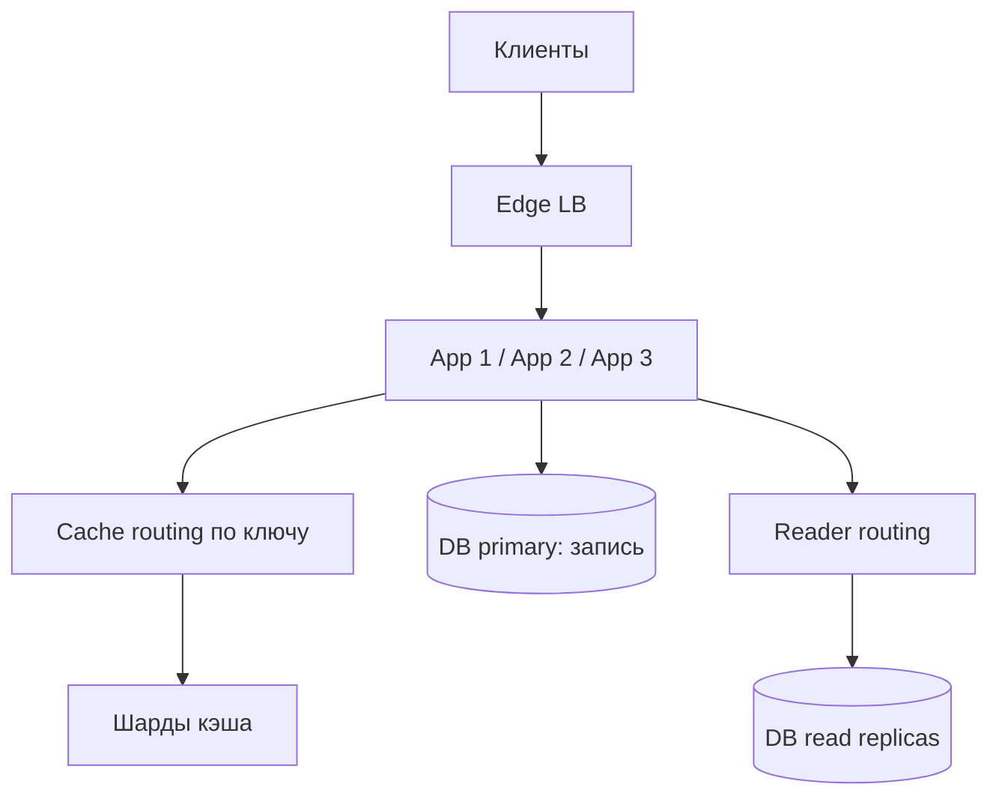
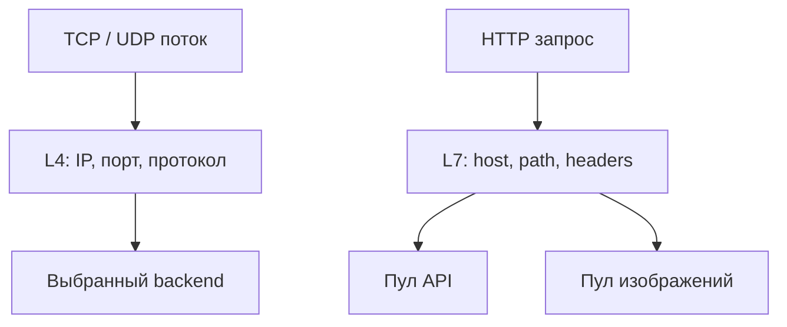
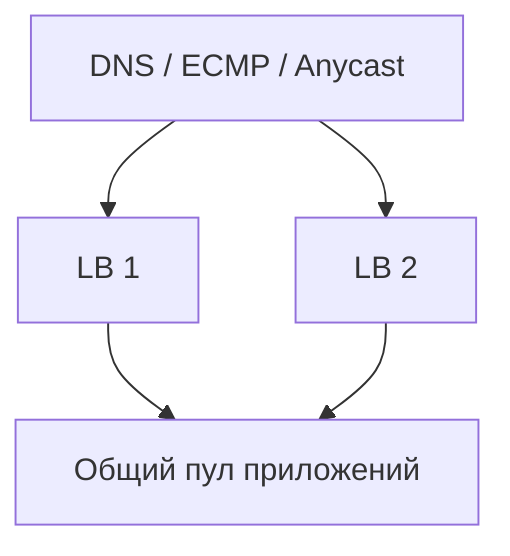
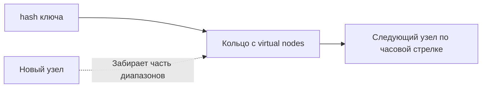
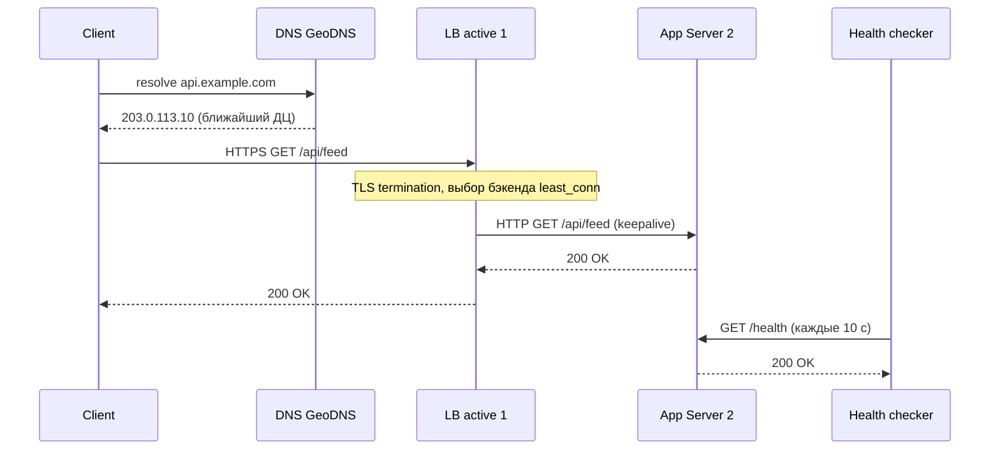

# Балансировка нагрузки (Load Balancing)

<!-- learning-nav:start -->
[← Все разделы](../README.md) · [Предыдущая тема](api-design.md) · [Следующая тема →](caching.md)
<!-- learning-nav:end -->

> Балансировщик — это «кирпичик», который появляется на схеме почти любого System Design собеседования. Вопрос «а какую стратегию балансировки выберем?» звучит на моках у Яндекса, Ozon и Avito практически всегда. Ниже — всё, что нужно, чтобы отвечать на него уверенно: L4 vs L7, алгоритмы, health checks, sticky sessions, отказоустойчивость самого балансировщика и DNS-балансировка.

## Содержание

<!-- toc:start -->
<details>
<summary>Показать темы и вопросы</summary>

- [Зачем нужен балансировщик](#зачем-нужен-балансировщик)
- [Где ставится балансировщик](#где-ставится-балансировщик)
- [L4 vs L7 балансировка](#l4-vs-l7-балансировка)
- [Алгоритмы балансировки](#алгоритмы-балансировки)
- [Health checks](#health-checks)
- [Sticky sessions (сессионная привязка)](#sticky-sessions-сессионная-привязка)
- [Балансировщик как точка отказа](#балансировщик-как-точка-отказа)
- [DNS-балансировка и GeoDNS](#dns-балансировка-и-geodns)
- [Клиентская vs серверная балансировка](#клиентская-vs-серверная-балансировка)
- [Практика: конфигурация NGINX](#практика-конфигурация-nginx)
- [Что говорить интервьюеру](#что-говорить-интервьюеру)
- [Красные флаги и типичные ошибки](#красные-флаги-и-типичные-ошибки)
- [Deep dive](#deep-dive)
- [Что спросят дополнительно](#что-спросят-дополнительно)
- [Видео по теме](#видео-по-теме)

</details>
<!-- toc:end -->

---

## Зачем нужен балансировщик

Любой сервер имеет конечную ёмкость: CPU, память, сетевые соединения, диск. Когда трафик растёт, есть два пути:

- **Вертикальное масштабирование (scale up)** — поставить более мощное железо. Просто, но упирается в потолок одной машины, дорого и оставляет single point of failure.
- **Горизонтальное масштабирование (scale out)** — много одинаковых дешёвых (commodity) серверов. Это распространённый способ роста, но масштабирование app-слоя не обязательно требует микросервисов.

Как только серверов стало больше одного, возникает вопрос: **на какой из них отправить конкретный запрос?** Эту задачу и решает балансировщик нагрузки (load balancer, LB).

Что даёт балансировщик:

- **Масштабируемость** — добавили инстанс, трафик перераспределился.
- **Доступность (high availability)** — упавший инстанс исключается из ротации через health check, сервис продолжает отвечать (медленнее, но отвечает).
- **Производительность** — равномерное распределение снижает средний latency и не даёт одному узлу «задохнуться», пока соседние простаивают.
- **Удобство эксплуатации** — rolling deploy с connection draining, TLS termination, сжатие, сбор логов и трассировка в одной точке.

Ёмкость LB оценивают по своему workload: RPS, одновременные соединения, новые соединения/с, объём байтов, TLS handshakes и стоимость фильтров. Один инстанс может обслуживать много idle WebSocket, но упереться в CPU на TLS или WAF при гораздо меньшем RPS. Универсального числа для программного или аппаратного LB нет.

> **Важно:** балансировка не лечит медленные запросы к БД, неэффективные алгоритмы и contention за ресурсы. Добавление веб-серверов не ускорит систему, если узкое место — база. Это любимая проверка интервьюера «на понимание».

---

## Где ставится балансировщик

Классическая ошибка новичка — нарисовать один квадратик LB между клиентом и веб-серверами и успокоиться. На самом деле балансировщик может стоять **между любыми двумя слоями**, где есть несколько одинаковых узлов:



Типичные точки установки:

- **Edge / вход в дата-центр** — терминация TLS, первичная маршрутизация.
- **Перед stateless app-серверами** — самый частый случай на собеседовании.
- **Перед кэшем (Redis/Memcached)** — часто не отдельный LB, а consistent hashing на клиенте или proxy (twemproxy, Envoy).
- **Перед репликами БД** — распределение read-запросов по репликам (например, ProxySQL или облачные reader endpoint'ы). PgBouncer прежде всего pooler соединений PostgreSQL: сам не разбирает SQL для разделения read/write.
- **Внутри микросервисной сетки** — перед каждым внутренним сервисом, чтобы каждый компонент масштабировался независимо (sidecar/ambient mesh: Envoy в Istio, Linkerd).

В зрелых системах под «одним квадратиком LB» скрывается целая иерархия: DNS/GeoDNS → LB на входе в ДЦ → LB внутри ДЦ → service discovery и клиентская балансировка между микросервисами.

---

## L4 vs L7 балансировка

Это **вопрос номер один** про балансировку на собеседованиях. Речь про уровни модели OSI, на которых балансировщик принимает решение о маршрутизации.

- **L4 (транспортный уровень, TCP/UDP).** LB смотрит только на заголовки пакетов: source/destination IP и порты, протокол. Полезная нагрузка не читается. Он назначает поток выбранному бэкенду; реализация может использовать NAT, proxy или Direct Server Return. Это не обязательно NAT.
- **L7 (прикладной уровень, HTTP/gRPC).** LB понимает прикладной запрос: URL, заголовки, cookies, метод; чтение тела требует соответствующей настройки. Для HTTPS обычно терминирует TLS, затем может шифровать upstream-трафик заново. Может маршрутизировать по пути (`/images/*` → один пул, `/api/*` → другой), по хосту, по cookie, по user-id в заголовке.



| Критерий | L4 | L7 |
|---|---|---|
| Что видит | IP, порты, протокол | URL, headers, cookies, тело запроса |
| Стоимость | Обычно меньше обработки на пакет | Больше CPU/памяти на HTTP, TLS и фильтры; буферизация зависит от настройки |
| TLS | Обычно passthrough (шифрованный поток идёт до бэкенда) | TLS termination на LB (или re-encrypt до бэкенда) |
| Гибкость маршрутизации | Низкая: hash по IP/порту | Высокая: path/host/header-based routing, A/B-тесты, канарейки |
| Дополнительные политики | Лимиты соединений, transport health checks, иногда TLS termination | Прикладные rate limiting, auth, WAF, rewrite, кэширование |
| Протоколы | Любые TCP/UDP (БД, MQTT, gRPC) | В основном HTTP/HTTPS, HTTP/2, gRPC, WebSocket |
| Примеры | NLB (AWS), LVS, IPVS в k8s kube-proxy, Maglev (Google) | NGINX, HAProxy (HTTP-режим), Envoy, ALB (AWS), Cloudflare |

Как выбирать на собеседовании:

- Нужен максимальный throughput и балансировка не-HTTP трафика (PostgreSQL, Kafka, игровые UDP-серверы) → **L4**.
- Нужна маршрутизация по URL, sticky sessions по cookie, TLS termination, канареечные релизы → **L7**.
- Реальный ответ в проде: **комбинация**. L4 (аппаратный/облачный NLB или Anycast) на входе распределяет потоки по ферме L7-балансировщиков, а те уже маршрутизируют по содержимому.

---

## Алгоритмы балансировки

Алгоритмы делятся на две большие группы:

- **Статические** — не учитывают текущее состояние бэкендов. Простые и предсказуемые.
- **Динамические** — учитывают метрики в реальном времени (число соединений, latency). Точнее, но требуют состояния на LB.

### Round Robin (циклический)

Запросы раздаются по кругу: первый → сервер A, второй → B, третий → C, четвёртый → снова A. Дефолтный алгоритм в NGINX.

- ✅ Простейшая реализация, равномерное распределение по количеству запросов.
- ❌ Не учитывает, что запросы не равнозначны: один клиент качает картинку на 10 КБ, другой — отчёт на 2 ГБ, и «его» сервер умирает под долгоживущими соединениями, пока соседи свободны.
- ❌ Не учитывает разную мощность серверов и их текущую загрузку.

### Weighted Round Robin (взвешенный)

Каждому серверу назначается вес. Сервер с весом 3 получает втрое больше запросов, чем с весом 1.

- ✅ Подходит для разнородного железа (heterogeneous fleet): новые мощные инстансы получают больше трафика.
- ✅ Позволяет постепенно уменьшать долю трафика и делать канарейки. Нулевой вес поддерживается не всеми LB; для вывода из ротации используйте документированный drain/down.
- ❌ Веса задаются вручную и не адаптируются к реальному времени ответа.

### Least Connections (наименьшее число соединений)

Новый запрос/поток уходит на сервер с наименьшим числом **активных** соединений, с учётом весов в конкретной реализации. LB ведёт счётчик по каждому бэкенду.

- ✅ Отлично работает при неравномерной «стоимости» запросов и долгих соединениях (WebSocket, SSE, long polling, отчёты).
- ❌ Требует состояния на LB; количество соединений ≠ реальная загрузка CPU. При HTTP/2 в одном соединении могут жить сотни запросов: полезнее least requests/active streams, если LB это поддерживает.

### Least Response Time (наименьшее время ответа)

Учитывается скользящее среднее latency каждого бэкенда (часто в комбинации с least connections). Запрос идёт к тому, кто отвечает быстрее всех.

- ✅ Самый адаптивный: автоматически «обтекает» деградирующую ноду.
- ❌ Максимальный overhead: постоянный мониторинг, хранение метрик на LB. С active-active парой LB метрики расползаются между двумя экземплярами — картина усредняется хуже.

### Hash-based (IP hash, URL hash)

Считается хэш от ключа запроса — IP клиента, URL, user-id — и по нему выбирается бэкенд: `server = hash(key) mod N`.

- ✅ При неизменном составе healthy backends и одинаковой hash policy ключ попадает на тот же сервер: полезно для локального кэша и affinity.
- ❌ **Классическая ловушка:** при добавлении/удалении сервера меняется `N`, и `mod N` перераспределяет **почти все** ключи — кэши инвалидируются массово. Лечится consistent hashing (см. Deep dive).
- ❌ IP hash плохо работает, когда за одним NAT сидят тысячи пользователей (корпоративные сети, мобильные операторы) — весь этот трафик прилипнет к одному бэкенду.

### Сравнительная таблица

| Алгоритм | Тип | Учитывает нагрузку | Дает привязку клиента | Когда выбирать |
|---|---|---|---|---|
| Round Robin | статический | нет | нет | stateless, одинаковые серверы, одинаковые запросы |
| Weighted RR | статический | нет (вручную) | нет | разное железо, канарейки, плавный drain |
| Least Connections | динамический | да (соединения) | нет | долгие/неравномерные запросы, WebSocket |
| Least Response Time | динамический | да (latency) | нет | latency-sensitive API, деградирующие ноды |
| IP/URL hash | статический | нет | да | локальные кэши, sticky без cookie |
| Consistent hashing | статический | нет | да (устойчивая) | кэши, шардированные пулы, изменяемый размер флота |

---

## Health checks

Балансировщик обязан знать, какие бэкенды живы, и исключать мёртвые из ротации. Это и есть механизм высокой доступности: сервис деградирует по ёмкости, но не падает целиком.

### Виды проверок

- **Passive (пассивные).** LB наблюдает за живым трафиком и исключает backend по настроенной failure policy (например, outlier detection в Envoy). В NGINX `max_fails` задаёт число учитываемых неуспешных попыток за интервал `fail_timeout`, не обязательно подряд. HTTP 500/502/503/504/429 учитываются только при явном перечислении в `proxy_next_upstream`; стандартная retry policy — `error timeout`. Корректный HTTP 500 сам по себе backend из ротации не выводит. Проверка не создаёт отдельного трафика, но реагирует постфактум — первые пользователи уже получили ошибки.
- **Active (активные).** LB сам периодически опрашивает бэкенды:
  - **L4 check:** TCP connect на порт. Быстро, но видит только «порт слушается».
  - **L7 check:** HTTP `GET /health`, ожидаем `200 OK`. Видит, что приложение реально работает.

### Параметры, о которых спросят

- **Интервал и таймаут** — например, каждые 5–10 с, таймаут 2 с.
- **Пороги и окно учёта** — например, 2–3 последовательных провала active check и несколько успехов для возврата. Для passive checks правила зависят от реализации: NGINX считает учитываемые failures внутри `fail_timeout`, а не универсальную серию подряд.
- **Liveness vs readiness.** Liveness отвечает, стоит ли перезапустить процесс; readiness — может ли инстанс принимать трафик сейчас. Readiness иногда проверяет обязательную зависимость, но бездумная проверка общей БД может одновременно убрать весь флот. Учитывайте деградацию, локальный прогрев и поведение LB при отсутствии healthy targets: некоторые реализации fail-open. Проверки зависимостей и отдельный end-to-end мониторинг не заменяют друг друга.

### Connection draining

При выводе ноды (деплой, autoscale-in) LB перестаёт слать на неё **новые** запросы, но даёт завершиться текущим в пределах заданного drain timeout (например, 60 с). Без этого rolling deploy режет живые соединения пользователей. Для бесконечных SSE/WebSocket одного ожидания недостаточно: нужен максимальный срок drain, уведомление о reconnect и восстановление по cursor. Readiness снимают до остановки процесса и учитывают время обновления discovery.

---

## Sticky sessions (сессионная привязка)

**Проблема:** если сессия пользователя хранится в памяти инстанса, а следующий запрос round robin отправит на другой инстанс — пользователь «разлогинится», потеряет корзину, состояние чата и т.д.

**Решение — sticky sessions (session affinity, «прилипание»):** все запросы одного клиента идут на один и тот же бэкенд.

Способы реализации:

1. **Cookie-based (L7).** LB при первом ответе вставляет свою cookie с идентификатором бэкенда и роутит по ней дальше. Точно, переживает смену IP клиента. Так делают AWS ALB, NGINX Plus (`sticky cookie`).
2. **IP hash (L4/L7).** Привязка по хэшу IP клиента. Не требует cookies, но ломается за NAT и при смене IP (мобильные сети).
3. **Hash от бизнес-ключа** — user-id, session-id из заголовка/токена.

Цена вопроса (об этом обязательно скажите сами — это показывает зрелость):

- **Неравномерная нагрузка.** «Горячие» пользователи/боты прилипают к одному инстансу; при autoscaling новые ноды получают мало трафика, потому что старые клиенты привязаны к старым.
- **Потеря сессии при падении ноды** — привязка не спасает данные в её памяти.
- **Усложнение деплоев** — нельзя просто убить ноду, на ней «висят» сессии.

Sticky sessions уменьшают перенос состояния, но связывают маршрутизацию с конкретной нодой. Для обычных пользовательских сессий сначала рассмотрите:

- **Внешнее хранилище сессий** (Redis, общая БД) — любой инстанс обслужит любого пользователя, балансировка снова равномерная.
- **Самодостаточные токены** (JWT, подписанные cookies) — проверка может быть локальной. Отзыв токенов, logout, смена прав и серверные корзины всё ещё требуют политики и иногда состояния.
- Исключение, где привязка оправдана: **локальные кэши** (consistent hashing ради cache-hit ratio) и stateful-вычисления. WebSocket физически закреплён за нодой до разрыва; sticky при новом handshake нужен только если восстановление требует именно её локального состояния. Общий connection registry/pub-sub решает доставку между нодами, но не сохраняет сообщения автоматически.

---

## Балансировщик как точка отказа

LB сам — single point of failure: если он упал, клиенты не достучатся даже до живых серверов. Плюс на больших масштабах он может стать bottleneck. Стандартные решения:

### Active-Passive

Два (или больше) LB, один активный, второй в горячем резерве. Между ними heartbeat (VRRP, keepalived); пассивный следит за активным и при его отказе поднимает на себе **виртуальный IP (VIP)** — клиенты обращаются к прежнему адресу. Существующие TCP-соединения обычно рвутся, если их состояние специально не реплицируется. Для координации используют и ZooKeeper/etcd (heartbeat + leader election). Время переключения — секунды.

- ✅ Один активный узел принимает решения о маршрутизации; при failover его локальные счётчики и привязки могут потеряться.
- ❌ Половина железа простаивает; failover не мгновенный.

### Active-Active

Оба LB одновременно обрабатывают трафик (через ECMP на роутере, DNS round robin или Anycast).

- ✅ Оба узла полезно загружены. После отказа ёмкости оставшихся должно хватать на весь принятый трафик; переключение и реконнекты всё равно влияют на клиентов.
- ❌ Состояние (счётчики соединений, метрики latency, sticky-таблицы) делится между двумя узлами — алгоритмы работают на неполных данных. Лечится либо отказом от stateful-алгоритмов, либо репликацией состояния, либо тем, что привязку обеспечивает слой ниже (например, flow hashing в ECMP). Anycast сам по себе не гарантирует привязку клиента при изменениях маршрутов.



На схеме active-active; VRRP/VIP для active-passive — отдельный вариант, их не
нужно смешивать в одну обязательную цепочку.

---

## DNS-балансировка и GeoDNS

Уровень выше балансировщиков — балансировка **самих балансировщиков и дата-центров** через DNS.

- **DNS round robin** — на одно доменное имя возвращается несколько A-записей; порядок адресов может меняться, а выбор и fallback зависят от клиента. Равного распределения запросов DNS не гарантирует. Просто, но:
  - DNS-кэши (TTL) не контролируются вами — после отказа LB/ДЦ часть клиентов будет слать трафик на мёртвый адрес, пока не истечёт TTL.
  - DNS не знает о реальной загрузке и здоровье узлов (кроме managed-решений с health-check-aware DNS: Route 53, NS1).
- **GeoDNS / latency-based routing** — резолверу возвращается IP ближайшего/наименее загруженного ДЦ по геолокации или измеренной задержке. Базовый паттерн multi-region архитектур.
- **Anycast** — один и тот же IP анонсируется из многих точек через BGP; маршрутизация BGP выбирает предпочтительный сетевой путь, а не обязательно географически ближайший или наименее загруженный узел. Так работают Cloudflare, Google (Maglev), большинство CDN. Обнаружение отказа и сходимость маршрутов зависят от сети и проверок; универсального обещания «быстрее DNS» нет.

На собеседовании сильно звучит фраза: «На входе в регион у нас GeoDNS/latency-based routing и Anycast, внутри региона — пара L7-балансировщиков в active-active, за ними — service discovery для внутренних вызовов».

---

## Клиентская vs серверная балансировка

Ещё одна независимая от L4/L7 ось — где принимается решение:

- **Серверная (server-side).** Клиент знает один адрес — LB, тот сам выбирает бэкенд. Всё, что описано выше: NGINX, HAProxy, облачные LB. Прозрачно для клиента, централизованные политики, но лишний сетевой хоп и сам LB нужно масштабировать.
- **Клиентская (client-side).** Клиент получает список живых инстансов из service discovery (etcd, Consul, ZooKeeper, Eureka) и **сам** выбирает, куда слать (round robin, least loaded, consistent hashing — логика в клиентской библиотеке). Классика: gRPC client-side LB, Finagle, Ribbon (legacy Netflix), xDS-клиенты.
  - ✅ Нет лишнего хопа и отдельной точки отказа, клиент видит реальную топологию.
  - ❌ Логика балансировки дублируется в каждом клиенте и на каждом языке; сложнее обновлять политики; клиенту нужен доступ к service discovery.
- **Компромисс в проде — service mesh:** балансировка выносится в sidecar-proxy (Envoy) рядом с приложением — клиентская балансировка без логики в коде приложения.

---

## Практика: конфигурация NGINX

На моках иногда просят «накидать конфиг» или просто плюсом является знание реальных директив.

```nginx
# Дефолт: round robin
upstream backend {
    server app1.internal:8080;
    server app2.internal:8080;
    server app3.internal:8080;
}

# Weighted round robin: app1 получит ~3/5 трафика
upstream backend_weighted {
    server app1.internal:8080 weight=3;
    server app2.internal:8080 weight=1;
    server app3.internal:8080 weight=1;
}

# Least connections
upstream backend_lc {
    least_conn;
    server app1.internal:8080;
    server app2.internal:8080;
}

# IP hash: привязка клиента к бэкенду (sticky по IP)
upstream backend_sticky {
    ip_hash;
    server app1.internal:8080;
    server app2.internal:8080;
}

# Passive health check: 3 учитываемые неуспешные попытки за 30с -> out на 30с.
# HTTP 5xx без явного proxy_next_upstream http_... не учитываются.
# Стандартная retry policy: proxy_next_upstream error timeout;
upstream backend_hc {
    server app1.internal:8080 max_fails=3 fail_timeout=30s;
    server app2.internal:8080 max_fails=3 fail_timeout=30s;
    server app3.internal:8080 backup;   # резерв, вступает при падении всех
}

# Вывод из ротации в OSS: отметить server ... down и сделать reload.
# weight=0 не подходит: NGINX требует положительный weight.
# drain доступен в OSS с 1.29.6; раньше требовал коммерческой подписки.
# slow_start по текущей документации требует коммерческой подписки.
```

Полезные мелочи, которые можно упомянуть: `slow_start` для вернувшейся после падения ноды (чтобы её не убило резким потоком), `keepalive` до бэкендов (переиспользование соединений, иначе LB сам упрётся в TCP-порты), активные health checks — платная фича NGINX Plus, в open-source — passive `max_fails` с явно понятной failure policy. Если включаете повтор на HTTP 5xx через `proxy_next_upstream`, ограничьте число/время попыток (`proxy_next_upstream_tries`, `proxy_next_upstream_timeout`) и не включайте `non_idempotent` без доказанной безопасности повторов.

---

## Что говорить интервьюеру

Когда рисуете LB на схеме, не ставьте квадратик молча. Проговорите вслух — это 80% впечатления:

1. **Позиция и уровень:** «Между клиентами и app-серверами ставлю L7-балансировщик — мне нужна маршрутизация по путям и TLS termination. Чтения БД направлю на read replicas через DB-aware router; записи — на primary».
2. **Алгоритм с обоснованием:** «Сервисы stateless, запросы короткие и однородные — хватит round robin. Если появятся долгие отчёты/WebSocket — перейду на least connections». Никогда не называйте алгоритм без причины.
3. **Health checks:** «LB опрашивает `/health` каждые 10 секунд, после трёх промахов нода выводится; при деплое — connection draining 60 секунд».
4. **SPOF самого LB:** «Сам балансировщик не должен быть точкой отказа — пара в active-passive с VRRP/VIP или active-active за Anycast; выше — GeoDNS для multi-region».
5. **Про сессии заранее:** «Sticky sessions не понадобятся: сессии кладём в Redis, сервисы stateless. Если бы понадобились — cookie-based affinity на L7, но я бы сначала спросил, можно ли уйти от состояния».

### Уточняющие вопросы, которые стоит задать

- Какой профиль трафика: короткие однородные запросы или есть долгие соединения (WebSocket, стриминг, выгрузки)?
- Есть ли требование привязки пользователя к инстансу (stateful логика, локальные кэши)?
- Мультирегиональность: нужен ли GeoDNS / failover между ДЦ?
- Ожидаемый RPS и его рост — чтобы прикинуть, когда один LB станет bottleneck.
- Какие протоколы: только HTTP/HTTPS или gRPC, TCP к БД, UDP?

---

## Красные флаги и типичные ошибки

По реальным мок-собеседованиям (Яндекс, Ozon, Avito):

- **«Поставим балансировщик» — и всё.** Интервьюер тут же спросит: какой алгоритм? какой уровень — L4 или L7? как проверяем здоровье нод? Не знать разницу L4/L7 — заметный минус: на одном из открытых моков кандидат буквально сказал «не знаю разницу», и тему пришлось закрыть.
- **Не различать оси классификации.** Server-side/client-side отвечает «кто выбирает backend», L4/L7 — «какие данные использует выбор». Открытый вопрос интервьюера стоит уточнить, а не угадывать единственно правильную пару.
- **Round robin как единственный известный алгоритм.** Назовите хотя бы least connections, weighted, hash-based — и по одному сценарию для каждого.
- **Sticky sessions по IP hash без оговорок.** Сразу уточните про NAT и мобильные сети, иначе это выглядит как непонимание.
- **Балансировка как панацея.** Добавление инстансов app-слоя не поможет, если узкое место — БД или медленный внешний API. Скажите это сами до того, как спросят.
- **Неясная отказоустойчивость LB.** Один прямоугольник может обозначать managed HA-сервис, но это нужно назвать. Для self-hosted укажите резервирование и запас ёмкости.
- **Health check, проверяющий общие зависимости.** Падение БД пометит unhealthy весь флот → полный отказ вместо частичной деградации.
- **Забыть connection draining.** Вопрос «как будете деплоить?» без drain — минус балл.

---

## Deep dive

### Consistent hashing для cache-aware роутинга

Задача: у каждого app-сервера локальный кэш; хочется, чтобы запросы одного пользователя попадали на один сервер и били в тёплый кэш. Наивное решение `server = hash(user_id) mod N` ломается при любом изменении флота: при `N → N+1` меняет назначение примерно **N/(N+1)** ключей при равномерном хэше. Для большого N это почти все ключи, для N=2 — около 2/3. Это промахи маршрутизации к тёплой копии, а не физическое удаление старого кэша.

**Consistent hashing:** хэш-пространство замыкается в кольцо (например, 0..2^32-1). Каждый сервер занимает позицию на кольце (в проде — сотни виртуальных узлов на сервер для равномерности). Ключ идёт к ближайшему серверу по часовой стрелке. При добавлении сервера перемещается только его дуга — в среднем **K/(N+1) ключей** при добавлении к N одинаковым узлам; при удалении одного из N — около K/N. Это доля ключей при равномерном хэше, не обязательно доля RPS или байтов.



Тот же принцип — в шардировании БД, DynamoDB, Cassandra, распределённых кэшах. На собеседовании это мостик к теме шардирования — интервьюеры охотно туда уходят.

### Почему L7 медленнее, и что с этим делать

L7 proxy разделяет клиентский и upstream transport, парсит HTTP и иногда буферизует запросы. HTTP/2 позволяет многим streams разделять соединение: это не обязательно два отдельных TCP-соединения на каждый запрос. Узкие места: CPU на TLS и парсинг, лимит эфемерных портов на исходящие соединения. Приёмы: keepalive-пулы до бэкендов, аппаратное ускорение TLS, вынос TLS на отдельный слой, kernel-bypass/еBPF в L4-слое (Maglev, Katran у Meta), Direct Server Return — L4-приём, где backend отвечает клиенту напрямую; к обычному L7 HTTP proxy с TLS termination его просто так добавить нельзя.

### Slow start и эффект «голодной ноды»

Нода, вернувшаяся в ротацию (после падения или при scale-out), холодная: пустые кэши, JIT не прогрет, пулы соединений не установлены. Резкий поток round robin может её убить повторно (thundering herd на ровном месте). Решение — **slow start**: вес ноды линейно растёт за заданное окно. Симметричная проблема при sticky sessions: новые ноды недогружены, потому что старые клиенты привязаны к старым — нагрузка выравнивается только по мере прихода новых пользователей.

### Примерный sequence потока запроса



---

## Что спросят дополнительно

- Чем балансировка отличается от rate limiting? (Rate limiting намеренно режет/отбрасывает трафик для защиты от злоупотреблений; балансировка распределяет легитимный трафик. Часто оба живут на одном LB/API gateway.)
- Как балансировать WebSocket/long-lived соединения? (Least connections; sticky на время жизни соединения; reconnect-логика с jitter; отдельный пул под realtime.)
- Как устроен API gateway и чем он отличается от LB? (Gateway = L7 LB + auth, rate limiting, маршрутизация по сервисам, агрегация. На моках часто говорят: «API gateway выполняет функции балансировки и аутентификации».)
- Как масштабировать сам LB, когда он упрётся? (L4-слой перед фермой L7, ECMP, Anycast, sharding по доменам.)
- Graceful shutdown: как вывести ноду без потери запросов? (Снять с LB → drain → остановить.)
- Что такое retry storm и почему ретраи через LB опасны? (Ретраи умножают нагрузку на деградирующую систему; нужны exponential backoff, jitter, бюджет ретраев, circuit breaker.)
- Где терминировать TLS: на LB или на бэкендах? (На LB — дешевле и централизованные сертификаты, но трафик внутри ДЦ открытый; compliance → re-encrypt или passthrough.)

---

### Почему gRPC может нагрузить один backend при десятке реплик

Условие: клиент открыл одно HTTP/2-соединение через L4 LB и посылает в нём
тысячи unary RPC. Реплик десять, но работает в основном одна.

L4 выбрал backend на уровне соединения; все его HTTP/2 streams следуют туда же.
Добавление реплик и round robin по **соединениям** не перераспределят уже открытый
поток. Варианты: gRPC-aware L7 proxy с маршрутизацией по RPC, client-side LB по
списку endpoints или несколько управляемых соединений. При streaming RPC
долгоживущий stream всё равно не переносится посередине: нужны reconnect и
прикладное восстановление. Проверяйте RPS/active streams по backend, а не только
общее число TCP-соединений.

<a id="источники-и-видео-по-теме"></a>

## Видео по теме

- [Балансировка нагрузки — как делать это правильно / Системный дизайн для собеседований с нуля](https://www.youtube.com/watch?v=PERKHUJYotM)
- [Балансировка в System Design. Алгоритмы на примере NGINX](https://www.youtube.com/watch?v=P5_cl_19zcQ)
- [6 лучших алгоритмов балансировки нагрузки, которые должен знать каждый разработчик](https://www.youtube.com/watch?v=dBmxNsS3BGE)
- [The Ultimate Guide to Load Balancers (System Design Fundamentals)](https://www.youtube.com/watch?v=xg7Dj2AXLyk)
- [Балансировщики нагрузки для собеседований по системному проектированию](https://www.youtube.com/watch?v=chyZRNT7eEo)
- [System Design - Part 3 / Load Balancer / Different Techniques explained with animations](https://www.youtube.com/watch?v=jHR-gj5T1Vw)
- [Mock-собеседование по System Design от Team Lead из Ozon](https://www.youtube.com/watch?v=hCg4N-r_kF0)
- [Открытое собеседование в бигтех: секция System Design (Авито, Ozon, Wildberries, Яндекс, Сбер)](https://www.youtube.com/watch?v=ND2Qfdg5bVc)
