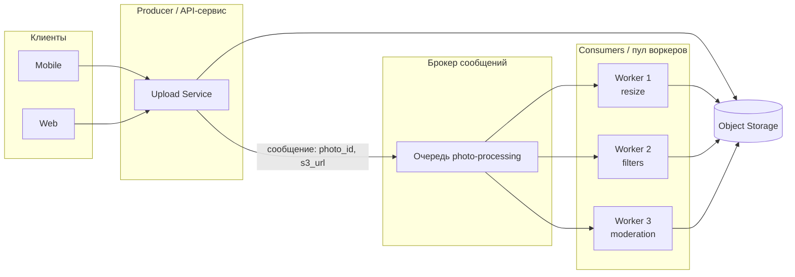
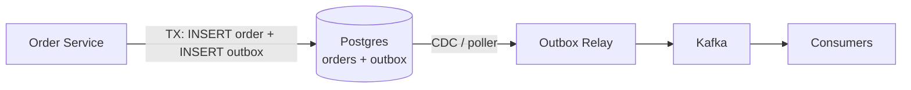
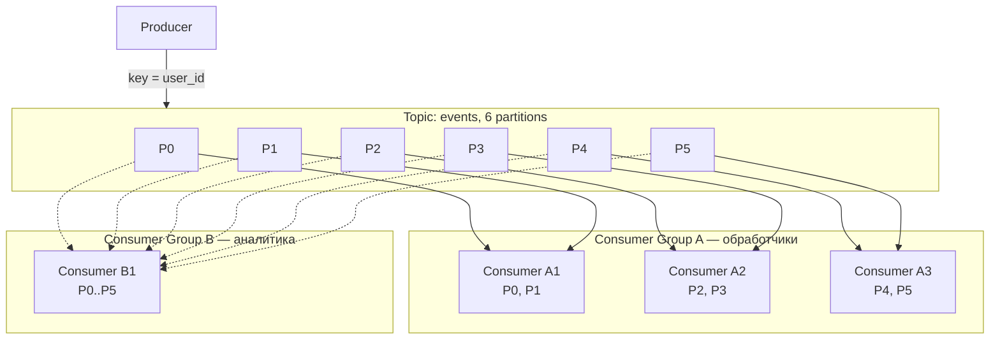
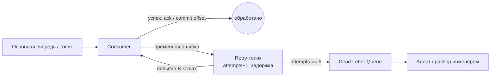

# Очереди сообщений и асинхронность

<!-- learning-nav:start -->
[← Все разделы](../README.md) · [Предыдущая тема](sharding.md) · [Следующая тема →](distributed-transactions.md)
<!-- learning-nav:end -->

> Building block для System Design собеседования: когда на доске появляется очередь,
> зачем она там, какую технологию назвать и какие вопросы последуют от интервьюера.

## Оглавление

<!-- toc:start -->
<details>
<summary>Показать темы и вопросы</summary>

- [Зачем нужна очередь: мотивирующий пример](#зачем-нужна-очередь-мотивирующий-пример)
- [Базовая модель: producer, broker, consumer](#базовая-модель-producer-broker-consumer)
- [Очередь задач vs поток событий: принципиальная разница](#очередь-задач-vs-поток-событий-принципиальная-разница)
- [Семантики доставки: at-most-once, at-least-once, exactly-once](#семантики-доставки-at-most-once-at-least-once-exactly-once)
- [Идемпотентность и паттерн Outbox](#идемпотентность-и-паттерн-outbox)
- [Kafka vs RabbitMQ vs SQS](#kafka-vs-rabbitmq-vs-sqs)
- [Consumer groups и partitioning](#consumer-groups-и-partitioning)
- [Backpressure: что делать, когда очередь растёт](#backpressure-что-делать-когда-очередь-растёт)
- [Dead Letter Queue и poison messages](#dead-letter-queue-и-poison-messages)
- [Долговечность: репликация и acks](#долговечность-репликация-и-acks)
- [В каких дизайнах очередь — правильный ответ](#в-каких-дизайнах-очередь--правильный-ответ)
- [Когда очередь вводить НЕ стоит](#когда-очередь-вводить-не-стоит)
- [Что говорить интервьюеру](#что-говорить-интервьюеру)
- [Уточняющие вопросы](#уточняющие-вопросы)
- [Красные флаги и типичные ошибки кандидатов](#красные-флаги-и-типичные-ошибки-кандидатов)
- [Deep dive: что спросят дополнительно](#deep-dive-что-спросят-дополнительно)
- [Чеклист-шпаргалка](#чеклист-шпаргалка)
- [Видео по теме](#видео-по-теме)

</details>
<!-- toc:end -->

---

## Зачем нужна очередь: мотивирующий пример

Классическая постановка, которую любят давать на моках (встречается у экс-Meta
интервьюеров и в разборах hellointerview): **«проектируем Instagram, пользователь
загружает фото»**. После загрузки нужно: нарезать несколько разрешений, применить
фильтры, прогнать content moderation. Каждая операция — секунды.

Наивный вариант — всё синхронно в одном запросе:

- **Latency.** Пользователь смотрит на спиннер 5–6 секунд, пока идёт обработка.
- **Хрупкость.** Падение одного шага (например, сервиса фильтров) валит весь upload:
  клиент получает ошибку, уже сделанная работа потеряна, начинаем с нуля.
- **Пики трафика.** Приложение попало в фичеринг App Store: upload-ы выросли с 50
  до 5000 RPS, а серверы переваривают 200. Остальные 4800 запросов в секунду —
  таймауты и ошибки, система «легла».

Решение: сервер сохраняет файл в объектное хранилище, кладёт в очередь сообщение
«обработай photo_id=456» и **немедленно** отвечает клиенту `202 Accepted`. Пул
воркеров на другом конце очереди разбирает задачи в своём темпе.

Что это дало:

1. **Быстрый ответ** — сервер только сохранил файл и записал сообщение.
2. **Изоляция отказов** — воркер упал посреди обработки → сообщение просто будет
   доставлено другому воркеру, ничего не потеряно.
3. **Поглощение пиков (load leveling)** — при всплеске растёт глубина очереди,
   а не число ошибок. В худшем случае — задержка обработки, но не потеря запросов.
4. **Независимое масштабирование** — upload-сервисы лёгкие, а воркерам обработки
   могут быть нужны GPU и толстые машины. Очередь развязывает (decoupling) эти
   две части: каждую скейлим и провижним отдельно.

Мнемоника, которая «заходит» на собеседованиях: очередь — это **рейка с заказами
на кухне ресторана**. Официант не стоит у плиты, пока повар готовит: он повесил
чек и пошёл обслуживать другие столики. Рейка развязывает «зал» и «кухню».

## Базовая модель: producer, broker, consumer



Ключевые свойства модели:

- **Разделение приёма и выполнения.** Producer дожидается подтверждения сохранения сообщения или надёжно записывает намерение отправки в outbox. Завершение бизнес-задачи — отдельный результат, который при необходимости отслеживается по `task_id`.
- **Consumer читает в своём темпе.** Очередь — буфер, чья работа — держать
  сообщения, пока потребитель не готов.
- **Decoupling** — главное слово, которое интервьюер ждёт услышать: producer и
  consumer не знают друг о друге, скейлятся независимо, можно заменить одну
  сторону, не трогая другую.

Важный нюанс про payload: в сообщение кладут **ссылку, а не данные**. Типичная
ошибка кандидатов — положить сам видеофайл в Kafka. Файл и так лежит в S3, а в
очередь уходит компактное сообщение `{video_id, s3_url}`. Практическое правило:
сообщение в Kafka держать < 1 МБ, иначе производительность кластера проседает.

## Очередь задач vs поток событий: принципиальная разница

Частый прокол на интервью — считать Kafka и RabbitMQ взаимозаменяемыми. Они решают
разные задачи, и выбор не того инструмента создаёт проблемы в проде.

| Критерий | Классическая очередь (RabbitMQ, SQS) | Поток событий (Kafka) |
|---|---|---|
| Ментальная модель | To-do list: задача взята и вычеркнута | Append-only лог: лента фактов |
| После обработки | Сообщение **удаляется** (после ack) | Сообщение **остаётся** до конца retention |
| Модель доставки | Point-to-point: каждое сообщение — одному consumer'у | Fan-out по умолчанию: каждая consumer group читает всё |
| Replay | После удаления сообщения нужен отдельный архив; у RabbitMQ Streams есть replay | Встроенный в пределах retention: отмотать offset и перечитать историю |
| Throughput | Измеряется на целевом размере сообщений, persistence, ACK, репликации и профиле обработки | Те же условия: универсального TPS для сравнения нет |
| Маршрутизация | Богатая: exchanges, bindings, routing keys (AMQP) | Примитивная: продюсер сам выбирает partition |
| Характер нагрузки | Длинные задачи разной длительности, всплески | Равномерный высокочастотный поток мелких событий |
| Примеры | job queue, отправка email, фоновые джобы | event bus, CDC, clickstream, логи, метрики |

Что это значит на практике:

- **Kafka можно использовать для распределения задач**, но обычная consumer group ограничивает параллелизм числом партиций и усложняет независимые ретраи длительных задач. Короткий retention не превращает offset-модель в удаление отдельных задач после ACK.
- **Сила Kafka — replayability.** Консьюмеры лежали час, обрабатывая события с
  багом? Катите фикс, отматывайте offset на час назад и перечитывайте. Новый
  аналитический сервис может прочитать всю историю событий, а не только новые.
- **Сила RabbitMQ — умный брокер.** Exchange (direct / fanout / topic / headers)
  и bindings позволяют строить хитрую маршрутизацию внутри брокера; consumer'ы
  могут «выбирать» сообщения по свойствам, а балансировка между воркерами —
  встроенная (prefetch + ack).
- **Kafka — «тупой» брокер, умные клиенты.** Маршрутизацию делает продюсер
  (ключ партиционирования), чтение идёт pull-моделью пачками — отсюда и
  гигантский throughput.

## Семантики доставки: at-most-once, at-least-once, exactly-once

Это один из самых частых follow-up вопросов: «Какие гарантии доставки даёт ваша
очередь?» Три варианта:

| Семантика | Что гарантирует | Цена | Когда уместна |
|---|---|---|---|
| **At-most-once** | Сообщение доставлено 0 или 1 раз; потери возможны | Fire-and-forget: ack/commit до обработки | Метрики, аналитика, где потеря единичных событий ок |
| **At-least-once** | Каждое сообщение доставлено ≥ 1 раза; дубликаты возможны | Нужна идемпотентность консьюмера | **Дефолтный ответ на интервью и в проде** |
| **Exactly-once effects** | Один видимый эффект в заданной транзакционной границе; код может исполняться повторно | Атомарная фиксация эффекта и позиции/ID входа | Kafka-to-Kafka; inbox + эффект в одной БД; другие явно заданные контуры |

Откуда берутся дубликаты при at-least-once: консьюмер обработал сообщение и упал
**до** отправки ack (или до commit offset). Брокер считает сообщение
необработанным и доставляет повторно другому консьюмеру. Для resize фото это
безобидно, а вот сообщение «списать $50» превращается в двойное списание.

Что говорить: **«Беру at-least-once и делаю консьюмеров идемпотентными»** — это
почти всегда правильный ответ. Exactly-once не обещайте, если не можете объяснить
механизм и защитить trade-off'ы: интервьюеры это чувствуют и начинают копать.

Exactly-once имеет смысл для **заданного наблюдаемого эффекта и границы транзакции**. Kafka EOS может атомарно зафиксировать выходные записи и входные offsets: повторное исполнение кода допустимо, повторного видимого результата в Kafka нет, если потребитель использует `read_committed`. Внешняя БД или платёжное API в эту транзакцию автоматически не входят. Там нужны атомарный inbox + бизнес-запись либо идемпотентный контракт получателя. Проблема потерянного ACK объясняет необходимость повторов, но не доказывает невозможность exactly-once effects вообще.

## Идемпотентность и паттерн Outbox

**Идемпотентный консьюмер** — такой, для которого повторная обработка того же
сообщения даёт тот же результат. Приёмы:

- Если семантика допускает, использовать установку состояния с проверкой версии. Само `SET post_count = 54` идемпотентно относительно повтора, но запоздавшее событие может затереть актуальное значение 55.
- Хранить `processed_message_id` в той же БД и **той же транзакции**, что и бизнес-эффект. Отдельный Redis SET не закрывает окно между отметкой и записью. Время хранения dedup — не меньше поддерживаемого окна повторной доставки и replay.
- Использовать естественные ограничения БД: `INSERT ... ON CONFLICT DO NOTHING`,
  уникальный constraint на бизнес-ключ.

```sql
CREATE TABLE processed_messages (
    message_id   TEXT PRIMARY KEY,
    processed_at TIMESTAMPTZ NOT NULL DEFAULT now()
);

BEGIN;
-- внутри той же транзакции, что и бизнес-изменение:
INSERT INTO processed_messages (message_id) VALUES ('msg-123')
ON CONFLICT (message_id) DO NOTHING;
-- если 0 rows: завершаем без бизнес-эффекта; иначе выполняем его
-- UPDATE ...;
COMMIT;
-- ACK/commit offset отправляется только после успешного COMMIT
```

**Outbox pattern** — ответ на вопрос «а как гарантировать, что запись в БД и
отправка сообщения не разъедутся?» Нельзя сделать «сохранил в БД → отправил в
Kafka» атомарно: между шагами процесс может упасть. Решение:



- В одной транзакции БД пишем и бизнес-сущность, и запись в таблицу `outbox`.
- Отдельный relay (или CDC через Debezium) читает outbox и публикует в брокер.
- Отправка в брокер тоже at-least-once → консьюмеры снова должны быть
  идемпотентными. Полный цикл: **at-least-once на каждом шаге + идемпотентность
  на каждом конце**.

## Kafka vs RabbitMQ vs SQS

### Сравнительная таблица

| Критерий | Apache Kafka | RabbitMQ | AWS SQS |
|---|---|---|---|
| Тип | Распределённый append-only лог / streaming platform | Классический брокер (AMQP 0-9-1) | Управляемая очередь в облаке |
| Хранение после чтения | Retention (по умолчанию 7 дней), replay | Удаление после ack | Удаление после `DeleteMessage` |
| Модель потребления | Pull пачками, offset коммитит консьюмер | Push по каналу, ack/timeout | Pull, visibility timeout |
| Координация потребителей | В обычной consumer group партиция назначена одному участнику; ребаланс не отменяет старый внешний запрос | Unacked-доставка и prefetch; после потери канала возможна redelivery | Visibility timeout скрывает сообщение временно; истечение может дать конкурентную обработку |
| Порядок | Лог внутри partition; параллельная обработка может нарушить порядок эффектов | FIFO enqueue не равен порядку завершения; redelivery и несколько потребителей меняют наблюдаемый порядок | Standard — best-effort; FIFO — внутри `MessageGroupId`, нужны корректные delete и retries |
| Fan-out | Нативно: N consumer groups читают один топик | Через fanout exchange | Через связку SNS → SQS |
| Throughput | Зависит от размера сообщения, ACK, диска, репликации и сети | Зависит от типа очереди, ACK, payload и репликации | Ограничен актуальными квотами региона/режима; проверять перед расчётами |
| Retry из коробки | Нет: вручную через retry-топики | Есть: redelivery + DLX | Есть: redrive policy → DLQ |
| Маршрутизация | Ключ партиционирования у продюсера | Exchanges + bindings + routing keys | Нет (топики = отдельные очереди) |
| Эксплуатация | Кластер, контроллер, ребалансы; или Confluent Cloud / AWS MSK | Кластер с quorum queues | Нулевая: fully managed |
| Типичный кейс | Event bus, CDC, clickstream, логи, потоковая аналитика | Task queue, RPC-over-queue, сложная маршрутизация | Простая асинхронная обработка в AWS |

### Как выбирать на интервью

- **Выбирайте по требованиям.** Сначала определите replay, порядок, длительность задач, маршрутизацию, число независимых подписчиков и допустимые эксплуатационные затраты.
- **AWS-контекст и нужна простота → SQS.** «Нам не нужны replay и сложная
  маршрутизация, берём managed SQS и не платим за эксплуатацию» — зрелый ответ.
- **Длинные задачи разной длительности, сложная маршрутизация, retry как
  first-class citizen → RabbitMQ.** Пример: пайплайн обработки документов, где
  сообщения нужно раскидывать по очередям по типу и приоритету.
- **Нужен replay, несколько независимых потребителей одного потока, потоковая
  аналитика (Flink/Spark), clickstream → Kafka или другой журнал/стриминговая платформа с нужными гарантиями.**

Честный аргумент из практики: Kafka рассчитана на **равномерный поток мелких
однотипных событий**, которые быстро обрабатываются. RabbitMQ лучше переносит
**всплесковый, неравномерный трафик длинных задач** — ack-модель с prefetch даёт
естественную балансировку: кто освободился, тот и взял следующую задачу.

## Consumer groups и partitioning

### Как это устроено в Kafka



Правила, которые надо назвать вслух:

- **Partition — единица параллелизма.** Каждый partition внутри consumer group
  читает ровно один консьюмер. 6 partitions + 3 консьюмера → по 2 partition на
  консьюмера.
- **Потолок активных владельцев в обычной consumer group — число partitions.** Седьмой консьюмер
  при 6 partitions будет простаивать. Хотите больше параллелизма — добавляйте
  partitions (и закладывайте их с запасом при создании топика: уменьшить число
  partitions потом нельзя).
- **Consumer groups независимы.** Группа «обработчики» и группа «аналитика»
  читают один и тот же топик, каждая со своими offset'ами, не мешая друг другу.
  Это и есть нативный fan-out Kafka.
- **Offset коммитится после логического завершения работы.** Пример из разбора:
  веб-краулер не должен коммитить offset, пока HTML не скачан и не сохранён в
  S3. Закоммитил раньше и упал → задача потеряна навсегда. Поэтому обработку в
  консьюмере держат маленькой и атомарной.
- **Rebalance.** Партиции переназначаются при изменении группы. Объём паузы зависит от протокола/assignor: cooperative и новые group protocols не требуют всегда останавливать всю группу. Незавершённые внешние операции старого владельца при этом сами не отменяются.

### Выбор partition key — главное дизайн-решение

Продюсер хэширует ключ и берёт `hash(key) % num_partitions` → номер partition.
При стабильном partitioner и числе партиций один сериализованный ключ идёт в одну партицию. Увеличение числа партиций может изменить маршрут для того же ключа: нужен drain/barrier либо версионированная миграция. Ключ решает две вещи:

1. **Порядок.** Гарантия порядка — только внутри partition. Классический пример:
   «пополнение $100, затем снятие $50» по одному счёту. Если сообщения попадут в
   разные partitions, снятие может обработаться первым и будет отклонено. Ключ —
   `account_id`, и обе операции идут в одну партицию в правильном порядке.
2. **Равномерность нагрузки.** Ключ, дающий порядок, не всегда даёт ровное
   распределение. Ride-sharing, партиционируем по городу → Нью-Йорк «slammed»,
   а Бойсе простаивает. Это **hot partition**.

Как бороться с hot partition (частый deep dive):

- **Убрать ключ**, если порядок не важен. Фактическое распределение зависит от partitioner (например, batching/sticky), а равномерность проверяется по нагрузке партиций.
- **Составной ключ (salting):** `ad_id + random(1..10)` — горячий ключ
  раскладывается по ~10 partitions. Цена: порядок сохраняется только внутри
  составного ключа, а продюсер должен знать, какие ключи горячие.
- **Backpressure на продюсере** для конкретного горячего топика.

Для оценки считайте байты/с с учётом replication factor, retention, индексов и запаса на отказ, затем проверяйте нагрузкой. Число сообщений/с без размера payload и политики ACK непригодно для выбора числа брокеров.

## Backpressure: что делать, когда очередь растёт

Любимый вопрос интервьюеров: **«Продюсеры пишут быстрее, чем консьюмеры читают.
Что будет?»**

Правильный ответ начинается с признания: **очередь — это буфер, а не решение
проблемы нехватки мощности.** Если приходит 300 msg/s, а обрабатывается 200,
очередь растёт на 100 msg/s бесконечно — вы просто откладываете падение. Когда
кончится диск/память брокера, начнутся потери.

Арсенал ответа (называйте все три уровня):

1. **Масштабирование консьюмеров.** Autoscaling по метрике queue depth /
   consumer lag: lag растёт → поднимаем поды-воркеры, добавляем partitions.
2. **Backpressure на продюсеров.** Замедлить запись: rate limiting, отклонять
   сообщения, возвращать клиенту `429`/`503` с `Retry-After` («мы перегружены,
   повторите через минуту»). Это и есть то слово, которое интервьюер ждёт.
3. **Мониторинг и алерты.** Минимум: алерты на глубину очереди и возраст
   самого старого сообщения (oldest message age в SQS, consumer lag в Kafka).

Отдельный частный случай — **hot partition** (см. выше): проблема не общая
ёмкость, а перекос одного ключа.

## Dead Letter Queue и poison messages

Сценарий: пользователь загрузил битый файл. Обработчик падает на нём **каждый
раз**. Без защиты сообщение ретраится вечно, жрёт ресурсы консьюмера и блокирует
очередь за собой. Это **poison message**.

Решение — связка **max retries + DLQ**:



- **Retry с лимитом и backoff'ом.** Например, до 5 попыток с экспоненциальной
  задержкой. В сообщении хранят счётчик попыток.
- **DLQ** — отдельная очередь (в Kafka — отдельный топик), куда уходят сообщения,
  исчерпавшие попытки. Основная очередь продолжает двигаться.
- **DLQ без алертов — свалка.** На DLQ должен стоять алерт (глубина > 0 — уже
  повод смотреть) и процесс разбора: инженер или автоматика решает, починить
  данные и переиграть или выкинуть.
- **Нюанс Kafka:** retry на стороне консьюмера из коробки нет (в отличие от
  SQS). Паттерн: отдельные retry-топики (`topic.retry.1m`, `topic.retry.10m`),
  консьюмер кладёт туда неудачные сообщения, после исчерпания лимита — в
  `topic.dlt`. Если retry — ключевое требование и хочется батареек, это аргумент
  в пользу SQS.
- **SQS:** redrive policy декларативно: `maxReceiveCount: 5` → сообщение само
  уедет в привязанную DLQ. **RabbitMQ:** dead-letter exchange (DLX), сообщения с
  истёкшим TTL или nack'нутые без requeue улетают в отдельный exchange.

Проактивное упоминание DLQ на интервью — сильный сигнал сеньорности: «здесь я
ограничу ретраи и добавлю dead letter queue» показывает, что вы думаете о
failure-сценариях, а не только о happy path.

## Долговечность: репликация и acks

Вопрос «а что, если упадёт сам брокер/очередь?» — вопрос про durability:

- **Kafka.** Каждый partition реплицируется: leader принимает все записи/чтения,
  followers тянут копии (например, зададим replication factor 3; это выбор дизайна, а не универсальная настройка по умолчанию). Настройка продюсера
  `acks`:
  - `acks=0` — не ждём подтверждения (максимум throughput, возможны потери);
  - `acks=1` — подтвердил только leader;
  - `acks=all` — лидер ждёт текущие ISR; `min.insync.replicas` задаёт минимально допустимое число ISR для такой записи. При единственной ISR и пороге 1 ACK всё ещё может дать одна копия. Для примера RF=3/minISR=2 нужно также определить safe leader election и модель потери дисков.
  - Продюсеру с включёнными ретраями обязательно включать **idempotent producer**
    (`enable.idempotence=true`), иначе ретрай после таймаута запишет дубликат.
- **RabbitMQ.** Durable queues + persistent messages + publisher confirms; для
  кластера — quorum queues (Raft). Стоит знать, что классические mirrored queues удалены в RabbitMQ 4.0; для реплицируемых очередей используют quorum queues.
- **SQS.** Долговечность обеспечивает AWS (данные реплицируются между AZ), об
  этом можно не думать — но и ручек нет.

Kafka пишет на диск последовательно (append-only log) + zero-copy, отсюда и
throughput, а retention (`retention.ms`, по умолчанию 7 дней; `retention.bytes`)
позволяет держать историю неделями и переигрывать её. Увеличиваете retention —
проговорите цену: диск и потенциальная деградация производительности.

## В каких дизайнах очередь — правильный ответ

Четыре сигнала, при которых очередь должна появиться на вашей диаграмме (стоит
озвучивать их как обоснование, а не рисовать очередь «потому что так принято»):

1. **Асинхронная работа.** Лакмус: «пользователю нужен результат прямо сейчас
   или можно чуть позже?» Отправка email/push, генерация отчёта, обработка
   загрузок — кандидаты в очередь.
2. **Всплесковый трафик.** Нужно поглощать пики без потерь запросов.
3. **Развязывание и независимое масштабирование.** Producer и consumer с разными
   требованиями к железу и скорости.
4. **Надёжность.** Downstream-сервис временно недоступен — очередь подержит
   сообщения до его возвращения, ничего не потеряется.

Конкретные дизайны из типового набора собеседований:

| Дизайн | Где очередь | Что говорить |
|---|---|---|
| **YouTube / видеохостинг** | Очередь транскодирования: upload сохранил оригинал в S3 → сообщение `{video_id, s3_url}` → воркеры нарезают кодеки/разрешения | В очередь — ссылку, не файл; параллелизм по partitions; DLQ для битых файлов |
| **Notification system** | Очередь на канал (email/SMS/push): сервис событий → топики → sender-воркеры с rate limiting по провайдерам | Приоритетные топики, ретраи с backoff, DLQ, идемпотентность по `notification_id` |
| **Процессинг платежей/заказов** | Order service → outbox → Kafka → fulfilment/billing | Partition key = `order_id`/`account_id` ради порядка; идемпотентные консьюмеры; at-least-once |
| **Web crawler** | Очередь URL: frontier → краулеры | Коммит offset только после сохранения контента; retry-топики для недоступных сайтов |
| **Агрегатор кликов / аналитика** | Поток событий в Kafka → Flink → агрегаты | Это stream, а не queue: replay, несколько consumer groups; at-most-once допустим для части метрик |
| **Чат / лайв-комментарии** | Pub/sub fan-out: событие → серверы с WebSocket-подключениями | Kafka как event bus; каждая группа читает весь поток |
| **Ticketmaster / бронирование** | Очередь ожидания: выпускать пользователей пачками по 100 на горячие события | Снижает конкуренцию за места и сглаживает пик на старте продаж |
| **LeetCode / code runner** | Приём решений → очередь → пул раннеров в контейнерах | Фронт скейлим под пик (100K сабмитов к концу контеста), дорогие раннеры — отдельно и медленнее |

## Когда очередь вводить НЕ стоит

Обратная сторона — красный флаг, который ловят интервьюеры:

- **Синхронные запросы с жёстким latency-бюджетом.** Если в NFR «ответ < 500 мс»,
  очередь на пути запроса почти гарантированно сломает SLA: плюс сетевые хопы,
  плюс ожидание в очереди, плюс отдельная механика доставки результата клиенту.
- **Нужен немедленный ответ с результатом обработки.** «Сконвертируй и верни»
  синхронно — очередь только усложнит.
- **Нагрузка мала.** 10 джоб в минуту не требуют Kafka-кластера; cron + таблица
  задач в Postgres честнее. Умение НЕ вводить компонент — тоже сеньорность.
- **Нужен строгий глобальный порядок всех сообщений.** Порядок в Kafka — только
  внутри partition; глобальный порядок = 1 partition = потолок одного консьюмера.

## Что говорить интервьюеру

Готовые формулировки, которые звучат сильно:

- «Вынесу обработку в очередь, потому что пользователю не нужен результат
  синхронно: отвечаем 202, а тяжёлую работу делают воркеры. Это даёт decoupling
  и поглощение пиков.»
- «Беру at-least-once доставку и делаю консьюмеры идемпотентными — дубликаты
  возможны, обработаем их дедупликацией по message_id.»
- «Запись в БД и отправку в очередь свяжу через outbox pattern, чтобы не потерять
  сообщение при падении между двумя шагами.»
- «Партиционирую по account_id ради порядка. Если счёт станет горячим, salting допустим только после пересмотра инварианта: он разделит поток и уберёт общий порядок счёта.»
- «Потолок параллелизма — число partitions, поэтому создам топик с запасом.»
- «На случай poison messages — лимит ретраев и dead letter queue с алертом.»
- «Очередь — буфер, а не решение capacity-проблемы: добавлю autoscaling воркеров
  по lag и алерты на глубину очереди.»
- «Здесь мне не нужен replay и потоковая обработка, поэтому вместо Kafka возьму
  SQS — меньше эксплуатации при той же семантике задачи.»

## Уточняющие вопросы

Прежде чем рисовать очередь, спросите:

- Какой ожидаемый throughput (сообщений/с) и размер сообщения? Пики vs средняя
  нагрузка?
- Нужен ли порядок обработки? Глобальный или в рамках сущности (user/order)?
- Что хуже для бизнеса: потерять сообщение или обработать дважды?
- Есть ли требования к latency доставки (секунды допустимы?) и к retention
  (нужно ли переигрывать события спустя месяцы)?
- Один потребитель потока или несколько независимых (fan-out)?
- Облако/вендор-лок допустимы (SQS/SNS/PubSub) или self-hosted?

## Красные флаги и типичные ошибки кандидатов

- **Класть большие payload'ы в очередь.** Видео на гигабайты в Kafka — верный
  признак, что кандидат не работал с ней в проде. Сообщение = ссылка + метаданные.
- **Обещать exactly-once без механики.** Сказал «exactly-once» — будь готов
  объяснить idempotent producer, транзакции и их границы. Иначе — минус балл.
- **Очередь в синхронном пути запроса** при жёстком latency SLA.
- **Игнорировать дубликаты.** «Очередь гарантирует ровно одну доставку» — нет,
  не гарантирует. Нужна идемпотентность.
- **Коммитить offset до завершения работы** — тихая потеря задач при падении.
- **Забыть про DLQ и лимит ретраев** — poison message положит обработку.
- **Kafka как «просто очередь задач»** без понимания, что это лог с retention и
  consumer groups; и наоборот — RabbitMQ на clickstream в миллион событий/с.
- **Забыть, что очередь не решает нехватку мощности** — только сглаживает.
- **Не назвать число partitions и partition key** — вопрос про масштабирование
  Kafka почти гарантирован.

## Deep dive: что спросят дополнительно

Список follow-up вопросов, которые реально звучат после появления очереди на
доске (собрано по мокам и разборам):

1. **Как масштабируется очередь?** → partitions, consumer groups, потолок
   «консьюмеров ≤ partitions», autoscaling по lag.
2. **Что если консьюмер упал?** → ack/offset не отправлен → redelivery /
   переназначение partition при rebalance; коммит после завершения работы.
3. **Что если продюсеры быстрее консьюмеров?** → растёт backlog; autoscaling,
   backpressure, алерты; очередь — буфер, а не панацея.
4. **Как обеспечить порядок?** → partition key; порядок только внутри partition;
   глобальный порядок = одна партиция = узкое место.
5. **Что с дубликатами?** → at-least-once + идемпотентность + dedup store.
6. **Что с потерями?** → acks=all + replication factor 3 + min.insync.replicas 2;
   durable queues; visibility timeout в SQS.
7. **Что делать с сообщениями, которые никогда не обработаются?** → max retries
   + DLQ + алерты.
8. **Как переиграть события за прошлую неделю?** → retention + reset offset
   (Kafka); в классической очереди — никак.
9. **Почему именно эта технология?** → таблица trade-off'ов выше; важно назвать,
   что вы теряете от выбора.

## Чеклист-шпаргалка

- [ ] Обосновал очередь: async / пики / decoupling / надёжность.
- [ ] Назвал семантику: at-least-once + идемпотентные консьюмеры.
- [ ] Payload — ссылка на хранилище, не данные (< 1 МБ).
- [ ] Partition key выбран: порядок vs равномерность; hot partition — salting.
- [ ] Partitions с запасом; потолок параллелизма = число partitions.
- [ ] Retry: лимит, backoff, retry-топики; DLQ с алертом.
- [ ] Durability: replication, acks=all / publisher confirms.
- [ ] Backpressure и autoscaling по lag; мониторинг глубины очереди.
- [ ] Outbox для связки «БД + брокер».
- [ ] Осознанный выбор технологии: Kafka (поток/replay/fan-out) vs RabbitMQ
      (задачи/маршрутизация) vs SQS (managed, простота).

<a id="источники-и-видео-по-теме"></a>

## Видео по теме

- [Очереди сообщений в системном дизайне на собеседованиях: советы от ведущего инженера Meta](https://www.youtube.com/watch?v=1ISRd0bS714)
- [Kafka для собеседований по System Design](https://www.youtube.com/watch?v=lDRx5dqQltA)
- [«Битва брокеров сообщений: Kafka, RabbitMQ, SQS»](https://www.youtube.com/watch?v=ZPDn7tdP6Rk)
- [Kafka vs RabbitMQ: выбор правильной системы сообщений // Курс «Java Developer. Professional»](https://www.youtube.com/watch?v=s14I_qSojYA)
- [Когда использовать Kafka или RabbitMQ / Проектирование системы](https://www.youtube.com/watch?v=w8xWTIFU4C8)
- [Прекратите использовать Kafka как очередь сообщений! (Очереди сообщений против потоковой передачи)](https://www.youtube.com/watch?v=8SacdtTk4pg)
