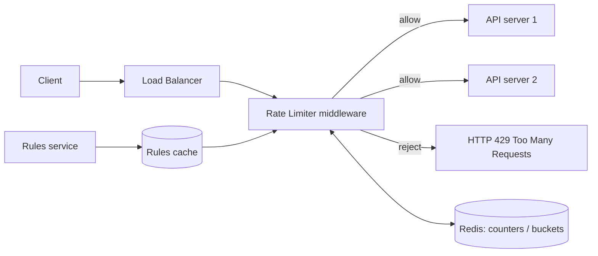
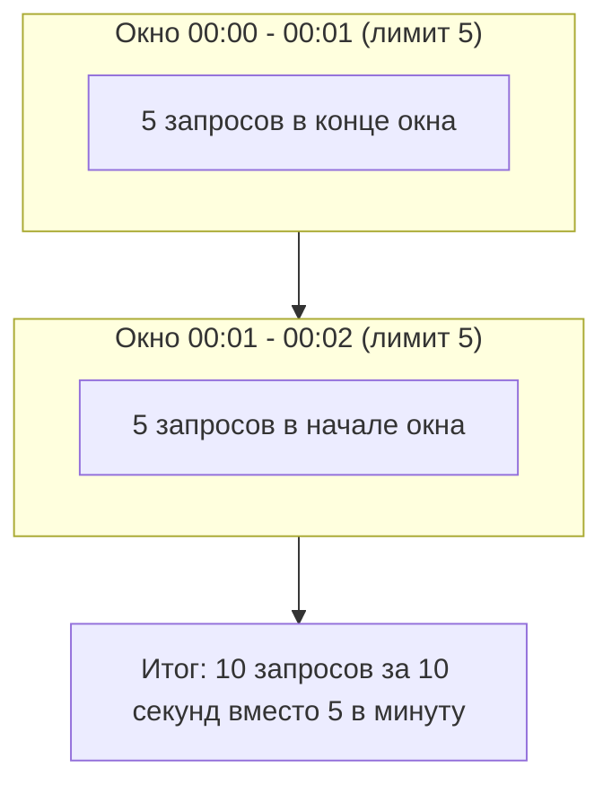
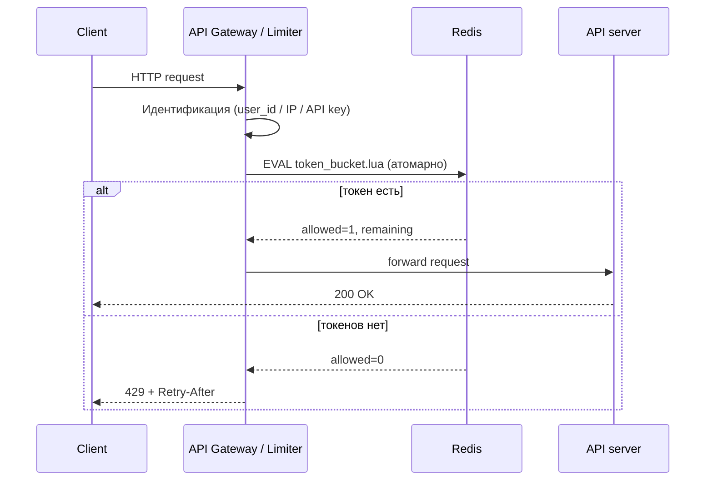
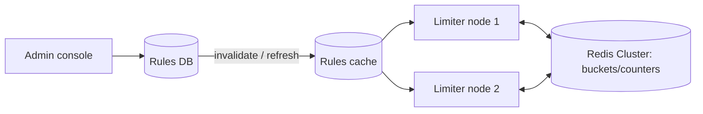
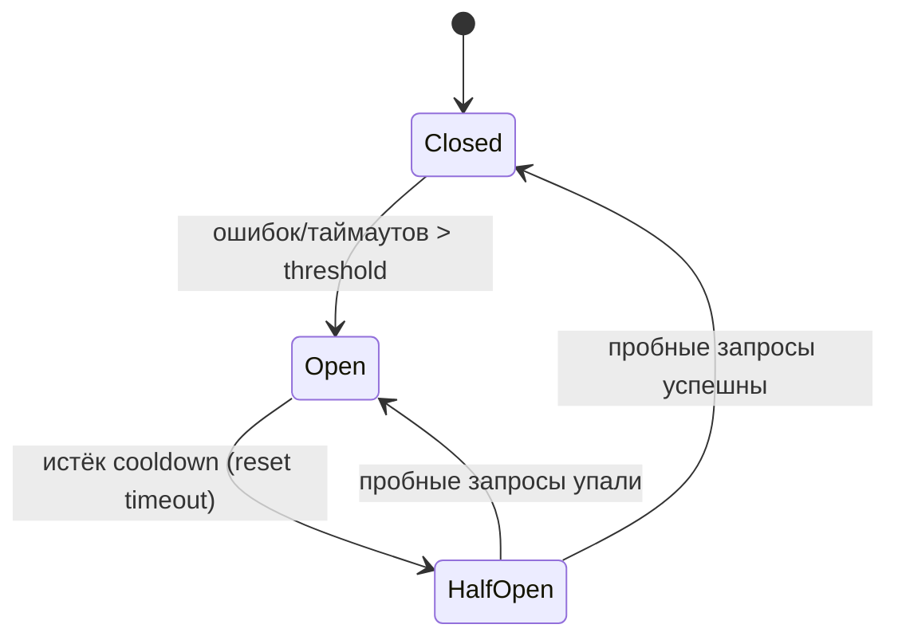

# Rate Limiting и защита от перегрузки

<!-- learning-nav:start -->
[← Все разделы](../README.md) · [Предыдущая тема](distributed-transactions.md) · [Следующая тема →](cdn-and-blob-storage.md)
<!-- learning-nav:end -->

Rate limiter — компонент, который ограничивает количество запросов к системе за единицу времени. При проектировании публичного API правило обычно задают для клиента, операции или ресурса. Первый вопрос на интервью — кого ограничиваем и какой всплеск допустим.

Зачем нужен:

- **Защита приложения от избытка запросов** — ограничивает abuse, баг клиента и retry storm. L7-лимитер не спасёт канал связи от volumetric DDoS: защита сети/edge нужна раньше.
- **Снижение стоимости** — меньше трафика = меньше серверов. Пример из практики: лимиты на API позволяют не держать запас мощности под злоупотребляющих клиентов.
- **Честное распределение ресурсов (fairness)** — один «шумный сосед» не должен уронить сервис для остальных (noisy neighbor problem).
- **Монетизация** — квоты как часть бизнес-модели: free tier 100 req/min, paid tier 10 000 req/min (конкретные тарифы и окна зависят от продукта).

---

## Уточняющие вопросы (что спросить у интервьюера в первую очередь)

По опыту мок-собеседований, сильный кандидат начинает не с алгоритмов, а с рамки. Чек-лист вопросов:

1. **Что лимитируем?** HTTP-запросы к API? Число создаваемых аккаунтов с одного IP в день? Количество сообщений? От ответа зависит ключ лимита: `user_id`, IP, API key, страна, fingerprint устройства.
2. **Где стоит лимитер?** Client-side / внутри сервиса как библиотека / отдельный middleware-сервис / API gateway. Это ключевой архитектурный вопрос (см. ниже).
3. **Какие правила?** Фиксированный лимит для всех или набор правил (rules) по тарифам, которые хранятся в БД и могут меняться динамически?
4. **Распределённая система?** Лимит действует на инстанс, регион, пользователя или весь сервис? Нужна ли строгая глобальная квота либо допустима погрешность?
5. **Что делать с отклонёнными запросами?** Отбрасывать с ошибкой 429, ставить в очередь на позднюю обработку, деградировать функциональность?
6. **Нужно ли информировать клиента?** Показывать ли ошибку, возвращать ли заголовки с остатком лимита?
7. **Масштаб?** Стартап на 5 000 пользователей или продукт на сотни миллионов? От этого зависит, нужен ли Redis-кластер и multi-region.

Нефункциональные требования, которые стоит проговорить самому (интервьюеры ждут):

- **Низкая задержка**: лимитер не должен заметно тормозить запросы. Если запрос отрабатывал за 100 мс, а с лимитером стал за 1 с — такой лимитер непригоден. Бюджет — единицы миллисекунд на проверку.
- **Точность**: считать лимиты корректно, особенно на границах окон и под конкурентной нагрузкой.
- **Ограниченная память**: оценить состояние на активный ключ, overhead хранилища и кардинальность. Два числа в алгоритме не означают 16 байт на ключ Redis.
- **Распределённость**: глобальный строгий лимит или региональные бюджеты с допустимым превышением. Общее хранилище — один вариант, не требование само по себе.
- **Отказоустойчивость**: падение хранилища лимитера не должно уронить весь сервис (fail-open vs fail-closed — об этом ниже).

---

## Где разместить лимитер

| Размещение | Плюсы | Минусы |
|---|---|---|
| **Client-side** | Снимает нагрузку до сети | Клиент легко «хакнуть»: возьми Postman и долби API напрямую. Никогда не единственная линия защиты |
| **Библиотека внутри сервиса** | Нет сетевого хопа, максимально быстро | В полиглот-компании нужно портировать на все языки; сложно выкатить одновременно во все команды; правила можно получать динамически, но обновление самой библиотеки требует rollout |
| **Отдельный middleware/сервис** | Единая точка, независимое развёртывание, языко-независим | Лишний сетевой хоп (единицы мс), ещё один компонент для эксплуатации |
| **API Gateway / sidecar (service mesh)** | Стандартное место: Kong, Envoy, NGINX, AWS API Gateway умеют из коробки | Не всегда хватает гибкости для кастомных правил |

Практический ответ на собеседовании: **лимитер на стороне сервера — обязательно** (обычно на уровне API gateway или middleware), клиентский — опционально как UX-оптимизация. Хороший ход: предложить на клиенте вместо лимитера **кэш запросов и дедупликацию** — чтобы UI не слал 500 GET'ов при прокрутке списка. В service mesh лимитер живёт в sidecar-прокси (Envoy/Istio) — красиво, но забирает миллисекунды из latency-бюджета, что критично для финансовых систем.



Поток запроса: клиент → идентификация (кто это: user_id / IP / API key) → выбор правила из кэша → проверка счётчика в Redis → allow (пропускаем дальше) или reject (429, либо в очередь на отложенную обработку).

---

## Алгоритмы

Сравните пять алгоритмов по двум признакам: сколько состояния они хранят на клиента и какой всплеск пропускают на границе окна.

### 1. Token Bucket

У каждого ключа (user/IP) — корзина ёмкостью `bucket_size`. Токены пополняются со скоростью `refill_rate` (например, 4 токена в минуту). На каждый запрос берём токен; токенов нет — отклоняем.

Важная деталь реализации, которую любят докручивать: **не нужен фоновой job для refill**. Токены вычисляются лениво на каждом запросе по формуле:

```text
tokens_to_add = (now - last_refill_time) * refill_rate
current_tokens = min(bucket_size, current_tokens + tokens_to_add)
```

Нужно сохранять дробный остаток — например, `double` или fixed-point integers: при refill_rate «2 токена в секунду» за 100 мс накапливает 0.2 токена. Если каждый раз обрезать пополнение и обновлять timestamp, дроби теряются и bucket может вообще не наполниться. Integer-реализация с переносом остатка тоже корректна. Ещё сильный ход — **вес запросов**: GET profile стоит 1 токен, POST update — 10 токенов, если он тяжелее для бэкенда.

```python
class TokenBucket:
    def __init__(self, bucket_size, refill_rate):
        self.max_size = bucket_size        # ёмкость = max burst
        self.refill_rate = refill_rate     # токенов в секунду
        self.tokens = bucket_size
        self.last_refill = now()

    def allow_request(self, cost=1):
        self._refill()
        if self.tokens >= cost:
            self.tokens -= cost
            return True
        return False

    def _refill(self):
        elapsed = now() - self.last_refill
        self.tokens = min(self.max_size, self.tokens + elapsed * self.refill_rate)
        self.last_refill = now()
```

- **Плюсы**: O(1) состояния на ключ, разрешает мгновенный burst до `bucket_size`, затем среднюю скорость refill. Для интервала T верхняя оценка принятого объёма — `capacity + rate × T`, а не «не более rate в любом окне».
- **Минусы**: два параметра (`bucket_size`, `refill_rate`) нужно подбирать; при смене лимита на лету поведение неочевидно.
- На собеседовании могут попросить **рабочий код с многопоточностью** (реальный кейс из моков: кандидат не написал thread-safe sliding window и завалил интервью). В одном процессе lock должен покрывать refill, проверку и списание целиком; атомарности одного числа недостаточно. Часы для локальной длительности — монотонные. В распределённой системе — например, Lua в Redis (ниже). Пример Python выше — последовательный псевдокод, не thread-safe реализация.

### 2. Leaky Bucket

Очередь фиксированного размера. Запросы кладутся в очередь; если очередь полна — отклоняем. Обработчик вычитывает из очереди с фиксированной скоростью (`outflow rate`).

- **Плюсы**: идеально сглаживает трафик — исходящий поток строго равномерный. Memory efficient: очередь ограничена. Применяется для ограниченной очереди отправки downstream.
- **Минусы**: burst складывается в очередь и обрабатывается позже — свежие запросы ждут за старыми, которые могли потерять актуальность (нужна политика вытеснения устаревших). Тот же минус с подбором двух параметров.
- Здесь описан **leaky bucket как shaper с очередью**: он сглаживает выход, задерживая burst. Есть и meter-вариант, который принимает/отклоняет запросы по виртуальному уровню воды без реальной очереди. Поэтому при сравнении сначала назовите вариант. Для API чаще нужен token bucket; leaky bucket хорош, когда сама обработка должна быть равномерной (стриминг, отправка SMS, выгрузка в партнёрский API с жёстким SLA).

### 3. Fixed Window Counter

Таймлайн режется на фиксированные окна (например, минуты: 00:00–00:01, 00:01–00:02). На каждое окно — счётчик. Запрос инкрементирует счётчик; превысил лимит — отклоняем до конца окна.

- **Плюсы**: тривиально, память O(1) на ключ.
- **Минус — проблема границы окон**: при лимите 5 req/min пользователь может отправить 5 запросов в 00:00:55–00:01:00 и ещё 5 в 00:01:00–00:01:05. За любое скользящее окно в минуту прошло **10 запросов — вдвое больше лимита**. Для систем, где всплеск в 2x критичен (дорогие downstream-ресурсы), это неприемлемо.



### 4. Sliding Window Log

Храним timestamp каждого запроса в отсортированной структуре (Redis `Sorted Set`: score = timestamp). На новый запрос удаляем все записи старше `now - window`, считаем оставшиеся: меньше лимита — добавляем запись и пропускаем.

- **Плюсы**: точный подсчёт принятых запросов в выбранном интервале при атомарной проверке, едином порядке времени и сохранности состояния. Определите границу, например `(now-window, now]`. Одновременные запросы должны иметь разные member ID.
- **Минусы**: память O(N) на ключ — храним по записи на каждый запрос. Для активного пользователя с лимитом 1000/min это килобайты; умножьте на миллионы ключей. Реализация на sorted set: при каждом запросе `ZREMRANGEBYSCORE` + `ZCARD` + `ZADD`.

### 5. Sliding Window Counter

Гибрид fixed window и sliding window log. Храним счётчики только для текущего и предыдущего фиксированных окон, а скользящее окно оцениваем формулой:

```text
elapsed_fraction = elapsed_in_current_window / window_size
estimated_count = prev_window_count * (1 - elapsed_fraction) + current_window_count
```

Пример: лимит 7 req/min. В предыдущей минуте было 5 запросов, текущая минута прошла на 30% (значит, скользящее окно перекрывает 70% предыдущей). Оценка: `5 * 0.7 + current`. При `current = 3` получаем `6.5`; новый запрос с cost=1 дал бы `7.5`, поэтому при лимите 7 отклоняем. Округлять не обязательно. Округление текущей оценки вниз **смягчает** проверку, вверх — ужесточает; правило должно быть явным.

- **Плюсы**: память O(1), сглаживает проблему границ fixed window. Ошибка зависит от распределения трафика: результат benchmark на одном наборе запросов нельзя выдавать за универсальную точность.
- **Минусы**: это всё же оценка, а не точное значение — предполагаем равномерное распределение запросов внутри предыдущего окна. Не подходит для биллинга и жёстких квот «3 запроса в сутки», где важен каждый запрос.

### Сводная таблица

| Алгоритм | Точность | Память на ключ | Burst'ы | Когда выбирать |
|---|---|---|---|---|
| Token bucket | Точный относительно bucket-модели | O(1) | Да (до ёмкости) | Контролируемый burst и средняя скорость |
| Leaky bucket shaper | Точный график выхода | O(queue) | Входной burst ждёт в очереди | Ограничение скорости отправки downstream |
| Fixed window | Точный внутри фиксированного окна | O(1) | До 2N около границы | Когда контракт именно про фиксированные окна |
| Sliding window log | Точный в рамках модели времени/состояния | O(N) | До N сразу, затем отказы | Строгие rolling-window лимиты, малые N |
| Sliding window counter | Приблизительный; зависит от профиля | O(1) | Ограниченно | Когда допустима измеренная погрешность |

**Что говорить интервьюеру**: «По умолчанию я бы взял token bucket — он простой, экономный по памяти и естественно разрешает всплески трафика. Если нужен точный rolling-window лимит — sliding window log с оговоркой про память и сохранность Redis. Для денежной квоты нужен долговечный учёт/резервирование, одного Redis sorted set недостаточно. Fixed window назову и сразу укажу на проблему 2x на границе — это покажет, что я понимаю trade-off'ы, а не заучил список».

---

## HTTP 429 и заголовки

Отклонённому запросу возвращаем **429 Too Many Requests** (RFC 6585). Код 429 интервьюеры ждут по памяти — это must. Плюс заголовки (их точные имена заучивать не обязательно, достаточно сказать «верну 429 с заголовками о лимите и времени повтора»):

```http
HTTP/1.1 429 Too Many Requests
Retry-After: 60
X-RateLimit-Limit: 100
X-RateLimit-Remaining: 0
X-RateLimit-Reset: 1722700800
```

- `Retry-After` — через сколько секунд (или в какой момент) можно повторить. Критично для клиентов с retry-логикой.
- `X-RateLimit-*` — распространённые, но не универсальные имена. Единицы reset, область лимита и трактовку remaining задают контрактом. Remaining — подсказка, а не резерв: параллельный запрос мог уже потратить бюджет.

Клиент учитывает Retry-After как минимальную задержку и добавляет jitter, соблюдает общий deadline и retry budget. Если очередь переполнена из-за общей перегрузки сервиса, семантически уместен 503; 429 обычно означает превышение политики лимита клиента.

Альтернативы «жёсткому» 429:

- **Очередь**: запрос не отклоняется, а ставится в очередь и обрабатывается позже (для фоновых задач, импорта данных).
- **Деградация**: вместо ошибки — урезанный ответ (кэшированные данные, отключение тяжёлых фич).
- **Повышение приоритета платных**: при перегрузке 429 выдаётся только free tier.

---

## Throttling vs Quota; hard vs soft

Термины часто смешивают — на собеседовании полезно развести:

- **Rate limiting / throttling** — скорость: «не более 100 req/sec». Цель — защита от всплесков, сглаживание нагрузки. Окно короткое (секунды–минуты).
- **Quota** — объём: «не более 10 000 запросов в месяц по тарифу». Цель — биллинг и бизнес-модель. Окно длинное (день–месяц), точность важнее скорости, отчётный счётчик можно вести асинхронно. **Строгую** квоту, запрещающую перерасход, нужно резервировать на горячем пути или раздавать ограниченные бюджеты: асинхронный учёт допускает overshoot.

Дополнительное измерение:

- **Hard limit** — как только лимит достигнут, рубим сразу.
- **Soft limit** — после достижения лимита короткое время разрешаем превышение (или пропускаем с пометкой), рубим при устойчивом превышении. Мягче для легитимных пользователей со всплесками.

Уровни применения лимита:

- **L7 (application)**: по `user_id` / API key — честно для залогиненных, требует аутентификации до лимитера.
- **L3/L4 (network)**: по IP — работает до аутентификации, защищает от флуда, но неточен: за NAT сидят тысячи пользователей (классический пример — один Wi-Fi семьи: «плохой брат» выжигает лимит для всех), а мобильные операторы ротируют IP.
- На практике комбинируют: жёсткий лимит по IP как первая линия + честный лимит по user_id после auth.

---

## Распределённый лимитер: Redis + Lua

### Почему локального состояния мало

В кластере из N инстансов без общего хранилища лимит фактически умножается на N: пользователь с лимитом 100 req/min, чьи запросы балансируются на 10 серверов, может сделать до 1000. Решения:

- **Sticky sessions** (все запросы клиента на один сервер) — звучит просто, но ломает балансировку и отказоустойчивость: сервер упал — состояние лимитов потеряно, горячие ключи не распределяются. Обычно отвергается.
- **Общее хранилище (Redis)** — все инстансы атомарно проверяют и меняют состояние ключа. Задержка включает сеть, очередь и Lua; она не равна загрузке слова из RAM. Throughput измеряют для своего скрипта, payload, TLS и persistence. Репликация Redis обычно асинхронная: failover/eviction может потерять часть счётчиков и позволить превышение.

### Race condition и Lua

Наивная реализация token bucket через GET + SET содержит **race condition read-modify-write**: два инстанса читают `tokens = 3` одновременно, оба решают «пропускаем», оба пишут `2` — обработали два запроса ценой одного токена. Решения:

1. **WATCH/MULTI/EXEC** с повтором при конфликте или lock-протокол — возможны, но добавляют round trips и конкуренцию. Для одного Redis-ключа Lua обычно проще, чем распределённый lock.
2. **Lua-скрипт в Redis** — проверка и списание изолированно выполняются на одном shard без клиентского lock, обычно за один RTT. Долгий скрипт блокирует другие команды; atomic execution не означает SQL rollback при runtime error. Проверяйте аргументы до записи.

```lua
-- Redis 7+: KEYS[1] = bucket key
-- ARGV = refill_rate_per_second, capacity, cost
-- Аргументы задаёт доверенный сервис, не конечный клиент.
local rate = tonumber(ARGV[1])
local capacity = tonumber(ARGV[2])
local cost = tonumber(ARGV[3])
if not rate or not capacity or not cost
   or rate <= 0 or capacity <= 0 or cost <= 0 or cost > capacity then
    return redis.error_reply('invalid bucket parameters')
end

local clock = redis.call('TIME')
local now = tonumber(clock[1]) * 1000 + math.floor(tonumber(clock[2]) / 1000)
local data = redis.call('HMGET', KEYS[1], 'tokens', 'last_refill')
local tokens = tonumber(data[1]) or capacity
local last = tonumber(data[2]) or now
local logical_now = math.max(now, last) -- не начислять дважды при откате часов

tokens = math.min(capacity, tokens + (logical_now - last) / 1000 * rate)
local allowed = 0
local retry_ms = 0
if tokens >= cost then
    tokens = tokens - cost
    allowed = 1
else
    retry_ms = math.ceil((cost - tokens) / rate * 1000) + (logical_now - now)
end

-- Не удалять bucket раньше, чем он мог бы естественно наполниться.
local ttl_ms = math.max(1, math.ceil(capacity / rate * 1000)
                           + (logical_now - now))
redis.call('HSET', KEYS[1], 'tokens', tokens, 'last_refill', logical_now)
redis.call('PEXPIRE', KEYS[1], ttl_ms)
return {allowed, tostring(tokens), retry_ms}
```

Пример хранит дробные токены и возвращает их строкой: в RESP2 Lua number в
ответе преобразуется в integer. Единые часы Redis убирают рассинхрон часов
app-инстансов, но скачок системного времени вперёд всё ещё способен ускорить
refill. Для строгой квоты выберите модель времени и допустимую погрешность явно.
Конфигурация bucket должна быть стабильна для его ключа: смена capacity/rate
требует определённой миграции состояния, а не произвольного reset.

Sliding window log аналогично выполняют одним скриптом: удалить scores `<= now-window`, `ZCARD`, при наличии места — `ZADD key now request_id`, затем TTL не короче window. **Timestamp не годится как member**: два запроса в одну миллисекунду затрут друг друга. Если лимит считает именно принятые запросы, отклонённые в log не добавляют.



Детали, за которые цепляются интервьюеры:

- **TTL на ключах** освобождает неактивные buckets. Для token bucket TTL не короче времени полного refill: иначе пустая корзина исчезнет раньше и следующий запрос получит полный burst заново. Для fixed window инкремент и установка expiry тоже должны быть атомарны.
- **Шардирование Redis** распределяет разные ключи, но один глобальный bucket остаётся горячим. Для одного Lua с несколькими ключами Redis Cluster требует один hash slot; используйте hash tags или другой протокол. Нельзя молча ожидать атомарность «user + tenant + global» на разных shards.
- **Multi-region**: общий Redis через океан может не уложиться в latency/availability budget. Региональные бюджеты, token leases или приблизительная синхронизация имеют разные пределы перерасхода; строгое глобальное ограничение требует координации и соответствующей цены.
- **Падение Redis — fail-open или fail-closed?** Fail-open (пропускать всё) — риск перегрузки; fail-closed (резать всё) — риск ложной недоступности. Частый компромисс: fail-open с локальным приблизительным лимитом на инстансе + алертинг. Обязательно обсудить это на собеседовании — вопрос почти гарантирован.

### Модель хранения правил

Сами правила (rules) — не горячие данные: их мало, меняются редко, читаются часто.



Смена правил на лету: через админку в БД → инвалидация кэша / push в лимитер-ноды. Никаких рестартов. В интервью звучит сильно: «правила храним отдельно, версионируем и обновляем динамически». Ужесточение лимита должно определить, сохраняем ли расход, как меняем ёмкость bucket и как переживаем разные версии правил на нодах.

---

## Производительность и мониторинг

Порядки чисел для оценок на собеседовании:

- Локальный limiter избегает сетевого RTT, но реальная проверка включает hash lookup, часы, синхронизацию и bookkeeping; latency одной загрузки RAM не является benchmark алгоритма.
- Для прикидки можно принять Redis RTT 0.5–1 мс, явно указав допущение. p99 при очереди, failover или тяжёлом скрипте может быть существенно выше; нужен timeout самого лимитера.
- Проверка лимита — одна атомарная Lua-операция = один RTT, а не два (не GET, потом SET).

Мониторинг — то, о чём кандидаты забывают и за что получают минус:

- Агрегировать throttling по правилу/tenant, подробные события сэмплировать. Логирование каждого отказа во время атаки может само стать bottleneck; не пишите API secrets и бесконтрольные user IDs в метрики.
- Метрики: rate отклонённых по правилам, доля 429, latency p99 самого лимитера, ошибки и нагрузка Redis. Cache hit rate для limiter bucket не показывает корректность лимита.
- Зачем: **слишком тугой лимит режет легитимных пользователей, слишком свободный — пропускает абьюз**. Найти правильное значение без метрик невозможно. Хорошая практика — shadow mode: лимитер считает и логирует, но не блокирует; смотрим, кого бы он отрезал, потом включаем.

---

## Circuit Breaker и Bulkhead — смежные паттерны

Rate limiter защищает систему от избытка входящего трафика. Два паттерна из той же оперы отказоустойчивости (разбираются, например, в лекции Яндекс Еды «Паттерны отказоустойчивой архитектуры» наряду с retry, deadline и деградацией):

### Circuit Breaker

Защищает **вызывающую** сторону от медленного/умершего downstream. Если rate limiter — «не пускай слишком много», то circuit breaker — «не зови того, кто всё равно не отвечает».

Состояния:



- **Closed**: запросы идут, считаем долю ошибок (например, >50% за последние 10 сек → открываемся).
- **Open**: запросы не идут вообще, сразу fallback (кэш, дефолт, ошибка) — downstream получает передышку, а мы не сжигаем потоки на ожидание таймаутов.
- **HalfOpen**: пропускаем несколько пробных запросов; успех — закрываемся, провал — снова open с новым cooldown.

Ключевые параметры: error threshold, cooldown, число пробных запросов, какие ошибки считать (timeout — да; 400-е бизнес-ошибки — нет). Реализации: Resilience4j (Java), Polly (.NET), Envoy outlier detection.

**Связка с rate limiter**: лимитер стоит перед нашим сервисом (вход), breaker — на вызовах из него (выход). Типичная авария, которую они гасят в паре: downstream тормозит → наши потоки висят → клиенты ретраят → лимитер режет retry storm, breaker прекращает ходить в умирающий downstream.

### Bulkhead

Переборки, как в корабле: изоляция ресурсов, чтобы один тонущий отсек не утопил всё.

- Отдельный thread pool / connection pool на каждый downstream-сервис: медленный сервис X исчерпает только свой пул, вызовы к Y продолжат работать.
- Отдельные очереди/лимиты на классы трафика: критичные платежи никогда не конкурируют за ресурсы с фоновым импортом.
- Пример: разделить пул соединений «платёжный шлюз» (20 соединений) и «рекомендации» (20 соединений) вместо общего на 40 — рекомендации под нагрузкой не заберут соединения у платежей.

| Паттерн | Что защищает | От чего |
|---|---|---|
| Rate limiter | Наш сервис (вход) | Избыток запросов, DDoS, noisy neighbor |
| Circuit breaker | Нас от downstream (выход) | Мёртвый/тормозящий зависимый сервис, каскадный сбой |
| Bulkhead | Соседние нагрузки друг от друга | Исчерпание общего ресурса одним потребителем |
| Retry + deadline | Надёжность вызова | Временные сбои; без дедлайна retry бесполезен и вреден |

В production они используются вместе: лимитер на входе, таймауты и retry с jitter на вызовах, breaker вокруг каждого downstream, bulkhead на пулы ресурсов.

---

## Красные флаги и типичные ошибки кандидата

1. **Сразу прыгнуть в алгоритмы**, не уточнив, что лимитируем, по какому ключу и где стоит лимитер. Задача на стыке System Design и алгоритмов — рамка решает больше, чем выбор между token bucket и leaky bucket.
2. **Предложить client-side лимитер как единственный** — клиенту нельзя доверять, обходится Postman'ом.
3. **Локальные счётчики в распределённой системе** — лимит умножается на число инстансов. Если предлагаешь sticky sessions — будь готов защищать (обычно отвергают).
4. **GET-then-SET в Redis без Lua/локов** — race condition read-modify-write. Интервьюеры специально подводят: «а что если два запроса одновременно?»
5. **Забыть TTL на ключах** — утечка памяти на мёртвых пользователях.
6. **Не назвать 429** — базовый факт, его ждут по памяти. Точные имена заголовков — не обязательны, но `Retry-After` стоит упомянуть.
7. **Не обсудить поведение при падении Redis** (fail-open vs fail-closed).
8. **Игнорировать проблему границ у fixed window** — это первое, что проверяют после перечисления алгоритмов.
9. **Терять дробный остаток при refill** — на частых запросах bucket может перестать пополняться; double и fixed-point с переносом остатка — оба допустимы.
10. **Пропустить мониторинг** — не сказать, как поймём, что лимит слишком тугой/свободный.
11. **Требовать 100% точности везде** — для защиты от перегрузки измеренная погрешность приблизительного лимитера может быть приемлема; для биллинга нужны долговечность и явная модель перерасхода.
12. **Забыть про вес запросов** — GET и тяжёлый POST «стоят» по-разному.

---

## Что говорить интервьюеру: каркас ответа на 45 минут

1. **Требования (5 мин)**: уточнить ключ лимита, правила, распределённость, поведение при отказе. Проговорить NFR: целевой latency-бюджет проверки, например p99 < 5 мс, точность, память, отказоустойчивость.
2. **Размещение (5 мин)**: middleware/API gateway перед сервисами; client-side — только как UX-бонус. Обосновать, почему не библиотека в каждом сервисе (полиглот, рассинхрон версий).
3. **Алгоритмы (10 мин)**: назвать все пять, глубоко разобрать token bucket (дефолт) и sliding window counter, честно показать проблему fixed window на границах. Если просят код — написать thread-safe `allowRequest` с ленивым refill.
4. **Распределённость (10 мин)**: Redis как общее хранилище, race condition, Lua-скрипт атомарно, TTL, шардирование, multi-region, fail-open/fail-closed.
5. **API контракта (5 мин)**: 429, Retry-After, X-RateLimit-*, поведение клиента (backoff с jitter).
6. **Продакшн-детали (5 мин)**: rules DB + кэш, динамическое обновление правил, мониторинг throttling-событий, shadow mode.
7. **Смежные темы (5 мин)**: circuit breaker, bulkhead, retry+deadline — «лимитер закрывает вход, breaker — выход».

Дополнительные вопросы, которыми добивают:

- Как лимитировать, если пользователь не залогинен? (IP + fingerprint, комбинация уровней)
- Как отличить DDoS от легитимного всплеска (например, распродажа)? (белые списки, динамические правила, поведенческий анализ — отдельная система)
- Как сделать лимитер для очереди задач, а не HTTP? (leaky bucket естественнее)
- Как тестировать? (юнит на алгоритм с подменой часов, нагрузочный тест на race conditions, хаос-тест с падением Redis)

---

### Когда нужен лимит конкурентности, а не только RPS

Условие: endpoint обычно отвечает за 50 мс при 100 RPS, но dependency замедлилась
до 5 секунд. RPS не вырос; почему заканчиваются потоки и соединения?

По закону Литтла для устойчивого потока `in_flight ≈ rate × latency`: было около
5 запросов, стало около 500. Rate limiter не ограничивает длительность работы.
Добавьте bounded concurrency/semaphore, короткую ограниченную очередь, deadline
и отмену бесполезной работы. При исчерпании бюджета отклоняйте запросы раньше
дорогой dependency. Circuit breaker помогает при отказе, но не заменяет такой
лимит, особенно пока медленные вызовы ещё не завершились ошибкой.

Для multi-region строгого общего бюджета возможна выдача token leases: регион
заранее получает ограниченную долю и тратит локально. Это сокращает RTT, но
неиспользованная квота может застрять в недоступном регионе. Если регионы просто
считают независимо и периодически синхронизируются, оцените overshoot через
скорость и интервал синхронизации; не обещайте точный глобальный лимит.

<a id="источники-и-видео-по-теме"></a>

## Видео по теме

- [#FaangTalk 19 - System Design: Rate Limiter](https://www.youtube.com/watch?v=Fx_m4gNNV04)
- [Design a Distributed Rate Limiter w/ a Ex-Meta Staff Engineer: System Design Breakdown](https://www.youtube.com/watch?v=MIJFyUPG4Z4)
- [Designing a Distributed Rate Limiter In System Design Interview](https://www.youtube.com/watch?v=a5PrMTeDl6c)
- [Rate Limiter: System Design Interview (Stripe & Amazon Offers)](https://www.youtube.com/watch?v=dpEOhfEEoyw)
- [Rate Limiting - System Design Interview](https://www.youtube.com/watch?v=gVVDo2h6DwA)
- [7: Design a Rate Limiter / Systems Design Interview Questions With Ex-Google SWE](https://www.youtube.com/watch?v=VzW41m4USGs)
- [Паттерны отказоустойчивой архитектуры / Александр Кривощёков (Яндекс Еда)](https://www.youtube.com/watch?v=WWTq-tbZwUE)
