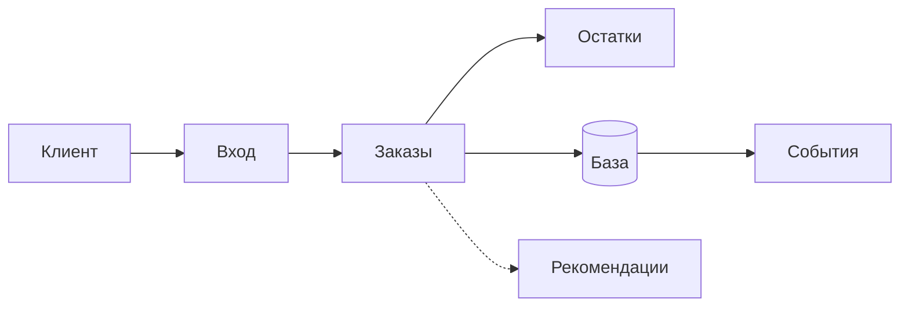
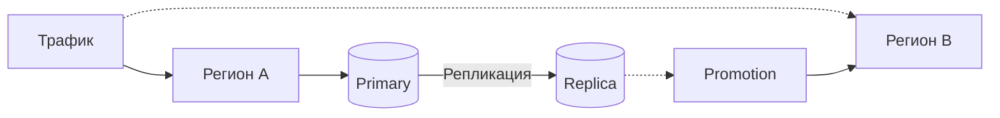

# Надёжность и эксплуатация распределённой системы

<!-- learning-nav:start -->
[← Все разделы](../README.md) · [Предыдущая тема](cdn-and-blob-storage.md) · [Следующая тема →](security-and-evolution.md)
<!-- learning-nav:end -->

Надёжность начинается с ответа на вопрос «какую работу система продолжит выполнять при конкретном отказе». Реплики, retry и второй регион полезны только вместе с измеримым результатом, границами ресурсов и проверенным восстановлением. Ниже один пример связывает время ответа, защиту от перегрузки, наблюдаемость и аварийное восстановление. Самостоятельные вопросы с разбором находятся в [банке по надёжности](../05-question-bank/reliability-and-operations.md).

<!-- toc:start -->
## Оглавление

<details>
<summary>Показать темы и вопросы</summary>

- [Сквозной пример и модель отказа](#сквозной-пример-и-модель-отказа)
- [Время запроса — конечный ресурс](#время-запроса--конечный-ресурс)
- [Повторы без усиления аварии](#повторы-без-усиления-аварии)
- [Перегрузка и изоляция](#перегрузка-и-изоляция)
- [SLO как правило принятия решений](#slo-как-правило-принятия-решений)
- [Наблюдаемость и реакция на инцидент](#наблюдаемость-и-реакция-на-инцидент)
- [Остановка и безопасные изменения](#остановка-и-безопасные-изменения)
- [Регионы и переключение](#регионы-и-переключение)
- [Восстановление данных и сервиса](#восстановление-данных-и-сервиса)
- [Мощность и стоимость](#мощность-и-стоимость)
- [Как защищать решение на собеседовании](#как-защищать-решение-на-собеседовании)

</details>
<!-- toc:end -->

## Сквозной пример и модель отказа

Проектируем оформление заказа: входной API проверяет корзину и остатки, фиксирует заказ, публикует дальнейшую обработку. Рекомендации необязательны; подтверждение цены и запись заказа обязательны. Платёж может завершаться асинхронно отдельной операцией: ответ «заказ принят» не означает «деньги списаны».

Примем учебные числа, которые затем проверим нагрузочным тестом:

| Величина | Значение и смысл |
|---|---|
| Нагрузка | 2 000 входящих запросов/с, пик 6 000/с |
| Клиентский deadline | 800 мс от начала операции |
| Серверный бюджет | 650 мс; ещё 150 мс — сеть и резерв клиента |
| SLO | 99,9% допустимых запросов завершаются корректно за 800 мс за 30 дней |
| Три зоны | По 6 экземпляров, всего 18 |
| Проверенная мощность экземпляра | 600 попыток/с при нужной задержке и составе запросов |
| DR-цели | RPO не более 60 с, RTO не более 15 мин для оговорённого отказа региона |

«Допустимые» запросы определены контрактом до измерения: валидные авторизованные попытки создать заказ в пределах договорной квоты. Законный отказ из-за отсутствия товара — корректный результат; отказ из-за нашей перегрузки — плохое событие. Исключать последние ради красивого SLO нельзя.



Связь между фиксацией заказа и публикацией требует отдельного протокола: например, outbox в той же транзакции и последующая доставка с защитой от дублей. Стрелка на обзорной схеме не обещает атомарность двух независимых записей; механизм разобран в [статье о распределённых транзакциях](distributed-transactions.md).

Зафиксируем область защиты: отказ процесса, зоны, зависимого сервиса, ошибочный релиз и потеря региона. Общая ошибочная конфигурация или компрометация доступа к бэкапам могут затронуть все копии сразу. Число реплик само по себе об этих отказах ничего не говорит.

## Время запроса — конечный ресурс

Timeout ограничивает отдельное ожидание; deadline задаёт момент, после которого результат уже бесполезен вызывающей стороне. Независимые таймауты по 500 мс на каждом из четырёх последовательных вызовов легко превратят операцию в двухсекундную. Вместо этого передаём остаток общего бюджета и на каждом шаге уменьшаем его на уже потраченное время.

В нашем примере внутренние 650 мс можно предварительно распределить так: вход и аутентификация — 50, корзина — 80, остатки — 180, транзакция — 170, формирование ответа — 20, запас — 150 мс. Это план предельных расходов, а не математическое сложение p99 компонентов: распределение итоговой задержки измеряется отдельно. Необязательные рекомендации получают свой короткий предел и не задерживают основной ответ.

Вызов начинается только тогда, когда оставшегося времени хватает на полезную попытку и возврат ответа. В бюджет входят ожидание соединения из пула, DNS, установка соединения, TLS, передача и чтение ответа — проверяйте фактическую область действия настройки клиента. Слишком короткий таймаут превращает обычный хвост задержек в поток повторов; слишком длинный удерживает ресурсы до исчерпания пула.

Для локального измерения длительности нужны монотонные часы. Передавать абсолютную отметку между машинами без модели рассинхронизации часов опасно. В gRPC deadline передаётся с учётом уже прошедшего времени; автоматическая propagation зависит от реализации. Отмена RPC также не останавливает произвольную работу приложения: обработчик должен прекратить запущенные задачи и освободить ресурсы.

Особенно важно окно «операция зафиксирована, ответ потерян». Отмена ожидания не отменяет commit. Клиент получает неопределённость и выясняет результат по идентификатору операции; безопасный повтор определяется контрактом идемпотентности, а не фактом таймаута.

## Повторы без усиления аварии

Retry помогает при кратком сбое, когда следующая попытка имеет шанс завершиться иначе. Ошибки валидации, отсутствие прав или исчерпанный бизнес-лимит повторять бессмысленно. Таймаут записи требует проверки безопасности повторного эффекта. Даже временный `503` не обещает свободную мощность прямо сейчас.

Политику повторов задаём одним владельцем на выбранной границе. Если три слоя делают до трёх попыток каждый, один исходный запрос способен породить 27 обращений к нижнему сервису. SDK, service mesh и приложение надо учитывать вместе. Ограничиваются число попыток, суммарное время и доля дополнительной нагрузки.

Для примера разрешим не более одной дополнительной попытки к остаткам, только при достаточном остатке deadline и наличии retry-токена. Общий бюджет повторов — максимум 10% исходного потока в устойчивом окне. При пике 6 000/с это не более 600 дополнительных попыток/с. Это выбранная политика, а не универсальная рекомендация.

Backoff увеличивает интервалы между попытками. Вариант full jitter выбирает задержку `random(0, min(cap, base × 2^k))`, где `k = 0` перед первым повтором. Случайность рассеивает синхронные повторные волны; она не ограничивает общее количество запросов, поэтому retry budget нужен отдельно. Если сервер просит ждать дольше оставшегося deadline, текущую синхронную операцию завершаем, а не засыпаем до бесполезного ответа. В HTTP `Retry-After` может быть длительностью в секундах или HTTP-датой.

```text
пока есть разрешённые попытки:
    если оставшегося времени недостаточно: завершить
    выполнить вызов с ограничением по оставшемуся времени
    если успех или неповторяемая ошибка: вернуть результат
    если нет retry-токена: завершить
    выбрать backoff с jitter
    если backoff + полезная попытка не помещаются: завершить
    подождать с поддержкой отмены
```

 Числа политики выбирают по собственным хвостам задержек и запасу мощности.

## Перегрузка и изоляция

Перегрузка часто начинается с замедления, а не с падения. Если зависимость раньше отвечала за 50 мс, а теперь за секунду, одновременно занятых вызовов при той же интенсивности станет примерно в 20 раз больше. Потоки, соединения и память закончатся раньше, чем CPU обязательно достигнет 100%.

Четыре механизма решают разные задачи:

- Rate limiting ограничивает интенсивность входа, например по клиенту и стоимости запроса. Подробные алгоритмы — в [отдельной статье](rate-limiting.md).
- Admission control и load shedding принимают работу только при доступном ресурсе и отбрасывают избыток до дорогих действий. Лимит одновременных операций реагирует на замедление там, где фиксированного RPS недостаточно.
- Backpressure сообщает производителю, что потребитель не успевает: замедлить чтение, сократить prefetch, ограничить отправку. Если производитель нельзя замедлить, нужны ограниченный буфер и явная политика отказа.
- Bulkhead изолирует бюджеты конкурирующих нагрузок: отдельные лимиты параллелизма, очереди и пулы для критичных операций и рекомендаций.

Пул на зависимость ограничивает ущерб, но общий executor, файловые дескрипторы или база всё ещё могут оставаться совместным узким местом. Изоляция проверяется по полному пути. Жёстко выделенные ресурсы повышают предсказуемость, но могут простаивать; общий резерв допустим лишь при сохранении гарантированного минимума критичному трафику.

Circuit breaker временно прекращает бесперспективные обращения после наблюдаемого ухудшения. Он не заменяет timeout и не изолирует ресурсы первых зависших вызовов. Порог требует минимального объёма наблюдений, а half-open — ограничения проб. Иначе восстановившуюся зависимость одновременно атакуют все экземпляры. Бизнес-отказ «товара нет» не должен открывать breaker.

Очередь имеет предел по длине и возрасту. При полезном времени ожидания 50 мс и скорости обработки 6 600 попыток/с грубый ориентир — 330 ожидающих попыток по всему рассматриваемому контуру, до поправки на разброс и стоимость работы. Это не «добавочная мощность»: очередь лишь переносит работу во времени. Начинать заведомо просроченную операцию вредно.

Деградация должна сохранять смысл ответа. Можно убрать рекомендации и показать явно помеченную устаревшую витрину. Нельзя подтвердить заказ без обязательной проверки или выдать нулевой баланс вместо недоступного. Fallback тоже получает бюджет: массовое переключение на БД при отказе кэша способно вызвать вторую аварию.

## SLO как правило принятия решений

SLI измеряет пользовательский результат, SLO задаёт цель за окно, SLA фиксирует внешнее обязательство. Базовые различия разобраны в [банке основ](../05-question-bank/fundamentals.md); здесь используем их для эксплуатации.

При постоянных 2 000 запросов/с за 30 дней будет `2 000 × 86 400 × 30 = 5 184 000 000` событий. Для SLO 99,9% допустимый бюджет — `5 184 000` плохих событий. На пике десять минут полного отказа дадут `6 000 × 600 = 3 600 000` плохих событий: около 69,4% оценённого месячного бюджета. Итоговый знаменатель считается по реальному трафику; постоянная нагрузка — только допущение для планирования. Временной бюджет 43,2 минуты для 99,9% за 30 дней применим к временному SLI, а не автоматически к запросному.

Burn rate — отношение наблюдаемой доли плохих событий к допустимой: при 2% ошибок и допуске 0,1% получаем `0,02 / 0,001 = 20`. Длинное окно обнаруживает устойчивое расходование, короткое подтверждает, что проблема ещё продолжается. Для малонагруженных сервисов нужны отдельные меры: единичная ошибка может исказить процент, а отсутствие запросов не доказывает исправность.

Error budget превращается в согласованную политику: ускоренно расходуется — ограничиваем рискованные релизы и устраняем повторяющийся отказ; цель выдерживается — допускаем изменения. Это не запрет на аварийный fix и не право сознательно терять оставшийся бюджет. У разных пользовательских путей и классов клиентов могут быть разные SLO: общий средний показатель способен скрыть полный отказ маленького региона.

## Наблюдаемость и реакция на инцидент

Начинаем с latency, traffic, errors и saturation. На входе считаем исходные пользовательские операции; внутри — все попытки, чтобы видеть усиление повторами. Задержки успешных и ошибочных ответов рассматриваем отдельно. Дополняем очередь возрастом старейшей задачи, пулы — временем ожидания и числом занятых слотов, репликацию — лагом и актуальностью последнего подтверждения.

Метрика локализует масштаб, трасса показывает критический путь конкретной операции, структурированный лог объясняет событие. Общие trace ID, версия релиза и регион связывают их. Время ожидания пула должно быть видно отдельно от удалённого вызова: иначе «медленная база» может оказаться очередью перед быстрым SQL.

Для SLO удобна доля событий быстрее явного порога: histogram с границей 800 мс позволяет считать её непосредственно. Среднее p99 экземпляров не является p99 сервиса. Счётчики совместимых histogram сначала агрегируют, затем вычисляют квантиль; готовые summary-квантили так складывать нельзя.

Сбор телеметрии имеет ограниченные буферы и политику потери. Иначе недоступность лог-хранилища остановит оформление заказов. Высококардинальные ID оставляем в логах/трассах, а не в метках метрик. Head sampling принимает раннее решение; tail sampling позволяет учитывать итог трассы, но требует буферизации и полного доступного потока до решения. Ошибки, отброшенные раньше, tail sampling не восстановит.

Во время инцидента сначала ограничиваем ущерб: остановить rollout, снизить приём, отключить необязательное, восстановить рабочую версию. Назначаем владельца координации и фиксируем временную шкалу действий. После стабилизации проверяем пользовательский SLI, целостность и отставшие задачи; зелёный CPU ещё не означает восстановление. Разбор должен завершаться проверяемыми изменениями и владельцами, а не фразой «быть внимательнее».

## Остановка и безопасные изменения

Graceful shutdown — протокол с конечным сроком: прекратить принимать новую работу, вывести экземпляр из маршрутизации, завершить допустимые активные операции, отменить оставшиеся, освободить ресурсы. Обновление маршрутов и закрытие старых соединений не мгновенны. Поэтому обработчик остановки сам контролирует новые запросы, а не полагается только на readiness.

В Kubernetes `preStop` входит в общий termination grace period; после его истечения остающиеся процессы принудительно завершаются. Удаление endpoint и локальная остановка происходят асинхронно, поэтому нельзя считать их глобально упорядоченными. Для фонового consumer важна граница «эффект выполнен, подтверждение обработки ещё не отправлено»: повторная доставка после остановки должна быть безопасной.

Canary ограничивает долю пользователей, затронутых новой версией. Сравниваем её с контрольной группой по результатам, задержке и ресурсам при сопоставимом трафике. Заранее задаём срок наблюдения, критерии продвижения и остановки. Один процент запросов может не включать редкий тяжёлый сценарий — успех малой выборки не доказывает безопасность всего релиза.

Rollback кода не отменяет уже отправленные сообщения и преобразованные данные. Изменения схемы проводят через совместимые этапы: добавить новое, научить обе версии понимать переходное состояние, переключить, затем удалять старое. Feature flag полезен, если его отключение само доступно при аварии и не требует сломанного компонента.

## Регионы и переключение

Multi-zone защищает от части локальных отказов; multi-region добавляет расстояние, независимость и новую сложность. Active-passive проще для единственного владельца записи, но резерв должен иметь проверенные мощности, доступы и актуальные данные. Active-active ускоряет локальное обслуживание и использует оба региона, однако требует правила владения записью или разрешения конфликтов.



Потеря сетевой связи не доказывает смерть старого primary. До открытия записи в резерве нужно исключить двойное владение: fencing, проверенный протокол лидерства или остановка старого пути. При асинхронной репликации переключение может потерять подтверждённые записи из окна лага. DNS меняет обнаружение адреса, но не исправляет эти гарантии; кэши, старые соединения и клиенты сохраняют прежний маршрут.

Порядок плана: подтвердить область отказа → определить допустимость потери → исключить старого писателя → подготовить данные и зависимости → включить трафик постепенно → проверить пользовательский путь. Возвращение в старый регион требует отдельной синхронизации: автоматический failback без сверки способен повторить аварию. Тестируют и работу без управляющего API, DNS-изменений или системы секретов, если они входят в рассматриваемую область отказа.

## Восстановление данных и сервиса

RPO — допустимая потеря данных, выраженная глубиной времени; RTO — целевое время восстановления оговорённого сервиса после оговорённого события. Они задаются бизнесом и подтверждаются учениями, а не выводятся из названия облачного тарифа. План должен включать зависимости и дрейф конфигурации.

Реплика помогает быстро продолжить работу при отказе узла, но воспроизводит ошибочное удаление. Бэкап создаёт отдельную точку восстановления. Для point-in-time recovery PostgreSQL нужны подходящая базовая копия и непрерывная последовательность WAL до нужной точки; нельзя считать каждый файл WAL самостоятельным бэкапом. Восстановление базы также не восстанавливает автоматически все внешние конфигурационные файлы.

Проверяем не только факт upload: можно ли прочитать копию, доступны ли ключи расшифрования из независимого контура, хватает ли сети и диска, корректно ли выбрана точка, согласуются ли восстановленные сущности с внешними эффектами. Защищённая от удаления копия не исправит логическую ошибку сама; нужен достаточный retention до её обнаружения.

Для наших RTO 15 минут пример плана: обнаружение и решение — 2, подготовка окружения и доступов — 2, восстановление — 6, проверки — 3, подача трафика — 2 минуты. Если данные занимают 2 ТБ, а эффективное чтение 500 МБ/с, одно последовательное чтение требует около 4 000 с, то есть 67 минут, ещё до replay и проверки. План с холодным полным restore не выполняет цель: нужен подготовленный резерв, другой способ восстановления или пересмотр RTO. Размеры и скорость здесь десятичные.

## Мощность и стоимость

При потере зоны остаётся 12 из 18 экземпляров. Их проверенная мощность — `12 × 600 = 7 200` попыток/с. Пик плюс максимум 10% повторов — `6 000 × 1,1 = 6 600`, загрузка по этой модели около 91,7%. Это небольшой запас: неопределённость теста, прогрев и горячие ключи легко его съедят. В нормальном режиме тот же поток занимает около 61,1% мощности 18 экземпляров.

Практическое решение: заранее проверить нагрузку при отказе зоны, уменьшить повторы, снять необязательную работу или добавить резерв. Автоскейлер помогает позже: пока он обнаружит рост и запустит прогретые экземпляры, должны работать admission control и исходный запас. Масштабирование приложения не повышает автоматически лимит базы или партнёрского API.

Считаем стоимость полезной завершённой операции вместе с повторами, межрегиональным трафиком, бэкапами, телеметрией и эксплуатацией. Добавочный регион может уменьшить один риск и увеличить число ошибочных переключений, конфликтов и ручных процедур. Предпочтительна минимальная архитектура, которая проходит выбранные сценарии отказа и цели восстановления. Экономия на проверках restore часто превращает дешёвое хранение копий в дорогую иллюзию.

## Как защищать решение на собеседовании

Свяжите каждую меру с проверяемым отказом: «зависимость замедлилась — предел параллелизма сохраняет ресурсы; retry ограничен временем и долей; падает зона — оставшаяся мощность покрывает критичный поток; ошибочный релиз — canary и совместимый rollback; потеря данных — проверенный restore в RPO/RTO».

Затем назовите границу: что потеряем, что отключим, кто принимает решение и какая метрика подтвердит восстановление. Ответ «три реплики, Kubernetes и мониторинг» не описывает ни одного из этих переходов. Рабочий дизайн включает порядок действий в момент, когда штатная схема перестала работать.
