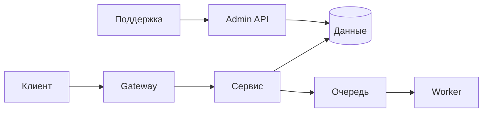
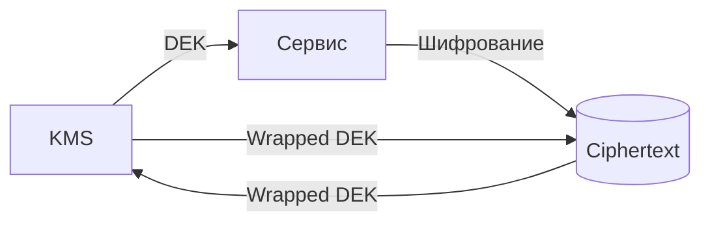
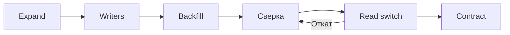

# Безопасность и эволюция распределённой системы

<!-- learning-nav:start -->
[← Все разделы](../README.md) · [Предыдущая тема](reliability-and-operations.md) · [Следующая тема →](../02-case-studies/url-shortener.md)
<!-- learning-nav:end -->

Система должна сохранять права доступа и смысл данных, пока меняются клиенты, сервисы, ключи и схема хранения. На собеседовании недостаточно нарисовать TLS и новую версию API: нужно показать, кто кому доверяет, где принимается решение о доступе и как старый код переживёт новый формат. Здесь рассматривается архитектура этих механизмов; базовый выбор протокола описан в [дизайне API](api-design.md), алгоритмы ограничения нагрузки — в [rate limiting](rate-limiting.md).

<!-- toc:start -->
<details>
<summary>Показать темы и вопросы</summary>

- [Границы доверия и модель угроз](#границы-доверия-и-модель-угроз)
- [Идентичность, права и изоляция арендаторов](#идентичность-права-и-изоляция-арендаторов)
- [Шифрование и жизненный цикл ключей](#шифрование-и-жизненный-цикл-ключей)
- [Секреты, логи и персональные данные](#секреты-логи-и-персональные-данные)
- [Защита от злоупотреблений](#защита-от-злоупотреблений)
- [Совместимость API и событий](#совместимость-api-и-событий)
- [Expand–contract и перенос данных](#expandcontract-и-перенос-данных)
- [Выкатка, откат и доказательства готовности](#выкатка-откат-и-доказательства-готовности)
- [Задача на подумать](#задача-на-подумать)

</details>
<!-- toc:end -->

## Границы доверия и модель угроз

Начинайте с активов и опасных действий. В платёжной системе это деньги, платёжные реквизиты, возможность создать выплату и изменить получателя. В SaaS — данные арендаторов, административные операции и ключи интеграций. Затем перечислите точки входа: публичный API, webhook, очередь, панель поддержки, импорт файлов, исходящие обращения к URL пользователя.

Граница доверия возникает там, где меняются субъект, полномочия или уровень контроля над данными. Это не обязательно граница сети: сообщение из внутренней очереди может содержать недоверенный пользовательский текст. Приватный IP сам по себе не удостоверяет отправителя.



У каждой стрелки нужны ответы на четыре вопроса: кто отправитель, как подтверждена его личность, какое действие ему разрешено, как ограничить ущерб при компрометации. На границе gateway проверяет клиентскую сессию и удаляет присланные извне служебные заголовки; сервис проверяет право на конкретный объект; worker проверяет допустимость задания и использует собственные ограниченные права. Панель поддержки — отдельный привилегированный путь с аудитом, а не исключение из модели.

Не превращайте threat modeling в каталог всех существующих атак. Для интервью достаточно двух-трёх реалистичных угроз, соответствующих задаче: чтение чужого заказа, подмена tenant в export-job, истощение SMS-бюджета. Для каждой назовите защиту и способ проверить её отказ.

## Идентичность, права и изоляция арендаторов

Аутентификация устанавливает субъект; авторизация связывает субъект, действие, ресурс и контекст. Роль `support` ещё не означает право читать любой документ: могут требоваться назначенный tenant, служебная причина и временное повышение доступа. mTLS удостоверяет вызывающий workload, но не доказывает право пользователя на перевод денег.

В цепочке `frontend → orders → billing` отдельно передавайте идентичность сервиса и, если нужна делегация, проверяемый контекст пользователя. Billing должен понимать, действует ли orders от своего имени или от имени пользователя. У получателя проверяются назначение удостоверения и допустимые действия. Нельзя доверять произвольному `X-User-Id`, разрешать любому внутреннему сервису выпускать пользовательские полномочия или пересылать один широкий bearer token всем зависимостям.

Для multi-tenant SaaS изоляция проходит через весь путь данных:

- tenant определяется из проверенного контекста и подтверждённого членства пользователя;
- запрос к объекту ограничивается tenant и идентификатором объекта;
- ключи кэша, поиска, файлов и идемпотентности учитывают область арендатора;
- фоновые задания сохраняют доверенный tenant-контекст и политику проверки прав;
- административные инструменты и backup/restore имеют отдельные полномочия.

```sql
-- Пример параметризованного запроса после проверки membership.
SELECT id, total_minor
FROM orders
WHERE tenant_id = :trusted_tenant
  AND id = :order_id;
```

Общая БД с `tenant_id` дешевле в эксплуатации, отдельная БД облегчает некоторые задачи изоляции и восстановления одного клиента, но увеличивает число миграций и подключений. Возможен гибрид: общий пул для небольших клиентов и отдельные ресурсы для крупных. Ни один вариант не устраняет авторизацию приложения.

Row-Level Security может страховать забытый фильтр. В PostgreSQL необходимо учитывать обход политик суперпользователем, ролями с `BYPASSRLS` и обычно владельцем таблицы; для владельца существует `FORCE ROW LEVEL SECURITY`. Tenant-контекст соединения надо устанавливать в границах транзакции и не переносить следующему пользователю из пула. RLS не защищает от приложения, которое само способно подставить любой tenant: источник контекста остаётся частью границы доверия.

## Шифрование и жизненный цикл ключей

Разделяйте три цели. TLS защищает канал между его конечными точками. Шифрование дисков и backup уменьшает последствия утечки носителя. Шифрование отдельных полей или объектов может ограничить доступ операторов хранения, если право расшифрования отделено от права читать ciphertext. После TLS termination на gateway начинается другой участок пути; защиту до backend выбирают явно. Компрометированный сервис, которому законно доступна расшифровка, всё ещё может прочитать данные.

Для больших объектов распространено envelope encryption: объект шифруется ключом данных DEK, а DEK защищается управляющим ключом KEK в KMS. Рядом с ciphertext сохраняются зашифрованный DEK, идентификатор/версия ключа и нужные параметры формата. Открытый DEK не хранится там же как постоянный секрет. Доступ к KMS, аудит расшифровок и резервирование становятся частью архитектуры. Это описание механизма, а не повод самостоятельно реализовывать криптографический протокол: используйте проверенный формат и библиотеку.



Ротация KEK, перепаковка существующих DEK и повторное шифрование самих данных — разные операции. Выбор зависит от причины: плановое обновление, компрометация конкретного ключа, смена алгоритма. Не удаляйте старый ключ, пока от него зависят данные, архивы и допустимые сценарии восстановления. Замена alias на новый ключ не доказывает, что старые объекты мигрировали.

Отказ KMS тоже нужно спроектировать: новые экземпляры могут не прочитать данные, даже если тёплые ещё держат разрешённый кэш ключей. Ограниченный кэш уменьшает зависимость от latency, но продлевает время действия уже выданного материала. Деградация определяется классом операции; записывать чувствительные данные открытым текстом при недоступном KMS — нарушение выбранной модели защиты.

## Секреты, логи и персональные данные

Секрету нужен жизненный цикл: выдача, доставка, использование, обновление, отзыв и расследование утечки. Workload получает минимальные права через свою идентичность; краткоживущие credentials уменьшают период риска. Secret manager не поможет, если его bootstrap-токен бессрочный и одинаковый у всех сервисов. Значения исключают из исходников, образов, URL, diagnostic dump и вывода CI; полномочия production и тестовой среды разделяют.

Ротацию credentials БД можно провести с периодом перекрытия: выдать новую учётную запись с нужными правами, обновить клиенты, пересоздать соединения, проверить отсутствие старых обращений, отозвать старую. Возможность держать две версии зависит от системы. При подтверждённой утечке удобный долгий overlap может быть неприемлем: план восстановления должен учитывать срочный отзыв.

Логи — самостоятельное хранилище с доступом и сроками. Практичный diagnostic event содержит operation, pseudonymous subject ID, tenant ID, outcome, error code, trace ID и версию политики. Полный `Authorization`, пароль, документ клиента или тело банковского запроса для обычной диагностики не нужны. Маскирование после приёма логов не отменяет уже созданную копию в агенте, буфере или dead-letter storage. Начинайте с разрешённого набора полей на источнике; затем проверяйте pipeline.

Для PII определяют цель обработки, владельца набора данных, срок, доступ и процедуру удаления. Универсального срока «все логи хранить N дней» нет: он зависит от применимых требований, договора, назначения данных и согласованной политики. Отдельно учитываются операционная БД, кэш, поисковый индекс, события, аналитика, выгрузки и backup. Для неизменяемой резервной копии может использоваться ограниченный жизненный цикл и повторное применение журнала удалений перед возвратом восстановленных данных в работу. Tombstone не должен превращаться в новую бессрочную копию удалённого профиля.

## Защита от злоупотреблений

Успешная аутентификация не делает действие полезным для бизнеса. Клиент может легально вызывать endpoint отправки SMS, резервировать все билеты или создавать дорогие отчёты. Ограничивайте не только HTTP RPS, но и денежную стоимость, число активных jobs, размер входа, глубину запроса и объём результатов.

Например, SMS-service проверяет бюджет по аккаунту и получателю, общий бюджет провайдера, период между повторами и число неуспешных проверок кода. Лимит только по IP плохо работает за NAT и обходится распределённым трафиком. CAPTCHA может повышать стоимость автоматизации, но не заменяет серверный бюджет. Для тяжёлых задач admission control применяется до постановки в очередь, иначе база уже защищена, а очередь и расходы продолжают расти.

Заранее определяйте поведение при отказе лимитера. Для публичного каталога возможен ограниченный локальный fallback; для дорогой отправки кода или денежной операции разумнее отказ либо более строгий резервный бюджет. Следите за false positives и успешностью законных пользователей, а не только числом заблокированных запросов.

## Совместимость API и событий

Совместимость имеет несколько уровней: данные разбираются, программа собирается, поведение сохраняет смысл. Новое необязательное поле часто безопасно, но строгий JSON-десериализатор может его отвергнуть. Новый enum может сломать исчерпывающий `switch`. Поле `amount` с прежним числовым типом, но новой единицей измерения семантически несовместимо. Удаление поля нельзя считать безопасным по отсутствию запросов за один день: редко запускаемые клиенты и восстановление событий тоже потребители.

Для protobuf правила бинарного формата и ProtoJSON различаются. Номер удалённого поля не переиспользуют; `reserved` защищает его от случайного повторного назначения. Это не даёт автоматической совместимости бизнес-логики: перевод суммы из копеек в рубли не исправляется wire format.

До релиза составьте матрицу: старый клиент/новый сервер, новый клиент/старый сервер, старый consumer/новое событие, новый consumer/старое событие из журнала. Для очереди временное окно совместимости часто длиннее окна rolling deployment: есть backlog, DLQ, replay и резервные копии. Новые consumers сначала учат читать оба формата, и только затем producers начинают публиковать новый. Контроль схемы в registry полезен, но не проверяет единицы измерения и все правила приложения.

## Expand–contract и перенос данных

Изменение работающей системы — последовательность совместимых состояний. Пример: заменить `price_rubles` на `price_minor` и добавить валюту.

1. Expand: добавить новые поля, сохранив старые; новый reader умеет fallback. Пока живут старые writers, они не должны создавать незаметно устаревшие новые значения.
2. Подготовить запись: обновить все writers, включая jobs и старые версии сервисов; определить источник истины, атомарность и обработку частичного успеха.
3. Backfill: перевести историю небольшими возобновляемыми порциями, защищаясь от конкурентных изменений.
4. Сверить: проверить расхождения, полноту, деньги и специальные случаи; выполнить shadow reads без влияния на пользовательский результат.
5. Переключить чтение по управляемому флагу, сохраняя возможность отката и наблюдение.
6. Contract: после завершения периода совместимости убрать старых writers/readers и только затем старое представление.



Если оба столбца находятся в одной транзакционной БД, их можно менять одной транзакцией. Два сетевых `write` в разные хранилища такой атомарности не дают: между ними процесс падает. Практичный вариант — основная запись плюс outbox в одной транзакции, затем повторяемая доставка и reconciliation. Это даёт управляемое отставание, а не мгновенную одинаковость двух систем. Подробнее о связи транзакций и событий — в [распределённых транзакциях](distributed-transactions.md).

Backfill сохраняет checkpoint только после надёжной фиксации партии. Диапазон по стабильному ключу обычно удобнее `OFFSET`; изменение строки защищают версией или условным обновлением. «Прочитать старое, посчитать новое, безусловно записать» может перезаписать более свежую сумму. Checkpoint показывает пройденный диапазон, но не доказывает корректность значений; нужны сверка и отдельная обработка пропусков. По latency, replication lag и росту очередей перенос замедляют или приостанавливают.

DDL тоже потребляет ресурсы и блокировки. В PostgreSQL 17 `CHECK`/FK можно добавить как `NOT VALID`, а старые строки проверить позже через `VALIDATE CONSTRAINT`; это не универсальный синтаксис для любого ограничения. `CREATE INDEX CONCURRENTLY` позволяет продолжать записи, но имеет ограничения, не запускается в transaction block и при ошибке может оставить invalid index. Слово «online» не означает отсутствие нагрузки или ожидания блокировок.

## Выкатка, откат и доказательства готовности

Деплой кода, изменение формата записи, backfill и включение поведения лучше управлять отдельно. Feature flag разрешает переключить путь исполнения, но не восстанавливает удалённый столбец и не преобразует уже опубликованное событие. Canary проверяет ограниченную когорту; для stateful-изменений её выбирают по tenant или partition, чтобы запросы одного объекта не прыгали между несовместимыми режимами.

План отката отвечает на конкретный вопрос: сможет ли версия N читать данные, созданные N+1? Если новая версия начала создавать неизвестный статус, старый бинарник может упасть сразу после «успешного» rollback. Подготовительный релиз сначала учит старый путь понимать новое представление; после этого разрешают его запись. Для необратимых преобразований возможен только forward fix либо заранее продуманный план восстановления с допустимой потерей данных. Restore всей БД — не бесплатный rollback: он затрагивает записи других пользователей после backup.

Критерии продвижения — не только отсутствие 5xx: совпадение бизнес-результатов, отсутствие cross-tenant доступа, доля fallback-чтений, lag репликации нового представления, возраст незавершённых переносов. У флага и временного dual-write должны быть владелец и условие удаления. Временная совместимость без завершения становится постоянной неоднозначностью источника истины.

## Задача на подумать

SaaS хранит счета двухсот арендаторов. Новый сервис читает `amount_minor`, старый всё ещё пишет только `amount`. Backfill завершил 99,9% строк, canary не дал 5xx. Команда предлагает удалить `amount` и объявить миграцию завершённой. Какие доказательства отсутствуют?

<details>
<summary>Разбор</summary>

Нужно остановить или обновить все старые writers: иначе заполненное новое поле устаревает после очередного изменения старого. Проверяются оставшиеся строки, смысл округления и валюты, включая редкие tenant и асинхронные jobs. Результат canary надо сравнивать по суммам и правам, а не только статусам HTTP. Отдельно проверяются старый бинарник на новых данных и восстановление истории.

Без удаления старого поля можно переключить чтение и откатить флаг, если старое представление ещё поддерживается корректным. После удаления поле не вернётся от смены флага. Contract допустим, когда нет зависимых readers/writers, завершён согласованный период совместимости и есть проверенный путь восстановления. Опасный ответ — «оставшиеся 0,1% несущественны»: в финансовых данных это могут быть самые большие счета или один полностью пропущенный tenant.

</details>

[Вопросы для самопроверки](../05-question-bank/security-and-evolution.md)
