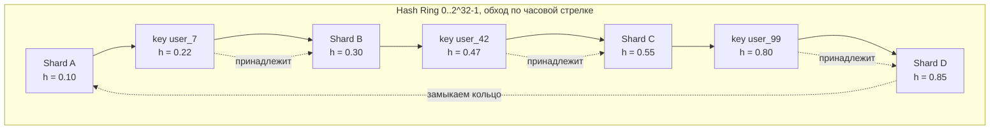
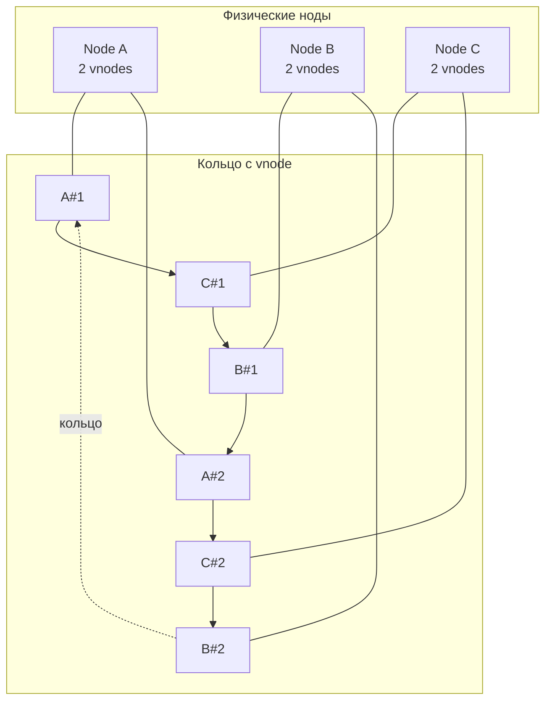
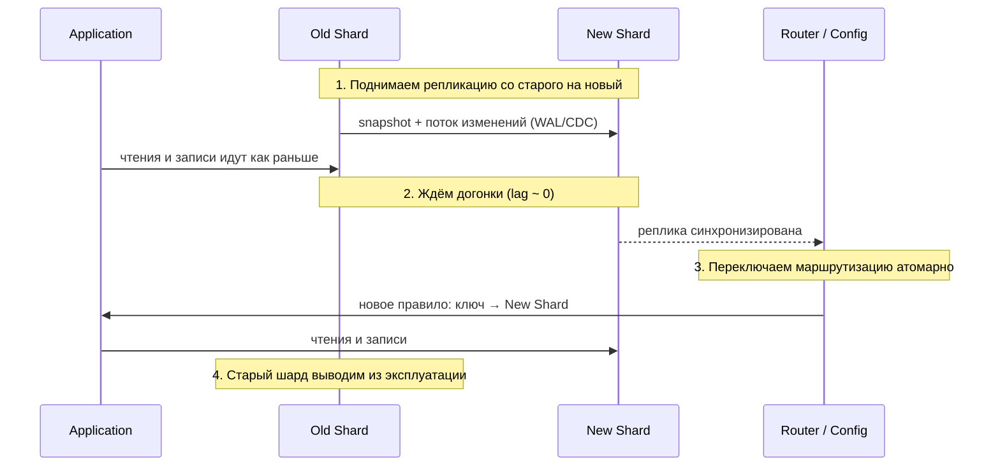
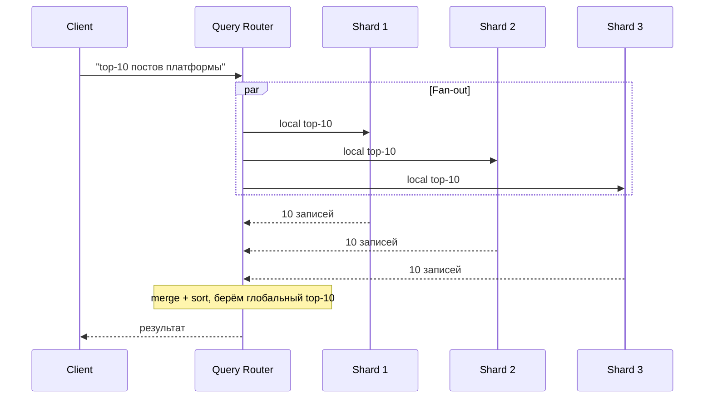

# Шардирование и партиционирование

<!-- learning-nav:start -->
[← Все разделы](../README.md) · [Предыдущая тема](cap-and-consistency.md) · [Следующая тема →](message-queues.md)
<!-- learning-nav:end -->

> Building block System Design: как делить данные между машинами, когда одна уже не справляется. Выбор shard key, range vs hash, consistent hashing с virtual nodes, resharding, hotspot'ы и cross-shard запросы — всё, что спросят на собеседовании, когда вы скажете слово «шардирование».

## Оглавление

<!-- toc:start -->

Показать темы и вопросы

- [Когда вообще нужно шардирование](#когда-вообще-нужно-шардирование)
- [Терминология: partition vs shard vs replica](#терминология-partition-vs-shard-vs-replica)
- [Два вопроса, которые решают всё](#два-вопроса-которые-решают-всё)
- [Выбор shard key](#выбор-shard-key)
- [Стратегии распределения: range vs hash vs directory](#стратегии-распределения-range-vs-hash-vs-directory)
- [Consistent hashing и virtual nodes](#consistent-hashing-и-virtual-nodes)
- [Resharding и ребалансировка](#resharding-и-ребалансировка)
- [Hotspot / celebrity problem](#hotspot--celebrity-problem)
- [Cross-shard запросы и scatter-gather](#cross-shard-запросы-и-scatter-gather)
- [Cross-shard транзакции](#cross-shard-транзакции)
- [Что говорить интервьюеру](#что-говорить-интервьюеру)
- [Уточняющие вопросы](#уточняющие-вопросы)
- [Красные флаги и типичные ошибки кандидатов](#красные-флаги-и-типичные-ошибки-кандидатов)
- [Чем закрыть проблему до того, как шардировать](#чем-закрыть-проблему-до-того-как-шардировать)
- [Эксплуатация шардированной системы](#эксплуатация-шардированной-системы)
- [Deep dive: вопросы, которыми копают глубже](#deep-dive-вопросы-которыми-копают-глубже)
- [Как шардируются реальные системы](#как-шардируются-реальные-системы)
- [Пример рассуждения целиком (соцсеть)](#пример-рассуждения-целиком-соцсеть)
- [Видео по теме](#видео-по-теме)

<!-- toc:end -->

---

## Когда вообще нужно шардирование

Шардирование — это разбиение данных по нескольким машинам так, чтобы **ни одна база не хранила весь датасет целиком**. Каждый шард — самостоятельная БД со своим CPU, памятью, диском и пулом соединений; вместе шарды образуют полный набор данных.

Ключевая мысль, которую интервьюеры ждут услышать явно: **шардирование — не дефолт, а крайняя мера**. Типичная ошибка кандидата — рефлекторно сказать «зашардим по user_id» на второй минуте дизайна. Современное железо тянет очень много:

- ёмкость одного PostgreSQL-инстанса определяется диском, RAM, индексами, WAL, запросами и SLO восстановления; универсального потолка TPS или числа терабайт нет — нужна нагрузочная проверка;
- read-нагрузка масштабируется репликами, а не шардами — сначала leader + N read replicas и кэш, и только потом шардирование.

Поэтому решение о шардировании принимается по числам. Три метрики, которые нужно прикинуть вслух:

1. **Storage.** 500 млн пользователей × 5 КБ профиля = 2.5 ТБ полезных данных — кандидат на один primary. До вывода проверяем объём индексов/WAL, запас диска, backup и время восстановления. 10 млрд событий × 1 КБ = 10 ТБ с ростом требуют такой же проверки, а не автоматического шардирования.
2. **Write throughput.** Реплики не помогают записи: весь write поток идёт в leader. Проверяем пиковые записи на целевом профиле нагрузки и запас на отказ; цифра 50–100 тыс. записей/с сама по себе ещё не доказывает необходимость шардирования.
3. **Read throughput.** 100 млн DAU × 10 запросов/день = ~11.5 тыс. RPS в среднем, ×3–5 на пике. Затем оцениваем, какую долю снимет кэш и какая нагрузка останется на primary/репликах; достаточно ли их, проверяем по стоимости запросов, p99 и запасу при отказе.

Сильный ход на собеседовании — **посчитать и показать, что шардирование не нужно**: «2.5 ТБ и 3 тыс. RPS — кандидат на один PostgreSQL с репликами; проверю индексы, p99, запас диска и восстановление. Если измеренная ёмкость достаточна, шардирование пока не нужно». Это демонстрирует инженерную зрелость лучше, чем преждевременное усложнение.

## Терминология: partition vs shard vs replica

Термины путают постоянно, и интервьюер может специально проверить:

- **Partition (партиция)** — логическое разбиение данных. Может быть внутри одной машины (`PARTITION BY RANGE` в PostgreSQL, партиции топика в Kafka).
- **Shard (шард)** — независимо размещаемая часть датасета. Несколько шардов могут жить на одной машине, а один шард — иметь реплики на нескольких. Шардирование = горизонтальное партиционирование. В MongoDB шард может содержать несколько диапазонов ключей, а виртуальный узел Cassandra описывает часть пространства токенов. При сравнении систем уточните, какая именно единица данных перемещается между узлами.
- **Replica (реплика)** — **копия** тех же данных на другой машине. Репликация решает доступность и read-масштабирование, шардирование — объём и write throughput. В проде почти всегда и то, и другое: каждый шард имеет свои реплики (leader + followers).

Частый вопрос-ловушка: «чем шардирование отличается от репликации?» — на реплике лежат **все** данные, на шарде — **подмножество**.

## Два вопроса, которые решают всё

Разговор о шардировании всегда раскладывается на два независимых решения:

1. **Чем шардируем — выбор shard key.** Поле (или комбинация полей), по которому группируем данные. Все данные с одним значением ключа живут на одном шарде.
2. **Как раскладываем — стратегия распределения.** Функция отображения значений ключа на конкретные машины: диапазоны, хэш, consistent hashing, lookup-таблица.

Shard key — это «как группируем данные», стратегия распределения — «как эти группы размещаем по шардам». На собеседовании стоит проговорить оба, даже если второе — дефолтный hash-based подход.

## Выбор shard key

Хороший shard key обладает тремя свойствами:

| Свойство | Что означает | Пример нарушения |
|---|---|---|
| **High cardinality** | Много уникальных значений — есть чем «заполнить» шарды | Шардирование по флагу `is_premium`: 2 значения = максимум 2 шарда, дальше тупик |
| **Even distribution** | Значения естественно равномерны по данным и нагрузке | Шардирование по `created_at`: все запросы идут в «свежий» диапазон → hotspot |
| **Query alignment** | Ключ совпадает с основным паттерном запросов | Запросы «дай посты пользователя X», а зашардили по `post_id` → каждый запрос бьёт по всем шардам |

Третий пункт — главный. **Shard key выбирается от access pattern, а не от структуры таблицы.** Классические примеры:

- Соцсеть, основной запрос — «профиль пользователя + его посты» → shard key = `user_id`. Кардинальность высокая, ключи пользователей можно распределить равномерно, но QPS крупных пользователей проверяем отдельно; запрос попадает в один шард.
- E-commerce, основной сценарий — «создать/посмотреть/обновить заказ» → shard key = `order_id` (или `user_id`, если чаще смотрят «мои заказы»).
- Мессенджер → `chat_id`: все сообщения чата на одном шарде, лента чата — один диапазонный запрос.
- IoT/метрики → `device_id` + время как вторичная часть ключа.

### Плохие ключи — любимая тема проверяющих

- **Низкая кардинальность**: `country`, `is_premium`, `gender`. Ограничивают число шардов и создают перекос (пользователей из одной страны больше).
- **Монотонно растущие значения при range-распределении**: автоинкрементный `id`, `created_at`. все новые записи ложатся на последний диапазон — «горячий хвост». Timestamp как range key может быть оправдан для time-series при контролируемой нагрузке и split; чтобы распределить интенсивную текущую запись, добавляют независимое разбиение на buckets/устройства.
- **Ключ, не совпадающий с запросами**: любой запрос без ключа в `WHERE` превращается в scatter-gather по всем шардам.

## Стратегии распределения: range vs hash vs directory

### Range-based (по диапазонам)

Значения ключа делятся на непрерывные интервалы: shard 1 — `user_id` 0–10M, shard 2 — 10M–20M и т.д.

Плюсы: интуитивно понятно, **эффективные range-запросы** («дай пользователей 5M–6M» читаются последовательно с одного шарда), легко делать перелив данных по границе диапазона. Так работают Bigtable/HBase и партиции по дате в PostgreSQL.

Минусы: перекос нагрузки — «хвост» диапазонов горячий (новые пользователи), старые холодные; границы нужно отслеживать и сплитить до того, как диапазон разрастётся.

### Hash-based (по хэшу ключа)

`shard = hash(key) mod N`. Хэш-функция (MD5, MurmurHash — не криптографическая важность, а равномерность) «перемешивает» ключи, и даже монотонные `id` разлетаются по шардам равномерно. Это индустриальный дефолт.

Цена: теряются range-запросы по ключу (соседние `id` лежат на разных шардах), и при смене `N` почти все ключи меняют шард — `mod 3` и `mod 4` совпадают примерно для 1/4 ключей при равномерном хэше. Решается consistent hashing (см. ниже).

### Directory-based (lookup-таблица)

Отдельный сервис/таблица хранит маппинг «ключ → шард». Максимальная гибкость: можно перенести конкретного пользователя на отдельный шард, просто обновив запись.

Цена: поддержка доступной и согласованной директории. Маппинг обычно кэшируют на роутерах, поэтому отдельного сетевого хопа на каждый запрос не требуется; при stale-маршруте владелец должен отклонять или перенаправлять запрос. Директорию реплицируют, её версию включают в протокол миграции. Но как **дополнение** к hash-based схеме lookup удобен для celebrity-шардов (см. ниже).

| Критерий | Range | Hash (+ consistent hashing) | Directory |
|---|---|---|---|
| Равномерность данных | Низкая (зависит от распределения ключа) | Высокая | Зависит от оператора |
| Range-запросы по ключу | Да | Нет | Нет |
| Добавление шарда | Сплит одного диапазона | ~K/N данных переезжает | Обновление маппинга |
| Маршрутизация | По границам диапазонов | По карте хэшей/слотов | По кэшируемому маппингу, при промахе — lookup |
| Управление топологией | Нужна доступная карта диапазонов | Нужна доступная карта владельцев | Нужна доступная директория; во всех случаях важна версия топологии |
| Где встречается | HBase, Bigtable, партиции по дате | Cassandra, DynamoDB, Redis Cluster | Vitess (частично), кастомные решения |

На интервью назовите конкретную схему маршрутизации. Hash-based, диапазоны и директория решают разные задачи; consistent hashing не является обязательным дополнением любого шардинга.

## Consistent hashing и virtual nodes

### Проблема `hash(key) mod N`

При добавлении или удалении ноды меняется модуль, и **почти все ключи переезжают** на другие шарды. Это лавина трафика на копирование данных, деградация кэшей и реальный риск уронить прод в момент масштабирования — то есть ровно тогда, когда система и так на пределе.

### Идея: кольцо хэшей

Берём фиксированное хэш-пространство (например, `0 .. 2^32−1`) и замыкаем его в кольцо. На кольцо той же хэш-функцией ставим и **ноды**, и **ключи**. Ключ принадлежит первой ноде **по часовой стрелке** от его позиции.

Кольцо — не физическая структура, а отсортированный список позиций нод в памяти роутера/клиента; поиск владельца ключа — бинарный поиск по позициям, O(log N).

Что это даёт:

- **Добавление ноды** в позицию X затрагивает только ключи на дуге между новой нодой и её предшественником — переезжает в среднем **K/N** ключей (K — всего ключей, N — нод после добавления), остальные не трогаем.
- **Удаление ноды**: её дуга целиком уходит следующей ноде по часовой — опять же только K/N ключей.
- При смене `mod N` на `mod (N+1)` меняет владельца примерно N/(N+1) равномерных ключей (для 3→4 — 75%); при consistent hashing и N узлах после добавления ожидаемая доля — ~1/N. Это то число, которое стоит назвать на собеседовании.

### Зачем нужны virtual nodes (vnodes)

Две оставшиеся проблемы «голого» кольца:

1. Случайные позиции нод дают дуги разной длины → один шард может получить в разы больше ключей, чем сосед.
2. При удалении ноды вся её дуга достаётся **одному** соседу — он удваивает нагрузку.

Решение: каждая физическая нода ставится на кольцо **в нескольких точках** (100–1000 виртуальных нод на ноду; в Cassandra число задаётся `num_tokens` и зависит от версии/конфигурации). Эффекты:

- распределение множества ключей статистически выравнивается (один горячий ключ не делится) — дисперсия размера дуг падает с ростом числа vnode;
- при выходе ноды её данные **размазываются по многим** оставшимся (дуги vnode разбросаны по кольцу, у каждой свой следующий сосед);
- можно задать разное число vnode нодам разной мощности — неявное взвешивание (heterogeneous hardware).

Где это в проде: Cassandra, DynamoDB, Riak, распределённые кэши (memcached-клиенты, Redis-клиенты), балансировщики и CDN. Копать алгоритм вглубь на собеседовании обычно просят только в задачах вида «спроектируй распределённый кэш/БД/очередь»; в обычном дизайне достаточно упомянуть.

## Resharding и ребалансировка

Ребалансировка нужна в трёх случаях:

1. **Рост**: данных/нагрузки стало больше, добавляем ноды.
2. **Сжатие**: перешардилась система «с запасом», жгём лишние ресурсы — убираем ноды.
3. **Смена стратегии**: выбрали неудачный ключ или распределение (бывает редко и стоит очень дорого — фактически полная миграция).

### Процедура безопасного переноса (без даунтайма)

Ключевые правила:

- пока идёт копирование, **трафик живёт на старом месте** — никакого dual-write руками приложения без необходимости;
- перед переключением ставим write barrier / меняем epoch владельца, догоняем CDC до известной позиции и проверяем данные; lag «около нуля» недостаточен, пока старый шард принимает записи;
- переключаем версию маршрутизации и запрещаем запись старому владельцу (fencing); устаревшие клиенты получают redirect/retry, иначе «атомарный feature flag» не спасёт от двух писателей;
- старые данные удаляем **после** подтверждения, что новый шард обслуживает нагрузку; сначала в фоне, с задержкой.

### Приём «фиксированное число логических партиций»

Практический трюк, который ценят интервьюеры: заранее заводим **много логических партиций** (скажем, 1024) и маппим их на физические ноды (`partition = hash(key) mod 1024`, а партиции распределяются по нодам). При добавлении машины никакие ключи не переезжают между логическими партициями — мы просто **переназначаем целые партиции** на новую ноду. Так устроены Riak, Couchbase и виртуальные бакеты в ряде систем. Плюсы: никогда не меняется функция от ключа, передача владения организуется на уровне партиции отдельным протоколом. Минус: изменение числа логических партиций требует отдельного протокола split/миграции; начальный запас упрощает рост, но не делает число физически неизменяемым.

### Что нельзя делать

- **«mod N, потом поменяли N»** — см. выше, полный reshuffle.
- Переносить данные, одновременно меняя и схему маршрутизации, и схему данных.
- Ребалансировать в пиковые часы — перенос сам создаёт нагрузку (диск, сеть, replication lag).

## Hotspot / celebrity problem

Даже с идеальным ключом распределение **нагрузки** не равно распределению **данных**. Классика: шардируем соцсеть по `user_id`, и Месси попадает на shard 1. Каждый просмотр профиля, лайк, комментарий к его постам — это трафик на shard 1, на порядки больше, чем у соседей. Один горячий ключ сводит на нет всё шардирование: система упирается в capacity **одной машины**.

Приёмы борьбы:

1. **Compound shard key (salting).** К ключу добавляем суффикс: `user_id + "_" + (hash(tweet_id) mod K)` — данные одного пользователя размазываются на K шардов. Цена: чтение «все посты пользователя» превращается в fan-out по K шардам — платим чтением за запись. K подбирается по размеру перекоса. Так Instagram/Discord борются с горячими ключами (в Discord — «hot shards» и перекладка по K партициям).
2. **Dedicated celebrity shard.** Детектируем сверхпопулярных пользователей (по счётчикам трафика) и выносим их на отдельный, возможно более мощный шард; маршрутизация — через маленький lookup поверх hash-based схемы: «если ключ в списке celebrities → celebrity shard, иначе consistent hashing». Это оправданное точечное использование directory-подхода.
3. **Кэш и реплики перед шардом.** Если проблема в **чтении** горячего ключа — чаще всего она решается кэшем (Redis перед шардом) и репликами, а не переделкой ключа. Шардирование от hotspot по чтению — последнее средство.
4. **Разделение write/read путей** для горячих сущностей: агрегация лайков/счётчиков через очередь, чтобы не лочить одну строку.

Отдельный вид hotspot — **временной**: шардирование по `created_at` или партиции по дате дают «все пишут в сегодняшнюю партицию». Лечится хэшированием по стабильному ключу, а время оставляем вторым компонентом ключа для range-сканов внутри партиции.

## Cross-shard запросы и scatter-gather

Запрос, в `WHERE` которого нет shard key, не знает, куда идти, и превращается в **scatter-gather** (fan-out): роутер шлёт запрос на все (или многие) шарды, собирает частичные результаты, мерджит в памяти и возвращает клиенту.

Почему это дорого:

- latency запроса = latency **самого медленного** шарда (tail latency растёт с числом шардов);
- роутер грузит сеть и CPU на мердж; один медленный/упавший шард блокирует ответ (нужны таймауты и partial results);
- пагинация превращается в боль: `OFFSET 1000` требует взять по 1010 записей с **каждого** шарда.

Что делать — в порядке приоритета:

1. **Сменить shard key** под доминирующий запрос. Постоянный scatter-gather на горячем пути — симптом неправильного ключа.
2. **Кэшировать результат** дорогого глобального запроса (Redis, TTL 1–5 минут). Тренды, лидерборды, ленты — почти всегда допускают staleness в минуты: меняем consistency на latency, и это обычно правильный trade-off.
3. **Прекомпьютить** фоновой джобой (materialized view, cron + агрегация, stream processing поверх CDC).
4. **Денормализовать**: дублировать нужные поля/строки на те шарды, где по ним часто читают. Платим двойной записью и рассинхроном — читаем с одного шарда.
5. **Вторичные индексы** — отдельная тема:
   - **Local (document-partitioned) index**: каждый шард индексирует только свои данные. Запись быстрая (индекс рядом), но чтение по вторичному полю — scatter-gather по всем шардам.
   - **Global (term-partitioned) index**: отдельный шардированный индекс «значение → список ключей». Чтение — один хоп в индекс + точечные запросы, но запись становится распределённой (обновить индекс на другом шарде, нужна асинхронность). DynamoDB GSI — пример отдельно партиционированного индекса. В Elasticsearch инвертированный индекс локален шарду; обычный поиск делает fan-out на шарды, а не один глобальный term lookup.

Правило, которое стоит произнести дословно: **cross-shard запросы должны быть исключением, а не нормой**. Если основной сценарий регулярно требует все шарды — либо неверный ключ, либо результат надо кэшировать/прекомпьютить, либо денормализовать.

## Cross-shard транзакции

Пока данные на одной БД, перевод денег «Боб → Алиса» — одна атомарная транзакция. Когда Боб на shard 1, а Алиса на shard 3, атомарности «из коробки» нет: списание у Боба может пройти, а начисление Алисе — упасть.

- **2PC (two-phase commit)**: координатор спрашивает все шарды «готовы?» (prepare), и только когда все сказали «да», говорит «commit». Даёт атомарное решение commit/abort, но сам не задаёт изоляцию; практически добавляет задержки (два раунда + блокировки) и хрупко: падение координатора между фазами оставляет шарды в подвешенном состоянии с залоченными строками. 2PC применяют и в высоконагруженных distributed SQL; выбор зависит от цены атомарности, длительности транзакции и реализации recovery.
- **Saga**: цепочка локальных транзакций, у каждой есть **компенсирующее действие**. «Списать $5 у Боба» → «начислить $5 Алисе»; если второй шаг упал — выполняем компенсацию «вернуть $5 Бобу». Не откат, а явный обратный шаг. Оркестрация — через оркестратор (Temporal и т.п.) или хореографию по событиям.
- **Золотое правило**: проектировать модель данных так, чтобы транзакция жила внутри одного шарда. Например, заказ и его позиции можно colocate по `order_id`. Два разных счёта при шардинге по `account_id` обычно на разных шардах: такой перевод требует отдельного ledger-протокола, distributed transaction либо явно спроектированной саги с резервами и сверкой.

## Что говорить интервьюеру

Шардирование всплывает в deep dive фазе, когда вы закрываете non-functional требование по масштабированию. Рабочий скрипт из четырёх шагов:

1. **Обосновать числами и проверенной ёмкостью.** «2.5 ТБ и 3 тыс. RPS — кандидат на один primary с репликами; проверю индексы, p99, запас диска и восстановление». Или: «На нашем профиле один узел выдерживает 20 тыс. writes/s при SLO, а пик — 50 тыс.; после проверки оптимизации рассматриваю шардирование». Эти цифры — условия примера с измерением, а не универсальные пределы PostgreSQL.
2. **Назвать shard key и почему.** «Основной паттерн — user-centric запросы (профиль, посты, лайки одного пользователя), поэтому shard key = `user_id`: высокая кардинальность, равномерное распределение, запрос попадает в один шард».
3. **Назвать стратегию и trade-off'ы.** «Hash-based с consistent hashing для ровного распределения и дешёвого добавления шардов. Плата: глобальные запросы (тренды по платформе) станут scatter-gather — закроем кэшем с TTL и прекомпьютом фоновой джобой».
4. **Показать план роста.** «Стартуем с 10 шардов с запасом; consistent hashing позволит добавлять шарды, перемещая ~1/N данных, без полного reshuffle».

Дальше самостоятельно проговорите, как справитесь с celebrity problem и cross-shard консистентностью, **до того** как об этом спросят — это читается как production-опыт.

## Уточняющие вопросы

Прежде чем произносить слово «шард», спросите:

- Какой доминирующий access pattern — что читаем чаще всего и как фильтруем? (Определяет shard key.)
- Какие оценки: объём данных сейчас и через 1–3 года, RPS на запись/чтение, соотношение read:write?
- Есть ли тяжёлые «глобальные» запросы — аналитика, поиск, топы по платформе? Какая у них допустимая staleness?
- Есть ли известные «очень крупные» сущности — селебрити, enterprise-клиенты, горячие чаты?
- Требования к консистентности: нужны ли транзакции, охватывающие несколько сущностей?
- Нагрузка равномерна по времени или есть сезонность/пики (это про расписание ребалансировки)?

## Красные флаги и типичные ошибки кандидатов

- **Шардировать рефлекторно**, без оценки объёма и RPS. Интервьюер специально ждёт, заметите ли вы, что одна нода справляется.
- Назвать shard key, **не связав его с access pattern**: «зашардим по id» — по какому id и почему?
- Shard key с низкой кардинальностью (`country`, `is_active`) или монотонный ключ при range-схеме (`created_at`) — и не заметить hotspot.
- `hash(key) mod N` без consistent hashing и без плана, что будет при добавлении ноды.
- Directory-based шардирование без версионирования, кэша маршрутов и отказоустойчивой директории.
- «Для консистентности используем 2PC» — без оговорки про стоимость и блокировки; saga и 2PC дают разные гарантии, поэтому сначала нужно назвать инвариант и допустимость промежуточных состояний.
- Игнорировать, что scatter-gather убивает tail latency и пагинацию; предлагать глобальные запросы «напрямую из всех шардов» на горячем пути.
- Забыть, что шард всё равно нуждается в **репликах** — шардирование ≠ отказоустойчивость.
- Не упомянуть эксплуатацию: бэкапы N шардов, перекосы, мониторинг lag'а ребалансировки.

## Чем закрыть проблему до того, как шардировать

Порядок эскалации, который стоит проговорить вслух — он показывает, что шардирование для вас осознанный выбор, а не рефлекс:

1. **Оптимизация запросов и индексов** — убрать full scans, добавить covering index, переписать N+1.
2. **Вертикальное масштабирование** — больше RAM под buffer pool, быстрые NVMe. Дёшево операционно, закрывает годы роста большинства продуктов.
3. **Кэш** — Redis/Memcached снимает 80–95% read-нагрузки на горячих путях.
4. **Read replicas** — read-нагрузку размазываем на реплики; leader оставляем под запись.
5. **Партиционирование внутри одного инстанса** (`PARTITION BY RANGE` в PostgreSQL) — ускоряет запросы и maintenance (drop партиции вместо DELETE), но не увеличивает write throughput и общий объём машины.
6. **Архивация / тиринг** — холодные данные (старые заказы, логи) уносятся в дешёвое хранилище (S3, ClickHouse); «горячая» БД остаётся маленькой.
7. И только потом — **шардирование**, когда упёрлись в storage или write throughput leader'а.

## Эксплуатация шардированной системы

То, о чём редко говорят в учебниках, но спрашивают на senior-позициях:

- **Каждый шард — со своими репликами.** Шардирование не про отказоустойчивость: падение шарда без реплик = потеря куска датасета и частичный даунтайм.
- **Бэкапы и PITR умножаются на N.** Координировать согласованный снапшот по всем шардам нетривиально; обычно бэкапят шарды независимо и принимают, что восстановление — per-shard, с последующей сверкой.
- **Скошенность со временем.** Даже хороший хэш не спасает от дрейфа: шарды растут с разной скоростью. Нужен мониторинг размера/QPS per shard и алерты на перекос (например, max/mean > 2×), по которому запускается ребалансировка.
- **Схема миграций.** Изменение схемы надо катить на все шарды; пока rolling-миграция идёт, приложение обязано работать с обеими версиями схемы (expand-contract).
- **Connection pools.** Приложение держит пул к каждому шарду; с ростом числа шардов и инстансов приложения суммарное число соединений становится проблемой (отсюда прокси вроде PgBouncer, Vitess).
- **Топология — в конфиге, а не в коде.** Маппинг «ключ → шард» (кольцо, таблица слотов) должен обновляться централизованно (ZooKeeper/etcd/конфиг-сервис), чтобы ребалансировка не требовала деплоя.

## Deep dive: вопросы, которыми копают глубже

- «Как добавите 11-й шард? Сколько данных переедет?» — ~1/11 при consistent hashing; почти всё — при mod N.
- «Что если один ключ генерирует 30% трафика?» — compound key/salting, celebrity shard, кэш, реплики.
- «Как выполнить запрос по полю, которое не shard key?» — scatter-gather vs global secondary index vs денормализация; trade-offs записи/чтения.
- «Как сделать пагинацию по всем шардам?» — merge sort по курсорам на роутере; почему OFFSET дорог; cursor-based пагинация.
- «Как перенести данные без даунтайма?» — репликация/CDC → догонка → атомарное переключение роутинга → отложенное удаление.
- «Local vs global secondary index — что выберете для таблицы с 10:1 read:write?» — global, если чтения по вторичному полю доминируют и запись может быть асинхронной.
- «Почему в Cassandra запрос без partition key — антипаттерн?» — это и есть scatter-gather по vnode'ам, `ALLOW FILTERING` как красный флаг.
- «Как изменится схема, если завтра основной запрос сменится с "посты пользователя" на "лента подписок"?» — ключ перестаёт совпадать с access pattern: либо второй денормализованный датасет с другим ключом (fan-out on write), либо прекомпьют лент.

## Как шардируются реальные системы

Полезно иметь под рукой 3–4 факта — интервьюеры любят вопрос «а как это сделано в X?»:

| Система | Ключ и распределение | Что важно знать |
|---|---|---|
| **Cassandra** | Partition key → Murmur3 → token ranges / vnodes; число токенов настраивается | Запрос без partition key — scatter-gather; `ALLOW FILTERING` = признак плохой модели. Моделируют данные «под запрос», а не под сущность |
| **DynamoDB** | Partition key (+ sort key) → хэш → партиции | Adaptive capacity перераспределяет ёмкость и может изолировать горячий item, но он не превысит предел одной партиции. Item collection иногда делится по sort key; LSI и характер трафика ограничивают split. Salting оценивают с учётом атомарности и read fan-out |
| **MongoDB** | shard key → range или hashed zones | Hashed shard key для монотонных ключей; resharding возможен, но это дорогая управляемая миграция с ограничениями версии и нагрузки |
| **Elasticsearch** | Документ → routing (по умолчанию `_id`) → primary shard | Число primary shards задаётся при создании индекса и почти не меняется; локальный инвертированный индекс на каждом шарде — поиск обычно идёт на все релевантные шарды и мерджится координатором |
| **Redis Cluster** | 16384 hash slots, slot = `CRC16(key) mod 16384` | Логические слоты переназначаются между нодами — тот самый приём «фиксированное число логических партиций» |
| **PostgreSQL (Citus) / Vitess (MySQL)** | Прокси-координатор поверх шардов | Координатор сам делает scatter-gather и мердж; distributed SQL прячет топологию, но цена cross-shard запросов никуда не девается |
| **Kafka** | Key сообщения → хэш → партиция топика | Партиция — единица параллелизма и упорядоченности; порядок логов задан внутри партиции; корректный ключ сохраняет colocating при стабильной маршрутизации, горячий ключ = горячая партиция |

## Пример рассуждения целиком (соцсеть)

Сжатый образец того, как это звучит на собеседовании:

1. **Оценка.** 200 млн пользователей, 50 млн DAU; пост ~2 КБ, по 0.1 поста на активного пользователя в день → ~58 постов/с записи, но чтение профилей — 50 млн × 20 запросов = ~11.5 тыс. RPS средних, ~40 тыс. на пике. Storage: 200 млн × 5 КБ профиля + 7 млрд постов × 2 КБ ≈ 15 ТБ.
2. **Проверка ёмкости.** 15 ТБ требуют оценки индексов, роста, p99 и времени backup/restore; само число не доказывает необходимость шардирования. Write-поток здесь мал. Сначала проверяем один primary с репликами и Redis на горизонте трёх лет; к плану шардирования ниже переходим, если измеренные ограничения или требуемое RTO не позволяют этот вариант.
3. **Ключ.** `user_id`: основной запрос — «профиль + посты пользователя», кардинальность максимальная, распределение ровное. Таблица `posts` кладём на шард автора (`posts.author_id` = shard key), чтобы «все посты пользователя» — один шард и range-scan по индексу `(author_id, created_at)`.
4. **Распределение при подтверждённой необходимости шардинга.** Рассматриваем hash-based + consistent hashing; число шардов выбираем по измеренной ёмкости и запасу на отказ (для примера — 16), каждый — leader + 2 реплики.
5. **Слабые места (проговариваем сами).** Тренды платформы — scatter-gather → прекомпьют раз в минуту в отдельное хранилище + кэш. Селебрити — compound key `user_id + bucket` для их постов и Redis-кэш профиля. «Лента подписок» — это уже другой access pattern: отдельный денормализованный датасет (fan-out on write) со своим ключом.

## Видео по теме

- [Шардинг в интервью по системному проектированию с инженером Meta Staff](https://www.youtube.com/watch?v=L521gizea4s)
- [Consistent Hashing: Easy Explanation for System Design Interviews](https://www.youtube.com/watch?v=vccwdhfqIrI)
- [Шардирование в System Design - 6 глава Клеппманна](https://www.youtube.com/watch?v=UdiQmyT_ZEA)
- [System Design - теория шардирования / Как масштабировать базы данных](https://www.youtube.com/watch?v=d6BtxBKhQoc)
