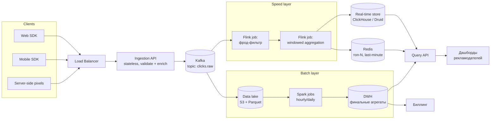
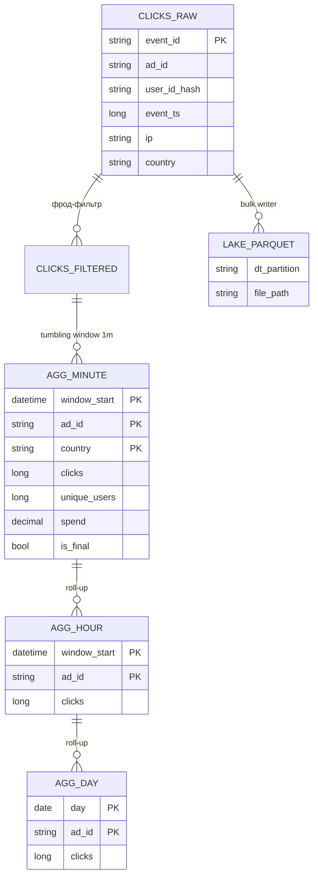
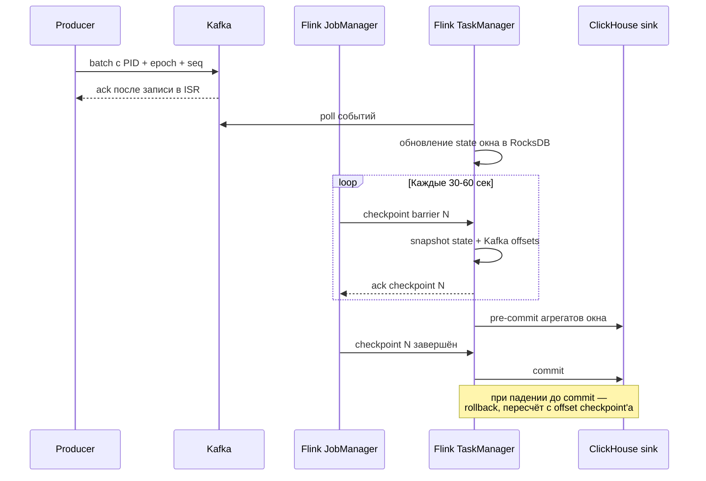
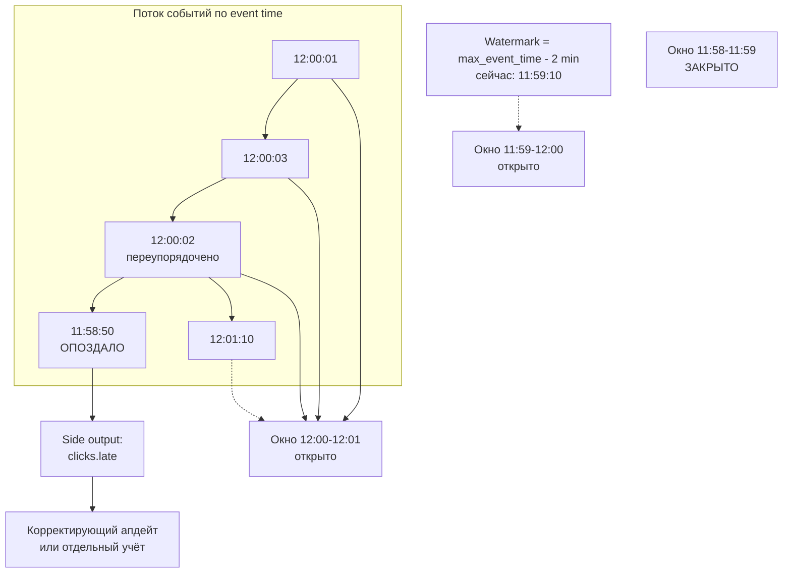
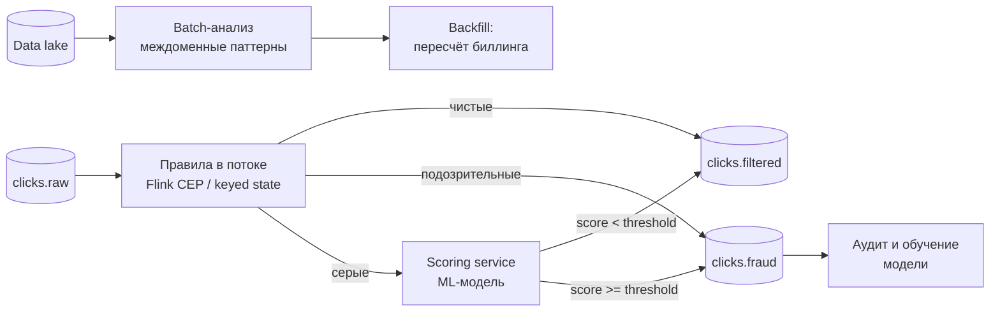
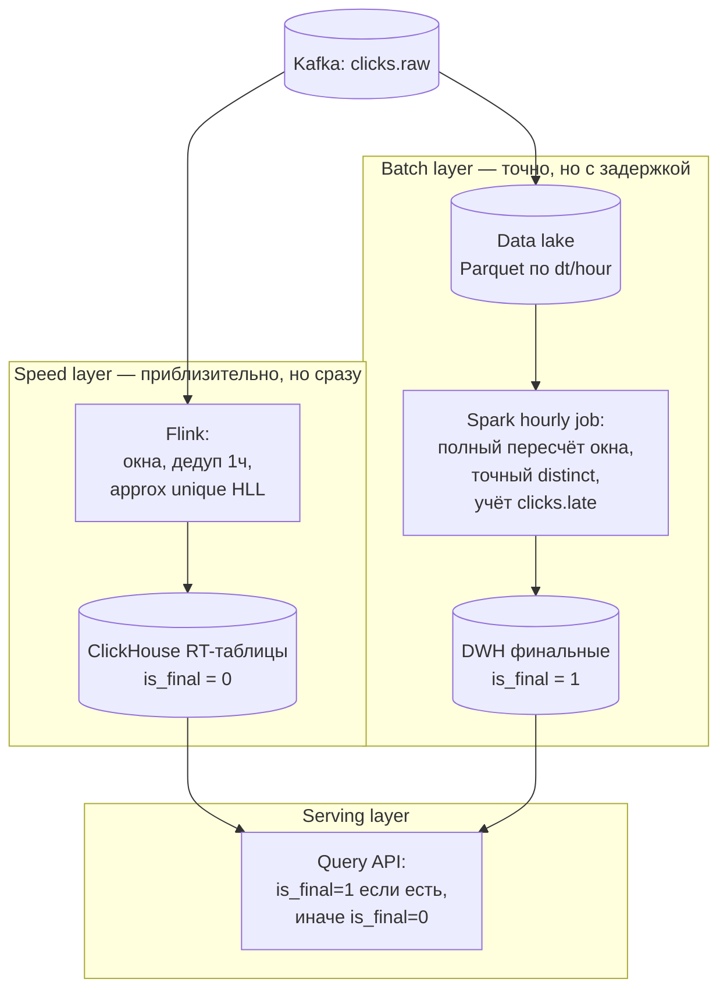

# Разбор задачи: агрегация рекламных кликов

> Классическая задача из «System Design Interview Vol. 2» (Alex Xu, глава Ad Click Event Aggregation), регулярно всплывает на собеседованиях в рекламных компаниях (Google, Meta, Яндекс, Avito, Ozon) и у data-инженеров. Проверяет умение работать с высоким write-throughput, потоковой обработкой, exactly-once семантикой и временными окнами.

Формулировка, которую вы услышите:

> «Спроектируй систему, которая собирает события кликов по рекламным объявлениям и позволяет рекламодателям смотреть агрегированные отчёты: сколько кликов получило объявление за последнюю минуту / час / день, топ-N объявлений, фильтры по стране и кампании».

Это задача про **data pipeline**, а не про сервис с REST API. Интервьюер хочет увидеть: Kafka, stream processing, работу с event time, оконные агрегации и честный разговор про дубликаты и опоздавшие события.

---

## 1. Уточняющие вопросы

Прежде чем рисовать, зафиксируйте рамки. В разборе главы про платежи из Vol. 2 Gergely Orosz подчёркивает: список вопросов из книги хорош для «generic-кандидата», но сильный кандидат спрашивает про то, что в реальном мире нельзя оставить за скобками — SLA, латентность по каждому флоу и фрод. Для кликов это напрямую применимо.

**Про данные и нагрузку:**

- Какой объём: сколько показов и кликов в день? Какой CTR (обычно 0.5–2%)?
- Какой размер события клика и что в нём есть (ad_id, user_id, timestamp, ip, user-agent, geo)?
- Нужны ли сырые события или только агрегаты? Сколько храним?

**Про отчёты (это определяет архитектуру):**

- Какие агрегации: count по ad_id? unique users? сумма spend? Группировки: по минутам/часам/дням, по стране, кампании, площадке?
- **Какая допустимая свежесть данных для каждого сценария?** Это ключевой вопрос. На собеседовании в Microsoft по проектированию систем обработки данных интервьюер сразу давил на это: «какая латентность нужна для каждого use case — им нужны самые свежие данные или нет?» От ответа зависит, нужен ли real-time в принципе.
- Кто читает отчёты: внешние рекламодатели (тысячи RPS на дашборды) или внутренние аналитики (десятки ad-hoc запросов)?

**Про корректность:**

- Клики — это деньги. Нужна ли точность «ровно один раз» или допустима погрешность ~1%?
- Фрод: фильтруем ли ботов и клик-фермы? В scope или out of scope? **В реальном мире фрод — всегда в scope, его нельзя «оставить валяться»** — но на собеседовании явно проговорите границы.
- Что делать с событиями, пришедшими с опозданием (мобильный клиент был офлайн)?

**Про эксплуатацию:**

- Нужен ли пересчёт (reprocessing) исторических данных, если поменялась логика агрегации или нашли фрод задним числом?

---

## 2. Требования

### Functional

1. Принимать события кликов от трекеров (web/mobile SDK, серверные пиксели) — сотни тысяч событий в секунду в пике.
2. Агрегировать клики по `ad_id` в минутных окнах (и производных: час, день).
3. Отдавать через API: клики по объявлению за интервал, топ-N объявлений за окно, группировку по geo/кампании.
4. Фильтровать фродовые клики до включения их в агрегаты (или помечать и исключать из биллинга).
5. Отдавать корректные финальные числа за прошедшие периоды (для биллинга), даже если события пришли с опозданием.

### Non-functional

| Требование | Цель | Почему |
|---|---|---|
| Write throughput | ~100k событий/сек в пике | Write-heavy система, чтения на порядки меньше |
| Латентность приёма события | < 10 мс на ACK | Трекер не должен блокировать страницу пользователя |
| Свежесть real-time отчёта | < 1–2 мин | Рекламодатель видит «пульс» кампании |
| Корректность финальных чисел | точно (для биллинга), без дублей | Деньги |
| Доступность | 99.9%+ на приём событий | Потерянный клик = потерянные деньги |
| Durability | Ноль потерь принятых событий | Replication + durable log |

Важная рамка, которую стоит озвучить интервьюеру прямо: **по умолчанию проектируем at-least-once доставку и добиваемся exactly-once эффекта на уровне агрегации (идемпотентность + дедупликация), а не магии «из коробки»**. В разборе дизайна Kafka это названо явно: «guarantee at least once by default, mention exactly once at the end — большинство интервьюеров просто хотят видеть, что вы понимаете, почему ваша система по умолчанию at-least-once».

---

## 3. Оценки нагрузки (back-of-envelope)

Считайте вслух, округляйте агрессивно — интервьюеру важен порядок величин и что вы умеете выводить одно из другого.

**Вход:**

- 1 млрд показов рекламы в день (крупная рекламная сеть уровня Яндекса/Avito — меньше, Google — на 2 порядка больше, сойдёмся на 1 млрд кликов/день для интересной задачи).
- CTR ~1% → **1 млрд кликов/день**.

**RPS:**

- Среднее: `10^9 / 86 400 ≈ 12 000 событий/сек`.
- Пик (×3 днём, рекламные кампании, ЧП): **~35–40k событий/сек**. Закладываем запас — проектируем под 100k/сек.

**Трафик и хранение сырых событий:**

- Событие клика (ad_id, campaign_id, user_id, ts, ip, ua, geo, price): ~0.5–1 KB в JSON, ~200–300 байт в Avro/Protobuf.
- Средний вход: `12 000 × 1 KB ≈ 12 MB/s`, пик ~40 MB/s — тривиально для Kafka-кластера из 3–5 брокеров.
- Сырые события в день: `10^9 × 1 KB ≈ 1 TB/день`. В сжатом columnar (Parquet, ClickHouse) — в 5–10 раз меньше: **~100–200 GB/день**, ~5 TB/месяц.
- Из реального опыта больших компаний (разбор от ex-Google SWE): события кодируют в Protobuf/Avro — это даёт выигрыш и на сети, и на диске, «в Google protobuf используется буквально для всего».

**Кардинальность агрегатов (это важнее, чем сырой объём):**

- 10 млн активных объявлений × 1440 минутных окон в день = **14.4 млрд строк агрегатов/день**, если писать строку на каждое окно. Строка `(ad_id, window_start, count, spend)` ~50 байт → ~700 GB/день. Многовато — поэтому:
  - пишем агрегат только для окон, где были клики (sparse),
  - минутные агрегаты храним неделями, дальше — часовые/дневные roll-up'ы (downsampling, как делают time-series БД).

**Вывод из оценок, который стоит озвучить:** запись доминирует над чтением на 3–4 порядка, дешёвое хранение сырых событий обязательно (data lake), а основная сложность — не объёмы, а **корректность подсчёта в потоке** (дедупликация, опоздания, горячие ключи).

---

## 4. API

Два разных интерфейса: приём событий (высоконагруженный, тонкий) и отчёты (чтение).

### Ingestion

```
POST /v1/events/click
{
  "event_id": "01J4Z...ULID",
  "ad_id": "ad_8392",
  "campaign_id": "camp_11",
  "user_id_hash": "9f2ab...",
  "timestamp": 1738502400123,
  "ip": "203.0.113.7",
  "user_agent": "...",
  "country": "DE",
  "price_cpc": 0.42
}
→ 204 No Content   (или 202 Accepted)
```

- Ответ `204` без тела — экономим байты и время; трекер шлёт и забывает (fire-and-forget), доставку обеспечивает батчинг на клиенте + наша durable-запись в Kafka.
- `event_id` генерируется на клиенте (ULID/UUID) — это ключ дедупликации на всём пути.
- На собеседовании упомяните, что high-throughput ingestion обычно идёт по оптимизированному бинарному протоколу поверх TCP (так устроены клиенты Kafka), а JSON/HTTP — компромисс для простоты интеграции.

### Отчёты

```
GET /v1/ads/{ad_id}/clicks?from=...&to=...&granularity=minute|hour|day
→ { "ad_id": "ad_8392", "granularity": "hour",
    "points": [{"ts": ..., "clicks": 1523, "unique_users": 1180, "spend": 512.30}] }

GET /v1/ads/top?window=15m&country=DE&limit=10
→ { "window_start": ..., "items": [{"ad_id": "...", "clicks": 91231}, ...] }
```

---

## 5. High-level design



Ключевые решения, которые нужно проговорить, пока рисуете:

- **Ingestion API — stateless и тупой**: валидация схемы, присвоение server timestamp, запись в Kafka. Вся логика — после durable-записи. Не делаем синхронных вызовов наружу: на высоких RPS любой синхронный хвост (БД, фрод-сервис) убьёт латентность и доступность.
- **Kafka — единственная точка входа**: durable log, буфер на пики, развязка producer/consumer, возможность replay. Это стандартный выбор для clickstream, и на собеседовании его нужно обосновать против RabbitMQ: нам нужен replay лога и порядок внутри партиции, а не per-message ack.
- **Два потребителя одного топика**: Flink (real-time агрегация) и writer в data lake (сырые события в Parquet). Независимые consumer group — независимые offset'ы.
- **Speed layer для «пульса», batch layer для истины** — подробнее в разделе про lambda-архитектуру.

---

## 6. Модель данных

### Kafka-топики

| Топик | Ключ партиции | Retention | Назначение |
|---|---|---|---|
| `clicks.raw` | `ad_id` | 7–30 дней | Сырые события после ingestion |
| `clicks.filtered` | `ad_id` | 7 дней | События, прошедшие фрод-фильтр |
| `clicks.fraud` | `ad_id` | 90 дней | Отброшенные события (аудит, обучение моделей) |
| `clicks.late` | `ad_id` | 30 дней | Опоздавшие за allowed lateness (side output) |
| `clicks.dlq` | — | ∞ | Битые сообщения, ручной разбор |

Про retention не забудьте trade-off: если нужно уметь переигрывать события через месяцы (смена логики агрегации), retention увеличивают — но обязательно проговорите цену: больше диска и потенциальное влияние на производительность. Обычно дёшево решается тем, что долгоживущая копия лежит в data lake, а в Kafka держат недели.

### Схема агрегатов (ClickHouse, real-time + финальные)

```sql
CREATE TABLE clicks_agg_minute (
    window_start DateTime,
    ad_id        String,
    campaign_id  String,
    country      LowCardinality(String),
    clicks       UInt64,
    unique_users UInt64,          -- HyperLogLog, приближённо
    spend        Decimal(18, 4),
    is_final     UInt8            -- 0 = speed layer, 1 = подтверждено batch
)
ENGINE = SummingMergeTree
PARTITION BY toYYYYMMDD(window_start)
ORDER BY (ad_id, window_start, country);
```



Замечания:

- `SummingMergeTree` (или аналог: Druid rollup) складывает дублирующиеся строки одного ключа — естественная модель для счётчиков.
- `is_final` — маркер слоя: real-time строки позже перезаписываются финальными из batch. Это и есть механика lambda-архитектуры на уровне данных.
- Unique users за окно точно не считают — используют **HyperLogLog** (ошибка ~1–2% при килобайтах состояния). Об этом обязательно спросят.

---

## 7. Deep dive 1: high-throughput ingestion через Kafka

### Почему Kafka выдерживает

- **Партиционирование — первый пункт разговора о производительности.** В русскоязычном разборе «Kafka для собеседований» это сформулировано прямо: обсуждение стратегии распределения по партициям почти всегда должно быть первым, с чего вы начинаете разговор о производительности Kafka. Цель — максимальный параллелизм и равномерная нагрузка на брокеры.
- У нас: ключ = `ad_id` → все события одного объявления в одной партиции → **порядок кликов по объявлению гарантирован** и windowed-агрегация по ключу локальна для одного consumer'а. Но смотри раздел про горячие ключи — это палка о двух концах.
- **Батчинг на producer'е**: накапливаем сообщения до `batch.size` или `linger.ms`, шлём одним запросом; плюс сжатие (snappy/lz4). Меньше запросов + меньше байт = выше throughput. Стандартная пара «батчинг + сжатие» — это то, что интервьюер ждёт услышать.
- `acks=all` + `min.insync.replicas=2` + replication factor 3: баланс между durability и латентностью ACK.
- Числа для оценки: партиция Kafka отдаёт десятки MB/s; наш пик 40 MB/s укладывается в 20–30 партиций с огромным запасом. Партиций делаем 100+ — с прицелом на параллелизм consumer'ов.

### Надёжность пути «клиент → Kafka»

- **Retries на producer'е обязательно с idempotent producer** (`enable.idempotence=true`): при сетевом таймауте producer не знает, дошло ли сообщение, и ретрай без идемпотентности даст дубликат. Idempotent producer добавляет PID + sequence number, брокер отбрасывает повторы.
- Но idempotent producer работает только внутри одной сессии producer → **дедупликация по `event_id` всё равно нужна end-to-end** (клиент может переслать событие после рестарта — классика мобильных SDK).
- Битые сообщения → `clicks.dlq` (dead letter queue как отдельный топик), туда же — после N ретраев обработки. DLQ никто автоматически не обрабатывает: сообщения лежат, пока инженер не разберётся, почему они падают.

---

## 8. Deep dive 2: exactly-once агрегация

Самая горячая тема этого кейса. Тезис для интервьюера: **«Exactly-once delivery в распределённых системах не существует, существует exactly-once processing — эффект ровно одного учёта события в результате, достигаемый идемпотентностью и транзакционными commit'ами»**.

Три места, где рождаются дубликаты:

1. Клиент/producer ретраит запись в Kafka → решается idempotent producer + дедупликацией по `event_id`.
2. Consumer падает после обработки, но до commit offset → после рестарта перечитает сообщения → **at-least-once по определению**. Отсюда правило: offset коммитим только после завершения логического блока работы, и обработка должна быть идемпотентной.
3. Flink пишет агрегаты в sink, а потом падает до checkpoint → при восстановлении пересчитает и запишет повторно.

### Как Flink добивается end-to-end exactly-once



Механика, которую нужно уметь объяснить:

- **State в RocksDB + checkpoints в объектное хранилище.** Flink держит локальное состояние окон в RocksDB (state backend), периодически снапшотит его вместе с Kafka offsets. При падении: восстанавливает state из последнего checkpoint'а, отматывает offsets и пересчитывает. События внутри checkpoint-интервала обрабатываются повторно — но идемпотентный sink это поглощает.
- **Важная оговорка, которая звучит зрело:** «Flink — не база данных». Состояние в RocksDB нужно для вычислений, но наружу его не отдают — результаты обязаны лежать в нормальном хранилище (ClickHouse/Druid), откуда их читают API и дашборды.
- **Идемпотентный sink**: upsert по `(ad_id, window_start, country)` вместо append. Повторная запись того же окна просто перезаписывает значение. Двухфазный commit (TwoPhaseCommitSinkFunction) нужен, когда sink не умеет идемпотентный upsert.
- **Дедупликация по `event_id`** в Flink: bloom-фильтр или RocksDB-set последних N часов event_id (полная дедупликация за сутки дорога: 1 млрд ID/день — десятки GB состояния; на практике дедуплицируют в окне 10–60 минут, этого покрывает клиентские ретраи).

---

## 9. Deep dive 3: late events и watermarks

### Event time vs processing time

Клик случился на телефоне в метро в 12:00:01, а дошёл до нас в 12:07 (офлайн, ретраи SDK). Если агрегировать по processing time — событие попадёт не в то окно, и поминутные отчёты будут врать. Поэтому окна строим по **event time**, а «время идёт» для движка через **watermarks**.

**Watermark** = утверждение «события с event time < T больше не придут (почти наверняка)». Окно закрывается, когда watermark прошёл его конец.



### Политика опозданий — проговорите числа

- **Watermark delay**: типично 1–5 минут для clickstream (баланс: больше задержка — позже закрываются окна и выше латентность отчётов; меньше — больше опоздавших мимо окна).
- **Allowed lateness**: окно держим открытым ещё, скажем, 10 минут — опоздавшее событие триггерит **обновление** агрегата (retract + новое значение). Real-time числа «дозревают».
- **За пределами allowed lateness** — side output в `clicks.late`: не выбрасываем (это деньги!), а учитываем в batch-слое при финальном пересчёте.
- **Финализация**: окно считается окончательным, когда его пересчитал batch-пайплайн по сырым данным из data lake — там опозданий не бывает, потому что считаем, когда всё уже доехало.

### Виды окон — знайте разницу, спросят

| Окно | Определение | Как считать | Где нужно в нашем кейсе |
|---|---|---|---|
| Tumbling | Фикс. длина, не пересекаются: 12:00–12:01, 12:01–12:02 | Событие → ровно одно окно | Базовые поминутные агрегаты, roll-up в часы/дни |
| Hopping | Фикс. длина, шаг < длины: 5 мин каждую минуту | Агрегация нескольких tumbling-окон (5 минутных → один hopping) | «Клики за последние 15 минут» на дашборде |
| Sliding | Фикс. длина, произвольное начало (по каждому событию) | Список/дек в памяти: добавляем в хвост, выкидываем протухшее из головы | Фрод-правила: «> N кликов с одного IP за скользящие 10 минут» |

Практический приём из разборов по stream processing: **hopping-окна не считают напрямую — строят из мелких tumbling**, это дешевле по состоянию и естественно ложится на roll-up архитектуру хранения.

---

## 10. Deep dive 4: фрод-детекция

Клик-фрод — прямые убытки: рекламодатель платит за клики ботов. На собеседовании минимум — явно спросить «фрод в scope или нет», максимум — показать внятную многослойную схему:



Три слоя, от дешёвого к дорогому:

1. **Stateless-эвристики на ingestion** (бесплатно): невалидный user-agent, IP из датацентровых диапазонов, отсутствие обязательных полей.
2. **Stateful-правила в потоке** (Flink, keyed state по `user_id`/`ip`): sliding window «больше X кликов за Y минут с одного IP», «клик без предшествующего показа», «интервал между кликами < 100 мс». Это те же скользящие окна, что и выше, — красиво, когда кандидат связывает механизмы.
3. **ML-scoring** асинхронно: признаки (частоты, паттерны устройства, поведение сессии) → модель → score. Подозрительные не выбрасываем, а помечаем: в real-time дашборде можно показывать «включая неотфильтрованные», в биллинг идут только чистые.

Критически важный пункт, который отличает зрелый ответ: **фрод-детекция совершенствуется задним числом**. Batch-анализ по данным из data lake находит новые паттерны (клик-фермы, координированные кампании) → помечаем события за прошлые даты → **пересчёт агрегатов и chargeback рекламодателю**. Это возможно только потому, что сырые события сохранены — ещё один аргумент за data lake, который стоит озвучить.

---

## 11. Deep dive 5: real-time + batch отчёты (lambda-архитектура)

Требования конфликтуют: «свежесть < минуты» и «финальные числа точны». Одним пайплайном это решается плохо: потоковый считает быстро, но с оговорками (опоздания, дедупликация в ограниченном окне, сбои); точность даёт только пересчёт по полным данным. Отсюда **lambda-архитектура**:



Механика чтения: Query API отдаёт финальные строки там, где они уже есть, и real-time строки для «ещё живых» окон. Рекламодатель видит непрерывный график: слева точная история, справа — свежий приблизительный хвост, который «дозреет» в течение часа.

Альтернатива — **kappa-архитектура** (только поток, пересчёт через replay Kafka): проще эксплуатация (один код), но replay месяца событий через потоковый движок дорог и медлен, а точный distinct в потоке невозможен. Честный trade-off, который стоит назвать самому.

Из разбора собеседования в Microsoft по data processing: интервьюер там советовал начинать с **batch-пайплайна как базы** и добавлять real-time как комплементарный сервис для тех use case'ов, где действительно нужна свежесть, — и сразу спрашивал про **incremental load** (не перезагружать всё: полный reload истории неподъёмно дорог). Это хорошая последовательность и для вашего ответа: сначала «истина» в batch, потом скорость.

### Почему хранилища именно такие

- **ClickHouse / Druid / Pinot** для агрегатов: колоночное хранение, агрегации по миллионам строк за миллисекунды, дешёвый roll-up. Из разбора distributed metrics: column-oriented формат даёт локальность чтения одной колонки + сжатие (dictionary/bitmap encoding в Parquet) — метрики похожи друг на друга и жмутся в разы.
- **S3 + Parquet — data lake** для сырья: дёшево, схема не обязательна на входе, дальше Spark перегоняет в DWH. Замечание из того же разбора: S3 — это «дешёвое место, куда сваливаем всё», обработка идёт отдельным compute (Spark/Hadoop-кластер).
- **Time-series подход к retention**: минутные агрегаты — 2 недели, часовые — год, дневные — вечно; старое сырьё — в архивный класс хранения (Glacier-аналог) или subsampling. Удаление старых данных в TSDB дёшево, потому что данные сегментированы по времени — удалили целый сегмент/индекс, а не ставим tombstone и не ждём compaction, как в LSM.
- Кэш поверх всего: топовые кампании смотрят часто → Redis для «топ-N за 15 минут» и последних окон.

---

## 12. Trade-offs — сводная таблица

| Решение | Выбрали | Альтернатива | Цена выбора |
|---|---|---|---|
| Приём событий | Kafka | RabbitMQ / SQS / HTTP→БД | Сложнее эксплуатация; нет per-message ack — DLQ делаем руками через топики |
| Партиционирование | По `ad_id` | Round-robin | Горячие партиции на мега-кампаниях (см. ниже) |
| Stream engine | Flink (true streaming, state, event time) | Spark Structured Streaming (micro-batch) | Flink сложнее в эксплуатации; Spark проще, но латентность выше — мини-батчи зато дают меньше сетевого overhead на запись в sink |
| Доставка | At-least-once + идемпотентный sink | «Exactly-once из коробки» | Нужна дисциплина: upsert по ключу окна, дедуп по event_id |
| Окна | Event time + watermarks | Processing time | Сложнее, задержка на watermark delay |
| Отчёты | Lambda (speed + batch) | Kappa (только поток) | Два пайплайна, согласование результатов |
| Уникальные пользователи | HyperLogLog (~1–2% ошибки) | Точный distinct | HLL не даёт точных чисел для биллинга |
| Сырые события | Храним всё в data lake | Только агрегаты | Терабайты в день, стоимость хранения |

### Отдельно: горячие ключи

Одна кампания-мегалонч (Super Bowl, распродажа) может дать значительную долю всех кликов → её партиция и её consumer перегружены, остальные простаивают. Приёмы:

- **Salting**: ключ `ad_id + (event_id % 16)` → 16 подключей, агрегация в два этапа (по подключу, потом merge). Цена — усложнение и потеря строгого порядка по объявлению (он нам и не нужен для count).
- **Двухэтапная агрегация**: local pre-aggregation на consumer'е (map-side combine) → итоговый merge по ключу — резко снижает и сетевой shuffle, и влияние перекоса.
- На собеседовании достаточно показать, что вы видите проблему: «ключ ad_id даёт порядок и локальность, но уязвим к перекосу; если интервьюера интересует, расскажу про salting и combine».

---

## 13. Что спросят дополнительно

- **«Как пересчитать агрегаты за прошлый месяц, если поменялась логика?»** — сырые события в data lake + versioned Spark job + новая таблица/партиции; Kafka retention на это не рассчитан, и это надо сказать прямо.
- **«Что если ClickHouse упал?»** — Flink держит события в offsets (не коммитит), накапливает; после восстановления догоняет. Kafka — буфер. Real-time дашборд деградирует, batch — нет.
- **«Как считать топ-N в реальном времени?»** — per-partition top-K в Flink + merge в Redis (approximate top-K / count-min sketch для heavy hitters).
- **«Как обеспечить ровно один списание денег с рекламодателя?»** — биллинг только по финальным (`is_final=1`) агрегатам, сверка (reconciliation) с логами PSP/банка — аналогия с платёжными системами, где reconciliation выносится в отдельный deep dive именно потому, что на нём теряют деньги.
- **«A/B-тесты рекламных кампаний?»** — добавить `experiment_id` в событие и в ключ агрегации.
- **«GDPR / удаление пользователя?»** — `user_id_hash` с солью, ротация соли; удаление → новая соль, старые хэши не восстановить.
- **«Как тестировать такой пайплайн?»** — replay продового топика в staging-кластер, сравнение speed vs batch агрегатов (data quality мониторинг), алерты на расхождение > порога.

---

## 14. Красные флаги / типичные ошибки

- **Писать клики сразу в БД** (PostgreSQL/MySQL) на ingestion-пути: 35k+ inserts/sec с индексами — мгновенный потолок, плюс потеря событий при деградации БД. Правильный рефлекс: сначала durable log, потом всё остальное.
- **Обещать exactly-once «потому что Kafka умеет»**: Kafka-овский exactly-once работает внутри связки Kafka→Kafka; как только появился внешний sink — нужна идемпотентность или 2PC. Неосознанное «у нас exactly-once» — красный флаг.
- **Игнорировать event time**: агрегировать по времени прихода — значит врать в отчётах на всех мобильных пользователях.
- **Считать уникальных пользователей точно** в потоке — состояние взорвётся; не знать про HLL — заметный минус.
- **Не спросить про фрод и SLA свежести** — интервьюеры специально ждут, в scope это или нет; молчание читается как «не строил реальные системы».
- **Нарисовать один пайплайн для всего** и не обсудить конфликт «свежесть vs точность» — сигнал, что кандидат не видел, как это ломается в жизни.
- **Забыть про стоимость**: хранить всё навсегда в горячем хранилище, не упомянуть roll-up/archival — частый вопрос «а как режете costs на старых данных».

---

## 15. Что говорить интервьюеру — шпаргалка формулировок

- «Прежде чем рисовать, зафиксирую: какая свежесть нужна для каждого типа отчёта и считаем ли мы фрод в scope — от этого зависит половина архитектуры».
- «Система write-heavy: десятки тысяч записей в секунду против сотен чтений — поэтому ingestion максимально тонкий, вся работа асинхронна после durable-записи в Kafka».
- «По умолчанию у меня at-least-once; exactly-once я получаю как эффект — идемпотентный producer, дедупликация по event_id и upsert агрегатов по ключу окна».
- «Окна считаю по event time, watermark — 2 минуты, allowed lateness — 10 минут с корректирующими апдейтами, остальное — в side output и доучтёт batch».
- «Real-time слой отвечает за пульс кампании, batch слой — за истину и деньги; финальные числа для биллинга приходят только из пересчёта по сырым данным».
- «Фрод фильтруем слоями: дешёвые эвристики в потоке, ML-scoring асинхронно, а backfill по data lake позволяет пересчитать биллинг, когда найдём новый паттерн задним числом».
- «Если интересует узкое место, могу копнуть: горячие ключи партиций, exactly-once в Flink через checkpoints и 2PC, или устройство serving-слоя для lambda».

---

## Источники и видео по теме

- [Kafka для собеседований по System Design](https://www.youtube.com/watch?v=lDRx5dqQltA)
- [Распределенная очередь сообщений (Kafka): системный дизайн на собеседовании (офферы от Stripe и Amazon)](https://www.youtube.com/watch?v=Qay43Km1NwY)
- [Distributed Metrics/Logging Design Deep Dive with Google SWE! / Systems Design Interview Question 14](https://www.youtube.com/watch?v=_KoiMoZZ3C8)
- [14: Distributed Logging & Metrics Framework / Systems Design Interview Questions With Ex-Google SWE](https://www.youtube.com/watch?v=p_q-n09B8KA)
- [Systems Design Interview: Volume 2 Review and Payments Chapter Deepdive](https://www.youtube.com/watch?v=KjCjVytZFq8)
- [Собеседование по проектированию систем обработки данных в Microsoft / Surfalytics](https://www.youtube.com/watch?v=IWzmJPwcBSU)
