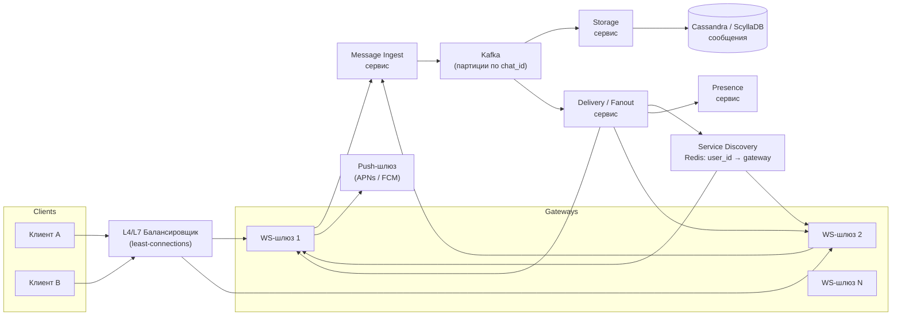
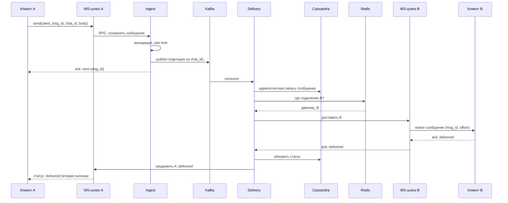
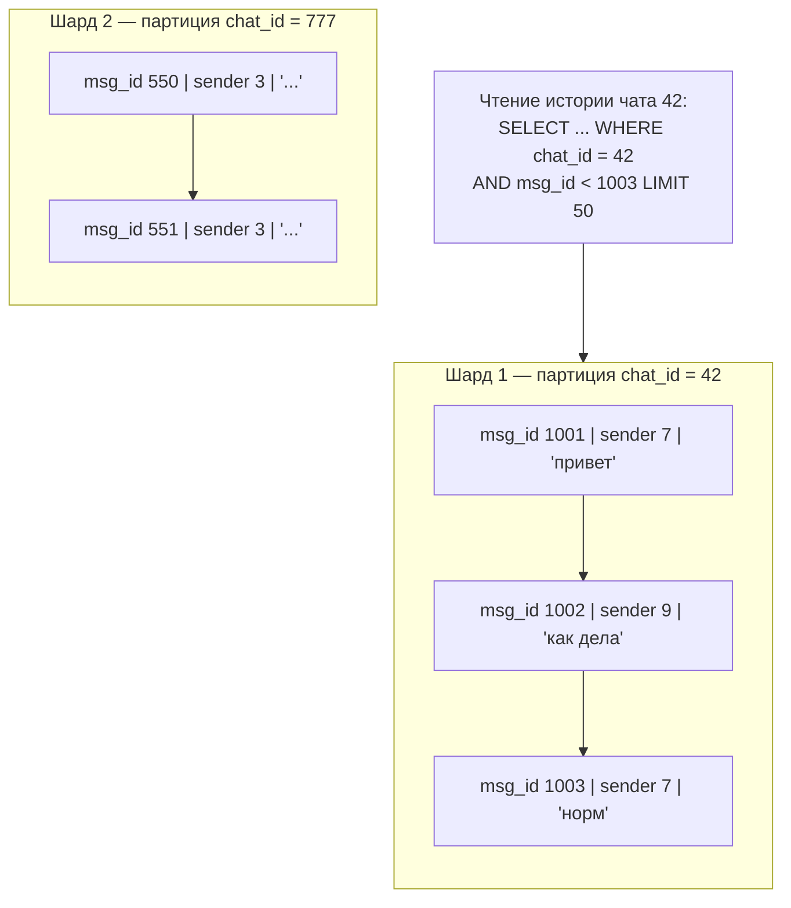
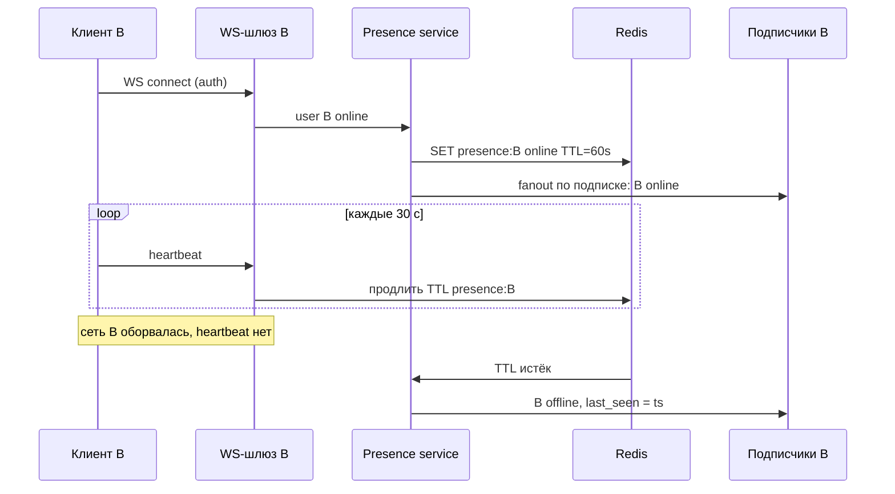
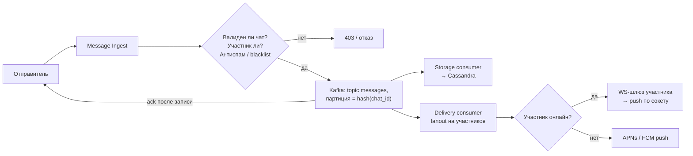

# Разбор задачи: мессенджер (WhatsApp / Telegram)

Мессенджер — одна из самых частых задач на System Design интервью (Meta, Google, Amazon, Яндекс, Авито). Она проверяет сразу несколько компетенций, которых нет в «обычных» CRUD-задачах:

- **stateful-сервисы** — WebSocket-шлюзы держат миллионы живых соединений, и это не stateless API, который можно просто поставить за round-robin балансером;
- **гарантии доставки** — ack'и, ретраи, идемпотентность, at-least-once семантика;
- **асимметричная нагрузка** — write-heavy поток сообщений против read-heavy истории чатов;
- **fanout** — одно сообщение в групповом чате превращается в N доставок.

Из мок-интервью с бывшим EM Google и ex-Meta Senior Manager видно: интервьюер специально оставляет формулировку расплывчатой («design WhatsApp») и смотрит, как кандидат сам сузит scope, посчитает нагрузку и выберет, куда копать. Ниже — полный разбор по структуре реального собеседования.

---

## Уточняющие вопросы

Первые 5 минут — сузить задачу. Сильный кандидат не начинает рисовать архитектуру, пока не зафиксировал scope. Что спросить:

- **Что за чаты?** Только 1:1 или групповые тоже? Если групповые — какой максимальный размер группы (500 как в WhatsApp или 200 000 как в Telegram-каналах — это принципиально разные задачи fanout)?
- **Какие типы сообщений?** Только текст или медиа (фото/видео/файлы)? Медиа меняет хранилище (blob storage + pre-signed URL), но не меняет ядро — часто договариваются «текст, медиа — если останется время».
- **Нужны ли статусы доставки/прочтения** («две галочки»)?
- **Нужен ли online presence** (зелёный кружок, «был(а) недавно», last seen)?
- **Мульти-девайс?** Один пользователь с телефона и ноутбука — это влияет на модель доставки (доставлять в N устройств, а не в одно соединение).
- **E2E-шифрование?** На System Design это почти всегда «упомянуть за 2 минуты в конце», а не проектировать.
- **Какой масштаб?** DAU, сообщений в день, рост за год. В одном из моков интервьюер дал конкретику: 10 млрд сообщений в день с удвоением за год — и сразу стало ясно, что нужно горизонтальное масштабирование всего.

> Приём из мок-интервью: кандидат сам предложил «давайте выкинем группы из scope ради времени, вернёмся в конце». Интервьюер это зафиксировал как плюс: сначала рабочее решение для узкого scope, потом расширение. Попытка спроектировать «всё и сразу» — типичная причина, почему кандидат не доходит до deep dive.

## Требования

### Functional

1. Отправка и получение сообщений 1:1.
2. Групповые чаты (до ~500–1000 участников).
3. Доставка в реальном времени, если получатель онлайн; надёжное хранение, если офлайн.
4. Статусы сообщений: отправлено / доставлено / прочитано.
5. Online presence (онлайн/офлайн, last seen).
6. История сообщений с пагинацией (скролл вверх).

### Non-functional

- **Низкая задержка**: доставка онлайн-получателю — сотни миллисекунд, причём не «в среднем», а на p95/p99. В моке кандидат специально проговорил: «цель — не средняя latency, а tail latency, среднее скроет проблемы» — это сильная формулировка.
- **Высокая доступность**: мессенджер — живой сервис, простой заметен сразу. Цель — 99.99%.
- **Eventual consistency допустима**: не страшно, если сообщение доедет до получателя на секунду-две позже ack'а отправителю. А вот отправитель после ack должен видеть своё сообщение в истории — read-your-writes для отправителя.
- **Надёжность**: сообщения не теряются (at-least-once), дубликаты допустимы — давим их идемпотентностью.
- **Масштаб**: сотни миллионов пользователей, миллионы одновременных соединений.

## Оценки нагрузки (back-of-envelope)

Считаем на пальцах, громко проговаривая допущения. Классический приём из мока: «в сутках ~100 тысяч секунд, это не точно, но для оценки достаточно».

| Величина | Расчёт | Итог |
|---|---|---|
| DAU | допущение | 500 млн |
| Сообщений в день | 500 млн × 20 сообщений | 10 млрд/день |
| Средний RPS на отправку | 10⁹ / 10⁵ с | ~100 тыс. msg/s |
| Пиковый RPS | ×4–5 от среднего | ~500 тыс. msg/s |
| Трафик на запись | 100 Б × 10¹⁰ | ~1 ТБ/день текста |
| Хранилище за 3 года | 1 ТБ × 365 × 3 | ~1 ПБ |
| Одновременных соединений | 10% DAU онлайн | ~50 млн WS-коннектов |

Выводы из оценок (озвучить интервьюеру):

- **1 ПБ за 3 года** — одна реляционная БД не справится, нужен шардинг и NoSQL с дешёвым горизонтальным ростом.
- **50 млн живых соединений** — это узкое место №1. При ~50–100 тыс. коннектов на один шлюз нужны сотни–тысячи WebSocket-серверов.
- **500 тыс. msg/s в пике** — один брокер/одна партиция не выдержит, нужно партиционирование очереди.
- Для сравнения, реальные цифры Авито (доклад про их мессенджер): 2 млн DAU, 1,5 млн запросов в минуту, **500 тыс. постоянных WebSocket-соединений в пике**, 7 тыс. сообщений в минуту. Это «средний» мессенджер — на собеседовании про WhatsApp масштаб на 2 порядка больше, но архитектурные решения те же.

## API

Не увлекаться REST-педантизмом — показать 3–4 эндпоинта и двигаться дальше:

```text
# Отправка (по WebSocket — фрейм; для справки — REST-эквивалент)
POST /v1/messages
{ "chat_id": "c123", "client_msg_id": "uuid-от-клиента",
  "type": "text", "body": "hi", "attachments": ["s3://..."] }
→ 200 { "msg_id": 18273645, "ts": 1691155200123 }

# История чата (курсорная пагинация)
GET /v1/chats/{chat_id}/messages?before_msg_id=18273600&limit=50

# Список чатов
GET /v1/chats?limit=20

# Отметка о прочтении
POST /v1/chats/{chat_id}/read { "up_to_msg_id": 18273640 }
```

Ключевые моменты, которые стоит проговорить:

- **`client_msg_id` генерирует клиент** — это ключ идемпотентности отправки. Клиент ретраит таймаут → сервер видит тот же `client_msg_id` → не создаёт дубликат. Так делает Авито: у сообщения два ID, клиентский и серверный, и оба используются как ключи дедупликации.
- Основной транспорт — не REST, а **WebSocket-фреймы** (в Авито поверх WS ходит JSON-RPC; в Telegram — собственный MTProto поверх TCP/WS). REST остаётся для «тяжёлых» и редких операций: загрузка истории, список чатов, медиа.

## High-level design



Разбор компонентов:

- **WS-шлюзы (chat/connection servers)** — stateful-слой: каждый держит 50–100 тыс. соединений. Терминирует WebSocket, аутентифицирует, держит heartbeat, проксирует RPC дальше. В Авито этот слой переписали с Node.js на Go ради плотности коннектов, а перед ним стоит nginx-балансер.
- **Message Ingest** — валидация (участник ли чата, не заблокирован ли, rate limit), запись в очередь, ack отправителю.
- **Kafka (или RabbitMQ)** — буфер и точка развязки: ingest отвечает клиенту быстро, а сохранение и доставка идут асинхронно.
- **Storage service** — консьюмер, пишет сообщения в основную БД.
- **Delivery / Fanout service** — консьюмер, рассчитывает получателей и пушит им через их шлюзы; офлайн-получателям — push-уведомление.
- **Service Discovery (Redis)** — маппинг `user_id → адрес шлюза, где живёт соединение`. На дисконнект запись удаляется; на случай падения шлюза — TTL.
- **Presence service** — онлайн-статусы (ниже, в deep dive).

Почему асинхронность — не опция, а необходимость: если рассылку по WebSocket'ам делать синхронно в запросе отправителя, то при группе в 500 человек и одном участнике на медленном 3G ответ отправителю растянется на секунды. Видео «Мессенджер на 1 млрд пользователей» разбирает эту эволюцию: сначала «сохранил в БД → синхронно разослал», потом «сохранил → ack → асинхронная рассылка через очередь». Авито пошло тем же путём: синхронно пишут только в шард отправителя (read-your-writes), отдают ack («одна галочка»), а копию получателю и нотификации делает асинхронный консьюмер через RabbitMQ.

## Sequence: отправка сообщения 1:1



Что важно проговорить по этой диаграмме:

- **Ack «отправлено» ≠ «доставлено»**. Ack отправителю уходит после надёжной записи (в очередь/БД), а не после доставки получателю — тот может быть офлайн сутками.
- **Где именно ack'ать — тонкий вопрос.** Если ack'ать после записи в Kafka, но до записи в БД, то при крахе между ними сообщение теоретически не дочитается с другого девайса. Вариант из «мессенджера на 1 млрд»: ack отправляется из консьюмера в момент рассылки, когда запись в БД уже гарантирована. Вариант Авито: ack после синхронной записи в шард отправителя. Оба честны — важно, чтобы вы осознавали семантику своего ack.
- **Повторы неизбежны**: консьюмер упал после записи в БД, но до коммита офсета → переиграет событие. Поэтому запись в БД и обработка на клиенте — идемпотентны (дедупликация по `msg_id`/`client_msg_id`). Авито формулирует это как главный принцип: «в мессенджере как можно больше операций делай идемпотентными».

## Хранение сообщений

### Выбор БД

| Критерий | Вывод |
|---|---|
| Объём | ~1 ПБ за 3 года → горизонтальный шардинг обязателен |
| Паттерн записи | write-heavy, append-only, без join'ов и транзакций |
| Паттерн чтения | «дай N сообщений чата X до курсора Y» — чтение диапазона внутри партиции |
| Доступность | критична → leaderless-репликация (Cassandra/ScyllaDB) либо managed (DynamoDB) |

Консенсус в материалах: **Cassandra (или ScyllaDB/DynamoDB)**, шардирование по `chat_id`. Реляционная БД с auto-increment и join'ами здесь не нужна: сложных запросов нет, а масштабировать петабайт на PostgreSQL дорого и больно. В моке ex-Google кандидат выбрал DynamoDB и честно назвал причину — «время инженеров дорого, managed-решение быстрее до прода; на масштабе можно пересмотреть в сторону self-hosted Cassandra из-за стоимости». Интервьюер отдельно похвалил именно проговаривание причин выбора без промпта.

### Схема данных

```sql
-- Cassandra: сообщения чата
CREATE TABLE messages_by_chat (
    chat_id    bigint,
    msg_id     bigint,      -- монотонно растёт ВНУТРИ чата
    sender_id  bigint,
    body       text,
    media_urls list<text>,
    created_at timestamp,
    PRIMARY KEY (chat_id, msg_id)
) WITH CLUSTERING ORDER BY (msg_id DESC);

-- Cassandra: inbox пользователя (для списка чатов / статусов)
CREATE TABLE inbox_by_user (
    user_id    bigint,
    chat_id    bigint,
    last_msg_id bigint,     -- курсор: что пользователь получил
    last_read_msg_id bigint,
    unread_count int,
    PRIMARY KEY (user_id, chat_id)
);
```



Ключевые решения:

- **Partition key = `chat_id`**: вся история чата — на одной машине, читаем историю одним запросом без scatter-gather. Это же решение независимо предлагается и в «мессенджере на 1 млрд», и в разборе group chat.
- **`msg_id` монотонно растёт внутри чата** → сообщения лежат на диске в хронологическом порядке, курсорная пагинация — это просто `msg_id < cursor`. Глобальный snowflake не нужен: порядок важен только внутри чата.
- **Как получить монотонный `msg_id` без лидера в БД?** Красивый трюк из «мессенджера на 1 млрд»: партиционируем Kafka по `chat_id` и **используем offset сообщения в партиции как `msg_id`**. Внутри одной партиции офсеты строго возрастают, а сообщения одного чата всегда попадают в одну партицию → инвариант сохраняется даже при масштабировании. Timestamp для этого не подходит: часы консьюмеров могут шагнуть назад после рестарта, и сообщение «уедет в прошлое».
- **Альтернативная модель — копия данных на пользователя.** Авито шардирует MongoDB по `user_id` и хранит **каждое сообщение в двух шардах** — отправителя и получателя. Плюс: чтение истории/списка чатов — всегда один шард, никакого scatter-gather; можно хранить персональные копии (удалил у себя — у собеседника осталось). Минус: ×2 объём и схема ломается о группы (копировать сообщение на 500 участников нереально — для групп нужна модель «одно сообщение + inbox-курсоры»). Это отличный пример честного trade-off: для 1:1-переписки покупатель↔продавец копии выигрывают, для групповых чатов — нет.

### Медиа

Не прогонять бинарники через чат-инфраструктуру. Из ex-Meta разбора: гонять видео на сотни мегабайт через WS-шлюзы, заточенные под килобайтные фреймы, — антипаттерн. Схема стандартная:

1. Клиент просит у API upload-URL → сервер выдаёт **pre-signed URL** на S3 с TTL.
2. Клиент грузит файл напрямую в S3 (мимо шлюзов).
3. В сообщение идёт только URL; получатель скачивает с CDN/S3 напрямую.

## Deep dive 1: WebSocket-шлюзы и connection management

Это самая «вкусная» часть для staff-level: stateful-слой нельзя масштабировать «как обычный API».

**Балансировка.** Round-robin не годится — соединения живучие и неравномерные. Балансер должен смотреть на число активных коннектов (least-connections) и направлять новый коннект на наименее загруженный шлюз.

**Маршрутизация доставки.** Получатель может быть подключён к любому из тысячи шлюзов. Нужен service discovery: при коннекте шлюз пишет в Redis `user_id → gateway_addr`, при дисконнекте — удаляет; записи с TTL на случай падения шлюза без graceful shutdown. Delivery-сервис перед рассылкой резолвит адрес получателя. Продвинутый вариант (из «1 млрд»): встроить маппинг внутрь кластера шлюзов с consistent hashing и etcd, чтобы убрать лишний round-trip в Redis и получить авто-решардинг — но это кастом, на собеседовании достаточно Redis-варианта с честным «на большом масштабе подумаем о consistent hashing».

**Reconnect storm.** Узкое место, о котором кандидаты почти не говорят, а в проде оно критично: при релоаде балансера или деплое шлюзов 500 тысяч соединений рвутся **одновременно**, и все клиенты ломятся восстановить состояние. Авито решает это горячим кэшем в шине реального времени (Redis pub/sub + инкрементальные офсеты нотификаций): клиент хранит номер последней полученной нотификации и при реконнекте догоняет пропущенное из кэша с retention ~5 минут, не трогая основную БД. Дополнительно — jitter на стороне клиента при реконнекте.

**Heartbeat.** Клиент и шлюз обмениваются ping/pong (или application-level heartbeat) каждые ~30 с: NAT и мобильные сети молча рвут «мёртвые» TCP-соединения. Отсутствие heartbeat — и presence врёт, и доставка в «полумёртвый» сокет теряется.

**Fallback.** WebSocket режется корпоративными прокси и старыми браузерами. Авито держит HTTP-long-polling fallback для ~1% клиентов — забирают пропущенные нотификации из того же горячего кэша раз в ~10 секунд.

**Масштаб цифрами (Авито):** держать per-user очереди в RabbitMQ federation на 100 тыс. коннектов стоило 70 CPU и 80 ГБ RAM и периодически разваливалось; переезд на Redis pub/sub engine дал 0,3 CPU и 1,5 ГБ на те же 100 тыс. — на два порядка эффективнее. Урок: брокер общего назначения — плохая шина для миллионов эфемерных per-user подписок.

**Троттлинг на шлюзе.** На 1,5 млн RPM аномалии не видны глазами: Авито обнаружил паразитный трафик (абьюзеры и баги в собственных клиентах) и повесил token-bucket rate limiting на шардированном Redis. На собеседовании это плюс-пункт: «на шлюзе — rate limiting, чтобы один клиент не уронил нам БД».

## Deep dive 2: доставка, ack и статусы

Три состояния сообщения и их смысл:

| Статус | Когда проставляется | Кто является источником истины |
|---|---|---|
| Отправлено (✓) | Записано надёжно на сервере (БД/очередь) | Сервер → отправителю |
| Доставлено (✓✓) | Устройство получателя прислало ack | Клиент получателя → сервер |
| Прочитано (✓✓ синие) | Получатель открыл чат, `POST /read` | Клиент получателя → сервер |

- **At-least-once + идемпотентность** — стандарт де-факто. Exactly-once в распределённой системе недостижим, поэтому: ретраи везде + дедупликация по `client_msg_id` на сервере и по `msg_id` на клиенте (клиент мержит дубликаты нотификаций и не показывает сообщение дважды).
- **Ретраи с экспоненциальным backoff'ом вынесены в брокер.** Паттерн Авито на RabbitMQ: каскад очередей с DLX (dead-letter exchange) и TTL — первая очередь ретраит через секунды, следующая через минуты и т.д., счётчик попыток в теле события. Плюс: процессы приложения не блокируются на снах между ретраями.
- **Порядок не гарантирован при ретраях** — и это надо проговорить. Авито живёт с этим (идемпотентность + сортировка на клиенте по `msg_id`); если железный порядок нужен — Kafka с партицией на чат, где порядок внутри партиции гарантирован.
- **Offline-доставка.** Получатель офлайн → сообщение уже надёжно лежит в БД, delivery-сервис отправляет push (APNs/FCM) с намёком «у вас новое сообщение», а при следующем коннекте клиент догоняет состояние по курсору `last_msg_id` (как оффсет в Kafka, только клиентский).
- **Статусы прочтения в группах** — дорогая фича: хранить per-user курсор прочитанного (`last_read_msg_id` в inbox), агрегировать «прочитали 3 из 5». Telegram подчищает эти данные со временем — хорошая деталь, чтобы показать понимание стоимости хранения.

## Deep dive 3: online presence

Обманчиво простая фича. Наивное решение — «при коннекте пишем в БД `online=true`, при дисконнекте `false`» — упирается в проблемы:

- **Нагрузка.** 50 млн коннектов/дисконнектов в день + лавины при reconnect storm. Пишем статус в Redis, а не в основную БД; last seen — периодическим флашем.
- **Fanout подписчиков.** Если на изменение статуса подписаны все контакты пользователя, один коннект-дисконнект порождает тысячи нотификаций, а при флапе соединения на мобильной сети — шторм «онлайн/офлайн». Из ex-Meta разбора: главный вопрос — как **ограничить, кто может наблюдать за presence данного пользователя** (только мои контакты, только кто сейчас смотрит экран чата со мной), и рассылать через существующий pub/sub по подписке, а не broadcast'ом всем.
- **Флаппинг.** Мобильный клиент теряет сеть каждые несколько минут → не считать пользователя офлайн мгновенно: grace period 30–60 с или «last seen recently».

Минимальная рабочая схема:



Ключевые решения: TTL вместо явного «offline»-события (шлюз может умереть, не успев отписаться), heartbeat продлевает TTL, fanout только явным подписчикам.

## Deep dive 4: групповые чаты (fanout)

Центральный trade-off задачи — **fanout on write vs fanout on read**:

| | Fanout on write | Fanout on read |
|---|---|---|
| Что делаем при отправке | Раскладываем копию сообщения в inbox каждого участника | Пишем сообщение один раз в поток чата |
| Чтение | Дёшево: один запрос в свой inbox | Дороже: склейка N потоков чатов |
| Запись | O(размер группы) записей | O(1) |
| Где хорошо | Маленькие группы (семья, рабочий чат до ~500) | Каналы Telegram на 100 тыс.+ подписчиков |
| Кто так делает | WhatsApp-подобные (inbox-модель) | Slack/Telegram-каналы (timeline-модель) |

Для интервью-варианта «группа до 500–1000 человек» рабочая схема из разбора group chat:



- **Kafka партиционируется по `chat_id`** — порядок сообщений внутри чата гарантирован, консьюмеры масштабируются consumer group'ами. Тонкость: число партиций задаётся с запасом заранее — при добавлении партиций чат может «переехать», и его сообщения окажутся в двух партициях, что ломает порядок. Вариант решения — отдельный топик на диапазон chat_id.
- **Несколько consumer group'ов на одном топике**: storage, delivery, антиспам — каждый со своим офсетом, независимы, падение delivery не мешает сохранению.
- **Идемпотентный delivery**: консьюмер упал после частичного fanout → при рестарте переиграет по офсету; дубликаты давятся по `msg_id` на шлюзе и на клиенте.
- **Иерархический fanout для гигантских групп**: если группа на 100 тыс., один delivery-инстанс не разошлёт — fanout-воркеры разбивают список участников на батчи и работают параллельно, избегая «explosive fanout» одним узлом.
- Ограничение мульти-девайса: из ex-Meta разбора — если у каждого из 100 участников по 5 устройств, fanout становится 500 записей; разумно ограничивать число активных устройств (2–3), иначе упираемся в лимиты транзакций БД.

## Кратко: E2E-шифрование

На System Design интервью это почти всегда двухминутный блок в конце — не проектировать Signal Protocol, а показать, что понимаете последствия для архитектуры:

- Клиенты обмениваются публичными ключами (сервер — key server, хранит только публичные ключи); сообщение шифруется на устройстве отправителя ключом получателя.
- Сервер хранит и доставляет **только шифротекст** — вся вышеописанная архитектура (очереди, шардинг, fanout, push) не меняется: ей безразлично содержимое `body`.
- Что реально ломается: серверный поиск по сообщениям, серверный антиспам по содержимому, модерация, превью ссылок. Это и есть честный trade-off, который стоит озвучить.
- Мульти-девайс усложняется: ключи на каждое устройство (как Signal/WhatsApp — отдельная сессия на устройство).

## Trade-offs: сводная таблица

| Решение | Вариант A | Вариант B | Что выбрать и почему |
|---|---|---|---|
| Транспорт клиента | WebSocket | Long polling | WS как основной, long polling — fallback для ~1% клиентов за корпоративными прокси |
| Шардирование сообщений | по `chat_id` | по `user_id` (копии) | `chat_id` — универсально и для групп; копии на юзера — быстрые чтения для 1:1, но ×2 объём и не работает для групп |
| Ack отправителю | после записи в БД | после записи в очередь | Быстрый ack — лучше UX, но слабее семантика; честно проговорить, что выбрали и почему |
| Fanout в группах | on write (inbox-копии) | on read (общий поток) | on write для групп до ~1 тыс., on read для каналов |
| Порядок сообщений | Kafka партиция на чат | Best-effort + сортировка на клиенте | Kafka, если железный порядок; клиентская сортировка, если строим на RabbitMQ-style ретраях |
| БД | Cassandra/ScyllaDB | DynamoDB | Cassandra — дешевле на петабайтах и leaderless; DynamoDB — быстрее внедрить, managed |
| Presence | TTL + heartbeat | явное offline-событие | TTL: явное событие теряется при крахе шлюза |

## Красные флаги / типичные ошибки кандидатов

- **Рисовать компоненты, не посчитав нагрузку.** «50 млн одновременных соединений» — это число определяет весь дизайн; кандидат, который его не вывел, выбирает решения вслепую.
- **Синхронная рассылка в запросе отправителя.** Один участник на плохой сети — и latency отправки для всех растёт на секунды. Сохранил → ack → асинхронная доставка.
- **Игнорировать statefulness шлюзов.** «Поставим за обычный round-robin» или «сервис доставки сам найдёт получателя» без service discovery — интервьюер сразу копает туда. Из ex-Meta разбора: на staff-уровне ждут именно понимания, что stateful chat-серверы — самая интересная часть задачи.
- **Exactly-once фантазии.** Говорить «обеспечим exactly-once доставку» вместо «at-least-once + идемпотентность + дедупликация по ID».
- **Хранить медиа в БД сообщений / гнать через чат-сервер.** Правильный ответ — blob storage + pre-signed URL.
- **Timestamp как message ID.** Часы консьюмеров шагают назад после рестарта — порядок ломается. Нужен монотонный источник: offset партиции, sequence-сервис, снежфлейк с оговорками.
- **Presence broadcast'ом всем контактам** без разговора об ограничении подписчиков и флаппинге.
- **Пытаться покрыть всё.** Из фидбека мок-интервью: интервьюеры специально отмечают кандидатов, которые быстро сузили scope (1:1, текст, остальное — «если останется время») и дошли до рабочего решения, а не тех, кто 40 минут перечислял фичи.

## Что спросят дополнительно

- **Как пережить падение шлюза с 100 тыс. коннектов?** (reconnect storm: jitter на клиенте, горячий кэш нотификаций для догона состояния, rate limit на коннекты).
- **Как сделать мульти-регион?** Модель «мессенджера на 1 млрд»: home region пользователя, чат привязан к региону (там генерируется `msg_id`), исходящие сообщения для чужих регионов — в outgoing-топики, между регионами — hub-регион вместо связности «все со всеми». Большинство чатов однорегиональны, поэтому hub не становится бутылочным горлышком.
- **Как реализовать «печатает...»?** Эфемерное событие через тот же WS-канал, без записи в БД, с дедупликацией по времени.
- **Как удалить сообщение «у всех»?** Tombstone-событие через тот же pipeline + TTL/компакция в Cassandra.
- **Поиск по сообщениям?** Отдельный pipeline: CDC из основной БД → Elasticsearch; с E2E — только клиентский поиск.
- **Антиспам?** Авито встроил проверку как middleware-стадию асинхронного пайплайна (до записи получателю и рассылки) с graceful degradation: сервис антиспама недоступен — сообщение доставляется без проверки.
- **Как ограничить рост таблицы недоставленного?** Разделить «доставленные/недоставленные» (как предложил кандидат в моке у ex-Google: отдельная таблица undelivered, иначе distributor сканирует петабайт) — либо избавиться от сканирования вовсе, перейдя на очередь/CDC.

## Источники и видео по теме

- [Пробное собеседование по системному проектированию: «Разработка WhatsApp или Telegram» (с бывшим EM Google)](https://www.youtube.com/watch?v=M6UZ7pVD-rQ)
- [Design Whatsapp: System Design Interview w/ a Ex-Meta Senior Manager](https://www.youtube.com/watch?v=cr6p0n0N-VA)
- [Group Chat System Design – WhatsApp, Slack, Messenger Deep Dive](https://www.youtube.com/watch?v=mhrbMPOi08E)
- [Мессенджер на 1 млрд пользователей - system design](https://www.youtube.com/watch?v=KIo9ovvMfGQ)
- [Архитектура Мессенджера Авито – путь одного сообщения / Александр Емелин (Авито)](https://www.youtube.com/watch?v=4tIS58sQ7Mc)
- [Проектирование системы WhatsApp / Проектирование системы Facebook Messenger](https://www.youtube.com/watch?v=RjQjbJ2UJDg)
