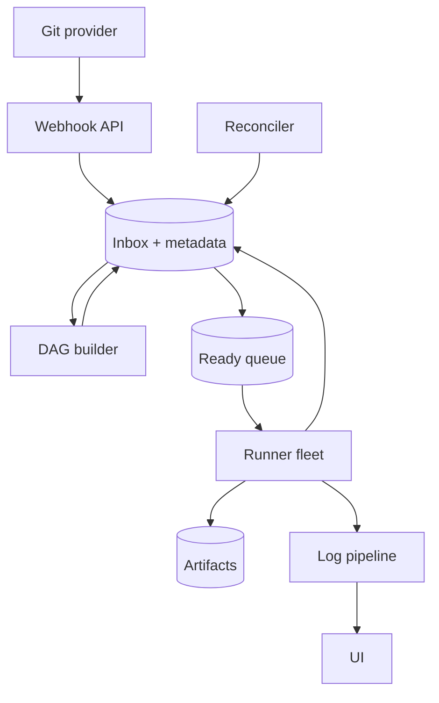
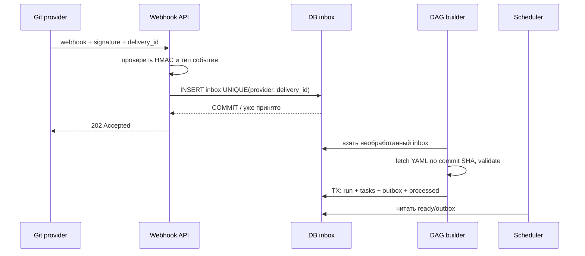
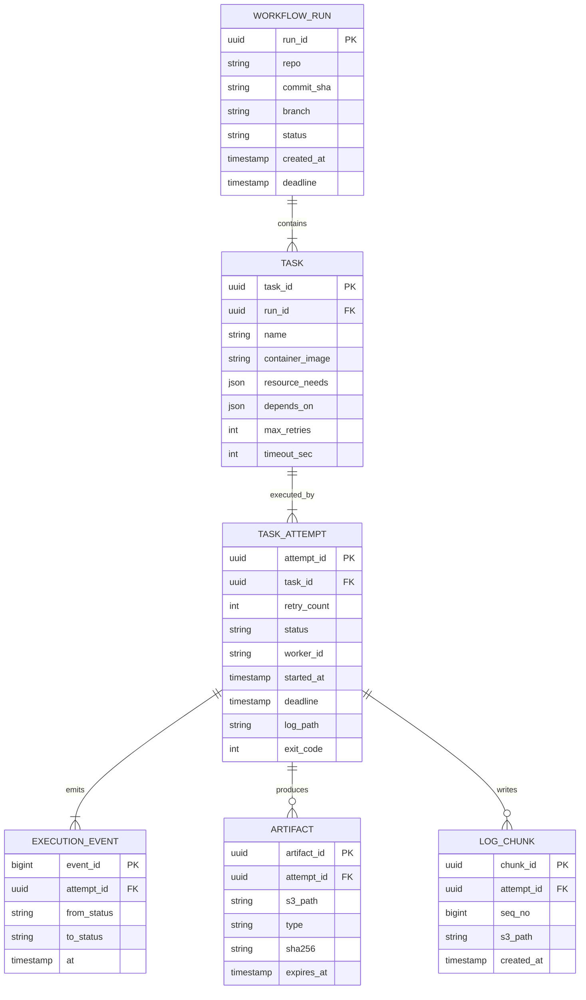
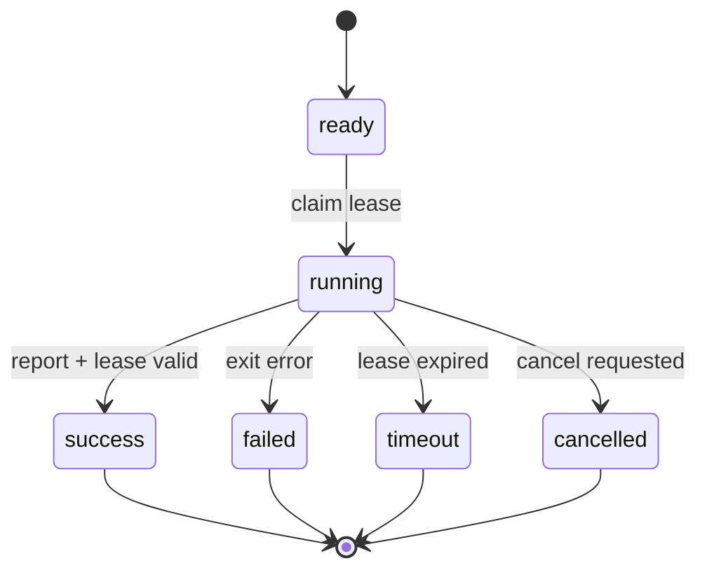
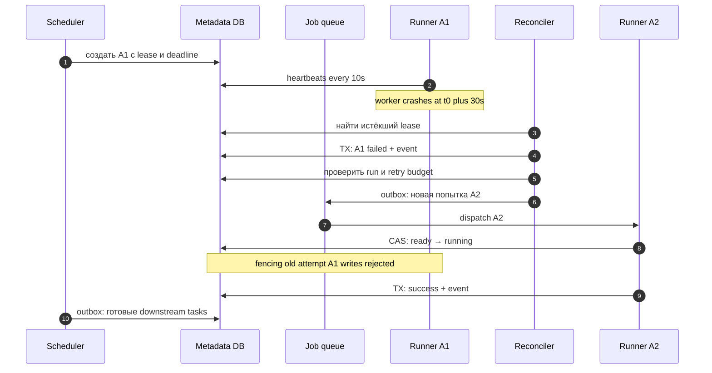
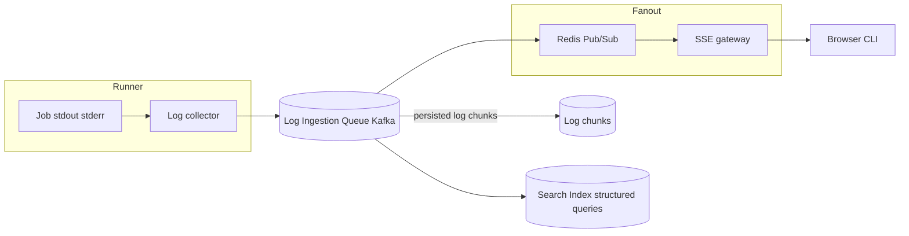

# Разбор задачи: проектирование CI/CD системы (свой GitHub Actions)

<!-- learning-nav:start -->
[← Все разделы](../README.md) · [Предыдущая тема](monitoring-system.md) · [Следующая тема →](ad-click-aggregation.md)
<!-- learning-nav:end -->

> **Формулировка на собеседовании:** «Спроектируй распределённую CI/CD систему в стиле GitHub Actions: система реагирует на `git push`, читает YAML-описание workflow из репозитория, планирует и выполняет джобы в изолированном окружении и стримит логи и статусы пользователю в реальном времени».
>
> В кейсе проверяем оркестрацию, границы доверия, учёт попыток и восстановление после сбоев. Конкретный масштаб ниже — учебные допущения.

## Почему задача сложнее, чем звучит

Наивный ответ («вебхук → сервер → bash-скрипт») разваливается на первом же follow-up вопросе. Реальные сложности, которые интервьюер будет нащупывать:

- **10k+ одновременных пайплайнов**, всплески нагрузки ×10 (merge train в понедельник утром, ночные регрессии).
- **Multi-tenancy и fairness**: сотни команд на одной платформе, нельзя дать одному репозиторию «съесть» весь кластер (noisy neighbor).
- **Воркеры падают посреди джобы** — нужны retry, таймауты, отмена и защита внешних эффектов от повторов.
- **Логи и статусы в реальном времени** — пользователь ждёт `tail -f` в браузере, а джоба может писать тысячи строк в секунду.
- **Секреты, артефакты, кэш, изоляция** — безопасность и воспроизводимость сборок.

Вопросы для самостоятельного deep dive (учебные формулировки):

- «Несколько пользователей запушили одновременно — как оркеструешь и приоритизируешь сборки, чтобы минимизировать задержки?»
- «Команды делят одну платформу — как изолируешь пайплайны, обеспечиваешь fairness и защищаешься от noisy neighbor?»
- «Будешь ли делать артефакты иммутабельными? Как тогда обеспечить воспроизводимость и инвалидацию кэша?»
- «Как спроектируешь безопасный rollback в мультисервисном окружении без каскадных падений?»
- «Расскажи по шагам, как работает retry: что пишется в БД, что видит пользователь, как не выполнить джобу дважды?»

## Уточняющие вопросы интервьюеру

Не начинайте рисовать, пока не зафиксировали рамки. Хороший набор вопросов (2–3 минуты):

1. **Триггеры**: только `git push`, или ещё PR, ручной запуск, cron/schedule, API-триггер? (Ответ влияет на ingestion-слой.)
2. **Источник конфигурации**: YAML в репозитории (как GitHub Actions) или UI/DSL? — берём YAML в репо, pinned на commit SHA.
3. **Масштаб**: сколько pushes/sec, сколько одновременных джоб, сколько организаций-тенантов?
4. **Изоляция**: достаточно контейнеров или нужна VM-изоляция (недоверенный код из публичных репо)?
5. **Результаты**: нужно ли хранить артефакты сборки и как долго? Нужен ли кэш зависимостей?
6. **Наблюдаемость**: логи в реальном времени — обязательны или «посмотреть после завершения» достаточно? (Обязательны — это отдельный deep dive.)
7. **Деплой (CD)**: входит ли деплой в скоуп, или проектируем только CI (build/test)? — обычно договариваются: CI в скоупе, CD обозначить как расширение.

## Требования

### Functional

| # | Требование | Суть |
|---|-----------|------|
| F1 | Триггер workflow по `git push` | Принять webhook, скачать YAML из коммита, распарсить, запланировать |
| F2 | Изолированное выполнение джоб | Каждая джоба в своём sandbox (контейнер/microVM), секреты — scoped, только нужному шагу |
| F3 | Видимость в реальном времени | Live-статусы шагов, стриминг логов, быстрый фидбек об ошибках |
| F4 | Retry, таймауты, отмена | Политики повторов, принудительное завершение зависших джоб, отмена workflow |
| F5 | Артефакты и кэш | Сохранение результатов сборки, версионирование, скачивание |

### Non-functional

| # | Требование | Целевое значение |
|---|-----------|------------------|
| N1 | Масштаб | 10k одновременных workflow в steady state, до 100k в пике |
| N2 | Изоляция | падение/«злой» скрипт одной джобы не влияет на другие |
| N3 | Fairness | per-tenant квоты, защита от noisy neighbor |
| N4 | Durability | состояние (статусы, логи, артефакты) переживает падение любого компонента; джоба восстанавливается или корректно ретраится |
| N5 | Низкая задержка триггера | от `git push` до постановки в очередь ≤ 10 сек даже в пике |

## Оценки нагрузки (back-of-envelope)

Исходные допущения — проговорите их вслух и зафиксируйте с интервьюером:

- **10 pushes/sec** → `10 × 86400 ≈ 864k workflow runs/день`.
- Среднее время workflow в системе, включая ожидание, — **15 минут** → concurrency = `10/s × 900s ≈ 9k ≈ 10k активных runs` (закон Литтла: `L = λ × W`).
- В одном workflow **7 джоб**, среднее фактическое время одной попытки **240 секунд**, без retry: `10 × 7 × 240 = 16 800` выполняющихся задач. Число джоб и длительность workflow сами по себе не определяют concurrency задач. В устойчивом пике ×10 понадобилось бы 168k слотов; при недостатке слотов растут очередь и время workflow.
- **Логи**: джоба пишет в среднем ~50 строк/сек × ~200 байт → `20k × 50 × 200B ≈ 200 MB/s` в steady state, ~1–2 GB/s в пике. Это 17,28 TB/сутки при постоянных 20k джоб; сжатие ×10 — гипотеза, дающая ~1,73 TB/сутки. Размер Kafka-кластера выводят из теста, replication factor, retention и запаса, а не из слова «обычный».
- **Артефакты**: 20% runs сохраняют ~100 MB → `864k × 0.2 × 100MB ≈ 17 TB/день`; retention 30 дней → ~0.5 PB в объектном хранилище. Это нормально для S3-подобного стора.
- **Метаданные**: при среднем 1,1 попытки на джобу получим `864k × 7 × 1,1 ≈ 6,65M task_attempt/день` и при 4 событиях на попытку ~26,6M execution_event/день. Строки попыток и событий — разные величины. При 2 попытках это 12,1M и 48,4M соответственно, а также удвоенная нагрузка исполнения. Retention и индексы оцениваем по каждой таблице.
- **SLO триггера**: GitHub требует 2xx в пределах 10 секунд; внутренний бюджет ACK ≤ 2 секунд оставляет запас. Автоматического redelivery неудавшихся webhook у GitHub нет: нужен наш процесс redelivery/reconciliation.

Эти числа сразу дают три архитектурных следствия: (1) ingestion должен быть асинхронным и буферизованным; (2) fairness и capacity очереди проверяются отдельно, шардирование вводится по необходимости; (3) состояние нельзя держать в памяти планировщика — нужна durable metadata DB.

## API

```http
# Вход от git-провайдера (не публичный API, но критичный интерфейс)
POST /webhooks/github
Headers: X-Hub-Signature-256: sha256=..., X-GitHub-Delivery: <uuid>
Body: { "ref": "refs/heads/main", "after": "<commit_sha>", "repository": {...} }
→ 202 Accepted   # сразу, без синхронной обработки

# Публичный API платформы
GET  /v1/runs?repo=org/app&branch=main&status=failed&limit=20
GET  /v1/runs/{run_id}                      # статус workflow + джоб
POST /v1/runs/{run_id}/cancel               # идемпотентная отмена
POST /v1/runs/{run_id}/rerun                # перезапуск (failed only / all)
GET  /v1/runs/{run_id}/jobs/{job_id}/logs   # SSE-стрим live-логов
GET  /v1/artifacts/{artifact_id}            # redirect на signed URL (S3)
POST /v1/repos/{repo}/secrets               # запись секрета (write-only)
```

Ключевые решения, которые стоит озвучить:

- Webhook отвечает **202 Accepted** после durable-приёма — «acknowledge first, process later». Это главный приём против таймаутов и ретраев провайдера.
- Логи — **SSE (Server-Sent Events)**, не WebSocket: однонаправленный стрим, дешевле держать тысячи соединений, reconnect с `Last-Event-ID`; сервер должен уметь воспроизвести пропущенные записи.
- Секреты — **write-only**: API позволяет записать/обновить, но не прочитать.

## High-level design



Inbox/outbox связывают durable metadata с очередью; стрелка БД → queue означает фоновую публикацию outbox. Autoscaler следит за backlog и насыщением runner pools, а scheduler применяет квоты до выдачи lease. Подробный путь логов показан отдельно.

Система делится на четыре плоскости — это удобный каркас для рассказа:

1. **Ingestion**: API Gateway → дедупликация → очередь вебхуков → ingress-сервис (fetch YAML → валидация → построение DAG → persist).
2. **Orchestration**: scheduler находит готовые к запуску задачи в DAG, orchestrator раздаёт их воркерам через шардированные очереди; reconciler следит за таймаутами.
3. **Execution**: stateless-воркеры, каждая джоба в изолированном sandbox, секреты scoped, квоты на CPU/RAM/network.
4. **Observability**: логи и статусы текут через Kafka, fanout в UI (SSE) и в durable storage (S3 + поисковый индекс).

## Поток данных: от `git push` до запланированного workflow



Подпись подтверждает источник и целостность payload, но сама не предотвращает replay. Уникальный `delivery_id` проверяется в durable inbox, а повтор с иным payload отклоняется. Commit SHA не является уникальным ID запуска: один commit можно запустить вручную несколько раз, а разные события могут иметь разные workflow.

ACK отправляется после commit inbox; тяжёлый fetch и построение DAG идут в фоне. Если API упал после commit до ответа, redelivery увидит тот же inbox. Если DAG builder упал после записи задач, транзакция с отметкой `processed` не даст создать второй run. Передача ready-задачи в брокер идёт через outbox; иначе возможен commit задачи без enqueue. Redis может быть быстрым кэшем дедупликации, но `SETNX` до durable enqueue без связанного протокола теряет событие при сбое между ними.

GitHub не обещает автоматический retry неудачной доставки. Reconciler отслеживает failed deliveries через API провайдера и инициирует redelivery либо сверяет принятые события с refs/runs. Политику и срок такой сверки согласуем отдельно. Эти гарантии не распространяются на выполнение произвольного пользовательского кода ровно один раз.

## Модель данных

Сущности выводятся из потока, а не придумываются заранее: смотрим, что должно сохраняться между блоками. Три базовые сущности + три вспомогательные:



Зачем каждая сущность:

- **`workflow_run`** — «мастер-запись» запуска: одно принятое trigger event → определённый набор runs, привязан к repo + commit SHA. Пин YAML на SHA даёт воспроизводимость: rerun старого пайплайна использует ровно тот же конфиг.
- **`task`** — узел DAG из YAML: образ, ресурсы, рёбра зависимостей (`depends_on`), политика retry/timeout.
- **`task_attempt`** — *каждая фактическая попытка* выполнения, включая ретраи. Это ключевое решение: без отдельной строки на попытку ретраи выглядят как «тихие переисполнения» — теряется история, аудит и защита от гонок (старая попытка не может писать, см. fencing ниже).
- **`execution_event`** — append-only журнал всех переходов состояний (`pending → running → failed → ...`). Источник истины для аудита и восстановления после падения orchestrator'а.
- **`artifact`**, **`log_chunk`** — связь выходов джобы с объектным хранилищем: путь, тип, хэш, TTL.

Практические замечания: партиционируем историю по времени, архивируем холодные runs. Активные попытки индексируем по lease/deadline отдельно от истории. При 16,8k задач heartbeat каждые 10 секунд даёт ещё 1680 апдейтов/с; это отдельная нагрузка. Возможности PostgreSQL проверяем по смеси запросов и contention, без универсального порога TPS.

## Deep dive 1: надёжный ingestion под всплесками

Сценарий: API принял webhook, но брокер недоступен. Если ACK уже выдан, ответственность за восстановление у нашей платформы. Durable inbox хранит payload, delivery ID и статус; фоновая доставка повторяется с backoff и jitter. Очередь может отстать, но принятое событие не зависит от памяти API.

При заполнении inbox или исчерпании retention нельзя продолжать отвечать 202: нужны отказ в приёме, алерт и процедура redelivery провайдера. Меряем возраст самого старого необработанного события и долю потерянных/необработанных deliveries, а не только глубину очереди. S3-копия удобна для аудита, но не заменяет commit перед ACK.

## Deep dive 2: планировщик, очереди задач и fairness

Почему наивный дизайн ломается на 100k одновременных джоб:

1. **Одна глобальная очередь** — единая точка contention, backlog растёт лавинообразно.
2. **Хаос координации** — джобы «перебронируются», молча падают, бесконечно рестартуют.
3. **Гонки в статусах** — два планировщика/ретрая переводят задачу `ready → running → ready` → двойное выполнение.
4. **Hot tenant** — один репозиторий флудит системой и душит остальных.

Решения:

### Шардированные очереди

Вместо одной очереди — партиции по `org_id` / `repo_id` или `hash(workflow_run_id)` (consistent hashing). Партиции увеличивают параллелизм, но сами не обеспечивают fairness: большой тенант может занять все слоты. Нужны глобальные/per-tenant лимиты running jobs, weighted fair scheduling и приоритеты. Репозитории могут делить один физический shard.

### Ready-очередь вместо полного скана DAG

На каждом тике сканировать весь DAG — трата CPU. Вместо этого задача попадает в **ready queue только когда все её prerequisites завершились**. Это снижает задержку, экономит вычисления и позволяет делать per-tenant приоритизацию на уровне ready-очереди.

### Идемпотентные переходы состояний (CAS)

Каждый переход — compare-and-swap по текущему статусу; обновление строки и execution_event выполняются в одной транзакции. Enqueue downstream/retry публикуется через outbox, иначе падение после commit потеряет запуск:

```sql
-- воркер забирает задачу: успех только если она ещё ready
UPDATE task_attempt
SET status = 'running', worker_id = 'w-29', started_at = now()
WHERE attempt_id = 'a2' AND status = 'ready';
-- affected rows = 0 → кто-то уже забрал, пропускаем
```

Тот же приём — optimistic locking по версии строки. Это защита от двух успешных захватов одной ready-попытки. Потерявший lease воркер физически ещё может работать: CAS метаданных не отменяет его HTTP-запросы или деплой. Сильная фраза для интервью: «все переходы состояний идемпотентны — повторная попытка с тем же намерением безвредна».

### Autoscaler + hot shard detector

Отдельный компонент следит за глубиной очередей, latency джоб, насыщением ресурсов и давлением по шардам:

- шард «горячего» репозитория троттлим (per-tenant квоты, weighted fair queuing);
- размер воркер-пулов масштабируется динамически (spot-пул для черновой нагрузки, on-demand для гарантированной);
- приоритеты по SLA (релизная ветка > фиче-ветка).

### Выбор брокера для очереди задач

| Критерий | Kafka | RabbitMQ | SQS |
|----------|-------|----------|-----|
| Модель | append-only log, consumer offset | умный брокер, ACK/NACK, routing | managed, visibility timeout |
| Порядок | внутри партиции | per queue | FIFO-очереди (с лимитом throughput) |
| Replay | да, из коробки | нет | нет |
| Throughput | очень высокий | средний | высокий (standard) |
| Когда брать | вебхуки, логи, события (нужен replay) | job queue с гибким routing и per-message ACK | минимум операционки |

Прагматичный ответ на собеседовании: **Kafka для потока событий и логов** (durability, ordering, replay), а для раздачи задач воркерам подойдёт и RabbitMQ/SQS-подобная очередь с per-message acknowledgement и visibility timeout — её семантика «взял → выполнил → ACK / не ACK → вернулось» прямо ложится на pull-модель раннеров. И ещё одна сильная формулировка из разборов Meta: **не обещайте exactly once** — честная позиция «at least once delivery + идемпотентные консьюмеры» звучит сильнее и соответствует продакшену.

## Deep dive 3: изоляция сборок и секреты

Каждая джоба исполняется в sandbox: запушенный код — недоверенный (в публичных репо — буквально чужой код на вашем железе).

| Подход | Граница доверия | Ограничение |
|---|---|---|
| Контейнер | namespace/cgroups, общее ядро | Без privileged, host mounts и Docker socket; kernel escape остаётся риском |
| gVisor | userspace kernel boundary | Проверять совместимость syscalls и стоимость workload |
| Kata / microVM | отдельное ядро гостя | Нужны hardening хоста, изоляция сети и очистка диска |

Время старта microVM из benchmark VMM не равно старту готовой джобы: ещё загружаются образ, сеть, зависимости и исходники. Для публичного недоверенного кода используем отдельные эфемерные окружения и пулы без доступа к инфраструктуре платформы; внутренний репозиторий тоже может содержать скомпрометированную зависимость. Self-hosted runner в VPC увеличивает последствия компрометации.

Секрет выдаётся только после решения policy engine: доверенный repository/ref, разрешённое событие, среда и необходимые permissions. PR из fork не получает deploy secrets. Особенно опасно запускать код PR в привилегированном контексте `pull_request_target` или передавать его артефакты напрямую в deploy. Сборка и деплой — разные trust domains: deploy использует проверенный manifest и digest артефакта, а не произвольный путь из PR.

OIDC убирает долгоживущий cloud key, но cloud trust policy должна ограничивать issuer, audience и subject (repo/ref/environment). Сам факт OIDC не делает код доверенным. В общей VM несколько шагов часто делят диск, процессы и пользователя: «секрет только в env последнего шага» не мешает предыдущему вредоносному шагу оставить перехватчик. Маскирование логов — дополнительная защита от случайной печати, оно не блокирует base64, сеть и артефакты. Для недоверенного кода секрет вовсе не выдаётся.

### Кэш и артефакты как граница доверия

Ключ кэша включает tenant/repo, OS/архитектуру, toolchain, lockfile и **trust domain**. Untrusted PR может читать разрешённый базовый кэш, но не должен перезаписывать кэш release-сборок. Широкий restore-prefix способен вернуть чужой/старый кэш. Immutable cache entry снижает гонки, но не проверяет, кто первым его заполнил. Проверяем происхождение, права записи и digest; кэш считается ускорением, а не источником доверенных исполняемых файлов.

Артефакту присваивают run/attempt, commit SHA и digest; release manifest ссылается на проверенный digest. Одинаковый commit не гарантирует одинаковую сборку, если плавают зависимости, images или сеть. Для воспроизводимости фиксируют toolchain и зависимости; для происхождения полезны attestations.

### На подумать: fork PR украл deploy token

Условие: PR-тесты не получают secrets. После их успеха доверенный workflow скачивает `build.tar` и запускает из него `deploy.sh` с production token. Изоляция соблюдена?

<details>
<summary>Разбор</summary>

Нет: недоверенный артефакт стал кодом внутри доверенного контекста. Проверяемая сборка должна продвигать данные/образы по digest, а deploy-логика берётся из защищённого ref и не исполняет произвольные скрипты PR. Policy проверяет provenance и статус нужного commit, environment требует необходимые gates. Даже сканер и подпись, полученные самим PR, не превращают его код в доверенный.

</details>

## Deep dive 4: durability — retry, таймауты, отмена

Масштаб бессмысленен, если оркестрация не durable. Четыре риска:

1. **Scheduler упал посреди run** → состояние в памяти потеряно, статусы неоднозначны.
2. **Retry затирает предыдущую попытку** → теряем историю и наблюдаемость.
3. **Зависшая джоба висит вечно** → утечка ресурсов, workflow никогда не завершится.
4. **Отменённый workflow «воскресает»** → поздний retry перезапускает то, что пользователь отменил.

Решения:

- **Всё состояние в metadata DB**: `workflow_run`, `task`, `task_attempt`, append-only `execution_event`. Scheduler stateless — после падения состояние полностью восстанавливается из БД.
- **Retry-политика в задаче**: `max_retries` (например 3–5), экспоненциальный backoff (1s → 2s → 4s → ...), разделение ошибок на retryable (network timeout, worker lost) и non-retryable (ошибка конфигурации YAML, failed test — нет смысла повторять). Каждый retry — **новая строка `task_attempt`**, старые попытки не затираются.
- **Reconciler (timeout manager)**: раз в 30–60 сек сканирует `SELECT ... WHERE status = 'running' AND deadline < now()`, применяет переходы `timeout`/`cancelled`. Даже если воркер испарился молча, система сама заметит «зомби».
- **Идемпотентная отмена**: run помечается `cancel_requested` в БД (новые попытки запрещены) → запущенные джобы получают SIGTERM (grace ~10 сек на слив логов) → SIGKILL → downstream-задачи помечаются `skipped`; `cancelled` фиксируется после подтверждения остановки либо отражается неопределённость lost runner. Все переходы пишутся как события; повторная отмена безвредна, поздний retry отменённой задачи отвергается CAS'ом.

### Жизненный цикл попытки (state machine)



Это жизненный цикл **одной попытки**: она терминальна и не возвращается в ready. Retry создаёт новую попытку после проверки run status, retry budget и backoff. `pending`/`skipped` — состояние логической task в DAG. Lease renewal и жёсткий execution deadline — разные поля: здоровый воркер не должен бесконечно продлевать максимальное время выполнения.

### Пошаговый сценарий retry (тот самый вопрос «расскажи, как движутся данные»)



Три детали, которые отличают сильный ответ:

- **Fencing**: старой попытке (A1) запрещено писать — апдейты проверяют attempt_id, активный lease epoch и терминальный статус; даже если «мёртвый» воркер ожил, он не испортит состояние.
- **Внешние эффекты**: fencing БД не ограждает deployment API. Получатель должен проверять epoch либо принимать idempotency key `(run, task, target)`; если не умеет, retry после неизвестного результата требует сверки, а не слепого повторения.
- **Heartbeat от воркеров**: orchestrator узнаёт о падении за ~30 сек, а не ждёт 15-минутного дедлайна.
- **Deadline хранится рядом с попыткой** — reconciler тупо сканирует индекс по `deadline`, ему не нужна внутренняя память. (В разборе distributed job scheduler используют тот же приём: индекс по run-timestamp даёт быстрый запрос «какие задачи пора запускать/ретраить», а исполнитель при захвате задачи продлевает отметку, чтобы задачу не ретраили, пока она честно работает.)

## Deep dive 5: логи и статусы в реальном времени

Разработчики хотят `tail -f` в браузере. Наивные подходы ломаются мгновенно: писать логи напрямую в БД — убьём IOPS (тысячи строк/сек на джобу); стримить воркер → клиент напрямую — лаг/дисконнект клиента теряет логи, а падение воркера уничтожает их навсегда.

Решение — **разделить ingestion, fanout и storage**:



- **Ingestion**: воркер батчит строки каждые несколько секунд, тегирует `attempt_id + seq_no` и пишет в Kafka. После broker ACK Kafka хранит принятые батчи в пределах retention; ещё не отправленный буфер погибшего runner можно потерять. Для жёсткой гарантии нужен локальный durable spool вне ephemeral sandbox, иначе UI честно показывает возможный gap.
- **Fanout**: из Kafka события разлетаются в Redis pub/sub; UI подписан через SSE. Апдейты дебаунсятся и rate-limit'ятся, heartbeat каждые несколько секунд держит соединение живым — клиент не захлёбывается, «зомби»-соединения не копятся.
- **Reconnect и backpressure**: Pub/Sub не хранит пропущенные события. SSE event ID содержит attempt и seq_no; reconnect дочитывает durable chunks/журнал и затем переключается на live, устраняя повторы. Slow client получает ограниченный буфер и возможность догрузки. Лимит байт/сек на джобу не даёт бесконечному stdout занять весь кластер.
- **Storage**: по завершении (или каждые N минут) логи сжимаются и укладываются в S3 по детерминированному пути `logs/{run_id}/{task_id}/{attempt_id}/stdout.log.gz` + дублируются в поисковый индекс для структурированных запросов («покажи ERROR по всем runs ветки за неделю»).
- **Статусы** — отдельный лёгкий канал: переходы состояний пишутся в БД и публикуются через pub/sub, UI обновляет бейджи шагов без чтения логов.

Фраза, которая хорошо завершает deep dive: «логи — это user experience CI/CD системы: если пользователь не видит, что происходит, система *ощущается* сломанной, даже если джобы выполняются».

## Trade-offs: сводная таблица

| Решение | Взяли | Альтернатива | Цена выбора |
|---------|-------|--------------|-------------|
| Модель раннеров | **Pull** (воркеры сами тянут задачи) | Push от orchestrator | нужны heartbeat и visibility timeout; зато естественный backpressure и простой autoscaling |
| Доставка событий | At least once + идемпотентность | Транзакционная публикация | Гарантия задаётся отдельно для каждой границы, особенно внешнего деплоя |
| Очередь задач | Шардированные партиции по тенанту | Одна глобальная FIFO | теряем строгий глобальный FIFO-порядок — он и не нужен между тенантами |
| Изоляция | Контейнеры (внутренние) + microVM (недоверенный код) | голые VM | VM — минуты на старт, контейнер — слабее изоляция; гибрид по уровню доверия |
| Метаданные | PostgreSQL (транзакции, CAS) | NoSQL | партиционирование/шардирование выбираются по профилю записи и retention |
| Live-логи | SSE | WebSocket / polling | SSE только server→client (нам хватает), нужны connection capacity и backpressure |
| Логи | Kafka → S3 + search index | прямая запись в БД | два хранилища = консистентность на приложении; зато БД не умирает под логами |
| Артефакты | Иммутабельные, versioned by SHA | перезаписываемые | больше storage (нужен TTL/GC), зато воспроизводимость и rollback |

## Красные флаги / типичные ошибки кандидатов

- **Рисовать полную диаграмму до требований и оценок.** Сигнал «заучил ответ». Сначала scope, числа, потом блоки.
- **Вывалить все детали сразу.** Ответ становится шумным и нечитаемым. Правильная тактика: идти по потоку, обозначать точки сложности и *предлагать* deep dive («логи стримим через Redis pub/sub, а персистим в S3 — про fanout и буферизацию на клиенте могу рассказать отдельно»). Это показывает, что вы видите сложность, но управляете фокусом.
- **Синхронная обработка вебхука.** Если вы делаете fetch + parse + schedule до ответа GitHub — получите ретраи, дубликаты и каскадный отказ в пике.
- **«Очередь гарантирует exactly once».** Без механизма и защиты формулировки это минус. Правильный ответ: at least once + идемпотентные переходы (CAS) + дедупликация на ingress.
- **Состояние в памяти scheduler'а.** Падение = потеря всего. Всё состояние — в metadata DB, scheduler stateless.
- **Одна глобальная очередь на всех.** Сама очередь не гарантирует fairness; нужны квоты и планировщик. Шардирование вводим при измеренном contention.
- **Retry без отдельной попытки.** Затираете историю, не можете отличить flaky от стабильно падающего, старый воркер может перезаписать новое состояние (нет fencing).
- **Джобы без таймаутов.** Зомби-джобы едят кластер вечно. Нужен reconciler с дедлайнами.
- **Логи в БД или напрямую клиенту.** Умрёте по IOPS / потеряете логи при падении воркера.
- **Забыть, что код в джобе — недоверенный.** Без sandbox, квот и scoped-секретов дизайн непригоден для multi-tenant платформы.

## Что спросят дополнительно (follow-up вопросы)

- **Кэш сборки**: как устроен ключ кэша, как инвалидируете, как не дать одному тенанту отравить кэш другого? (Ключ включает lockfiles + OS + toolchain + trust domain; отдельно проверяются права записи.)
- **Rollback в CD**: как откатить деплой в мультисервисном окружении без каскадных падений? (Иммутабельные артефакты + версионирование релизов, деплой обратной совместимостью N/N-1, canary + автоматический откат по метрикам, запрет «рассогласованных» откатов через явный release manifest.)
- **Merge queue / merge train**: как сериализовать проверки PR перед мерджем, не проверяя каждый по отдельности? (Очередь батчей, проверка «предиктивного» мердж-результата, eviction неудачного батча.)
- **Приоритеты**: как обеспечить, что hotfix в прод соберётся раньше ночной регрессии? (Приоритетные очереди внутри шарда, preemption или выделенный on-demand пул.)
- **Spot-инстансы**: что если воркер на spot отзовут посреди джобы? (Тот же механизм heartbeat + retry на другом воркере; чекпоинты кэша/артефактов для длинных сборок.)
- **Масштаб метаданных**: рост истории `task_attempt` и `execution_event` — как жить? (Партиции по дате, TTL-архивация в S3, отдельная «горячая» таблица активных попыток для reconciler'а.)
- **Безопасность**: как не утечь секретом через логи? (Не выдавать токен недоверенному коду; ограничить permissions и OIDC trust policy. Маскирование защищает лишь от части случайных утечек.)
- **Self-hosted runners**: как встроить раннеры клиента в его VPC? (Pull-модель решает: раннер сам ходит наружу за задачами, inbound-доступ не нужен.)

## Как подавать ответ: 5-шаговый фреймворк

Из разбора ShowOffer — рабочая структура именно для таких «конвейерных» систем:

1. **Нарежьте функциональные требования на строительные блоки**: `git push → fetch YAML → validate → build DAG → persist → enqueue`. Это скелет, который не даёт прыгать между компонентами.
2. **Прикладывайте принципы к каждому блоку**: синхронно или асинхронно? какие гарантии durability и retry? нужна ли дедупликация, backpressure, fallback? Это показывает мышление инженера распределённых систем, а не «рисователя диаграмм».
3. **Выводите сущности из потока**: смотрите, какие данные должны сохраняться между блоками — так естественно рождаются `workflow_run`, `task`, `task_attempt`, а не угадываются заранее.
4. **Свяжите диаграммой**: даже текстовая схема с подписанными ответственностями и жизненным циклом `run → task → attempt → status → logs`.
5. **Вернитесь к deep dives** — не углубляйтесь раньше времени, а приглашайте интервьюера: «могу подробнее рассказать про retry и таймауты / про fanout логов / про fairness между тенантами — что интереснее?»

<a id="источники-и-видео-по-теме"></a>

## Видео по теме

- [Разработка системы CI/CD — популярный вопрос на собеседовании по OpenAI и Meta (ShowOffer)](https://www.youtube.com/watch?v=y32PywFi7Ek) — основной разбор: требования, 5-шаговый фреймворк подачи, дедупликация вебхуков, шардированные очереди, reconciler, retry/timeout-сценарии, стриминг логов.
- [Distributed Job Scheduler / Systems Design Interview Questions With Ex-Google SWE](https://www.youtube.com/watch?v=pzDwYHRzEnk) — смежная задача: индексация по run-timestamp, продление таймстемпа исполнителем против ложных ретраев, ограничение числа retry, партиционирование.
- [Очереди сообщений в системном дизайне на собеседованиях: советы от ведущего инженера Meta](https://www.youtube.com/watch?v=1ISRd0bS714) — гарантии доставки (at least once + идемпотентность как стандартный правильный ответ), почему не стоит обещать exactly once, выбор между SQS/RabbitMQ/Kafka.
