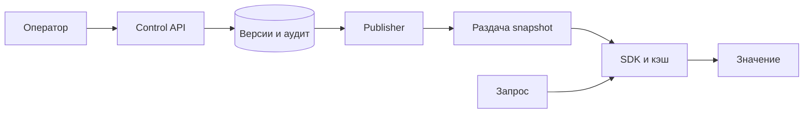

# Разбор задачи: сервис feature flags

<!-- learning-nav:start -->
[← Все разделы](../README.md) · [Предыдущая тема](job-scheduler.md) · [Следующая тема →](monitoring-system.md)
<!-- learning-nav:end -->

Feature flag отделяет выпуск кода от включения поведения: новый путь уже задеплоен, но доступен только сотрудникам, одному tenant или небольшой группе пользователей. Спроектируем сервис, в котором продуктовая команда меняет правила, а приложение быстро и предсказуемо получает значение. Главные вопросы — стабильность выбора, распространение конфигурации и поведение при её устаревании. Сам по себе флаг не отменяет миграцию данных, не заменяет авторизацию и не откатывает совершённые операции.

## Требования и нагрузка

### 1. Что именно система должна гарантировать?

Уточняем типы флагов, среду исполнения и цену неверного ответа. Boolean достаточно для включения ветки; строковая вариация нужна для выбора алгоритма. Конфигурации разделяем по проекту и среде: изменение в staging не должно затронуть production. В нашем кейсе основные потребители — backend-сервисы с локальной оценкой; браузеры получают только разрешённые для них значения или публичные правила.

Принимаем такие требования для проектируемого сервиса:

- Один и тот же субъект при одинаковом snapshot и контексте получает одинаковую вариацию на всех поддерживаемых SDK.
- Изменения публикуются версиями, проходят валидацию и оставляют аудит автора, причины и содержимого.
- На обычном запросе не требуется сетевой вызов к управляющему API.
- Цель распространения: 99% подключённых исправных backend-экземпляров подтверждают новую версию за 30 секунд. Отключённые клиенты в эту цель не входят и видны отдельно.
- Для каждого флага определены безопасный fallback и допустимая устарелость. Универсальное «при ошибке всегда false» не подходит.

Не обещаем одновременное переключение всех сервисов или мгновенный глобальный kill switch во время сетевого разделения. Если бизнес требует запретить операцию немедленно и без исключений, проверка должна находиться на авторитетной границе самой операции. Локальный кэш флагов не создаёт такую гарантию, даже если интерфейс называет кнопку «аварийное отключение».

### 2. Какие числа нужны для выбора local или remote evaluation?

Допустим, 100 backend-экземпляров обрабатывают суммарно 20 тыс. запросов/с и проверяют по пять флагов на запрос. Получаем 100 тыс. оценок/с. При удалённой проверке это до 100 тыс. RPC/с либо 20 тыс. пакетных вызовов/с с сетевой задержкой на критическом пути. Локальная оценка превращает их в обращения к памяти и вычисление правил; её реальное время измеряем на целевых SDK и сложных правилах, а не объявляем заранее.

В одной среде 2000 активных флагов, сериализованная конфигурация каждого в среднем 1 КБ: snapshot порядка 2 МБ до сжатия и накладных расходов. Полная загрузка на 100 экземпляров — примерно 200 МБ. Если все опрашивают раз в 30 секунд, это около `100 / 30 ≈ 3,3` запросов/с. При неизменной версии условный GET возвращает небольшой ответ; без него полные снимки дали бы примерно 6,7 МБ/с. Частота операторских изменений — десятки в день, а не 100 тыс./с.

Для этого масштаба достаточно БД, сервиса публикации и HTTP-раздачи snapshot. Streaming улучшит задержку обновления, но не является обязательной первой технологией. При десятках тысяч SDK соединения, массовый restart и исходящий трафик становятся отдельной задачей; добавляем региональные relay и кэшируемые артефакты по измерениям.

## Контракты и данные

### 3. Как разделить control plane и data plane?

Control plane — редактирование, права, согласование, аудит и публикация. Data plane — получение опубликованной конфигурации и оценка значения. Поломка панели управления не должна ломать чтение уже установленного snapshot. База черновиков не участвует в каждой проверке флага.



Оператор меняет `checkout-v2` с 1% на 5%. API сохраняет новую ревизию и запись публикации в одной транзакции. Publisher проверяет типы, зависимости и размер правил, сохраняет целостный неизменяемый snapshot среды, затем атомарно продвигает указатель текущей версии только вперёд по sequence. Проверка номера и смена указателя составляют одну условную запись; безусловной атомарной замены недостаточно. SDK получает его через условный GET либо stream и заменяет активную ссылку только после полной проверки. Запрос видит старый или новый snapshot целиком, а не половину обновлённых правил.

Для нескольких связанных оценок в одном запросе закрепляем один snapshot. Иначе первая проверка выполнится по версии 41, вторая — по 42, хотя каждая по отдельности «атомарна». Если сервисы обязаны принять одно совместное решение, лучше передать уже выбранную вариацию вместе с операцией, а не независимо переоценивать её на разных версиях.

### 4. Какие API и модель данных достаточны?

```http
PUT /v1/projects/shop/environments/prod/flags/checkout-v2
If-Match: "17"
Content-Type: application/json

{
  "type": "boolean",
  "enabled": true,
  "rollout_basis_points": 500,
  "bucket_by": "tenant_id",
  "fallback": false,
  "reason": "Расширение после проверки ошибок"
}
```

`If-Match` защищает от потери параллельного изменения: несовпадение версии даёт `412`. Публикация — отдельная операция `POST .../publications` с idempotency key, если нужны preview и согласование. Ответ содержит ID публикации; статус `published` означает доступность артефакта на сервере раздачи, а не получение всеми SDK. `GET .../snapshot` поддерживает `ETag` и `If-None-Match`.

Локальный контракт выглядит как `evaluateBoolean(key, defaultValue, context)`; диагностический вариант возвращает также `reason`, `variant`, `snapshot_version`, `error_code`. Это не повод отправлять весь контекст по сети. OpenFeature определяет интерфейс оценки и поведение с default, но не предоставляет сам control plane и не обещает конкретную свежесть конфигурации.

Храним `flags(project, environment, key, type, owner, expires_at)`, неизменяемые `flag_revisions(flag_id, revision, rules, salt, fallback, author)`, `publications(environment, sequence, snapshot_ref, checksum, created_at)` и аудит. Уникальны ключ флага внутри среды и sequence публикации. Аудит содержит старое и новое содержание, а не только «пользователь нажал Save». Удаление — опубликованный tombstone с периодом совместимости для старого кода; ключ не переиспользуем без осознанного решения.

## Предсказуемая оценка

### 5. Как работает targeting и стабильное процентное распределение?

Сначала проверяем явные overrides, затем упорядоченные targeting rules, затем default rule. Внутри правила может быть процентное распределение. Порядок — часть версии конфигурации, а отсутствующее поле обрабатывается по формальной семантике, например «правило не совпало». Нельзя превращать отсутствие возраста в ноль или сравнивать строки версий обычным лексикографическим оператором.

Для rollout выбираем единицу: пользователь, tenant или устройство. Если совместная работа внутри организации должна быть согласованной, bucket по `tenant_id` предпочтительнее `user_id`. Схематично:

```text
input = canonical_encode(environment, flag_key, salt, subject_kind, subject_key)
h = first_64_bits(SHA256(input))          # unsigned, fixed byte order
bucket = floor(h * 10000 / 2^64)        # 0 ... 9999
enabled = bucket < rollout_basis_points
```

Это наш протокол, а не стандарт всех продуктов. Задаём точное кодирование длины полей, UTF-8 и порядок байтов, тестовые векторы для всех SDK. Расчёт выполняем целочисленно: обычный JavaScript Number не представляет все 64-битные целые точно. При увеличении порога с 100 до 500 прежние участники остаются включены, если не изменились ключ, salt и предшествующие правила. Версию публикации в hash не включаем: иначе каждое редактирование перетасует пользователей.

Важна стабильность выбранного алгоритма. Случайный `random() < 0.05` на каждом запросе заставит интерфейс мигать и сделает сравнение поведения бессмысленным.

### 6. Почему 5% субъектов не означают 5% нагрузки и как запускать rollout?

Равномерный hash распределяет ключи, а нагрузка у ключей может различаться на порядки. Один крупный tenant в 1% пользователей способен дать половину запросов. Перед расширением оцениваем размеры когорт, нагрузку новой ветки и отдельные лимиты downstream. Для особо крупных tenant используем управляемые rings либо явное согласованное включение, а не надеемся на проценты.

Пример плана: сотрудники → несколько согласованных tenant → 1% → 5% → 25%. Конкретные интервалы наблюдения определяются частотой событий и риском, а не универсальным правилом «пять минут достаточно». При 100 заказах в час редкий дефект не проявится на 1% за пять минут. Для автоматического продвижения задаём минимальный объём наблюдений, пороги ошибок и latency, ограничение скорости изменения, срок наблюдения и ручную остановку.

Откат — новая публикация с более высоким sequence и ранее проверенным содержимым. Он быстро меняет будущие решения после распространения, но не возвращает старый формат уже записанных данных, не отзывает письма и не останавливает все начатые запросы. Новая и старая ветки должны оставаться совместимыми с данными в период rollout. Для необратимого действия ставим ограничения самого действия: бюджет, квоту, дополнительную проверку. Увеличивать rollout до 100% только потому, что система флагов технически доступна, — смешивать доступность управления с безопасностью изменения.

### 7. Как защитить targeting-данные и не превратить флаг в авторизацию?

Evaluation context содержит минимум признаков, необходимых правилам: например, устойчивый внутренний ID, тариф и регион. Email, ФИО и полный профиль не нужны для bucket. Ключ распределения должен стабильно обозначать одного субъекта между запросами. В нашей системе отсутствие обязательного bucket key даёт определённый fallback и диагностическую причину.

Backend может оценивать правила локально, не передавая пользовательские атрибуты в control plane. Не помещаем большие списки клиентов во все SDK: сегменты версионируем и распространяем в пределах доверенной среды либо оцениваем на сервере. Хэш email без секрета не обеспечивает анонимность: небольшой словарь легко перебрать. HMAC с управляемым секретом может псевдонимизировать идентификатор для конкретной цели, но требует жизненного цикла ключей и не делает данные автоматически обезличенными.

В браузер нельзя отправлять скрытые сегменты, секретные правила или серверный ключ. Там выдаём allowlist публичных флагов либо уже вычисленные значения через backend. Пользователь может изменить локальное значение, поэтому «флаг включён» не разрешает доступ к платному API. Авторизацию, права и проверку входных данных выполняет сервер независимо. Если нужна неподконтрольная клиенту принадлежность к когорте, вычисляем её на доверенной стороне, а не выбираем по подставленному клиентом `user_id`.

## Отказы и эксплуатация

### 8. Как SDK обрабатывает staleness, cold start и fail-open/fail-closed?

SDK держит последний проверенный snapshot в памяти и, для backend, может сохранять его на диск. При старте сначала проверяет локальный артефакт, затем пытается загрузить актуальный. Повреждённый, чужой по среде или неподдерживаемый snapshot не активируется. Пока корректной конфигурации нет, действует default, заданный приложением и согласованный с владельцем флага.

Политика задаётся на флаг, а не на весь SDK. Косметический выбор темы может долго использовать последнее значение. Для новой дорогой ветки обработки допустим, например, максимум десять минут без подтверждения актуальности, после чего выбираем старый путь. Для аварийного запрета особо опасной операции такой лимит может быть слишком большим: решение требует отдельного контура или меньшей доступности при изоляции. Fail-closed означает запретить конкретную операцию, а не обязательно вернуть boolean `false`: у флага `disable-checkout` безопасным значением может быть `true`.

Различаем время создания неизменяемого snapshot и время последнего подтверждения, что он всё ещё текущий. Старый snapshot может оставаться актуальным месяц; успешный условный GET это подтверждает. Возраст считаем по времени с последнего доверенного подтверждения с учётом политики cold start. Получение повторно закэшированного старого ответа само по себе не должно бесконечно продлевать свежесть. Вариант, reason и признак stale доступны в диагностике. Значение «флаг выключен оператором» и «вернули default из-за ошибки» — разные причины.

### 9. Как пережить дубликаты публикаций, потерю событий и failover?

Изменение ревизии и задание на публикацию сохраняем транзакционно, например через outbox. Повтор publisher не создаёт второе логическое изменение; артефакт идентифицируется publication ID и checksum. В каждом environment выделяем монотонный sequence и защищаем продвижение серверного current pointer: например, транзакционный `UPDATE ... WHERE current_sequence < candidate_sequence`, одновременно меняющий sequence и ссылку на уже сохранённый snapshot. Отдельное чтение номера перед безусловной записью оставляет гонку.

Допустим, publisher 41 завис, publisher 42 завершился, затем 41 продолжил работу. Условное продвижение отвергает 41: текущей остаётся 42, в том числе для нового SDK без локальной истории. При указателе в object storage перед каждой попыткой читаем указатель, отвергаем кандидата, если текущий sequence не меньше его номера, затем выполняем CAS по ETag прочитанного указателя. При конфликте повторяем весь цикл с новым чтением и сравнением. Один CAS без проверки sequence тоже недостаточен. Сравнение `If-Match` проверяет версию объекта. Правило монотонности задаёт наш протокол публикации.

SDK дополнительно не применяет поздно пришедший sequence 41 после уже активированного 42, но эта защита не заменяет серверную. Намеренный rollback получает 43, хотя его правила могут совпадать с 40: повторная установка указателя на 40 запрещена тем же условием.

Stream ускоряет доставку, но разрыв соединения не должен оставлять SDK навсегда на старой версии. После reconnect передаём последний sequence, восстанавливаем изменения или скачиваем полный snapshot при пробеле. Периодическая сверка версии служит страховкой. Ретраи используют backoff и jitter, чтобы массовый restart не устроил шторм. Телеметрию отправляем отдельно: её недоступность не должна блокировать оценку.

При падении control plane data plane продолжает раздавать последнюю опубликованную версию. При падении раздачи SDK переходит к своей staleness-политике. Переключение реплики control DB требует сохранения истории и sequence: потеря подтверждённой публикации при ненулевом RPO может воскресить опасное правило. Один writable лидер либо протокол согласования публикаций проще, чем независимые региональные редакторы. Региональным раздатчикам достаточно реплицировать неизменяемые артефакты и текущий указатель; наличие локального раздатчика не означает, что каждое изменение уже дошло в регион.

### 10. Что наблюдать и как ограничить ошибку оператора?

Измеряем возраст подтверждённой конфигурации, распределение активных sequence, ошибки обновления, долю fallback/stale-ответов, время локальной оценки и задержку от publish до подтверждения SDK. «HTTP 200 на Save» не показывает состояние потребителей. Отдельно видны экземпляры, которые давно не присылали heartbeat: отсутствие подтверждения нельзя считать успешным обновлением.

Ошибки бизнес-операции и latency сравниваем по вариации и версии, по возможности учитывая состав трафика. Решение флага и фактическое использование новой ветки — разные события: exposure регистрируем при реальном использовании. Полное логирование каждого из 100 тыс. evaluations/с дорого; агрегируем и семплируем, не теряя итоговых бизнес-метрик. Не помещаем ID пользователей в labels и не записываем весь контекст в аудит.

В control plane нужны роли по средам, проверка типов и циклов зависимостей, preview на примерах контекста, понятный diff, причина изменения и дополнительное согласование для выбранных критичных флагов. Владелец и `expires_at` помогают убрать завершённые rollout-флаги из кода. Проверяем SDK общими тестовыми векторами, отсутствующие атрибуты, обрыв stream, неверный checksum, устаревание, конкурентное редактирование, доставку версий в обратном порядке и запоздалый publisher 41 после 42 с последующим cold start SDK. Проверка только успешного переключения в панели оставляет основной data plane непроверенным.

## Задачи на подумать

### 11. После изменения с 5% на 10% часть прежних пользователей выключилась. Это ожидаемо?

Алгоритм bucket не меняли. В публикацию добавили правило для нового тарифа; часть пользователей сменила тариф, а мобильный клиент начал передавать ID устройства вместо ID аккаунта.

<details>
<summary>Разбор</summary>

Монотонность увеличения процента действует при неизменных входах и том же пути через правила. Здесь изменились и targeting, и единица распределения: прежняя когорта не обязана сохраниться. Проверяем reason оценки, выбранное правило, subject kind/key, salt и snapshot, а не только процент в интерфейсе. Фиксируем контракт ID между SDK; при необходимости миграции когорт храним явное назначение либо меняем его управляемо. Ошибка — добавить номер версии в hash «для синхронизации»: это гарантированно перетасует всех при каждом publish.

</details>

### 12. Нужно выключить функцию на всех устройствах за две секунды. Достаточно stream?

Часть телефонов находится offline, а опасное действие можно выполнить локально. Менеджер предлагает добавить push-событие и назвать это гарантированным kill switch.

<details>
<summary>Разбор</summary>

Stream и push не достигают изолированного устройства. Можно гарантировать только поведение приложения по истечении заранее заданного срока действительности разрешения, и то при доверии к клиенту и его времени. Для серверного опасного действия переносим окончательное решение на сервер и согласуем цену отказа при сетевом разделении. Для полностью локального действия честно пересматриваем требование: короткий срок разрешения ограничит offline-доступность, а модифицированный клиент всё равно обойдёт локальный флаг. Обещать две секунды всем устройствам на основании задержки в здоровой сети некорректно.

</details>

### 13. Когда оправдана удалённая оценка вместо локального SDK?

Удалённая оценка полезна, когда правила или сегменты нельзя раздавать клиенту, нужны оперативные централизованные атрибуты либо клиенты не поддерживают одинаковый evaluator. Цена — дополнительная сетевая зависимость, передача контекста и нагрузка. Пакетируем оценки и используем региональный сервис, но всё равно определяем timeout и fallback.

Для backend с небольшими стабильными правилами локальный snapshot обычно проще по критическому пути. Для браузера возможен смешанный вариант: backend вычисляет приватные флаги и отдаёт только нужные значения, публичные косметические флаги оцениваются локально. Выбор связан с границей доверия и свежестью, а не с лозунгом «всё должно быть на edge». На интервью полезно завершить ответ границей ответственности: сервис флагов доставляет версионированное решение, приложение отвечает за совместимость веток, права и необратимые эффекты.
