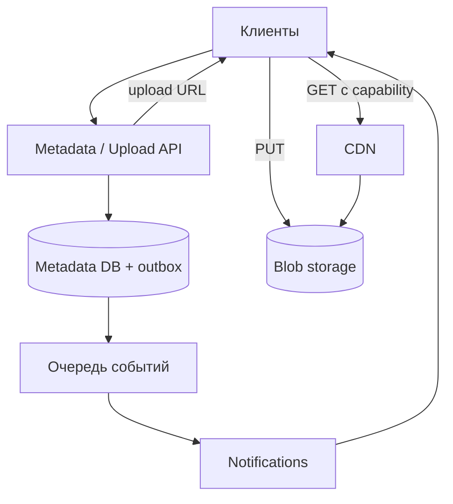
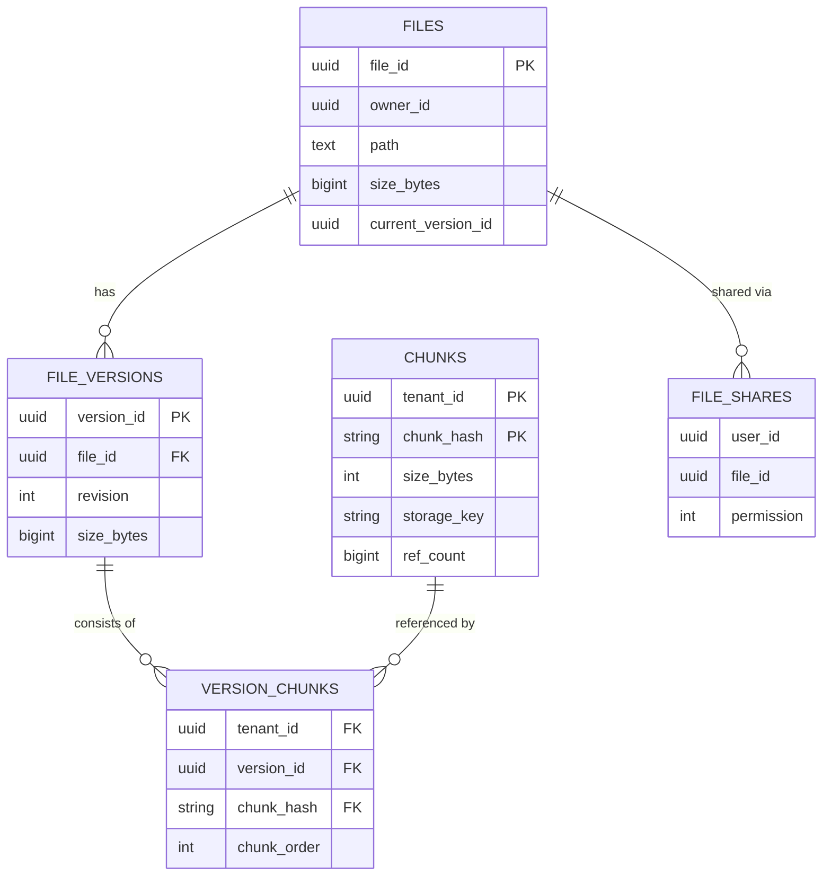
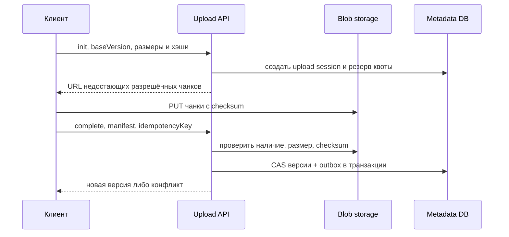
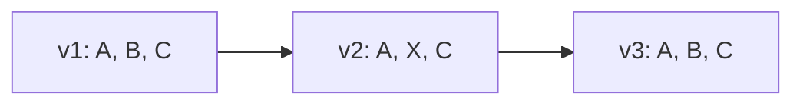
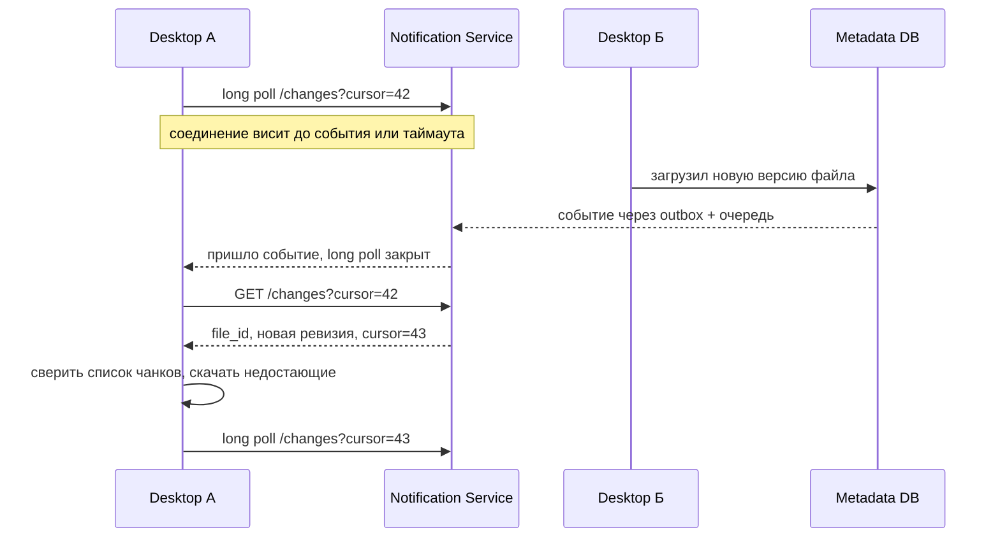
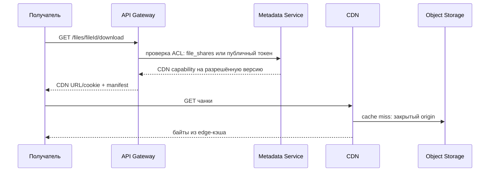

# Разбор задачи: облачное хранилище (Dropbox / Google Drive)

<!-- learning-nav:start -->
[← Все разделы](../README.md) · [Предыдущая тема](chat-messenger.md) · [Следующая тема →](video-streaming.md)
<!-- learning-nav:end -->

Задача на проектирование файлового сервиса с синхронизацией между устройствами. Внешне простая — «положить файл в облако», — но внутри: chunking, дедупликация, delta sync, версионирование, шаринг и отдельный мир метаданных. Именно поэтому её любят интервьюеры: можно копать почти в любую сторону.

Задача хорошо проверяет три вещи:

- умеете ли вы разделять **данные и метаданные** (главный архитектурный ход всего разбора);
- можете ли обосновать вынос больших файлов из реляционной БД;
- можете ли рассуждать об экономике хранения (петабайты, erasure coding, квоты, oversell).

---

## 1. Уточняющие вопросы

Прежде чем рисовать коробки, зафиксируйте скоуп. Вопросы, которые стоит задать вслух:

- Какие фичи в скоупе: загрузка/скачивание, синхронизация между устройствами, шаринг, версионирование? (Возьмите все четыре — этого хватит на 45 минут.)
- Какие клиенты: web, мобильные, desktop-клиент с синхронизацией папки?
- Какие файлы: медиа (фото/видео), документы, произвольные? Есть ли лимит на размер файла (условно 10 ГБ)?
- Нужна ли синхронизация «как в Dropbox» — локально смонтированная папка с автозаливкой?
- Шаринг: по ссылке, конкретным пользователям, read-only или с правом редактирования?
- Ожидаемый масштаб: 50 млн пользователей, 10 млн DAU — нормальная стартовая точка.
- Нужна ли дедупликация, внутри какого пользователя/tenant она разрешена и стоит ли экономия усложнения протокола?
- Требования к шифрованию: server-side, per-user ключи? (Этот вопрос потом вернётся бумерангом в разделе про дедупликацию.)

Сильная формулировка: «Предлагаю взять ядро Dropbox: загрузка, скачивание, автосинхронизация между устройствами, шаринг и версионирование. Редактирование документов онлайн, как в Google Docs, выносим за скоуп — это отдельная задача про collaborative editing и CRDT/OT».

---

## 2. Требования

### Functional

- Загрузка и скачивание файлов до согласованного лимита, например 10 ГБ.
- Автосинхронизация: локальная папка ↔ облако, изменения с одного устройства доезжают до остальных.
- Шаринг: файлом/папкой можно поделиться с конкретными пользователями или по ссылке.
- Версионирование: история изменений, возможность откатиться.
- Восстановление прерванной загрузки (resumable upload).

### Non-functional

- **Надёжность хранения**: определить допустимую потерю данных (RPO), восстановление (RTO), бэкапы метаданных и защиту от ошибочного удаления. Проектная durability выбранного класса object storage не гарантирует безошибочность нашего приложения.
- **Доступность чтения** и допустимая задержка sync между устройствами, например секунды. Публикация версии, проверка ACL и резервирование квоты требуют согласованной записи на домашнем шарде. При partition можно отложить запись; объявлять весь сервис «AP» недостаточно.
- **Эффективность по трафику и месту**: delta sync, дедупликация блоков, сжатие.
- **Низкая задержка** на операциях с метаданными (листинг папки, проверка изменений) — метаданные «горячие», байты «холодные».
- Масштаб: десятки миллионов пользователей, сотни петабайт данных.

Из реальных разборов: интервьюеры подчёркивают, что read/write ratio здесь перекошен в сторону чтения — но не так наивно, как кажется. Пользователь генерирует контент редко, зато всплесками (вернулся из отпуска — залил 10 тысяч фотографий), а потом смотрит их снова и снова. Плюс синхронизация сама по себе мультипликатор: один залитый файл разъезжается по N устройствам.

---

## 3. Оценки нагрузки (back-of-envelope)

Берём: 50 млн зарегистрированных пользователей, 10 млн DAU.

**Загрузки:**

- Допустим, 2 загрузки/изменения файла на активного пользователя в день: `10M × 2 = 20M загрузок/день`.
- QPS на запись: `20M / 86400 ≈ 240 RPS`, пик ×3 ≈ **~700 RPS**.
- Для расчёта принимаем средний размер новой версии 3 МБ. Это допущение о нашем наборе данных, а не свойство всех файловых сервисов.
- Трафик на запись: `20M × 3 МБ ≈ 60 ТБ/день ≈ 0.7 ГБ/с`, пик ~2 ГБ/с.

**Хранилище:**

- `60 ТБ/день × 365 ≈ 22 ПБ/год` новых данных (без учёта дедупликации).
- Средний пользователь занимает ~10 ГБ → 50M × 10 ГБ = **500 ПБ** суммарно. Это независимый сценарий накопленного объёма: его нельзя получить только из одного года загрузок выше.
- Экономию дедупликации измеряем на выборке. В capacity plan сначала берём 0% экономии; отдельно учитываем историю версий, репликацию, индексы и запас на восстановление.

**Метаданные:**

- ~1 КБ метаданных на файл (имя, путь, размер, хэши, владелец, ACL).
- Если средний пользователь держит ~2000 файлов: `50M × 2000 = 100 млрд файлов` → `100 млрд × 1 КБ ≈ 100 ТБ` метаданных. Одной БД мало — нужно шардирование.
- Файлов и блоков — **десятки миллиардов записей**. Это важно сказать интервьюеру: наивная схема «одна табличка files в Postgres» на таком объёме не живёт.

**Синхронизация:**

- 10 млн DAU, в среднем 2 устройства → миллионы долгоживущих соединений (long polling / WebSocket) к notification-сервису.
- Каждое изменение файла — fanout на все устройства всех пользователей, имеющих к нему доступ. Трафик чтения заметно больше трафика записи.

Для оценки стоимости считаем физический объём отдельно от логического: 500 ПБ данных при кодировании 4+2 требуют минимум 750 ПБ фрагментов, а при трёх полных копиях — 1.5 ЭБ, ещё до резерва и метаданных. Это варианты собственного storage-движка; managed object storage тарифицируется по своему классу, его внутреннее кодирование мы не выбираем. Проданные квоты не равны использованной ёмкости: нужен прогноз заполнения, запас и отказ в новых записях до исчерпания дисков.

---

## 4. API

REST, авторизация по токену в заголовках (на схемах опускаем):

```text
POST   /files/upload            — инициировать загрузку (метаданные + хэши чанков)
                                  → возвращает uploadId + presigned URLs на чанки
POST   /files/upload/complete   — опубликовать версию (uploadId, baseVersion, idempotencyKey)
GET    /files/{fileId}/download — получить метаданные + presigned URL(ы) на скачивание
POST   /files/{fileId}/share    — поделиться: список userId, права (read/write), или ссылка
GET    /files/list?path=/docs   — листинг «папки» (папки виртуальные, см. ниже)
GET    /changes?cursor=42       — изменения с позиции cursor (для sync-клиентов)
GET    /files/{fileId}/versions — история версий
POST   /files/{fileId}/restore  — откат на версию
```

Про presigned URLs стоит сказать явно: мы **не пропускаем байты через свой API-сервис**. Если клиент грузит файл нам на сервер, а мы потом перекладываем его в blob storage, мы:

- делаем двойную работу и в два раза больше трафика;
- греем свой stateless-сервис тяжёлым I/O в час пик;
- заставляем европейского пользователя гнать байты в американский ДЦ, откуда они потом ещё и реплицируются обратно.

Правильный паттерн: сервис выдаёт **подписанную ссылку**, клиент льёт байты напрямую в объектное хранилище (S3), сервис только фиксирует метаданные.

---

## 5. High-level design

Ключевое разделение всей системы: **метаданные** (кто, что, где лежит, версии, права — «горячие», нужны миллисекундные ответы, живут в шардированной БД) и **байты** (иммутабельные блоки в объектном хранилище — «холодные», отдаём через CDN).



Компоненты:

- **API Gateway** — входная точка: балансировка, rate limiting, аутентификация.
- **Metadata Service** — вся бизнес-логика: файлы, версии, права, листинги.
- **Upload / Block Service** — нарезка логики загрузки: выдача presigned URLs, подтверждение чанков, дедупликация.
- **Object Storage (S3)** — байты. Неизменяемые объекты, плоское пространство имён, автоматическая репликация/erasure coding внутри.
- **Message Queue** — события «файл изменён» (транзакционный outbox из metadata DB).
- **Notification Service** — держит long polling / WebSocket соединения sync-клиентов, рассылает «у файла X новая ревизия».
- **CDN** — скачивание популярного контента ближе к пользователю; критично для шаринга по публичной ссылке (кейс «селебрити выложил файл — полмиллиона человек ломится скачивать»).

Большие файлы можно хранить в SQL, но при этом их объём входит в WAL, репликацию, бэкапы и восстановление БД. PostgreSQL использует TOAST для больших `bytea`: они не заставляют каждый запрос к метаданным читать все байты фотографии. Вынос в blob storage нужен здесь из-за независимого масштабирования и стоимости хранения/раздачи; для небольшого сервиса маленькие BLOB в БД могут быть разумным упрощением.

Что даёт объектное хранилище «из коробки» и почему мы его берём, а не пишем файлы на диски своих серверов:

- **Плоское пространство имён**: объект адресуется одним ключом-строкой, никакой навигации по дереву каталогов (корзины и «папки» в UI S3 — лишь сахар над префиксами ключа).
- **Неизменяемые ключи в нашей модели**: публикуем каждый чанк под новым ключом и запрещаем его перезапись. Сам storage API может разрешать replace; без условий записи гонки никуда не исчезают.
- **Отказоустойчивость выбранного класса**: размещение по зонам зависит от storage class. Межрегиональная копия требует настройки; S3 CRR асинхронна, поэтому failover учитывает replication lag.

---

## 6. Data model

Плоское пространство ключей blob storage не определяет модель папок в metadata DB. Для простого сервиса можно хранить полный `path`. Для дешёвого переименования папки и наследуемых ACL удобнее явные `folders(folder_id, parent_id)` и `files(parent_id, name)`: rename меняет одну запись, а не все пути потомков. Ниже приведена упрощённая модель с `path`.

Идентификаторы могут быть UUIDv7. Порядок по времени полезен для locality индекса, но не определяет shard key: метаданные ниже распределяем по `owner_id`. Range-шардирование свежих UUID само по себе может создать горячий последний диапазон.

```sql
-- Файл (логическая сущность, то, что видит пользователь)
files (
    file_id     uuid,        -- UUIDv7
    owner_id    uuid,
    path        text,        -- "/docs/report.pdf" — "папки" выводятся из пути
    size_bytes  bigint,
    mime_type   text,
    current_version_id uuid,
    is_deleted  boolean,     -- soft delete -> корзина
    created_at  timestamptz,
    updated_at  timestamptz
) SHARD BY owner_id;

-- Версия файла: набор ссылок на чанки
file_versions (
    version_id  uuid,
    file_id     uuid,
    revision    int,         -- монотонный номер для sync-клиентов
    size_bytes  bigint,
    created_at  timestamptz
);

-- Физический чанк: контент-адресуемый, иммутабельный
chunks (
    tenant_id   uuid,        -- dedup только внутри tenant
    chunk_hash  char(64),    -- SHA-256 блока = идентификатор (dedup key)
    size_bytes  int,
    storage_key text,        -- ключ объекта в S3
    ref_count   bigint       -- сколько версий файлов на него ссылаются
) SHARD BY (tenant_id, chunk_hash);

-- Состав версии: порядок чанков в файле
version_chunks (
    tenant_id   uuid,
    version_id  uuid,
    chunk_hash  char(64),     -- ссылка на (tenant_id, chunk_hash)
    chunk_order int,
    PRIMARY KEY (version_id, chunk_order)
);

-- Шаринг: отдельная таблица связей
file_shares (
    user_id     uuid,
    file_id     uuid,
    permission  smallint,    -- 1=read, 2=write
    PRIMARY KEY (user_id, file_id)
) SHARD BY user_id;
```



Замечания, которые любят интервьюеры:

- **Почему шаринг — отдельная таблица, а не массив `shared_with` в записи файла?** Потому что типовой запрос — «дай файлы, которыми поделились со мной». Массивы индексируются, например GIN в PostgreSQL, но отдельные связи удобнее для обратного поиска, изменения отдельных прав и маршрутизации по получателю. Таблица связей `(user_id, file_id)` с B-tree по `user_id` и шардированием по `user_id` идеально ложится в паттерн запросов.
- **Шардирование по `owner_id` / `user_id`** — дружелюбный ключ: вся домашняя папка пользователя на одном шарде. Но активность пользователей неравномерна — будут «жирные» шарды, нужна перебалансировка (виртуальные шарды/бакеты, как в Vitess или DynamoDB).
- **Это не один шардированный кластер, а несколько**: метаданные файлов шардируются по пользователю, чанки — по tenant и хэшу, шаринг — по получателю. У сущностей разный профиль нагрузки, и общий ключ шардирования подобрать нельзя. Сильный ход — озвучить это самому, не дожидаясь вопроса.
- **GC чанков**: нулевой `ref_count` — кандидат на удаление. Межшардовые сбои могут рассинхронизировать счётчик; нужны durable ссылки, tombstone/lease, периодическая сверка и повторная проверка перед удалением. Одна задержка sweeper не устраняет гонку с новым commit. Успешное удаление объекта S3 имеет strong consistency; это не гарантия свежести CDN-кэша.

---

## 7. Deep dive 1: Chunking и resumable upload

Различаем логический чанк приложения и part multipart-протокола. Для dedup/delta sync здесь выбираем отдельные неизменяемые объекты по 4–8 МиБ и manifest версии с их порядком. Каждый такой объект можно загрузить обычным PUT. При 4 МиБ миллион файлов по 4 ГиБ порождает примерно миллиард ссылок на чанки — стоимость метаданных тоже надо считать.

S3 multipart — другой вариант: части принадлежат одной upload-сессии, а `CompleteMultipartUpload` создаёт один объект. Он не склеивает произвольные ранее загруженные dedup-объекты и не даёт ссылаться на part другой сессии. По текущим ограничениям S3 обычная part не меньше 5 МиБ (кроме последней), максимум 10 000 parts: 4-МиБ dedup-чанки нельзя напрямую считать такими parts. При 8 МиБ × 10 000 получится около 78 ГиБ, а не 40 ТБ. Для более крупных объектов размер part увеличивают.

| Логический чанк | Выигрыш | Цена |
|---|---|---|
| 64 КиБ–1 МиБ | Точная дельта | Много ссылок и PUT |
| 4–16 МиБ | Меньше метаданных | Правка байта перезагружает чанк |

Протокол для выбранной модели отдельных объектов:



Сервер не доверяет клиентскому списку `done`: проверяет объекты, связь с upload session и допустимый суммарный размер. ETag не следует считать универсальным SHA-256, особенно для multipart. Подписанный checksum должен быть проверен storage, либо доверенный ingestion-воркер пересчитывает хэш до публикации. Иначе клиент может объявить hash(A), загрузить B и отравить dedup для остальных.

Состояние session позволяет продолжить загрузку, обновить истёкшие URL после повторной авторизации и безопасно повторить complete. Неиспользованные объекты очищаются после истечения session и проверки отсутствия опубликованных ссылок. Если выбран один большой multipart-объект, вместо manifest используем storage complete и отдельное правило очистки незавершённых multipart-сессий.

---

## 8. Deep dive 2: Дедупликация блоков по хэшу

`SHA-256(bytes)` — ключ поиска одинаковых байтов, а не право их читать. Безопасный baseline — dedup внутри tenant: `(tenant_id, chunk_hash, size)`. Глобальный lookup «такой hash уже есть» нельзя превращать в выдачу ссылки чужого файла. Клиент, знающий хэш известного документа, ещё не доказал владение его байтами и не прошёл ACL.

Даже ответ «загружать не нужно» может раскрывать наличие документа у другого клиента. Поэтому кросс-tenant dedup требует отдельной оценки приватности и протокола подтверждения владения; проще загрузить и проверить байты, а физическую экономию сделать серверной и не раскрывать её через скорость/ответ API. В tenant с чувствительными файлами можно вообще отказаться от instant upload.

При 10¹⁰ независимых блоков birthday-оценка вероятности случайной коллизии SHA-256 имеет порядок `n² / 2²⁵⁷ ≈ 4 × 10⁻⁵⁸`. Это не заменяет проверку целостности и защиту от злонамеренных загрузок. Хэш manifest версии включает упорядоченные пары `(hash, length)`, алгоритм и формат; перестановка блоков должна менять идентификатор версии.

Шифрование уточняем по уровню. Независимое клиентское шифрование случайными ключами/nonce скрывает одинаковость plaintext от сервера, и глобальный plaintext-dedup ему недоступен. Но server-side envelope encryption может хранить общий ciphertext чанка с отдельными разрешениями на ключи: само выражение «у пользователей разные ключи» ещё не доказывает невозможность dedup. Convergent encryption раскрывает равенство и позволяет угадывать низкоэнтропийное содержимое; это не бесплатный обход компромисса.

Решение принимается по экономии на измеренном корпусе, требованиям изоляции, стоимости ключей и GC. По умолчанию сохраняем байты с проверенным хэшем и права независимо от физического расположения.

---

## 9. Deep dive 3: Версионирование и delta sync

**Иммутабельные блоки.** Чанк никогда не изменяется — появляется только новый чанк с новым хэшом. Версия файла = упорядоченный список ссылок на чанки. Изменение файла локализовано: поменялся второй блок из четырёх → новая версия ссылается на три старых чанка и один новый. При откате создаём новую монотонную ревизию, ссылающуюся на старый manifest: байты не копируются, но change log и аудит видят новое событие.



В v2 заменён блок B, а v3 — новая ревизия отката к содержимому v1.

**Delta sync** — передаём только изменившиеся чанки, а не файл целиком. Клиент после правки файла пересчитывает хэши чанков, отправляет серверу новый список; сервер отвечает, какие чанки у него уже есть, клиент заливает только недостающие. Зеркально при скачивании: sync-клиент знает, какие чанки у него уже лежат локально, и дотягивает только дельту.

Здесь — известное место, где кандидаты переусложняют. Частая ошибка: тащить в дизайн rsync-подобную дельта-кодировку со скользящим окном (rolling hash, Rabin fingerprint, чанки переменной длины по content-defined chunking). На собеседовании стоит честно оценить профит:

- Для **медиа** часто преобладают новые файлы и чтение без изменений; выгода CDC зависит от реального характера правок.
- Для **офисных документов** сюрприз: современные форматы — это zip с XML внутри. ZIP-контейнер может изменить сжатые части, смещения и метаданные. Иногда меняется небольшая часть, иногда почти весь файл: экономию delta sync нельзя обещать по расширению файла.
- Реально выигрывают: текстовые файлы, код, правки «в середину» больших бинарников (образы дисков, БД-файлы).

Поэтому разумный ответ: фиксированные чанки + дедуп по хэшу как baseline; content-defined chunking (как в restic/Borg) упомянуть как опцию, если профиль нагрузки — документы и бэкапы, а не медиа.

**Синхронизация remote → local.** Desktop-клиент держит соединение с Notification Service (long polling: запрос `/changes` висит до события или таймаута, затем переподключается). События рождаются транзакционным outbox из metadata DB → очередь → fanout всем заинтересованным устройствам.



Два неочевидных момента из практики:

- **Синхронизация — мультипликатор трафика.** Залитый файл размножается на все устройства всех пользователей с доступом: за трафик платим в несколько раз больше, чем за исходную загрузку. Поэтому реальные клиенты по умолчанию работают в режиме **on-demand**: показывают файл в папке (placeholder), но байты скачивают только при открытии. «Способность выдержать нагрузку не означает необходимость её создавать» — по умолчанию «скачивать всё» включать нельзя.
- **Конфликты.** Клиент передаёт `baseVersion`. Commit выполняет CAS: `UPDATE files SET current_version_id=:new WHERE file_id=:id AND current_version_id=:base`. Если изменено 0 строк, версия уже сменилась: возвращаем 409 и сохраняем кандидата как конфликтную копию. Часы устройств не выбирают победителя, CRDT для произвольных бинарных файлов не требуется.

---

## 10. Deep dive 4: Sharing и permissions

Модель прав:

- **Владелец** — полный доступ, управление шарингом.
- **Явный шаринг**: записи в `file_shares (user_id, file_id, permission)` — read/write.
- **Публичная ссылка**: токен с высокой энтропией (`/s/{128-bit token}`), опционально TTL и пароль. «Запрет скачивания» в интерфейсе не мешает получателю сохранить уже полученные байты. Публичные ссылки — это отдельная нагрузка: выложенная «селебрити» ссылка даёт всплеск чтения, который гасится CDN, а не нашим хранилищем.

Поток скачивания по шарингу:



Для прямой раздачи S3 presigned URL — bearer capability. Его TTL ограничен также сроком credentials; прекращение выдачи новых URL не отзывает уже выданные. Изменение IAM/bucket policy либо отзыв credentials могут прекратить будущие storage-запросы, но это часто затронет больше одной ссылки. TTL проверяется при начале запроса: уже идущая загрузка может продолжиться.

Если используется CDN, он проверяет собственную подпись/cookie на каждом viewer request, включая cache hit; origin закрыт от прямого доступа. S3 presigned URL сам по себе не авторизует чтение из edge-кэша. Для быстрого отзыва требуется поддерживаемая edge-проверка актуального denylist/версии доступа, иначе оговариваем окно до истечения capability. Инвалидация кэша и отзыв прав решают разные задачи.

Edge cases, которые спросят:

- **Шаринг папки** = префиксный матчинг по `path` + материализованный список прав с наследованием; либо явная таблица `folder_shares` + проверка по иерархии.
- **Отзыв доступа** при скачанном файле — доступ отзываем на сервере, локальную копию у пользователя не отнять (это честно сказать).
- **Корпоративные группы**: группа из 500 тысяч аккаунтов не кладётся в одну строку и не шардируется «по пользователю» так просто — отдельная сущность `groups` со своим кластером и развёртывание group → members при проверке ACL (с кэшем).

---

## 11. Trade-offs: сводная таблица

| Решение | Выбрали | Альтернатива | Почему так |
|---|---|---|---|
| Загрузка байтов | Presigned URLs напрямую в S3 | Через наш API-сервис | Не греем сервис I/O, нет двойного трафика, геолокально ближе |
| Метаданные | Шардированный Postgres + outbox | MongoDB / DynamoDB | На собеседовании честно: важны CAS, ACL, квоты и транзакционный outbox; межшардовые ссылки требуют отдельного протокола |
| Надёжность байтов | Erasure coding (4+2: любые 2 из 6 потерянных фрагментов восстановимы, overhead ~50%) | 3x-репликация (overhead 200%) | На сотнях петабайт разница — десятки миллионов долларов; цена — сложность и вычисления при восстановлении |
| Размер чанка | 4–8 МБ фиксированные | CDC переменной длины (rsync/restic) | Профиль нагрузки — медиа; CDC окупается на документах/бэкапах, не здесь |
| Дедупликация | Внутри tenant по проверенному SHA-256 | Глобальная / отключена | Изоляция и простота против экономии |
| Согласованность | CAS commit, async sync | Multi-writer merge | Публикация и ACL согласованы; уведомления могут запаздывать |
| Синхронизация | On-demand placeholder по умолчанию | Полная реплика на каждое устройство | Трафик × число устройств; диски на устройствах меньше облака |
| Идентификаторы | UUIDv7 | UUIDv4 | Locality индекса; shard key выбирается отдельно |

---

## 12. Красные флаги / типичные ошибки кандидатов

- **Хранить файлы в реляционной БД** как bytea или «на дисках API-серверов». Нужно сразу разделить: байты → объектное хранилище, метаданные → БД.
- **Гнать байты через бэкенд** вместо presigned URLs. Удвоение трафика и I/O на stateless-сервисе — первая вещь, за которую цепляются.
- **Смешать дерево папок в метаданных с ключами blob storage.** Явное дерево допустимо и полезно для rename и ACL.
- **Тащить rsync/rolling hash как обязательную часть**, не оценив профиль нагрузки. На медиа-контенте это мёртвый код; интервьюеры это знают и специально ждут, сверите ли вы решение с типом данных.
- **Принять content hash за авторизацию** или обещать глобальный dedup без модели приватности и шифрования.
- **Шаринг массивом в записи файла** без ответа на вопрос «а как ты найдёшь файлы, расшаренные конкретному пользователю, на миллиарде записей».
- **Одна база метаданных «на всё»** без разговора о шардировании: 100 млрд файлов и сотни ТБ метаданных в одну БД не влезают.
- **Commit без baseVersion/CAS и сохранения конфликта**: потеря пользовательских правок недопустима.
- **Молчать про экономику**: на масштабе сотен петабайт вопросы erasure coding vs репликация, квот и tiering (горячие/холодные данные автоматически переезжают между классами хранения) — это и есть суть задачи, а не только API-шки.

---

## 13. Что спросят дополнительно

- Как устроен S3 внутри? (Обсудить внешний контракт: strong consistency PUT/GET/LIST в S3 и отдельную асинхронную CRR; не придумывать внутренние алгоритмы managed-сервиса.)
- Как масштабировать Notification Service на миллионы соединений? (Число активных соединений, память/FD, heartbeat, reconnect jitter, шардирование по user_id; стоимость long polling и WebSocket измеряется на профиле соединений.)
- Как сделать поиск по именам файлов? (Отдельный search-индекс: Elasticsearch/OpenSearch, подписка на события из outbox.)
- Корзина и восстановление: soft delete + TTL-джоба, которая декрементит `ref_count` и GC чанков с нулём ссылок.
- Вирусное сканирование / модерация при публичном шаринге (асинхронный пайплайн после complete).
- Квоты: атомарный резерв перед upload, commit фактического размера и освобождение резерва по expiry. Async-счётчик подходит для UI, но не для жёсткого лимита.
- Георепликация метаданных: пользователь привязан к домашнему региону, метаданные реплицируются, байты лениво мигрируют ближе к месту чтения.
- Бэкап-нагрузка как частный случай: миллионы мелких файлов на пользователя (снапшоты диска) требуют мегаскоростного чтения метаданных «дата изменения + размер» для построения инкрементов — отдельный профиль нагрузки на metadata DB.
- Rate limiting загрузок, abuse (хранилище как бесплатный CDN для пиратов), dedup-атаки (проверка «есть ли такой файл у сервиса» как oracle).

---

## 14. Что говорить интервьюеру: сильные формулировки

- «Главный архитектурный ход — разделить метаданные и байты: это два разных мира с разным профилем нагрузки, и даже шардируются они по-разному».
- «Байты через мой сервис не проходят: я выдаю presigned URL, и клиент льёт напрямую в объектное хранилище».
- «Неизменяемые чанки позволяют переиспользовать байты; отдельно проектирую ACL, проверку хэша, commit manifest и безопасный GC».
- «Delta sync оцениваю по профилю данных: для медиа сложная дельта-математика не окупается, поэтому baseline — фиксированные чанки 4–8 МБ».
- «Уведомления могут запаздывать, но публикация версии выполняется CAS на домашнем шарде».
- «Уточняю модель шифрования: client-side случайный ciphertext, server-side envelope keys и dedup имеют разные компромиссы».
- «На сотнях петабайт себестоимость хранения определяет дизайн: erasure coding 4+2 вместо 3x-репликации — это разница в разы по железу».

---

## Вопросы и сценарии отказа

### 15. Что произойдёт, если два устройства одновременно завершили загрузку на основе v7?

Оба upload сохраняют байты независимо, но публиковать новую текущую версию может только один CAS по `baseVersion=v7`. Предположим, desktop первым создал v8. Commit мобильного клиента с базой v7 получает конфликт, а его manifest сохраняется отдельной веткой либо конфликтной копией. Возвращаем клиенту обе версии и предлагаем осмысленное действие; порядок прихода сетевых пакетов не делает правки второго устройства ненужными.

В одной metadata-транзакции записываем новую версию, обновляем current pointer, завершаем session, снимаем резерв квоты и добавляем outbox-событие. Повтор запроса после потери ответа возвращает результат по `idempotencyKey`, а не создаёт v9. Manifest, не опубликованный из-за конфликта, удерживается до решения пользователя или истечения retention: GC не должен стереть правки раньше ответа клиенту.

Здесь есть граница атомарности: blob storage и metadata DB не участвуют в общей транзакции. Сначала сохраняем и проверяем байты, затем публикуем ссылки; crash между шагами оставляет orphan, который можно убрать позднее. Обратный порядок оставляет видимый файл с отсутствующими чанками. При региональном failover наличие metadata v8 ещё не доказывает, что все её чанки успели доехать в резервный регион.

### 16. Как гарантировать синхронизацию, если WebSocket потерял уведомление?

Уведомление — только подсказка «есть изменения». Источник восстановления — durable change log с непрозрачным cursor на пользователя/namespace. Клиент после reconnect запрашивает `/changes?cursor=...`, применяет события идемпотентно по file ID и revision и сохраняет cursor после успешного локального применения. Дубли и разрыв соединения не теряют изменения.

Например, клиент получил события 101–110, применил до 105 и упал. После рестарта он продолжает со 105; повторные 106–110 допустимы. Если change log хранится 30 дней, а устройство не выходило в сеть два месяца, сервер явно возвращает «cursor expired»: клиент делает согласованный snapshot листинга и получает стартовый cursor для последующих изменений. Иначе существует окно между листингом и подпиской, в котором теряются файлы.

Удаления передаются tombstone-событиями, а отзыв доступа — отдельным изменением namespace. При sync папки rename не должен выглядеть как несвязанные delete/create, если нужно сохранить локальные привязки. Ошибка — полагаться на надёжность WebSocket или использовать глобальный последовательный cursor без определения области порядка между шардами.

### 17. На подумать: отзыв ссылки и старый CDN-кэш

Пользователь заменил файл v1 на v2 по тому же публичному URL и отозвал доступ у получателя. Через секунду получатель всё ещё скачивает v1 из CDN. Какие две разные причины нужно проверить?

<details>
<summary>Разбор</summary>

Сначала разделяем свежесть и авторизацию. Если URL объекта остался прежним, edge может легально отдать v1 до TTL даже после strong-consistent перезаписи origin. Для обновлений используем versioned URL (`/file/version/chunk`), а API меняет указатель на v2; старый объект удаляем только после retention. Для срочного удаления запускаем invalidation, учитывая отдельные browser/proxy-кэши.

Затем проверяем capability: выданная до отзыва ссылка/cookie может действовать ещё несколько минут. Отзыв ACL блокирует выдачу новых capability, но не меняет их криптографическую подпись. Если требуется прекращение будущих запросов за секунды, проектируем edge-проверку denylist/ревизии доступа и измеряем время её распространения. Ни очистка origin, ни смена текущей версии не отнимают уже скачанную локальную копию. Опасный ответ — «проверим ACL только при cache miss».

</details>

---

<a id="источники-и-видео-по-теме"></a>

## Видео по теме

- [[02] System Design - Проектируем DropBox/GoogleDrive/YandexDisk](https://www.youtube.com/watch?v=8yRdKhMvzao)
- [System Design Глава 15: Проектирование Google Drive](https://www.youtube.com/watch?v=U2FcPeLKRKU)
- [Object Storage in System Design Interviews w/ Ex-Meta Staff Engineer](https://www.youtube.com/watch?v=RvaMHMxHjp4)
