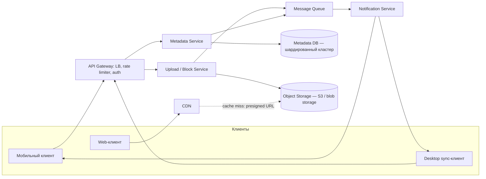
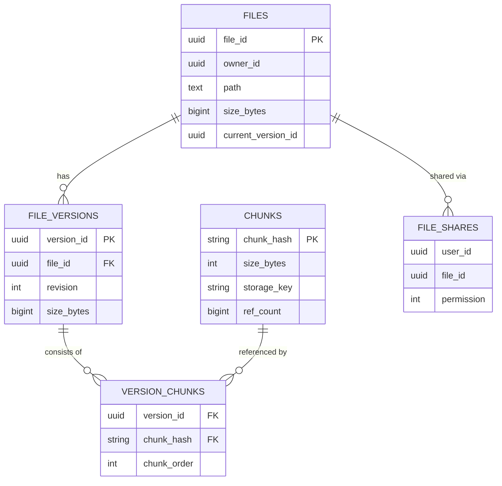
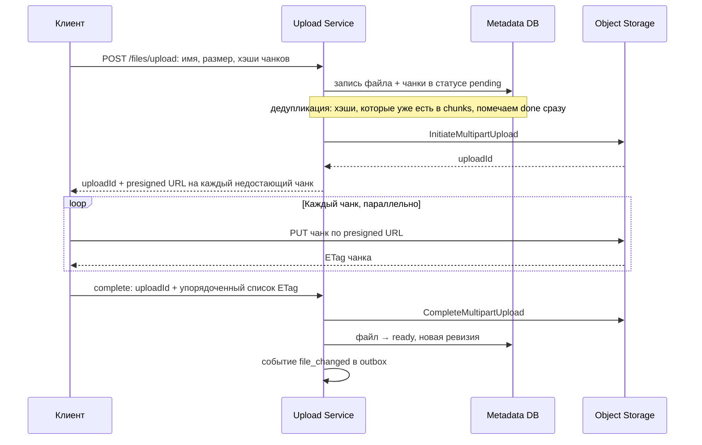
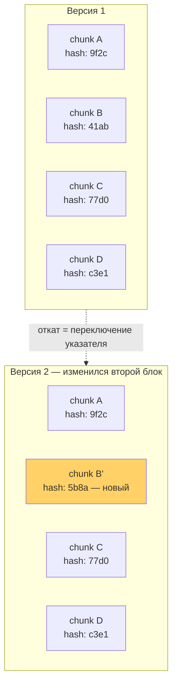
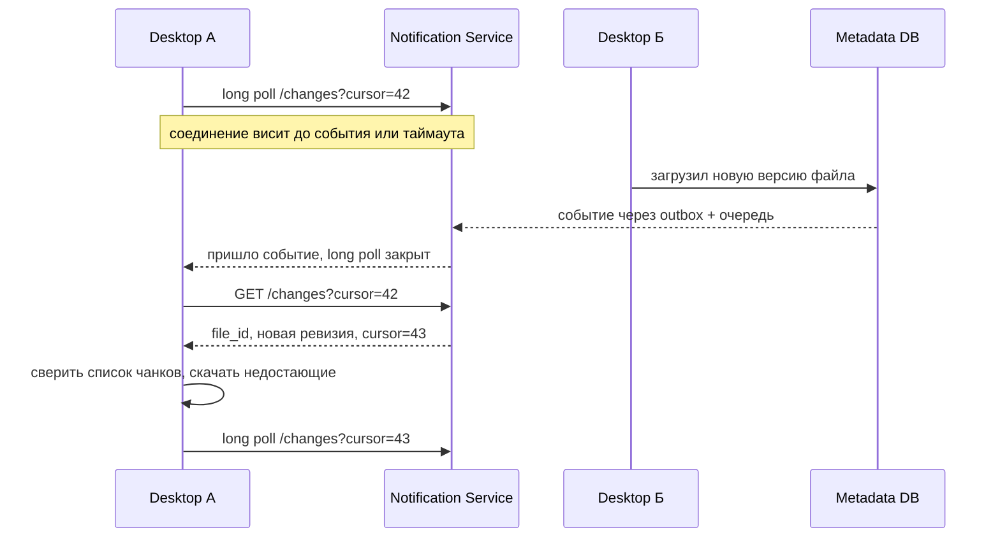
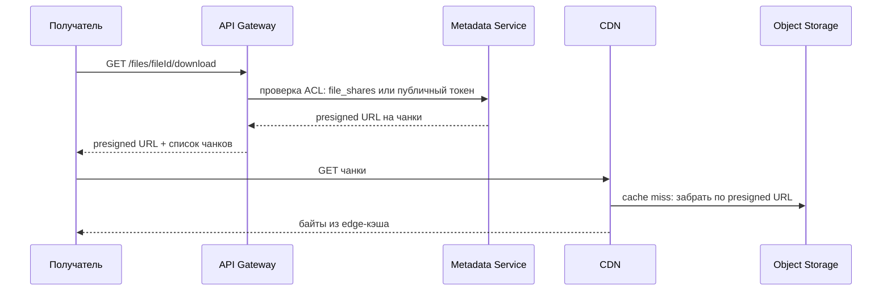

# Разбор задачи: облачное хранилище (Dropbox / Google Drive)

Классическая задача System Design интервью (глава 15 «System Design Interview» Алекса Сюй, частый гость на моках Яндекса/Ozon/Avito). Внешне простая — «положить файл в облако», — но внутри: chunking, дедупликация, delta sync, версионирование, шаринг и отдельный мир метаданных. Именно поэтому её любят интервьюеры: можно копать почти в любую сторону.

Задача хорошо проверяет три вещи:

- умеете ли вы разделять **данные и метаданные** (главный архитектурный ход всего разбора);
- понимаете ли, почему байты не живут в реляционной БД;
- можете ли рассуждать об экономике хранения (петабайты, erasure coding, квоты, oversell).

---

## 1. Уточняющие вопросы

Прежде чем рисовать коробки, зафиксируйте скоуп. Вопросы, которые стоит задать вслух:

- Какие фичи в скоупе: загрузка/скачивание, синхронизация между устройствами, шаринг, версионирование? (Возьмите все четыре — этого хватит на 45 минут.)
- Какие клиенты: web, мобильные, desktop-клиент с синхронизацией папки?
- Какие файлы: медиа (фото/видео), документы, произвольные? Есть ли лимит на размер файла (условно 10 ГБ)?
- Нужна ли синхронизация «как в Dropbox» — локально смонтированная папка с автозаливкой?
- Шаринг: по ссылке, конкретным пользователям, read-only или с правом редактирования?
- Ожидаемый масштаб: 50 млн пользователей, 10 млн DAU — нормальная стартовая точка.
- Нужна ли дедупликация и экономия места — это платная фича для бизнеса, уточните, насколько она важна.
- Требования к шифрованию: server-side, per-user ключи? (Этот вопрос потом вернётся бумерангом в разделе про дедупликацию.)

Сильная формулировка: «Предлагаю взять ядро Dropbox: загрузка, скачивание, автосинхронизация между устройствами, шаринг и версионирование. Редактирование документов онлайн, как в Google Docs, выносим за скоуп — это отдельная задача про collaborative editing и CRDT/OT».

---

## 2. Требования

### Functional

- Загрузка и скачивание файлов произвольного размера.
- Автосинхронизация: локальная папка ↔ облако, изменения с одного устройства доезжают до остальных.
- Шаринг: файлом/папкой можно поделиться с конкретными пользователями или по ссылке.
- Версионирование: история изменений, возможность откатиться.
- Восстановление прерванной загрузки (resumable upload).

### Non-functional

- **Надёжность хранения** — главное требование. Потерять пользовательский файл недопустимо: durability 99.999999999% (11 девяток, как у S3). Файлы — это часто единственная копия фотографий пользователя.
- **Высокая доступность**, причём осознанно жертвуем консистентностью: пользователь с мобильного может минуту не видеть файл, залитый с desktop, — это ок. AP-система.
- **Эффективность по трафику и месту**: delta sync, дедупликация блоков, сжатие.
- **Низкая задержка** на операциях с метаданными (листинг папки, проверка изменений) — метаданные «горячие», байты «холодные».
- Масштаб: десятки миллионов пользователей, сотни петабайт данных.

Из реальных разборов: интервьюеры подчёркивают, что read/write ratio здесь перекошен в сторону чтения — но не так наивно, как кажется. Пользователь генерирует контент редко, зато всплесками (вернулся из отпуска — залил 10 тысяч фотографий), а потом смотрит их снова и снова. Плюс синхронизация сама по себе мультипликатор: один залитый файл разъезжается по N устройствам.

---

## 3. Оценки нагрузки (back-of-envelope)

Берём: 50 млн зарегистрированных пользователей, 10 млн DAU.

**Загрузки:**

- Допустим, 2 загрузки/изменения файла на активного пользователя в день: `10M × 2 = 20M загрузок/день`.
- QPS на запись: `20M / 86400 ≈ 240 RPS`, пик ×3 ≈ **~700 RPS**.
- Средний файл — фото с телефона, ~2–4 МБ (не 500 КБ — современные фотографии с iPhone весят заметно больше; мелкие документы тоже есть, но медиа доминирует по байтам).
- Трафик на запись: `20M × 3 МБ ≈ 60 ТБ/день ≈ 0.7 ГБ/с`, пик ~2 ГБ/с.

**Хранилище:**

- `60 ТБ/день × 365 ≈ 22 ПБ/год` новых данных (без учёта дедупликации).
- Средний пользователь занимает ~10 ГБ → 50M × 10 ГБ = **500 ПБ** суммарно. Это порядок реальных цифр Dropbox.
- Дедупликация типично экономит 20–40% (те же мемы, вложения почты, переотправленные файлы).

**Метаданные:**

- ~1 КБ метаданных на файл (имя, путь, размер, хэши, владелец, ACL).
- Если средний пользователь держит ~2000 файлов: `50M × 2000 = 100 млрд файлов` → `100 млрд × 1 КБ ≈ 100 ТБ` метаданных. Одной БД мало — нужно шардирование.
- Файлов и блоков — **десятки миллиардов записей**. Это важно сказать интервьюеру: наивная схема «одна табличка files в Postgres» на таком объёме не живёт.

**Синхронизация:**

- 10 млн DAU, в среднем 2 устройства → миллионы долгоживущих соединений (long polling / WebSocket) к notification-сервису.
- Каждое изменение файла — fanout на все устройства всех пользователей, имеющих к нему доступ. Трафик чтения заметно больше трафика записи.

Честное замечание из практики: сотни петабайт — это режим, в котором **диски и серверы хранения становятся расходником**, а стоимость хранения — главной строкой расходов. Исторический пример: mail.ru Облако запустилось с 3x-репликацией и это жгло деньги; индустрия пришла к erasure coding. Dropbox стартовал поверх S3 (2007 год, S3 тогда только-только появился), а потом построил собственное хранилище (Magic Pocket) — потому что на таких объёмах экономика съедала маржу. Google Drive, по рассказам разработчиков, на старте продавал квоты, физически не имея ёмкости под них, — вводили железо по мере реального заполнения. Это нормально упомянуть на собеседовании, когда обсуждаете квоты и oversell.

---

## 4. API

REST, авторизация по токену в заголовках (на схемах опускаем):

```text
POST   /files/upload            — инициировать загрузку (метаданные + хэши чанков)
                                  → возвращает uploadId + presigned URLs на чанки
POST   /files/upload/complete   — завершить multipart-загрузку (uploadId, список ETag чанков)
GET    /files/{fileId}/download — получить метаданные + presigned URL(ы) на скачивание
POST   /files/{fileId}/share    — поделиться: список userId, права (read/write), или ссылка
GET    /files/list?path=/docs   — листинг «папки» (папки виртуальные, см. ниже)
GET    /changes?cursor=42       — изменения с позиции cursor (для sync-клиентов)
GET    /files/{fileId}/versions — история версий
POST   /files/{fileId}/restore  — откат на версию
```

Про presigned URLs стоит сказать явно: мы **не пропускаем байты через свой API-сервис**. Если клиент грузит файл нам на сервер, а мы потом перекладываем его в blob storage, мы:

- делаем двойную работу и в два раза больше трафика;
- греем свой stateless-сервис тяжёлым I/O в час пик;
- заставляем европейского пользователя гнать байты в американский ДЦ, откуда они потом ещё и реплицируются обратно.

Правильный паттерн: сервис выдаёт **подписанную ссылку**, клиент льёт байты напрямую в объектное хранилище (S3), сервис только фиксирует метаданные.

---

## 5. High-level design

Ключевое разделение всей системы: **метаданные** (кто, что, где лежит, версии, права — «горячие», нужны миллисекундные ответы, живут в шардированной БД) и **байты** (иммутабельные блоки в объектном хранилище — «холодные», отдаём через CDN).



Компоненты:

- **API Gateway** — входная точка: балансировка, rate limiting, аутентификация.
- **Metadata Service** — вся бизнес-логика: файлы, версии, права, листинги.
- **Upload / Block Service** — нарезка логики загрузки: выдача presigned URLs, подтверждение чанков, дедупликация.
- **Object Storage (S3)** — байты. Неизменяемые объекты, плоское пространство имён, автоматическая репликация/erasure coding внутри.
- **Message Queue** — события «файл изменён» (транзакционный outbox из metadata DB).
- **Notification Service** — держит long polling / WebSocket соединения sync-клиентов, рассылает «у файла X новая ревизия».
- **CDN** — скачивание популярного контента ближе к пользователю; критично для шаринга по публичной ссылке (кейс «селебрити выложил файл — полмиллиона человек ломится скачивать»).

Почему не хранить файлы в реляционной БД (частый вопрос интервьюера): Postgres пакует строки в 8-КБ страницы, и 4-МБ фотография размазывается по ~500 страницам. Это портит даже простые запросы (`SELECT top 50 users` теперь тащит гигантские страницы), раздувает WAL и репликацию (блоб копируется на каждую реплику при каждой записи) и превращает восстановление из бэкапа из минут в часы. Блобы живут в объектном хранилище, в БД — только ключи.

Что даёт объектное хранилище «из коробки» и почему мы его берём, а не пишем файлы на диски своих серверов:

- **Плоское пространство имён**: объект адресуется одним ключом-строкой, никакой навигации по дереву каталогов (корзины и «папки» в UI S3 — лишь сахар над префиксами ключа).
- **Иммутабельность**: объект нельзя изменить «в середине» — только перезаписать целиком или создать новую версию. Это убирает локи и race conditions на уровне движка хранения, отсюда дешевизна и скорость.
- **Надёжность**: данные асинхронно раскладываются по репликам внутри ДЦ, потом по регионам; переживаем сгоревший ДЦ.

---

## 6. Data model

Файлы в облачном хранилище **не имеют классической древовидной ФС** — всё лежит плоско, а «папки» в UI строятся из путей в имени файла (`/docs/report.pdf`). Это стандартный приём, о нём прямо спрашивают.

Идентификаторы — UUIDv7 (или аналог на базе unix-timestamp): k-sortable, по ним удобно шардировать диапазонами.

```sql
-- Файл (логическая сущность, то, что видит пользователь)
files (
    file_id     uuid,        -- UUIDv7
    owner_id    uuid,
    path        text,        -- "/docs/report.pdf" — "папки" выводятся из пути
    size_bytes  bigint,
    mime_type   text,
    current_version_id uuid,
    is_deleted  boolean,     -- soft delete -> корзина
    created_at  timestamptz,
    updated_at  timestamptz
) SHARD BY owner_id;

-- Версия файла: набор ссылок на чанки
file_versions (
    version_id  uuid,
    file_id     uuid,
    revision    int,         -- монотонный номер для sync-клиентов
    size_bytes  bigint,
    created_at  timestamptz
);

-- Физический чанк: контент-адресуемый, иммутабельный
chunks (
    chunk_hash  char(64),    -- SHA-256 блока = идентификатор (dedup key)
    size_bytes  int,
    storage_key text,        -- ключ объекта в S3
    ref_count   bigint       -- сколько версий файлов на него ссылаются
) SHARD BY chunk_hash;

-- Состав версии: порядок чанков в файле
version_chunks (
    version_id  uuid,
    chunk_hash  char(64),
    chunk_order int,
    PRIMARY KEY (version_id, chunk_order)
);

-- Шаринг: отдельная таблица связей
file_shares (
    user_id     uuid,
    file_id     uuid,
    permission  smallint,    -- 1=read, 2=write
    PRIMARY KEY (user_id, file_id)
) SHARD BY user_id;
```



Замечания, которые любят интервьюеры:

- **Почему шаринг — отдельная таблица, а не массив `shared_with` в записи файла?** Потому что типовой запрос — «дай файлы, которыми поделились со мной». По массиву внутри документа нормальный индекс под это не построить (в Postgres выручил бы GIN, но мы хотим шардироваться и скейлиться до миллиардов строк). Таблица связей `(user_id, file_id)` с B-tree по `user_id` и шардированием по `user_id` идеально ложится в паттерн запросов.
- **Шардирование по `owner_id` / `user_id`** — дружелюбный ключ: вся домашняя папка пользователя на одном шарде. Но активность пользователей неравномерна — будут «жирные» шарды, нужна перебалансировка (виртуальные шарды/бакеты, как в Vitess или DynamoDB).
- **Это не один шардированный кластер, а несколько**: метаданные файлов шардируются по пользователю, чанки — по хэшу, шаринг — по получателю. У сущностей разный профиль нагрузки, и общий ключ шардирования подобрать нельзя. Сильный ход — озвучить это самому, не дожидаясь вопроса.
- **GC чанков**: `ref_count = 0` → чанк можно удалять (асинхронный sweeper; сами удаления из S3 — eventual, с задержкой, чтобы не снести блок, на который кто-то прямо сейчас создаёт ссылку).

---

## 7. Deep dive 1: Chunking и resumable upload

Файл нарезается на чанки **4–8 МБ** (S3 multipart: до 10 000 частей → файлы до ~40 ТБ). Почему не целиком:

- обрыв сети на 90% двухгигабайтного файла не должен сжечь весь прогресс — перезаливаем только недоехавшие чанки;
- чанки грузятся **параллельно**, упираемся в канал клиента, а не в один TCP-поток;
- чанк — атом дедупликации и delta sync (ниже).

Размер чанка — trade-off, и тут кандидаты часто ошибаются в обе стороны:

| Размер чанка | Плюсы | Минусы |
|---|---|---|
| Мелкий (64 КБ–1 МБ) | Точный delta sync, лучше дедупликация | Взрыв метаданных: файл 100 ГБ = 100k+ записей; накладные расходы на каждый PUT |
| Крупный (4–16 МБ) | Мало метаданных, эффективная передача | Грубая гранулярность: правка 1 байта внутри чанка = перезаливка 8 МБ |

Из реальных разборов: «от маленьких блоков толку никакого» — в пользовательском хранилище доминируют медиафайлы, для них сверхточная гранулярность не нужна. Dropbox в реальности использует 4 МБ.

Протокол загрузки — по сути S3 Multipart Upload:



Важные детали для интервью:

- Хэши чанков клиент считает **локально** до загрузки — это позволяет серверу ответить «этот чанк у нас уже есть, грузить не надо» ещё до передачи байтов (instant upload: второй пользователь, заливающий тот же файл, «загружает» его за миллисекунды).
- Каждый чанк можно перезаливать независимо; presigned URL имеет TTL и scope ровно на один объект.
- Статусы чанков живут в метаданных — сервер знает, что недогружено, и клиент может докачать с нужного места хоть с другого устройства.
- Сборка файла из чанков — на стороне хранилища (CompleteMultipartUpload склеивает parts), наш сервис байт не трогает.

---

## 8. Deep dive 2: Дедупликация блоков по хэшу

Чанк адресуется **содержимым**: `chunk_id = SHA-256(bytes)`. Два одинаковых блока от разных пользователей/файлов — один физический объект в S3 и одна запись в `chunks` с инкрементом `ref_count`.

Что это даёт:

- экономия 20–40% ёмкости на реальном пользовательском контенте (переотправленные документы, одинаковые фото из мессенджеров, дистрибутивы);
- instant upload по хэшу целого файла (цепочка хэшей чанков = эффективный «хэш файла»);
- естественная совместимость с версионированием (см. deep dive 3).

Тонкие места, которые проверяют вопросами:

- **Коллизии**: вероятность коллизии SHA-256 на 10¹⁰ блоках пренебрежимо мала — это безопаснее, чем полагаться на то, что диск не битнёт данные. MD5/SHA-1 для новых систем не берём (длина + известные атаки; хотя для дедупа, а не безопасности, формально хватило бы).
- **Дедупликация vs шифрование** — ловушка, на которой спотыкаются почти все. Если данные каждого пользователя шифруются **своим ключом**, одинаковый блок у двух пользователей даёт разный шифротекст → кросс-пользовательская дедупликация **в принципе невозможна**. Варианты: дедуп только внутри пользователя, convergent encryption (ключ = хэш данных, как было в некоторых системах — но это утекает информацией «у кого-то уже есть такой файл»), или честно сказать «при per-user шифровании дедупликацию отключаем». Знание этого конфликта — сильный сигнал для интервьюера.
- **Side-channel**: сам факт instant upload сообщает «такой файл в системе уже есть». Для большинства систем приемлемо, для параноидальных — нет.

---

## 9. Deep dive 3: Версионирование и delta sync

**Иммутабельные блоки.** Чанк никогда не изменяется — появляется только новый чанк с новым хэшом. Версия файла = упорядоченный список ссылок на чанки. Изменение файла локализовано: поменялся второй блок из четырёх → новая версия ссылается на три старых чанка и один новый. Откат — просто переключение `current_version_id` на старую ревизию, байты вообще не двигаются.



**Delta sync** — передаём только изменившиеся чанки, а не файл целиком. Клиент после правки файла пересчитывает хэши чанков, отправляет серверу новый список; сервер отвечает, какие чанки у него уже есть, клиент заливает только недостающие. Зеркально при скачивании: sync-клиент знает, какие чанки у него уже лежат локально, и дотягивает только дельту.

Здесь — известное место, где кандидаты переусложняют. Частая ошибка: тащить в дизайн rsync-подобную дельта-кодировку со скользящим окном (rolling hash, Rabin fingerprint, чанки переменной длины по content-defined chunking). На собеседовании стоит честно оценить профит:

- Для **медиа** (фото, видео, архивы — а это основная масса байтов) инкрементальной докачки почти не бывает: файлы либо новые, либо не меняются. Сложная дельта-машина в 90% случаев бесполезна.
- Для **офисных документов** сюрприз: современные форматы — это zip с XML внутри. Поменял одну строчку — перепаковался весь архив, и на блочном уровне изменился почти весь файл. Дельта-синк на фиксированных чанках тут сэкономит немного.
- Реально выигрывают: текстовые файлы, код, правки «в середину» больших бинарников (образы дисков, БД-файлы).

Поэтому разумный ответ: фиксированные чанки + дедуп по хэшу как baseline; content-defined chunking (как в restic/Borg) упомянуть как опцию, если профиль нагрузки — документы и бэкапы, а не медиа.

**Синхронизация remote → local.** Desktop-клиент держит соединение с Notification Service (long polling: запрос `/changes` висит до события или таймаута, затем переподключается). События рождаются транзакционным outbox из metadata DB → очередь → fanout всем заинтересованным устройствам.



Два неочевидных момента из практики:

- **Синхронизация — мультипликатор трафика.** Залитый файл размножается на все устройства всех пользователей с доступом: за трафик платим в несколько раз больше, чем за исходную загрузку. Поэтому реальные клиенты по умолчанию работают в режиме **on-demand**: показывают файл в папке (placeholder), но байты скачивают только при открытии. «Способность выдержать нагрузку не означает необходимость её создавать» — по умолчанию «скачивать всё» включать нельзя.
- **Конфликты.** Два устройства офлайн правили один файл → last-write-wins для текущей версии + проигравшая копия сохраняется как `report (conflicted copy from device X).pdf`. Оба варианта остаются в истории версий. Для этой задачи не нужны CRDT — файл целиком, а не совместное редактирование.

---

## 10. Deep dive 4: Sharing и permissions

Модель прав:

- **Владелец** — полный доступ, управление шарингом.
- **Явный шаринг**: записи в `file_shares (user_id, file_id, permission)` — read/write.
- **Публичная ссылка**: токен с высокой энтропией (`/s/{128-bit token}`), опционально TTL, пароль, запрет скачивания. Публичные ссылки — это отдельная нагрузка: выложенная «селебрити» ссылка даёт всплеск чтения, который гасится CDN, а не нашим хранилищем.

Поток скачивания по шарингу:



Проверки ACL — только на уровне метаданных, на пути байтов никакой логики прав: presigned URL сам является capability. Поэтому TTL ссылок держим коротким (минуты), а отзыв доступа реализуем на уровне выдачи новых ссылок, а не инвалидации старых.

Edge cases, которые спросят:

- **Шаринг папки** = префиксный матчинг по `path` + материализованный список прав с наследованием; либо явная таблица `folder_shares` + проверка по иерархии.
- **Отзыв доступа** при скачанном файле — доступ отзываем на сервере, локальную копию у пользователя не отнять (это честно сказать).
- **Корпоративные группы**: группа из 500 тысяч аккаунтов не кладётся в одну строку и не шардируется «по пользователю» так просто — отдельная сущность `groups` со своим кластером и развёртывание group → members при проверке ACL (с кэшем).

---

## 11. Trade-offs: сводная таблица

| Решение | Выбрали | Альтернатива | Почему так |
|---|---|---|---|
| Загрузка байтов | Presigned URLs напрямую в S3 | Через наш API-сервис | Не греем сервис I/O, нет двойного трафика, геолокально ближе |
| Метаданные | Шардированный Postgres (outbox из коробки) | MongoDB / DynamoDB | На собеседовании честно: для этой задачи не критично — нет сложных связей и констрейнтов; Postgres даёт транзакции + outbox-паттерн для событий синхронизации |
| Надёжность байтов | Erasure coding (4+2: любые 2 из 6 потерянных фрагментов восстановимы, overhead ~50%) | 3x-репликация (overhead 200%) | На сотнях петабайт разница — десятки миллионов долларов; цена — сложность и вычисления при восстановлении |
| Размер чанка | 4–8 МБ фиксированные | CDC переменной длины (rsync/restic) | Профиль нагрузки — медиа; CDC окупается на документах/бэкапах, не здесь |
| Дедупликация | Глобальная по SHA-256 чанка | Per-user или отключена | Глобальная несовместима с per-user шифрованием — осознанный выбор |
| Согласованность метаданных | Eventual consistency между устройствами | Strong consistency | Доступность важнее: задержка в секунды до другого устройства приемлема |
| Синхронизация | On-demand placeholder по умолчанию | Полная реплика на каждое устройство | Трафик × число устройств; диски на устройствах меньше облака |
| Идентификаторы | UUIDv7 (k-sortable) | UUIDv4 | Шардирование диапазонами, locality по времени |

---

## 12. Красные флаги / типичные ошибки кандидатов

- **Хранить файлы в реляционной БД** как bytea или «на дисках API-серверов». Нужно сразу разделить: байты → объектное хранилище, метаданные → БД.
- **Гнать байты через бэкенд** вместо presigned URLs. Удвоение трафика и I/O на stateless-сервисе — первая вещь, за которую цепляются.
- **Нарисовать «папки» как реальную древовидную структуру в хранилище.** Правильный ответ: плоское пространство имён, папки — проекция из путей в метаданных.
- **Тащить rsync/rolling hash как обязательную часть**, не оценив профиль нагрузки. На медиа-контенте это мёртвый код; интервьюеры это знают и специально ждут, сверите ли вы решение с типом данных.
- **Забыть конфликт «дедупликация vs шифрование»**. Озвучить его самому — сильный плюс; не знать после вопроса — минус.
- **Шаринг массивом в записи файла** без ответа на вопрос «а как ты найдёшь файлы, расшаренные конкретному пользователю, на миллиарде записей».
- **Одна база метаданных «на всё»** без разговора о шардировании: 100 млрд файлов и сотни ТБ метаданных в одну БД не влезают.
- **Last-write-wins без конфликт-копий**: потеря пользовательских правок недопустима даже в «простом» дизайне.
- **Молчать про экономику**: на масштабе сотен петабайт вопросы erasure coding vs репликация, квот и tiering (горячие/холодные данные автоматически переезжают между классами хранения) — это и есть суть задачи, а не только API-шки.

---

## 13. Что спросят дополнительно

- Как устроен S3 внутри? (Плоское key-value хранилище поверх своих дисков, partitioning по префиксу ключа, erasure coding, eventual→strong consistency после 2020.)
- Как масштабировать Notification Service на миллионы соединений? (Long polling вместо WebSocket — дешевле; шардирование по user_id; горизонтальный скейл stateless-нод перед очередью.)
- Как сделать поиск по именам файлов? (Отдельный search-индекс: Elasticsearch/OpenSearch, подписка на события из outbox.)
- Корзина и восстановление: soft delete + TTL-джоба, которая декрементит `ref_count` и GC чанков с нулём ссылок.
- Вирусное сканирование / модерация при публичном шаринге (асинхронный пайплайн после complete).
- Квоты пользователя: счётчик занятого места в метаданных, eventual-consistent; oversell квот относительно физической ёмкости — нормальная практика.
- Георепликация метаданных: пользователь привязан к домашнему региону, метаданные реплицируются, байты лениво мигрируют ближе к месту чтения.
- Бэкап-нагрузка как частный случай: миллионы мелких файлов на пользователя (снапшоты диска) требуют мегаскоростного чтения метаданных «дата изменения + размер» для построения инкрементов — отдельный профиль нагрузки на metadata DB.
- Rate limiting загрузок, abuse (хранилище как бесплатный CDN для пиратов), dedup-атаки (проверка «есть ли такой файл у сервиса» как oracle).

---

## 14. Что говорить интервьюеру: сильные формулировки

- «Главный архитектурный ход — разделить метаданные и байты: это два разных мира с разным профилем нагрузки, и даже шардируются они по-разному».
- «Байты через мой сервис не проходят: я выдаю presigned URL, и клиент льёт напрямую в объектное хранилище».
- «Чанк иммутабелен и адресуется хэшом содержимого — из этого бесплатно следуют и дедупликация, и версионирование, и delta sync».
- «Delta sync оцениваю по профилю данных: для медиа сложная дельта-математика не окупается, поэтому baseline — фиксированные чанки 4–8 МБ».
- «Осознанно жертвую консистентностью ради доступности: реплика метаданных между устройствами за секунды — приемлемый UX».
- «Глобальная дедупликация несовместима с per-user шифрованием — предлагаю выбрать явно, исходя из требований к приватности».
- «На сотнях петабайт себестоимость хранения определяет дизайн: erasure coding 4+2 вместо 3x-репликации — это разница в разы по железу».

---

## Источники и видео по теме

- [[02] System Design - Проектируем DropBox/GoogleDrive/YandexDisk](https://www.youtube.com/watch?v=8yRdKhMvzao)
- [System Design Глава 15: Проектирование Google Drive](https://www.youtube.com/watch?v=U2FcPeLKRKU)
- [Object Storage in System Design Interviews w/ Ex-Meta Staff Engineer](https://www.youtube.com/watch?v=RvaMHMxHjp4)
