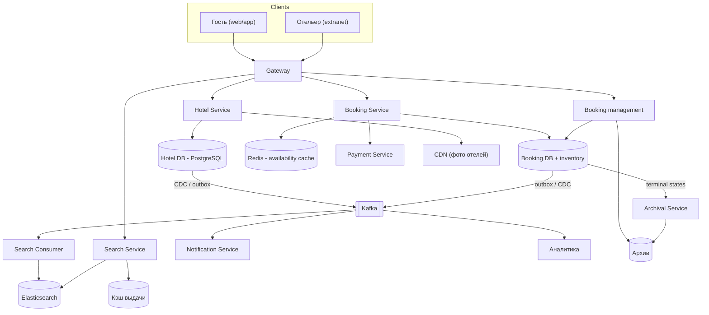
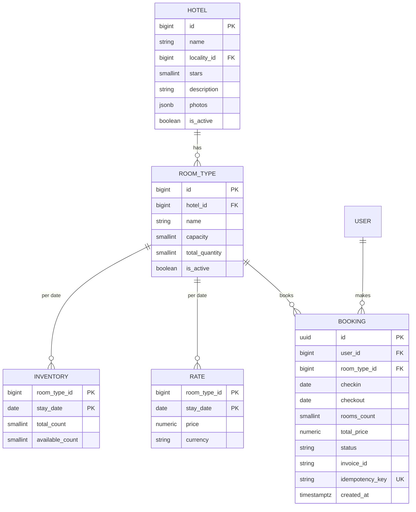
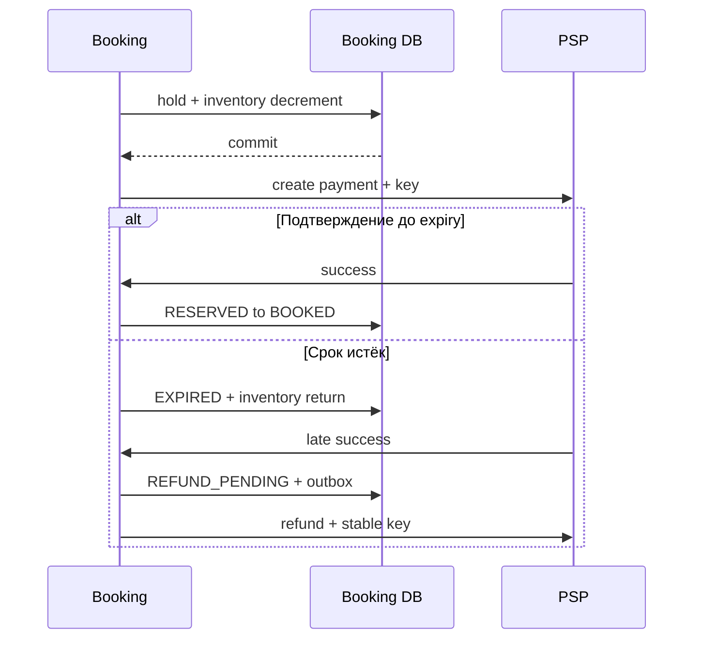
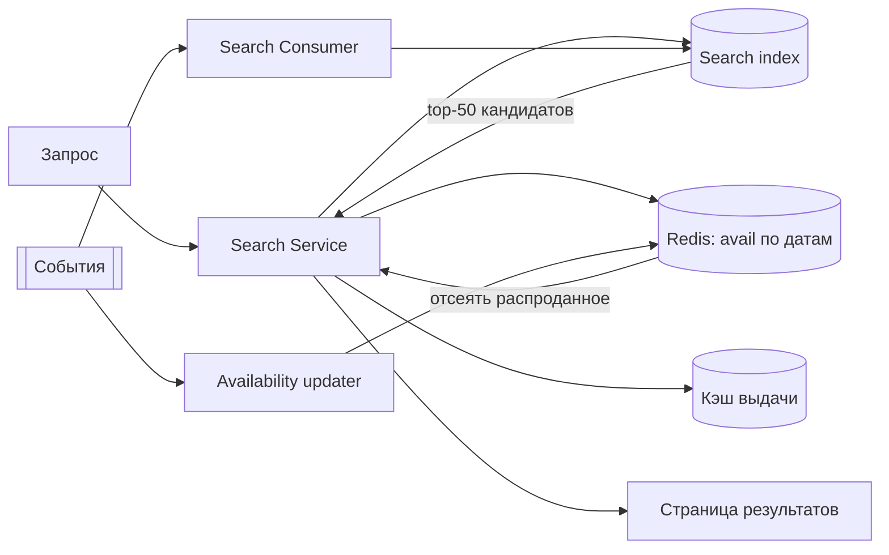
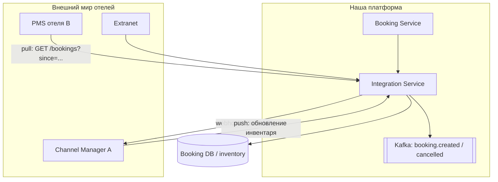

# Разбор задачи: бронирование отелей (Booking.com)

<!-- learning-nav:start -->
[← Все разделы](../README.md) · [Предыдущая тема](ticket-booking.md) · [Следующая тема →](payment-system.md)
<!-- learning-nav:end -->

Задача «спроектируй Booking.com / Airbnb / систему бронирования отелей» — одна из самых частых на system design интервью. Причина проста: она выглядит обманчиво простой (CRUD про отели?), но внутри сидят три классические проблемы распределённых систем — **конкурентный доступ к ограниченному ресурсу** (защита от двойного бронирования), **согласованность между хранилищами** (БД, поисковый индекс, кэш availability) и **управление временем жизни резерваций** (hold с таймаутом). Как отмечается в разборах по этой теме, именно вопрос «что будет, если два пользователя одновременно забронируют последний номер» — любимый способ интервьюера проверить, senior перед ним или нет: задача «выглядит очень простой, но на деле проверяет, понимаете ли вы concurrency и consistency по-настоящему».

Этот разбор построен по стандартной для собеседования структуре: требования → оценки → API → high-level design → модель данных → deep dive по узким местам → trade-offs.

---

## 1. Уточняющие вопросы (что спросить в первые 5 минут)

Не начинайте рисовать архитектуру, пока не зафиксировали рамку. Сильные вопросы для этой задачи:

- **Масштаб**: это глобальная платформа уровня Booking.com (~500 тыс. отелей, 10–12 млн номеров по всему миру) или нишевый сервис для одной страны? От этого зависит, нужны ли шардирование и multi-region.
- **Кто пользователи**: только гости, или ещё отельеры (extranet для управления объектами) и админы?
- **Модель инвентаря**: бронируем конкретный номер (как место в кинотеатре) или тип номера с количеством («стандартный двухместный, всего 40 шт.»)? Для этого разбора выбираем второе. Пул типов упрощает назначение номера, но всё ещё требует атомарного резервирования всех ночей.
- **Платёж**: оплата сразу на площадке, на ресепшене, или оба варианта? Есть ли предоплата/депозит?
- **Резервация**: держим ли номер за пользователем, пока он оплачивает (hold на N минут)? Это ключевой вопрос — именно он порождает deep dive.
- **Откуда приходят данные отелей**: отельеры сами вбивают через наш UI, или нужна интеграция с их системами (PMS/channel manager)?
- **Поиск**: только по городу и датам или полноценный full-text с фильтрами (цена, звёзды, удобства, гео)?
- **Овербукинг**: допускаем ли продажу сверх инвентаря (отели это практикуют) или требуем жёсткой гарантии «ни одного двойного бронирования»?

Фраза, которая звучит сильно: «Давайте я зафиксирую: мы проектируем платформу, где отель загружает инвентарь по типам номеров, гость ищет по датам и фильтрам, бронирует с оплатой на площадке, а номер резервируется на время оплаты. Жёсткое требование — двойное бронирование недопустимо никогда, поиск может быть eventually consistent».

---

## 2. Требования

### Functional

**Гость:**
1. Поиск отелей по локации + диапазону дат, с фильтрами (цена, звёзды, удобства, тип питания) и сортировкой.
2. Просмотр страницы отеля: описание, фото, доступные типы номеров и цены на выбранные даты.
3. Бронирование номера на диапазон дат с оплатой.
4. Просмотр и отмена своих бронирований.

**Отельер:**
1. Онбординг объекта (создание отеля, типов номеров, загрузка фото).
2. Управление инвентарём и ценами (сколько номеров какого типа доступно на каждую дату, по какой цене).
3. Просмотр поступивших бронирований.

**Платформа:**
4. Резервирование номера на время оплаты (hold ~10–15 минут) с автоматическим освобождением.
5. Уведомления гостю и отелю (подтверждение, отмена, напоминание о заезде).

### Non-functional

- **Консистентность инвентаря — строгая**: один и тот же номер на одну и ту же ночь не может быть продан дважды. Это требование диктует выбор хранилища инвентаря (ACID).
- **Доступность поиска — высокая**: поиск — витрина бизнеса, даунтайм = прямые потери. Поиск может быть eventual consistent (номер, который «только что забронировали», может ещё минуту отображаться в выдаче — пользователь узнает об этом на шаге бронирования, и это нормальный UX).
- **Низкая латентность чтения**: p99 поиска < 300–500 мс. Read-heavy нагрузка: соотношение чтений к бронированиям порядка 100:1 и выше.
- **Надёжность денег**: ни одной «потерянной» оплаты; каждое расхождение между оплатой и бронированием получает устойчивое состояние, retry/reconciliation и ответственного за ручной разбор. Refund асинхронен и тоже может иметь неизвестный результат.

### Важное наблюдение про масштаб конкуренции

Обычно конкуренция распределена по отелям, типам и датам, поэтому начинаем с коротких SQL-транзакций. Но «не более 2–3 претендентов» не является гарантией: последний номер у стадиона в день финала может стать горячим ключом. Частоту конфликтов, p99 ожидания row lock и откаты измеряем; admission control вводим по конкретному объекту/дате, если они перегружены. Waiting room не нужен по умолчанию, но продукт «отели» сам по себе не запрещает его.


---

## 3. Оценки нагрузки (back-of-envelope)

Зададим учебные допущения; это не статистика реального Booking.com. Порядок важнее точности:

| Параметр | Оценка | Как посчитали |
|---|---|---|
| Отелей в мире | ~500 000 | допущение |
| Номеров всего | ~10–12 млн | ~20–25 номеров среднего отеля × 500k (у крупных — до 7000, но это хвост) |
| Типов номеров | ~2–3 млн | 4–6 типов на отель |
| Строк инвентаря | ~1 млрд/год | 3 млн × 365 ≈ 1.095 млрд строк; объём с индексами и обслуживанием считаем отдельно |
| Бронирований | ~2 млн/сутки | ~23 RPS среднее, ~100 RPS пик (×4–5 коэффициент) |
| Поисковых запросов | ~200 млн/сутки | read:write ≈ 100:1 → ~2 315 RPS среднее, **~10 000 RPS пик** |
| Просмотров страницы отеля | ~500 млн/сутки | ~5 787 RPS среднее, ~25 000 RPS пик |

**Выводы из оценок:**

- При ~100 bookings/s и среднем проживании 5 ночей меняются уже ~500 строк inventory/s плюс booking, outbox, индексы и отмены. Один кластер может быть достаточен, но миллиард строк требует оценки диска, индексов, backup/restore и vacuum. Для начала — партиционирование по дате и измерения; при шардинге `hotel_id` сохраняет ночи брони на одном шарде.
- Чтение — десятки тысяч RPS: **нужен кэш availability и поисковый индекс**, который отдельно масштабируется от БД.
- Данные инвентаря «горячие» только на ближайшие ~1–2 года; завершённые бронирования можно архивировать в дешёвое хранилище (Cassandra/объектное), чтобы «живая» БД оставалась маленькой и быстрой.

---

## 4. API

REST, версии опущены. Клиент может передать `quote_id`, но не определяет стоимость: сервер проверяет владельца, срок и условия quote либо рассчитывает новую цену и получает согласие на её изменение. Это частый вопрос интервьюера-ловушка.

```text
# Поиск
GET /search?city=sochi&checkin=2026-09-01&checkout=2026-09-05
        &guests=2&price_max=8000&stars=4&facilities=pool,wifi
        &sort=price_asc&cursor=eyJvZmZzZXQiOjQwfQ==

# Страница отеля + доступность и цены на даты
GET /hotels/{hotel_id}?checkin=...&checkout=...

# Проверка доступности конкретного типа номера
GET /room-types/{room_type_id}/availability?checkin=...&checkout=...

# Создание бронирования (идемпотентно!)
POST /bookings
  Idempotency-Key: 7f3a9c...
  { "room_type_id": 12345, "checkin": "2026-09-01",
    "checkout": "2026-09-05", "guests": 2 }
  → 201 { "booking_id": "b-991", "status": "RESERVED",
          "total_price": 32000, "expires_at": "2026-08-04T12:15:00Z",
          "payment_url": "..." }

# Подтверждение после оплаты (webhook от платёжного провайдера)
POST /payments/webhook  { "booking_id": "b-991", "status": "success", "invoice_id": "inv-55" }  # подпись PSP проверяется отдельно

# Бронирования пользователя / отмена
GET  /users/{user_id}/bookings
POST /bookings/{booking_id}/cancel

# API отельера
POST   /hotels
PUT    /hotels/{hotel_id}
PUT    /hotels/{hotel_id}/room-types/{room_type_id}
PUT    /room-types/{room_type_id}/inventory        # массовая загрузка availability по датам
PUT    /room-types/{room_type_id}/prices           # цены по датам
```

Три вещи, которые стоит проговорить:

- **`Idempotency-Key` на создании бронирования.** Клиент нажал «Забронировать», соединение оборвалось, он жмёт ещё раз — без идемпотентности получите две резервации одного и того же. Сервер сохраняет scoped `(user_id, operation, key) → booking_id` вместе с хэшем нормализованных параметров и созданием брони в одной транзакции. В упрощённой таблице ниже ключ относится только к CREATE_BOOKING. Повтор с тем же телом возвращает прежнюю бронь; другие даты/количество с тем же ключом — ошибка.
- **`expires_at` в ответе** — клиент рисует таймер обратного отсчёта, сервер обязуется держать резерв до этого момента.
- **Cursor снижает стоимость глубокой пагинации**, но не фиксирует меняющуюся выдачу. Нужны стабильный tie-breaker и при требовании стабильной сессии — snapshot/PIT. Проверка availability после поиска может уменьшить страницу: дочитываем следующие кандидаты с ограниченным бюджетом.

---

## 5. High-level design



Потоки данных:

1. **Отельерский контур (write, низкая нагрузка):** Hotel Service — CRUD справочников в Hotel DB. Авторитетные изменения продаваемого inventory идут через Booking DB, чтобы не разделять один инвариант между кластерами. Изменения публикуются в Kafka — напрямую через transactional outbox или через CDC (Debezium читает WAL). Изображения — в объектное хранилище + CDN, в БД только URL.
2. **Поисковый контур (read, высокая нагрузка):** Search Consumer забирает события из Kafka и обновляет Elasticsearch. Search Service обслуживает поисковые запросы из ES + кэш горячих выдач в Redis.
3. **Бронирующий контур (write, критичная консистентность):** Booking Service работает поверх Booking DB (ACID), хранит hold и уменьшенный инвентарь в одной Booking DB, использует Redis как кэш availability, инициирует оплату после коммита и публикует события через outbox — их же подхватывает Search Consumer, чтобы убрать распроданные отели из выдачи.
4. **Обвязка:** Notification Service (email/push по событиям из Kafka), Analytics (все события стримятся в Hadoop/ClickHouse для revenue-отчётов и динамического ценообразования), Archival Service переносит бронирования в терминальных статусах из Booking DB в архив.

Почему два разных PostgreSQL-кластера (Hotel DB и Booking DB), а не один: нагрузка и требования к ним разные — инвентарь и брони требуют строгих транзакций и не хотят конкурировать за ресурсы с тяжёлыми чтениями справочника отелей. Можно начать с одной БД и разных схем: транзакция inventory + booking должна оставаться локальной. Отдельные базы PostgreSQL не дают обычную общую SQL-транзакцию.

---

## 6. Модель данных

Ключевое решение задачи: **инвентарь хранится по строкам «тип номера × дата»**, а не «одна строка на тип номера». Для пула взаимозаменяемых номеров доступность = min(available) по всем ночам `[checkin, checkout)`, если строка есть для каждой ночи. Отсутствующая дата — недоступно, а не повод посчитать минимум по оставшимся.



```sql
CREATE TABLE inventory (
    room_type_id    BIGINT      NOT NULL,
    stay_date       DATE        NOT NULL,
    total_count     SMALLINT    NOT NULL,
    available_count SMALLINT    NOT NULL,
    CHECK (total_count >= 0 AND available_count BETWEEN 0 AND total_count),
    PRIMARY KEY (room_type_id, stay_date)
);

CREATE TABLE booking (
    id              UUID PRIMARY KEY,
    user_id         BIGINT NOT NULL,
    room_type_id    BIGINT NOT NULL,
    checkin         DATE NOT NULL,
    checkout        DATE NOT NULL CHECK (checkout > checkin),
    rooms_count     SMALLINT NOT NULL CHECK (rooms_count > 0),
    total_price     NUMERIC(12,2) NOT NULL,
    status          TEXT NOT NULL
                    CHECK (status IN ('RESERVED','BOOKED','EXPIRED','CANCELLED','COMPLETED')),
    expires_at      TIMESTAMPTZ NOT NULL,
    currency        CHAR(3) NOT NULL,
    invoice_id      TEXT,
    idempotency_key TEXT NOT NULL,
    request_hash    TEXT NOT NULL,
    created_at      TIMESTAMPTZ NOT NULL DEFAULT now(),
    UNIQUE (user_id, idempotency_key)
);
CREATE INDEX idx_booking_user ON booking(user_id, created_at DESC);
CREATE INDEX idx_booking_hotel_dates ON booking(room_type_id, checkin)
    WHERE status IN ('RESERVED','BOOKED');
```

Замечания к схеме:

- **Инвариант — инвентарь уменьшается атомарно для всех ночей вместе с созданием hold.** CHECK на неотрицательность страхует арифметику, но один не защищает от lost update: два приложения могут прочитать 1 и оба присвоить 0. Условный `available_count = available_count - N`, проверка количества строк и единая транзакция обязательны. Подробнее в deep dive 7.1.
- Статусная модель брони: `RESERVED → BOOKED → COMPLETED`; `RESERVED → EXPIRED`, разрешённая отмена — `CANCELLED`. `EXPIRED`, `CANCELLED` и `COMPLETED` — терминальные, именно их можно архивировать после окончания срока оперативного восстановления и урегулирования денег.
- Одна бронь = один тип номера (но можно несколько штук, `rooms_count`). «Одна deluxe и одна standard в одной брони» — это уже booking + booking_items; на собеседовании достаточно упомянуть, что знаете про это ограничение.
- Цены — отдельная таблица `rate` по датам, а не колонка в `room_type`: цена на одну и ту же комнату различается по ночам, выходным и сезонам.
- Софт-делит через `is_active` в справочниках; аудит-колонки (`created_at`, `updated_at`) на собеседовании достаточно упомянуть.

---

## 7. Deep dive

### 7.1 Защита от двойного бронирования

Это сердце задачи: сначала формулируем инвариант, затем минимальный механизм, который его обеспечивает. Короткая SQL-транзакция с корректными условиями достаточна; Redis не является обязательным «следующим уровнем» ответа.

**Слой 1. Атомарный декремент в транзакции (основной механизм).**

```sql
BEGIN;

-- 1. Проверить и уменьшить доступность на каждую ночь диапазона
UPDATE inventory
SET available_count = available_count - $rooms
WHERE room_type_id = $rt
  AND stay_date >= $checkin AND stay_date < $checkout
  AND available_count >= $rooms;
-- Проверить rooms > 0, checkout > checkin и разумный максимум проживания.
-- Если число строк != checkout - checkin → ROLLBACK всей транзакции.
-- Проверять надо также отсутствие дат, а не только нехватку available_count.

-- 2. Создать бронь в статусе RESERVED
INSERT INTO booking (id, user_id, room_type_id, checkin, checkout,
                     rooms_count, total_price, status, idempotency_key)
VALUES (...);

COMMIT;
```

Почему это работает без всяких внешних локов:

- `UPDATE ... WHERE available_count >= N` атомарен: две конкурентные транзакции не прочитают «одну и ту же единицу» одновременно — БД сериализует обновления одной строки через row lock.
- `CHECK (available_count >= 0)` — страховка: даже если в коде баг и WHERE-условие когда-то потеряется, БД отклонит уход в минус.
- Обе операции — в одной транзакции: либо бронь создана и инвентарь уменьшен, либо ничего не произошло.

Здесь важно произнести вслух, **почему реляционная БД, а не Cassandra**: нам нужны транзакции и constraints. Cassandra поддерживает условные LWT, но атомарность диапазона ночей и ограничения схемы придётся отдельно проектировать; это не прямая замена SQL-транзакции. Иначе логику придётся реализовывать на стороне приложения — дополнительная сложность и риск рассинхрона. (Обратный ход — Cassandra отлично подходит для архива завершённых броней, где допустима отдельная query-модель под архивные запросы.)

**Слой 2. Распределённый лок в Redis (оптимизация UX и разгрузка БД).**

```text
SET lock:room_type:12345:2026-09-01 <request_id> NX EX 10
```

- `NX` — установить ключ, только если его нет: атомарная проверка+захват.
- `EX 10` — TTL как safety hatch: если инстанс сервиса упал, держа лок, он освободится сам, а не зависнет навсегда.
- Ключ должен совпадать с конкурирующим ресурсом. Уникальный ключ per booking_id не координирует две разные брони на последний номер. Много дат — много lease и сложность частичного захвата, поэтому сначала обходимся SQL.

Зачем слой 2, если слой 1 уже корректен? Если измерения показывают пользу — чтобы отсеивать конфликты до SQL, не доводя до ошибок БД и откатов транзакций: пользователь сразу получает «номер только что забронировали», а не ждёт падения транзакции. Но **лок никогда не является гарантией корректности** — гарантия всегда в БД. Локи в Redis могут потеряться при падении узла, при сетевых проблемах; рассуждения про fencing tokens и Redlock на собеседовании — плюс, но честный вывод такой: Redis lock — это оптимизация; корректность обеспечивает транзакционный инвариант: условный декремент всех ночей, проверка числа обновлённых строк и создание booking в одной SQL-транзакции, дополненные constraints.

**Слой 3. Идемпотентность API** (см. раздел 4) — защита от дублей не от конкурентных пользователей, а от одного и того же пользователя с ретраями.

| Подход | Плюсы | Минусы | Когда применять |
|---|---|---|---|
| SQL-транзакция и условный декремент всех ночей + booking + constraints | Атомарный инвариант без дополнительной инфраструктуры | При нехватке хотя бы одной ночи откатываем всю транзакцию; учитываем ожидание блокировок | Минимальный корректный механизм для выбранной модели |
| + Redis distributed lock | Конфликты отсекаются до БД, лучше UX | Доп. инфраструктура; лок ≠ гарантия; вопросы отказоустойчивости Redis | Оптимизация по результатам измерений |
| `SELECT ... FOR UPDATE` (pessimistic) | Строгая сериализация в БД | Долгие блокировки строк, падает throughput, риск дедлоков | Когда конфликты часты и критичны |
| Optimistic locking (version column) | Нет блокировок на чтении | SQL-записи берут row lock; при конфликте версий нужен retry | Редкие конфликты и необходимость защищать сложную read-modify-write логику |
| Serializable isolation | Защита от аномалий изоляции; ограничения и retries всё равно нужны | Переносит весь contention на БД, заметно медленнее | Малые нагрузки |

### 7.2 Резервация (hold) и её истечение

Сначала выбираем одну модель инвентаря. В нашем дизайне `available_count` уже уменьшен при создании DB-hold: удаление Redis-ключа не увеличивает его обратно. Нельзя одновременно обещать «hold только в Redis» и держать неучтённый декремент в SQL — номер зависнет или освободится дважды.

Бронь хранит `status=RESERVED`, `expires_at`, список ночей и количество. Деньги/возврат имеют отдельный payment_status; `REFUND_PENDING` на схеме относится к этому измерению, а не отменяет `EXPIRED` у брони. Sweeper небольшими batch выбирает истёкшие брони; для каждой выполняет короткую транзакцию. Под блокировкой booking он проверяет срок по времени БД, переводит `RESERVED → EXPIRED`, возвращает ровно `rooms_count` на все ночи и пишет outbox. Возвращаем инвентарь только если переход действительно состоялся. Повтор джобы или cancel после expiry не должен вернуть его ещё раз.



Confirm, cancel и sweeper блокируют booking в одном порядке, затем нужные строки inventory. Confirm проверяет владельца/сумму/валюту платежа и допустимый срок. Если hold уже освобождён, поздний успех не может просто выставить `BOOKED`: деньги идут в возврат либо создаётся новая бронь после нового атомарного захвата всех ночей. Это отдельное продуктовое решение с новой ценой/согласием, а не откат времени.

DB `expires_at` — источник срока. Job с периодом 1 с всё равно может опоздать: закладываем метрику oldest expired hold и SLA освобождения. Lazy expiry, как у единственного места, нельзя реализовать одним условием в SELECT по агрегированному счётчику: `available_count` уже уменьшен. Нужно атомарно учесть/освободить истёкшие holds или выбрать другую модель вычисления остатка из активных аллокаций.

Redis ZSET с deadline или delayed queue могут разбудить sweeper раньше, но остаются ускорителем. Keyspace notifications — Pub/Sub без надёжного replay и не гарантируют точный момент expiry; потеря подписки не должна терять возврат inventory. Источник для восстановительного сканирования — БД.

Падение Redis в этой модели теряет кэш/сигнал, **не DB-hold**. Падение между созданием hold и оплатой восстанавливается по idempotency key/outbox, а потерянный webhook — запросом к PSP и сверкой. Запуск оплаты не продлевает срок автоматически; grace period сохраняем атомарно до expiry и запрещаем бесконечное продление.

### 7.3 Поиск с фильтрами и кэш availability

Поиск — read-heavy часть (тысячи RPS против единиц RPS записей), поэтому он физически отделён от БД бронирований.

**Почему можно выделить Elasticsearch/OpenSearch:**

- Full-text с опечатками («мальдивы», «maldivs») — fuzzy search на инвертированном индексе; наивный `LIKE '%...%'` без подходящего индекса ведёт к сканированию. PostgreSQL FTS и pg_trgm с GIN/GiST — рабочая стартовая альтернатива; выделенный поиск выбираем ради сочетания функций и независимого масштабирования, а не из-за отсутствия текстовых индексов в SQL.
- Фильтры-фасеты (звёзды, удобства, цена, рейтинг) — терм-запросы и агрегации из коробки.
- Геопоиск («отели в 2 км от центра», «в viewport карты») — geo_point/geo_shape индексы.
- Комбинация текст + гео + диапазон дат + числовые фильтры исполняется по разным индексам внутри одного запроса и быстро.

**Как данные попадают в ES — выбор, который спросят обязательно:**

| Способ | Плюсы | Минусы |
|---|---|---|
| Dual-write из кода (пишем в БД, потом в ES) | Просто понять и написать | Двухфазная проблема: первая запись успешна, вторая упала — хранилища разошлись; логика компенсаций в коде приложения |
| Transactional outbox (событие в outbox-таблицу той же транзакцией, ретранслятор → Kafka → consumer → ES) | Атомарность с БД, ат-least-once доставка, развязка | Доп. компонент (реле), задержка секунды |
| CDC (Debezium читает WAL) | Ноль изменений в коде приложения, ловит ВСЕ изменения | Операционная сложность, события низкоуровневые (строки, а не бизнес-события) |

Прагматичный ответ: outbox + Kafka — промышленный стандарт; CDC — сильная альтернатива, если изменений много и из разных мест.

**Главная проблема: выдача должна учитывать доступность на даты**, а availability живёт в Booking DB и меняется каждую секунду. Запрещать в ES каждую бронь — дорого (переиндексация). Варианты:

1. **Двухфазный поиск (рекомендуемый):** ES отдаёт кандидатов по тексту/фильтрам/гео → Search Service для top-N страницы (20–50 отелей) идёт в **кэш availability в Redis** (`avail:{room_type_id}:{date} → count`, обновляется событием брони) и отфильтровывает распроданное. Полная точность нужна только на шаге бронирования — там идём в БД.
2. **Денормализация availability в ES:** Search Consumer на событии брони обновляет поле `availability` в документе отеля. Проще запрос, но каждое бронирование — запись в ES (индексация дорогая, ~1s refresh lag), и инвентарь по датам в документ не упакуешь красиво.
3. **Кэш поисковых выдач:** популярные связки (`город + даты + популярные фильтры`) кэшируются целиком в Redis на короткий TTL (30–60 c). Инвалидация по событиям брони — сложно, поэтому короткий TTL + двухфазная проверка availability поверх кэша.



Важная честная оговорка: выдача eventual consistent — отель может показываться в поиске, хотя последний номер ушёл минуту назад. Это **нормально**: пользователь узнает об этом на шаге бронирования, где проверка идёт по БД. Стремиться к strongly consistent поиску — значит заплатить производительностью за то, что пользователь почти не замечает. А вот обратное направление (номер освободился после отмены, а в выдаче отеля ещё нет) — тоже терпимо.

И отдельный trade-off, который любят спрашивать: стоит ли ставить Redis-кэш **перед Hotel DB** (справочник отелей)? Хороший ответ — нет, если этот сервис не в критичном пути высоконагруженного чтения: гости ходят в Search Service, а не в Hotel DB, поэтому кэш там — это лишняя инфраструктура без выигрыша. Кэш — это тоже стоимость, и решение «не кэшировать» должно быть таким же осознанным, как решение кэшировать.

### 7.4 Ценообразование

- **Клиент не определяет стоимость** — сервер проверяет действующий quote или считает цену по `rate` и получает согласие на итог. Показанная в поиске цена может расходиться с итоговой (кэш/задержка индексации) — на шаге бронирования показываем финальную, и она фиксируется в `booking.total_price`.
- **Цена по ночам, а не за диапазон:** `total = rooms_count × Σ rate[stay_date]` по всем ночам + налоги/сборы. Разные ночи — разные цены (выходные, праздники, сезон).
- **Динамическое ценообразование:** отельер задаёт `price_min`/`price_max`, система внутри коридора поднимает цену при высоком спросе/низком остатке и опускает при пустом инвентаре. Стартовая точка — согласованная базовая цена; дальше возможна модель на данных аналитического контура (все события бронирований и просмотров и так стекают в Hadoop/ClickHouse). На собеседовании не углубляйтесь в ML — достаточно показать, что архитектура это допускает: pricing engine читает аналитику и пишет в `rate`, остальная система ничего не замечает.
- **Валюты:** храним цену в валюте отеля + курс на момент бронирования; конвертация — отдельный сервис/справочник курсов.

### 7.5 Интеграция с системами отелей

Реальные отели живут не в вашем extranet, а в своих PMS (Opera, Mews) и channel manager'ах (SiteMinder, Cloudbeds). Если это всплывает на собеседовании (обычно вопросом «а как отель узнает о брони?»), покажите, что понимаете двустороннюю проблему:



- **От нас к отелю:** события `booking.created/cancelled` из Kafka → Integration Service → webhook отелю (или их channel manager дёргает наш pull-API с курсором). Retry + dead-letter: недоставленное бронирование — это овербукинг в реальном мире.
- **От отеля к нам:** инвентарь и цены прилетают push'ами от channel manager'ов или батчами. Критично: **наш локальный инвентарь — копия их мастер-данных**, расхождения неизбежны (отель продал номер по телефону). Отсюда два следствия: (1) локальная копия может быть как меньше, так и больше фактического остатка; продажа по устаревшему завышенному значению создаст физический overbooking; (2) нужна периодическая reconciliation-джоба и алерты на расхождения.
- **Кто мастер инвентаря?** Два режима: отель отдаёт нам аллокацию («вот вам 10 номеров — продавайте сами, дальше не дёргайте меня») vs. подтверждение каждой брони у отеля (точнее, но +1 синхронный вызов в критичный путь и согласование резервов). На собеседовании достаточно назвать обе модели и выбрать один режим как допущение. Без эксклюзивной аллокации или авторитетного подтверждения нельзя обещать отсутствие overbooking во внешнем мире.
- Эта интеграция — ещё один аргумент за outbox/Kafka: внешние системы не входят в локальную SQL-транзакцию. Если PMS авторитетен и требует confirm, его вызов входит в бизнес-процесс через pending-состояние/saga; отложенная доставка уведомления не заменяет согласование инвентаря.

---

## 8. Сводная таблица trade-offs

| Решение | Выбрали | Альтернатива | Почему |
|---|---|---|---|
| Хранилище инвентаря | PostgreSQL (ACID, CHECK constraints, транзакции) | Cassandra, Redis-only | Двойное бронирование недопустимо; логику консистентности отдаём БД, а не коду |
| Hold на время оплаты | DB-hold + expires_at + sweeper | Вычисляемая доступность из активных аллокаций | Надёжное восстановление и однократное освобождение всех ночей |
| Двойное бронирование | Атомарный UPDATE + CHECK constraint, поверх — Redis lock | Только лок; только constraint; serializable | Транзакция всех ночей — гарантия; Redis добавляется по измерениям |
| Поиск | Elasticsearch, eventual consistent | SQL + LIKE; strongly consistent выдача | FTS/pg_trgm тоже возможны; поиск можно масштабировать отдельно |
| Синхронизация БД → ES | Transactional outbox + Kafka | Dual-write; CDC | Dual-write не атомарен; CDC сложнее в эксплуатации |
| Availability в поиске | Кэш в Redis, обновляется событиями; точная проверка при брони | Денормализация в ES | Запись в ES на каждую бронь — дорого и всё равно с лагом |
| Архив броней | Cassandra/объектное хранилище для терминальных статусов | Всё в PostgreSQL | «Живая» БД остаётся маленькой; запросы к архиву — только по ключу |
| Инвентарь отелей | Модель аллокации (нам отдают пул номеров) | Синхронное подтверждение у PMS | Убираем внешнюю зависимость из критичного пути бронирования |

---

## 9. Красные флаги и типичные ошибки кандидатов

- **«Проверю доступность, потом создам бронь»** как два независимых шага — классическая race condition check-then-act. Интервьюер ждёт атомарного `UPDATE ... WHERE available_count >= N` или явного объяснения, как вы сериализуете.
- **Redis lock как единственная защита.** Лок — не гарантия: падение узла, split-brain, потерянные ключи. Без constraint/транзакции в БД ответ неполный.
- **Цена в теле запроса на бронирование.** Мгновенный красный флаг — клиенту нельзя доверять деньги.
- **Нет идемпотентности на POST /bookings** — ретрай клиента создаёт две брони одному пользователю.
- **Cron job для истечения hold'ов без упоминания дельты.** Приемлемо для middle, но senior сам называет проблему и предлагает DB-sweeper с заданным SLA; Redis TTL сам по себе не освобождает SQL-инвентарь.
- **«Поиск сделаю LIKE без индекса»** — сначала оцените план и объём; FTS/pg_trgm могут быть достаточны без отдельного движка.
- **Dual-write в БД и ES без обсуждения**, что будет при падении второй записи.
- **Elasticsearch как единственное/основное хранилище** — ES не является авторитетным transactional inventory в этом дизайне; источник истины — реляционная БД, ES — проекция.
- **Тянуть в критичный путь бронирования синхронные вызовы**: уведомления, аналитику, интеграцию с отелем, обновление поискового индекса. Всё это — асинхронно через события.
- **Кэшировать всё подряд.** Кэш перед редко читаемым сервисом — это стоимость без выгоды; каждое «добавлю Redis» должно быть обосновано нагрузкой.
- **Молча принять требования.** Куда вы поведёте разговор — решать вам: хорошая подсказка — вернуться к нефункциональным требованиям и посмотреть, что ещё не закрыто дизайном.

---

## 10. Что спросят дополнительно

- **«Как сделать инвентарь отказоустойчивым к падению Redis?»** — hold живёт в БД, теряется только кэш/ускоритель. Восстанавливаем cache и sweeper из авторитетных DB-состояний.
- **«Пользователь оплатил, а бронь уже отменена по TTL»** — порядок событий не гарантирован; применяем компенсации только из состояния `RESERVED`; дальше refund или попытка забронировать заново — продуктовое решение.
- **«Как отменить бронь и вернуть инвентарь консистентно?»** — та же транзакция: условный переход активной брони в CANCELLED + `UPDATE inventory +rooms_count` по всем ночам только при успешном переходе; событие в outbox → поиск/кэш обновятся асинхронно.
- **«Как масштабировать Booking DB при ×100 нагрузке?»** — шардирование по `hotel_id` (инвентарь и брони отеля в одном шарде → транзакции остаются локальными), партиционирование не снимает конкуренцию за одну и ту же ночь: нужны короткие транзакции, backoff и admission control.
- **«Как показать пользователю его бронирования быстро?»** — индекс по `user_id`, write-through кэш списка броней в Redis; исторические — из архива.
- **«Овербукинг: отель хочет продавать 105% инвентаря»** — конфигурируемый multiplier на `total_count` + отдельный процесс разруливания редких конфликтов (релокация гостя). Хороший пример того, как требование бизнеса ломает «красивый» инвариант.
- **«Рейтинги и отзывы»** — отдельный сервис, агрегаты рейтинга асинхронно в документ ES (иначе сортировка по рейтингу не сработает).
- **«Мультирегион»** — для каждого отеля один авторитетный writer, чтения можно реплицировать. Бронь гостя из другой страны направляется владельцу inventory; DR failover требует исключить двух writer и определить RPO. Корзина из нескольких отелей нарушит предположение о локальности транзакции.

---

## 11. Практические вопросы и задачи на отказ

### 1. Можно ли дважды освободить номер при cancel и expiry?

Нет, освобождение должно быть эффектом единственного успешного перехода брони. Под блокировкой строки booking проверяем `RESERVED/BOOKED`, допустимость отмены и то, что inventory ещё занят этой бронью. Переводим статус, обновляем **все** ночи на `rooms_count`, пишем событие outbox в той же транзакции. Refund следует отдельным состоянием: отмена брони и возврат денег не одна атомарная операция.

Например, expiry и cancel одновременно прочитали `RESERVED`. Если оба независимо выполнили `inventory + 1`, `available_count <= total_count` поймает не каждый дубль: у типа из 40 номеров заняты ещё 20, поэтому лишний возврат до 21 пройдёт CHECK. Защищает именно переход и запись основания освобождения, а не только верхняя граница счётчика. Повтор команды возвращает результат прежней операции. Если одна бронь включает несколько типов, все item/ночи должны войти в ту же транзакцию или потребуется отдельная схема распределённых резервов.

Частая ошибка — помечать бронь cancelled после коммита inventory: падение между этими шагами делает повторное освобождение неизбежным.

### 2. На подумать: свободно по каждой ночи, но нет одного номера на весь срок

У отеля два физических номера одного типа: A занят 1 сентября, B занят 2 сентября. Пул показывает `available_count=1` на обе ночи. Можно ли подтвердить проживание с 1 по 3 сентября без переселения?

<details>
<summary>Разбор</summary>

Проверка `min(available) >= 1` доказывает достаточность пула на каждую ночь, но не существование одной и той же физической комнаты на весь срок. Для взаимозаменяемого пула это допустимо, если отель способен заранее перераспределять ещё не заселённые брони так, чтобы выдать непрерывный номер. При фиксированных назначениях или требованиях доступности, этажа, вида и запрете переселений такое допущение может не выполняться.

Нужно уточнить договор: либо платформа продаёт тип, а PMS отвечает за непрерывное размещение; либо ищем конкретный `room_id`, свободный на весь `[checkin, checkout)`, и защищаем пересечения интервалов транзакцией/ограничением. Простое суммирование свободных ночей неверно: две свободные разные ночи не заменяют одну непрерывную двухночную бронь. Даты ночёвок считаем в календаре отеля, checkout не включаем; длительность в часах при DST не равна числу ночей.

</details>

<a id="источники-и-видео-по-теме"></a>

## Видео по теме

- [Проектирование систем Airbnb / Проектирование систем Booking.com](https://www.youtube.com/watch?v=YyOXt2MEkv4) — полный разбор: оценки масштаба, схема `available_rooms` с constraint, hold через Redis TTL, гонка «оплата vs истечение», архив в Cassandra.
- [How to Prevent Duplicate Booking / Redis Distributed Locks Explained](https://www.youtube.com/watch?v=KCVlt6Su_eQ) — слоёная защита от двойного бронирования: `SET NX EX` + unique constraint как финальная гарантия.
- [System Design: проектируем Ticketmaster, систему бронирования билетов](https://www.youtube.com/watch?v=zxeR5bfsNOg) — три уровня решения истечения резервов (cron / неявный статус / Redis TTL), падение Redis, Elasticsearch через CDC.
- [System Design of a Ticket Booking System: BookMyShow](https://www.youtube.com/watch?v=ohdu6TUoE5s) — статусная машина мест, истечение блокировок через `locked_at` без cron'ов, почему таймауты нельзя держать в памяти приложения, перенос contention на уровень БД.
- [Управление параллельным доступом в распределенных системах / Оптимистические и пессимистические блокировки](https://www.youtube.com/watch?v=D3XhDu--uoI) — optimistic vs pessimistic concurrency control, version column, уровни изоляции.
