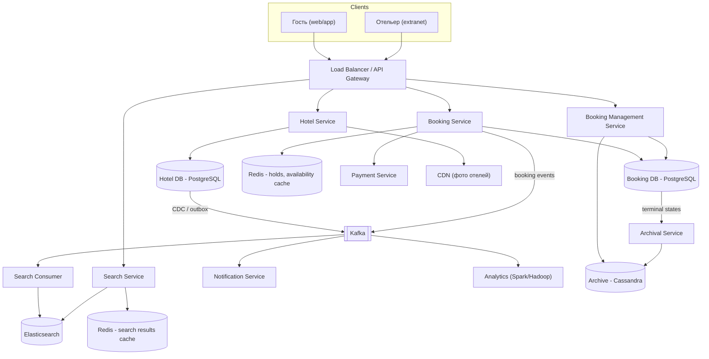
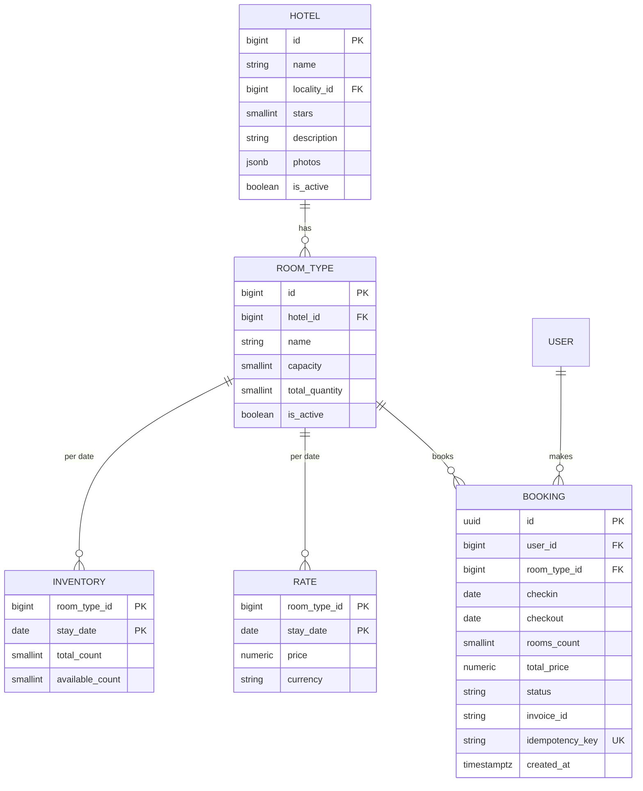
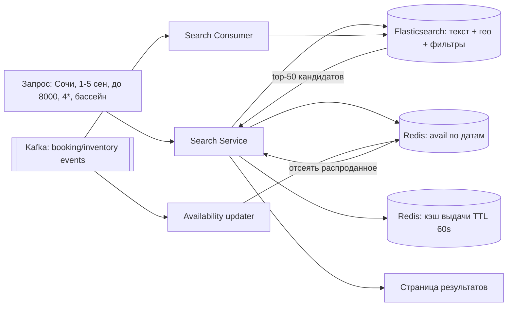
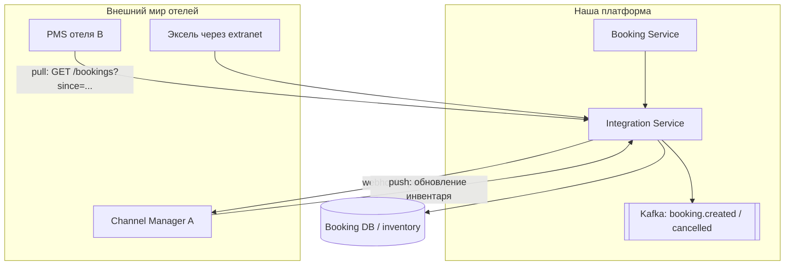

# Разбор задачи: бронирование отелей (Booking.com)

Задача «спроектируй Booking.com / Airbnb / систему бронирования отелей» — одна из самых частых на system design интервью. Причина проста: она выглядит обманчиво простой (CRUD про отели?), но внутри сидят три классические проблемы распределённых систем — **конкурентный доступ к ограниченному ресурсу** (защита от двойного бронирования), **согласованность между хранилищами** (БД, поисковый индекс, кэш availability) и **управление временем жизни резерваций** (hold с таймаутом). Как отмечается в разборах по этой теме, именно вопрос «что будет, если два пользователя одновременно забронируют последний номер» — любимый способ интервьюера проверить, senior перед ним или нет: задача «выглядит очень простой, но на деле проверяет, понимаете ли вы concurrency и consistency по-настоящему».

Этот разбор построен по стандартной для собеседования структуре: требования → оценки → API → high-level design → модель данных → deep dive по узким местам → trade-offs.

---

## 1. Уточняющие вопросы (что спросить в первые 5 минут)

Не начинайте рисовать архитектуру, пока не зафиксировали рамку. Сильные вопросы для этой задачи:

- **Масштаб**: это глобальная платформа уровня Booking.com (~500 тыс. отелей, 10–12 млн номеров по всему миру) или нишевый сервис для одной страны? От этого зависит, нужны ли шардирование и multi-region.
- **Кто пользователи**: только гости, или ещё отельеры (extranet для управления объектами) и админы?
- **Модель инвентаря**: бронируем конкретный номер (как место в кинотеатре) или тип номера с количеством («стандартный двухместный, всего 40 шт.»)? В отелях почти всегда второе — это сильно упрощает задачу по сравнению с Ticketmaster.
- **Платёж**: оплата сразу на площадке, на ресепшене, или оба варианта? Есть ли предоплата/депозит?
- **Резервация**: держим ли номер за пользователем, пока он оплачивает (hold на N минут)? Это ключевой вопрос — именно он порождает deep dive.
- **Откуда приходят данные отелей**: отельеры сами вбивают через наш UI, или нужна интеграция с их системами (PMS/channel manager)?
- **Поиск**: только по городу и датам или полноценный full-text с фильтрами (цена, звёзды, удобства, гео)?
- **Овербукинг**: допускаем ли продажу сверх инвентаря (отели это практикуют) или требуем жёсткой гарантии «ни одного двойного бронирования»?

Фраза, которая звучит сильно: «Давайте я зафиксирую: мы проектируем платформу, где отель загружает инвентарь по типам номеров, гость ищет по датам и фильтрам, бронирует с оплатой на площадке, а номер резервируется на время оплаты. Жёсткое требование — двойное бронирование недопустимо никогда, поиск может быть eventually consistent».

---

## 2. Требования

### Functional

**Гость:**
1. Поиск отелей по локации + диапазону дат, с фильтрами (цена, звёзды, удобства, тип питания) и сортировкой.
2. Просмотр страницы отеля: описание, фото, доступные типы номеров и цены на выбранные даты.
3. Бронирование номера на диапазон дат с оплатой.
4. Просмотр и отмена своих бронирований.

**Отельер:**
1. Онбординг объекта (создание отеля, типов номеров, загрузка фото).
2. Управление инвентарём и ценами (сколько номеров какого типа доступно на каждую дату, по какой цене).
3. Просмотр поступивших бронирований.

**Платформа:**
4. Резервирование номера на время оплаты (hold ~10–15 минут) с автоматическим освобождением.
5. Уведомления гостю и отелю (подтверждение, отмена, напоминание о заезде).

### Non-functional

- **Консистентность инвентаря — строгая**: один и тот же номер на одну и ту же ночь не может быть продан дважды. Это требование диктует выбор хранилища инвентаря (ACID).
- **Доступность поиска — высокая**: поиск — витрина бизнеса, даунтайм = прямые потери. Поиск может быть eventual consistent (номер, который «только что забронировали», может ещё минуту отображаться в выдаче — пользователь узнает об этом на шаге бронирования, и это нормальный UX).
- **Низкая латентность чтения**: p99 поиска < 300–500 мс. Read-heavy нагрузка: соотношение чтений к бронированиям порядка 100:1 и выше.
- **Надёжность денег**: ни одной «потерянной» оплаты; каждая расхождение между оплатой и бронированием должно разрешаться автоматически (refund).

### Важное наблюдение про масштаб конкуренции

Из разборов этой задачи стоит запомнить одну эвристику: в отеле в среднем ~1000 номеров, которые распроданы по разным датам и типам. Поэтому ситуация «тысячи пользователей дерутся за одну единицу инвентаря» (как на распродаже билетов на концерт) здесь **почти не возникает**: в худшем случае 2–3 пользователя одновременно претендуют на последний номер конкретного типа на конкретную ночь. Это значит, что нам **не нужны** виртуальные очереди ожидания (virtual waiting room) и прочая артиллерия уровня Ticketmaster — достаточно транзакций в реляционной БД. Скажите это интервьюеру явно — такие допущения, озвученные вслух, отделяют сильный ответ от шаблонного.

---

## 3. Оценки нагрузки (back-of-envelope)

Берём цифры из открытых источников и разборов (порядок важнее точности):

| Параметр | Оценка | Как посчитали |
|---|---|---|
| Отелей в мире | ~500 000 | открытая статистика |
| Номеров всего | ~10–12 млн | ~20–25 номеров среднего отеля × 500k (у крупных — до 7000, но это хвост) |
| Типов номеров | ~2–3 млн | 4–6 типов на отель |
| Строк инвентаря | ~1 млрд/год | 3 млн типов номеров × 365 дат — влезает в одну реляционную БД без фанатизма |
| Бронирований | ~2 млн/сутки | ~25 RPS среднее, ~100 RPS пик (×4–5 коэффициент) |
| Поисковых запросов | ~200 млн/сутки | read:write ≈ 100:1 → ~2 500 RPS среднее, **~10 000 RPS пик** |
| Просмотров страницы отеля | ~500 млн/сутки | ~6 000 RPS среднее, ~25 000 RPS пик |

**Выводы из оценок:**

- Записи (бронирования) — единицы–сотни RPS: **один кластер PostgreSQL/MySQL справится**, шардирование инвентаря не нужно на старте (но продумайте ключ: `hotel_id` или `(room_type_id, date)`).
- Чтение — десятки тысяч RPS: **нужен кэш availability и поисковый индекс**, который отдельно масштабируется от БД.
- Данные инвентаря «горячие» только на ближайшие ~1–2 года; завершённые бронирования можно архивировать в дешёвое хранилище (Cassandra/объектное), чтобы «живая» БД оставалась маленькой и быстрой.

---

## 4. API

REST, версии опущены. Цену в теле запроса на бронирование **не принимаем** — цену всегда вычисляет сервер из своего хранилища на момент бронирования, иначе клиент сможет подменить цену в запросе. Это частый вопрос интервьюера-ловушка.

```
# Поиск
GET /search?city=sochi&checkin=2026-09-01&checkout=2026-09-05
        &guests=2&price_max=8000&stars=4&facilities=pool,wifi
        &sort=price_asc&cursor=eyJvZmZzZXQiOjQwfQ==

# Страница отеля + доступность и цены на даты
GET /hotels/{hotel_id}?checkin=...&checkout=...

# Проверка доступности конкретного типа номера
GET /room-types/{room_type_id}/availability?checkin=...&checkout=...

# Создание бронирования (идемпотентно!)
POST /bookings
  Idempotency-Key: 7f3a9c...
  { "room_type_id": 12345, "checkin": "2026-09-01",
    "checkout": "2026-09-05", "guests": 2 }
  → 201 { "booking_id": "b-991", "status": "RESERVED",
          "total_price": 32000, "expires_at": "2026-08-04T12:15:00Z",
          "payment_url": "..." }

# Подтверждение после оплаты (webhook от платёжного провайдера)
POST /payments/webhook  { "booking_id": "b-991", "status": "success", "invoice_id": "inv-55" }

# Бронирования пользователя / отмена
GET  /users/{user_id}/bookings
POST /bookings/{booking_id}/cancel

# API отельера
POST   /hotels
PUT    /hotels/{hotel_id}
PUT    /hotels/{hotel_id}/room-types/{room_type_id}
PUT    /room-types/{room_type_id}/inventory        # массовая загрузка availability по датам
PUT    /room-types/{room_type_id}/prices           # цены по датам
```

Три вещи, которые стоит проговорить:

- **`Idempotency-Key` на создании бронирования.** Клиент нажал «Забронировать», соединение оборвалось, он жмёт ещё раз — без идемпотентности получите две резервации одного и того же. Сервер сохраняет пару `(key → booking_id)` и на повторный запрос с тем же ключом возвращает уже созданную бронь.
- **`expires_at` в ответе** — клиент рисует таймер обратного отсчёта, сервер обязуется держать резерв до этого момента.
- **Пагинация поиска — через cursor**, а не offset: выдача постоянно меняется (бронируют, меняются цены), offset-пагинация будет дублировать и пропускать результаты.

---

## 5. High-level design



Потоки данных:

1. **Отельерский контур (write, низкая нагрузка):** Hotel Service — CRUD над Hotel DB. Каждое изменение (новый отель, цена, инвентарь) публикуется в Kafka — напрямую через transactional outbox или через CDC (Debezium читает WAL). Изображения — в объектное хранилище + CDN, в БД только URL.
2. **Поисковый контур (read, высокая нагрузка):** Search Consumer забирает события из Kafka и обновляет Elasticsearch. Search Service обслуживает поисковые запросы из ES + кэш горячих выдач в Redis.
3. **Бронирующий контур (write, критичная консистентность):** Booking Service работает поверх Booking DB (ACID), использует Redis для hold'ов и кэша availability, синхронно дёргает Payment Service, события бронирования публикует в Kafka — их же подхватывает Search Consumer, чтобы убрать распроданные отели из выдачи.
4. **Обвязка:** Notification Service (email/push по событиям из Kafka), Analytics (все события стримятся в Hadoop/ClickHouse для revenue-отчётов и динамического ценообразования), Archival Service переносит бронирования в терминальных статусах из Booking DB в архив.

Почему два разных PostgreSQL-кластера (Hotel DB и Booking DB), а не один: нагрузка и требования к ним разные — инвентарь и брони требуют строгих транзакций и не хотят конкурировать за ресурсы с тяжёлыми чтениями справочника отелей. Можно начать с одного кластера и двух баз — скажите, что это осознанный компромисс «на старт».

---

## 6. Модель данных

Ключевое решение задачи: **инвентарь хранится по строкам «тип номера × дата»**, а не «одна строка на тип номера». Доступность на диапазон дат = min(available) по всем ночам диапазона.



```sql
CREATE TABLE inventory (
    room_type_id    BIGINT      NOT NULL,
    stay_date       DATE        NOT NULL,
    total_count     SMALLINT    NOT NULL,
    available_count SMALLINT    NOT NULL CHECK (available_count >= 0),
    PRIMARY KEY (room_type_id, stay_date)
);

CREATE TABLE booking (
    id              UUID PRIMARY KEY,
    user_id         BIGINT NOT NULL,
    room_type_id    BIGINT NOT NULL,
    checkin         DATE NOT NULL,
    checkout        DATE NOT NULL,
    rooms_count     SMALLINT NOT NULL,
    total_price     NUMERIC(12,2) NOT NULL,
    status          TEXT NOT NULL
                    CHECK (status IN ('RESERVED','BOOKED','CANCELLED','COMPLETED')),
    invoice_id      TEXT,
    idempotency_key TEXT UNIQUE,
    created_at      TIMESTAMPTZ NOT NULL DEFAULT now()
);
CREATE INDEX idx_booking_user ON booking(user_id, created_at DESC);
CREATE INDEX idx_booking_hotel_dates ON booking(room_type_id, checkin)
    WHERE status IN ('RESERVED','BOOKED');
```

Замечания к схеме:

- **`CHECK (available_count >= 0)` — это и есть главная защита от двойного бронирования** на уровне БД. Физически невозможно увести счётчик в минус, значит два конкурентных бронирования последнего номера не пройдут оба — одна транзакция откатится. Подробнее в deep dive 7.1.
- Статусная модель брони: `RESERVED → BOOKED → COMPLETED`, из `RESERVED` и `BOOKED` — в `CANCELLED`. `CANCELLED` и `COMPLETED` — терминальные, именно они уезжают в архив.
- Одна бронь = один тип номера (но можно несколько штук, `rooms_count`). «Одна deluxe и одна standard в одной брони» — это уже booking + booking_items; на собеседовании достаточно упомянуть, что знаете про это ограничение.
- Цены — отдельная таблица `rate` по датам, а не колонка в `room_type`: цена на одну и ту же комнату различается по ночам, выходным и сезонам.
- Софт-делит через `is_active` в справочниках; аудит-колонки (`created_at`, `updated_at`) на собеседовании достаточно упомянуть.

---

## 7. Deep dive

### 7.1 Защита от двойного бронирования

Это сердце задачи. Правильный ответ — **слоёный**, и именно так его стоит подавать: «первая линия обороны — быстрый proactive-механизм на уровне приложения, последняя — железобетонная гарантия на уровне БД». Кандидат, который отвечает только «поставлю unique constraint» или только «возьму Redis lock», показывает, что думает одним слоем — это типичная ошибка середняков.

**Слой 1. Атомарный декремент в транзакции (основной механизм).**

```sql
BEGIN;

-- 1. Проверить и уменьшить доступность на каждую ночь диапазона
UPDATE inventory
SET available_count = available_count - $rooms
WHERE room_type_id = $rt
  AND stay_date >= $checkin AND stay_date < $checkout
  AND available_count >= $rooms;
-- если затронуто строк меньше, чем ночей в диапазоне → ROLLBACK

-- 2. Создать бронь в статусе RESERVED
INSERT INTO booking (id, user_id, room_type_id, checkin, checkout,
                     rooms_count, total_price, status, idempotency_key)
VALUES (...);

COMMIT;
```

Почему это работает без всяких внешних локов:

- `UPDATE ... WHERE available_count >= N` атомарен: две конкурентные транзакции не прочитают «одну и ту же единицу» одновременно — БД сериализует обновления одной строки через row lock.
- `CHECK (available_count >= 0)` — страховка: даже если в коде баг и WHERE-условие когда-то потеряется, БД отклонит уход в минус.
- Обе операции — в одной транзакции: либо бронь создана и инвентарь уменьшен, либо ничего не произошло.

Здесь важно произнести вслух, **почему реляционная БД, а не Cassandra**: нам нужны транзакции и constraints. Если взять Cassandra для инвентаря, всю эту логику придётся реализовывать руками на стороне приложения — дополнительная сложность и риск рассинхрона. (Обратный ход — Cassandra отлично подходит для архива завершённых броней, где все запросы идут по одному ключу `booking_id`.)

**Слой 2. Распределённый лок в Redis (оптимизация UX и разгрузка БД).**

```
SET lock:room_type:12345:2026-09-01 <request_id> NX EX 10
```

- `NX` — установить ключ, только если его нет: атомарная проверка+захват.
- `EX 10` — TTL как safety hatch: если инстанс сервиса упал, держа лок, он освободится сам, а не зависнет навсегда.
- Ключ лучше делать per `(room_type_id, date)` или вообще один per booking flow — гранулярность обсуждается с интервьюером.

Зачем слой 2, если слой 1 уже корректен? Чтобы 99% конфликтов отсекать быстро и дёшево, не доводя до ошибок БД и откатов транзакций: пользователь сразу получает «номер только что забронировали», а не ждёт падения транзакции. Но **лок никогда не является гарантией корректности** — гарантия всегда в БД. Локи в Redis могут потеряться при падении узла, при сетевых проблемах; рассуждения про fencing tokens и Redlock на собеседовании — плюс, но честный вывод такой: Redis lock — это оптимизация, constraint — это истина.

**Слой 3. Идемпотентность API** (см. раздел 4) — защита от дублей не от конкурентных пользователей, а от одного и того же пользователя с ретраями.

| Подход | Плюсы | Минусы | Когда применять |
|---|---|---|---|
| Только constraints в БД | Просто, надёжно, ноль инфраструктуры | Конфликтующие запросы падают с ошибкой БД; лишняя нагрузка на откаты | Минимальный правильный ответ |
| + Redis distributed lock | Конфликты отсекаются до БД, лучше UX | Доп. инфраструктура; лок ≠ гарантия; вопросы отказоустойчивости Redis | Стандартный senior-ответ |
| `SELECT ... FOR UPDATE` (pessimistic) | Строгая сериализация в БД | Долгие блокировки строк, падает throughput, риск дедлоков | Когда конфликты часты и критичны |
| Optimistic locking (version column) | Нет блокировок на чтении | Нужны ретраи при конфликте версий | Read-heavy с редкими конфликтами — не наш случай для инвентаря |
| Serializable isolation | Максимальные гарантии из коробки | Переносит весь contention на БД, заметно медленнее | Малые нагрузки |

### 7.2 Резервация (hold) и её истечение

Сценарий: пользователь нажал «Забронировать», мы уменьшили инвентарь и создали `RESERVED`, дальше он ушёл на страницу оплаты. Что, если он не оплатит за 10 минут — закрыл вкладку, пропал интернет, передумал? Номер не должен зависнуть в резерве навсегда.

Это классическое место, где интервьюер смотрит, как кандидат наращивает решение. Три уровня ответа:

**Вариант A. Cron job + `expires_at` (проходной для middle).** В брони храним `expires_at = now() + 10 min`. Фоновая джоба раз в N минут находит `RESERVED` с истёкшим `expires_at` и переводит их в `CANCELLED`, возвращая инвентарь. Проблема очевидна: дельта между моментом истечения и запуском джобы. Джоба раз в 5 минут → номер до 5 минут числится занятым, хотя уже должен быть свободен. Для билетов на концерт это потерянные продажи; для отелей — терпимо, но интервьюер ждёт, что вы сами назовёте этот недостаток.

**Вариант B. «Неявный» статус (без фоновых джоб).** Не трогаем статус вообще: доступным считается номер, у которого либо нет брони, либо бронь `RESERVED` с `expires_at < now()`. Ноль инфраструктуры, точность до миллисекунды. Минус — модель данных становится неявной: семантика статуса `RESERVED` теперь «зарезервировано, но только если не истекло», и эту двойственность придётся держать в голове в каждом запросе. Через год такой код — источник багов.

**Вариант C. Hold в Redis с TTL (senior-ответ).** Статусов `RESERVED`-как-блокировки в БД вообще нет: в БД бронь только `BOOKED` или никакая. На время оплаты создаём запись в Redis: `hold:{room_type_id}:{date}` / `hold_booking:{booking_id}` с TTL = 10 минут.

```mermaid
sequenceDiagram
    autonumber
    participant C as Клиент
    participant BS as Booking Service
    participant DB as Booking DB
    participant R as Redis
    participant PS as Payment Service

    C->>BS: POST /bookings (idempotency-key)
    BS->>DB: BEGIN; UPDATE inventory -1; INSERT booking RESERVED
    DB-->>BS: COMMIT ok
    BS->>R: SET hold:b-991 booking_id EX 600
    BS-->>C: 201 RESERVED, expires_at, payment_url
    C->>PS: оплата
    PS-->>BS: webhook success
    BS->>DB: UPDATE booking SET status=BOOKED, invoice_id
    BS->>R: DEL hold:b-991
    BS-->>C: подтверждение брони

    Note over R: Если за 600s оплаты не было —<br/>TTL истекает, ключ удаляется
    R-->>BS: keyspace notification expired (или sweeper-поллер)
    BS->>DB: UPDATE booking SET status=CANCELLED;<br/>UPDATE inventory +1 (только если status=RESERVED)
```

Детали, за которые дают плюс:

- **TTL в Redis — не точный таймер.** Истечение ключей реализовано лениво (проверка при доступе) + фоновый цикл выборки, поэтому callback об истечении придёт с задержкой — секунды, иногда больше под нагрузкой. Для нашего кейса задержка в минуту некритична. Если интервьюер хочет точности — предложите sweeper: упорядоченное множество `ZADD holds <expire_ts> <booking_id>` и поллер, который раз в секунду забирает `ZRANGEBYSCORE ... now`. Честно назовите цену: постоянная нагрузка на Redis и ещё один компонент.
- **Гонка «оплата прошла, а hold истёк».** Платёжный webhook и событие истечения TTL могут прийти в любом порядке. Правило: компенсацию (возврат инвентаря, отмену) применяем **только если бронь всё ещё `RESERVED`**. Если уже `BOOKED` — событие истечения игнорируем. Обратный случай (сначала CANCELLED, потом success от платёжки) — два варианта, обсудить с интервьюером/продуктом: автоматический refund, либо проверить доступность и всё-таки забронировать, раз деньги взяли. Первый надёжнее, второй лучше для конверсии.
- **При успехе/провале оплаты удаляйте ключ из Redis сразу** — не держите мусор до TTL.
- **Что если упал сам Redis?** Все hold'ы последних 10 минут потеряны: несколько пользователей могут считать, что держат один номер, и пойти оплачивать. И тут снова спасает слой 1 из 7.1: транзакция `BOOKED` пройдёт только у одного, остальным — автоматический refund. Плохой UX, но корректность сохранена, и происходит это только при сбое Redis. Можно поднять реплику Redis — но это уже разговор с продуктом о цене надёжности.
- Сервис бронирования stateless, инстансов много — **состояние hold'ов нельзя хранить в памяти приложения**, только во внешнем хранилище с общим согласованным видом.

### 7.3 Поиск с фильтрами и кэш availability

Поиск — read-heavy часть (тысячи RPS против единиц RPS записей), поэтому он физически отделён от БД бронирований.

**Почему Elasticsearch/OpenSearch, а не SQL:**

- Full-text с опечатками («мальдивы», «maldivs») — fuzzy search на инвертированном индексе; в PostgreSQL `LIKE '%...%'` — это full scan, на сотнях тысяч отелей не жизнеспособно.
- Фильтры-фасеты (звёзды, удобства, цена, рейтинг) — терм-запросы и агрегации из коробки.
- Геопоиск («отели в 2 км от центра», «в viewport карты») — geo_point/geo_shape индексы.
- Комбинация текст + гео + диапазон дат + числовые фильтры исполняется по разным индексам внутри одного запроса и быстро.

**Как данные попадают в ES — выбор, который спросят обязательно:**

| Способ | Плюсы | Минусы |
|---|---|---|
| Dual-write из кода (пишем в БД, потом в ES) | Просто понять и написать | Двухфазная проблема: первая запись успешна, вторая упала — хранилища разошлись; логика компенсаций в коде приложения |
| Transactional outbox (событие в outbox-таблицу той же транзакцией, ретранслятор → Kafka → consumer → ES) | Атомарность с БД, ат-least-once доставка, развязка | Доп. компонент (реле), задержка секунды |
| CDC (Debezium читает WAL) | Ноль изменений в коде приложения, ловит ВСЕ изменения | Операционная сложность, события низкоуровневые (строки, а не бизнес-события) |

Прагматичный ответ: outbox + Kafka — промышленный стандарт; CDC — сильная альтернатива, если изменений много и из разных мест.

**Главная проблема: выдача должна учитывать доступность на даты**, а availability живёт в Booking DB и меняется каждую секунду. Запрещать в ES каждую бронь — дорого (переиндексация). Варианты:

1. **Двухфазный поиск (рекомендуемый):** ES отдаёт кандидатов по тексту/фильтрам/гео → Search Service для top-N страницы (20–50 отелей) идёт в **кэш availability в Redis** (`avail:{room_type_id}:{date} → count`, обновляется событием брони) и отфильтровывает распроданное. Полная точность нужна только на шаге бронирования — там идём в БД.
2. **Денормализация availability в ES:** Search Consumer на событии брони обновляет поле `availability` в документе отеля. Проще запрос, но каждое бронирование — запись в ES (индексация дорогая, ~1s refresh lag), и инвентарь по датам в документ не упакуешь красиво.
3. **Кэш поисковых выдач:** популярные связки (`город + даты + популярные фильтры`) кэшируются целиком в Redis на короткий TTL (30–60 c). Инвалидация по событиям брони — сложно, поэтому короткий TTL + двухфазная проверка availability поверх кэша.



Важная честная оговорка: выдача eventual consistent — отель может показываться в поиске, хотя последний номер ушёл минуту назад. Это **нормально**: пользователь узнает об этом на шаге бронирования, где проверка идёт по БД. Стремиться к strongly consistent поиску — значит заплатить производительностью за то, что пользователь почти не замечает. А вот обратное направление (номер освободился после отмены, а в выдаче отеля ещё нет) — тоже терпимо.

И отдельный trade-off, который любят спрашивать: стоит ли ставить Redis-кэш **перед Hotel DB** (справочник отелей)? Хороший ответ — нет, если этот сервис не в критичном пути высоконагруженного чтения: гости ходят в Search Service, а не в Hotel DB, поэтому кэш там — это лишняя инфраструктура без выигрыша. Кэш — это тоже стоимость, и решение «не кэшировать» должно быть таким же осознанным, как решение кэшировать.

### 7.4 Ценообразование

- **Цена никогда не приходит от клиента** — только вычисляется сервером из `rate` на момент бронирования. Показанная в поиске цена может расходиться с итоговой (кэш/задержка индексации) — на шаге бронирования показываем финальную, и она фиксируется в `booking.total_price`.
- **Цена по ночам, а не за диапазон:** `total = Σ rate[stay_date]` по всем ночам + налоги/сборы. Разные ночи — разные цены (выходные, праздники, сезон).
- **Динамическое ценообразование:** отельер задаёт `price_min`/`price_max`, система внутри коридора поднимает цену при высоком спросе/низком остатке и опускает при пустом инвентаре. Стартовая точка — середина коридора; дальше — ML-модель на данных аналитического контура (все события бронирований и просмотров и так стекают в Hadoop/ClickHouse). На собеседовании не углубляйтесь в ML — достаточно показать, что архитектура это допускает: pricing engine читает аналитику и пишет в `rate`, остальная система ничего не замечает.
- **Валюты:** храним цену в валюте отеля + курс на момент бронирования; конвертация — отдельный сервис/справочник курсов.

### 7.5 Интеграция с системами отелей

Реальные отели живут не в вашем extranet, а в своих PMS (Opera, Mews) и channel manager'ах (SiteMinder, Cloudbeds). Если это всплывает на собеседовании (обычно вопросом «а как отель узнает о брони?»), покажите, что понимаете двустороннюю проблему:



- **От нас к отелю:** события `booking.created/cancelled` из Kafka → Integration Service → webhook отелю (или их channel manager дёргает наш pull-API с курсором). Retry + dead-letter: недоставленное бронирование — это овербукинг в реальном мире.
- **От отеля к нам:** инвентарь и цены прилетают push'ами от channel manager'ов или батчами. Критично: **наш локальный инвентарь — копия их мастер-данных**, расхождения неизбежны (отель продал номер по телефону). Отсюда два следствия: (1) наше `available_count` может быть меньше фактического — продадим меньше, но не больше — безопасно; (2) нужна периодическая reconciliation-джоба и алерты на расхождения.
- **Кто мастер инвентаря?** Два режима: отель отдаёт нам аллокацию («вот вам 10 номеров — продавайте сами, дальше не дёргайте меня») vs. подтверждение каждой брони у отеля (точнее, но +1 синхронный вызов в критичный путь и согласование резервов). На собеседовании достаточно назвать обе модели и выбрать аллокацию — так работают крупные OTA.
- Эта интеграция — ещё один аргумент за outbox/Kafka: внешние системы не должны быть синхронно вписаны в транзакцию бронирования.

---

## 8. Сводная таблица trade-offs

| Решение | Выбрали | Альтернатива | Почему |
|---|---|---|---|
| Хранилище инвентаря | PostgreSQL (ACID, CHECK constraints, транзакции) | Cassandra, Redis-only | Двойное бронирование недопустимо; логику консистентности отдаём БД, а не коду |
| Hold на время оплаты | Redis TTL + компенсация по событию | Cron job; неявный статус `expires_at < now()` | Точность и простота модели; cron — дельта, неявный статус — запутанная модель |
| Двойное бронирование | Атомарный UPDATE + CHECK constraint, поверх — Redis lock | Только лок; только constraint; serializable | Слои: лок отсекает 99% конфликтов дёшево, constraint гарантирует корректность всегда |
| Поиск | Elasticsearch, eventual consistent | SQL + LIKE; strongly consistent выдача | LIKE = full scan; строгая консистентность выдачи не нужна бизнесу |
| Синхронизация БД → ES | Transactional outbox + Kafka | Dual-write; CDC | Dual-write не атомарен; CDC сложнее в эксплуатации |
| Availability в поиске | Кэш в Redis, обновляется событиями; точная проверка при брони | Денормализация в ES | Запись в ES на каждую бронь — дорого и всё равно с лагом |
| Архив броней | Cassandra/объектное хранилище для терминальных статусов | Всё в PostgreSQL | «Живая» БД остаётся маленькой; запросы к архиву — только по ключу |
| Инвентарь отелей | Модель аллокации (нам отдают пул номеров) | Синхронное подтверждение у PMS | Убираем внешнюю зависимость из критичного пути бронирования |

---

## 9. Красные флаги и типичные ошибки кандидатов

- **«Проверю доступность, потом создам бронь»** как два независимых шага — классическая race condition check-then-act. Интервьюер ждёт атомарного `UPDATE ... WHERE available_count >= N` или явного объяснения, как вы сериализуете.
- **Redis lock как единственная защита.** Лок — не гарантия: падение узла, split-brain, потерянные ключи. Без constraint/транзакции в БД ответ неполный.
- **Цена в теле запроса на бронирование.** Мгновенный красный флаг — клиенту нельзя доверять деньги.
- **Нет идемпотентности на POST /bookings** — ретрай клиента создаёт две брони одному пользователю.
- **Cron job для истечения hold'ов без упоминания дельты.** Приемлемо для middle, но senior сам называет проблему и предлагает TTL/sweeper.
- **«Поиск сделаю SELECT с LIKE»** — full scan на сотнях тысяч записей; ждут поисковый движок с инвертированным индексом.
- **Dual-write в БД и ES без обсуждения**, что будет при падении второй записи.
- **Elasticsearch как единственное/основное хранилище** — ES не даёт гарантий надёжности primary storage; источник истины — реляционная БД, ES — проекция.
- **Тянуть в критичный путь бронирования синхронные вызовы**: уведомления, аналитику, интеграцию с отелем, обновление поискового индекса. Всё это — асинхронно через события.
- **Кэшировать всё подряд.** Кэш перед редко читаемым сервисом — это стоимость без выгоды; каждое «добавлю Redis» должно быть обосновано нагрузкой.
- **Молча принять требования.** Куда вы поведёте разговор — решать вам: хорошая подсказка — вернуться к нефункциональным требованиям и посмотреть, что ещё не закрыто дизайном.

---

## 10. Что спросят дополнительно

- **«Как сделать инвентарь отказоустойчивым к падению Redis?»** — hold'ы потеряны, но корректность держится на транзакциях БД; потерявшим резерв пользователям — автоматический refund; обсудить репликацию Redis с продуктом.
- **«Пользователь оплатил, а бронь уже отменена по TTL»** — порядок событий не гарантирован; применяем компенсации только из состояния `RESERVED`; дальше refund или попытка забронировать заново — продуктовое решение.
- **«Как отменить бронь и вернуть инвентарь консистентно?»** — та же транзакция: `UPDATE booking SET status=CANCELLED` + `UPDATE inventory +1` по всем ночам; событие в outbox → поиск/кэш обновятся асинхронно.
- **«Как масштабировать Booking DB при ×100 нагрузке?»** — шардирование по `hotel_id` (инвентарь и брони отеля в одном шарде → транзакции остаются локальными), горячие диапазоны дат не проблема из-за партиционирования по `(room_type_id, stay_date)`.
- **«Как показать пользователю его бронирования быстро?»** — индекс по `user_id`, write-through кэш списка броней в Redis; исторические — из архива.
- **«Овербукинг: отель хочет продавать 105% инвентаря»** — конфигурируемый multiplier на `total_count` + отдельный процесс разруливания редких конфликтов (релокация гостя). Хороший пример того, как требование бизнеса ломает «красивый» инвариант.
- **«Рейтинги и отзывы»** — отдельный сервис, агрегаты рейтинга асинхронно в документ ES (иначе сортировка по рейтингу не сработает).
- **«Мультирегион»** — поиск и чтение реплицируются легко; инвентарь привязан к географии отеля → шард по региону; кросс-региональных транзакций не возникает, потому что отель живёт в одном регионе.

---

## Источники и видео по теме

- [Проектирование систем Airbnb / Проектирование систем Booking.com](https://www.youtube.com/watch?v=YyOXt2MEkv4) — полный разбор: оценки масштаба, схема `available_rooms` с constraint, hold через Redis TTL, гонка «оплата vs истечение», архив в Cassandra.
- [How to Prevent Duplicate Booking / Redis Distributed Locks Explained](https://www.youtube.com/watch?v=KCVlt6Su_eQ) — слоёная защита от двойного бронирования: `SET NX EX` + unique constraint как финальная гарантия.
- [System Design: проектируем Ticketmaster, систему бронирования билетов](https://www.youtube.com/watch?v=zxeR5bfsNOg) — три уровня решения истечения резервов (cron / неявный статус / Redis TTL), падение Redis, Elasticsearch через CDC.
- [System Design of a Ticket Booking System: BookMyShow](https://www.youtube.com/watch?v=ohdu6TUoE5s) — статусная машина мест, истечение блокировок через `locked_at` без cron'ов, почему таймауты нельзя держать в памяти приложения, перенос contention на уровень БД.
- [Управление параллельным доступом в распределенных системах / Оптимистические и пессимистические блокировки](https://www.youtube.com/watch?v=D3XhDu--uoI) — optimistic vs pessimistic concurrency control, version column, уровни изоляции.
