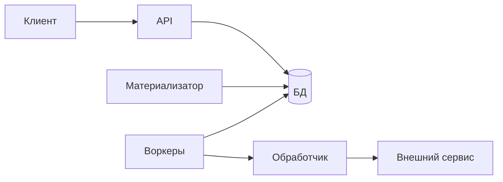

# Разбор задачи: распределённый планировщик заданий

<!-- learning-nav:start -->
[← Все разделы](../README.md) · [Предыдущая тема](payment-system.md) · [Следующая тема →](feature-flags.md)
<!-- learning-nav:end -->

Нужно запускать отложенные и периодические задания: подготовить отчёт завтра, очистить старые логи ночью, повторить уведомление после временного сбоя. Основная сложность — не вычислить следующую минуту по cron, а сохранить намерение выполнить работу и восстановиться после падения между бизнес-эффектом и подтверждением. Разбор строится вокруг простой схемы с БД и воркерами; отдельный брокер появится только при доказанной необходимости.

## Требования и оценки

### 1. Что уточнить и какие инварианты зафиксировать?

Сначала различаем три объекта: расписание, конкретный запуск и попытку запуска. «Ежедневный отчёт» — расписание; отчёт за определённую дату — запуск; обработка после таймаута — новая попытка того же запуска. Без этого различия повтор легко превратится в новый бизнес-эффект.

Для кейса принимаем следующие требования, а не свойства любого планировщика:

- Разовые задания задаются абсолютным временем; периодические — календарным правилом и часовым поясом.
- После подтверждённого создания задание переживает перезапуск приложения в пределах согласованной модели надёжности БД.
- Цель для обычной нагрузки: 99% запусков начинают обработку не позднее пяти секунд после срока. Это SLO начала, а не завершения.
- Доставка допускает повторы. Повторный бизнес-эффект предотвращает обработчик или принимающий сервис.
- У каждого запуска есть конечное состояние и объяснимая история попыток; число повторов и общий срок выполнения ограничены.

Не обещаем запуск «ровно в момент» при перегрузке или разделении сети. Отдельно согласуем `misfire_policy`: пропустить пропущенное, выполнить один последний запуск или догнать все. Для очистки логов обычно достаточно одного актуального запуска; для расчёта отдельных расчётных периодов пропуск может быть недопустим. Именно бизнес-смысл определяет политику, а не удобство cron-библиотеки.

### 2. Как оценки меняют архитектуру?

Допустим, храним 10 млн будущих разовых заданий и 100 тыс. периодических расписаний; в сутки исполняется 1 млн запусков. Средняя интенсивность — `1 000 000 / 86 400 ≈ 11,6 запуска/с`. Согласованный пик после начала часа — 500 запусков/с. Среднее время обработчика две секунды: по закону Литтла на таком пике понадобится около `500 × 2 = 1000` одновременно выполняющихся обработок. Это число конкурентных операций, а не обязательно тысяча потоков или процессов.

При полезном размере записи запуска 1 КБ будущие задания занимают около 10 ГБ до индексов, версий строк, реплик и резервных копий. История за семь дней — ещё примерно 7 ГБ при 1 млн запусков в сутки; несколько попыток увеличат её. Большие входные данные храним отдельно, в задании — ссылку и контрольную сумму.

Эти оценки позволяют начать с одной транзакционной БД и нескольких экземпляров воркера. Они не доказывают, что конкретная конфигурация выдержит нагрузку: проверяем пакетный захват, heartbeat, WAL и очистку истории. Если после аварии накопилось 100 тыс. запусков, а свободная производительность сверх входящего потока — 200/с, догонять будем минимум 500 секунд. Добавить воркеры можно только до предела downstream, иначе восстановление породит новый отказ.

## Контракты и хранение

### 3. Как выглядит API и что означает отмена?

```http
POST /v1/jobs
Idempotency-Key: report-order-782
Content-Type: application/json

{
  "handler": "build-report-v2",
  "run_at": "2027-01-20T08:00:00Z",
  "payload_ref": "reports/order-782",
  "deadline": "2027-01-20T09:00:00Z"
}
```

Ответ `201` содержит `job_id` и состояние `scheduled`. Ключ уникален внутри tenant; сохраняем также отпечаток тела. Повтор с тем же ключом возвращает существующий ID, а с другим телом — конфликт. Для расписания используем `POST /v1/schedules` с `cron`, `timezone`, политиками пропусков и пересечений. `GET /v1/jobs/{id}` показывает состояние и попытки; изменение расписания требует `If-Match` с версией, чтобы два оператора не затёрли решения друг друга.

`POST /v1/jobs/{id}/cancel` имеет два исхода. Если отмена первой зафиксировала переход ожидающего запуска в `cancelled`, будущий захват этого запуска запрещён. Если воркер уже захватил работу, возвращаем `cancel_requested`: обработчик проверяет сигнал в безопасных точках. Завершённую отправку письма отменить нельзя. Гонку отмены и захвата разрешают условные изменения одной строки в транзакции, а не два независимых чтения.

При отмене расписания прекращаем создание новых запусков; судьбу уже созданных задаём отдельным параметром. Смешивать эти операции опасно: «остановить завтрашние отчёты» не всегда означает «прервать сегодняшний».

### 4. Какие таблицы и индексы нужны?

Достаточно следующей логической модели:

```text
schedules:
  id, tenant_id, version, rule, timezone, enabled
  next_fire_at, misfire_policy, overlap_policy

runs:
  id, tenant_id, schedule_id?, scheduled_at, schedule_version?
  handler, payload_ref, state, available_at, deadline
  attempt_no, lease_owner, lease_until, fence, cancel_requested

attempts:
  run_id, attempt_no, started_at, finished_at, outcome, error_code
```

У `runs` первичный ключ `id`; для периодических запусков — уникальность `(schedule_id, scheduled_at)`, где время — абсолютный момент. Она закрывает повторную материализацию одного вхождения. Разовые запросы защищает отдельная уникальность `(tenant_id, idempotency_key)`. Рабочий частичный индекс начинается с `available_at` для состояний `ready/retry`, индекс по `lease_until` помогает искать просроченные аренды. Фактический порядок полей уточняем после выбора стратегии fairness и проверки плана запроса.

Материализатор блокирует строку расписания, создаёт ближайший запуск и сдвигает `next_fire_at` в одной транзакции. Поэтому падение не оставляет «сдвинули курсор, но потеряли запуск». Не создаём бесконечный список будущих повторений: держим следующий запуск или небольшой горизонт. Изменения правила влияют на ещё не исполнявшиеся вхождения по явной политике; уже начатый запуск сохраняет свою версию конфигурации. Историю архивируем или удаляем по сроку хранения, не заставляя горячий индекс расти бессрочно.

## Архитектура и выполнение

### 5. Как работает минимальная система от запроса до результата?



API проверяет права tenant и допустимый `handler`, сохраняет задание и только после commit отвечает клиенту. Произвольный код или URL от пользователя не исполняем: работаем с зарегистрированными обработчиками. Материализатор создаёт периодические запуски; разовое задание сразу становится будущей строкой `runs`.

Воркер короткой транзакцией выбирает готовую пачку, назначает владельца, срок аренды и увеличивает `fence`, затем освобождает блокировки. Выполняет обработчик уже вне транзакции. Один из вариантов выбора:

```sql
SELECT id
FROM runs
WHERE state IN ('ready', 'retry')
  AND available_at <= now()
ORDER BY available_at, id
LIMIT 50
FOR UPDATE SKIP LOCKED;
```

В той же транзакции выбранные строки переводятся в `running`; приведённый `SELECT` сам по себе не является захватом. При захвате также проверяем deadline и сигнал отмены: просроченное задание завершаем отдельно, а не исполняем только потому, что его время уже наступило. PostgreSQL описывает `SKIP LOCKED` как подходящий для нескольких потребителей очереди, но предупреждает о несогласованном представлении пропущенных строк: это не механизм строгого FIFO.

Воркер продлевает аренду условно по `owner/fence`, вызывает обработчик с постоянным `run_id`, затем сохраняет результат таким же условным обновлением. Брокер здесь не обязателен. Если он понадобится для развязки нагрузки, публикуем через outbox: независимые запись БД и отправка сообщения создают окно потери. Дубликат сообщения по-прежнему должен безопасно обрабатываться.

### 6. Почему lease недостаточно и где помогает fencing?

Предположим, lease равен 30 секундам, heartbeat — каждые десять. Это параметры примера: выбираем их по задержкам, паузам процесса и допустимому времени восстановления. Воркер A завис, аренда истекла, воркер B получил запуск с `fence=42`. A проснулся со старым `fence=41` и тоже продолжил работу. Истечение времени не останавливает процесс и не отзывает отправленный HTTP-запрос.

Завершение и heartbeat принимаются только при совпадении владельца, fence, состояния и действующей аренды. Старый воркер не сможет пометить новую попытку успешной. Для защиты внешнего ресурса принимающая сторона должна сама проверять fencing token и атомарно отвергать токены меньше уже принятого. Проверка только в планировщике внешнюю запись не защищает. Более того, старый токен может попасть в ресурс раньше нового; fencing не означает физическое прекращение старой работы в момент истечения lease.

Токен монотонен в области защищаемого ресурса. Счётчик отдельного запуска нельзя сравнивать со счётчиком другого запуска, обновляющего тот же объект. Если downstream не поддерживает такую проверку, используем его idempotency API, транзакционный бизнес-инвариант либо сверку результата; заявлять общую гарантию отсутствия повторных эффектов нельзя. Lease уменьшает конкуренцию, fencing защищает от устаревших владельцев, а дедупликация отвечает на другой вопрос — был ли эффект этого запуска уже применён.

### 7. Как пережить таймаут, повтор и падение после бизнес-эффекта?

Самое опасное окно: внешний сервис успешно создал отчёт, но воркер упал до `succeeded`. Повтор неизбежен, потому что планировщик не знает результата. Постоянный `run_id` передаём как ключ бизнес-операции; `attempt_no` годится для диагностики, но как ключ дедупликации даст новый эффект на каждой попытке.

Если эффект в собственной БД, вставка `processed_runs(run_id UNIQUE)` и бизнес-изменение выполняются одной транзакцией. Сначала отдельный `SELECT`, затем изменение — гонка. Если эффект во внешнем API, нужны его договорённости о сроке жизни ключа, совпадении параметров и восстановлении результата. Такой идентификатор поможет, только если внешний API распознаёт повтор с тем же ключом.

Транзиентные ошибки повторяем с exponential backoff и jitter; невалидный payload сразу завершаем ошибкой. Ограничиваем и попытки, и deadline. Просроченный `running` восстановитель возвращает в `retry`, только если lease всё ещё истёк; следующий захват выдаёт новый fence. После исчерпания бюджета получаем `failed` с причиной и возможностью ручного повтора. Ручной повтор того же намерения сохраняет ключ; сознательно новая операция получает новый ID. Иначе операторская кнопка обойдёт всю дедупликацию.

## Время, изоляция и эксплуатация

### 8. Чем delayed отличается от recurring и как обработать DST?

«Через 24 часа» — интервал до абсолютного момента, а «каждый день в 09:00 по местному времени» — календарное расписание. При переходе на летнее время расстояние между двумя такими утрами может отличаться от 24 часов. Для recurring храним правило и имя IANA, например `Europe/Berlin`, а не один текущий offset `+01:00`. Правила часовых поясов меняются, поэтому важны обновление tzdb и воспроизводимость вычислений.

Политика для несуществующего местного времени при весеннем переходе — пропустить либо перенести на следующий допустимый момент; для повторившегося осенью — первое вхождение, второе или оба. В нашем контракте выбираем «пропустить gap, выполнить только первое overlap», показываем это в preview следующих запусков. Если нужны оба, они получают разные UTC-моменты и разные ключи запусков. Эти решения не являются универсальной семантикой cron.

Для сравнения: Kubernetes CronJob имеет настройки часового пояса, пропусков и конкуренции, но документация прямо требует идемпотентных Jobs из-за возможных повторов или отсутствия создания при некоторых обстоятельствах. Не переносим его конкретные правила в собственный сервис без проверки.

Аренды оцениваем по времени БД, чтобы разные часы воркеров не решали судьбу одного lease. Для локального таймаута используем монотонный таймер. Скачок настенных часов и обновление tzdb тестируем отдельно: UTC-хранение само по себе не определяет календарную политику.

### 9. Как обеспечить fairness, ограничить пересечения и восстановиться после failover?

Глобальная очередь по приоритету позволяет одному tenant занять все воркеры. Вводим предел одновременно выполняющихся заданий на tenant и класс обработчика, квоты приёма и выборку небольшими пачками по очереди между активными tenant. Взвешенная round-robin выдаёт большему тарифу больше слотов, но оставляет ненулевую долю остальным. В нескольких воркерах квоту нужно резервировать согласованно; локальный счётчик каждого процесса общий лимит не обеспечивает.

Для долгого recurring-задания заранее выбираем политику пересечений: разрешить, пропустить новое либо оставить один ожидающий запуск. «Поставить всё в очередь» при времени обработки десять минут и периоде одна минута создаст бесконечное отставание. Для строгого запрета пересечения требуется координация по `schedule_id`; проверка наличия `running` без блокировки оставляет гонку. При этом старая потерявшая lease попытка всё ещё требует защиты эффекта.

После failover БД воркеры перечитывают действительное состояние и условно продлевают аренду. Безопасность зависит от отсутствия двух writable лидеров и сохранения подтверждённых записей; асинхронная реплика с ненулевым RPO может потерять и задания, и записи дедупликации. Для multi-region сначала выбираем одного владельца шарда с надёжным переключением. Active-active без общего протокола владения не возникает от второго cron-процесса. Шардирование по tenant добавляем при измеренном пределе, отдельно решая крупных tenant.

### 10. Какие метрики и проверки доказывают работоспособность?

Главная метрика — распределение `started_at - scheduled_at` по классу и tenant. Средняя задержка скроет редкие отставания и голодание. Рядом нужны возраст самого старого готового запуска, глубина очереди, число просроченных lease, успешность продлений, длительность обработчиков, повторы по причинам и доля окончательных ошибок. Для recurring отдельно измеряем отставание материализатора: пустая очередь может означать, что задания вообще не создаются.

Логи связываем через `schedule_id`, `run_id`, `attempt_no`, `fence`; payload и секреты туда не копируем. ID помещаем в логи и трассы, а не в неограниченные labels метрик. Алерт должен различать «нет свободных воркеров» и «downstream отвечает 429»: действия разные. Контролируем накопление таблиц, длительные транзакции и стоимость архивирования.

Проверяем падение сразу после commit создания, после захвата и после эффекта до подтверждения; пробуждение старого воркера; гонку cancel/claim; недоступность БД; смену лидера; gap/overlap времени; шторм повторов одного tenant. Критерий — не только «всё когда-нибудь завершилось», а сохранение уникальности намерения, корректного состояния и доступной доли ресурсов у остальных. Ускорение happy path без этих сценариев мало говорит о надёжности планировщика.

## Задачи на подумать

### 11. Воркер потерял lease после отправки письма. Можно ли безопасно повторить?

Почтовый API не имеет idempotency key и не позволяет найти отправку по нашему ID. Воркер получил timeout, аренда истекла. Требование бизнеса — «письмо должно прийти ровно один раз».

<details>
<summary>Разбор</summary>

По имеющемуся контракту требование невыполнимо: письмо могло уйти, а ответ — потеряться. Отказ от повтора рискует потерять письмо, повтор рискует создать дубликат. Ни fencing в таблице планировщика, ни «один активный воркер» не убирают неопределённый результат внешнего вызова. Нужен другой контракт поставщика, собственный идемпотентный шлюз с дальнейшим решением той же границы либо согласованная бизнес-политика: повторять с допустимыми дублями или отправлять на ручную сверку. Называть фиксацию `succeeded` до вызова решением опасно: тогда падение потеряет работу.

</details>

### 12. После часа простоя нужно выполнить все пропущенные запуски очистки логов?

Расписание выполнялось каждую минуту. Очистка удаляет записи старше семи дней, запуск обычно занимает две минуты. За час появилось 60 пропущенных вхождений.

<details>
<summary>Разбор</summary>

Для такого обработчика отдельные минуты не несут самостоятельного бизнес-смысла. Обычно выбираем coalescing: один актуальный запуск, без пересечений, со стабильным cutoff внутри него и удалением небольшими порциями. Обсуждаем индекс по времени и ограничение нагрузки на основную БД. Все 60 запусков только конкурировали бы за одни записи. Для расчёта начислений за каждый отдельный период вывод был бы другим: догонять периоды нужно с индивидуальными ключами и ограниченной скоростью. Ошибка — переносить политику «всё пропустить» с уборки на финансовые операции.

</details>

### 13. Когда нужен отдельный брокер или готовая workflow-система?

При текущих допущениях БД объединяет durable scheduling, захват и статусы без ещё одной границы доставки. Брокер полезен, если профиль нагрузки требует независимого буферизования и масштабирования доставки, но он не хранит за нас бизнес-расписание и не отменяет идемпотентность. Стоимость перехода — outbox, дополнительный lag и согласование состояний сообщения и запуска.

Готовый workflow-движок рассматриваем, когда задание превращается в долгую цепочку шагов с ожиданием сигналов, компенсациями и версионированием исполнения. Для одной ночной очистки логов это может быть лишняя операционная нагрузка. На интервью сначала показываем, какую конкретную проблему решает инструмент, затем сравниваем его гарантии с нашими требованиями. Фраза «возьмём распределённый scheduler, он гарантирует exactly once» пропускает самый важный вопрос: где именно заканчивается его транзакция и начинается внешний эффект.
