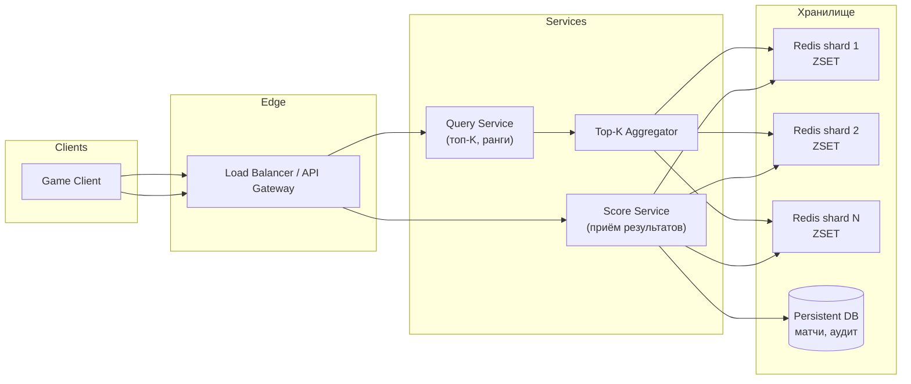
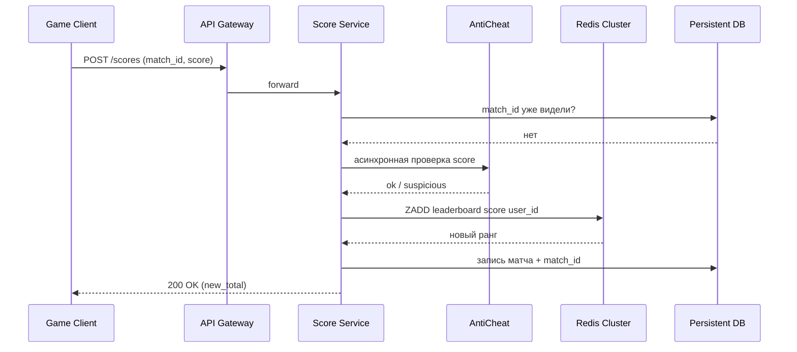
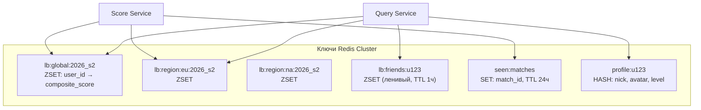
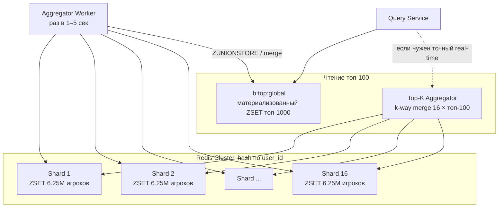
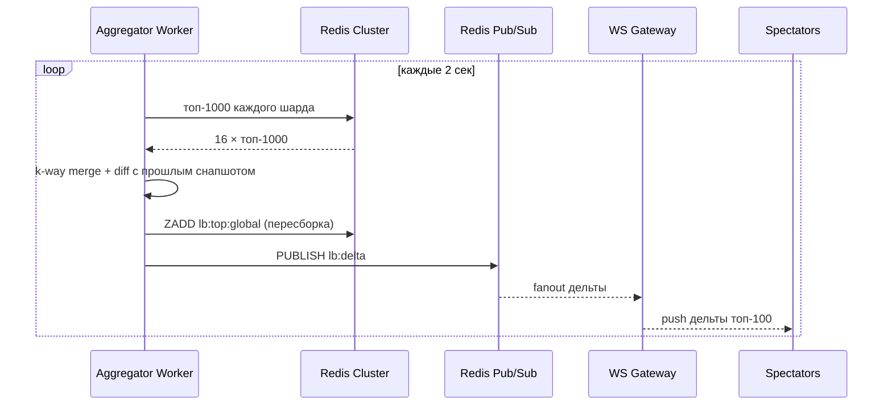

# Разбор задачи: игровой лидерборд

Лидерборд (таблица лидеров) — классическая задача на собеседованиях уровня Middle+/Senior, потому что на ней удобно проверять сразу несколько навыков: выбор структуры данных под запрос, оценку нагрузки, шардирование и честное обсуждение trade-off'ов между консистентностью и скоростью. Формулировка обычно звучит так: «Спроектируй систему, которая показывает топ-100 игроков по очкам и позицию конкретного игрока в рейтинге».

Ключевая интуиция, которую интервьюер ждёт услышать в первые пять минут: **это не задача про базу данных, это задача про структуру данных**. Топ-K от упорядоченного множества с частыми обновлениями — это sorted set, и в индустрии де-факто стандартом является Redis ZSET. Всё остальное (шардирование, агрегация, античит) — надстройки над этим ядром.

---

## 1. Уточняющие вопросы

Не начинайте рисовать архитектуру, пока не зафиксировали рамки. По опыту мок-собеседований, одна из самых частых ошибок кандидатов — не недоуточнить, а **переуточнить**: начать собирать требования, которых от вас не ждут (двухфакторная аутентификация игроков, лайки на профилях, система репортов), и сжечь половину интервью на scope, который никто не просил. Задавайте только те вопросы, ответы на которые реально меняют дизайн.

Функциональный scope:

- Это глобальный рейтинг или много таблиц (по регионам, по сезонам, по друзьям, ежедневные/еженедельные)?
- Сколько игроков и какой объём таблицы: топ-10, топ-100, топ-1000?
- Нужно ли показывать позицию конкретного игрока («вы на 1 243 567-м месте»)?
- Нужен ли «окрестный» срез — 5 игроков выше и ниже меня?
- Очки только накапливаются или могут уменьшаться/обнуляться (сезонный сброс)?
- Как обрабатываем одинаковые очки — кто раньше достиг, тот выше, или безразлично?

Нефункциональный scope:

- Какая задержка допустима между «игрок набрал очки» и «он виден в таблице» — секунды или минуты?
- Чтения и записи — какой RPS и какой пик (финал турнира)?
- Насколько критична точность ранга? Допустима ли eventual consistency («позиция обновится в течение минуты»)?

Вопрос, который почти всегда выигрышно звучит: **«А насколько нам важна консистентность ранга? Обычно для лидерборда допустима задержка в секунды — это сильно упрощает дизайн, могу я так предположить?»** Вы показываете, что понимаете цену strong consistency, и сами предлагаете разумный компромисс.

---

## 2. Требования

### Функциональные

- Игра/клиент присылает результат матча: `submit_score(user_id, delta или абсолютное значение)`.
- Получить топ-K: `get_top(k)` — глобальный и по региону/сезону.
- Получить позицию игрока: `get_rank(user_id)` — ранг + очки.
- Получить окрестность игрока: `get_around(user_id, n)` — n выше и n ниже.
- (Опционально) обновление таблицы у клиентов в реальном времени.

### Нефункциональные

| Требование | Цель | Почему важно |
|---|---|---|
| Задержка чтения топ-K | p99 < 100 мс | Таблицу смотрят часто, она должна быть «живой» |
| Задержка обновления скора | p99 < 50 мс на запись | Запись не должна тормозить игровой цикл |
| Видимость обновления | < 5 сек | Игрок ждёт, что его очки «появятся сразу» |
| Доступность | 99.9%+ | Потеря таблицы на час в финале турнира = катастрофа для продукта |
| Консистентность | Eventual, с монотонностью для одного игрока | Строгий порядок между разными игроками не нужен |

Осознанно **отбрасываем**: strong consistency глобального ранга (дорого и не нужно), историю изменений (это аналитика, отдельная система), точный античит (кратко обсудим, но это отдельный домен).

---

## 3. Оценки нагрузки

Считаем на пальцах, вслух, округляя до порядков. Пусть у нас крупная мобильная игра:

- 10 млн DAU, всего зарегистрировано 100 млн игроков.
- Средний игрок играет 5 матчей в день → записи скора: `10^7 × 5 = 5×10^7` обновлений/день ≈ **~600 RPS в среднем**.
- Пиковый коэффициент ×10 (вечер, финалы турниров) → **~6 000–10 000 RPS на запись в пике**.
- Таблицу открывают чаще, чем играют: каждый DAU смотрит топ-100 в среднем 20 раз/день → `2×10^8` чтений/день ≈ ~2 500 RPS в среднем, **~25 000 RPS в пике**.

Соотношение чтение/запись примерно 3–4:1 — нагрузка симметричнее, чем в типичном «read-heavy» сервисе, но и та, и другая скромная по меркам Redis.

Память: одна запись в ZSET — member (user_id, до 16–32 байт) + score (8 байт double) + накладные расходы skiplist и хэш-таблицы. Практическая оценка — **~64–100 байт на запись**. Для 100 млн игроков: `10^8 × 100 Б ≈ 10 ГБ`. Это помещается в память одной ноды Redis, но одна нода — это single point of failure и потолок по RPS. Отсюда — разговор про кластер и шардирование (раздел 7).

Важная ремарка для интервью: **держать в ZSET все 100 млн игроков не обязательно**. Если таблица показывает топ-100 и позицию игрока, хранить нужно всех (ранг считается относительно всех). А вот для «ежедневного топа» или «топа по слову» (как в разборе Redis от ex-Meta инженера — топ-5 твитов по ключевому слову) записи можно **подрезать**: после вставки удалять всё, что ниже топ-K, через `ZREMRANGEBYRANK`. Тогда множество остаётся маленьким, а вставка остаётся O(log K) с крошечным K. Это сильный ход — вы показываете, что понимаете разницу между «ранг среди всех» и «топ-K из потока».

---

## 4. API

```text
POST /v1/scores
  { "user_id": "u123", "match_id": "m456", "score": 2750, "mode": "ranked" }
  → 200 OK { "new_total": 15230 }

GET /v1/leaderboard/top?k=100&region=eu&season=2026_s2
  → [ { "rank": 1, "user_id": "u9", "score": 98120 }, ... ]

GET /v1/leaderboard/rank?user_id=u123&region=eu&season=2026_s2
  → { "rank": 1243567, "score": 15230, "percentile": 98.7 }

GET /v1/leaderboard/around?user_id=u123&n=5
  → [ 5 записей выше, сам игрок, 5 ниже ]
```

Два момента, о которых стоит сказать вслух:

- `match_id` — ключ идемпотентности. Клиент может ретраить submit при таймауте, и без дедупликации очки задвоятся. Храним `match_id` в SET с TTL (например, 24 часа) или в основной БД результатов.
- Разделение «сырых результатов матча» и «скора в таблице». Сырая правда о матчах живёт в персистентной БД (PostgreSQL/Cassandra), а Redis — материализованное, пересчитываемое представление. Redis может умереть и быть перестроен из БД — это снимает требование durable-хранения к самому Redis.

---

## 5. High-level design



Поток записи (submit score) с идемпотентностью и античит-проверкой:



Обратите внимание на порядок: пишем в Redis синхронно (быстро, < 5 мс), а персистентную запись и античит — асинхронно или слабо связанно. Если античит позже пометит результат как читерский, делаем компенсацию: `ZINCRBY` на отрицательную дельту или пересчёт скора из БД. Таблица у нас eventual consistent — это легально.

---

## 6. Data model: Redis ZSET как ядро

### Почему именно ZSET

Sorted set в Redis — это две структуры под одним ключом:

- **хэш-таблица** `member → score` — O(1) на чтение скора;
- **skiplist**, упорядоченный по `(score, member)` — O(log N) на вставку, удаление и поиск позиции.

Эта пара даёт ровно тот набор операций, который нужен лидерборду:

| Операция | Команда | Сложность |
|---|---|---|
| Обновить/установить скор | `ZADD key score user` | O(log N) |
| Добавить дельту | `ZINCRBY key delta user` | O(log N) |
| Топ-K по убыванию | `ZREVRANGE key 0 K-1 WITHSCORES` | O(log N + K) |
| Ранг игрока | `ZREVRANK key user` | O(log N) |
| Окрестность игрока | `ZREVRANGE key rank-n rank+n` | O(log N + n) |
| Подрезать хвост | `ZREMRANGEBYRANK key 0 -(K+1)` | O(log N + M) |

Сравните с альтернативами — это то, что интервьюер почти гарантированно спросит:

| Подход | Проблема |
|---|---|
| Реляционная БД + `ORDER BY score DESC LIMIT 100` | Чтение топа — O(log N) по индексу, ок. Но **ранг игрока** = `COUNT(*) WHERE score > X` — скан половины индекса. На 100 млн строк и 10k RPS записи индекс деградирует от постоянных обновлений |
| Куча (heap) топ-K в памяти сервиса | Топ-K есть, ранга нет, состояние не разделяется между инстансами, восстановление после падения — боль |
| Cassandra/DynamoDB | Нет нативной сортировки по значению; ранг требует full scan + внешней агрегации |
| ZSET | Все четыре операции за O(log N) или лучше, in-memory скорость, встроенная репликация |

### Тай-брейкинг при равных очках

ZSET сортирует равные скоры лексикографически по member — для лидерборда это обычно не то, что нужно. Продуктовое правило чаще такое: **«при равных очках выше тот, кто достиг результата раньше»** (аналогичное правило «first in wins» обсуждают в мок-разборе аукциона — интервьюеры любят, когда кандидат сам поднимает тему тай-брейкинга).

Решение — упаковать время в score. Скор игрока — целое, скажем до 10^9. Берём composite score:

```text
score = points × 10^13 + (10^13 − timestamp_достижения)
```

Чем раньше timestamp, тем больше вторая компонента — и выше итоговый скор при равных очках. `double` в Redis имеет 52 бита мантиссы (~9×10^15 точных целых), так что `10^9 × 10^13 = 10^22` не влезет — масштабируйте под реальные диапазоны (например, очки до 10^7 и timestamp в секундах до 2×10^9: `10^7 × 3×10^9 + offset ≈ 3×10^16` — уже на грани; аккуратно посчитайте разрядность вслух, это мелочь, которая цепляет интервьюера).

Альтернатива без арифметики: хранить чистые очки, а для равных скоров применять `ZREVRANGEBYLEX`-подход или отдельный tie-break на уровне сервиса. На собеседовании достаточно назвать проблему и один рабочий способ.

### Схема ключей



Принципы:

- Одна таблица = один ключ. Сезонные/региональные таблицы — отдельные ключи; старый сезон просто истекает по TTL или архивируется.
- Профили (ник, аватар) лежат отдельно от ZSET: топ-100 из ZSET + batch-`MGET` профилей. Не кладите JSON профиля member'ом — обновление ника не должно трогать рейтинг.
- «Топ среди друзей» — лениво материализуемый ZSET на пользователя с коротким TTL: при запросе собираем скоры друзей из глобальной таблицы и кладём в временный ключ.

---

## 7. Deep dive #1: шардирование и сборка глобального топ-K

### Почему одной ноды мало, хотя памяти хватает

10 ГБ влезает в одну ноду. Но: (а) одна нода — SPOF, (б) Redis однопоточен на выполнение команд — 10k RPS записей + 25k RPS чтений одна нода выдержит, но запас на рост ×10 уже требует плана. Правильная формулировка для интервью: «Сейчас одна нода справляется, но я сразу заложу кластерную схему, потому что решающим фактором станет не память, а доступность и пиковый throughput».

### Стратегии шардирования

**Вариант A: hash по user_id (индустриальный дефолт).** `shard = crc16(user_id) mod N` — 16 шардов, на каждом свой ZSET. Распределение равномерное, горячих шардов нет. Минус — глобальный топ-K требует scatter-gather: спросить топ-K у **каждого** шарда и слить результаты (k-way merge) на агрегаторе. Ранг игрока — сумма `ZCOUNT(shard_i, score+1, +inf)` по всем шардам плюс локальный ранг. Это N сетевых запросов на один пользовательский — звучит страшно, но Redis быстрый: 16 параллельных запросов по ~0.2 мс — это всё ещё единицы миллисекунд. Именно такая схема («несколько sorted set'ов по хэшу ключа, склеиваем на запросе, 16 запросов на практике не проблема») описана в deep dive по Redis от бывшего staff-инженера Meta.

**Вариант B: шардирование по диапазону скоров.** Шард 1: score ∈ [0, 1M), шард 2: [1M, 2M), ..., топ-шард: [X, +inf). Топ-100 читается с **одного** верхнего шарда без scatter-gather — это главный соблазн варианта. Минусы:

- **Горячий шард по построению.** Диапазоны скоров распределены неравномерно — как в примере с шардированием по ценам товаров: если почти все товары дешевле порога, один шард берёт всю нагрузку. В лидерборде большинство игроков кучкуется в середине распределения, а все записи топ-игроков лупят в один верхний шард.
- **Миграции при каждом изменении скора.** Игрок перешёл границу диапазона → `ZREM` на одном шарде + `ZADD` на другом, желательно атомарно (Lua-скрипт или два шага с eventual consistency).
- **Ребалансировка границ** по мере инфляции скоров — операционная боль.

Диапазонное шардирование вообще коварно: на интервью по шардированию от инженера Meta Staff прямо разбирается, как range-based подход с монотонно растущим ключом приводит к тому, что вся запись и чтение ложатся на последний шард, а остальные простаивают. Здесь та же ловушка, только ключ — скор.

**Вариант C: hash по user_id + материализованный глобальный топ.** Гибрид: шарды как в варианте A, а поверх — фоновый воркер, который раз в 1–5 секунд пересобирает маленький ZSET `lb:top:global` (только топ-1000) из топов шардов. Чтение топ-100 — один запрос в один ключ; ранг игрока — scatter-gather по `ZCOUNT`. Это то, что обычно и делают в проде.

| Критерий | A: hash + merge | B: range по скору | C: hash + материализация топа |
|---|---|---|---|
| Чтение топ-K | N запросов + merge | 1 запрос | 1 запрос |
| Ранг игрока | N запросов (ZCOUNT) | 1–2 запроса | N запросов |
| Запись скора | 1 запрос | 1–2 запроса + миграции | 1 запрос + фоновый пересчёт |
| Горячие шарды | нет | да, верхний | нет |
| Ребалансировка | consistent hashing | пересмотр границ | consistent hashing |
| Свежесть топа | real-time | real-time | лаг 1–5 сек |



Полезная деталь: слияние топов можно делать и самим Redis — `ZUNIONSTORE` умеет объединять несколько ZSET с суммированием скоров, но он тянет данные на одну ноду; на собеседовании безопаснее описать merge на стороне агрегатора (k-way merge за O(N × K)).

### Ранг игрока при шардировании

Формула для варианта A/C, говорите её явно:

```text
rank(user) = Σ_i ZCOUNT(shard_i, score(user) + ε, +inf) + 1
```

`ZCOUNT` — O(log N) на шард, 16 параллельных вызовов ≈ 1–3 мс. Percentile считается через `ZCARD` всех шардов. Это тот момент, где интервьюер проверяет, понимаете ли вы, что scatter-gather для **счётчиков** дёшев, а для **данных** дорог.

---

## 8. Deep dive #2: обновление у клиентов в реальном времени

«В реальном времени» надо декомпозировать. Для таблицы лидеров почти никогда не нужен честный push на каждое обновление — математика убивает идею: 10k обновлений/сек × 100k онлайн-зрителей = миллиард сообщений в секунду. Рабочие варианты:

| Подход | Лаг | Цена | Когда уместен |
|---|---|---|---|
| Polling раз в 10–30 сек | до 30 сек | Дёшево, HTTP-кэшируется | Дефолт для мобильных игр |
| SSE / WebSocket с **батчевым** push раз в 1–5 сек | 1–5 сек | Средне; push только дельт топ-100 | Турнирные экраны, стримы |
| WebSocket per-update | ~0 | Не масштабируется | Только если зрителей мало (киберспорт-матч 1-на-1) |

Сильный ответ: «Реальное время» делаем не push'ем каждого апдейта, а периодической рассылкой дельты материализованного топа (см. вариант C выше). Клиент хранит снапшот, сервер шлёт diff: «позиции 34–41 сдвинулись, вошёл новый игрок на 38-е место». WebSocket-гейтвеи масштабируются независимо, Redis pub/sub или Streams разносят дельты по инстансам.



Для «моей позиции» push не нужен вовсе: клиент спрашивает ранг после своего матча и периодически во время сессии.

---

## 9. Deep dive #3: античит (кратко, но честно)

Полноценный античит — отдельная система, и правильный ход на собеседовании — очертить границу, а не проектировать её целиком. Но показать понимание угроз стоит, особенно если интервьюер сам спросит «а как вы защититесь от накрутки?».

Уровни защиты, от дешёвого к дорогому:

1. **Серверная авторитетность.** Клиент не присылает «я набрал 10^9 очков» — клиент присылает результат матча, а скор вычисляет или валидирует сервер. Submit подписан (HMAC) и привязан к серверной сессии матча. Это снимает 90% наивных накруток.
2. **Идемпотентность и лимиты.** `match_id` дедуплицируется; rate limit на submit с одного аккаунта (например, не больше 1 матча / 30 сек); sanity-границы на максимально возможный скор за матч.
3. **Эвристики и ML-детекция (асинхронно).** Поток результатов пишется в Kafka; отдельный воркер ищет аномалии: скор вне распределения, неправдоподобная длительность матча, паттерны win-trading (группа аккаунтов сливается друг другу по кругу). Нарушителей `ZREM` из таблицы и бан — таблица eventual consistent, компенсация легальна.
4. **Replay/верификация.** Для призовых турниров — серверный replay матча. Дорого, применяется только к топ-N претендентов.

Ключевая фраза: «Античит не должен быть в критическом пути записи скора — проверяем асинхронно, откатываем компенсирующими операциями, потому что лидерборд у нас eventual consistent by design».

---

## 10. Отказоустойчивость и восстановление

- **Redis Cluster / Sentinel**: каждый шард — master + replica, автоматический failover за секунды. Чтение топа можно раздавать с реплик.
- **Персистентность Redis**: AOF (everysec) — потеря ≤ 1 сек записей при падении. Допустимо, потому что источник истины — БД матчей.
- **Дезастер-рекавери**: если кластер потерян целиком — пересборка из БД матчей батч-джобом: пробежать по результатам сезона, переиграть `ZINCRBY`. 5×10^7 матчей / ~50k ZINCRBY в секунду ≈ 15–20 минут на восстановление. Проговорите эту оценку — она показывает, что вы считаете восстановление, а не машете рукой.
- **Репликация между ДЦ**: глобальная игра → региональные Redis-кластеры, глобальный топ собирается из региональных топов (тот же паттерн merge, уровнем выше). Лаг кросс-ДЦ репликации — секунды, что укладывается в наш SLO на свежесть.

---

## 11. Trade-offs: что проговорить явно

| Решение | Выбираем | Жертвуем | Почему ок |
|---|---|---|---|
| Redis ZSET vs SQL | ZSET | durability, SQL-запросы | Источник истины — БД; Redis пересчитываем |
| Eventual consistency топа (вариант C) | лаг 1–5 сек | «мгновенность» | Пользователь не отличит 2 сек задержки; чтение топа становится O(1) запрос |
| Hash-шардирование | равномерность | scatter-gather на ранг | ZCOUNT за O(log N) на шард — дёшево |
| Push vs polling | polling/батч-push | «настоящий» real-time | per-update fanout не масштабируется физически |
| Асинхронный античит | скорость записи | читеры видны минуты | Компенсация `ZREM`/`ZINCRBY` разрешена моделью |

---

## 12. Красные флаги и типичные ошибки кандидатов

- **«Храним в PostgreSQL, добавим индекс на score».** Индекс решает топ-K, но не ранг игрока (это `COUNT` по полуиндексу) и не 10k обновлений в секунду по одному B-tree. Если кандидат не называет эту проблему сам — интервьюер докопается.
- **Рисовать Kubernetes и микросервисы раньше, чем структуру данных.** Задача проверяет, что вы сначала ответите «отсортированное множество», а потом уже «кластер». Как ехидно замечают в разборе ошибок собеседований: не стесняйтесь рисовать простые квадратики — load balancer это просто квадрат, который раскидывает поток; глубина нужна в модели данных, а не в количестве прямоугольников.
- **Забыть про тай-брейкинг равных скоров.** Вопрос «а что при равных очках?» — почти гарантированный follow-up.
- **Per-update push всем зрителям.** Озвучив миллиард сообщений в секунду как «WebSocket, и всё» — красный флаг по оценке нагрузки.
- **Собирать требования, которых не просили.** Если вы тратите 10 минут на проектирование античит-ML-пайплайна вместо ядра — scope потерян. Правильно: назвать, очертить границу, двинуться дальше.
- **Range-шардирование по скору без оговорки про горячий шард.** Если выбираете диапазоны — сами скажите про перекос и миграции, не ждите, пока поймают.
- **Забыть идемпотентность submit'а.** Ретрай клиента = двойные очки. Интервьюеры это обожают проверять.

---

## 13. Что спросят дополнительно

- **«А если топ-игроков атакуют — как не дать DDoS'ить запись?»** — rate limiting на gateway, очередь на приём результатов, отделение write path от read path.
- **«Как сделать еженедельный сброс таблицы?»** — новый ключ на сезон (`lb:global:2026_w32`), старый — в архив/TTL; переключение атомарно по имени ключа, без миграций данных.
- **«А миллиард игроков?»** — память: 10^9 × 100 Б ≈ 100 ГБ → шардирование обязательно; ранговые запросы дорожают линейно по числу шардов → аппроксимация ранга для длинного хвоста (ранг с точностью до процентиля через бакеты скоров).
- **«Как показать "ты обогнал X друзей"?»** — ленивые ZSET по кругу друзей или предрасчёт дельт воркером по потоку обновлений.
- **«Strong consistency когда-нибудь нужна?»** — только на финише призового турнира: финальная таблица фиксируется «заморозкой» (снапшот из БД матчей), а не live-таблицей.
- **«Почему Redis, а не in-house skiplist в сервисе?»** — shared state между инстансами, репликация из коробки, операционная зрелость; своя структура оправдана только при экстремальных RPS, где цена сетевого хопа критична.

---

## 14. Итоговая «скелетная» версия ответа (60 секунд)

> Ядро — Redis sorted set: ZADD на обновление, ZREVRANGE на топ-K, ZREVRANK на позицию — всё за O(log N). Источник истины — персистентная БД матчей, Redis — пересчитываемая проекция. При росте шардируем ZSET по хэшу user_id на 16 шардов; глобальный топ собирает агрегатор k-way merge'ем, а для быстрого чтения материализуем топ-1000 раз в пару секунд. Ранг игрока — сумма ZCOUNT по шардам. Равные скоры разрешаем composite score с timestamp. Обновления клиентам — дельты материализованного топа раз в несколько секунд, не per-update push. Античит — асинхронно по потоку результатов, с компенсирующим ZREM. Консистентность — eventual, для лидерборда это корректный компромисс.

---

## Источники и видео по теме

- [Глубокое погружение в Redis с бывшим старшим менеджером Meta](https://www.youtube.com/watch?v=fmT5nlEkl3U)
- [Шардинг в интервью по системному проектированию с инженером Meta Staff](https://www.youtube.com/watch?v=L521gizea4s)
- [System Design на собеседовании: ошибки, которые тебя топят](https://www.youtube.com/watch?v=MKNg7gwnUX0)
- [System Design - теория шардирования / Как масштабировать базы данных](https://www.youtube.com/watch?v=d6BtxBKhQoc)
- [OpenAI & Meta Senior/Staff System Design Mock Interview: Design Online Auction](https://www.youtube.com/watch?v=o8nSXW-B7Rw)
- [Redis system design / Distributed cache System design](https://www.youtube.com/watch?v=DUbEgNw-F9c)
- [Redis - In Practice / Distributed Systems Deep Dives With Ex-Google SWE](https://www.youtube.com/watch?v=k8_qxgoZ4bg)
