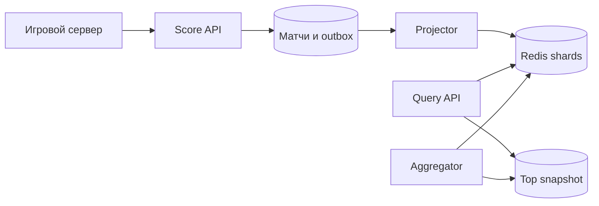
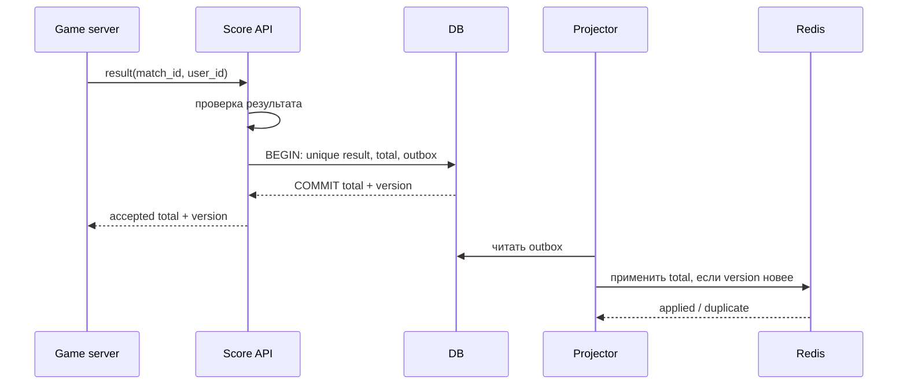
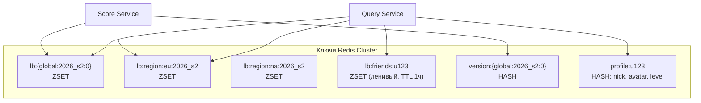
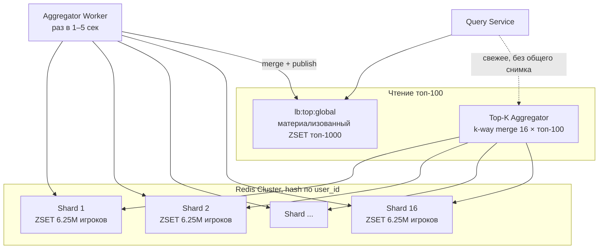
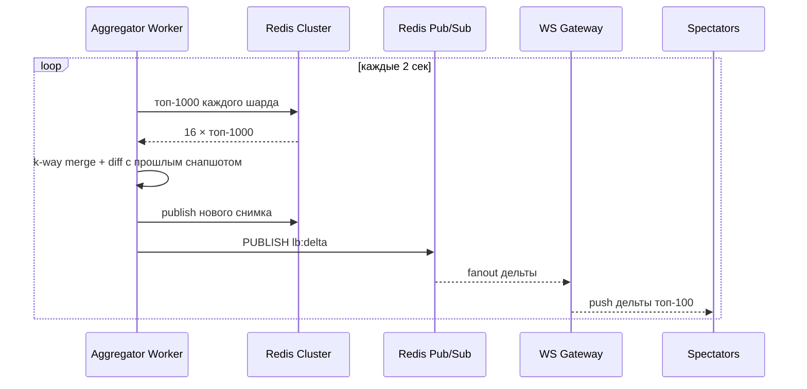

# Разбор задачи: игровой лидерборд

<!-- learning-nav:start -->
[← Все разделы](../README.md) · [Предыдущая тема](web-crawler.md) · [Следующая тема →](ride-sharing.md)
<!-- learning-nav:end -->

Лидерборд (таблица лидеров) — классическая задача на собеседованиях уровня Middle+/Senior, потому что на ней удобно проверять сразу несколько навыков: выбор структуры данных под запрос, оценку нагрузки, шардирование и честное обсуждение trade-off'ов между консистентностью и скоростью. Формулировка обычно звучит так: «Спроектируй систему, которая показывает топ-100 игроков по очкам и позицию конкретного игрока в рейтинге».

Начните с запросов: топ-K, ранг и окрестность требуют упорядоченного индекса. Redis ZSET — удобный вариант, если индекс помещается в память. SQL с индексом тоже подходит для части масштабов; выбор проверяют по памяти, стоимости обновлений и запросам ранга. Структура данных сама по себе не обеспечивает надёжный учёт матчей и согласованный глобальный снимок.

---

## 1. Уточняющие вопросы

Не начинайте рисовать архитектуру, пока не зафиксировали рамки. По опыту мок-собеседований, одна из самых частых ошибок кандидатов — не недоуточнить, а **переуточнить**: начать собирать требования, которых от вас не ждут (двухфакторная аутентификация игроков, лайки на профилях, система репортов), и сжечь половину интервью на scope, который никто не просил. Задавайте только те вопросы, ответы на которые реально меняют дизайн.

Функциональный scope:

- Это глобальный рейтинг или много таблиц (по регионам, по сезонам, по друзьям, ежедневные/еженедельные)?
- Сколько игроков и какой объём таблицы: топ-10, топ-100, топ-1000?
- Нужно ли показывать позицию конкретного игрока («вы на 1 243 567-м месте»)?
- Нужен ли «окрестный» срез — 5 игроков выше и ниже меня?
- Очки только накапливаются или могут уменьшаться/обнуляться (сезонный сброс)?
- Как обрабатываем одинаковые очки — кто раньше достиг, тот выше, или безразлично?

Нефункциональный scope:

- Какая задержка допустима между «игрок набрал очки» и «он виден в таблице» — секунды или минуты?
- Чтения и записи — какой RPS и какой пик (финал турнира)?
- Насколько критична точность ранга? Допустима ли eventual consistency («позиция обновится в течение минуты»)?

Вопрос, который почти всегда выигрышно звучит: **«А насколько нам важна консистентность ранга? Обычно для лидерборда допустима задержка в секунды — это сильно упрощает дизайн, могу я так предположить?»** Вы показываете, что понимаете цену strong consistency, и сами предлагаете разумный компромисс.

---

## 2. Требования

### Функциональные

- Авторитетный игровой сервер присылает результат матча: `submit_score(user_id, delta или абсолютное значение)`.
- Получить топ-K: `get_top(k)` — глобальный и по региону/сезону.
- Получить позицию игрока: `get_rank(user_id)` — ранг + очки.
- Получить окрестность игрока: `get_around(user_id, n)` — n выше и n ниже.
- (Опционально) обновление таблицы у клиентов в реальном времени.

### Нефункциональные

| Требование | Цель | Почему важно |
|---|---|---|
| Задержка чтения топ-K | p99 < 100 мс | Таблицу смотрят часто, она должна быть «живой» |
| Задержка обновления скора | p99 < 50 мс на запись | Запись не должна тормозить игровой цикл |
| Видимость обновления | < 5 сек | Игрок ждёт, что его очки «появятся сразу» |
| Доступность | 99.9%+ | Потеря таблицы на час в финале турнира = катастрофа для продукта |
| Консистентность | Eventual, без перезаписи новой версии старой | Свежесть и точность ранга оговариваются отдельно |

Осознанно **отбрасываем**: strong consistency глобального ранга (дорого и не нужно), историю изменений (это аналитика, отдельная система), точный античит (кратко обсудим, но это отдельный домен).

---

## 3. Оценки нагрузки

Считаем на пальцах, вслух, округляя до порядков. Пусть у нас крупная мобильная игра:

- 10 млн DAU, всего зарегистрировано 100 млн игроков.
- Средний игрок играет 5 матчей в день → записи скора: `10^7 × 5 = 5×10^7` обновлений/день ≈ **~600 RPS в среднем**.
- Пиковый коэффициент ×10 (вечер, финалы турниров) → **~6 000–10 000 RPS на запись в пике**.
- Таблицу открывают чаще, чем играют: каждый DAU смотрит топ-100 в среднем 20 раз/день → `2×10^8` чтений/день ≈ ~2 500 RPS в среднем, **~25 000 RPS в пике**.

Соотношение чтение/запись примерно 3–4:1 — нагрузка симметричнее, чем в типичном «read-heavy» сервисе, но и та, и другая скромная по меркам Redis.

Память: одна запись в ZSET — member (user_id, до 16–32 байт) + score (8 байт double) + накладные расходы skiplist и хэш-таблицы. Для оценки возьмём **100–200 байт на запись**, затем измерим `MEMORY USAGE` на репрезентативных данных. Для 100 млн игроков это 10–20 ГБ только основной структуры. Дополнительно нужны реплики, профили, дедупликация, allocator overhead и запас на fork/AOF rewrite. Ёмкость и throughput проверяем отдельно; репликация обеспечивает отказоустойчивость, шардирование распределяет данные и нагрузку.

Важная ремарка для интервью: **держать в ZSET все 100 млн игроков не обязательно**. Если таблица показывает топ-100 и позицию игрока, хранить нужно всех (ранг считается относительно всех). А вот для «ежедневного топа» или «топа по слову» (как в разборе Redis от ex-Meta инженера — топ-5 твитов по ключевому слову) записи можно **подрезать**: после вставки удалять всё, что ниже топ-K, через `ZREMRANGEBYRANK`. Это корректно для независимых результатов или монотонного лучшего результата. Для суммы очков игрока нужно отдельно хранить полный total: исключённый из топа игрок может накопить достаточно очков и вернуться. При уменьшении очков/бане лидера top-K без полного состояния не знает следующего кандидата.

---

## 4. API

```text
POST /v1/scores
  { "user_id": "u123", "match_id": "m456", "score": 2750, "mode": "ranked" }
  → 200 OK { "new_total": 15230 }

GET /v1/leaderboard/top?k=100&region=eu&season=2026_s2
  → [ { "rank": 1, "user_id": "u9", "score": 98120 }, ... ]

GET /v1/leaderboard/rank?user_id=u123&region=eu&season=2026_s2
  → { "rank": 1243567, "score": 15230, "percentile": 98.7 }

GET /v1/leaderboard/around?user_id=u123&n=5
  → [ 5 записей выше, сам игрок, 5 ниже ]
```

Два контракта должны быть явными:

- `match_id` вместе с игроком и режимом — уникальный ключ результата. Ретрай с тем же ключом и другим payload возвращает конфликт. TTL 24 часа покрывает только повторы в эти 24 часа; долговечный уникальный ключ в БД нужен для позднего replay.
- Источник истины — принятые результаты матчей и версии total в БД. Redis — восстанавливаемая проекция. Ответ после commit может вернуть `accepted_total` и `projection_version`: ранг ещё отстаёт.

---

## 5. High-level design



Путь записи сначала фиксирует истину, затем обновляет представление:



Проверка авторства и допустимости результата выполняется до commit; дорогой поиск аномалий может идти асинхронно. Обновление total и outbox — одна транзакция. Если projector упал после Redis-записи, он повторит событие: Lua/Redis Function атомарно сравнивает версию игрока и применяет абсолютный total через `ZADD`, поэтому очки не удвоятся. Ключ версии и ZSET должны быть в одном hash slot. Несколько таблиц (global/region) могут обновляться с разным лагом: это оговорённая eventual consistency, а не межшардовая транзакция.

При дельтах `SETNX seen` и `ZINCRBY` тоже должны быть одной атомарной операцией в одном слоте. Отдельные вызовы создают окно «дедуп записан, очки не начислены» или «очки начислены дважды». Абсолютный total с версией проще для replay и корректировок.

---

## 6. Data model: Redis ZSET как ядро

### Почему именно ZSET

У больших ZSET Redis обычно использует две структуры под одним ключом (небольшие множества могут иметь компактное представление):

- **хэш-таблица** `member → score` — O(1) на чтение скора;
- **skiplist**, упорядоченный по `(score, member)` — O(log N) на вставку, удаление и поиск позиции.

Эта пара даёт ровно тот набор операций, который нужен лидерборду:

| Операция | Команда | Сложность |
|---|---|---|
| Обновить/установить скор | `ZADD key score user` | O(log N) |
| Добавить дельту | `ZINCRBY key delta user` | O(log N) |
| Топ-K по убыванию | `ZREVRANGE key 0 K-1 WITHSCORES` | O(log N + K) |
| Ранг игрока | `ZREVRANK key user` | O(log N) |
| Окрестность игрока | `ZREVRANGE key rank-n rank+n` | O(log N + n) |
| Подрезать хвост | `ZREMRANGEBYRANK key 0 -(K+1)` | O(log N + M) |

Сравните с альтернативами — это то, что интервьюер почти гарантированно спросит:

| Подход | Проблема |
|---|---|
| Реляционная БД + `ORDER BY score DESC LIMIT 100` | Чтение топа — O(log N) по индексу, ок. Но **ранг игрока** = `COUNT(*) WHERE score > X` — скан половины индекса. Стоимость зависит от распределения scores, видимости строк, размера индекса и железа; проверяем benchmark |
| Куча (heap) топ-K в памяти сервиса | Топ-K есть, ранга нет, состояние не разделяется между инстансами, восстановление после падения — боль |
| Cassandra/DynamoDB | Нет нативной сортировки по значению; ранг требует full scan + внешней агрегации |
| ZSET | Все четыре операции за O(log N) или лучше, in-memory скорость, встроенная репликация |

### Тай-брейкинг при равных очках

Сначала определите тип ранга. При competition rank игроки с одинаковыми очками делят место: 1, 1, 3. При ordinal rank каждой записи нужна уникальная позиция: очки, затем время достижения, затем ID. Redis при равных score сравнивает member лексикографически; в обратном порядке больший member идёт раньше.

Упаковка в float требует строгого ограничения: все целые точно представимы лишь до `2^53`. Формула `points * 10^13 + time_part` для `points=10^9` даёт `10^22` и теряет tie-break. Даже `3×10^16` уже превышает безопасный диапазон. Рабочий учебный пример: очки до `10^6`, секундный offset внутри сезона меньше `10^8`; множитель `10^8` даёт до `10^14`, но обеспечивает только секундную точность. При уменьшениях и одинаковых timestamps нужны дополнительные правила.

Простой базовый дизайн хранит только очки и явно принимает ID как tie-break либо общий competition rank. Для правила «кто раньше» можно использовать индекс с составным ключом `(points DESC, reached_at ASC, user_id ASC)`. `ZRANGEBYLEX` нельзя использовать как сортировку по времени среди произвольных разных score: гарантии lex-диапазонов рассчитаны на одинаковые score.

### Схема ключей



Принципы:

- До шардирования одна таблица = один ZSET; после шардирования — один ZSET на bucket таблицы. Пара `lb:{global:2026_s2:0}` / `version:{global:2026_s2:0}` имеет одинаковый hash tag и доступна одному атомарному скрипту. Для следующего bucket тег меняется на `{global:2026_s2:1}`: номер bucket должен быть **внутри** фигурных скобок, иначе весь сезон останется в одном слоте. Разные теги могут попасть в один slot по коллизии; распределение slots по primary контролируется отдельно. Сезонные/региональные таблицы имеют свои пространства ключей; старый сезон истекает по TTL или архивируется.
- Профили (ник, аватар) лежат отдельно от ZSET: топ-100 из ZSET + пакетное чтение профилей (`HMGET` для HASH; `MGET` только для STRING). Не кладите JSON профиля member'ом — обновление ника не должно трогать рейтинг.
- «Топ среди друзей» — лениво материализуемый ZSET на пользователя с коротким TTL: при запросе собираем скоры друзей из глобальной таблицы и кладём в временный ключ.

---

## 7. Deep dive #1: шардирование и сборка глобального топ-K

### Почему одной ноды мало, хотя памяти хватает

Одна primary с replica может покрыть исходный объём: шардировать заранее необязательно. Проверяем p99 на смеси записей, топов и рангов, размер памяти, паузы обслуживания и восстановление. Чтение большого K и скрипты могут блокировать обработку других команд. Реплики уменьшают часть чтений, но дают устаревшие данные; рост записи требует разделения ключей.

### Стратегии шардирования

**Вариант A: hash по user_id.** Приложение выбирает логический bucket игрока и хранит отдельный ZSET на bucket. Redis Cluster сам распределяет *ключи*, а не участников одного ZSET: один `lb:global` не распараллелится. Нужна версионируемая карта bucket → shard; простая смена `mod N` переносит множество игроков.

Глобальный топ-K строим из локальных топ-K каждого шарда: любой глобальный участник топ-K обязательно входит в локальный топ-K при одном и том же полном порядке сравнения. Слияние возвращает K записей; вход содержит до `S*K`. При частых обновлениях чтения шардов не образуют общего снимка. Hash распределяет пользователей, но не исключает горячий bucket из-за популярного пользователя или неравных запросов.

**Вариант B: шардирование по диапазону скоров.** Шард 1: score ∈ [0, 1M), шард 2: [1M, 2M), ..., топ-шард: [X, +inf). Топ-100 читается с верхнего шарда, если в нём есть 100 записей; иначе затрагивает соседние диапазоны — это главный соблазн варианта. Минусы:

- **Горячий шард по построению.** Диапазоны скоров распределены неравномерно — как в примере с шардированием по ценам товаров: если почти все товары дешевле порога, один шард берёт всю нагрузку. В лидерборде большинство игроков кучкуется в середине распределения, а все записи топ-игроков лупят в один верхний шард.
- **Миграции при каждом изменении скора.** Игрок перешёл границу диапазона → `ZREM` на одном шарде + `ZADD` на другом, между разными слотами Lua атомарность не даст; нужен протокол миграции с версией и дедупликацией при чтении.
- **Ребалансировка границ** по мере инфляции скоров — операционная боль.

Диапазонное шардирование вообще коварно: на интервью по шардированию от инженера Meta Staff прямо разбирается, как range-based подход с монотонно растущим ключом приводит к тому, что вся запись и чтение ложатся на последний шард, а остальные простаивают. Здесь та же ловушка, только ключ — скор.

**Вариант C: hash по user_id + материализованный глобальный топ.** Гибрид: шарды как в варианте A, а поверх — фоновый воркер, который раз в 1–5 секунд пересобирает маленький ZSET `lb:top:global` (только топ-1000) из топов шардов. Чтение топ-100 — один запрос в один ключ; ранг игрока — scatter-gather по `ZCOUNT`. Это возможный вариант при согласованном SLO свежести.

| Критерий | A: hash + merge | B: range по скору | C: hash + материализация топа |
|---|---|---|---|
| Чтение топ-K | N запросов + merge | 1 запрос | 1 запрос |
| Ранг игрока | Счётчики со всех шардов | Нужны размеры верхних диапазонов | Счётчики со всех шардов |
| Запись скора | 1 запрос | 1–2 запроса + миграции | 1 запрос + фоновый пересчёт |
| Горячие шарды | Возможны | Перекос диапазонов | Возможны + горячий top cache |
| Ребалансировка | consistent hashing | пересмотр границ | consistent hashing |
| Свежесть топа | Чтения в разные моменты | Зависит от миграций | Цель: лаг 1–5 сек |



Слияние выполняет агрегатор: `ZUNIONSTORE` в Redis Cluster требует ключи одного hash slot и не собирает распределённые ZSET. K-way merge отсортированных списков через heap возвращает K записей за `O(S + K log S)` после получения до `S*K` кандидатов; чтение/передача кандидатов тоже стоит ресурсов. Новый материализованный топ сначала собирают под временным ключом, затем атомарно публикуют (`RENAME` в одном слоте), чтобы читатель не увидел половину пересборки.

### Ранг игрока при шардировании

Для competition rank по чистым очкам:

```text
rank(u) = 1 + sum_i count_i(score > score(u))
Redis: ZCOUNT shard_key (15230 +inf
```

Скобка задаёт строгую нижнюю границу. Не нужны `score+1` или ε: они неверны для дробных score. Локальный ранг дополнительно не прибавляют — локальные записи уже входят в сумму. Для ordinal rank добавьте число участников с равными очками, стоящих раньше по выбранному tie-break; один `ZCOUNT` их не различает. Например, у u=100, на двух шардах по два игрока выше: ранг 5, независимо от распределения равных по очкам.

Каждый `ZCOUNT` стоит `O(log N_i)`, но p99 fan-out зависит от самого медленного шарда и сети. Нельзя обещать 1–3 мс без измерения. Если игрок изменил score между запросами или один shard недоступен, результат не является точным глобальным рангом в определённый момент. Отдаём `as_of`/версию снимка либо признак устаревания; не складываем отсутствующий shard как ноль. Точный финальный ранг строится по зафиксированной версии принятых матчей.

---

## 8. Deep dive #2: обновление у клиентов в реальном времени

«В реальном времени» надо декомпозировать. Для таблицы лидеров почти никогда не нужен честный push на каждое обновление — математика убивает идею: 10k обновлений/сек × 100k онлайн-зрителей = миллиард сообщений в секунду. Рабочие варианты:

| Подход | Лаг | Цена | Когда уместен |
|---|---|---|---|
| Polling раз в 10–30 сек | до 30 сек | Дёшево, HTTP-кэшируется | Дефолт для мобильных игр |
| SSE / WebSocket с **батчевым** push раз в 1–5 сек | 1–5 сек | Средне; push только дельт топ-100 | Турнирные экраны, стримы |
| WebSocket per-update | ~0 | Не масштабируется | Только если зрителей мало (киберспорт-матч 1-на-1) |

Сильный ответ: «Реальное время» делаем не push'ем каждого апдейта, а периодической рассылкой дельты материализованного топа (см. вариант C выше). Клиент хранит снапшот, сервер шлёт diff: «позиции 34–41 сдвинулись, вошёл новый игрок на 38-е место». WebSocket-гейтвеи масштабируются независимо, Redis pub/sub или Streams разносят дельты по инстансам.



Для «моей позиции» базово достаточно запроса: клиент спрашивает ранг после своего матча и периодически во время сессии. Дельты топа несут snapshot version; после разрыва/пропуска версии клиент перечитывает полный snapshot, потому что Redis Pub/Sub не хранит пропущенные сообщения. Окрестность в одном ZSET читают вместе с рангом атомарно, иначе соседние апдейты сместят срез между командами.

---

## 9. Deep dive #3: античит (кратко, но честно)

Полноценный античит — отдельная система, и правильный ход на собеседовании — очертить границу, а не проектировать её целиком. Но показать понимание угроз стоит, особенно если интервьюер сам спросит «а как вы защититесь от накрутки?».

Уровни защиты, от дешёвого к дорогому:

1. **Серверная авторитетность.** Клиент не присылает «я набрал 10^9 очков» — клиент присылает результат матча, а скор вычисляет или валидирует сервер. Submit подписан (HMAC) и привязан к серверной сессии матча. Подпись должна принадлежать доверенному игровому серверу: секрет внутри мобильного клиента извлекаем и не подтверждает честность игры.
2. **Идемпотентность и лимиты.** `match_id` дедуплицируется; rate limit на submit с одного аккаунта (например, не больше 1 матча / 30 сек); sanity-границы на максимально возможный скор за матч.
3. **Эвристики и ML-детекция (асинхронно).** Поток результатов пишется в Kafka; отдельный воркер ищет аномалии: скор вне распределения, неправдоподобная длительность матча, паттерны win-trading (группа аккаунтов сливается друг другу по кругу). Нарушителей `ZREM` из таблицы и бан — таблица eventual consistent, компенсация легальна.
4. **Replay/верификация.** Для призовых турниров — серверный replay матча. Дорого, применяется только к топ-N претендентов.

Ключевая фраза: «Дорогой поиск аномалий можно вынести из критического пути — проверяем асинхронно, откатываем компенсирующими операциями, потому что лидерборд у нас eventual consistent by design».

---

## 10. Отказоустойчивость и восстановление

Каждый shard — primary и replica с настроенным failover. Асинхронная репликация может потерять подтверждённые Redis-записи; AOF `everysec` обычно ограничивает локальную потерю последней секундой, но не даёт абсолютной межузловой гарантии. Источник истины — commit БД матчей, а не ACK от Redis.

Разбираем конкретный отказ: матч m1 принят, total версии 42 записан в БД; projector обновил Redis и упал до подтверждения outbox. После рестарта повтор версии 42 игнорируется. Затем failover Redis вернул состояние версии 41: reconciliation сверяет версии и повторно применяет 42. Простой флаг «outbox уже доставлен» не обнаружит потерю проекции; нужны периодическая сверка и возможность replay.

При полном восстановлении создаём новую генерацию индекса из snapshot totals, затем догоняем события после его позиции в журнале и переключаем чтение. Повторный `ZINCRBY` по всем матчам без пустой новой генерации задвоит очки. `5×10^7 / 50 000 = 1000` секунд (16,7 минуты) — только идеализированная прокачка *одного дня* матчей, без чтения БД и конкуренции. Сезон в 90 дней в таком расчёте — 25 часов; snapshot totals существенно сокращает RTO.

### На подумать: что показывать при потере шарда?

Условие: 16 шардов, один недоступен, у игрока ранг 500 в последнем снимке. Можно ли вернуть сумму по 15 шардам как актуальную позицию?

<details>
<summary>Разбор</summary>

Нет: неизвестные игроки могут стоять выше, поэтому сумма — только нижняя оценка номера места. Отдайте последний полный снимок с временем и признаком stale либо ошибку для запроса точного ранга. Топ-K из 15 шардов тоже может пропустить победителя. Для призов приостанавливают финализацию до восстановления журнала; высокая доступность API сама по себе не оправдывает неправильную выдачу наград.

</details>

---

## 11. Trade-offs: что проговорить явно

| Решение | Выбираем | Жертвуем | Почему ок |
|---|---|---|---|
| Redis ZSET vs SQL | ZSET | durability, SQL-запросы | Источник истины — БД; Redis пересчитываем |
| Eventual consistency топа (вариант C) | лаг 1–5 сек | «мгновенность» | Согласованная freshness; один запрос, O(log N + K) работы |
| Hash-шардирование | равномерность | scatter-gather на ранг | ZCOUNT за O(log N) на шард — дёшево |
| Push vs polling | polling/батч-push | «настоящий» real-time | Стоимость определяется частотой изменений и аудиторией |
| Асинхронный античит | скорость записи | читеры видны минуты | Компенсация `ZREM`/`ZINCRBY` разрешена моделью |

---

## 12. Красные флаги и типичные ошибки кандидатов

- **«Храним в PostgreSQL, добавим индекс на score».** Индекс решает топ-K, но не ранг игрока (это `COUNT` по диапазону индекса); способность выдержать 10k обновлений/с зависит от размера индекса, железа и транзакций и требует проверки. Если кандидат не называет эту проблему сам — интервьюер докопается.
- **Рисовать Kubernetes и микросервисы раньше, чем структуру данных.** Задача проверяет, что вы сначала ответите «отсортированное множество», а потом уже «кластер». Как ехидно замечают в разборе ошибок собеседований: не стесняйтесь рисовать простые квадратики — load balancer это просто квадрат, который раскидывает поток; глубина нужна в модели данных, а не в количестве прямоугольников.
- **Забыть про тай-брейкинг равных скоров.** Вопрос «а что при равных очках?» — почти гарантированный follow-up.
- **Per-update push всем зрителям.** Озвучив миллиард сообщений в секунду как «WebSocket, и всё» — красный флаг по оценке нагрузки.
- **Собирать требования, которых не просили.** Если вы тратите 10 минут на проектирование античит-ML-пайплайна вместо ядра — scope потерян. Правильно: назвать, очертить границу, двинуться дальше.
- **Range-шардирование по скору без оговорки про горячий шард.** Если выбираете диапазоны — сами скажите про перекос и миграции, не ждите, пока поймают.
- **Забыть идемпотентность submit'а.** Ретрай клиента = двойные очки. Интервьюеры это обожают проверять.

---

## 13. Что спросят дополнительно

- **«А если топ-игроков атакуют — как не дать DDoS'ить запись?»** — rate limiting на gateway, очередь на приём результатов, отделение write path от read path.
- **«Как сделать еженедельный сброс таблицы?»** — новый ключ на сезон (`lb:global:2026_w32`), старый — в архив/TTL; переключение атомарно по имени ключа, без миграций данных.
- **«А миллиард игроков?»** — память: 10^9 × 100 Б ≈ 100 ГБ → шардирование обязательно; ранговые запросы дорожают линейно по числу шардов → аппроксимация ранга для длинного хвоста (ранг с точностью до процентиля через бакеты скоров).
- **«Как показать "ты обогнал X друзей"?»** — ленивые ZSET по кругу друзей или предрасчёт дельт воркером по потоку обновлений.
- **«Strong consistency когда-нибудь нужна?»** — например, на финише призового турнира: финальная таблица фиксируется «заморозкой» (снапшот из БД матчей), а не live-таблицей.
- **«Почему Redis, а не in-house skiplist в сервисе?»** — shared state между инстансами, репликация из коробки, операционная зрелость; своя структура оправдана только при экстремальных RPS, где цена сетевого хопа критична.

---

### 1. Сезонный сброс и рейтинг за последние 24 часа — одно и то же?

Нет. Сезон имеет фиксированные границы: новый результат маршрутизируется в season ID по правилам приёма, новая таблица начинается пустой. Рейтинг за последние 24 часа — скользящий: старые вклады каждого игрока надо вычитать по мере истечения. TTL ключа удаляет весь рейтинг, а не отдельный матч и не вклад игрока.

Например, у A 100 очков за матч вчера в 12:00 и 20 сегодня в 11:00. Сегодня в 12:01 rolling score равен 20, а total сезона — 120. Нужны журнал/бакеты вкладов, повторяемая expiration-операция и та же защита от дублей, что для начисления. Минутные бакеты дают ограниченную погрешность границы; точное event-time окно требует хранить/обрабатывать события и политику late data. Удаление игрока за пределами top-K не освобождает от хранения его total.

При переключении сезона фиксируют deadline, accepted watermark/позицию журнала и правило поздних матчей. Нельзя отправить повтор старого match_id в новый сезон только потому, что сервер уже сменил текущий ключ. Финальные награды выдаются идемпотентно по `(season, reward, user)`, после публикации полной версии результата.

## 14. Итоговая «скелетная» версия ответа (60 секунд)

> Ядро — Redis sorted set: ZADD на обновление, ZREVRANGE на топ-K, ZREVRANK на позицию — запрос топ-K стоит O(log N + K). Источник истины — персистентная БД матчей, Redis — пересчитываемая проекция. При росте шардируем ZSET по хэшу user_id на 16 шардов; глобальный топ собирает агрегатор k-way merge'ем, а для быстрого чтения материализуем топ-1000 раз в пару секунд. Ранг игрока — сумма ZCOUNT по шардам. Для равных очков фиксируем правило ранга; произвольную упаковку timestamp в double не используем. Обновления клиентам — дельты материализованного топа раз в несколько секунд, не per-update push. Античит — асинхронно по потоку результатов, с компенсирующим ZREM. Консистентность — eventual, для лидерборда это корректный компромисс.

---

<a id="источники-и-видео-по-теме"></a>

## Видео по теме

- [Глубокое погружение в Redis с бывшим старшим менеджером Meta](https://www.youtube.com/watch?v=fmT5nlEkl3U)
- [Шардинг в интервью по системному проектированию с инженером Meta Staff](https://www.youtube.com/watch?v=L521gizea4s)
- [System Design на собеседовании: ошибки, которые тебя топят](https://www.youtube.com/watch?v=MKNg7gwnUX0)
- [System Design - теория шардирования / Как масштабировать базы данных](https://www.youtube.com/watch?v=d6BtxBKhQoc)
- [OpenAI & Meta Senior/Staff System Design Mock Interview: Design Online Auction](https://www.youtube.com/watch?v=o8nSXW-B7Rw)
- [Redis system design / Distributed cache System design](https://www.youtube.com/watch?v=DUbEgNw-F9c)
- [Redis - In Practice / Distributed Systems Deep Dives With Ex-Google SWE](https://www.youtube.com/watch?v=k8_qxgoZ4bg)
