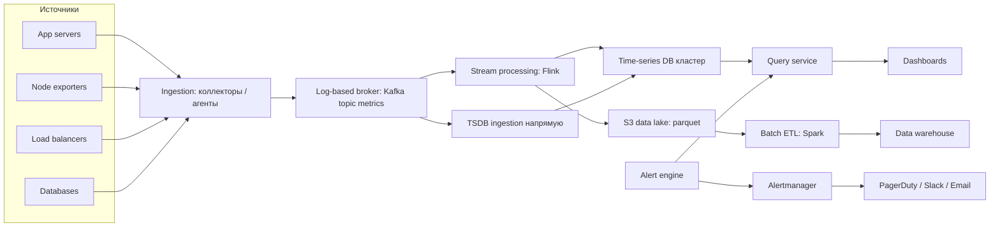
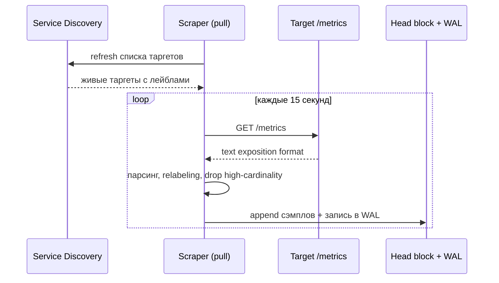
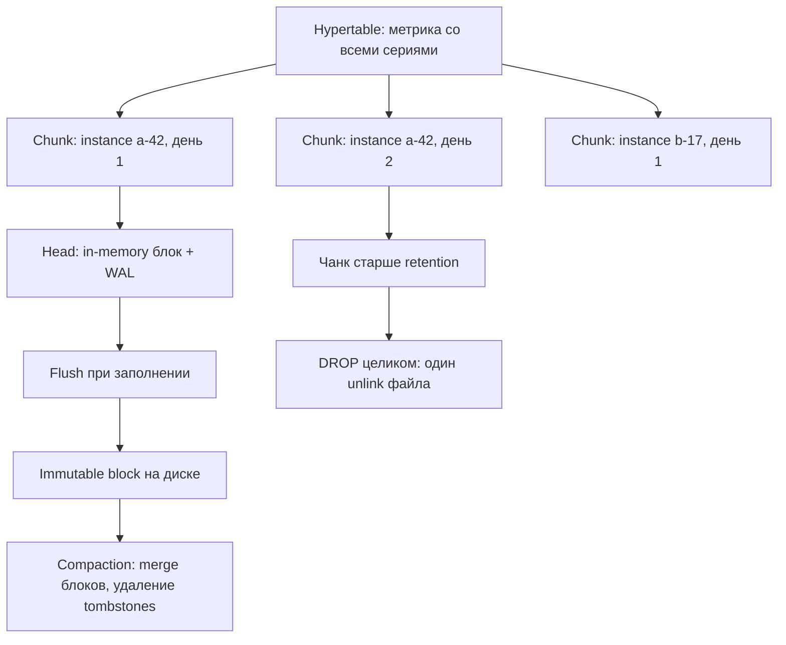
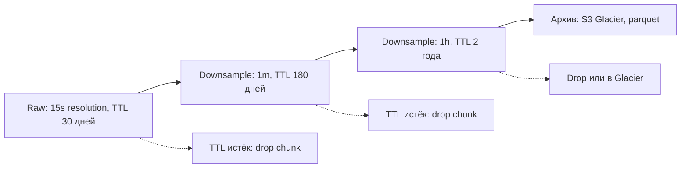
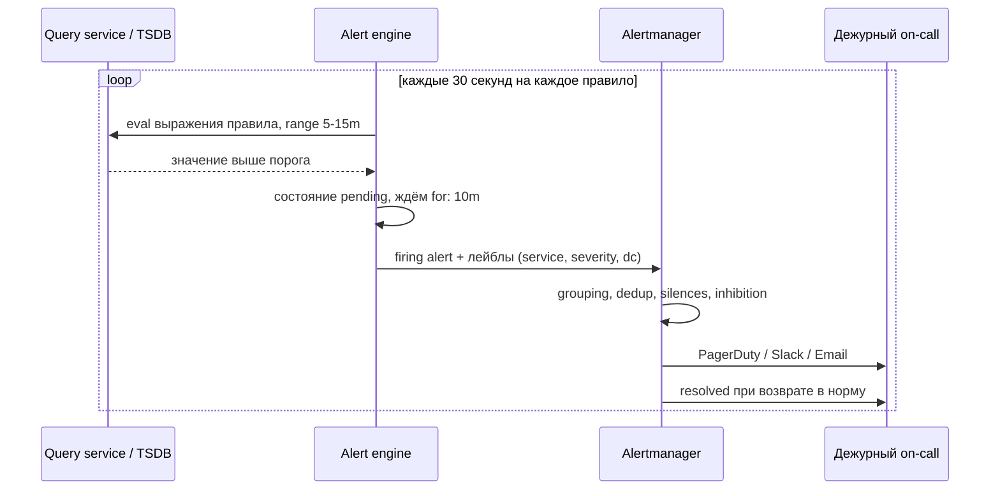

# Разбор задачи: система мониторинга и метрик (свой Prometheus / Datadog)

> Задача звучит примерно так: «Спроектируй систему мониторинга инфраструктуры и приложений: сбор метрик, хранение, дашборды и алертинг — как Prometheus, Datadog или Zabbix». Это одна из самых «write-heavy» задач в системном дизайне: чтений на порядки меньше, чем записей, а главные узкие места — модель сбора (pull vs push), устройство time-series хранилища, retention и взрыв кардинальности.

## Оглавление

- [Постановка и уточняющие вопросы](#постановка-и-уточняющие-вопросы)
- [Требования](#требования)
- [Оценки нагрузки](#оценки-нагрузки)
- [API](#api)
- [High-level design](#high-level-design)
- [Модель данных](#модель-данных)
- [Deep dive 1: Pull vs Push сбор метрик](#deep-dive-1-pull-vs-push-сбор-метрик)
- [Deep dive 2: Time-series DB изнутри](#deep-dive-2-time-series-db-изнутри)
- [Deep dive 3: Downsampling и retention](#deep-dive-3-downsampling-и-retention)
- [Deep dive 4: Алертинг](#deep-dive-4-алертинг)
- [Deep dive 5: Проблема кардинальности](#deep-dive-5-проблема-кардинальности)
- [Дашборды и query path](#дашборды-и-query-path)
- [Trade-offs: сводная таблица](#trade-offs-сводная-таблица)
- [Красные флаги и типичные ошибки кандидатов](#красные-флаги-и-типичные-ошибки-кандидатов)
- [Что спросят дополнительно](#что-спросят-дополнительно)
- [Источники и видео по теме](#источники-и-видео-по-теме)

---

## Постановка и уточняющие вопросы

Формулировка «спроектируй мониторинг» намеренно размытая — интервьюер ждёт, что вы сами сузите скоуп. В разборах моков по этой задаче кандидатов валят именно на первых минутах: те, кто сразу рисует Kafka и Kubernetes, так и не ответив на вопрос «что именно мониторим и зачем».

**Уточняющие вопросы, которые стоит задать (в этом порядке):**

1. **Что мониторим?** Серверы и инфраструктуру (CPU, memory, disk), бизнес-метрики приложений (RPS, latency, ошибки), или ещё и логи/трейсы? Важно сразу сказать: метрики, логи и трейсы — три разных пайплайна. В этом разборе фокус на **метриках**; логи — это отдельная задача про inverted index (Elasticsearch), трейсы — про sampling и OpenTelemetry. Сильный ход — назвать это разделение явно и предложить обсудить логи в конце, если останется время.
2. **Какой масштаб?** Сколько хостов/подов, сколько метрик на хост, какой интервал сбора? От этого зависит всё: 1k хостов и 100k хостов — принципиально разные системы.
3. **Кто потребители данных?** Дежурные инженеры (дашборды, алерты) или ещё и аналитики (долгосрочное хранение, ad-hoc запросы)? Это определяет, нужен ли второй контур — data lake / warehouse.
4. **Какие требования к свежести данных?** Допустима ли задержка в минуту между событием и точкой на графике? Для инфраструктурных метрик — да, обычно 10–60 секунд. Это сразу разрешает буферизацию и мини-батчинг.
5. **Какой retention?** Сколько хранить сырые данные, сколько — агрегированные? Нужна ли точность через год (обычно нет)?
6. **Нужен ли multi-tenancy?** Это внутренняя система для одной компании или SaaS вроде Datadog, где метрики клиентов нужно изолировать?

**Что говорить интервьюеру:** «Предлагаю сфокусироваться на инфраструктурных и прикладных метриках: сбор → буфер → хранение в TSDB → запросы/дашборды → алертинг. Логи и трейсинг оставлю за скобками, в конце помечу, как они встроились бы в ту же платформу».

---

## Требования

### Functional

- Сбор числовых метрик (counter, gauge, histogram, summary) с тысяч серверов и сервисов с заданным интервалом (10–60 секунд).
- Хранение метрик как временных рядов с метками (labels) и запросы по ним: фильтрация по лейблам, агрегации по времени и по измерениям (avg, sum, rate, percentile).
- Дашборды: графики по запросам за произвольный временной диапазон, refresh раз в ~30 секунд.
- Алертинг: правила над метриками («error rate > 5% в течение 10 минут»), доставка уведомлений дежурным (PagerDuty, Slack, email), дедупликация и глушение (silences).
- Retention и downsampling: старые данные хранятся с пониженным разрешением или удаляются.

### Non-functional

- **Write-heavy**: записей на 2–3 порядка больше, чем чтений. Система оптимизируется под ingestion.
- **Высокая доступность записи** (AP-уклон): потерять часть метрик при сбое допустимо, остановить сбор — нет. Мониторинг не должен стать точкой отказа продуктивной системы.
- **Свежесть данных**: lag от события до видимости на дашборде — десятки секунд.
- **Запросы по свежим данным быстрые**: дашборд за последние 6 часов должен открываться за < 1–2 секунды; исторические запросы могут быть медленнее.
- **Долговечность настраиваемая**: raw-данные за неделю терять нельзя, данные годичной давности в исходном разрешении — можно.
- **Изоляция от нагрузки**: всплеск метрик от продуктивных сервисов (инцидент → storm метрик) не должен ронять ни мониторинг, ни сами сервисы.

---

## Оценки нагрузки

Возьмём флот среднего размера (крупная компания, но не Google):

| Параметр | Значение |
|---|---|
| Хостов / подов | 50 000 |
| Активных временных рядов (series) на хост | ~1 000 (node exporter ~500–700 + приложения ~300) |
| Всего активных серий | **50 млн** |
| Интервал сбора | 15 секунд |
| Samples/sec | 50M / 15 ≈ **3,3 млн точек/с** |
| Размер точки после сжатия | ~2–2,5 байта (delta-of-delta timestamp + XOR value, см. Gorilla) |
| Поток записи | 3,3M × 2,5 Б ≈ **8 МБ/с ≈ 700 ГБ/сутки** |
| Raw за 30 дней (×2 репликации) | ~40 ТБ |

Ключевые формулы, которые стоит написать на доске:

```
samples/sec   = hosts × series_per_host / scrape_interval
storage/day   = samples/sec × bytes_per_sample × 86 400
```

И сразу вывод из формулы: **единственный рычаг, который реально двигает нагрузку, — число активных серий** (не хостов!). 50 млн серий — это и есть главная проблема задачи, она называется «кардинальность», и ей посвящён отдельный deep dive.

Оценка чтения для контраста: 1 000 инженеров, ~50 одновременно открытых дашбордов, 10 панелей × 30-секундный refresh → сотни–единицы тысяч QPS на чтение в пике, причём 95% запросов — за последние часы. **Соотношение запись:чтение ≈ 1000:1** — это надо произнести вслух, оно определяет весь дизайн (write-оптимизированное хранилище, кэш свежих данных для чтения).

Отдельная оценка для алертинга: 10 000 правил × eval каждые 30 секунд ≈ 300–1000 eval/с — это обычные range-запросы к TSDB, они грузят query path и должны учитываться в capacity.

---

## API

Для системы мониторинга API делится на три группы. На собеседовании достаточно перечислить их и показать формат точки данных; REST-педантичность здесь не нужна — реальные системы ходят по gRPC и protobuf ради компактности.

**Приём метрик:**

```
# pull-модель: таргет отдаёт text exposition format
GET /metrics
http_requests_total{method="GET",path="/api/v1/orders",status="200",instance="a-42"} 154203

# push-модель: агент шлёт батч (remote write / protobuf, snappy)
POST /api/v1/write
[{ "metric": "http_requests_total",
   "labels": {"method":"GET","path":"/api/v1/orders","status":"200","instance":"a-42"},
   "samples": [[1691000000, 154203]] }]
```

**Запросы (PromQL-подобный язык):**

```
GET /api/v1/query?query=rate(http_requests_total{status="500"}[5m])&time=1691000000
GET /api/v1/query_range?query=avg_over_time(node_cpu_usage{dc="east"}[1h])&start=...&end=...&step=60
```

**Управление правилами и алертами:**

```
POST /api/v1/rules          # создать recording/alerting rule
POST /api/v1/silences       # заглушить алерт на время (maintenance window)
GET  /api/v1/alerts         # текущие firing алерты
```

**Что говорить интервьюеру:** «JSON показываю для читаемости; в проде ingestion пойдёт по protobuf через schema registry — на 3,3 млн точек в секунду экономия на сериализации это сотни мегабайт в секунду сети и заметная доля диска». Этот аргумент прямо из практики: в разборах ex-Google инженеров подчёркивается, что фиксированная схема (protobuf/Avro/Thrift, поля по номерам, а не по именам) даёт двойной выигрыш — и на сети, и на диске, поэтому в Google protobuf используется буквально для всего.

---

## High-level design

Классическая ошибка — «пусть каждый сервер пишет метрики сразу в базу». Она не работает по двум причинам: (1) всплеск метрик при инциденте (а именно при инциденте метрик больше всего) положит и БД, и сами сервисы — нет развязки; (2) над данными нужна обработка в реальном времени (оконные агрегации, обогащение), и база — плохое место для неё. Поэтому между источниками и хранилищем стоит **буфер и слой stream processing**.



Почему контур именно такой (это совпадает с тем, как разбирают задачу ex-Google SWE в моках и что реально делают компании — например, Pinterest для distributed logging использует Kafka, а не in-memory брокер):

1. **Log-based брокер (Kafka), а не in-memory (RabbitMQ/Redis pub-sub).** Аргументы: дурабельность — сообщения на диске, метрики не теряются при падении консьюмеров; replay — можно подключить новый тип консьюмера и проиграть историю, а crashed-консьюмер восстанавливает state с последнего чекпоинта (в S3) и дочитывает с offset'а; at-least-once семантика из коробки. Плата — чуть меньший throughput, что здесь некритично.
2. **Stream processing (Flink)** между брокером и хранилищем: оконные агрегации (pre-aggregation перед записью — это же и инструмент борьбы с кардинальностью), обогащение (подтянуть имя сервиса по instance из справочника, закэшировав его локально, а не дёргая SQL на каждое событие), фильтрация/дроп серий. Flink обрабатывает сообщения по одному (реальное время), Spark Streaming — мини-батчами; мини-батчи выгоднее по network overhead при записи в БД, разница в задержке — секунды, обе опции надо уметь назвать.
3. **Два контура хранения.** Горячий — TSDB для дашбордов и алертов (свежие данные, быстрые запросы по лейблам). Холодный — S3 data lake → Spark ETL → column-oriented warehouse (Parquet: колоночное хранение, dictionary/bitmap encoding, predicate pushdown по min/max в заголовках) для аналитики и ad-hoc SQL. Не пытайтесь заставить одну систему обслуживать оба паттерна — у них противоположные требования к партиционированию и latency.
4. **Alert engine** читает из query path (те же range-запросы, что и дашборды), а не из сырого потока — так правила выражаются на том же языке запросов, что и графики.

---

## Модель данных

Временной ряд (series) = имя метрики + набор лейблов. Точка (sample) = (timestamp, value).

```
http_requests_total{method="GET", path="/orders", status="200", instance="a-42"}
└─ series_id = hash(metric_name, sorted(label pairs)) ─┘
                                                   ↓ samples
                                     (t0, 154000) (t1, 154203) (t2, 154311) ...
```

- `series_id` — 64-битный хэш; все сэмплы серии хранятся вместе (data locality по серии — главный принцип TSDB).
- Лейблы кодируются словарём (label name/value → integer id), поэтому сами точки лейблов не содержат — только series_id. Отсюда же цена новой комбинации лейблов: это запись в словаре + новый индекс серии, а не просто новая строка.
- Типы метрик: **counter** (монотонно растёт, запросы — через `rate()`), **gauge** (мгновенное значение: память, температура), **histogram/summary** (для latency-перцентилей; histogram хранится как набор counter'ов по бакетам `le="0.1"`, `le="0.5"`... — это тоже серии и они тоже умножают кардинальность).

SQL-таблица здесь не нужна как основная модель — но на собеседовании полезно показать «логическую» схему для metadata store (правила, дашборды, пользователи):

```sql
CREATE TABLE alert_rules (
    id          BIGSERIAL PRIMARY KEY,
    name        TEXT NOT NULL,
    expr        TEXT NOT NULL,        -- rate(http_requests_total{status="500"}[5m]) > 0.05
    for_seconds INT  NOT NULL DEFAULT 0,
    severity    TEXT NOT NULL,        -- page | ticket | log
    channel     TEXT NOT NULL,        -- pagerduty-sre | slack-team-x
    enabled     BOOLEAN NOT NULL DEFAULT TRUE
);

CREATE TABLE silences (
    id         BIGSERIAL PRIMARY KEY,
    matcher    TEXT NOT NULL,         -- service="payments", severity="page"
    starts_at  TIMESTAMPTZ NOT NULL,
    ends_at    TIMESTAMPTZ NOT NULL,
    created_by TEXT NOT NULL
);
```

---

## Deep dive 1: Pull vs Push сбор метрик

Это первый вопрос, который задают после high-level картинки: «Как данные попадают в систему — кто инициирует передачу?» Нужна честная таблица trade-off'ов и понимание, почему индустрия пришла к гибриду.

| Критерий | Pull (Prometheus scrape) | Push (StatsD, Datadog agent, remote write) |
|---|---|---|
| Инициатор | Сервер мониторинга сам ходит на `GET /metrics` | Агент/приложение шлёт в ingestion endpoint |
| Service discovery | Обязателен: список таргетов из K8s API / Consul / файла | Не нужен: агент знает один endpoint |
| Health detection | Бесплатно: не смогли соскрапить — `up == 0`, таргет мёртв | Отсутствие данных ≠ смерть сервиса (сеть? агент? сервис?) — нужен отдельный heartbeat |
| Short-lived jobs | Плохо: cron-job умирает до scrape → Pushgateway как костыль | Естественно: отправил и умер |
| Контроль нагрузки | Центральный: scrape interval, лимиты — на стороне мониторинга | Storm-защита нужна на ingestion: rate limiting, буфер |
| NAT / firewall / edge | Проблема: мониторинг должен достучаться до таргета | Решается сама: исходящее соединение всегда можно |
| Тестирование | `curl localhost:9090/metrics` — метрики видны глазами | Нужен отдельный приёмник |



**Как рассуждать вслух:** «Я беру pull как основную модель для серверов и долгоживущих сервисов — из-за бесплатного health detection и централизованного контроля интервалов; push оставляю для ephemeral workloads (batchjob, serverless) через remote write endpoint. В проде это обычно гибрид: Prometheus-совместимый scrape + агенты, которые сами scrape'ят локально и шлют remote write в центральное хранилище (agent mode) — так решается и проблема NAT, и масштабирование scrape-флота».

Отдельно упомяните **протокол и батчинг**: точки не шлются по одной — агент копит 5–15 секунд и отправляет батчем со сжатием (snappy поверх protobuf). Это тот же аргумент про мини-батчи из stream processing: меньше сетевого overhead на единицу данных.

---

## Deep dive 2: Time-series DB изнутри

Вопрос «почему нельзя просто Cassandra/PostgreSQL?» — почти гарантирован. Правильный ответ: можно (и Cassandra-based TSDB существуют), но специализированная TSDB выигрывает за счёт устройства индекса — **hypertable + chunks**.

### Hypertable и chunk'и

Вместо одного гигантского индекса на всю таблицу TSDB режет данные на мелкие чанки по двум осям: **источник (серия/набор серий) × интервал времени**. Например: «instance a-42, 2026-08-01» — один чанк, «instance a-42, 2026-08-02» — другой.



Что это даёт (по пунктам — это и есть ответ на «почему TSDB»):

1. **Горячий чанк целиком помещается в память.** Пишем мы всегда в «сегодняшние» чанки, читаем в основном тоже их — индекс актуального диапазона кэшируется полностью, без случайных чтений с диска.
2. **Меньше дерево — дешевле операция.** LSM-дерево на чанк маленькое, а стоимость операций в LSM логарифмична от размера. Более того: сэмплы одной серии приходят почти упорядоченными по времени, поэтому in-memory структура может быть проще LSM — по сути отсортированный список/буфер, который при заполнении сбрасывается в immutable блок (классическая схема memtable → SSTable, но без дорогой поддержки порядка вставки).
3. **Retention = drop chunk, а не tombstones.** Это самый красивый пункт. В обычной LSM-базе delete — это запись tombstone (та же цена, что и write), которая реально освободит место только после compaction: массовое удаление старых данных конкурирует с живой записью. В TSDB устаревший чанк — отдельный файл/партиция, и retention сводится к `DROP` целого чанка: один системный вызов, ноль compaction.
4. **Партиционирование очевидно.** Чанк и есть единица шардирования/репликации по кластеру.

### Сжатие сэмплов

Raw-пара (int64 timestamp, float64 value) — 16 байт; в TSDB хранится ~1–2 байта на точку:

- **Timestamps — delta-of-delta**: храним разность разностей времён; при равномерном scrape в 15 с дельта-дельты почти нулевые и кодируются парой бит (variable-length encoding).
- **Values — XOR-кодирование (схема из статьи Facebook Gorilla)**: соседние float64 обычно отличаются в младших битах; XOR даёт длинные серии ведущих/хвостовых нулей, которые и сжимаются. Итог ~1,37 байта на точку в среднем по статье.
- **Labels — dictionary encoding** в integer id (см. модель данных).

Именно поэтому в оценках выше мы закладывали 2–2,5 байта на точку, а не 16.

### Отказоустойчивость ingestion

- **WAL** (write-ahead log) на каждый append в head-блок: после рестарта in-memory состояние восстанавливается проигрыванием WAL. Без WAL падение процесса = потеря последних часов (именно они ещё не сброшены на диск).
- **Репликация**: single-leader репликация чанков на 2–3 ноды; при потере ноды query переключается на реплику. Запись в обе реплики ведёт ingestion слой (fan-out на клиенте проще, чем consensus-протокол внутри TSDB — честный trade-off: possible divergence решается чтением из обеих и merge).
- **Долгосрочный бэкап**: immutable блоки периодически выгружаются в object storage — отсюда же строится и long-term storage (Thanos/Mimir/VictoriaMetrics читают блоки прямо из S3).

---

## Deep dive 3: Downsampling и retention

Хранить годовые данные в 15-секундном разрешении бессмысленно: график за год всё равно рисует ~1000 пикселей по горизонтали. Стандартное решение — **иерархия разрешений**.



Механика:

- **Downsampling-джобы** (или streaming-агрегация во Flink ещё до записи — дешевле) считают по raw-серии семейство агрегатов за окно: `avg`, `min`, `max`, `sum`, `count`, иногда перцентили. Важно сохранять min/max рядом с avg: по усреднённому графику всплесков не видно, а именно они интересуют при разборе инцидента год спустя.
- **Recording rules**: частые запросы с дашбордов и из алертов (`sum(rate(http_requests_total[5m])) by (service)`) превращаются в предрасчитанные серии — разгружает query path в десятки раз. Это и есть по сути materialized views для метрик.
- **Оконные агрегации** (нужно уметь назвать все три типа, их спрашивают):
  - *Tumbling window* — фиксированная длина и старт, не пересекаются (каждые 10 минут с 12:00). Реализация тривиальна: отрезали младшие разряды timestamp → бакет.
  - *Hopping window* — пересекающиеся окна (20 минут с шагом 10). Считается как сумма соседних tumbling-окон.
  - *Sliding window* — «последние N минут» в любой момент. Реализация — очередь (linked list) в памяти: новые события в хвост, истёкшие выкидываем с головы. Именно sliding-окна стоят внутри `avg_over_time(...[10m])` при eval алертов.
- **Subsampling** для сверхстарых данных: оставляем каждую N-ю точку или 1% рядов целиком. Признайте честно: это lossy-подход, годится для трендов, не для разбора инцидентов.
- **Архив в холодное хранилище**: parquet-файлы (колоночный формат, dictionary/bitmap encoding — метрики соседних точек очень похожи и жмутся отлично) в S3, а совсем старое — в Glacier. Чтение оттуда — редкий Spark-запрос, минуты ожидания приемлемы.

**Что говорить интервьюеру:** «Retention я реализую не удалением точек, а иерархией разрешений + drop целых чанков: TSDB позволяет удалить устаревший chunk одной операцией, без tombstones и compaction-шторма, который в LSM-базе сопровождает массовые удаления».

---

## Deep dive 4: Алертинг

Алертинг — это то, ради чего система существует (дашборды смотрят редко, алерты будят людей). Архитектурно это отдельный контур поверх query path:



Ключевые решения, о которых ждут рассказа:

- **Состояния алерта**: inactive → pending (условие выполняется, но меньше `for`) → firing. Параметр `for: 10m` отсекает флапы — одиночный всплеск не будит человека. Это первое, что отличает продакшн-алертинг от наивного «if value > threshold: page()».
- **Alertmanager — отдельный компонент**, потому что его задачи ортогональны вычислению условий:
  - *grouping*: 200 алертов по подам одного сервиса → одно уведомление «сервис payments горит»;
  - *dedup*: несколько реплик alert engine шлют один и тот же firing → одно уведомление;
  - *silences*: maintenance window глушит алерты по matcher'ам (`dc="east"` на время миграции);
  - *inhibition*: если firing «дата-центр недоступен», глушим все алерты сервисов в нём — иначе дежурный получит 5 000 писем вместо одного.
- **Надёжность доставки**: alert engine реплицирован (2+ экземпляра eval'ят одни и те же правила — дубли съедает Alertmanager через gossip-кластер); каналы доставки с retry и escalation policy (не подтвердил за 15 минут → следующий в цепочке on-call).
- **Мониторинг мониторинга (dead man's switch)**: если молчит сама система алертинга, никто не узнает, что алерты сломаны. Решение — синтетический always-firing алерт «watchdog», который обязан доставляться по отдельному каналу; его молчание = инцидент. Эта фраза стоит недорого, а звучит как опыт.

Сам алертинг тоже создаёт нагрузку: из оценок — сотни eval-запросов в секунду. Поэтому тяжёлые выражения выносятся в recording rules, а alert engine ходит за предрасчитанными сериями.

---

## Deep dive 5: Проблема кардинальности

Это любимый «вброс» интервьюера: «У вас на доске 50 млн серий. Откуда они взялись и что будет, если станет 5 млрд?»

**Математика взрыва.** Серия = метрика × декартово произведение значений лейблов:

```
http_requests_total{method, path, status, instance}
 5 методов × 2 000 путей × 6 статусов × 50 000 инстансов
 = до 3 млрд комбинаций — теоретически
```

На практике убивают не пути, а **лейблы с неограниченным множеством значений**: `user_id`, `request_id`, `session_id`, `url` с query-параметрами, `pod_name` (поды K8s пересоздаются — имена всегда новые, старые серии становятся «мусором», но продолжают занимать индекс). Одна строчка в коде приложения (`labels["user_id"] = id`) способна за день создать сотни миллионов серий и положить TSDB: растёт словарь лейблов, индекс серий (у каждой серии — запись в inverted index по лейблам), head-блок в памяти держит метаданные всех активных серий.

**Защита (надо перечислить слоями):**

| Слой | Механизм |
|---|---|
| Библиотека/агент | Allowlist лейблов; принудительная нормализация `path` (`/users/{id}` вместо `/users/12345`) |
| Ingestion | Relabeling-правила: drop лейблов по regex, лимит серий на таргет/тенанта, отказ с 429 при превышении |
| Stream processing | Pre-aggregation до записи: суммировать по `service`, выкидывая `instance` |
| TSDB | Лимиты на активные серии, out-of-order/TTL для «мёртвых» серий, отдельные кластеры под жирных тенантов |
| Процесс | Бюджет кардинальности на команду + метрика кардинальности самой системы (мета-мониторинг) |

**Сильная формулировка для собеседования:** «Кардинальность — это единственная величина в задаче, которая растёт быстрее бизнеса: хостов стало в 2 раза больше — серий может стать в 20 раз больше из-за одного неудачного лейбла. Поэтому лимиты и drop-правила на ingestion я закладываю с первого дня, а не „потом разберёмся“».

---

## Дашборды и query path

Query path устроен проще ingestion, но имеет свои нюансы:

- **Query service** принимает PromQL-подобный запрос, парсит его, находит серии по inverted index лейблов (`{status="500", service="payments"}` → множество series_id), читает нужные чанки, считает агрегации (rate, sum by, percentile из histogram-бакетов) и отдаёт точки с шагом `step`.
- **Разрешение ответа подгоняется под ширину графика**: запрос за 30 дней не тащит 15-секундные точки — step выбирается так, чтобы вернуть ~1000 точек; заодно запрос маршрутизируется в нужный «этаж» иерархии downsampling'а (свежие данные — из raw, годичные — из часовых агрегатов).
- **Кэш свежих результатов**: 95% запросов — за последние часы, а открытый дашборд дёргает одни и те же запросы каждые 30 секунд. Кэш с TTL в минуту разгружает TSDB кратно.
- **Федерация для multi-DC**: локальные кластеры в каждом ДЦ + глобальный query layer, который fan-out'ит запрос и мержит результаты. Данные не возим между ДЦ — возим только ответы (на порядки меньше).
- **Dashboards-as-code**: дашборды хранятся в git, разворачиваются через CI — иначе при 1000 инженеров дашборды превращаются в свалку, и никто не знает, каким графикам можно верить.

---

## Trade-offs: сводная таблица

| Решение | Выбрали | Альтернатива | Цена выбора |
|---|---|---|---|
| Сбор | Гибрид pull + push (remote write) | Чистый push (Datadog-style) | Две модели = две подсистемы для поддержки |
| Буфер | Log-based брокер (Kafka) | In-memory брокер, прямая запись в TSDB | +1 компонент, задержка секунды |
| Хранилище горячих данных | Специализированная TSDB (hypertable/chunks) | Cassandra/HBase, PostgreSQL | Менее универсальная; вендор-специфика запросов |
| Долгосрочное хранение | Downsampling + S3/Glacier | Всё в raw навсегда | Потеря детализации старых данных |
| Обработка | Flink (real-time) | Spark Streaming (мини-батчи) | Сложнее эксплуатация; меньше эффективность записи батчами |
| Консистентность | AP: at-least-once, возможны дубли точек | Exactly-once (транзакции) | Дубли сглаживаются агрегациями — для метрик приемлемо |
| Алертинг | Отдельный alert engine поверх query path | Streaming-алерты на сыром потоке | Задержка = интервал eval (30 с) вместо миллисекунд |
| Кардинальность | Жёсткие лимиты + drop на ingestion | Неограниченные лейблы | Часть «удобных» лейблов запрещена разработчикам |

---

## Красные флаги и типичные ошибки кандидатов

- **«Каждый сервис пишет метрики сразу в базу».** Нет буфера — при инциденте (когда метрик больше всего) база падает, мониторинг слепнет именно тогда, когда нужен. Правильный рефлекс: источник → брокер → консьюмеры → хранилище.
- **Игнорировать кардинальность.** Нарисовать «метрики с лейблами» и не посчитать, сколько это серий — значит не понимать главную проблему задачи. Интервьюер обязательно спросит «а что будет, если в лейбл положат user_id?».
- **Хранить всё вечно в полном разрешении.** Отсутствие слов retention/downsampling в ответе — минус балл; наоборот, фраза «удаление старых данных через drop целых чанков, а не tombstones» — сильный сигнал seniority.
- **Алертинг как «if value > threshold → send email».** Без `for`-периода, grouping, silences и escalation это не система оповещения, а генератор спама, который дежурные отключат в первую неделю.
- **Забыть про health самой системы**: нет WAL (потеря часов данных при рестарте), нет dead man's switch (молчащий алертинг считается живым), нет метрик самого мониторинга.
- **Тянуть exactly-once.** Метрики — агрегируемые данные; дубли точек от at-least-once сглаживаются `rate()`/`avg()`. Требование exactly-once на 3 млн точек/с — это overengineering, который убьёт throughput.
- **Одна система и для дашбордов, и для аналитики.** TSDB для графиков и column-oriented warehouse для ad-hoc SQL — разные контуры с разным партиционированием; попытка совместить удовлетворит оба сценария плохо.
- **Молча выбирать технологии.** «Возьмём Kafka» без сравнения с in-memory брокером и без аргумента про replay/дурабельность — технология без обоснования читается как заученный ответ.

---

## Что спросят дополнительно

- **«Как добавить логи в эту платформу?»** Отдельный пайплайн: те же источники → брокер → Elasticsearch (inverted index, партиция = сервис + run/день; поиск по N дням = распределённый запрос по N партициям с мержем). Полнотекстовый поиск по логам и range-запросы по метрикам — разные индексы, не смешивать.
- **«А трейсинг?»** OpenTelemetry: SDK в сервисах шлёт spans, ключевая проблема — sampling (head-based vs tail-based): хранить 100% трейсов на большом RPS нерентабельно, семплируем рутину, сохраняем ошибки и медленные запросы.
- **«Как масштабировать scrape на 500k таргетов?»** Шардировать scrape-флот по consistent hashing от списка таргетов, агенты в agent mode (scrape локально → remote write), federation для кросс-ДЦ запросов.
- **«Перцентили latency — как?»** Histogram-метрики с бакетами на стороне клиента (перцентиль агрегируем по кластеру) vs summary на клиенте (не агрегируем) — знать разницу и почему histogram дороже по кардинальности (каждый бакет = серия).
- **«Multi-tenancy?»** Изоляция: лейбл tenant, отдельные ingestion-лимиты на тенанта, отдельные шарды/кластеры под шумных соседей, per-tenant billing по активным сериям.
- **«Out-of-order и late data?»** Метрики приходят с задержкой (ретраи агентов, часы съехали). Решения: окно приёма out-of-order сэмплов в TSDB, NTP/chrony на флоте, серверный timestamp как fallback.
- **«Как сделать запрос „когда эта ошибка началась“ эффективным?»** Исторический поиск по серии в TSDB дешёвый (chunk per time range); аналогичный вопрос для логов упирается в распределённый запрос по партициям по дням — отсюда вывод держать в индексе больше одного дня на партицию, если объёмы позволяют.

---

## Источники и видео по теме

- [Distributed Metrics/Logging Design Deep Dive with Google SWE! | Systems Design Interview Question 14](https://www.youtube.com/watch?v=_KoiMoZZ3C8)
- [14: Distributed Logging & Metrics Framework | Systems Design Interview Questions With Ex-Google SWE](https://www.youtube.com/watch?v=p_q-n09B8KA)
- [16. System Design - Distributed Messaging Queue / Design Messaging Queue like Kafka, RabbitMQ](https://www.youtube.com/watch?v=oVZtzZVe9Dg)
- [System design interview: Scale to 1 million users](https://www.youtube.com/watch?v=YkGHxOg9d3M)
- [8 Most Important System Design Concepts You Should Know](https://www.youtube.com/watch?v=BTjxUS_PylA)
