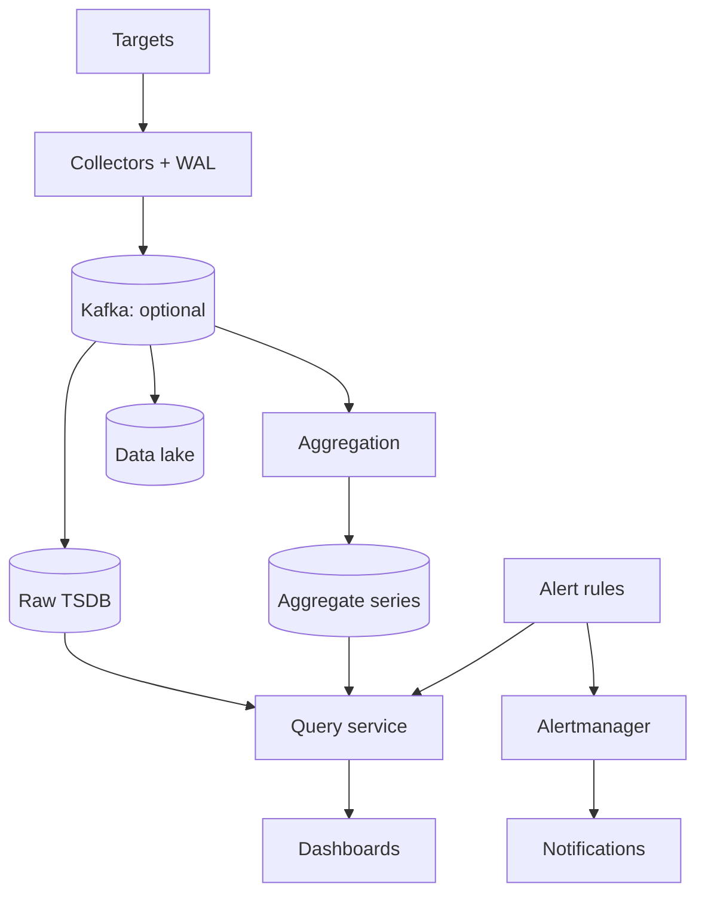
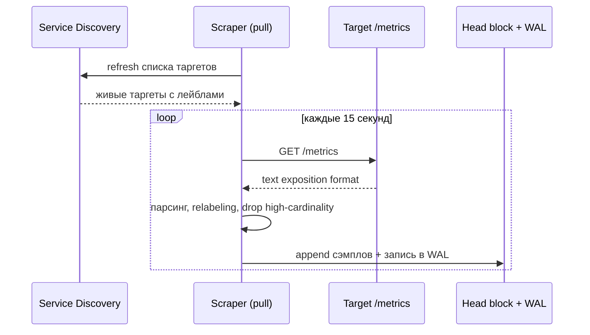
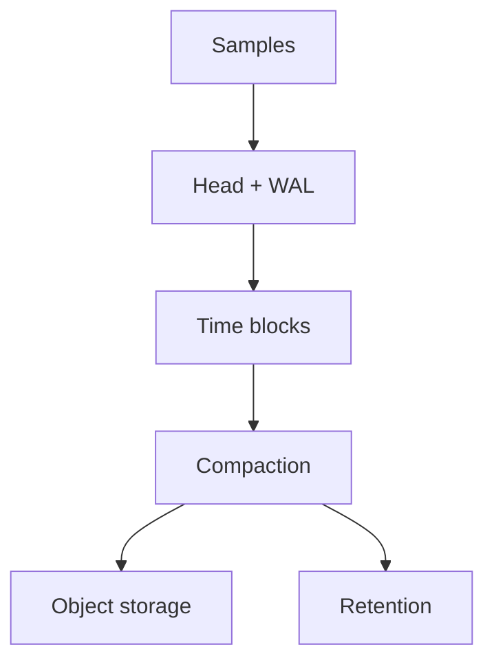
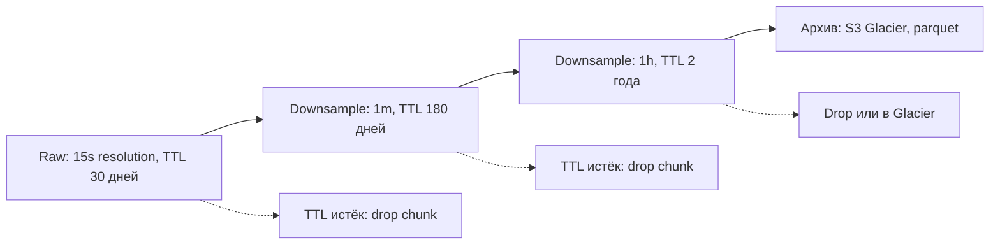
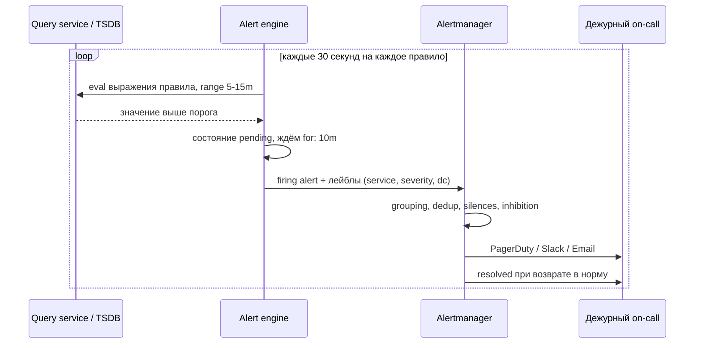

# Разбор задачи: система мониторинга и метрик (свой Prometheus / Datadog)

<!-- learning-nav:start -->
[← Все разделы](../README.md) · [Предыдущая тема](feature-flags.md) · [Следующая тема →](ci-cd-system.md)
<!-- learning-nav:end -->

> Задача звучит примерно так: «Спроектируй систему мониторинга инфраструктуры и приложений: сбор метрик, хранение, дашборды и алертинг — как Prometheus, Datadog или Zabbix». Это одна из самых «write-heavy» задач в системном дизайне: чтений на порядки меньше, чем записей, а главные узкие места — модель сбора (pull vs push), устройство time-series хранилища, retention и взрыв кардинальности.

## Оглавление

<!-- toc:start -->
<details>
<summary>Показать темы и вопросы</summary>

- [Постановка и уточняющие вопросы](#постановка-и-уточняющие-вопросы)
- [Требования](#требования)
- [Оценки нагрузки](#оценки-нагрузки)
- [API](#api)
- [High-level design](#high-level-design)
- [Модель данных](#модель-данных)
- [Deep dive 1: Pull vs Push сбор метрик](#deep-dive-1-pull-vs-push-сбор-метрик)
- [Deep dive 2: Time-series DB изнутри](#deep-dive-2-time-series-db-изнутри)
- [Deep dive 3: Downsampling и retention](#deep-dive-3-downsampling-и-retention)
- [Deep dive 4: Алертинг](#deep-dive-4-алертинг)
- [Deep dive 5: Проблема кардинальности](#deep-dive-5-проблема-кардинальности)
- [Дашборды и query path](#дашборды-и-query-path)
- [Trade-offs: сводная таблица](#trade-offs-сводная-таблица)
- [Красные флаги и типичные ошибки кандидатов](#красные-флаги-и-типичные-ошибки-кандидатов)
- [Что спросят дополнительно](#что-спросят-дополнительно)
- [Гистограммы, sampling и сценарий отказа](#гистограммы-sampling-и-сценарий-отказа)
  - [1. Как получить общий p99 и сколько серий он стоит?](#1-как-получить-общий-p99-и-сколько-серий-он-стоит)
  - [2. Почему «оставим 1% данных» не универсальная экономия?](#2-почему-оставим-1-данных-не-универсальная-экономия)
  - [3. На подумать: target исчез во время перегрузки TSDB](#3-на-подумать-target-исчез-во-время-перегрузки-tsdb)
- [Видео по теме](#видео-по-теме)

</details>
<!-- toc:end -->

---

## Постановка и уточняющие вопросы

Формулировка «спроектируй мониторинг» намеренно размытая — интервьюер ждёт, что вы сами сузите скоуп. Без этого нельзя выбрать интервал сбора, модель хранения и допустимую потерю данных.

**Уточняющие вопросы, которые стоит задать (в этом порядке):**

1. **Что мониторим?** Серверы и инфраструктуру (CPU, memory, disk), бизнес-метрики приложений (RPS, latency, ошибки), или ещё и логи/трейсы? Важно сразу сказать: метрики, логи и трейсы — три разных пайплайна. В этом разборе фокус на **метриках**; логи — это отдельная задача про inverted index (Elasticsearch), трейсы — про sampling и OpenTelemetry. Сильный ход — назвать это разделение явно и предложить обсудить логи в конце, если останется время.
2. **Какой масштаб?** Сколько хостов/подов, сколько метрик на хост, какой интервал сбора? От этого зависит всё: 1k хостов и 100k хостов — принципиально разные системы.
3. **Кто потребители данных?** Дежурные инженеры (дашборды, алерты) или ещё и аналитики (долгосрочное хранение, ad-hoc запросы)? Это определяет, нужен ли второй контур — data lake / warehouse.
4. **Какие требования к свежести данных?** Допустима ли задержка в минуту между событием и точкой на графике? Для инфраструктурных метрик — да, обычно 10–60 секунд. Это сразу разрешает буферизацию и мини-батчинг.
5. **Какой retention?** Сколько хранить сырые данные, сколько — агрегированные? Нужна ли точность через год (обычно нет)?
6. **Нужен ли multi-tenancy?** Это внутренняя система для одной компании или SaaS вроде Datadog, где метрики клиентов нужно изолировать?

**Что говорить интервьюеру:** «Предлагаю сфокусироваться на инфраструктурных и прикладных метриках: сбор → буфер → хранение в TSDB → запросы/дашборды → алертинг. Логи и трейсинг оставлю за скобками, в конце помечу, как они встроились бы в ту же платформу».

---

## Требования

### Functional

- Сбор числовых метрик (counter, gauge, histogram, summary) с тысяч серверов и сервисов с заданным интервалом (10–60 секунд).
- Хранение метрик как временных рядов с метками (labels) и запросы по ним: фильтрация по лейблам, агрегации по времени и по измерениям (avg, sum, rate, percentile).
- Дашборды: графики по запросам за произвольный временной диапазон, refresh раз в ~30 секунд.
- Алертинг: правила над метриками («error rate > 5% в течение 10 минут»), доставка уведомлений дежурным (PagerDuty, Slack, email), дедупликация и глушение (silences).
- Retention и downsampling: старые данные хранятся с пониженным разрешением или удаляются.

### Non-functional

- **Write-heavy**: записей на 2–3 порядка больше, чем чтений. Система оптимизируется под ingestion.
- **Высокая доступность сбора**: при сбое допустим оговорённый gap, но приложение не должно ждать мониторинг. При недоступности storage агент буферизует ограниченный объём или дропает samples по политике. Мониторинг не должен стать точкой отказа продуктивной системы.
- **Свежесть данных**: lag от события до видимости на дашборде — десятки секунд.
- **Запросы по свежим данным быстрые**: дашборд за последние 6 часов должен открываться за < 1–2 секунды; исторические запросы могут быть медленнее.
- **Долговечность настраиваемая**: оговариваем RPO для принятых samples и допустимые gaps при недоступности источника. Retention недели не означает нулевую потерю в процессе сбора.
- **Изоляция от нагрузки**: всплеск метрик от продуктивных сервисов (инцидент → storm метрик) не должен ронять ни мониторинг, ни сами сервисы.

---

## Оценки нагрузки

Возьмём флот среднего размера (крупная компания, но не Google):

| Параметр | Значение |
|---|---|
| Хостов / подов | 50 000 |
| Активных временных рядов (series) на хост | ~1 000 (учебное допущение, зависит от collectors и labels) |
| Всего активных серий | **50 млн** |
| Интервал сбора | 15 секунд |
| Samples/sec | 50M / 15 ≈ **3,3 млн точек/с** |
| Размер точки после сжатия | ~2–2,5 байта (delta-of-delta timestamp + XOR value, см. Gorilla) |
| Поток записи | 3,3M × 2,5 Б ≈ **8 МБ/с ≈ 700 ГБ/сутки** |
| Raw за 30 дней (×2 репликации) | ~43,2 ТБ без индексов/WAL |

Это оценка только сжатых float samples: labels/index, head RAM, WAL, compaction и native histogram samples учитываем отдельно. При 50M активных серий даже условные 1 KB метаданных/серию означают 50 GB RAM на всё множество, до реплик и query buffers. Проверяем измерением, а не подставляем дисковое сжатие в оценку памяти.

Ключевые формулы, которые стоит написать на доске:

```text
samples/sec   = hosts × series_per_host / scrape_interval
storage/day   = samples/sec × bytes_per_sample × 86 400
```

И сразу вывод из формулы: нагрузку определяют **число активных серий, интервал сбора, размер samples и churn** (скорость создания новых серий). 50 млн серий — это и есть главная проблема задачи, она называется «кардинальность», и ей посвящён отдельный deep dive.

Оценка чтения для контраста: 1 000 инженеров, ~50 одновременно открытых дашбордов × 10 панелей / 30 секунд = **16,7 запросов/с**, если панель делает один запрос. Но один запрос может прочитать миллионы samples: сравнение samples/sec и HTTP QPS как однородных операций вводит в заблуждение. Оцениваем отдельно fan-out по сериям, временной диапазон, шаг и CPU query engine.

Отдельная оценка для алертинга: 10 000 правил × eval каждые 30 секунд ≈ 333 eval/с — это обычные range-запросы к TSDB, они грузят query path и должны учитываться в capacity.

---

## API

Для системы мониторинга API делится на три группы. На собеседовании достаточно перечислить их и показать формат точки данных; REST-педантичность здесь не нужна — реальные системы ходят по gRPC и protobuf ради компактности.

**Приём метрик:**

```text
# pull-модель: таргет отдаёт text exposition format
GET /metrics
http_requests_total{method="GET",path="/api/v1/orders",status="200",instance="a-42"} 154203

# push-модель: агент шлёт батч (remote write / protobuf, snappy)
POST /api/v1/write
[{ "metric": "http_requests_total",
   "labels": {"method":"GET","path":"/api/v1/orders","status":"200","instance":"a-42"},
   "samples": [[1691000000, 154203]] }]
```

**Запросы (PromQL-подобный язык):**

```text
GET /api/v1/query?query=rate(http_requests_total{status="500"}[5m])&time=1691000000
GET /api/v1/query_range?query=avg_over_time(node_cpu_usage{dc="east"}[1h])&start=...&end=...&step=60
```

**Управление правилами и алертами:**

```text
POST /api/v1/rules          # создать recording/alerting rule
POST /api/v1/silences       # заглушить алерт на время (maintenance window)
GET  /api/v1/alerts         # текущие firing алерты
```

JSON выше — иллюстрация модели, не wire-format Prometheus remote write. Реальный remote write использует protobuf и Snappy, с версионируемой спецификацией; schema registry ему не обязателен. Выбор размера батча ограничен не только экономией сети, но и допустимым lag, памятью и объёмом повтора при ошибке.

---

## High-level design

Базовый дизайн — scraper с WAL → TSDB → query/rules → Alertmanager. Локальная очередь/WAL ограничивает влияние недоступности приёмника на приложение. При независимых потребителях, длительном replay и большом multi-tenant ingestion добавляем Kafka и stream processing; это расширение, а не обязательная часть любого мониторинга.



В расширенной схеме raw samples пишутся в raw TSDB, а stream-агрегаты — под отдельными именами серий/в отдельном наборе. Две ветки не должны независимо вставлять одни и те же samples без дедупликации.

Kafka удобна для durable replay и независимых consumer groups. RabbitMQ тоже поддерживает persistent messages и durable queues; сравнивать их как «диск против памяти» неправильно. Для выбранного брокера задаём ACK, replication, retention, максимальный backlog и действие при его исчерпании. Ускорение/замедление нельзя вывести из названия брокера.

Flink может выполнять pre-aggregation и фильтрацию до дорогого хранения. Например, из histogram бакетов по pod получаем service-level бакеты после корректного rate/reset handling. Простое удаление `instance` у raw counters создаст конфликтующие samples, а не сумму. Второй lake/warehouse-контур нужен только при соответствующих аналитических требованиях; небольшая система может обойтись одной TSDB.

---

## Модель данных

Временной ряд (series) = имя метрики + набор лейблов. Точка (sample) = (timestamp, value).

```text
http_requests_total{method="GET", path="/orders", status="200", instance="a-42"}
└─ series_id = hash(metric_name, sorted(label pairs)) ─┘
                                                   ↓ samples
                                     (t0, 154000) (t1, 154203) (t2, 154311) ...
```

- `series_id` — внутренний идентификатор (хэш требует проверки коллизий); все сэмплы серии хранятся вместе (data locality по серии — главный принцип TSDB).
- Лейблы кодируются словарём (label name/value → integer id), поэтому сами точки лейблов не содержат — только series_id. Отсюда же цена новой комбинации лейблов: это запись в словаре + новый индекс серии, а не просто новая строка.
- Типы метрик: **counter** (монотонно растёт, запросы — через `rate()`), **gauge** (мгновенное значение: память, температура), **histogram/summary** (для latency-перцентилей; histogram хранится как набор counter'ов по бакетам `le="0.1"`, `le="0.5"`... — это тоже серии и они тоже умножают кардинальность).

SQL-таблица здесь не нужна как основная модель — но на собеседовании полезно показать «логическую» схему для metadata store (правила, дашборды, пользователи):

```sql
CREATE TABLE alert_rules (
    id          BIGSERIAL PRIMARY KEY,
    name        TEXT NOT NULL,
    expr        TEXT NOT NULL,        -- sum(rate(http_requests_total{status=~"5.."}[5m])) / sum(rate(http_requests_total[5m])) > 0.05
    for_seconds INT  NOT NULL DEFAULT 0,
    severity    TEXT NOT NULL,        -- page | ticket | log
    channel     TEXT NOT NULL,        -- pagerduty-sre | slack-team-x
    enabled     BOOLEAN NOT NULL DEFAULT TRUE
);

CREATE TABLE silences (
    id         BIGSERIAL PRIMARY KEY,
    matcher    TEXT NOT NULL,         -- service="payments", severity="page"
    starts_at  TIMESTAMPTZ NOT NULL,
    ends_at    TIMESTAMPTZ NOT NULL,
    created_by TEXT NOT NULL
);
```

---

## Deep dive 1: Pull vs Push сбор метрик

Это первый вопрос, который задают после high-level картинки: «Как данные попадают в систему — кто инициирует передачу?» Нужна честная таблица trade-off'ов и понимание, почему индустрия пришла к гибриду.

| Критерий | Pull (Prometheus scrape) | Push (StatsD, Datadog agent, remote write) |
|---|---|---|
| Инициатор | Сервер мониторинга сам ходит на `GET /metrics` | Агент/приложение шлёт в ingestion endpoint |
| Service discovery | Обязателен: список таргетов из K8s API / Consul / файла | Агент знает endpoint; discovery источников внутри агента всё ещё нужен |
| Health detection | Бесплатно: не смогли соскрапить — `up == 0`, scrape неуспешен; причина может быть в сети/авторизации, а не в смерти таргета | Отсутствие данных ≠ смерть сервиса (сеть? агент? сервис?) — нужен отдельный heartbeat |
| Short-lived jobs | Плохо: cron-job умирает до scrape → Pushgateway как костыль | Естественно: отправил и умер |
| Контроль нагрузки | Центральный: scrape interval, лимиты — на стороне мониторинга | Storm-защита нужна на ingestion: rate limiting, буфер |
| NAT / firewall / edge | Проблема: мониторинг должен достучаться до таргета | Исходящий push часто проще; egress/прокси и credentials всё равно настраиваются |
| Тестирование | `curl localhost:9090/metrics` — метрики видны глазами | Нужен отдельный приёмник |



**Как рассуждать вслух:** «Я беру pull как основную модель для серверов и долгоживущих сервисов — из-за бесплатного health detection и централизованного контроля интервалов; push оставляю для ephemeral workloads (batchjob, serverless) через remote write endpoint. В проде это обычно гибрид: Prometheus-совместимый scrape + агенты, которые сами scrape'ят локально и шлют remote write в центральное хранилище (agent mode) — так решается и проблема NAT, и масштабирование scrape-флота».

Отдельно упомяните **протокол и батчинг**: точки не шлются по одной — агент копит 5–15 секунд и отправляет батчем со сжатием (snappy поверх protobuf). Это тот же аргумент про мини-батчи из stream processing: меньше сетевого overhead на единицу данных.

---

## Deep dive 2: Time-series DB изнутри

Вопрос «почему нельзя Cassandra/PostgreSQL?» не имеет запрета: time-series workload реализуют и поверх них. Выигрыш специализированной TSDB — компрессия, индекс label → series и эффективное чтение диапазонов. `Hypertable` — термин TimescaleDB, а не универсальное устройство всех TSDB.

### Hypertable и chunk'и

В Prometheus свежие samples идут в head и WAL; далее формируются immutable временные блоки с индексом и chunks серий. В TimescaleDB hypertable разбивается на chunks по времени и при необходимости дополнительным измерениям. Нельзя рисовать их как одно и то же LSM-дерево.



Блок содержит множество серий за интервал, а chunk — часть samples серии. Доступ по labels сначала выбирает series через индекс, затем временные диапазоны. Ни весь head, ни весь индекс не обязаны помещаться в маленький объём: кардинальность и churn расходуют память. Out-of-order приём требует отдельной политики и ресурсов.

Retention целых старых блоков дешевле удаления отдельных samples. Однако это не обязательно один `unlink`: блок — каталог нескольких файлов, локальные и удалённые копии удаляются разными процессами, а данные могут исчезать с задержкой до завершения блока/compaction. Удаление произвольных серий может использовать tombstones. Локальный Prometheus не становится распределённой реплицируемой TSDB автоматически.

### Сжатие сэмплов

Raw-пара (int64 timestamp, float64 value) — 16 байт; float samples часто сжимаются до нескольких байт на точку, но это не универсальная константа:

- **Timestamps — delta-of-delta**: храним разность разностей времён; при равномерном scrape в 15 с дельта-дельты почти нулевые и кодируются парой бит (variable-length encoding).
- **Values — XOR-кодирование**: соседние float64 обычно отличаются в младших битах; XOR даёт длинные серии ведущих/хвостовых нулей, которые и сжимаются. Результат зависит от данных: случайные значения сжимаются хуже плавных counters.
- **Labels — dictionary encoding** в integer id (см. модель данных).

Именно поэтому в оценках выше мы закладывали 2–2,5 байта на точку, а не 16.

### Отказоустойчивость ingestion

- **WAL** (write-ahead log) на каждый append в head-блок: после рестарта in-memory состояние восстанавливается проигрыванием WAL. Без WAL падение процесса = потеря последних часов (именно они ещё не сброшены на диск).
- **HA scrape**: два Prometheus могут независимо собирать один target. Это две копии, помеченные replica label; query layer должен дедуплицировать их, а alerting не должен считать двойной RPS. Это отличается от single-leader репликации распределённой TSDB.
- **Удалённое хранение**: remote write и/или выгрузка блоков дают долгий retention. Требования к ACK, quorum, восстановлению и дедупликации зависят от выбранного backend. Не все TSDB используют один и тот же S3 block layout.

---

## Deep dive 3: Downsampling и retention

Для обзорного годового графика обычно не нужно 15-секундное разрешение; для расследований и аудита требования могут быть иными. Хранить raw постоянно дорого: график за год всё равно рисует ~1000 пикселей по горизонтали. Стандартное решение — **иерархия разрешений**.



Механика:

- **Downsampling-джобы** (или streaming-агрегация во Flink ещё до записи — дешевле) считают по raw-серии семейство агрегатов за окно: `min`, `max`, `sum`, `count`; avg восстанавливаем как sum/count. Перцентили требуют сохранять распределение, а не складывать готовые p99. Важно сохранять min/max рядом с avg: по усреднённому графику всплесков не видно, а именно они интересуют при разборе инцидента год спустя.
- **Recording rules**: частые запросы с дашбордов и из алертов (`sum(rate(http_requests_total[5m])) by (service)`) превращаются в предрасчитанные серии — разгружает query path в десятки раз. Это и есть по сути materialized views для метрик.
- **Оконные агрегации** (нужно уметь назвать все три типа, их спрашивают):
  - *Tumbling window* — фиксированная длина и старт, не пересекаются (каждые 10 минут с 12:00). Реализация тривиальна: отрезали младшие разряды timestamp → бакет.
  - *Hopping window* — пересекающиеся окна (20 минут с шагом 10). Считается объединением мелких окон для mergeable агрегатов.
  - *Sliding window* — «последние N минут» в любой момент. Для упорядоченного потока годится deque/кольцевой буфер; out-of-order требует буферизации и event-time правил. PromQL range selector задаёт диапазон при каждом eval, но не обязывает движок хранить linked list на каждое правило.
- **Subsampling** для сверхстарых данных: случайно/регулярно выбираем часть точек только для явно разрешённых исследовательских сценариев. Это может убрать короткую аварию или целый сервис; для SLO и алертов произвольное семплирование метрик неприемлемо. Уменьшение scrape frequency и агрегация — тоже потери, их цену нужно назвать.
- **Архив в холодное хранилище**: parquet-файлы (колоночный формат, dictionary/bitmap encoding — метрики соседних точек очень похожи и жмутся отлично) в S3, а совсем старое — в Glacier. Чтение оттуда — редкий Spark-запрос, минуты ожидания приемлемы.

**Что говорить интервьюеру:** «Retention я реализую не удалением точек, а иерархией разрешений + drop целых чанков: TSDB позволяет удалить устаревший chunk по блокам; произвольное удаление отдельных серий устроено иначе».

---

## Deep dive 4: Алертинг

Алертинг — это то, ради чего система существует (дашборды смотрят редко, алерты будят людей). Архитектурно это отдельный контур поверх query path:



Ключевые решения, о которых ждут рассказа:

- **Состояния алерта**: inactive → pending (условие выполняется, но меньше `for`) → firing. Параметр `for: 10m` отсекает флапы — одиночный всплеск не будит человека. Это первое, что отличает продакшн-алертинг от наивного «if value > threshold: page()».
- **Alertmanager — отдельный компонент**, потому что его задачи ортогональны вычислению условий:
  - *grouping*: 200 алертов по подам одного сервиса → одно уведомление «сервис payments горит»;
  - *dedup*: несколько реплик alert engine шлют один и тот же firing → одно уведомление;
  - *silences*: maintenance window глушит алерты по matcher'ам (`dc="east"` на время миграции);
  - *inhibition*: если firing «дата-центр недоступен», глушим все алерты сервисов в нём — иначе дежурный получит 5 000 писем вместо одного.
- **Надёжность доставки**: alert engine реплицирован (2+ экземпляра eval'ят одни и те же правила — дубли съедает Alertmanager через gossip-кластер); каналы доставки с retry и escalation policy (не подтвердил за 15 минут → следующий в цепочке on-call).
- **Мониторинг мониторинга (dead man's switch)**: если молчит сама система алертинга, никто не узнает, что алерты сломаны. Решение — синтетический always-firing алерт «watchdog», который обязан доставляться по отдельному каналу; его молчание = инцидент. Эта фраза стоит недорого, а звучит как опыт.

Сам алертинг тоже создаёт нагрузку: из оценок — сотни eval-запросов в секунду. Поэтому тяжёлые выражения выносятся в recording rules, а alert engine ходит за предрасчитанными сериями.

---

## Deep dive 5: Проблема кардинальности

Это любимый «вброс» интервьюера: «У вас на доске 50 млн серий. Откуда они взялись и что будет, если станет 5 млрд?»

**Математика взрыва.** Серия = метрика × декартово произведение значений лейблов:

```text
http_requests_total{method, path, status, instance}
 5 методов × 2 000 путей × 6 статусов × 50 000 инстансов
 = до 3 млрд комбинаций — теоретически
```

На практике убивают не пути, а **лейблы с неограниченным множеством значений**: `user_id`, `request_id`, `session_id`, `url` с query-параметрами, `pod_name` (поды K8s пересоздаются — имена всегда новые, старые серии становятся «мусором», но продолжают занимать индекс). Одна строчка в коде приложения (`labels["user_id"] = id`) способна за день создать сотни миллионов серий и положить TSDB: растёт словарь лейблов, индекс серий (у каждой серии — запись в inverted index по лейблам), head-блок в памяти держит метаданные всех активных серий.

**Защита (надо перечислить слоями):**

| Слой | Механизм |
|---|---|
| Библиотека/агент | Allowlist лейблов; принудительная нормализация `path` (`/users/{id}` вместо `/users/12345`) |
| Ingestion | Relabeling-правила: drop лейблов по regex, лимит серий на таргет/тенанта, отказ с 429 при превышении |
| Stream processing | Pre-aggregation с учётом типа: rate counter до sum; histogram buckets объединять по одинаковой схеме |
| TSDB | Лимиты на активные серии, отдельный контроль churn и retention индекса; out-of-order — другая задача, отдельные кластеры под жирных тенантов |
| Процесс | Бюджет кардинальности на команду + метрика кардинальности самой системы (мета-мониторинг) |

**Сильная формулировка для собеседования:** «Кардинальность может расти быстрее числа хостов: хостов стало в 2 раза больше — серий может стать в 20 раз больше из-за одного неудачного лейбла. Поэтому лимиты и drop-правила на ingestion я закладываю с первого дня, а не „потом разберёмся“».

---

## Дашборды и query path

Query path устроен проще ingestion, но имеет свои нюансы:

- **Query service** принимает PromQL-подобный запрос, парсит его, находит серии по inverted index лейблов (`{status="500", service="payments"}` → множество series_id), читает нужные чанки, считает агрегации (rate, sum by, percentile из histogram-бакетов) и отдаёт точки с шагом `step`.
- **Разрешение ответа подгоняется под ширину графика**: запрос за 30 дней не тащит 15-секундные точки — step выбирается так, чтобы вернуть ~1000 точек; заодно запрос маршрутизируется в нужный «этаж» иерархии downsampling'а (свежие данные — из raw, годичные — из часовых агрегатов).
- **Кэш свежих результатов**: 95% запросов — за последние часы, а открытый дашборд дёргает одни и те же запросы каждые 30 секунд. Кэш ключуется tenant + expression + time range + step; TTL ограничен SLO свежести. Алёрты не должны молча читать минутный stale cache, если их задержка меньше минуты.
- **Федерация для multi-DC**: локальные кластеры в каждом ДЦ + глобальный query layer, который fan-out'ит запрос и мержит результаты. Часть агрегации выполняем локально; экономия зависит от запроса. Для глобального p99 передаём mergeable histogram states, а не среднее региональных p99.
- **Dashboards-as-code**: дашборды хранятся в git, разворачиваются через CI — иначе при 1000 инженеров дашборды превращаются в свалку, и никто не знает, каким графикам можно верить.

---

## Trade-offs: сводная таблица

| Решение | Выбрали | Альтернатива | Цена выбора |
|---|---|---|---|
| Сбор | Гибрид pull + push (remote write) | Чистый push (Datadog-style) | Две модели = две подсистемы для поддержки |
| Буфер | WAL, при необходимости Kafka | Durable queue, локальная запись в TSDB | +1 компонент, задержка секунды |
| Хранилище горячих данных | Специализированная TSDB с индексом серий | Cassandra/HBase, PostgreSQL | Менее универсальная; вендор-специфика запросов |
| Долгосрочное хранение | Downsampling + S3/Glacier | Всё в raw навсегда | Потеря детализации старых данных |
| Обработка | Flink со state/event time | Spark Structured Streaming, recording rules | Оба движка могут батчить sink; выбор зависит от задержки, state и компетенций |
| Доставка | At-least-once, возможны повторы | Транзакционная публикация | Нужна дедупликация по идентичности sample; дубли могут исказить сумму |
| Алертинг | Отдельный alert engine поверх query path | Streaming-алерты на сыром потоке | Задержка = интервал eval (30 с) вместо миллисекунд |
| Кардинальность | Жёсткие лимиты + drop на ingestion | Неограниченные лейблы | Часть «удобных» лейблов запрещена разработчикам |

---

## Красные флаги и типичные ошибки кандидатов

- **Не ограничить очередь метрик.** Прямая локальная запись в TSDB допустима, но медленный exporter/remote backend не должен блокировать request path приложения. Ограниченный буфер, timeout и явная политика drop важнее обязательного Kafka на схеме.
- **Игнорировать кардинальность.** Нарисовать «метрики с лейблами» и не посчитать, сколько это серий — значит не понимать главную проблему задачи. Интервьюер обязательно спросит «а что будет, если в лейбл положат user_id?».
- **Хранить всё вечно в полном разрешении.** Отсутствие слов retention/downsampling в ответе — минус балл; наоборот, фраза «удаление старых данных через drop целых чанков, а не tombstones» — сильный сигнал seniority.
- **Алертинг как «if value > threshold → send email».** Без `for`-периода, grouping, silences и escalation это не система оповещения, а генератор спама, который дежурные отключат в первую неделю.
- **Забыть про health самой системы**: нет WAL (потеря часов данных при рестарте), нет dead man's switch (молчащий алертинг считается живым), нет метрик самого мониторинга.
- **Считать дубли безвредными.** Повтор дельты удваивает counter, две HA-копии удваивают сумму, конфликт значений при одном timestamp требует политики. Для cumulative samples задайте идентичность `(tenant, full labels, timestamp)` и правила повторов; rate/avg не являются общей дедупликацией.
- **Одна система и для дашбордов, и для аналитики.** TSDB для графиков и column-oriented warehouse для ad-hoc SQL — разные контуры с разным партиционированием; попытка совместить удовлетворит оба сценария плохо.
- **Молча выбирать технологии.** «Возьмём Kafka» без сравнения с in-memory брокером и без аргумента про replay/дурабельность — технология без обоснования читается как заученный ответ.

---

## Что спросят дополнительно

- **«Как добавить логи в эту платформу?»** Отдельный пайплайн: те же источники → брокер → Elasticsearch (inverted index, партиция = сервис + run/день; поиск по N дням = распределённый запрос по N партициям с мержем). Полнотекстовый поиск по логам и range-запросы по метрикам — разные индексы, не смешивать.
- **«А трейсинг?»** OpenTelemetry: SDK в сервисах шлёт spans, ключевая проблема — sampling (head-based vs tail-based): хранить 100% трейсов на большом RPS нерентабельно, семплируем рутину, сохраняем ошибки и медленные запросы.
- **«Как масштабировать scrape на 500k таргетов?»** Шардировать scrape-флот по consistent hashing от списка таргетов, агенты в agent mode (scrape локально → remote write), federation для кросс-ДЦ запросов.
- **«Перцентили latency — как?»** Histogram-метрики с бакетами на стороне клиента (перцентиль агрегируем по кластеру) vs summary на клиенте (не агрегируем) — знать разницу и почему histogram дороже по кардинальности (каждый бакет = серия).
- **«Multi-tenancy?»** Изоляция: tenant из проверенного auth context (не из произвольного label клиента), отдельные ingestion-лимиты на тенанта, отдельные шарды/кластеры под шумных соседей, per-tenant billing по активным сериям.
- **«Out-of-order и late data?»** Метрики приходят с задержкой (ретраи агентов, часы съехали). Решения: окно приёма out-of-order сэмплов в TSDB, NTP/chrony на флоте, сохранение event/receive time отдельно; замена timestamp меняет смысл исторических метрик.
- **«Как сделать запрос „когда эта ошибка началась“ эффективным?»** Исторический поиск по серии в TSDB дешёвый (chunk per time range); аналогичный вопрос для логов упирается в распределённый запрос по партициям по дням — отсюда вывод держать в индексе больше одного дня на партицию, если объёмы позволяют.

---

## Гистограммы, sampling и сценарий отказа

### 1. Как получить общий p99 и сколько серий он стоит?

Нельзя усреднить p99 двух pod: у них могут быть разные объёмы и распределения. Для classic histogram сначала считаем rate каждого cumulative bucket (с обработкой reset), затем суммируем по одинаковым `le`, после — quantile:

```promql
histogram_quantile(0.99,
  sum by (le, service) (rate(http_request_duration_seconds_bucket[5m]))
)
```

Это оценка с погрешностью, зависящей от границ бакетов. 10 конечных границ + `+Inf` + `_sum` + `_count` означают 13 float series на каждую комбинацию остальных labels. 200 routes × 5 methods × 6 statuses × 100 pods × 13 = 7,8M потенциальных series только одной метрики. Native histograms хранят распределение одним sample другой формы; они уменьшают размножение series, но не отменяют стоимость buckets, совместимость SDK/backend и бюджеты памяти. Summary quantiles между pod не складываются, хотя `_sum` и `_count` агрегировать можно.

### 2. Почему «оставим 1% данных» не универсальная экономия?

Trace sampling выбирает spans/трейсы; metric aggregation считает числовой итог наблюдений. Head sampling дёшев, но не знает будущий HTTP status; tail sampling ждёт завершения и требует состояния/маршрутизации spans одного trace. «Сохраняем все ошибки» возможно только в рамках входного трафика sampling-контура и его capacity. Из sampled traces нельзя без поправок получить точный RPS и error ratio, особенно при biased policy. Поэтому ключевые SLO считаем несемплированными counters/histograms, а exemplar связывает наблюдение с выбранным trace.

### 3. На подумать: target исчез во время перегрузки TSDB

Условие: remote write отстаёт на 20 минут, UI показывает последний CPU=20%, правило `CPU > 90% for 10m` молчит. Значит ли это, что сервис здоров?

<details>
<summary>Разбор</summary>

Нет. Последнее значение — устаревшее наблюдение, а отсутствие series может убрать результат выражения, а не сделать его истинным. Нужны отдельные алерты на freshness/remote-write lag, неуспешный scrape и отсутствие ожидаемых series. Отличаем target down, collector down и storage delay. Локальный WAL даёт ограниченный запас; при исчерпании retention часть samples потеряется. После восстановления догоняем в пределах бюджета и не исполняем старые page-уведомления как новые аварии без явной политики. Независимый watchdog проверяет весь путь доставки, иначе мониторинг сообщает о своём отказе через самого себя.

</details>

<a id="источники-и-видео-по-теме"></a>

## Видео по теме

- [Distributed Metrics/Logging Design Deep Dive with Google SWE! | Systems Design Interview Question 14](https://www.youtube.com/watch?v=_KoiMoZZ3C8)
- [14: Distributed Logging & Metrics Framework | Systems Design Interview Questions With Ex-Google SWE](https://www.youtube.com/watch?v=p_q-n09B8KA)
- [16. System Design - Distributed Messaging Queue / Design Messaging Queue like Kafka, RabbitMQ](https://www.youtube.com/watch?v=oVZtzZVe9Dg)
- [System design interview: Scale to 1 million users](https://www.youtube.com/watch?v=YkGHxOg9d3M)
- [8 Most Important System Design Concepts You Should Know](https://www.youtube.com/watch?v=BTjxUS_PylA)
