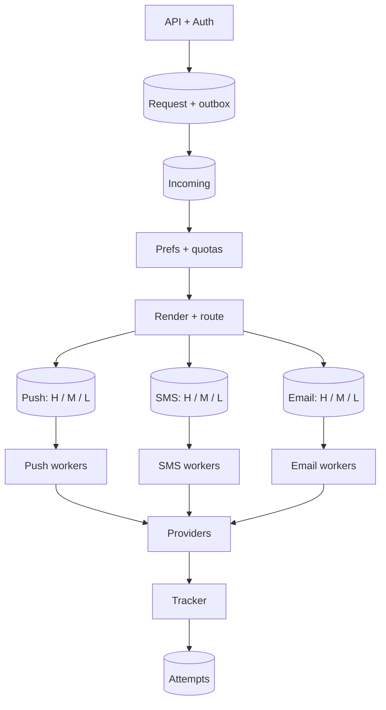
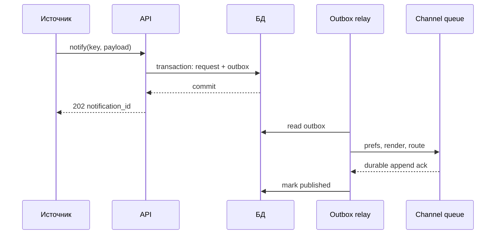
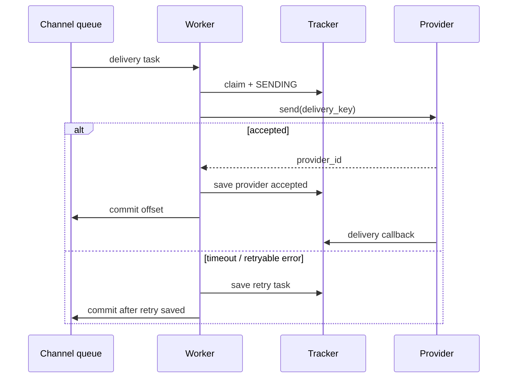
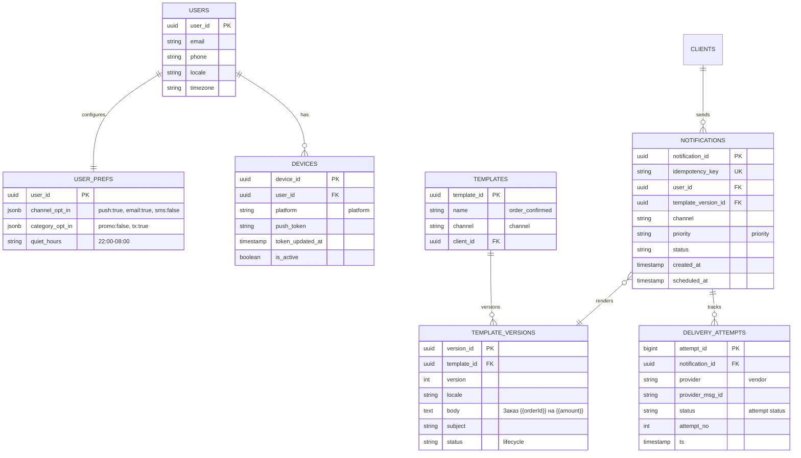
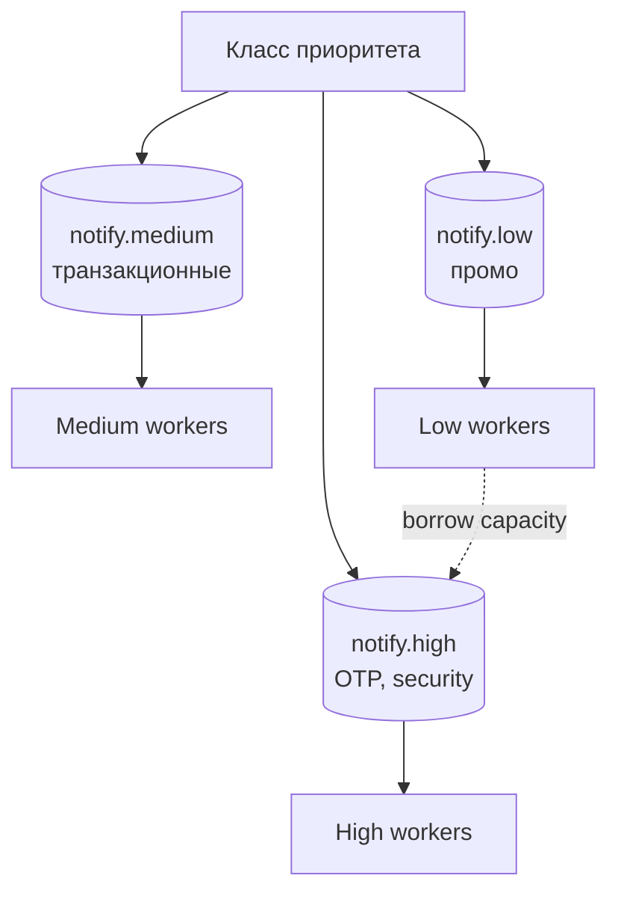
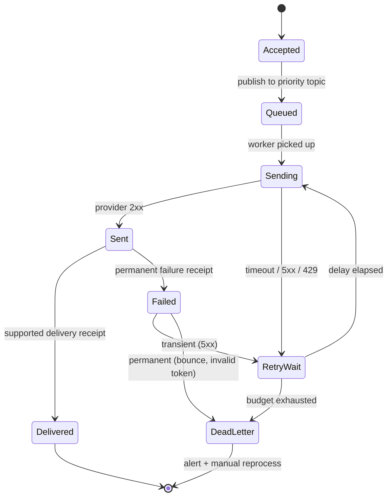

# Разбор задачи: система уведомлений (Notification System)

<!-- learning-nav:start -->
[← Все разделы](../README.md) · [Предыдущая тема](url-shortener.md) · [Следующая тема →](twitter-feed.md)
<!-- learning-nav:end -->

> Классическая задача на системный дизайн: спроектировать сервис, который доставляет уведомления пользователям по каналам push / email / SMS / in-app. Обманчиво простая формулировка скрывает целый ворох подводных камней: приоритизация, rate limiting, дедупликация, интеграция с внешними провайдерами (FCM, APNS, Twilio, SMTP) и трекинг доставки.
>
> Важный контекст, который сразу стоит озвучить интервьюеру: система уведомлений почти никогда не существует сама по себе — это встраиваемый компонент большой системы (e-commerce, банкинг, букинг). Поэтому хороший ответ строится как «платформа уведомлений для всей компании», а не как «скрипт, который шлёт пуши».

## Содержание

<!-- toc:start -->
<details>
<summary>Показать темы и вопросы</summary>

- [Уточняющие вопросы](#уточняющие-вопросы)
- [Требования](#требования)
- [Оценки нагрузки](#оценки-нагрузки)
- [API](#api)
- [High-level design](#high-level-design)
- [Модель данных](#модель-данных)
- [Deep dive](#deep-dive)
  - [1. Приоритетные очереди](#1-приоритетные-очереди)
  - [2. Per-user rate limiting и user preferences](#2-per-user-rate-limiting-и-user-preferences)
  - [3. Дедупликация и идемпотентность](#3-дедупликация-и-идемпотентность)
  - [4. Провайдеры, retry и трекинг доставки](#4-провайдеры-retry-и-трекинг-доставки)
  - [5. Шаблонизация](#5-шаблонизация)
  - [6. Как пережить неоднозначный ответ провайдера и replay?](#6-как-пережить-неоднозначный-ответ-провайдера-и-replay)
  - [7. Как учитывать отзыв согласия и отмену scheduled-рассылки?](#7-как-учитывать-отзыв-согласия-и-отмену-scheduled-рассылки)
- [Trade-offs](#trade-offs)
- [Красные флаги и типичные ошибки](#красные-флаги-и-типичные-ошибки)
- [Что говорить интервьюеру: опорный план на 45 минут](#что-говорить-интервьюеру-опорный-план-на-45-минут)
- [Что спросят дополнительно](#что-спросят-дополнительно)
- [Видео по теме](#видео-по-теме)

</details>
<!-- toc:end -->

---

## Уточняющие вопросы

Не начинайте рисовать архитектуру, пока не зафиксируете рамки. Сильный кандидат тратит первые 3–5 минут на вопросы:

1. **Какие каналы поддерживаем?** Push (iOS/Android), email, SMS, in-app? WhatsApp/Telegram — сейчас или «на будущее»? От ответа зависит требование pluggability.
2. **Кто отправитель?** Внутренние сервисы компании (заказ оформлен, платёж прошёл) или это SaaS-платформа для внешних клиентов? Для SaaS добавляется биллинг, квоты per-client и атрибуция.
3. **Какие типы уведомлений?** Транзакционные (OTP, подтверждение платежа) vs промо/маркетинговые. Это ключ к приоритизации и rate limiting.
4. **Требования к задержке?** OTP должен прийти за секунды; промо-рассылка может опоздать на полчаса — никто не заметит.
5. **Масштаб?** 10 тыс. уведомлений в день или 10 млн? Для малого масштаба всё честно собирается в один deployable сервис — и это стоит прямо сказать интервьюеру, это признак зрелости, а не слабости.
6. **Нужны ли scheduled / bulk-рассылки?** «Отправить всем, кто купил телевизор за последние сутки» — это отдельный сценарий со своим query engine.
7. **Нужен ли трекинг доставки и аудит?** Для банковского/юридического контекста — обязательно («нам могут предъявить, что мы не уведомили клиента»).
8. **Учитываем ли пользовательские настройки (opt-in/opt-out, quiet hours)?**

Сильная формулировка: «Предлагаю сфокусироваться на платформе для внутренних сервисов компании с каналами push/email/SMS, транзакционным и промо-трафиком, ~10 млн уведомлений в день. In-app inbox и bulk-рассылки обозначу, но вглубь пойду по основному pipeline».

---

## Требования

### Functional

- Отправка уведомлений по каналам: **push (iOS/Android), email, SMS, in-app**.
- Две модели запроса:
  - «отправь этот контент по этому адресу этим каналом» (external-style: клиент сам решает как);
  - «отправь это событие этому userId» (internal-style: платформа сама выбирает канал по предпочтениям пользователя).
- **Приоритизация**: high (OTP, security alerts) → medium (транзакционные) → low (промо).
- **Rate limiting**: per-user («не больше N промо в день») и per-client/per-API-key (для SaaS).
- **Шаблоны** с параметрами и версионированием.
- **Дедупликация**: одно бизнес-событие = одно уведомление на канал.
- **Retry с exponential backoff**, dead-letter queue для окончательно недоставленных.
- **Трекинг статусов**: accepted → queued → provider accepted; далее delivered, failed, expired либо unknown в зависимости от подтверждений канала (+ аудит).
- User preferences: opt-in/opt-out по каналам и категориям, quiet hours.
- (Опционально) Bulk-рассылки по фильтру аудитории, scheduled отправки.

### Non-functional

| NFR | Комментарий |
|---|---|
| **Availability** | Высокая. Падение сервиса = пользователи не получают OTP и не могут залогиниться → прямые потери денег |
| **Latency** | High-priority: секунды end-to-end. Low-priority: минуты/час допустимы |
| **Durability** | Ни одно принятое уведомление не должно потеряться → persistence в очереди, а не in-memory |
| **Scalability** | Пики на порядок выше среднего (flash sale, массовый сбой, новогодняя рассылка) |
| **Pluggability** | Добавление нового канала (WhatsApp) = новый handler + новый топик, без переделки ядра |
| **At-least-once + идемпотентность** | Внутри своей БД добиваемся exactly-once effect; внешняя доставка требует участия провайдера и устройства |

Ключевая мысль для интервьюера: **«мы не можем гарантировать exactly-once доставку до устройства, поэтому строим at-least-once pipeline и гасим дубликаты идемпотентностью»** — эта фраза сразу отделяет сеньора от джуна.

---

## Оценки нагрузки

Возьмём крупный продукт:

- **100 млн пользователей**, в среднем **5 уведомлений на пользователя в день** → **500 млн уведомлений/день**.
- Средний RPS: `500M / 86 400 ≈ 5 800 msg/s`.
- Пик (рассылки по часовым поясам, flash sale): **×5–10 от среднего → 30–60 тыс. msg/s**.
- Размер записи о статусе доставки ~1 КБ → `500M × 1KB ≈ 500 ГБ/день` трекинг-данных. Храним «горячими» 30 дней (~15 ТБ), дальше — в дешёвое холодное хранилище (S3/Parquet) для аудита.
- Более скромный сценарий (10 млн уведомлений/день): среднее ~115 msg/s, пик ~1–2 тыс. msg/s — тоже удобная цифра, чтобы показать, что вы умеете считать.

Выводы из цифр, которые стоит озвучить:

- Даже «скромные» 10 млн/день — это такая нагрузка, при которой наивное решение (синхронный HTTP-вызов провайдера прямо в request path) ломается: **таймаут оставляет неопределённый исход, превышение квоты вызывает отказы, а общий FIFO позволяет промо заблокировать OTP**.
- Число workers считаем по latency провайдера, допустимому параллелизму и квотам. При 1000 msg/s и 200 мс на вызов нужно в среднем ~200 in-flight запросов до запаса на p99; добавление workers сверх квоты повышает число 429, а не throughput.

---

## API

```http
POST /v1/notifications
Content-Type: application/json
X-Idempotency-Key: 9f2c1e7a-...
```

```json
{
  "userId": "u-12345",
  "templateId": "order_confirmed",
  "templateVersion": 3,
  "params": { "orderId": "A-987", "amount": "1290 RUB" },
  "channels": ["push", "email"],
  "priority": "high",
  "scheduledAt": null,
  "metadata": { "sourceService": "orders-api", "traceId": "..." }
}
```

Ответ — асинхронный `202 Accepted`:

```json
{ "notificationId": "n-abc-001", "status": "accepted" }
```

Принципиальный момент, который обсуждают в разборах: **синхронно не ждём реальной отправки**. Сервис валидирует запрос, надёжно сохраняет уведомление и outbox в одной транзакции, затем отвечает «принято». Публикация в очередь выполняется с повторами; срок доставки — SLO, а не гарантия фактического получения устройством. Синхронный вариант возможен только для узкого класса (например, OTP по явному требованию), но и там обычно async + быстрый путь.

Дополнительные эндпоинты:

```text
GET  /v1/notifications/{id}            # статус доставки по каналам
POST /v1/templates                     # CRUD шаблонов (admin)
GET  /v1/users/{id}/preferences        # opt-in/opt-out, quiet hours
PUT  /v1/users/{id}/preferences
POST /v1/bulk                          # фильтр аудитории + templateId
POST /v1/providers/webhooks/{vendor}   # delivery callbacks от Twilio/SES/FCM
```

---

## High-level design



Ключевые архитектурные решения, которые нужно проговорить:

1. **Message queue между приоритизацией и сендерами — не опция, а необходимость.** Без очереди получаем жёсткую связность: если SMS-сервис тормозит, приоритизатор блокируется на ожидании и душит throughput всей системы; если сендер упал — уведомления «в полёте» теряются без шанса на переобработку. Очередь даёт: (а) развязку по скорости (сендер читает в своём темпе), (б) естественный retry (сообщение остаётся в топике, пока не обработано), (в) буфер на пики.
2. **Durable очередь с подходящей политикой retention.** Kafka удобна для replay и большого потока; RabbitMQ quorum queues или SQS также подходят. Celery — система задач, а не самостоятельный брокер; Redis поддерживает persistence, Streams отличаются от Pub/Sub. Надёжность определяется подтверждениями записи, репликацией и failover, а не одним названием технологии.
3. **Явное разложение по каналам.** После выбора каналов публикуем отдельные задачи с ключом `(notification_id, channel, recipient)`. У каждого channel/priority свой топик/очередь и пул workers. Consumer groups одного топика не фильтруют его по каналу автоматически: разные группы прочитают все записи.
4. **Pluggability**: новый канал (WhatsApp) = новый тип сообщения + новый топик + новый handler. Ядро не трогаем.
5. **Масштаб диктует детализацию.** При низком throughput честно говорим: «всё это можно собрать в один deployable сервис с внутренними очередями — и я бы так и сделал на старте». Интервьюеры это ценят.

### Поток одного уведомления (sequence)



Работа канального worker отделена от приёма:



Обратите внимание на деталь, которую любят проверять: **commit до отправки создаёт риск потери; отправка до commit — риск повтора**. При ошибке сохраняем durable retry-задачу и лишь затем двигаем offset, чтобы не блокировать партицию ожиданием backoff. Таймаут после приёма провайдером оставляет неопределённый исход: локальная запись статуса не делает внешний вызов атомарным (см. deep dive 3).

---

## Модель данных



Выбор хранилищ — отдельная мини-задача, и это частый follow-up вопрос:

| Данные | Хранилище | Почему |
|---|---|---|
| User prefs, devices, templates | PostgreSQL / MySQL | Мало записей, читаются часто, важна консистентность и простые join'ы; шардируем по user_id при росте |
| Delivery status / audit log | Cassandra / ScyllaDB | Write-heavy (сотни ГБ в день), читается редко (аудит, расследования); шард по notification_id или user_id, TTL на горячие данные |
| Кэш «популярных» статусов | Redis (LRU) | Горячие уведомления читаются многократно (in-app inbox) |
| Idempotency keys | Durable БД, Redis как кэш | Unique key + сохранённый результат и payload hash |
| Rate-limit счётчики | Redis | Атомарные операции с ограниченным TTL |
| Холодный аудит | S3 + Parquet | Дёшево, читается batch-запросами |

Для **in-app inbox** (лента уведомлений в приложении) схема другая: Cassandra-таблица, шардированная по user_id и отсортированная по timestamp — запрос «дай последние 50 уведомлений пользователя» превращается в чтение одной партиции.

---

## Deep dive

### 1. Приоритетные очереди

Базовая идея, которую предлагают практически все сильные разборы: **не одна очередь с полем priority, а несколько физических топиков** — `notify.high`, `notify.medium`, `notify.low`.



Правила, которые стоит озвучить:

- **OTP — всегда high**: если пользователь не получил код, он не залогинится и не завершит транзакцию — прямой убыток. Промо, опоздавшее на полчаса, никто не заметит.
- Каждому классу выделяем гарантированную ёмкость, а свободную можно занимать соседним классам. Строгий приоритет «сначала весь high» допускает starvation low; weighted scheduling и лимиты high сохраняют прогресс остальных.
- Цель — отдельный SLO high-priority и резерв workers/квоты провайдера. Нулевой lag всегда обещать нельзя: недоступность провайдера не лечится приоритетом. Измеряем возраст старейшего задания, time-to-provider-accept и истечение deadline, а не только число записей в lag.
- Отдельный инфраструктурный бонус: изоляция отказов. Медленный SMS-провайдер не блокирует email, если очереди и ресурсы действительно разделены по channel/priority.

Альтернатива — одна очередь + priority queue внутри консьюмера. Почему хуже: head-of-line blocking на уровне партиции Kafka и сложнее масштабировать классы независимо. Зато меньше топиков = проще эксплуатация. Честно назовите оба варианта и объясните выбор.

### 2. Per-user rate limiting и user preferences

Два разных вида rate limiting — их путают, и интервьюер это замечает:

1. **Per-user / per-category**: «не больше 5 промо-уведомлений пользователю в день суммарно со всех бизнес-юнитов». Защищает пользователя от спама (в Amazon-like компании десятки команд шлют уведомления одному и тому же человеку).
2. **Per-client (SaaS)**: «клиент X может слать 100 RPS по своему API-ключу» — квоты, биллинговые тарифы, защита платформы.

Плюс третий, тонкий случай: **провайдерский rate limit** (см. deep dive 4) — FCM/Twilio сами режут трафик, и под них нужен token bucket на отправку.

Реализация per-user лимита:

```text
# Redis, sliding window via sorted set или простой счётчик с TTL
KEY  ratelimit:promo:{userId}:{yyyy-mm-dd}
атомарный script: INCR; при первом INCR установить TTL до границы окна
если значение > LIMIT → drop или defer (перенести на завтра / отложить до конца quiet hours)
```

- Промо и критические уведомления имеют разные лимиты. OTP тоже ограничивается по аккаунту, IP и назначению, иначе сервис превращается в инструмент спама и расходования SMS-бюджета. Резерв ёмкости и квоты провайдера обязательны для всех категорий.
- Где стоит rate limiter в pipeline — предмет торга с интервьюером: до prioritizer'а (экономим ресурсы) или после user preferences (точнее учитываем категорию). Оба варианта валидны; в разборах прямо говорят «эти два компонента можно менять местами в зависимости от разговора с интервьюером» — умение сказать такое вслух плюсует.
- User preferences (opt-out, quiet hours) и rate limit логически рядом: оба фильтруют по правилу «можно ли ЭТОМУ пользователю СЕЙЧАС слать ТАКОЕ». Часто объединяются в один модуль «Delivery Policy Engine».
- Quiet hours: не дропаем, а переносим `scheduledAt` на конец тихих часов в таймзоне пользователя (кроме явно согласованных категорий, которым разрешён обход quiet hours).

### 3. Дедупликация и идемпотентность

Источники дублей, которые нужно перечислить:

- Клиент ретраит HTTP-запрос после таймаута → два одинаковых события в incoming-очереди.
- Kafka даёт at-least-once: консьюмер упал после отправки, но до коммита offset → сообщение обработается повторно.
- Replay топика после сбоя (классический сценарий: email-сервис лежал сутки, проиграли партиции заново — а SMS-сендер всё это время работал и уже всё отправил).
- Провайдер сам может ответить таймаутом, но доставить.

Слоёная защита:

1. **Idempotency key на входе.** Клиент присылает `X-Idempotency-Key` (или платформа генерирует детерминированный ключ `hash(userId + templateId + businessEventId)`). В durable БД атомарно создаём запись `(tenant_id, idempotency_key, payload_hash, notification_id)` и outbox. Повтор с тем же payload возвращает прежний результат, с иным — конфликт. `SET NX` в Redis полезен как оптимизация, но крах после него до публикации может потерять задание. TTL определяется окном retry/replay; при 500 млн новых ключей/день даже 100 Б на ключ — 50 ГБ/день до overhead и реплик.
2. **Идемпотентные воркеры.** Отправка защищена уникальным delivery key, атомарным claim/lease с fencing token и проверкой статуса. Простая последовательность «проверил → отправил» допускает гонку двух workers. Если провайдер поддерживает idempotency key, повторяем с тем же ключом и payload. Если он принял SMS, а ответ потерялся, локальная dedup не определит исход: reconciliation/status API может помочь, но без поддержки провайдера приходится выбирать риск дубля или риск недоставки.
3. **Дедупликация на устройстве.** FCM/APNS могут доставить пуш дважды — приложение дедуплицирует по нашему стабильному delivery ID там, где само управляет показом. Автоматический показ системного notification payload не всегда позволяет приложению подавить дубль. Collapse key заменяет ожидающие сообщения, а не гарантирует exactly-once. Про это почти никто не говорит — скажите вы.

Про хранение ключей: если ключей слишком много для памяти, классическая оптимизация из разборов — **Bloom filter** перед проверкой по диску. Отрицательный ответ безопасен только при актуальном и полностью заполненном фильтре; после потери/восстановления фильтра нельзя обходить unique constraint. Положительный ответ всегда перепроверяется в точном хранилище. В идеальном мире горячие ключи просто живут в Redis с TTL, равным окну возможных ретраев.

Отдельно стоит сказать, чего делать **не надо**: объявлять 2PC универсальным решением: внешние провайдеры обычно не участвуют в нашей транзакции. Нужную согласованность внутри своей границы можно обеспечить транзакциями/outbox; производительность 2PC зависит от реализации и нагрузки, а не от общего запрета. Если упоминаете согласованность БД↔очередь на входе — правильный паттерн **transactional outbox**.

### 4. Провайдеры, retry и трекинг доставки

Канал → провайдеры:

| Канал | Провайдеры | Особенности |
|---|---|---|
| Push iOS | **APNS** | HTTP/2, device token может протухнуть (`410 Gone` → удаляем токен из devices) |
| Push Android | **FCM** | Rate-limited; HTTP v1 `UNREGISTERED` → удаляем токен |
| SMS | Twilio, Vonage, локальные агрегаторы | Цена и лимиты зависят от страны/маршрута; ограничиваем бюджет |
| Email | SES, SendGrid, свой SMTP | Bounces, репутация домена, webhook'и о доставке |
| In-app | Свой WebSocket/SSE gateway + inbox в БД | История в БД; gateway — сигнал, нужен sync после reconnect |

**Vendor routing.** Глобальная компания интегрирована с несколькими SMS-вендорами (один силён в Азии, другой — в США и Европе). SMS-handler внутри себя решает: какой вендор для этого номера, какой приоритет между вендорами, как распределять трафик (weighted routing), failover по согласованной политике. Таймаут не означает, что первый вендор не отправил SMS; слепое переключение способно удвоить доставку и стоимость. Это красивый deep dive, который почти никто не раскрывает спонтанно.

**Retry-политика:**



- **Exponential backoff с full jitter**: `delay = random(0, min(cap, base * 2^attempt))`. Без jitter все воркеры ретраят одновременно и добивают и без того задыхающегося провайдера (thundering herd).
- **429 от провайдера** — отдельный случай: это не сбой, а сигнал притормозить → token bucket на исходящий трафик к каждому провайдеру (учитываем `Retry-After` и конкретный код ошибки; у FCM для некоторых 429 минимальный начальный retry — 1 минута).
- **Постоянные ошибки не ретраим**: APNs `410 Unregistered` / FCM `UNREGISTERED` (мёртвый device token), hard bounce email, несуществующий номер — сразу в failed + чистим контактные данные.
- **Retry ограничен временем и смыслом.** У задания есть `expires_at`, максимум попыток и денежный бюджет. Истёкший OTP получает `expired`, а не отправляется после восстановления провайдера. DLQ требует причины, метрик, алертов и контролируемого replay; массовый replay повторно проверяет срок, согласия и состояние бизнеса.

**Трекинг доставки.** Каждое изменение статуса пишется в трекинг-стор (Cassandra — write-heavy нагрузка, читается редко). Зачем: аудит и споры («вы не уведомили клиента об изменении тарифа» — юридическое требование во многих доменах), метрики deliverability, дедупликация воркеров. Семантика зависит от канала: email delivery обычно означает приём почтовым сервером адресата, SMS receipt — отчёт сети/провайдера, push accepted — ещё не получение устройством. Отсутствие receipt оставляет `unknown`, а open tracking не доказывает прочтение человеком. Webhook проверяем по подписи и timestamp, дедуплицируем и применяем к конкретной попытке без регресса статуса от запоздавшего callback.

### 5. Шаблонизация

- Отдельный **Template Service + Template DB**: шаблоны CRUD'ятся через админку, версионируются (`templateId + version`), имеют локали и канал-специфичные тела (шаблон SMS ≠ шаблон email: GSM-7/UCS-2 и сегментация SMS против HTML email; кириллица обычно уменьшает число символов на сегмент).
- Клиент в запросе передаёт `templateId + params`, а не готовый текст — контент централизован, маркетинг правит тексты без релизов.
- Версия шаблона фиксируется в уведомлении: через месяц можно восстановить, **какой именно текст** ушёл пользователю (аудит, споры).
- Рендеринг — на этапе pipeline (после приоритизации, перед публикацией в канальные топики), чтобы в топиках лежал готовый к отправке payload.
- Валидация: обязательные плейсхолдеры, preview-отправка на тестовую группу, A/B-варианты шаблона (если интервьюер спрашивает про эксперименты).

```text
Template: order_confirmed / v3 / ru / push
Title: "Заказ {{orderId}} подтверждён"
Body:  "Сумма {{amount}}. Доставка {{deliveryDate}}."
Required params: [orderId, amount, deliveryDate]
```

### 6. Как пережить неоднозначный ответ провайдера и replay?

Один delivery key обозначает бизнес-доставку, а `attempt_id` — конкретную попытку у конкретного вендора. До запроса сохраняем attempt, deadline и idempotency key; после ответа — provider ID и результат. Ack провайдера означает принятие, а не обязательно доставку получателю. Задачи retry хранятся надёжно: сон worker в памяти не переживёт рестарт.

На подумать: провайдер принял SMS, worker получил timeout, затем упал. Через минуту приходит callback `delivered`, но retry уже подхвачен другим worker. Как не послать вторую SMS?

<details>
<summary>Разбор</summary>

Сначала повторно проверяем состояние delivery под атомарным claim; webhook связываем с известной попыткой. При поддержке провайдера повторяем с прежним idempotency key или запрашиваем статус по client reference. Если callback успел зафиксировать успех, новый worker прекращает retry. Но гонка между проверкой и внешним запросом остаётся без идемпотентного API провайдера: локальный lock не отменяет уже отправленный запрос. Для категории выбираем и документируем политику неопределённости; автоматический failover не устраняет её. Просроченный OTP нельзя повторно слать даже из DLQ.

</details>

Replay перечитывает лог обработки, но не стирает журнал успешных доставок. Горизонт dedup должен покрывать разрешённый replay; если это невозможно, архивные события идут в восстановление витрин, а внешняя отправка включается отдельным контролируемым действием. Иначе восстановление аналитики превращается в повторную рассылку клиентам.

### 7. Как учитывать отзыв согласия и отмену scheduled-рассылки?

Audience snapshot определяет кандидатов, но не даёт бессрочного права отправки. Проверяем актуальные preferences и suppression list непосредственно перед внешним вызовом. В задаче сохраняем campaign/version, категорию, tenant и deadline. Отмена кампании меняет её состояние; worker с устаревшей задачей видит отмену и фиксирует `cancelled`, не отправляя контент. Проверка должна относиться к нужному tenant: API key одного клиента не получает чужие шаблоны, контакты и статусы.

Пример: маркетинг запланировал email на завтра; ночью пользователь отписался, утром пачка уже находится в очереди. Проверка согласия только при постановке слишком ранняя. Делать распределённую транзакцию с почтовым провайдером обычно нельзя, поэтому есть неизбежная граница: отмена после фактического принятия письма не отзывает его. Контракт явно описывает эту границу, а метрика отдельно считает `suppressed` и `cancelled`, чтобы не смешивать их с ошибками доставки.

На подумать: bulk на 50 млн адресатов остановили после 10 млн отправок. Как возобновить оставшееся без повторов и перегрузки OTP?

<details>
<summary>Разбор</summary>

Сохраняем стабильный snapshot/курсор аудитории и отдельный delivery key на адресата и канал. Возобновление создаёт только недостающие задачи, повторно проверяет согласия и deadline, использует выделенные low-priority capacity и квоты провайдера. Дедупликация не компенсирует отсутствие backpressure: не надо за секунду выкладывать десятки миллионов задач в общий поток OTP. Опасный ответ — заново прогнать тот же SQL по изменившейся аудитории и считать, что `sent` полностью решает задачу.

</details>

---

## Trade-offs

| Решение | Выбрали | Альтернатива | Цена выбора |
|---|---|---|---|
| Sync vs async приём | Async (202 + очередь) | Синхронная отправка | Клиент не знает мгновенно итог; нужен статус-API |
| Kafka vs SQS/RabbitMQ | Kafka | SQS (проще операционно), RabbitMQ | Kafka сложнее в эксплуатации; зато replay, партиционирование, огромный throughput |
| Несколько топиков по приоритетам vs одна очередь с priority | Несколько топиков | Priority queue в консьюмере | Больше топиков = больше операционной сложности |
| Отдельный сервис на каждый шаг pipeline vs монолит | Микросервисы на масштабе | Один deployable сервис на старте | Микросервисы: сеть, observability, сложность деплоя |
| Дедупликация в Redis vs Bloom filter + диск | Redis TTL для горячего окна | Bloom filter при огромных объёмах | Bloom допускает false positives — нужен fallback на точную проверку |
| At-least-once + идемпотентность | Да | «Exactly-once» семантика Kafka | EOS покрывает только внутренность Kafka, не доставку до провайдера и устройства |
| Push через FCM/APNS напрямую vs через агрегатор (OneSignal, Braze) | Напрямую (контроль, дешевле на масштабе) | Агрегатор (быстрый старт) | Своя интеграция = поддержка токенов, ретраев, вебхуков |
| Хранение статусов в Cassandra vs PostgreSQL | Cassandra | Postgres с партициями | Нет ad-hoc join'ов по аудиту — выносим аналитику в холодный слой |

---

## Красные флаги и типичные ошибки

То, что интервьюеры реально отмечают как слабые места кандидатов:

- **Синхронная отправка в request path.** «Принял HTTP-запрос → сходил в Twilio → ответил». Один таймаут провайдера — и сообщение потеряно, плюс latency клиента привязана к худшему провайдеру.
- **Нет очереди между этапами.** Прямые вызовы приоритизатор → сендеры = каскадные блокировки и потеря сообщений при падении сендера.
- **Нет retry-политики вообще** или retry без backoff/jitter (добиваем провайдера синхронными ретраями).
- **Нет дедупликации**: кандидат говорит «Kafka нам даст exactly-once». EOS не делает отправку провайдеру и показ устройством атомарными; нужны подтверждения и явная политика повторов.
- **Игнорирование rate limits провайдеров**: «шлём в FCM сколько хотим» → реальный бан sender'а. Senior-ответ упоминает token bucket на исходящие вызовы.
- **Все уведомления равны**: промо-рассылка на 10 млн сообщений душит OTP в общей очереди.
- **Забытые device tokens**: не чистим протухшие токены → бесполезные попытки, лишняя нагрузка и рост failed rate.
- **Нет трекинга статусов**: на вопрос «как узнаем, что уведомление доставлено?» — тишина.
- **Рисовать микросервисный ад для 10 тыс. уведомлений в день** — или, наоборот, предлагать один cron-скрипт для 100 млн пользователей. Масштаб должен определять дизайн.
- **Считать локальную транзакцию защитой внешней отправки**: outbox гарантирует публикацию задания, но exactly-once SMS требует участия провайдера.

---

## Что говорить интервьюеру: опорный план на 45 минут

1. **(5 мин) Уточнения**: каналы, масштаб, типы трафика, SaaS или внутренняя платформа. Зафиксировать: push/email/SMS, 10–500 млн/день, транзакционные + промо.
2. **(5 мин) Требования и оценки**: FR/NFR, посчитать RPS и объём хранения на доске. Проговорить «локальный exactly-once effect достигается транзакцией; внешние вызовы требуют идемпотентного контракта».
3. **(5 мин) API + приём**: асинхронный `POST /v1/notifications`, idempotency key, 202 Accepted.
4. **(10 мин) High-level**: gateway → validation/preferences → rate limit → prioritizer → топики по приоритетам → канальные сендеры → провайдеры; трекер и DLQ сбоку.
5. **(15 мин) Deep dive по выбору интервьюера**: приоритетные очереди, дедупликация, retry/DLQ, vendor routing, шаблоны, bulk-рассылки.
6. **(5 мин) Trade-offs, метрики, алерты**: consumer lag per topic, delivery rate по каналам, latency p99 для high, DLQ size, provider error rate.

Фразы, которые звучат сильно:

- «Уведомления — это классическая fan-out задача; узнав её, вы переиспользуете тот же паттерн в новостных лентах и мессенджерах».
- «Я бы начал с одного deployable сервиса и выносил компоненты по мере роста нагрузки — но очередь между приёмом и отправкой заложил бы сразу, это дёшево и снимает целый класс отказов».
- «Компоненты X и Y можно поменять местами в pipeline — это зависит от того, что для вас важнее; давайте обсудим».

---

## Что спросят дополнительно

- **Как реализовать bulk-рассылку «всем, кто купил молоко 3 дня назад»?** Отдельный контур: транзакционные события бизнес-сервисов → parser → поисковый стор (Elasticsearch/Mongo) → query engine с DSL-фильтрами → список userId → тот же Notification Service. Бонус: тот же query engine переиспользуется rule engine'ом («отменил 10 заказов подряд → антифрод») — сама рассылка это rule «условие → действие».
- **Scheduled / recurring уведомления?** Таблица `scheduled_at` + сканер (или delay-очереди), который публикует в incoming-топик в нужный момент. Distributed cron с лидер-элекцией.
- **Как масштабировать партиционирование?** Партиции Kafka по user_id (порядок важен для in-app) или по topic/каналу; групповой координатор брокера для consumer groups; KRaft управляет метаданными кластера; fan-out на сендеры через consumer groups.
- **In-app центр уведомлений?** Cassandra по user_id + Redis-кэш горячих лент + WebSocket-gateway; счётчик непрочитанных.
- **Multi-region?** Региональные кластеры у провайдеров (APNS/FCM глобальны, SMS-вендоры локальны), геороутинг, репликация prefs.
- **Как тестировать?** Контрактные тесты с mock-провайдерами, shadow-трафик, chaos (убиваем сендер — проверяем crash-окна, deadline, dedup и поведение при неопределённом результате).
- **Метрики и SLO?** p99 latency OTP < 5 с, delivery rate > 99% для транзакционных, consumer lag, DLQ size, provider error/429 rate, стоимость SMS на пользователя.
- **Безопасность?** PII в шаблонах (минимизируем в push — тело видно на локскрине), шифрование токенов, подпись webhook'ов провайдеров, разграничение доступа к Template Service.

---

<a id="источники-и-видео-по-теме"></a>

## Видео по теме

- [Вопрос для собеседования по проектированию системы уведомлений для обработки миллиардов пользователей](https://www.youtube.com/watch?v=CUwt9_l0DOg)
- [Как разработать систему уведомлений / Что нужно знать для собеседований по системному проектированию](https://www.youtube.com/watch?v=0pOYU5-pXWA)
- [Notification System Design: Handling Millions of Messages](https://www.youtube.com/watch?v=TpZ3dHb3jRE)
- [19: Notification Service / Systems Design Interview Questions With Ex-Google SWE](https://www.youtube.com/watch?v=J-5JozlYIqI)
- [Глубокое погружение в проектирование сервисов уведомлений с Google SWE!](https://www.youtube.com/watch?v=TpugGhXhdaU)
- [System Design 15: Design Scalable Notifications System / SMS / OTP / Email & Push / HLD / LLD](https://www.youtube.com/watch?v=Yv9q8d11Y7k)
