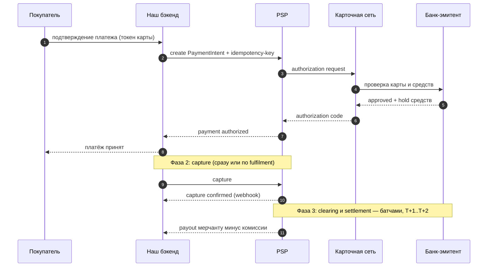
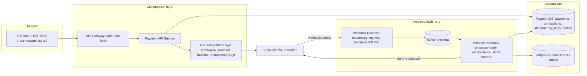
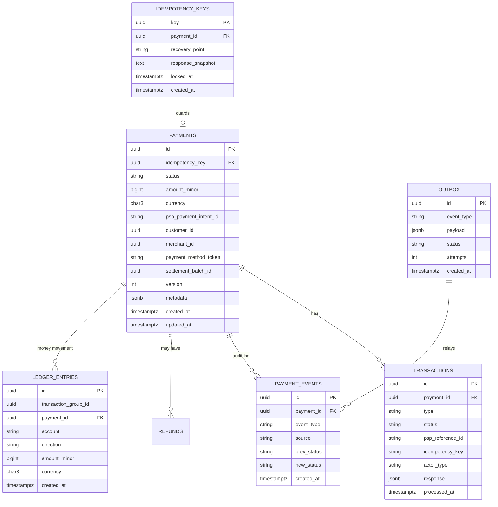
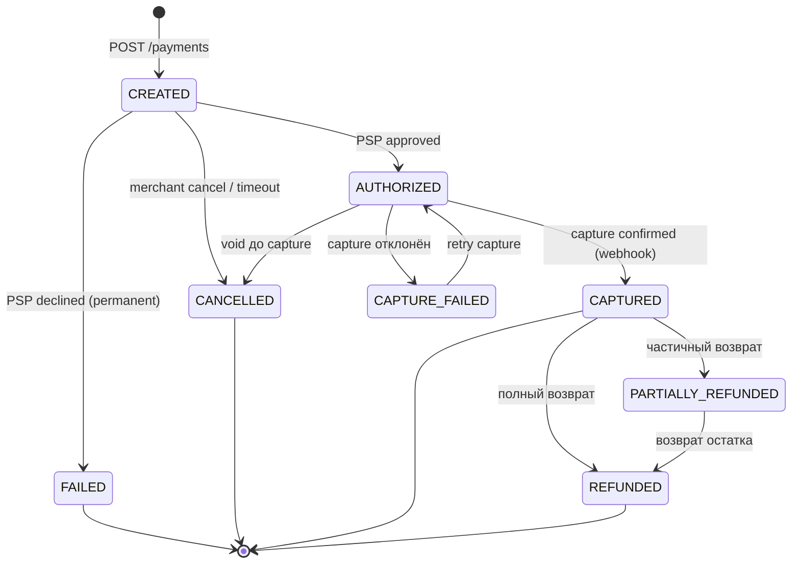
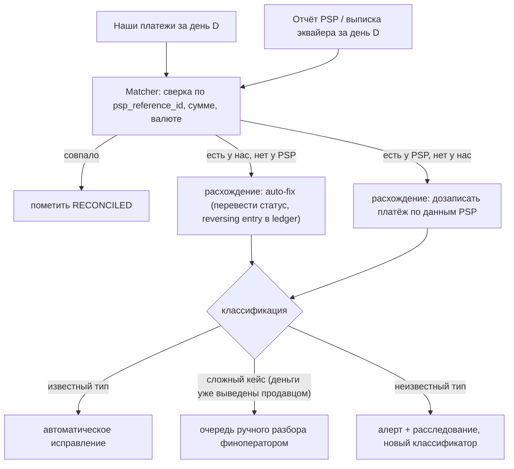

# Разбор задачи: платёжная система

> **Формулировка на собеседовании:** «Спроектируй платёжную систему / payment gateway / систему приёма платежей для маркетплейса (как Stripe, PayPal, ЮKassa)».
>
> Это одна из самых «проверяющих» задач: здесь интервьюер смотрит не на масштабирование (нагрузка обычно скромная), а на то, как ты думаешь о **корректности под нагрузкой отказов**: дубли списаний, падения посередине платежа, рассинхрон с внешним провайдером. Счастливый путь опишет любой; senior от junior отличает рассказ о том, что происходит, когда что-то пошло не так.

## Как вести себя в начале

- Не рисуй всю систему сразу. Нарисуй рамку, выдели внешние и внутренние компоненты и **договорись о скоупе**: «Вот это — зона PSP/банков, мы её не проектируем, концентрируемся на нашем бэкенде. На чём углубляемся — идемпотентность, ledger, reconciliation?». На интервью 45–60 минут, и сужение области — это сигнал зрелости, а не уклонение.
- Каждый компонент на схеме сопровождай «зачем»: не «ставим ledger», а «нам нужна надёжность и аудит движения денег, поэтому ставим ledger». Кандидаты, которые называют компоненты без мотивации, выглядят зазубрившими.
- Если собеседуешься в финтех — владение терминологией (acquirer, issuer, capture, settlement, chargeback) обязательно; если в компанию не из платёжного домена — достаточно вывести дизайн из первых принципов («работаем с деньгами → нужна консистентность → нужна бухгалтерская книга и сверка»).

## Уточняющие вопросы

1. **Кто мы?** Маркетплейс, принимающий платежи от покупателей в пользу продавцов? SaaS с подписками? Или мы строим сам PSP (Stripe-as-a-service)? Это принципиально разные задачи.
2. **Способы оплаты:** только карты или ещё Apple Pay / Google Pay / СБП / кошельки?
3. **География и валюты:** одна страна и одна валюта или мультивалютность и кросс-бордер?
4. **Модель списания:** one-time платежи, подписки с recurring billing, отложенный capture (отели, физические товары)?
5. **Возвраты:** нужны ли full/partial refunds? Chargebacks?
6. **Payout'ы продавцам:** нужно ли начислять и выводить деньги продавцам (split payments)?
7. **Нагрузка:** TPS на создание платежа, пиковые распродажи?
8. **Строим процессор сами или интегрируем PSP?** Почти всегда правильный ответ — интегрируем PSP (Stripe, Adyen, ЮKassa). Свой процессор — это годы лицензирования и банковских интеграций; оправдан только на масштабе Amazon, где экономия 0.1% на комиссии окупает всё.

## Требования

### Functional

- Создание платежа (payment intent): покупатель платит продавцу.
- Подтверждение и авторизация платежа через внешний PSP, включая 3-D Secure.
- Capture: немедленный (цифровые товары, подписки) или отложенный (по факту fulfilment).
- Полные и частичные возвраты — через отдельный refund flow со своим жизненным циклом.
- Отслеживание статуса платежа; webhook'и от PSP как источник истины о статусе.
- Внутренний учёт денег: ledger + балансы продавцов (wallet), payout'ы.
- Ежедневная сверка (reconciliation) с отчётами PSP/банка.

### Non-functional

- **Корректность превыше всего.** Exactly-once эффект платежа: двойное списание — катастрофа, а не баг.
- **Консистентность > доступность.** Это один из немногих доменов, где в терминах CAP честно выбирают C: показать пользователю неверный баланс/статус хуже, чем короткая недоступность.
- **Идемпотентность на каждом слое:** клиент → наш API, наш API → PSP, обработка webhook'ов, batch-джобы.
- **Аудируемость:** append-only история всех переходов состояний и движений денег.
- **Безопасность:** минимальный PCI-скоуп, токенизация карт, mTLS между сервисами.
- Latency: до ~5 с end-to-end на платёж (внутри — синхронные вызовы к PSP и 3DS), <100 мс на внутренние вызовы.

## Оценки нагрузки

Платёжные системы редко упираются в throughput — упор в корректность. Но прикинуть нужно:

- Маркетплейс среднего размера: **~1 млн платежей/день** → ~12 TPS в среднем, пик ×10 ≈ **120 TPS** на создание платежа. Это немного: один инстанс PostgreSQL справляется с запасом.
- Webhook'и от PSP: 0.5–1 млн событий/день (на платёж приходится несколько событий: created, authorized, captured, refund...).
- Чтение статуса платежа: на порядок больше записей, ~100–1000 RPS — кэш/реплики.
- Хранилище: запись платежа ~1 КБ + события и ledger-записи ~3–5 КБ на платёж → ~5 ГБ/день, ~2 ТБ/год. Данные **не удаляются никогда** (аудит), архивируем холодные партиции.
- Внешние ограничения: дефолтный rate limit Stripe — 100 rps на read-операции; комиссия PSP ~2.9% + фиксированная часть за транзакцию — отсюда бизнес-интерес к оптимизации количества вызовов.

Вывод для интервьюера: «Узкое место — не железо, а семантика exactly-once и согласованность с внешним миром, поэтому дальше я фокусируюсь на состояниях, идемпотентности и сверке».

## Как движутся деньги: контекст домена

В карточной транзакции участвуют шесть сторон: держатель карты, мерчант, PSP, банк-эквайер (банк мерчанта), карточная сеть (Visa/Mastercard/Мир), банк-эмитент (банк покупателя). Платёж проходит три фазы с разными таймингами и фейл-модами:



- **Authorization** — эмитент проверяет карту и резервирует (hold) сумму. Денег ещё нет.
- **Capture** — мерчант говорит «списывай». Для цифровых товаров — сразу (auto-capture), для физических — на fulfilment. Отсюда обязательные состояния `AUTHORIZED` и `CAPTURED` — если схлопнуть их в одно, отложенный capture не смоделировать.
- **Clearing & settlement** — транзакции батчами уходят в сеть, сеть считает комиссии, деньги физически перемещаются. Финальное подтверждение приходит с задержкой в дни — именно поэтому поддержка Amazon честно отвечает «деньги вернутся в течение 3–4 дней»: это время банковского settlement и сверки, а не тормоза их системы.

## API

```http
POST   /v1/payments                  # создать платёж (intent)
POST   /v1/payments/{id}/confirm     # подтвердить (payment_method_token)
POST   /v1/payments/{id}/capture     # capture (если отложенный)
POST   /v1/payments/{id}/cancel      # отмена до capture
POST   /v1/payments/{id}/refunds     # полный/частичный возврат
GET    /v1/payments/{id}             # статус + история транзакций
POST   /v1/webhooks/psp              # приёмник событий от PSP (подпись HMAC)
```

Ключевые детали, которые стоит произнести:

- Все mutating-эндпоинты принимают заголовок `Idempotency-Key: <uuid>` — клиент генерирует ключ на одну «логическую операцию» и шлёт его при ретраях.
- `POST /payments` возвращает `201` с `payment_id`, `status=CREATED`, `client_secret` для фронта — деньги ещё не двинулись, это лишь намерение.
- Отдельные сущности **payment** и **transaction**: payment — бизнес-намерение списать деньги (аналог Stripe PaymentIntent), transaction — одна попытка/шаг исполнения (authorize, capture, refund). У одного payment много transactions: первая авторизация упала → ретрай, потом capture, потом частичный refund. Тот, кто пишет всё в один `status` платежа, теряет историю, ломает ретраи и observability — классическая ошибка кандидата.

## High-level design



Принципиальные решения:

- **Синхронный путь минимален:** принять запрос, проверить idempotency-key, создать запись, дернуть PSP, вернуть ответ. Всё остальное — асинхронно.
- **PSP Integration Layer** — адаптер над конкретным провайдером: скрывает его API за интерфейсом, маппит коды ошибок во внутренние (retriable/permanent), проставляет idempotency-key на каждый POST, управляет таймаутами. Заодно это точка смены провайдера и мульти-PSP роутинга.
- **Webhook receiver делает три вещи и ничего больше:** проверяет HMAC-подпись PSP, сохраняет сырое событие, отвечает `200 OK` за доли секунды. У PSP короткий таймаут на доставку; если обрабатывать событие синхронно и не успеть — провайдер будет ретраить, а ты получишь шторм дублей. Бизнес-логика — после, из очереди с at-least-once семантикой.
- **Четыре класса фоновых воркеров:** обработка webhook-событий (переходы состояний), ретраи с экспоненциальным backoff'ом, daily reconciliation, детектор «застрявших» платежей в промежуточных состояниях с алертами.

## Data model



```sql
-- payments: деньги — ТОЛЬКО integer в минорных единицах (копейки/центы).
-- Никаких float/double: 0.1 + 0.2 != 0.3, а в деньгах это инцидент.
CREATE TABLE payments (
    id               UUID PRIMARY KEY,
    idempotency_key  UUID NOT NULL UNIQUE,          -- первая линия защиты от дублей
    status           TEXT NOT NULL,                 -- state machine, см. ниже
    amount_minor     BIGINT NOT NULL CHECK (amount_minor > 0),
    currency         CHAR(3) NOT NULL,
    psp_payment_intent_id TEXT,
    customer_id      UUID NOT NULL,
    merchant_id      UUID NOT NULL,
    payment_method_token TEXT NOT NULL,             -- токен, НЕ карта
    settlement_batch_id  UUID,                      -- защита от повторного settlement
    version          INT NOT NULL DEFAULT 0,        -- optimistic locking
    metadata         JSONB,
    created_at       TIMESTAMPTZ NOT NULL DEFAULT now(),
    updated_at       TIMESTAMPTZ NOT NULL DEFAULT now()
);
-- частичный индекс: застрявшие платежи ищутся только по не-терминальным статусам
CREATE INDEX idx_payments_active ON payments(status)
    WHERE status NOT IN ('CAPTURED','CANCELLED','FAILED','REFUNDED');

-- ledger: append-only. UPDATE и DELETE запрещены на уровне прав.
CREATE TABLE ledger_entries (
    id            UUID PRIMARY KEY,
    tx_group_id   UUID NOT NULL,              -- группирует дебет+кредит одной операции
    account       TEXT NOT NULL,              -- 'buyer:...', 'merchant:...', 'fees', 'psp_clearing'
    direction     TEXT NOT NULL CHECK (direction IN ('DEBIT','CREDIT')),
    amount_minor  BIGINT NOT NULL CHECK (amount_minor > 0),
    currency      CHAR(3) NOT NULL,
    created_at    TIMESTAMPTZ NOT NULL DEFAULT now()
);
-- инвариант: сумма DEBIT = сумма CREDIT внутри tx_group_id (проверяется в коде/триггером)
```

Индексы на чтение: `psp_payment_intent_id` (матчинг webhook'ов), `customer_id`, `merchant_id` (дашборды, выписки).

## Deep dive 1: идемпотентность и idempotency keys

Главный вопрос этой задачи: **«Что будет, если запрос придёт дважды?»** Источники дублей: ретрай клиента по таймауту (запрос дошёл, ответ потерялся), дабл-клик по кнопке «Оплатить», повторная доставка webhook'а, перезапуск batch-джобы, реплей сообщения из Kafka.

Идемпотентность нужна на **трёх слоях**:

### Слой 1: клиент → наш API

Клиент генерирует UUID-ключ на логическую операцию и шлёт в заголовке. Сервер в одной транзакции:

```
BEGIN;
INSERT INTO idempotency_keys (key, recovery_point) VALUES (:key, 'STARTED');
-- UNIQUE violation => ключ существует:
--   recovery_point = FINISHED     -> вернуть сохранённый ответ (response_snapshot)
--   recovery_point неполный       -> продолжить с точки обрыва
--   locked_at свежий              -> кто-то обрабатывает прямо сейчас -> 409 Conflict
-- новый ключ -> исполняем flow, фиксируя recovery_point после каждой фазы
COMMIT;
```

Тонкости, которые отличают сильный ответ:

- **Recovery point.** Операция разбивается на фазы, разделённые внешними вызовами: `STARTED → PAYMENT_CREATED → PSP_CALLED → FINISHED`. Каждая фаза коммитит прогресс. Падение между «создали платёж у себя» и «вызвали PSP» при ретрае с тем же ключом продолжается с последней зафиксированной точки, а не с нуля. Это решает самый неприятный edge case: краш между записью idempotency-ключа и вызовом PSP.
- **`locked_at` против гонок.** Два одновременных запроса с одним ключом: второй получает `409/425`, а не параллельное исполнение.
- **Ключ + хэш тела запроса.** Если пришёл тот же ключ с *другим* телом — это `422`, а не молчаливый успех: ключ переиспользован ошибочно.
- **TTL.** Хранить ключи вечно не нужно: окно ретраев клиента — часы/сутки (Stripe хранит ключи 24 ч, отдельные — дольше). Дальше ключи архивируются.

### Слой 2: наш бэкенд → PSP

Тот же ключ прокидывается в PSP через его idempotency-header. Тогда безопасен ретрай по таймауту: если первый запрос до PSP дошёл, а ответ потерялся, повторный вызов с тем же ключом вернёт результат первого, а не создаст второй charge. **Без этого слоя ретрай таймаута превращается в double charge.**

### Слой 3: webhook'и

PSP гарантирует at-least-once доставку: одно событие придёт несколько раз. Обработчик обязан быть идемпотентным: таблица `processed_webhook_events(event_id PK)` — перед обработкой проверяем, видели ли событие; видели — пропускаем. Плюс события могут приходить **не по порядку** (`captured` раньше `authorized`), поэтому переходы состояний проверяются против state machine, а не слепо применяются.

### Слой 4 (бонус): batch-джобы

Ежедневной джобе settlement присваивается `batch_id`, каждый платёж тегируется им. Повторный запуск джобы после краша видит уже обработанные платежи и пропускает их — двойной settlement исключён.

## Deep dive 2: состояния платежа как state machine

«Нельзя settle'ить платёж, который не был authorized» — такие инварианты должны быть невозможны *by design*, а не проверяться if'ами в разных местах. Моделируем две связанные машины состояний: бизнес-уровень (payment) и технический уровень попыток (transaction).



Для transactions: `INITIATED → SUCCESS / FAILED → RETRYING (если ошибка retriable) → FAILED_FINAL (после исчерпания ретраев или permanent-ошибки: невалидная карта, антифрод)`.

Как это enforce'ится:

- **Переходы в БД, а не в памяти.** `UPDATE payments SET status=:new, version=version+1 WHERE id=:id AND status=:expected AND version=:v` — optimistic locking гарантирует, что из двух воркеров, меняющих один платёж, успеет один. Второй получит 0 rows affected и поймёт, что состояние уже изменилось.
- **Каждый переход — событие.** `payment_events` — append-only аудит-лог: `prev_status`, `new_status`, `source` (`api` / `webhook` / `reconciliation`), timestamp. Без этого через месяц в проде невозможно ответить на вопрос «почему этот платёж в таком статусе».
- **Классификация ошибок — retriable vs permanent.** Timeout и 5xx от PSP — ретрай с backoff'ом и DLQ в конце. `card_declined`, `insufficient_funds`, антифрод — терминальный отказ, ретраить бессмысленно и вредно. Слепой ретрай всего подряд — и дубли, и блокировки карты эмитентом.
- **Refund — отдельная машина состояний** со своими idempotency-ключами: у платежа в `CAPTURED` возврат живёт своим циклом (`REFUND_INITIATED → REFUNDED / REFUND_FAILED`), не затирая статус самого платежа.

Что спросит интервьюер: «Авторизация прошла, а capture упал — что делать?» (состояние `AUTHORIZED` живёт, ретраим capture, по таймауту hold сам сгорит у эмитента — деньги не потеряны); «событие captured пришло раньше authorized?» (буферизуем/применяем по версии состояния, reconciliation добьёт остаток).

## Deep dive 3: outbox-паттерн и webhook-инфраструктура

Классическая проблема dual write: нужно атомарно (а) обновить платёж в БД и (б) опубликовать событие в Kafka / вызвать внешний API. Коммит в БД успешен, а публикация упала — мир узнал неправду; наоборот — ещё хуже. Решение — **transactional outbox**:

```mermaid
sequenceDiagram
    autonumber
    participant W as Payment Service
    participant DB as Payment DB
    participant R as Outbox Relay
    participant K as Kafka
    participant C as Consumers

    W->>DB: BEGIN; UPDATE payments SET status='CAPTURED'; INSERT INTO outbox (...); COMMIT
    Note over W,DB: одна локальная транзакция — атомарно
    R->>DB: poll новых записей outbox (или CDC по WAL)
    R->>K: publish событие
    R->>DB: UPDATE outbox SET status='PUBLISHED'
    K->>C: доставка (at-least-once)
    C->>DB: идемпотентная обработка (dedup по event_id)
```

- Событие пишется в таблицу `outbox` **в той же транзакции**, что и изменение состояния. Упали после коммита — relay дочитает и отправит позже: гарантия at-least-once.
- Relay — polling publisher или CDC (Debezium по WAL). At-least-once означает, что **все консьюмеры обязаны быть идемпотентными** — dedup по `event_id`.
- Тот же приём работает и в обратную сторону: вместо синхронного вызова PSP из запроса пользователя пишем «authorize payment X» в outbox — воркер исполнит, упавший вызов безопасно перезапустится.

**Входящие webhook'и от PSP:** receiver проверяет HMAC-подпись (защита от поддельных «ваш платёж прошёл»), пишет сырое событие, отвечает 200 быстро, обработка — из очереди. **Исходящие webhook'и мерчантам** (если мы сами платформа): dispatcher с экспоненциальным backoff'ом, счётчиком попыток, статусами `PENDING/DELIVERED/FAILED`, DLQ после исчерпания, HMAC-подпись payload'а shared secret'ом. Доставка webhook'а мерчанту никогда не блокирует основной платёжный путь.

## Deep dive 4: double-entry ledger и reconciliation

### Зачем ledger

Кошелёк с полем `balance` — это производное значение, которое нельзя проверить. **Ledger (бухгалтерская книга)** — append-only журнал, где каждое движение денег записывается сбалансированной парой дебет/кредит в одной `tx_group_id`. Платёж на 1000 ₽:

| tx_group | account | direction | amount |
|---|---|---|---|
| g1 | `psp_clearing` | DEBIT | 1000 |
| g1 | `merchant:42` | CREDIT | 971 |
| g1 | `fees` | CREDIT | 29 |

Инварианты, которые это даёт:

- Σ(DEBIT) = Σ(CREDIT) в каждой группе — деньги не создаются и не исчезают; нарушение = баг, который находится автоматической проверкой.
- Баланс любого счёта — `SUM(credits) - SUM(debits)`, пересчитываемо в любой момент времени (аудит «каким был баланс вчера»).
- Ошибка исправляется **только обратной проводкой** (reversing entry), никогда не UPDATE/DELETE. Книга — источник истины, кошельки и балансы — материализованные проекции, которые всегда можно пересчитать из книги.
- Произносим на интервью: «Ledger — это не из блокчейна, это обычная бухгалтерия: дебет с кредитом должны сойтись. Именно он делает возможной сверку».

### Reconciliation

Даже с идемпотентностью и ledger'ом наша система и PSP/банк **расходятся**: мы считали платёж успешным, а банк его отклонил; webhook потерялся; PSP зачислил payout не той суммой. Reconciliation — ежедневная (и более частая, near-real-time) сверка наших записей с отчётами провайдера (settlement reports, выписки эквайера):



Классификация расхождений — важная деталь, которую редко называют:

1. **Автофикс.** Мы записали «успех», PSP говорит «отклонён», деньги ещё никуда не ушли → переводим статус, reversing entry, средства с кошелька продавца резервируются корректно. Дёшево и автоматизируемо.
2. **Ручной разбор.** Ошибку заметили поздно, продавец уже вывел деньги → программно «забрать обратно» нетривиально и опасно, кейс уходит финансовым операторам.
3. **Неклассифицированное.** Вид расхождения новый → алерт, лог, разбор; по итогам заводится новый автоматический обработчик.

Именно поэтому ledger и reconciliation идут парой: книга — это то, что сверяем, а сверка — то, ради чего книга ведётся. Отдельный reconciliation-сервис пишет результаты сверки в свои таблицы, не трогая оперативные платёжные данные напрямую.

## PCI DSS кратко (на 60 секунд разговора)

- PCI DSS — обязательный стандарт безопасности для всех, кто хранит/обрабатывает/передаёт данные карт. Уровень 1 (самый строгий) — шифрование at rest/in transit, управление ключами, регулярные внешние аудиты, физическая безопасность. Огромная операционная и юридическая нагрузка.
- **Золотое правило дизайна: не прикасаться к PAN/CVC вообще.** Карта вводится в iframe/SDK провайдера (Stripe Elements, hosted fields), данные улетают напрямую в PCI-compliant vault, нам возвращается токен (`pm_...`). Бэкенд хранит и передаёт только токен → мы вне PCI-скоупа уровня 1, заполняем лёгкий SAQ-A.
- Красный флаг на интервью: положить в сущность payment поле «card_number + cvc». Даже временное прохождение сырых данных через API/логи/очереди — уже PCI-скоуп и риск утечки через misconfigured log.
- Если всё же свой vault — изолированный сегмент сети (PCI zone), строгий ACL, в логах только токены.
- Плюс внутренняя безопасность: mTLS и service identity между сервисами — скомпрометированный воркер не должен мочь «от имени» payment service инициировать refund (zero trust, ограничение blast radius).

## Trade-offs

| Решение | Плюсы | Минусы / цена |
|---|---|---|
| Интеграция PSP | Нет лицензий, глобальные методы оплаты из коробки, antifraud и compliance на провайдере | Комиссия ~2.9% + фикс за транзакцию, зависимость от их SLA и rate limits |
| Свой процессор | Минимальные комиссии, полный контроль | Годы лицензирования, банковские интеграции, PCI level 1 полностью на тебе; оправдано только на гигантских объёмах |
| PostgreSQL (single primary) для платежей | ACID, UNIQUE-констрейнты для идемпотентности, достаточно для сотен TPS | Вертикальный потолок; при росте — шардирование по merchant_id, но cross-shard ledger усложняется |
| Outbox + Kafka вместо синхронных вызовов | At-least-once, переживает краши, развязка | Eventual consistency, консьюмеры обязаны быть идемпотентными, задержка секунды |
| Append-only ledger | Аудит, пересчёт балансов, основа reconciliation | Только растущий объём, баланс — отдельная проекция, которую надо поддерживать |
| Синхронный ответ клиенту после authorize | Простой UX | Capture/settlement всё равно асинхронны — финальный статус только по webhook'у; честнее вернуть «платёж в обработке» |
| Оптимистичные локи (version) | Нет дедлоков, просто | Конфликтующий апдейт отбрасывается — нужна обработка retry наверху |

## Красные флаги / типичные ошибки кандидатов

- Хранить номер карты/CVC в своей БД → мгновенный PCI level 1. Правильно: токенизация, у себя — только `payment_method_token`.
- Писать всё в один `status` платежа без отдельных transactions и audit-лога → потеряна история, ретраи и разбор инцидентов невозможны.
- Ретраить вызов PSP без idempotency-key → double charge при потерянном ответе.
- Обрабатывать webhook синхронно в приёмнике → таймаут у PSP, шторм ретраев.
- `amount` как float/double → накопленные ошибки округления в деньгах.
- UPDATE/DELETE в ledger'е вместо reversing entries → нет аудита.
- Не упомянуть reconciliation вообще — «PSP нам ответил, значит всё сошлось». В реальности системы расходятся, и без сверки ты об этом не узнаешь.
- Слепые ретраи permanent-ошибок (`card_declined`) — и деньги на антифрод-проверки, и блокировки.
- Рисовать схему «клиент → сервер → база» без разделения синхронного/асинхронного путей и внешней зоны PSP.

## Что говорить интервьюеру (шпаргалка формулировок)

- «В платёжных системах я сознательно выбираю консистентность в ущерб доступности: показать неверный статус платежа хуже, чем вернуть 503».
- «Идемпотентность — сквозная: ключ от клиента, тот же ключ в PSP, dedup по event_id на webhook'ах, batch_id на settlement-джобе».
- «Webhook receiver — тонкий: подпись, сохранить, 200 OK; вся логика асинхронно из очереди».
- «Payment — это намерение, transaction — попытка исполнения; у одного платежа много транзакций».
- «Ledger — append-only double-entry книга; ошибки исправляем обратными проводками, баланс — проекция книги».
- «Reconciliation — ежедневная сверка с отчётом PSP; расхождения классифицируем: автофикс, ручной разбор, новый кейс для расследования».
- «Карточных данных у нас нет — токенизация на клиенте, вне PCI-скоупа».
- «Переходы состояний enforce'ю в базе через optimistic locking, каждый переход — событие в audit-логе».

## Что спросят дополнительно

- **Chargebacks и disputes:** отдельный flow — эмитент принудительно отзывает деньги; нужны состояния `DISPUTED`, evidence-пакеты, автоматический дебет мерчанта или списание в убыток.
- **Мультивалютность:** сумма + валюта везде (включая ledger), курс конверсии фиксируется в момент авторизации, settlement может идти в другой валюте — расхождение курсов ложится в ledger отдельной проводкой.
- **Подписки:** recurring billing по сохранённому токену (off-session), dunning — умные ретраи declined-списаний по расписанию с учётом причин отказа.
- **Payout'ы продавцам:** расписание (T+N после capture), hold для резерва под refunds/chargebacks, отдельный state machine вывода.
- **Фрод:** velocity-лимиты, device fingerprint, 3DS2, ML-скоринг до авторизации — антифрод-отказ — это permanent-ошибка, не ретраим.
- **Шардирование Payment DB:** по `merchant_id`; ledger-группы не должны пересекать шарды — проектируем счета так, чтобы дебет и кредит жили на одном шарде (clearing-счета как граница).
- **Тестирование:** как проверить exactly-once? — хаос-тесты: убиваем воркер после вызова PSP, реплеим webhook'и, прогоняем джобу дважды; инвариант — ledger всегда балансируется.

## Источники и видео по теме

- [Design a Payment System Like a Senior Engineer](https://www.youtube.com/watch?v=Mqalc-nRMB0)
- [Design Payment System - Top Asked Interview Question in OpenAI / Stripe](https://www.youtube.com/watch?v=ruxGKk51aHo)
- [#FaangTalk 1 - Систем дизайн Payment System](https://www.youtube.com/watch?v=PYZVfTor2hM)
- [System Design 17: Design Payment Gateway / Payment System / Stripe / Paypal / Razorpay / HLD / LLD](https://www.youtube.com/watch?v=7EnqCwQOddY)
