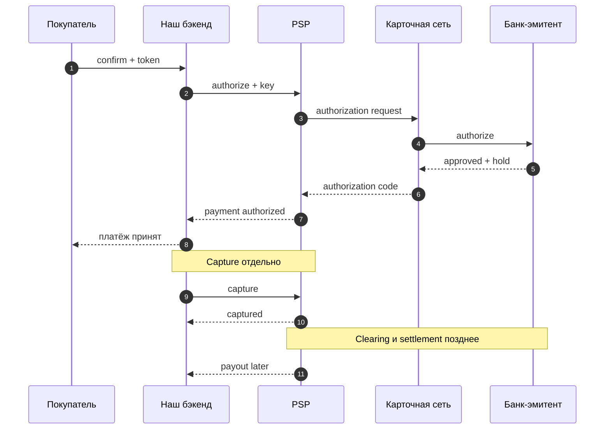
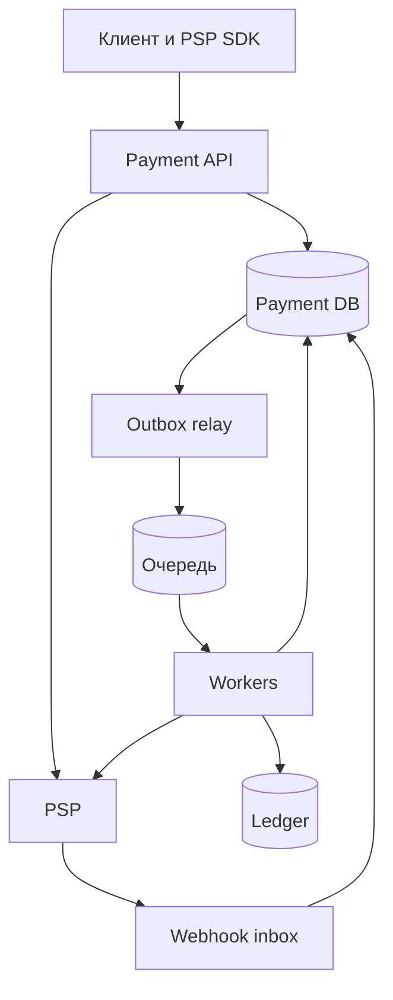
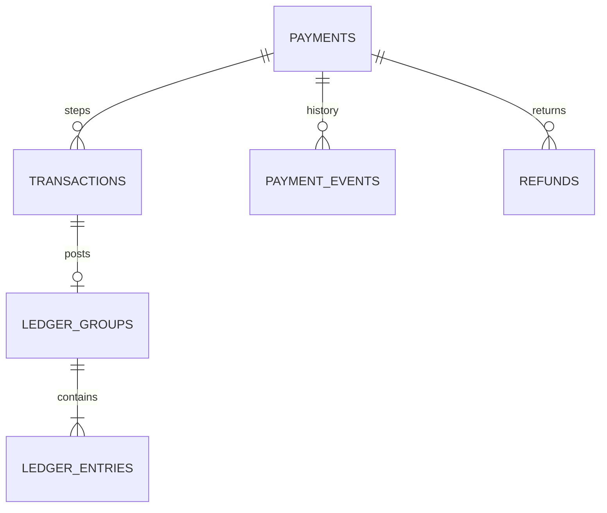
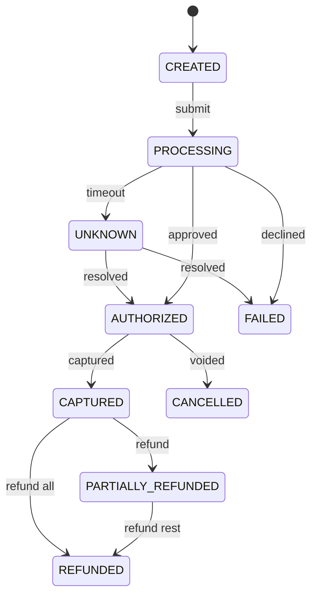
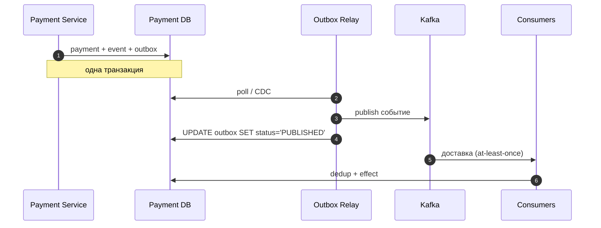
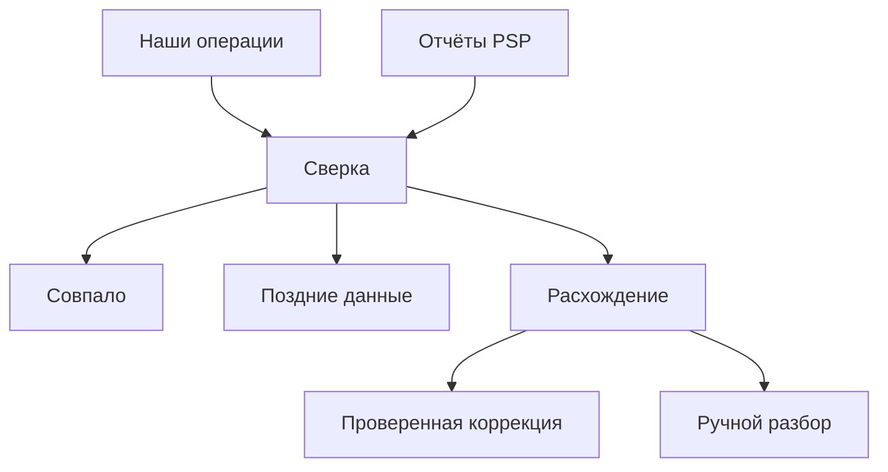

# Разбор задачи: платёжная система

<!-- learning-nav:start -->
[← Все разделы](../README.md) · [Предыдущая тема](hotel-booking.md) · [Следующая тема →](job-scheduler.md)
<!-- learning-nav:end -->

> **Формулировка на собеседовании:** «Спроектируй платёжную систему / payment gateway / систему приёма платежей для маркетплейса (как Stripe, PayPal, ЮKassa)».
>
> Это одна из самых «проверяющих» задач: здесь интервьюер смотрит не на масштабирование (нагрузка обычно скромная), а на то, как ты думаешь о **корректности под нагрузкой отказов**: дубли списаний, падения посередине платежа, рассинхрон с внешним провайдером. Счастливый путь опишет любой; senior от junior отличает рассказ о том, что происходит, когда что-то пошло не так.

## Как вести себя в начале

- Не рисуй всю систему сразу. Нарисуй рамку, выдели внешние и внутренние компоненты и **договорись о скоупе**: «Вот это — зона PSP/банков, мы её не проектируем, концентрируемся на нашем бэкенде. На чём углубляемся — идемпотентность, ledger, reconciliation?». На интервью 45–60 минут, и сужение области — это сигнал зрелости, а не уклонение.
- Каждый компонент на схеме сопровождай «зачем»: не «ставим ledger», а «нам нужна надёжность и аудит движения денег, поэтому ставим ledger». Кандидаты, которые называют компоненты без мотивации, выглядят зазубрившими.
- Если собеседуешься в финтех — владение терминологией (acquirer, issuer, capture, settlement, chargeback) обязательно; если в компанию не из платёжного домена — достаточно вывести дизайн из первых принципов («работаем с деньгами → нужна консистентность → нужна бухгалтерская книга и сверка»).

## Уточняющие вопросы

1. **Кто мы?** Маркетплейс, принимающий платежи от покупателей в пользу продавцов? SaaS с подписками? Или мы строим сам PSP (Stripe-as-a-service)? Это принципиально разные задачи.
2. **Способы оплаты:** только карты или ещё Apple Pay / Google Pay / СБП / кошельки?
3. **География и валюты:** одна страна и одна валюта или мультивалютность и кросс-бордер?
4. **Модель списания:** one-time платежи, подписки с recurring billing, отложенный capture (отели, физические товары)?
5. **Возвраты:** нужны ли full/partial refunds? Chargebacks?
6. **Payout'ы продавцам:** нужно ли начислять и выводить деньги продавцам (split payments)?
7. **Нагрузка:** TPS на создание платежа, пиковые распродажи?
8. **Строим процессор сами или интегрируем PSP?** В заданном скоупе интегрируем PSP. Собственный процессинг требует банковских интеграций, контроля рисков и выполнения применимых требований; решение зависит от бизнеса и юрисдикции, а не от одного порога оборота.

## Требования

### Functional

- Создание платежа (payment intent): покупатель платит продавцу.
- Подтверждение и авторизация платежа через внешний PSP, включая 3-D Secure.
- Capture: немедленный (цифровые товары, подписки) или отложенный (по факту fulfilment).
- Полные и частичные возвраты — через отдельный refund flow со своим жизненным циклом.
- Отслеживание статуса платежа: ответы API, подписанные webhook'и, запрос текущего объекта PSP и финансовые отчёты сверяются между собой.
- Внутренний учёт денег: ledger + балансы продавцов (wallet), payout'ы.
- Ежедневная сверка (reconciliation) с отчётами PSP/банка.

### Non-functional

- **Корректность превыше всего.** Не более одного денежного эффекта на бизнес-операцию; повторная доставка и неизвестный результат — штатные случаи. Exactly-once между нашей БД и PSP одной локальной транзакцией не достигается.
- **При недоступности авторитетного состояния запрещаем рискованные записи.** Например, не разрешаем payout по устаревшему балансу. Просмотр истории может работать с пометкой актуальности. CAP относится к поведению при сетевом разделении, а не требует сделать всю систему недоступной.
- **Идемпотентность на каждом слое:** клиент → наш API, наш API → PSP, обработка webhook'ов, batch-джобы.
- **Аудируемость:** append-only история всех переходов состояний и движений денег.
- **Безопасность:** минимальный PCI-скоуп, токенизация карт, mTLS между сервисами.
- Latency: например, p99 приёма команды <500 мс; внешний результат может прийти позже. 3DS с действием пользователя и асинхронные методы оплаты не укладываются в универсальный SLA «5 секунд до оплаты».

## Оценки нагрузки

Платёжные системы редко упираются в throughput — упор в корректность. Но прикинуть нужно:

- Маркетплейс среднего размера: **~1 млн платежей/день** → ~12 TPS в среднем, пик ×10 ≈ **120 TPS** на создание платежа. Это отправная точка для нагрузочного теста: один платёж создаёт несколько записей, ledger и обновления индексов; число API TPS не равно числу SQL-транзакций.
- Webhook'и от PSP: при допущении 3 события/платёж — ~3 млн/день, ~35 событий/с в среднем; отдельно учитываем повторные доставки и пики.
- Чтение статуса платежа: на порядок больше записей, ~100–1000 RPS — кэш/реплики.
- Хранилище: запись платежа ~1 КБ + события и ledger-записи ~3–5 КБ на платёж → ~5 ГБ/день, ~2 ТБ/год. Сроки хранения определяем требованиями аудита и приватности; архивируем холодные партиции. Индексы, реплики, WAL и бэкапы увеличат физический объём.
- Внешние ограничения: бюджет API зависит от провайдера, аккаунта и endpoint; задаём отдельные лимитеры и backoff. Комиссия зависит от договора и способа оплаты: меньше HTTP-запросов обычно не означает меньше комиссии за транзакцию.

Вывод для интервьюера: «Узкое место — не железо, а семантика exactly-once и согласованность с внешним миром, поэтому дальше я фокусируюсь на состояниях, идемпотентности и сверке».

## Как движутся деньги: контекст домена

В упрощённой карточной модели участвуют: держатель карты, мерчант, PSP, банк-эквайер (банк мерчанта), карточная сеть (Visa/Mastercard/Мир), банк-эмитент (банк покупателя). Платёж проходит три фазы с разными таймингами и фейл-модами:



- **Authorization** — эмитент проверяет карту и резервирует (hold) сумму. Денег ещё нет.
- **Capture** — мерчант говорит «списывай». Для цифровых товаров — сразу (auto-capture), для физических — на fulfilment. Отсюда обязательные состояния `AUTHORIZED` и `CAPTURED` — если схлопнуть их в одно, отложенный capture не смоделировать.
- **Clearing & settlement** — транзакции батчами уходят в сеть, сеть считает комиссии, деньги физически перемещаются. Сроки зависят от метода оплаты и договора. Settlement между участниками, payout мерчанту и зачисление refund покупателю — разные процессы; универсального T+N для них нет.

## API

```http
POST   /v1/payments                  # создать платёж (intent)
POST   /v1/payments/{id}/confirm     # подтвердить (payment_method_token)
POST   /v1/payments/{id}/capture     # capture (если отложенный)
POST   /v1/payments/{id}/cancel      # отмена до capture
POST   /v1/payments/{id}/refunds     # полный/частичный возврат
GET    /v1/payments/{id}             # статус + история транзакций
POST   /v1/webhooks/psp              # приёмник событий от PSP (подпись HMAC)
```

Ключевые детали, которые стоит произнести:

- Все mutating-эндпоинты принимают заголовок `Idempotency-Key: <uuid>` — клиент генерирует ключ на одну «логическую операцию» и шлёт его при ретраях.
- `POST /payments` возвращает `201` с `payment_id`, `status=CREATED`, `client_secret` для фронта — деньги ещё не двинулись, это лишь намерение.
- Отдельные сущности **payment** и **transaction**: payment — бизнес-намерение списать деньги (аналог Stripe PaymentIntent), transaction — одна попытка/шаг исполнения (authorize, capture, refund). У одного payment много transactions: первая авторизация упала → ретрай, потом capture, потом частичный refund. Тот, кто пишет всё в один `status` платежа, теряет историю, ломает ретраи и observability — классическая ошибка кандидата.

## High-level design



Inbox и outbox хранятся с платёжным состоянием. Если ledger вынесен в другую БД, его запись идемпотентна по идентификатору денежной операции; платёжный статус не доказывает, что проекция баланса уже обновилась.


Принципиальные решения:

- **Синхронный путь минимален:** принять запрос, закрепить операцию и её ключ в БД, вызвать PSP с ограниченным ожиданием либо поставить команду в outbox. При неизвестном результате вернуть `202 PROCESSING`, сохранив тот же `payment_id`. Всё остальное — асинхронно.
- **PSP Integration Layer** — адаптер над конкретным провайдером: скрывает его API за интерфейсом, маппит коды ошибок во внутренние (retriable/permanent), проставляет idempotency-key на каждый POST, управляет таймаутами. Заодно это точка смены провайдера и мульти-PSP роутинга.
- **Webhook receiver делает три вещи и ничего больше:** проверяет подпись по исходным байтам и допустимость timestamp по контракту PSP, надёжно сохраняет событие в inbox и только после коммита отвечает `2xx`. У PSP короткий таймаут на доставку; если обрабатывать событие синхронно и не успеть — провайдер будет ретраить, а ты получишь шторм дублей. Бизнес-логика — после, из очереди с at-least-once семантикой.
- **Четыре класса фоновых воркеров:** обработка webhook-событий (переходы состояний), ретраи с экспоненциальным backoff'ом, daily reconciliation, детектор «застрявших» платежей в промежуточных состояниях с алертами.

## Data model



`idempotency_keys` хранит `(merchant_id, operation, key)` с UNIQUE, `request_hash`, `payment_id`, результат и срок хранения; `inbox` — уникальные provider event IDs. Для `transactions` нужны PSP account/provider, operation type, stable PSP key, provider reference, сумма, валюта и outcome. `outbox` хранит event ID, aggregate ID/version и payload. Это отдельные записи: outbox переносит событие, а не является владельцем audit log.

```sql
-- Для фиксированной валюты используем integer в её минорных единицах.
-- Для курсов/пропорций допустим exact NUMERIC с явным округлением; не float.
-- Никаких float/double: 0.1 + 0.2 != 0.3, а в деньгах это инцидент.
CREATE TABLE payments (
    id               UUID PRIMARY KEY,
    idempotency_key  UUID NOT NULL,                 -- scoped ключ в отдельной таблице
    status           TEXT NOT NULL,                 -- state machine, см. ниже
    amount_minor     BIGINT NOT NULL CHECK (amount_minor > 0),
    currency         CHAR(3) NOT NULL,
    psp_payment_intent_id TEXT,
    customer_id      UUID NOT NULL,
    merchant_id      UUID NOT NULL,
    payment_method_token TEXT NOT NULL,             -- токен, НЕ карта
    settlement_batch_id  UUID,                      -- ссылка на сверочный batch, не дедуп эффекта
    version          INT NOT NULL DEFAULT 0,        -- optimistic locking
    metadata         JSONB,
    created_at       TIMESTAMPTZ NOT NULL DEFAULT now(),
    updated_at       TIMESTAMPTZ NOT NULL DEFAULT now()
);
-- частичный индекс: застрявшие платежи ищутся только по не-терминальным статусам
CREATE INDEX idx_payments_active ON payments(status)
    WHERE status NOT IN ('CAPTURED','CANCELLED','FAILED','REFUNDED');

-- ledger: append-only. UPDATE и DELETE запрещены на уровне прав.
CREATE TABLE ledger_entries (
    id            UUID PRIMARY KEY,
    tx_group_id   UUID NOT NULL,              -- группирует дебет+кредит одной операции
    account       TEXT NOT NULL,              -- 'buyer:...', 'merchant:...', 'fees', 'psp_clearing'
    direction     TEXT NOT NULL CHECK (direction IN ('DEBIT','CREDIT')),
    amount_minor  BIGINT NOT NULL CHECK (amount_minor > 0),
    currency      CHAR(3) NOT NULL,
    created_at    TIMESTAMPTZ NOT NULL DEFAULT now()
);
-- Вся группа проводок коммитится атомарно и балансируется отдельно по валюте.
-- Нужны UNIQUE на business_operation_id в таблице групп и проверка при COMMIT;
-- CHECK одной строки не проверяет сумму остальных строк.
```

Индексы на чтение: `psp_payment_intent_id` (матчинг webhook'ов), `customer_id`, `merchant_id` (дашборды, выписки).

## Deep dive 1: идемпотентность и idempotency keys

Главный вопрос этой задачи: **«Что будет, если запрос придёт дважды?»** Источники дублей: ретрай клиента по таймауту (запрос дошёл, ответ потерялся), дабл-клик по кнопке «Оплатить», повторная доставка webhook'а, перезапуск batch-джобы, реплей сообщения из Kafka.

Идемпотентность нужна на четырёх слоях:

### Слой 1: клиент → наш API

Клиент генерирует ключ на логическую операцию. Сервер привязывает его к `(merchant_id, operation, key)` и хэшу нормализованных параметров. Создание payment и регистрация ключа происходят в одной короткой транзакции:

```sql
BEGIN;
INSERT INTO idempotency_keys (merchant_id, operation, key, request_hash)
VALUES (:merchant, 'CREATE_PAYMENT', :key, :hash)
ON CONFLICT DO NOTHING;
-- Если ключ уже есть: проверить hash и вернуть связанный payment_id/результат.
-- Если вставили: создать payment, привязать его к ключу, записать outbox.
COMMIT;
```

Схема выше — псевдокод ветвления, не готовая хранимая процедура. Уникальность scoped-ключа нужна в БД; check-then-insert без constraint небезопасен. Одинаковый ключ с другими параметрами — ошибка контракта, например `422`. Для ещё исполняющейся операции возвращаем тот же ID и `202` либо документированный конфликт, а не начинаем второе списание.

Recovery points полезны (`STARTED → COMMAND_SAVED → RESULT_KNOWN`), но запись `PSP_CALLED` не устраняет окно между внешним эффектом и локальным коммитом. После падения в этом окне результат неизвестен. `locked_at` — lease, а не вечное владение: после паузы старый воркер может продолжить работу. Защиту денежного эффекта обеспечивает стабильный PSP-ключ и проверка результата.

Срок хранения ключа должен покрывать ретраи, задержки очередей и восстановление. После удаления ключа прежний запрос может стать новым; бизнес-уникальность `order_id + operation` часто хранится дольше транспорта. Окно дедупликации PSP проверяем отдельно по его контракту.

### Слой 2: наш бэкенд → PSP

На каждый денежный шаг создаём стабильный ключ, например `payment_id:authorize:attempt_1`, `payment_id:capture:1`, `refund_id`. Ключ клиента на создание payment и ключ capture — разные операции: бездумно передавать один ключ во все вызовы нельзя. При сетевом таймауте повторяем тот же шаг с теми же параметрами и ключом в пределах гарантий PSP.

HTTP `5xx` тоже не доказывает отсутствие эффекта. Например, Stripe описывает такие результаты как неопределённые: слепой retry с новым ключом может списать повторно. После исчерпания бюджета ретраев сохраняем `UNKNOWN/PROCESSING`, проверяем объект по provider ID/merchant reference, принимаем webhook и выполняем сверку. Переключение на другой PSP до разрешения неизвестного исхода может удвоить платёж.

### Слой 3: webhook'и

Доставка может повторяться, нарушать порядок и закончиться без успеха после исчерпания ретраев. Inbox имеет уникальный `(provider, event_id)`: receiver сохраняет `RECEIVED`, worker в одной транзакции отмечает `PROCESSED`, меняет допустимое состояние и пишет outbox. Наличие сырой записи в inbox ещё не означает, что бизнес-эффект применён. Отдельные «проверил dedup → изменил платёж → пометил обработанным» оставляют crash windows.

Dedup по event ID не заменяет уникальность бизнес-эффекта: два разных события могут описывать один capture. Проводку защищает `provider_operation_id`. При `captured` раньше `authorized` можно получить текущий объект PSP и применить доказанный результат, а не вечно ждать пропущенное событие. Timestamp не гарантирует порядок; локальная `version` сериализует наши записи, но не является версией объекта PSP.

### Слой 4 (бонус): batch-джобы

Джобе присваивается стабильный `batch_id`, каждому эффекту — уникальный business ID. И эффект, и отметка обработки коммитятся вместе. Само поле batch_id не исключает дубль, если процесс упал между отправкой payout и записью отметки; внешнему payout нужен собственный ключ и разрешение неизвестного исхода.

## Deep dive 2: состояния платежа как state machine

«Нельзя выполнить capture сверх подтверждённой авторизации» — такие инварианты должны быть невозможны *by design*, а не проверяться if'ами в разных местах. Моделируем две связанные машины состояний: бизнес-уровень (payment) и технический уровень попыток (transaction).



Схема упрощена: `UNKNOWN` здесь показывает неизвестную авторизацию. Capture, cancel и refund имеют свои outcome в `transactions`; при неизвестном capture основной payment может оставаться `AUTHORIZED` с ожидающим шагом, но это **не разрешение повторно списывать**. Для 3DS нужны `REQUIRES_ACTION`, для асинхронных методов — собственные pending/expiry-переходы. Не все виды оплаты вообще используют карточную авторизацию.

Для transactions различаем `INITIATED → PROCESSING → SUCCESS / DECLINED / UNKNOWN`. После timeout/DLQ остаётся `UNKNOWN` до разрешения; подтверждённый retriable-отказ может породить повтор по правилам PSP. Истечение retry budget не означает `FAILED_FINAL` для неизвестного денежного эффекта.

Как это enforce'ится:

- **Переходы в БД, а не в памяти.** `UPDATE payments SET status=:new, version=version+1 WHERE id=:id AND status=:expected AND version=:v` — optimistic locking гарантирует, что из двух воркеров, меняющих один платёж, успеет один. Второй получит 0 rows affected и поймёт, что состояние уже изменилось.
- **Каждый переход — событие.** `payment_events` — append-only аудит-лог: `prev_status`, `new_status`, `source` (`api` / `webhook` / `reconciliation`), timestamp. Без этого через месяц в проде невозможно ответить на вопрос «почему этот платёж в таком статусе».
- **Классификация ошибок — retriable vs permanent.** Timeout и неоднозначный 5xx — неизвестный исход, ограниченные повторы с прежним ключом и сверка; DLQ требует владельца разбора и не превращает исход в `FAILED`. Подтверждённый decline завершает эту попытку. Повтор после insufficient funds может быть допустим по политике recurring/dunning, но не немедленным бесконечным циклом; исправление реквизитов или действие пользователя создаёт контролируемую новую попытку. Слепой ретрай всего подряд — и дубли, и блокировки карты эмитентом.
- **Refund — отдельная машина состояний** со своими idempotency-ключами: у платежа в `CAPTURED` возврат живёт своим циклом (`REFUND_INITIATED → PROCESSING → REFUNDED / DECLINED / UNKNOWN`), не затирая статус самого платежа.

Что спросит интервьюер: «Авторизация прошла, а capture дал timeout?» — храним неизвестный исход capture, проверяем PSP, не обещаем отсутствие списания. При доказанном отказе возможен повтор до истечения авторизации; её срок зависит от метода оплаты. «Captured пришёл раньше authorized?» — сверяем актуальный объект, применяем допустимый переход и отдельно закрываем историю событий.

## Deep dive 3: outbox-паттерн и webhook-инфраструктура

Классическая проблема dual write: нужно атомарно (а) обновить платёж в БД и (б) опубликовать событие в Kafka / вызвать внешний API. Коммит в БД успешен, а публикация упала — мир узнал неправду; наоборот — ещё хуже. Решение — **transactional outbox**:



- Событие пишется в таблицу `outbox` **в той же транзакции**, что и изменение состояния. Упали после коммита — relay дочитает и отправит позже: гарантия at-least-once.
- Relay — polling publisher или CDC (Debezium по WAL). At-least-once означает, что **все консьюмеры обязаны быть идемпотентными** — dedup по `event_id`.
- Тот же приём работает и в обратную сторону: вместо синхронного вызова PSP из запроса пользователя пишем «authorize payment X» в outbox — воркер исполнит с прежним PSP-ключом и обработает неизвестный исход. Outbox гарантирует сохранение команды, но не атомарность внешнего списания с нашей БД.

**Входящие webhook'и от PSP:** receiver проверяет HMAC-подпись (защита от поддельных «ваш платёж прошёл»), пишет сырое событие, отвечает 200 быстро, обработка — из очереди. **Исходящие webhook'и мерчантам** (если мы сами платформа): dispatcher с экспоненциальным backoff'ом, счётчиком попыток, статусами `PENDING/DELIVERED/FAILED`, DLQ после исчерпания, HMAC-подпись payload'а shared secret'ом. Доставка webhook'а мерчанту никогда не блокирует основной платёжный путь.

## Deep dive 4: double-entry ledger и reconciliation

### Зачем ledger

Один изменяемый `balance` без истории операций нельзя независимо объяснить и пересчитать. **Ledger (бухгалтерская книга)** — append-only журнал, где каждое отражаемое движение денег записывается сбалансированной группой дебет/кредит в одной `tx_group_id`. Платёж на 1000 ₽:

| tx_group | account | direction | amount |
|---|---|---|---|
| g1 | `psp_clearing` | DEBIT | 1000 |
| g1 | `merchant:42` | CREDIT | 971 |
| g1 | `fees` | CREDIT | 29 |

Инварианты, которые это даёт:

- Σ(DEBIT) = Σ(CREDIT) в каждой группе и валюте — контроль сбалансированности. Он не доказывает, что сумма, получатель и число списаний верны: двойная сбалансированная проводка тоже ошибочна.
- Для показанных обязательств мерчанту баланс — `SUM(credits) - SUM(debits)`; знак для активных счетов задаётся планом счетов. Баланс пересчитывается на заданный момент (аудит «каким был баланс вчера»).
- Ошибка исправляется **только обратной проводкой** (reversing entry), никогда не UPDATE/DELETE. Книга — источник истины, кошельки и балансы — материализованные проекции, которые всегда можно пересчитать из книги.
- Произносим на интервью: «Ledger — это не из блокчейна, это обычная бухгалтерия: дебет с кредитом должны сойтись. Именно он делает возможной сверку».

### Reconciliation

Даже с идемпотентностью и ledger'ом наша система и PSP/банк **расходятся**: мы считали платёж успешным, а банк его отклонил; webhook потерялся; PSP зачислил payout не той суммой. Reconciliation — ежедневная (и более частая, near-real-time) сверка наших записей с отчётами провайдера (settlement reports, выписки эквайера):



Сопоставляем provider reference, сумму, валюту и вид операции; учитываем timezone, cutoff, комиссии и задержку settlement. Отсутствие строки в отчёте за день само по себе не доказывает отказ. Сначала проверяем полноту отчёта и ожидаемый лаг, затем создаём разбирательство. Любая коррекция проходит обычный идемпотентный путь изменения состояния/ledger с причиной и аудитом; напрямую «дозаписать успех по несовпадению» опасно.

Классификация расхождений — важная деталь, которую редко называют:

1. **Автофикс.** Сверка доказала неверную внутреннюю запись, источник и причина установлены → корректирующая операция и reversing entry. Уже подтверждённый capture нельзя объявить неуспешным только из-за отсутствия settlement; спор/chargeback — отдельное движение денег. Дёшево и автоматизируемо.
2. **Ручной разбор.** Ошибку заметили поздно, продавец уже вывел деньги → программно «забрать обратно» нетривиально и опасно, кейс уходит финансовым операторам.
3. **Неклассифицированное.** Вид расхождения новый → алерт, лог, разбор; по итогам заводится новый автоматический обработчик.

Именно поэтому ledger и reconciliation идут парой: книга — это то, что сверяем, а сверка — то, ради чего книга ведётся. Отдельный reconciliation-сервис пишет результаты сверки в свои таблицы, не трогая оперативные платёжные данные напрямую.

## PCI DSS кратко (на 60 секунд разговора)

- PCI DSS задаёт требования к защите карточных данных; схема подтверждения соответствия и merchant level зависят от правил платёжных брендов/эквайера. Это не разные версии самих требований безопасности.
- Ввод карты в hosted iframe/SDK PSP и хранение токенов уменьшают область проверки. Аутсорсинг не отменяет ответственность мерчанта и не гарантирует право на SAQ A: нужно выполнить все критерии применимости.
- PAN/CVC не должны попадать в наши API, логи, очереди и трассировки. CVC нельзя хранить после авторизации даже в шифрованном виде. Токены тоже защищаем от утечки и не логируем client secrets.
- mTLS подтверждает сервисную идентичность, но не заменяет авторизацию: refund разрешён ограниченным ролям, с лимитами и аудитом.

## Trade-offs

| Решение | Плюсы | Минусы / цена |
|---|---|---|
| Интеграция PSP | Быстрая интеграция методов оплаты и инструментов антифрода; часть операций у PSP | Договорные комиссии, зависимость от их SLA и rate limits |
| Свой процессор | Контроль маршрутизации и потенциальная экономия на части комиссий | Годы лицензирования, банковские интеграции, соответствие применимым требованиям полностью на тебе; экономика и требования оцениваются отдельно |
| PostgreSQL (single primary) для платежей | ACID, UNIQUE-констрейнты для идемпотентности, достаточно для сотен TPS | Вертикальный потолок; при росте — шардирование по merchant_id, но cross-shard ledger усложняется |
| Outbox + Kafka вместо синхронных вызовов | At-least-once, переживает краши, развязка | Eventual consistency, консьюмеры обязаны быть идемпотентными, задержка секунды |
| Append-only ledger | Аудит, пересчёт балансов, основа reconciliation | Только растущий объём, баланс — отдельная проекция, которую надо поддерживать |
| Синхронный ответ клиенту после authorize | Простой UX | Capture/settlement всё равно асинхронны — результат проверяем по API, webhook и сверке; честнее вернуть «платёж в обработке» |
| Оптимистичные локи (version) | Обнаруживает конфликт версий; SQL-записи всё равно используют блокировки | Конфликтующий апдейт отбрасывается — нужна обработка retry наверху |

## Красные флаги / типичные ошибки кандидатов

- Хранить номер карты/CVC в своей БД → расширение PCI scope и риск утечки. Правильно: токенизация, у себя — только `payment_method_token`.
- Писать всё в один `status` платежа без отдельных transactions и audit-лога → потеряна история, ретраи и разбор инцидентов невозможны.
- Ретраить вызов PSP без idempotency-key → double charge при потерянном ответе.
- Обрабатывать webhook синхронно в приёмнике → таймаут у PSP, шторм ретраев.
- `amount` как float/double → накопленные ошибки округления в деньгах.
- UPDATE/DELETE в ledger'е вместо reversing entries → нет аудита.
- Не упомянуть reconciliation вообще — «PSP нам ответил, значит всё сошлось». В реальности системы расходятся, и без сверки ты об этом не узнаешь.
- Слепые ретраи permanent-ошибок (`card_declined`) — и деньги на антифрод-проверки, и блокировки.
- Рисовать схему «клиент → сервер → база» без разделения синхронного/асинхронного путей и внешней зоны PSP.

## Что говорить интервьюеру (шпаргалка формулировок)

- «В платёжных системах я сознательно выбираю консистентность в ущерб доступности: рискованные записи по неизвестному состоянию отклоняю, чтение истории оставляю с отметкой актуальности».
- «Идемпотентность — сквозная: scoped клиентский ключ, отдельный стабильный ключ каждого шага PSP, inbox и уникальность денежной операции, атомарная обработка batch».
- «Webhook receiver — тонкий: подпись, сохранить, 200 OK; вся логика асинхронно из очереди».
- «Payment — это намерение, transaction — попытка исполнения; у одного платежа много транзакций».
- «Ledger — append-only double-entry книга; ошибки исправляем обратными проводками, баланс — проекция книги».
- «Reconciliation — ежедневная сверка с отчётом PSP; расхождения классифицируем: автофикс, ручной разбор, новый кейс для расследования».
- «Карточных данных у нас нет — токенизация на клиенте, уменьшаем PCI scope».
- «Переходы состояний enforce'ю в базе через optimistic locking, каждый переход — событие в audit-логе».

## Что спросят дополнительно

- **Chargebacks и disputes:** отдельный flow — эмитент принудительно отзывает деньги; нужны состояния `DISPUTED`, evidence-пакеты, автоматический дебет мерчанта или списание в убыток.
- **Мультивалютность:** сумма + валюта везде (включая ledger), курс конверсии фиксируется в согласованный момент по договору, settlement может идти в другой валюте — расхождение курсов ложится в ledger отдельной проводкой.
- **Подписки:** recurring billing по сохранённому токену (off-session), dunning — умные ретраи declined-списаний по расписанию с учётом причин отказа.
- **Payout'ы продавцам:** расписание (T+N после capture), hold для резерва под refunds/chargebacks, отдельный state machine вывода.
- **Фрод:** velocity-лимиты, device fingerprint, 3DS2, ML-скоринг до авторизации — антифрод-отказ — это permanent-ошибка, не ретраим.
- **Шардирование Payment DB:** по `merchant_id`; ledger-группы не должны пересекать шарды — проектируем счета так, чтобы дебет и кредит жили на одном шарде (clearing-счета как граница).
- **Тестирование:** как проверить exactly-once? — падения после вызова PSP и до коммита, дубли/перестановка webhook, повтор batch; проверяем не только баланс ledger, но число внешних операций, уникальность business ID и отсутствие выплаты по неизвестному результату.

## Разбор отказов и новых условий

### 1. Таймаут списания: можно ли вернуть ошибку и начать платёж заново?

PSP списал деньги, но ответ потерялся; наш воркер перезапустился до сохранения provider ID. Пользователь повторяет оплату, поддержка предлагает другой банк. Что должна сделать система?

<details>
<summary>Разбор</summary>

Возвращаем существующий payment со статусом «проверяем результат», а не предлагаём новую денежную попытку. Локально сохраняем ключ и параметры до отправки; после рестарта повторяем с тем же ключом в пределах его гарантированного окна либо ищем операцию по merchant reference. Если провайдер сохраняет и ошибочный ответ, повтор сам по себе может не разрешить исход: нужны актуальный объект, webhook, отчёты и эскалация.

Нельзя считать исчерпанный retry budget доказательством отказа. И нельзя перенаправлять `UNKNOWN` на другой PSP: его ключи не дедуплицируют операции первого. Если контракт провайдера вообще не позволяет восстановить исход, строгую автоматическую гарантию получить нельзя — блокируем повторный charge до разбирательства, с понятным UX и SLA для поддержки. Компенсационный refund — тоже внешняя операция с собственным неизвестным исходом.

</details>

### 2. Два частичных возврата: почему двух идемпотентных ключей недостаточно?

Из capture на 1000 ₽ два оператора одновременно запросили refund по 700 ₽ с разными ключами. Как ограничить общую сумму?

<details>
<summary>Разбор</summary>

Идемпотентность убирает повтор одной команды, но это две разные команды. В одной транзакции блокируем агрегат платежа либо условно увеличиваем `refund_reserved_minor` при `refunded_minor + refund_reserved_minor + requested <= captured_minor`; создаём refund и outbox. Суммы сохраняем в валюте capture. Не держим SQL-транзакцию во время вызова PSP.

На подтверждённом успехе переносим резерв в `refunded_minor`; на доказанном отказе освобождаем. При `UNKNOWN` резерв остаётся: иначе второй запрос может вернуть уже возвращённые деньги. Сбой после ответа PSP разрешается прежним refund key и сверкой. Защита лимита нужна и при отмене резерва, и при обработке webhook, в одной транзакции с изменением refund. Если PSP допускает свои возвраты вне нашей системы, их также импортируем до расчёта доступного остатка или передаём окончательный лимит авторитетному PSP.

</details>

<a id="источники-и-видео-по-теме"></a>

## Видео по теме

- [Design a Payment System Like a Senior Engineer](https://www.youtube.com/watch?v=Mqalc-nRMB0)
- [Design Payment System - Top Asked Interview Question in OpenAI / Stripe](https://www.youtube.com/watch?v=ruxGKk51aHo)
- [#FaangTalk 1 - Систем дизайн Payment System](https://www.youtube.com/watch?v=PYZVfTor2hM)
- [System Design 17: Design Payment Gateway / Payment System / Stripe / Paypal / Razorpay / HLD / LLD](https://www.youtube.com/watch?v=7EnqCwQOddY)
