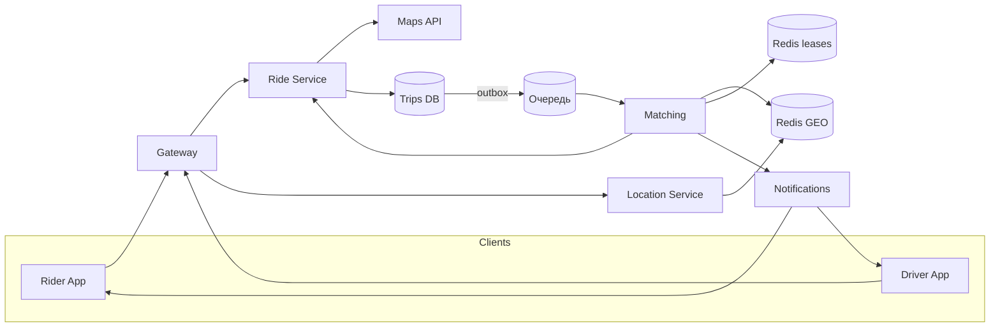
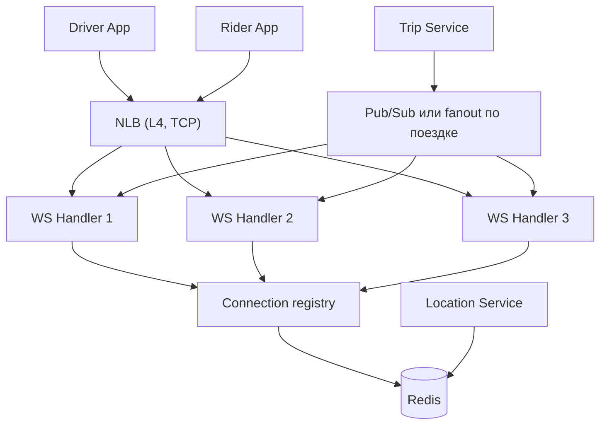
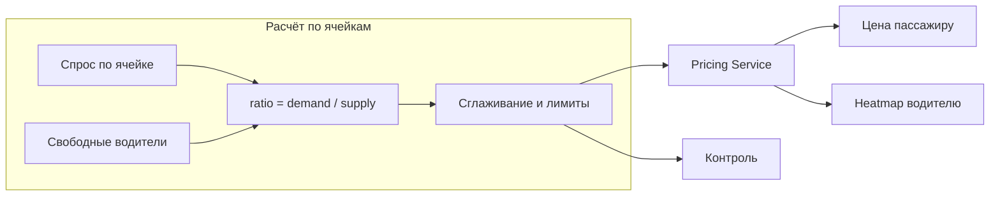
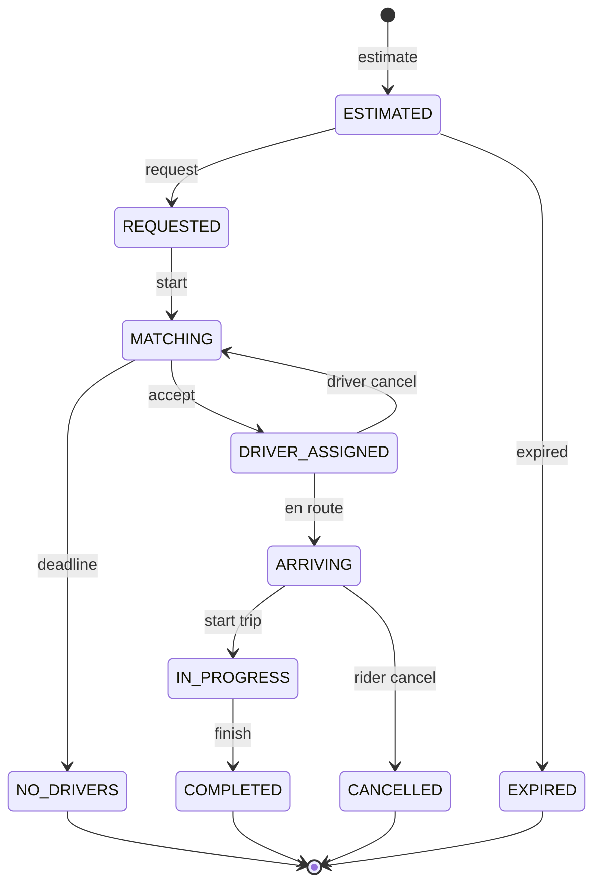

# Разбор задачи: такси-сервис (Uber / Яндекс Go)

<!-- learning-nav:start -->
[← Все разделы](../README.md) · [Предыдущая тема](leaderboard.md) · [Следующая тема →](ticket-booking.md)
<!-- learning-nav:end -->

Задача «спроектируй Uber» — классика proximity-систем и одна из самых частых на System Design собеседованиях (Яндекс, Ozon, Avito, Meta, Amazon). Если вы уверенно проектируете такси-сервис, вы автоматически закрываете большую часть смежных задач: доставка еды, поиск заведений рядом (Yelp), каршеринг, курьерские сервисы — везде одно и то же ядро: геопоиск + matching в реальном времени.

Задача многослойная: в ней есть и высокая нагрузка на запись (локации водителей), и жёсткие требования к согласованности (одна поездка — один водитель), и асинхронный matching с таймаутами, и realtime-каналы до клиентов. Именно поэтому интервьюеры её любят: есть куда копать на любом грейде.

## Структура ответа на интервью

Стандартный фреймворк, которого стоит придерживаться (и явно озвучить интервьюеру):

1. Требования: функциональные и нефункциональные.
2. Основные сущности и API.
3. High-level design — закрываем функциональные требования.
4. Deep dive в 2–4 узких места — закрываем нефункциональные.

По времени: на первые три пункта у senior-кандидата должно уйти 15–20 минут из 45. Остальное — на погружения, там и зарабатывается оценка. Для middle проходной уровень — связный high-level дизайн + ответы на наводящие вопросы. Для senior — глубокая проработка минимум двух мест (хранилище локаций, согласованность matching). Для staff — ещё глубже, плюс самостоятельный выбор, куда углубляться.

## Уточняющие вопросы

Прежде чем рисовать, зафиксируйте рамки. Хорошие вопросы:

- Что входит в скоуп: заказ поездки и matching, или ещё расчёт цены, навигация, оплата, рейтинги?
- Водитель видит один заказ за раз или список? Сколько времени на принятие решения? (Типичная формулировка: водитель видит один заказ, у него 10 секунд.)
- Цена фиксируется на момент заказа? На какое время она валидна? (Например: цена актуальна 10 секунд.)
- Нужно ли пассажиру видеть машину на карте в реальном времени?
- Какой масштаб: один город, страна, мир? Есть ли межгород?
- Нагрузка: сколько пользователей, водителей, поездок в сутки?

На мок-интервью интервьюеры нередко сами диктуют требования — например: «10 млн водителей, 100 млн пользователей, 10 млн поездок в сутки, сервис работает и внутри города, и межгород». Не спорьте, фиксируйте и считайте от этих чисел.

## Требования

### Функциональные

1. Пассажир вводит точки A и B и получает оценку цены и ETA поездки. Цена фиксируется на короткое окно (~10 секунд).
2. Пассажир заказывает поездку по этой цене.
3. Система подбирает ближайшего доступного водителя в реальном времени.
4. Водитель может принять или отклонить заказ; на решение — ~10 секунд; в моменте он видит только один заказ.
5. После назначения пассажир и водитель видят взаимное положение на карте (realtime-трекинг).

**Out of scope (озвучьте это явно — это признак продуктового мышления):**

- несколько тарифов (эконом/комфорт/детский) — считаем один тариф;
- рейтинги пассажиров и водителей;
- предзаказ на время, поездки с остановками, попутчики;
- оплата и биллинг, фрод;
- ML-модели ценообразования — абстрагируемся за «сервис цен».

Ограничение до 3 ключевых требований — осознанный выбор: времени мало, и попытка спроектировать всё приведёт к тому, что вы не успеете углубиться ни во что. Разбор этой задачи на практике показывает: интервьюер оценивает не полноту покрытия фич, а глубину в критических местах.

### Нефункциональные

Типичная ошибка — написать список слов на «-ость»: масштабируемость, доступность, надёжность. Это бесполезно, потому что не влияет на дизайн. Каждое требование надо сформулировать в контексте системы и по возможности оценить количественно:

- **Низкая задержка matching**: от запроса поездки до сопоставления (или отказа «нет водителей») — меньше 1 минуты.
- **Согласованность matching**: в каждый момент времени поездка назначена максимум одному водителю, и водитель рассматривает максимум один заказ. Это место, где в терминах CAP мы выбираем consistency.
- **Высокая доступность всего остального**: заказ, цена, трекинг должны работать 24/7, даунтайм минимален.
- **Всплески нагрузки**: часы пик, концерты, футбольные матчи — до сотен тысяч заказов в пределах одного региона за короткое время. Терять заказы нельзя.
- **Высокая нагрузка на запись локаций**: миллионы активных водителей шлют координаты каждые несколько секунд.

## Оценки нагрузки

Спорный момент: считать ли «на салфетке» в самом начале. Сильная позиция — сказать интервьюеру прямо: «Я предпочёл бы делать оценки по ходу дизайна, когда их результат напрямую влияет на выбор решения, а не заранее ради самих чисел». Большинство интервьюеров это устроит: пять минут умножения, после которых кандидат говорит «ну, это много», не добавляют информации ни о системе, ни о кандидате. Если интервьюер настаивает — считайте сразу, не спорьте.

Когда считать всё-таки стоит (эти числа реально влияют на дизайн):

**Заказы (запись).** 10 млн поездок/сутки ≈ `10^7 / 86400 ≈ 116 новых поездок/с` в среднем. Пики: ×5–10 от среднего → 500–1000 записей/с. Это отправная точка для теста: одна поездка создаёт несколько переходов, events и outbox. Шардирование вводим по нагрузке и объёму, сохраняя инвариант водитель + поездка внутри одной транзакционной границы.

**Обновления локаций водителей (главная write-нагрузка).** 8 млн водителей всего, активны одновременно ~половина → 4 млн. Обновление каждые 5 секунд:

```text
4 000 000 / 5 ≈ 800 000 обновлений/с
```

Это аргумент за отдельный распределённый контур локаций. Универсального потолка «10k TPS PostgreSQL» нет: всё зависит от схемы, индексов, durability и оборудования. Сравниваем стоимость/задержку на своей модели обновления.

**Опрос статуса заказа пассажиром.** Если 100 поездок/с создаётся, пассажир ждёт в среднем ~30 секунд и поллит раз в 3 секунды, в каждый момент ждут ~3000 пользователей → ~1000 RPS, в пике до десятков тысяч RPS на чтение статуса. Читать это напрямую из основной БД не хочется — отсюда кэш, CDC или push-модель.

**Поллинг заказов водителями (если выбрать pull-модель).** 3 млн активных водителей × опрос раз в 5 секунд ≈ 600k RPS в кэш. Redis кластер это переварит, но сама оценка заставляет пересмотреть модель в сторону push.

**Хранение.** Поездка с метаданными ~1–2 КБ. 10 млн/сутки × 365 ≈ 3.6 млрд поездок/год ≈ 5–7 ТБ/год только заказов. Трекинговые точки поездки (раз в 5 с на 20 минут ≈ 240 точек × ~50 байт ≈ 12 КБ/поездка) — ещё ~40 ТБ/год сырых логов. Заказы — шардируем, трекинг-логи — в дешёвое хранилище с TTL/архивацией.

## API

Не усложняйте: идите по функциональным требованиям по порядку, один-два эндпоинта на требование. Типы данных не расписывайте — интервьюер опытный инженер, это пустая трата времени. Исключение — enum статусов поездки, его стоит выписать явно.

| Метод | Назначение |
|---|---|
| `POST /rides` | Тело: `{source, destination}`. Создаёт поездку в статусе `ESTIMATED`, возвращает `{rideId, fare, eta}` |
| `PATCH /rides/{rideId}/request` | Пассажир подтверждает заказ по зафиксированной цене. Ответ быстрый, matching асинхронен |
| `POST /drivers/location` | Тело: `{lat, lon, sessionId, seq, observedAt, accuracy}`; водитель из auth |
| `PATCH /rides/{rideId}/respond` | Тело: `{offerId, accept}`. Решение только по актуальному предложению |
| `GET /rides/{rideId}` | Статус поездки (для поллинга) |

Два важных приёма, которые стоит проговорить:

- **Оценка и заказ могут быть одной сущностью.** Здесь `POST /rides` создаёт `ESTIMATED`, затем `PATCH` подтверждает. Отдельный quote с `quote_id`, сроком и версией также корректен; это удобно, если оценок много, а заказов мало.
- **Идентификатор пользователя — только из токена.** Никакого `userId` в теле запроса: берём из JWT/session-токена в заголовке. Иначе любой может заказать поездку или ответить на заказ от чужого имени.

Заметьте: эндпоинт `POST /drivers/location` всплывает не из требований напрямую, а из дизайна — без него matching нечем кормить. Нормально обнаружить его по ходу и вернуться дописать в список; никто не ждёт, что вы угадаете полный API с первой попытки.

## High-level design



Потоки данных:

1. **Оценка цены.** Rider App → API Gateway → Ride Service → внешний картографический API (ETA с учётом трафика) → расчёт цены → запись поездки в БД → ответ `{rideId, fare, eta}`.
2. **Заказ.** `PATCH /rides/{id}/request` → Ride Service в одной транзакции меняет статус на `REQUESTED` и сохраняет outbox; relay отправляет команду в очередь. Ответ клиенту — сразу, matching асинхронен.
3. **Локации.** Driver App раз в 5–15 секунд → Location Service → Redis geo-индекс. Для matching достаточно последней свежей координаты; после потери кэша водители временно исключаются до нового heartbeat. История для биллинга/споров сохраняется отдельно.
4. **Matching.** Matching Service забирает заказ из очереди, ищет в Location DB водителей в радиусе 2–3 км, фильтрует по статусу `AVAILABLE`, по одному предлагает заказ через Notification Service, ждёт 10 секунд, при отказе/таймауте — следующий.
5. **Назначение.** Водитель принял актуальный offer → Ride Service атомарно закрепляет и поездку, и активную занятость водителя; лишь затем публикует назначение через outbox. Пассажир узнаёт через push/поллинг.

Почему Matching — отдельный сервис, а не часть Ride Service: он вычислительно намного дороже (геопоиск + цикл ожидания по 10 секунд), асинхронен и масштабируется совсем иначе, чем синхронный CRUD поездок. Плюс его может развивать отдельная команда. Такой аргумент («разделил, потому что профили нагрузки и жизненные циклы разные») звучит на интервью сильнее, чем «потому что микросервисы».

## Модель данных

Основные сущности: `Ride`, `Rider`, `Driver`, `Location`.

```sql
-- Поездка (PostgreSQL, авторитетный регион назначения)
CREATE TABLE rides (
    ride_id       UUID PRIMARY KEY,
    rider_id      UUID NOT NULL,
    driver_id     UUID,                    -- NULL до назначения
    src_lat       DOUBLE PRECISION NOT NULL,
    src_lon       DOUBLE PRECISION NOT NULL,
    dst_lat       DOUBLE PRECISION NOT NULL,
    dst_lon       DOUBLE PRECISION NOT NULL,
    fare          NUMERIC(10,2) NOT NULL,
    currency      CHAR(3) NOT NULL,
    quote_expires_at TIMESTAMPTZ NOT NULL,
    version       BIGINT NOT NULL DEFAULT 0,  -- зафиксированная цена
    eta_seconds   INT,
    status        ride_status NOT NULL,    -- enum, см. state machine ниже
    created_at    TIMESTAMPTZ NOT NULL DEFAULT now(),
    updated_at    TIMESTAMPTZ NOT NULL DEFAULT now()
);
CREATE INDEX idx_rides_rider ON rides (rider_id, created_at DESC);

-- Водитель
CREATE TABLE drivers (
    driver_id  UUID PRIMARY KEY,
    status     driver_status NOT NULL,     -- OFFLINE / AVAILABLE / ON_TRIP
    car_info   JSONB,
    updated_at TIMESTAMPTZ NOT NULL
);
```

**Выбор БД для поездок.** Авторитетные назначения и допустимые переходы требуют атомарности. На старте выбираем региональный PostgreSQL: `rides`, `driver_assignments`, `offers`, outbox. Произвольное шардирование только по `ride_id` распределит две поездки одного водителя по разным шардам и сломает локальную уникальность занятости. Возможные пути роста — шард по dispatch-региону с единым владельцем водителя либо хранилище с транзакциями по нужным ключам. Само название SQL/NoSQL корректность не определяет.

**Отказоустойчивость:** синхронная реплика уменьшает RPO, но схема failover обязана исключать двух принимающих запись primary. Клиент после потерянного ответа повторяет команду с тем же ключом, не создаёт новую поездку. Трекинг допускает устаревание, ответ об окончательном назначении — авторитетная операция.

**Региональность.** Matching локален географически, поэтому основную нагрузку размещаем по регионам. Но водитель переезжает границу, существуют межгород, общий аккаунт, выплаты и DR. Передачу владения водителем выполняем с `owner_epoch`: старый регион после передачи не вправе назначать новые поездки. Межрегиональный поиск может быть eventual, окончательное назначение идёт через единственного владельца. «Регионам вообще нечего синхронизировать» — слишком сильное обещание.

**Локации — отдельное хранилище.** Не таблица, а Redis с geo-командами:

```text
GEOADD drivers:moscow 37.6176 55.7558 driver:42
GEOSEARCH drivers:moscow FROMLONLAT 37.6 55.75 BYRADIUS 3 km ASC COUNT 10
```

Ключ шарда — город/регион, member — `driver_id`, score — geohash координаты (Redis делает это сам). У обычного GEO sorted set нет TTL на отдельный member. Храним `last_seen`/session в метаданных и отдельный ZSET для очистки через `ZREM`; при каждом matching всё равно фильтруем свежесть, не полагаясь на punctual cleanup. TTL целого ключа удалит всех водителей города.

## Deep dive 1: геопоиск водителей

### Почему «просто PostgreSQL с lat/lon» не работает

Наивное решение: колонки `lat`, `lon`, B-tree индексы, запрос по диапазону. Три проблемы:

1. **B-tree — одномерная структура.** Даже составной индекс `(lat, lon)` кладёт рядом точки с близкой широтой, но точка (59.9, 30.3) в индексе окажется далеко от (59.9, −30.3)... и рядом с (59.9, 179) — двумерная близость не сохраняется. B-tree может отфильтровать диапазоны, но его эффективность зависит от порядка колонок и селективности; он не является полноценным пространственным индексом.
2. **Сканирование диапазонов.** Широкие выборки по координатам — это большие range scan'ы.
3. **Главное — write-нагрузка.** 800k обновлений/с глобально — это цена WAL, индексов, репликации и хранения. Отделяем их от транзакционной БД поездок и тестируем шардирование/агрегацию; одного универсального TPS-порога нет.

Опытный кандидат здесь упомянет **PostGIS**: пространственные индексы (обычно GiST) ускоряют поиск «в радиусе». Он поддерживает движущиеся точки; индекс не перестраивается целиком на каждом UPDATE. Цена частых изменений/репликации может быть выше in-memory решения, но выбор делаем по benchmark и региональной, а не глобальной нагрузке.

### Quadtree

Идея: рекурсивно делим карту на 4 квадранта, представляем как дерево. Есть порог K (например, 100): если в ячейке больше K точек — делим её ещё на 4. Поиск: спускаемся по дереву до листа, покрывающего точку запроса, и читаем список точек ячейки (+ соседи при необходимости).

Плюсы: адаптируется к плотности — в центре города ячейки мелкие, в пустыне крупные. Минусы: перемещение между листьями требует удаления/вставки и иногда split/merge; сложны горячие ячейки и распределённое хранение. Полностью перестраивать дерево для каждой точки не требуется.

### Geohash

Чередуем двоичные разбиения долготы и широты до нужной точности, независимо от плотности. Каждые пять бит кодируются в base32 — получается строка. Москва, например, это `ucfv...`. Свойства:

- чем длиннее строка, тем мельче ячейка;
- общий префикс = общий родительский регион: можно смотреть на 2–3 символа и понимать макрорегион, не вычисляя ничего;
- вычисление дёшево, хранение — просто строка, никаких деревьев.

| Длина geohash | Размер ячейки | Применение |
|---|---|---|
| 4 | ~39 × 20 км | район города |
| 5 | ~4.9 × 4.9 км | кластер улиц |
| 6 | ~1.2 × 0.6 км | matching-зона |
| 7 | ~153 × 153 м | точная подача |

Размеры в таблице приблизительны у экватора: ширина по долготе уменьшается с широтой. Для поиска в радиусе покрываем круг достаточным набором ячеек, включая соседей, затем фильтруем по реальному расстоянию. Девяти ячеек хватает не для любого радиуса и precision.

### Quadtree vs geohash: таблица для интервью

| Критерий | Quadtree | Geohash |
|---|---|---|
| Неравномерная плотность (город vs пустыня) | Отлично: адаптивные ячейки | Хуже: ячейки одинаковые |
| Частота обновлений | Удаление/вставка между ячейками, иногда split/merge | Обновление точки и состава ячеек |
| Хранение | Дерево, сложно в РС | Строка / sorted set score |
| Поддержка из коробки | Приложение / специализированные индексы | Redis, многие NoSQL |
| Типовая задача | Yelp, статичные POI | Такси, курьеры, всё движущееся |

Вывод для этой задачи: несмотря на неравномерное распределение водителей (города), из-за экстремальной частоты обновлений выигрывает geohash + Redis. Если интервьюер спросит «а что использует Uber на самом деле» — **H3** — открытая иерархическая сетка, разработанная в Uber: преимущественно шестиугольники, но на каждом уровне есть 12 пятиугольников. Проекция на сферу вносит искажения; соседи не обязаны быть строго равноудалены. **S2** — другой сферический индекс с иерархией четырёхугольных ячеек, также с искажениями размеров/форм. Геоячейки дают кандидатов, не точную дорожную ETA. Знание тройки geohash / H3 / S2 с плюсами и минусами — уже уверенный senior-сигнал.

### Краевые эффекты geohash

Соседние на карте ячейки не всегда имеют похожие коды: на границе крупных квадрантов геохэши «прыгают» (ячейка 7 и ячейка 8 могут быть соседями с совершенно разными строками). Поэтому:

- запрашиваем покрытие радиуса достаточным числом ячеек и фильтруем расстояние;
- при префиксном поиске (`LIKE 'ucfv%'`) теряем точки у границы — это классический подвох вопроса «а в чём проблема поиска по префиксу geohash?».

### Как уложиться в нагрузку: адаптивные обновления

800k записей/с — честная верхняя оценка, но интервьюер почти наверняка спросит: «А можно ли сделать это число меньше?» Сильный ответ — адаптивная частота на клиенте водителя:

- **оффлайн** → не шлём вообще;
- **стоит** → редкие heartbeats: без них сервер не отличит стоящую машину от отключившегося приложения;
- **в поездке / движется** → каждые 3–5 секунд;
- **в глуши, вдали от горячих зон спроса** → каждые 30–60 секунд, с большим допустимым возрастом точки; перед offer подтверждаем свежесть.

Например, при подходящем распределении состояний можно получить ~100k обновлений/с; это допущение, которое проверяем по данным. Число узлов Redis определяет benchmark с GEOSEARCH, metadata, persistence и запасом на отказ, а не только GEOADD/с. Формулировка «нагрузку на запись мы сначала давим продуктовыми компромиссами на клиенте, и только потом подбираем железо» — очень сильный сигнал.

Отдельно: вариант «поставить очередь перед БД и батчить записи» технически рабочий, но добавляет задержку (локации становятся неточными) и не решает проблему переиндексации — с Redis он просто не нужен, это overengineering. Если вы его предложили и сами отвергли с этими аргументами — тоже плюс.

## Deep dive 2: matching пассажир–водитель

### Кто кого ищет: pull или push

Две архитектуры, их стоит назвать и сравнить явно:

| | Pull: водители ищут заказы | Push: заказы ищут водителей |
|---|---|---|
| Механика | Водительский клиент поллит «дай ближайший заказ» раз в 2–5 с | Новый заказ → сервис сам ищет ближайших водителей и предлагает |
| Задержка назначения | До интервала поллинга (5+ с) сверху | Убирает ожидание следующего poll; поиск/доставка/решение остаются |
| Нагрузка | Сотни тысяч RPS впустую (у большинства водителей рядом заказов нет) | Пропорциональна числу заказов (~100–1000/с) |
| Контроль очерёдности | Сложный | Центральное управление; повторная обработка требует координации |

При требовании «заказ подбирается почти мгновенно» pull-модель разваливается на latency и накладных расходах. Push-модель (очередь + Matching Service) — правильный выбор. Это переворот схемы «вверх ногами» — на моках интервьюеры специально подводят кандидата к этому вопросом «а как бы вы изменили дизайн, если нужен мгновенный matching?».

### Алгоритм matching

```python
# Псевдокод: offer и assignment сохраняются в авторитетном хранилище.
def match(ride):
    while before_deadline(ride):
        for driver in fresh_candidates(ride):
            offer = try_create_offer(ride.id, driver.id, ttl_seconds=10)
            if offer is None:
                continue
            publish_offer_via_outbox(offer)
            # В production ожидаем событие/таймер, не держим поток 10 секунд.
            result = await_offer_result(offer.id)
            if result == "ACCEPT":
                if try_assign_atomically(offer.id):
                    return "ASSIGNED"
            expire_offer_if_still_pending(offer.id)
        expand_radius_with_limit(ride)
    fail_if_still_matching(ride.id)
```

Кандидаты из geo-индекса — подсказка: дополнительно проверяем свежесть позиции, online/status, тариф и отсутствие действующего offer/поездки. `offer_id`, срок и `owner_epoch` проверяются при accept. После timeout старый accept не должен назначить водителя на уже другой заказ. При повторном запуске воркер читает сохранённые offers, а не обнуляет цикл.

По одному предложению водителю — наше продуктовое допущение. Некоторые продукты допускают пакет/аукцион, но тогда правило приёма и конкуренция проектируются явно. Отказ водителя не удаляет заказ; сохраняем список уже отклонённых предложений с ограниченным сроком. Внешний push может потеряться, поэтому приложение догружает текущий offer по API.

### Согласованность: «один водитель — один заказ»

Геопоиск может вернуть одного водителя сотне заказов. Нужно обеспечить **два** инварианта: не более одного активного назначения на `ride_id` и на `driver_id`. Условный UPDATE только поездки защищает первый, но не второй.

**Решение 1 — авторитетная БД.** В одной короткой транзакции проверяем активный offer и состояние поездки, создаём `driver_assignments` с уникальным активным `driver_id` и `ride_id`, меняем ride и driver, пишем outbox. Все пути отмены/завершения используют ту же границу. Для offers аналогично храним владельца и deadline; истёкший offer перезахватывается условно, не обязательно ждать cron. SQL row locks не держим во время решения водителя.

```sql
CREATE TABLE driver_assignments (
    ride_id UUID PRIMARY KEY,
    driver_id UUID NOT NULL UNIQUE,
    offer_id UUID NOT NULL UNIQUE
);
-- Здесь только активные назначения; историю пишем отдельно.
-- INSERT + изменение ride/driver + outbox выполняются одной транзакцией.
```

**Решение 2 — Redis lease как ускорение.** `SET lock:driver:42 token NX EX 10` сокращает конкуренцию. Но TTL не останавливает старый воркер: после паузы он может проснуться и продолжить назначение. Redis failover также может потерять ключ. Поэтому нельзя отпускать lease перед `assign` и считать гонку закрытой; конечный DB-инвариант остаётся. Удаление/продление — только атомарно по token. Fencing имеет смысл, только если принимающее запись хранилище проверяет монотонный epoch, а не просто получает token в запросе.

**Решение 3 — условные записи в другой БД.** DynamoDB может хранить offer/assignment с condition expressions и транзакцией по нужным ключам. Его TTL — фоновое удаление, обычно через дни, а не точный 10-секундный таймер. Право перезахвата определяет условие по `expires_at` и владельцу; сравниваемое время требует принятой модели часов. TTL оставляем для cleanup.

### Отказоустойчивость воркеров и пики

Matching-воркер живёт долго (цикл до минуты) и может упасть посреди цикла. Отсюда **очередь перед Matching Service** (Kafka):

- обработка может повториться после падения/rebalance, а старый воркер — продолжить после паузы. Уникальность активного назначения проверяется и по ride, и по driver в БД. Для Kafka нельзя коммитить offset позднего сообщения, пока более раннее ещё не сохранено: иначе при рестарте его пропустим. Практичный вариант — быстро сохранить идемпотентную команду/inbox и ack, затем вести matching как устойчивую state machine;
- всплеск (стадион, концерт) — заказы копятся в очереди, воркеры разбирают со своей скоростью, backlog должен укладываться в matching deadline: при превышении бюджета ограничиваем admission/честно отказываем, иначе очередь лишь превращает отказ в долгий timeout;
- **партиционируем очередь по региону**: иначе «тяжёлый» заказ из деревни без водителей в FIFO-очереди задержит сотни лёгких заказов из центра Москвы. Один город может быть слишком горячей партицией: разбиваем по ячейке/ключу поездки, сохраняя DB-инварианты для общих водителей. Порядок Kafka — только в партиции, не глобальная очередь по часам клиента; цикл ожидания не должен блокировать всю партицию на минуту.

### Sequence-диаграмма полного цикла


## Deep dive 3: realtime-локации и трекинг

После назначения пассажир хочет видеть машинку на карте, а водитель — точку пассажира. Требования: обновления раз в 3–5 секунд, задержка < 1–2 секунд, сотни тысяч одновременных активных поездок.

### Варианты доставки до клиента

| Подход | Плюсы | Минусы | Когда |
|---|---|---|---|
| Short polling (раз в 3–5 с) | Просто, stateless, любой LB | Лишний трафик, задержка до интервала | Прототип, MVP |
| SSE | Односторонний push по HTTP, автопереподключение | Только сервер→клиент, держит соединение | Статусы заказа |
| WebSocket | Двусторонний realtime, минимальная задержка | Stateful, сложное масштабирование | Трекинг машинки |
| APNs/FCM push | Работает со свёрнутым приложением | Не для потока координат (лимиты, latency) | «Водитель найден», «подъехал» |

Прагматичная комбинация: **WebSocket для трекинга + APNs/FCM для редких событий + поллинг как fallback**. На интервью честно проговорите, что WebSocket-пул — самая сложная часть: персистентные соединения плохо дружат с балансировкой и деплоем.

### Архитектура WebSocket-слоя



- **L4 или L7** выбираем по требованиям TLS, маршрутизации и лимитам соединений. WebSocket поддерживается и L7-балансировщиками, например ALB; обязательного NLB нет. Проверяем Upgrade, idle timeout, heartbeat и drain при деплое. Число соединений на хендлер измеряем.
- **WebSocket Manager** — реестр «какой клиент на каком хендлере висит» (в Redis). Когда Matching или Trip Service хочет что-то отправить конкретному клиенту, он узнаёт у менеджера целевой хендлер и делает fanout через pub/sub.
- **Переподключение.** Хендлер упал → клиент по экспоненциальному backoff переподключается, попадает на другой хендлер, реестр обновляется. Клиент всегда может догнать состояние через `GET /rides/{id}` — канал не должен быть единственным источником истины.
- **Координаты поездки** — ключ `ride:{id}:positions` в in-memory хранилище: водитель шлёт свои точки, пассажир читает последнюю. Персистентность потока не нужна (последнее значение важнее истории); историю трека отдельно, асинхронно, в дешёвое хранилище для биллинга и споров.

Типичный вопрос интервьюера: «А можно без WebSocket?» Честный ответ: request/response-модель с поллингом раз в 5 секунд для десятков тысяч одновременных поездок — это десятки тысяч RPS впустую и видимая задержка; но как компромисс для первой версии — жизнеспособно. Важно показать, что вы понимаете цену каждого варианта, а не бездумно ставите WebSocket везде.

## Deep dive 4: ETA, цена и surge pricing

### ETA и базовая цена

Не проектируйте маршрутизатор на интервью — это отдельная задача (граф дорог, Contraction Hierarchies, ETA-модели). Сильный ход — прямо сказать: «абстрагирую за картографический сервис (Google Maps / Яндекс Карты), для меня это вызов API: координаты → время в пути с учётом текущего трафика и расстояние». Дальше:

```text
fare = base + per_km * distance + per_min * eta_traffic
```

- **ETA подачи** (когда машина будет у вас) — из того же Maps API до ближайших кандидатов из geo-индекса; на интервью достаточно «расстояние / средняя скорость» как грубая оценка; дорожные ограничения, мосты и пробки требуют routing ETA, а не расстояния по прямой.
- **Фиксация цены.** Цена живёт ~10 секунд. Заказ приходит с `ride_id`, а не с ценой — **клиент не определяет цену**: Ride Service сам пересчитывает/проверяет. При истечении quote получаем новый и запрашиваем согласие пассажира; незаметно менять уже согласованную стоимость нельзя. Это частый вопрос-ловушка: «откуда Order Service берёт цену?»
- **Финальная цена vs предварительная.** Модель «upfront price»: показываем цену до заказа и держим её, если маршрут не изменился. Альтернатива — счётчик по факту (время+км из трека). Обсудить оба варианта — плюс.

### Surge pricing (динамическое ценообразование)

Цель surge — не «заработать на час пик», а восстановить баланс спроса и предложения: высокий коэффициент отпугивает часть пассажиров и притягивает водителей из соседних зон.



Ключевые решения, которые стоит озвучить:

- **Гранулярность — геоячейка** (geohash-5/6 или H3), а не город целиком: в центре surge x2, в спальнике x1.
- **Окно агрегации 1–5 минут + сглаживание** (EMA): без него коэффициент дёргается от одного заказа, пассажиры видят «мерцающие» цены.
- **Кап коэффициента и прозрачность**: жёсткий потолок (репутационно и регуляторно), цена показывается до заказа, сюрпризов по факту нет.
- **Спрос считаем не только по заказам**: просмотр цены без заказа — тоже сигнал спроса (иначе surge подавляет спрос, метрика падает, surge отключается, спрос возвращается — классическая осцилляция).
- **Данные для расчёта** — потоковая агрегация поверх тех же событий: заказы из Kafka, локации водителей из Location Service; считать на лету в Redis (инкременты по ячейкам с TTL) или в stream-processing (Flink/Kafka Streams).

## Поездка как state machine

Поездка — классический конечный автомат. Явно нарисовать его на интервью — дешёвый способ показать полноту мышления: все переходы становятся либо API-вызовами, либо таймаутами.



На что обратить внимание интервьюера:

- **Переходы идемпотентны.** Клиент с плохой сетью ретраит `accept`; воркер после рестарта повторяет назначение. Условные апдейты (`WHERE status = 'MATCHING'`) делают повторы безопасными.
- **Каждый переход — событие.** `ride.status.changed` в outbox/Kafka → уведомления, аналитика, surge-метрики. Состояние и намерение уведомить коммитятся атомарно; push может потеряться или задержаться, поэтому клиент читает актуальную версию через API, потому что push строится от CDC/события, а не «надеемся, что сервис не упал между UPDATE и отправкой».
- **Отмена водителем до посадки** может вернуть активный заказ в MATCHING, если пассажир согласен и deadline не исчерпан. Отмена пассажиром переводит поездку в CANCELLED; активное назначение освобождается атомарно.
- **Деньги и споры** требуют журнала переходов (кто, когда, почему отменил) — отдельная append-only таблица `ride_events`, а не только текущий статус.

## Trade-offs: сводная таблица

| Решение | Выбрали | Альтернатива | Почему так |
|---|---|---|---|
| Хранилище локаций | Redis geohash | PostGIS R-tree, quadtree | 800k обновлений/с; Стоимость обновлений и durable-записи проверяем нагрузочным тестом |
| Модель matching | Push (очередь + воркеры) | Pull (поллинг водителей) | Latency и нагрузка на два порядка меньше |
| Защита от дабл-бука | Атомарное назначение ride + driver с уникальностью | Redis-only lease | Lease не останавливает устаревший воркер и не является финальной гарантией |
| Канал до клиента | WebSocket + push fallback | Short/long polling, SSE | Realtime-цена vs сложность stateful-пула |
| Основная БД | Шардированный PostgreSQL | DynamoDB, CockroachDB | Strong consistency статусов; связей мало, поэтому NoSQL тоже валиден |
| Масштабирование | Региональные шарды всей системы | Глобальная гео-БД | Нужна передача владения водителем и общие аккаунты/платежи |
| Очередь заказов | Kafka с партициями по городу | Одна FIFO | Иначе «деревенский» заказ блокирует городские |
| Обновления локаций | Адаптивная частота на клиенте | Фиксированные 5 с | Уменьшаем трафик с заданным бюджетом устаревания и heartbeat |

## Красные флаги и типичные ошибки

- **Прыгнуть рисовать микросервисы, не зафиксировав требования и числа.** Сначала рамки, потом прямоугольники.
- **Записать NFR списком слов на «-ость»** без привязки к системе и без чисел. «Низкая задержка» — ничего не значит; «matching < 1 минуты, иначе отказ» — влияет на дизайн.
- **Хранить локации водителей в PostgreSQL** с колонками lat/lon и не заметить 800k записей/с.
- **Цена приходит от клиента.** Order Service обязан валидировать цену сам — между просмотром цены и заказом проходит время.
- **Водителю отдают батч заказов** — все заказы батча блокируются, пока он смотрит первый; латентность для пассажиров взлетает.
- **Поллинг как единственный механизм** без оценки RPS (3 млн водителей × раз в 5 с = 600k RPS впустую) — и без обсуждения push-альтернативы.
- **Lease без срока и owner token** или вера, что TTL остановит старого воркера. Предложение имеет deadline, поездка — отдельное активное назначение, освобождаемое условно.
- **Гео-распределённая БД** там, где данные регионально изолированы. Нужны единый владелец водителя и процедура его передачи между регионами.
- **CDC → push напрямую из сервиса заказов клиенту**, без учёта того, что клиент переподключается между подами. Эту сложность делегируют отдельному notification-сервису.
- **Надеяться на естественный джиттер.** После массового reconnect/deploy таймеры могут синхронизироваться. Явный jitter в heartbeat/retry и ограничение reconnect rate нужны даже при независимых подключениях.

## Что говорить интервьюеру: сильные формулировки

- «Оценки на салфетке в начале я бы пропустил и считал по ходу дизайна, там, где результат влияет на выбор. Вас устроит?»
- «Нефункциональные требования сформулирую в контексте системы: низкая задержка — это matching меньше минуты; консистентность — не более одного водителя на поездку и одной активной поездки на водителя».
- «Цену от клиента не принимаю: между `POST /rides` и `request` прошло время, Order Service пересчитывает или спрашивает Price Service».
- «Прежде чем выбирать хранилище локаций, посчитаю запись: 4 млн активных водителей / 5 секунд ≈ 800k обновлений в секунду — отделяю поток координат от БД поездок и сравниваю стоимость решений».
- «Частоту локаций выбираю по состоянию: стоит водитель — редкие heartbeats, движется — частые координаты. Снижение с 800k до ~100k обновлений/с возможно при выбранном распределении состояний и проверяется измерениями; last_seen должен оставаться свежим».
- «Quadtree или geohash? У нас неравномерная плотность, но экстремальная частота обновлений, поэтому geohash. В бою Uber использует H3 — преимущественно гексагоны на сфере, с искажениями и пятиугольниками».
- «Предлагаю инвертировать схему: не водители ищут заказы поллингом, а заказ через очередь сам находит водителей — убираем ожидание следующего poll; остаются ETA-поиск и решение водителя».
- «Назначение проверяет уникальность ride и driver в одной транзакции. Redis lease сокращает конкуренцию, но после его expiry старый воркер всё равно обязан пройти авторитетную проверку».
- «Matching размещаю регионально; для водителя есть единственный owner с epoch, его передачу между регионами проектирую отдельно».

## Что спросят дополнительно

- Как масштабировать WebSocket-пул? Что происходит при падении хендлера? (Реестр соединений в Redis, клиентский backoff, догон состояния через REST.)
- Как сделать ETA точнее? (Свой роутинг-движок поверх OSM, исторические скорости по сегментам, ML поверх; но это отдельное интервью.)
- Пассажир отменил, когда водитель уже ехал? (Переход в CANCELLED с правилами штрафа, водителю — компенсация простоя, заказ не возвращается в пул.)
- Двойная оплата / повторный заказ при ретраях? (Idempotency-key на `POST /rides`, условные переходы статусов.)
- Как хранить трек поездки? (Поток точек → Kafka → S3/ClickHouse; в Redis — только последняя позиция.)
- Рейтинг водителя в matching? (Скоринг-кандидатов: расстояние × рейтинг × время на линии; но сначала честно закройте базовый вариант.)
- Что если Redis geo-шард города перегружен? (Шардирование по городу → по geohash-префиксу; ребалансировка горячих ячеек.)
- Как тестировать matching? (Симулятор водителей/пассажиров, shadow-трафик, метрики: time-to-match, fill rate, доля отказов.)

## Практические вопросы и задачи на отказ

### 1. Как обеспечить идемпотентность REST-сервиса заказа такси?

Идемпотентность означает один результат одной логической команды, а не «у UUID почти нет коллизий». `POST /rides` принимает клиентский ключ; в одной транзакции сохраняем уникальный `(rider_id, operation, key)`, hash параметров и ride. Повтор с теми же A/B/тарифом возвращает тот же ID, с другими — ошибку. Если оценки представлены отдельными quote, ключ создания заказа связан с quote и его сроком. Одно ограничение «не более одной активной поездки у пассажира» может дополнять это, но мешает продукту заказа семье/другому человеку — уточняем требования.

`request`, `accept`, `cancel` имеют собственные command ID и ожидаемую версию/состояние. После потерянного ответа accept повторный вызов должен вернуть прежнее назначение, а не ошибочно «offer уже использован». Команда и outbox коммитятся вместе, обработчики дедуплицируют события в одной транзакции с эффектом. Версия помогает отбрасывать старый push на клиенте, но сама не заменяет уникальность назначения driver/ride.

Окно хранения ключа должно перекрывать offline-ретраи приложения и очередь. По истечении ключа бизнес-инвариант сохраняется; невозможно обеспечить бессрочное replay только временным Redis `SET NX`.

### 2. На подумать: координаты пришли в обратном порядке

Водитель отправил точки 101 и 102. Из-за сети 102 пришла первой, затем 101 с более поздним серверным receive timestamp. Между ними приложение переподключилось. Какая позиция правильная и можно ли назначать машину?

<details>
<summary>Разбор</summary>

Порядок получения не равен порядку наблюдений, а часы телефона могут спешить или откатиться. Сервер выдаёт `session_id/epoch`; внутри сессии принимаем только возрастающий seq, атомарно обновляя metadata и GEO. Точку 101 после 102 отвергаем. Новая сессия имеет новый epoch: её seq может начаться с нуля, а поздний пакет старой сессии не должен воскресить устаревшее положение. Нельзя сбрасывать last_seen на «сейчас» для отвергнутого старого пакета: он сделает offline-водителя свежим.

Отдельно проверяем наблюдаемый возраст, погрешность GPS, допустимую скорость скачка и server last_seen. Sequence не доказывает свежесть: offline-клиент может прислать возрастающий батч часовой давности. Перед offer фильтруем возраст, статус и owner; выбор по GEO не даёт права назначения. При неизвестной свежести исключаем кандидата или запрашиваем подтверждение, вместо обещания пассажиру точной ETA. Монотонные часы сервера пригодны для локального интервала ожидания, wall-clock timestamp — для обмена с явно принятыми допусками; ни те ни другие не создают глобального порядка событий.

</details>

### 3. На подумать: старый воркер принял ответ после expiry

W1 получил offer на 10 секунд, завис на 15. W2 уже предложил водителю другую поездку. W1 проснулся с accept первого заказа. Почему два `SET NX` не спасают?

<details>
<summary>Разбор</summary>

Истечение lease позволяет W2 начать работу, но не прерывает W1. W1 не должен удалять ключ W2, а его accept должен пройти авторитетную транзакцию: offer ещё активен, deadline не прошёл, epoch совпадает, ride всё ещё MATCHING и driver свободен. Уникальные ограничения на активные driver/ride не дадут закоммитить два назначения даже при потерянном Redis.

Окончание lease для **предложения** и длительность самой поездки — разные сроки: после принятия водитель занят до завершения/отмены, а не до истечения 10 секунд. Освобождение assignment должно проверять именно ride/offer ID, иначе поздний cancel первой поездки освободит водителя из второй. Неправильный ответ — «увеличим TTL до минуты»: он уменьшит частоту гонки, но не докажет единственность владельца.

</details>

<a id="источники-и-видео-по-теме"></a>

## Видео по теме

- [System Design: проектируем Uber, сервис для заказа такси](https://www.youtube.com/watch?v=R9B90ewl9EY)
- [Проектируем Uber, Яндекс Такси / System Design Mock-интервью / Middle+](https://www.youtube.com/watch?v=A6lsDx4lXk0)
- [Секреты успешного System Design Interview: Design Uber (интервью на русском)](https://www.youtube.com/watch?v=t79pmaVejP0)
- [System design - Яндекс Пробки / Гео базы данных / High load](https://www.youtube.com/watch?v=igL5EoQiX3c)
- [Разработка Uber с участием бывшего инженера-разработчика Meta: разбор интервью по системному проектированию](https://www.youtube.com/watch?v=lsKU38RKQSo)
- [Uber System Design / Ola System Design / System Design Interview Question - Grab, Lyft](https://www.youtube.com/watch?v=Tp8kpMe-ZKw)
