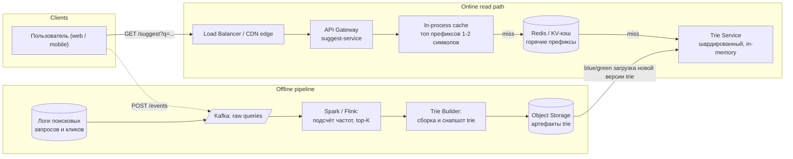
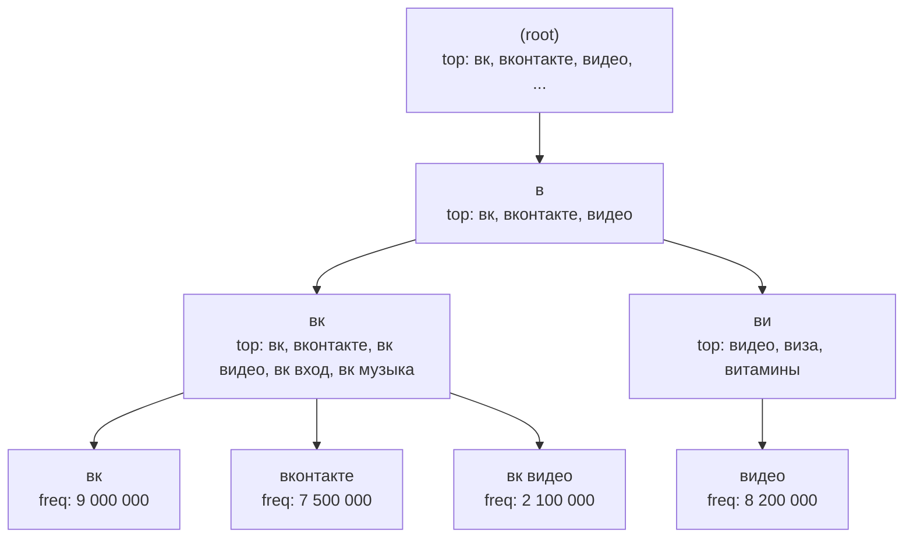
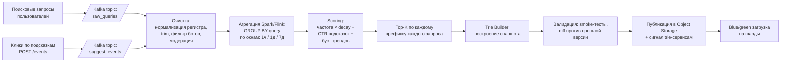
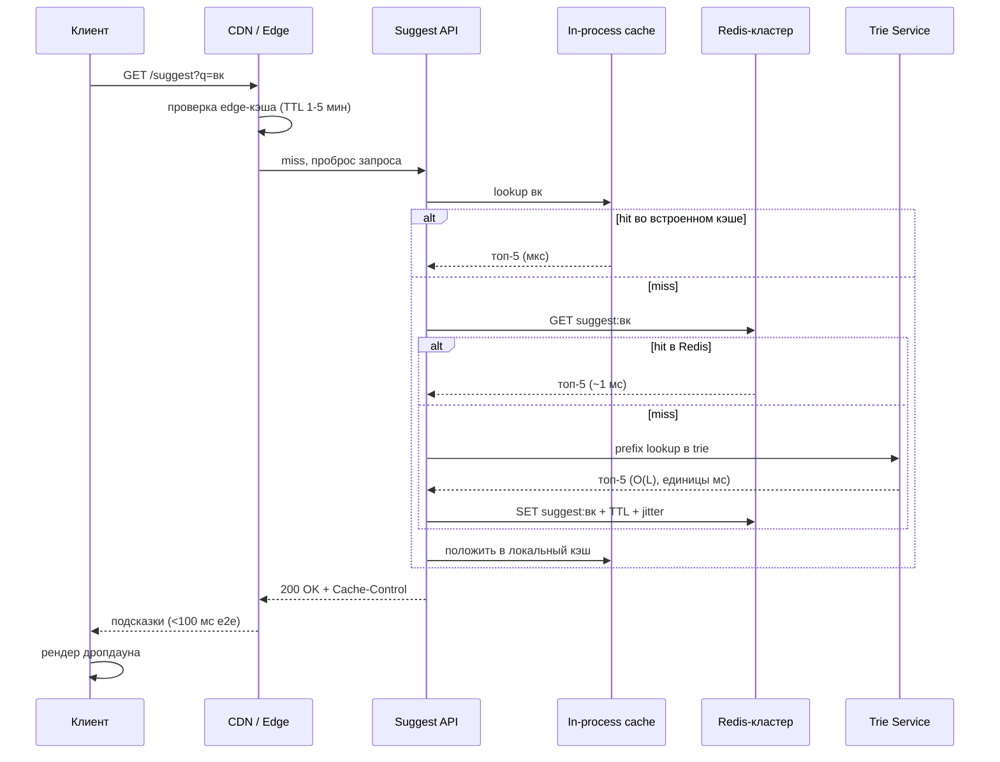

# Разбор задачи: поисковые подсказки (autocomplete / typeahead)

> Классическая задача системного дизайна: «Спроектируй поисковые подсказки для Google / Яндекса / маркетплейса». Формулируется также как typeahead, search suggestions, «саджесты». Обманчиво простая снаружи, внутри — концентрат тем: структуры данных (trie), офлайн-пайплайны агрегации, кэширование горячих ключей, шардирование, персонализация и жёсткий latency-бюджет.

Задача любима интервьюерами, потому что за 45 минут проверяет сразу несколько компетенций: умеешь ли ты считать нагрузку, понимаешь ли разницу между online-путём (read path, <100 мс) и offline-путём (пересчёт топов), знаешь ли, почему обычный `LIKE 'prefix%'` или Elasticsearch — не ответ на вопрос, и видишь ли узкие места до того, как тебя о них спросят.

---

## Как вести интервью: рамка

Опытные интервьюеры (в моках от тимлидов Яндекса и Ozon это звучит почти дословно) ожидают, что кандидат **сам ведёт процесс по шагам** и объявляет план вслух:

1. Формализация функциональных и нефункциональных требований.
2. Back-of-envelope оценка нагрузки (RPS, объём данных, трафик).
3. API (псевдокодом, без фреймворков).
4. High-level архитектура: компоненты и движение данных.
5. Модель данных: как физически хранятся подсказки.
6. Deep dive в 2–3 узких места по выбору кандидата или интервьюера.
7. (Бонус) Оценка железа и стоимости.

Два замечания из фидбэка на реальных моках, которые напрямую относятся к этой задаче:

- **Аргументируй каждый выбор технологии.** Фраза «возьмём Redis» без объяснения, почему именно Redis (in-memory, sorted sets, предсказуемая латентность), выглядит как гадание. Интервьюер специально давит: «а почему не PostgreSQL?» — и ждёт, что ты расскажешь про модель данных и её проблемы.
- **Сам озвучивай корнер-кейсы.** «А что будет, если один префикс станет мегапопулярным? А если кэш прогрет не будет? А если обновление trie упадёт посередине?» — если ты сам ставишь эти вопросы и тут же на них отвечаешь, это сильный сигнал seniority. Если ждёшь, пока спросят, — минус в карму.

---

## Уточняющие вопросы

Прежде чем рисовать первый прямоугольник, зафиксируй рамку. Хорошие вопросы (и зачем они):

- **Сколько подсказок показываем?** Обычно 5–10. От этого зависит, сколько топов хранить на узле trie.
- **Это глобальный поиск (Google) или вертикальный (маркетплейс, музыка, документы)?** У маркетплейса словарь на порядки меньше и есть категории; у глобального поиска — сотни миллионов уникальных запросов.
- **Матчинг строго по префиксу или нужны опечатки/fuzzy/матчинг в середине слова?** Префикс — одна задача (trie). «Содержит подстроку» и исправление опечаток — другая (n-gram индексы, симпелл, FST с levenshtein-автоматами). В базовом разборе договорись: только префикс, fuzzy — опциональное расширение.
- **Персонализация нужна?** Сильно меняет дизайн: глобальный топ кэшируется идеально, персональный топ — почти не кэшируется.
- **Насколько свежими должны быть подсказки?** Допустим ли топ за вчера (daily batch) или нужны тренды за последний час (near-real-time)? Это определяет offline-пайплайн.
- **Мультиязычность?** Русский + английский удваивают словарь; иероглифы меняют модель ввода (подсказки до конвертации IME).
- **Какой масштаб?** DAU, поисков в день, география (один регион или мульти-DC).

Сильная формулировка: «Предлагаю начать с MVP: топ-5 подсказок строго по префиксу, глобальный топ без персонализации, свежесть — ежедневный пересчёт. Персонализацию и опечатки вынесу в расширения и вернусь к ним в deep dive, если останется время».

---

## Требования

### Функциональные

- По префиксу длиной от 1–2 символов возвращать топ-N (N=5..10) наиболее популярных запросов, начинающихся с этого префикса.
- Подсказки обновляются по мере набора текста (каждый новый символ — новый запрос, с debounce на клиенте).
- Популярность считается по истории реальных поисковых запросов пользователей.
- (Опционально) Персонализация: учёт истории самого пользователя.
- (Опционально) Тренды: повышенный вес свежим всплескам («зенит спартак сегодня»).
- (Опционально) Модерация: фильтрация нецензурных и чувствительных подсказок.

### Нефункциональные

| Требование | Целевое значение | Почему |
|---|---|---|
| Latency (p99) | **< 100 мс** end-to-end, < 20–30 мс на бэкенде | Подсказка должна появиться быстрее, чем пользователь допечатает символ (~100–150 мс между кейстроками). Иначе фича бесполезна |
| Доступность | 99.9%+ | Read-only сервис, легко масштабируется репликами |
| Throughput | сотни тысяч RPS на пике | Запрос на каждый кейстрок |
| Свежесть данных | часы–сутки | Подсказки не обязаны быть real-time; топ запросов инертен |
| Консистентность | eventual | Никто не заметит, что подсказки обновились на 10 минут позже |

Ключевой инсайт, который стоит озвучить: **это read-heavy система с крайне асимметричной нагрузкой** — чтений на 3–4 порядка больше, чем записей (записи — это периодический пересчёт топов). Значит, оптимизируем read path любой ценой, а всю тяжёлую работу выносим в offline.

---

## Оценки нагрузки (back of envelope)

Считай вслух, округляй агрессивно, фиксируй допущения. Пример для «условного Google в одном регионе»:

**Запросы:**

- DAU = 100 млн, в среднем 5 поисковых сессий на пользователя в день → 500 млн поисков/день.
- Средний запрос ~20 символов; клиент шлёт запрос не на каждый кейстрок (debounce 100–150 мс + клиентский кэш префиксов) → считаем ~10 обращений к серверу на одну поисковую сессию.
- Autocomplete RPS средний: `500 млн × 10 / 86 400 ≈ 60 000 RPS`.
- Пиковый коэффициент ×2–3 (вечерний прайм, новостные всплески) → **~150–200 тыс. RPS на пике**.

**Данные:**

- Уникальных запросов за месяц: ~1–2 млрд, но длинный хвост нам не нужен. Храним топ по частоте: отсекаем всё реже, скажем, 100 показов → **~100–300 млн «живых» запросов**.
- Средняя длина запроса 20 байт + частота + метаданные ≈ 40–50 байт на запрос → сырой словарь ~10–15 ГБ.
- Trie с топ-5 кандидатами на узле: грубая оценка ×3–5 от сырого словаря с учётом указателей и встроенных топов → **~30–75 ГБ**. Умещается в память десятка машин после шардирования, а горячая часть (префиксы длиной 1–3) — в память одной машины.

**Ключевое наблюдение про распределение:** популярность префиксов подчиняется степенному закону. Короткие префиксы («а», «вк», «ин») обслуживают львиную долю трафика — именно они должны быть в самом горячем кэше. Хвост из длинных префиксов можно вообще не подсказывать (после 6–8 символов пользователь почти дописал запрос).

---

## API

Два эндпоинта — один на получение подсказок, один служебный на телеметрию (не забудь его: без сбора сигналов система не обучается):

```
GET /v1/suggest?q=вк&limit=5&lang=ru&session_id=...
→ 200 OK
{
  "query": "вк",
  "suggestions": [
    {"text": "вк", "score": 0.98},
    {"text": "вконтакте", "score": 0.91},
    {"text": "вк вход", "score": 0.74},
    {"text": "вк видео", "score": 0.61},
    {"text": "вк музыка", "score": 0.55}
  ],
  "cached": true,
  "took_ms": 8
}
```

```
POST /v1/events        # телеметрия: показы и клики по подсказкам
{"session_id": "...", "shown": ["вк", ...], "clicked": "вк", "ts": ...}
```

Что проговорить интервьюеру про API:

- **Ответ должен быть дешёвым и кэшируемым**: `Cache-Control`, `ETag` — CDN и браузер могут кэшировать глобальные подсказки на минуты без вреда.
- **`session_id`** (а не user_id в query) — для персонализации и для склейки «показ → клик» в офлайн-метриках качества.
- Версия API (`/v1/`) — подсказки будут A/B-тестироваться и меняться.
- Таймауты: если suggest-сервис не ответил за ~150 мс, клиент просто не показывает дропдаун. **Деградация graceful**: поиск работает и без подсказок. Это важная мысль — сервис не на критическом пути, что развязывает руки в дизайне.

---

## High-level design

Система распадается на два почти независимых контура: **online read path** (быстрый, тупой, read-only) и **offline data pipeline** (медленный, умный, пересчитывает топы). Такое разделение — главный архитектурный ответ этой задачи.



Проговори вслух:

- **Read path не содержит ничего умного.** Никаких вычислений топов в рантайме, никаких JOIN'ов. Запрос — это lookup по префиксу в заранее построенной структуре.
- **Offline path не влияет на latency пользователей.** Тяжёлая агрегация логов (сотни ГБ в день) идёт в Spark/Flink и выкатывается атомарно.
- **Обновление trie — blue/green**: новый снапшот загружается параллельно, переключение указателя — атомарно, старая версия выгружается. Падение сборки новой версии не трогает работающий сервис.

---

## Модель данных: trie и его эффективное хранение

### Почему trie

Задача «все строки с данным префиксом, отсортированные по частоте» — это ровно то, для чего придумано префиксное дерево. Lookup — `O(L)`, где `L` — длина префикса (обычно ≤ 20), и **не зависит от размера словаря**. Сравнение альтернатив:

| Структура | Lookup по префиксу | Комментарий |
|---|---|---|
| HashMap | `O(1)` только для точного ключа | Префиксный поиск невозможен в принципе |
| B-Tree индекс в БД (`LIKE 'abc%'`) | `O(log N + k)` | Работает (ключи отсортированы лексикографически), но это диск, page cache промахи и неровная латентность; на 200k RPS — дорого |
| Инвертированный индекс (Elasticsearch/Lucene) | Заточен под полнотекстовый поиск по токенам, а не под «строка начинается с префикса» | Правильный инструмент для «найти документы со словом пицца в любом месте названия», избыточен для саджестов. Отдельная причина: подсказка нужна на каждый кейстрок — тащить за этим поисковый движок с его query parsing и scoring накладно |
| **Trie** | `O(L)` | Идеальное совпадение семантики; топ-N хранится прямо в узлах |

Важный нюанс, который ценят интервьюеры: **разница между «префиксным поиском» и «полнотекстовым поиском»**. B-tree отлично отвечает на `starts with`, но бессилен на `contains`; инвертированный индекс — наоборот. Саджесты живут в мире `starts with`, поэтому trie, а не Lucene.

### Trie с предвычисленным топом

Наивный trie хранит все запросы и частоты, а топ по поддереву считается на лету — это `O(размер поддерева)`, неприемлемо. Стандартный трюк: **в каждом узле храним предвычисленный топ-K (K=5–10) запросов из его поддерева**. Тогда ответ на запрос — спуститься по префиксу и вернуть готовый список: `O(L + K)`.



Топ в узле пересчитывается при каждой офлайн-сборке, поэтому в рантайме не нужно ничего сортировать.

### Проблема памяти и как её решают

Главный недостаток trie — «жадность» до памяти: каждый узел хранит map/массив указателей на детей (для кириллицы + латиницы + цифры — десятки указателей, большинство пустые). Приёмы по порядку применения:

1. **Ограничение глубины.** Не строим trie глубже ~30–50 символов: более длинные запросы — экзотика, которую можно отсечь или искать fallback'ом.
2. **Хранить топ только до некоторой глубины.** На глубине 1–3 (самый горячий трафик) топ обязателен; на глубине 10+ — можно обходиться без встроенного топа.
3. **Компактное представление детей**: sorted array вместо hash map (бинарный поиск по массиву из ~30 элементов быстрее, чем кажется, и не тратит память на бакеты).
4. **Radix tree (сжатое trie, Patricia)**: цепочки узлов с единственным ребёнком сливаются в одно ребро-строку (`в-к-о-н-т...` → одно ребро `"вконтакте"`). Экономия памяти ×2–5 на естественных языках, где длинные «хвосты» без ветвлений — норма.
5. **FST (Finite State Transducer)** — как в Lucene: минимальный ациклический автомат, компактифицирует и префиксы, и суффиксы. Максимальная плотность, но структура иммутабельна — что нам и нужно (пересборка офлайн).
6. **Не хранить длинный хвост вообще.** Степенной закон: 90% трафика дают верхние несколько процентов запросов. Запросы с частотой ниже порога не попадают в trie.

Сильная формулировка для интервью: «Trie — это read-оптимизированный материализованный индекс. Мы сознательно жертвуем памятью и стоимостью обновления ради `O(L)` на чтение, потому что соотношение read:write здесь — тысячи к одному».

### Шардирование и репликация

- **Шардировать по первым 1–2 символам префикса** — естественный partition key. Минус: перекос («а» и «в» горячее, чем «ы»), поэтому на практике группируют префиксы в диапазоны по измеренной нагрузке (consistent hashing по префиксу с виртуальными узлами).
- **Репликация**: read-only данные реплицируются бесплатно — каждый шард имеет N реплик, трафик балансируется между ними.
- **Горячие шарды** (короткие префиксы) реплицируются шире и дополнительно кэшируются уровнями выше (см. deep dive про кэш).

---

## Deep dive 1: офлайн-пайплайн сбора и пересчёта топов

Полная цепочка от сырого клика до новой версии подсказок:



Что важно рассказать на каждом шаге:

**Сбор сигналов.** Источник популярности — логи поисковых запросов. Плюс телеметрия самих подсказок: показы и клики (CTR подсказки — сильный сигнал качества: если подсказку показывают, но не кликают, она мусорная). Из ранжирования в ритейле известен принцип: клик/отклик из топа выдачи — самый дешёвый и самый честный implicit-сигнал, он работает лучше, чем ручные эвристики.

**Нормализация.** Регистр, лишние пробелы, `ё/е`, раскладка клавиатуры («вк» vs «dr» — пользователь не переключил язык), фильтрация ботов и накруток (одинаковые запросы с одного IP/сессии), модерация по стоп-листам.

**Частоты и окна.** Наивный подход — count за всё время — делает топ бессмертным: «вконтакте» не сдвинуть ничем. Поэтому:

- **Time decay**: `score = Σ count_i × w(t_i)`, где веса затухают экспоненциально (полураспад — недели). Новым всплескам легче пробиться в топ.
- **Оконная агрегация**: daily batch (Spark, полный пересчёт за 7–30 дней) + hourly micro-batch (Flink/Spark Streaming, инкремент за последний час) для трендов. Lambda-архитектура в миниатюре.
- **Тренды как отдельный сигнал**: `trend_score = count_последний_час / count_средний_час_за_неделю`. Запросы со всплеском («распродажа 11.11») временно доминируют в топе соответствующих префиксов.

**Top-K по префиксам.** Для каждого популярного запроса генерируем все его префиксы (запрос длиной L порождает L записей «префикс → запрос, score»), затем `GROUP BY prefix` + `TOP K BY score`. Это классическая MapReduce-задача, идеально параллелится.

**Сборка и выкатка.** Trie строится полностью офлайн (никаких инкрементальных апдейтов живого дерева — это источник багов и локов), валидируется (не опустел ли топ, нет ли запрещённых слов, разумный ли diff с прошлой версией), публикуется как иммутабельный артефакт и подхватывается шардами.

Частота пересчёта — честный trade-off:

| Режим | Latency обновления | Стоимость | Когда уместен |
|---|---|---|---|
| Daily full batch (Spark) | до 24 ч | Дёшево, просто отлаживать | Базовый вариант, достаточен для 90% случаев |
| Hourly micro-batch | ~1 ч | Средне | Тренды, новостные всплески |
| Real-time стриминг (Flink, top-K в рантайме) | секунды–минуты | Дорого, сложно (approximate top-K: Count-Min Sketch, Space-Saving) | Когда бизнес реально живёт трендами (финансы, новости) |

---

## Deep dive 2: latency < 100 мс и кэш горячих префиксов

Разложим бюджет 100 мс: ~30–50 мс сеть клиента (мобильный интернет!), ~10–20 мс edge/gateway, остаётся **~20–30 мс на внутренний путь**. Значит, внутри дата-центра запрос должен обслуживаться за единицы миллисекунд — только память, никаких дисков.



Уровни кэша и зачем каждый:

1. **Клиент (браузер/приложение).** Если пользователь набрал «вко», а до этого уже спрашивал «вк» — топ для «вко» можно сузить из уже полученного списка локально, без сети вообще. Плюс HTTP-кэширование (`Cache-Control: max-age=60`) для глобальных подсказок.
2. **CDN/edge.** Глобальные (неперсонализированные) подсказки для мегапопулярных префиксов идентичны для всех пользователей региона — идеальный кандидат для edge-кэша с TTL в минуты. Срезает значительную долю трафика до своего DC — а с мобильных сетей это ещё и главный выигрыш в latency.
3. **In-process кэш** на инстансах suggest-сервиса: топ префиксов длины 1–2 (тысячи ключей, мегабайты памяти) — обслуживает огромную долю RPS за микросекунды.
4. **Redis** как общий кэш префиксов длины 2–4. KV-модель (`prefix → готовый топ-5 JSON`) — ни вычислений, ни сканов.
5. **Trie-сервис** — источник истины, in-memory, `O(L)`.

### Проблема горячих ключей (hot keys)

Это любимый follow-up интервьюеров, и здесь у autocomplete есть специфика: **каждый короткий префикс — потенциальный hot key**. Новостной всплеск («трамп», «олимпиада») способен дать миллионы RPS на один-два ключа — один Redis-шард не выдержит, даже если общий hit rate отличный. Стандартные приёмы (звучат на собеседованиях уровня staff):

- **Репликация горячих ключей**: кладём горячий префикс на все шарды/реплики кэша, приложение балансирует чтение между ними. Read-only данные — реплицировать дёшево.
- **Local fallback cache**: экстремально горячие ключи держим в памяти самого приложения, чтобы запросы вообще не доходили до Redis.
- **Детектирование**: метрики per-key QPS; ключи выше порога автоматически переводятся в «горячий» режим (репликация + локальный кэш).

### Cache stampede (thundering herd)

Вторая классическая ловушка: TTL горячего префикса истёк → тысячи конкурентных запросов одновременно пошли пересчитывать значение → trie-сервис задохнулся. Приёмы:

- **Request coalescing / singleflight**: при промахе только первый запрос идёт пересчитывать, остальные ждут его результат. В Go это `singleflight`, в Java — `CompletableFuture` на ключ.
- **TTL + jitter**: к TTL добавляем случайный разброс (например, 60с ± 10%), чтобы ключи не истекали синхронно.
- **Stale-while-revalidate**: отдаём протухшее значение, пока в фоне идёт обновление. Для подсказок протухшие данные на 30 секунд — вообще не проблема, это идеальный сценарий для этого паттерна.
- **Прогрев кэша**: при деплое/перезапуске или после падения кэш наполняется топом популярных префиксов до приёма трафика. Холодный кэш под полной нагрузкой — гарантированный stampede на trie-сервис.

### Деградация

Проговори явно: при перегрузке система деградирует вправо по диаграмме — сначала отключаем обращения к trie для длинных префиксов (отдаём только кэшированное), затем поднимаем TTL, в пределе — отдаём статичный предсобранный топ для коротких префиксов. Подсказки — не критичный путь: хуже отдать устаревший топ, чем не отдать ничего, но и «не отдать ничего» — приемлемый fallback (поиск-то работает).

---

## Deep dive 3: персонализация

Самый интересный архитектурный конфликт задачи: **персонализация убивает кэш**. Глобальный топ для префикса «вк» один на миллионы пользователей и кэшируется идеально; персональный топ у каждого свой — hit rate кэша рушится, а latency-бюджет никто не отменял.

Практичные решения по нарастанию сложности:

1. **Смешанная выдача (рекомандабельный базовый ответ).** Берём глобальный топ-10 из кэша (быстро, бесплатно) и персональный мини-топ (2–3 кандидата) из отдельного персонального индекса, **мержим и реранжируем на лету**. Пользователь видит, скажем, 3 глобальных + 2 персональных подсказки.
2. **Персональный trie на пользователя** — не масштабируется (100 млн маленьких trie — бред), но **персональная история последних запросов** в Redis (`user_id → последние 50 запросов`) — дёшево. Кандидат из истории добавляется в выдачу, если матчится по префиксу. «Я вчера искал "вк видео" — сегодня при наборе "вк" оно всплывёт выше».
3. **Когортная персонализация**: вместо «топ для конкретного Васи» — «топ для сегмента» (язык, регион, возрастная когорта, mobile/desktop). Сегментов сотни, а не миллионы — **кэш оживает**: ключ `suggest:ru:moscow:вк` вполне кэшируем. Это стандартный компромисс между качеством и стоимостью.
4. **ML-реранкинг**: кандидаты из глобального топа + персональных источников прогоняются через лёгкую модель (градиентный бустинг по фичам: глобальный score, кликал ли пользователь похожее, время суток, регион). Принцип из систем ранжирования: сначала дешёвый отбор кандидатов (сотни), потом точный реранкинг (десятки) — двухстадийная воронка держит latency, потому что тяжёлая модель работает только с верхушкой.

Что подчеркнуть интервьюеру: неперсонализированная выдача, идентичная для всех, — это не «недоделка», а осознанный baseline, на который персонализация наворачивается инкрементами. И у каждого инкремента своя цена по latency и кэшу. Сильный кандидат сам предлагает начать с когорт, а не с пер-юзерной модели.

Осторожно с корнер-кейсом: **персональная история чувствительна** (инкогнито, общие устройства, GDPR/152-ФЗ). Упомяни opt-out и TTL хранения истории — это дешёвые очки в глазах интервьюера.

---

## Trade-offs: сводная таблица

| Решение | За | Против | Вердикт для autocomplete |
|---|---|---|---|
| Trie in-memory | `O(L)` lookup, топ предвычислен | Память, пересборка целиком | Да, ядро read path |
| B-tree индекс в PostgreSQL | Просто, знакомо | Диск, неровная латентность, 200k RPS — дорого | Только для MVP/малого масштаба |
| Elasticsearch | Готовый движок, fuzzy из коробки | Заточен под полнотекст, тяжёлый query path, GC-паузы | Если нужны опечатки/полнотекст — отдельный сервис, не ядро |
| Глобальный топ + кэш | Максимальный hit rate, минимальный latency | Нет персонализации | Baseline |
| Пер-юзерная персонализация | Максимум релевантности | Убивает кэш, latency, приватность | Только через мердж с глобальным топом |
| Когортная персонализация | Кэш работает, заметный прирост релевантности | Грубее, чем пер-юзерная | Лучший баланс |
| Daily batch пересчёт | Просто, дёшево | Тренды запаздывают на сутки | Базовый вариант |
| Real-time top-K (Flink) | Тренды за минуты | Сложность, approximate алгоритмы | Только при доказанной ценности трендов |
| Хранить топ-K в узле trie | Чтение без сортировки | Память ×K на узел, пересчёт при апдейте | Да, K=5–10 |

---

## Красные флаги и типичные ошибки кандидатов

- **«Сохраним запросы в PostgreSQL и сделаем `LIKE 'prefix%'`»** — и на этом остановимся. На собесе важно показать, что ты понимаешь, где запрос станет неэффективным: лексикографический индекс формально справляется с `starts with`, но не выдержит latency-бюджет и RPS на диске, а `contains` вообще в full scan. Хуже того — кандидат, который не видит разницы между prefix search и full-text search.
- **Считать топ в рантайме.** «Пройдёмся по поддереву и отсортируем» — под узлом «в» живут миллионы запросов. Топ должен быть предвычислен офлайн.
- **Инкрементально обновлять живой trie на каждый поисковый запрос.** Локи, деградация, неконсистентность топов между узлами. Правильный паттерн: иммутабельный снапшот + blue/green переключение.
- **Игнорировать горячие ключи.** Кэш ≠ бесконечная масштабируемость: один мегапопулярный префикс убивает один шард. Интервьюеры целенаправленно давят на это, как только кандидат произнёс слово «кэш».
- **Забыть про клиента.** Debounce, отмена предыдущего запроса (race: ответ на «вк» пришёл позже ответа на «вко» и перезатёр дропдаун), локальное сужение списка, graceful degradation при таймауте — всё это часть дизайна, а не «фронтовые детали».
- **Персонализация в лоб** («построим trie на каждого пользователя») без разговора о кэше и стоимости.
- **Не посчитать нагрузку.** Если кандидат начал рисовать компоненты до оценки RPS и объёма словаря — интервьюер не знает, под какой масштаб он проектирует.
- **Неупомянутая модерация.** Подсказки генерируются из пользовательских запросов — без фильтрации топ по некоторым префиксам будет непечатным. Упоминание stop-list/модерации в пайплайне показывает production-опыт.

---

## Что спросят дополнительно (готовь ответы)

- **Как обновлять trie без даунтайма?** — Blue/green: новый снапшот грузится в память параллельно, атомарное переключение указателя, старый собирается GC. Для шардов — rolling update.
- **Опечатки (fuzzy)?** — Отдельный механизм: симпелл-словарь (удаление одного символа из всех популярных запросов), n-gram индекс, или Levenshtein-автомат поверх FST. Дороже по памяти и latency; обычно включается на коротких префиксах, где ошибиться легче всего.
- **Мультиязычность?** — Отдельный trie на язык (разные алфавиты — естественное шардирование), нормализация раскладки («вк» ↔ «dr»), учёт IME для CJK-языков.
- **Как измерить качество подсказок?** — CTR подсказок, доля сессий, где подсказка была использована, экономия набранных символов (keystroke savings), MRR/nDCG по позиции кликнутой подсказки. Сигналы берутся из телеметрии `POST /events` — вот зачем он в API.
- **Zero-result префиксы?** — Клиентский кэш отрицательных ответов («на "вкцй" подсказок нет, на "вкцйу" точно не будет»), Bloom-фильтр префиксов на клиенте как экзотика.
- **Борьба с накруткой?** — Дедупликация по сессии/пользователю в пайплайне, отсечение аномальных всплесков с одного источника, порог минимального числа уникальных пользователей для попадания в топ.
- **Мульти-региональность?** — Trie read-only и компактен: полная копия в каждом DC, сборка централизованная, доставка артефактов через object storage. Проблема только в трендах: они региональны — значит, scoring-пайплайн тоже региональный.
- **А если сделать подсказки для маркетплейса?** — Словарь меньше на 2 порядка, зато появляются категории («айфон» → предложить категорию «Смартфоны»), коммерческий буст (продвижение брендов в подсказках), инвентарь-фильтр (не подсказывать то, чего нет в наличии).

---

## Что говорить интервьюеру: шпаргалка сильных формулировок

- «Система read-heavy с соотношением чтений к записям в тысячи к одному — поэтому всю вычислительную сложность выношу в offline-пайплайн, а read path делаю тупым lookup'ом в предвычисленной структуре».
- «Trie даёт `O(длина_префикса)`, независящий от размера словаря, и позволяет хранить предвычисленный топ прямо в узлах — чтение становится O(L + K)».
- «Различаю prefix search и full-text search: B-tree решает первое, инвертированный индекс — второе; саджесты живут в первом мире, поэтому не Elasticsearch».
- «Топ кэшируется по степенному закону: префиксы длины 1–2 — в процессе, 2–4 — в Redis, хвост — в trie. Горячие ключи реплицирую и выношу в локальный кэш, потому что один шард один мегапрефикс не выдержит».
- «TTL с jitter, request coalescing и stale-while-revalidate — потому что истечение TTL горячего префикса под 200k RPS без защиты устроит thundering herd».
- «Обновление — иммутабельный снапшот и blue/green: живой trie никто не мутирует».
- «Персонализация конфликтует с кэшированием, поэтому: глобальный топ как baseline, поверх — когорты или мердж с персональной историей, а ML — только реранкинг верхушки кандидатов».
- «Сервис не на критическом пути: при таймауте клиент просто не показывает дропдаун. Это позволяет быть агрессивным в кэшировании и спокойным в деградации».

---

## Источники и видео по теме

- [System Design Interview by Alex Xu](https://www.youtube.com/watch?v=YvIlYyp4Tgs) — обзор классических задач, включая autocomplete: trie, кэширование префиксов, ограничение длины, офлайн-обновление структуры из логов.
- [Algorithms You Should Know Before System Design Interviews](https://www.youtube.com/watch?v=xbgzl2maQUU) — trie как структура для префиксного поиска, стоимость памяти, radix/suffix-варианты.
- [Кэширование в интервью по системному проектированию с инженером Meta Staff](https://www.youtube.com/watch?v=1NngTUYPdpI) — hot keys и их репликация, local fallback cache, cache stampede / thundering herd, TTL и jitter, как говорить про кэш на интервью.
- [DB Indexing in System Design Interviews — B-tree, Geospatial, Inverted Index, and more!](https://www.youtube.com/watch?v=BHCSL_ZifI0) — почему B-tree годится для `starts with`, но не для `contains`; где место инвертированного индекса; как выбирать индекс под тип запроса.
- [Как построить систему ранжирования с нуля? Диванная аналитика #13](https://www.youtube.com/watch?v=QDLEL-L0Gb4) — поисковая воронка, клики как implicit-сигнал, путь от неперсонализированной выдачи к персонализации на исторических данных.
- [Теория кэширования — System Design](https://www.youtube.com/watch?v=Rk1w1ouzE58) — прогрев кэша после падения, инвалидация, уровни кэша (на русском).
- [Mock-собеседование по System Design от Team Lead из Яндекса](https://www.youtube.com/watch?v=9_8ShTF6aQA) — ожидания интервьюера: требования → нагрузка → API → архитектура → модель данных → железо; фидбек про аргументацию выбора технологий и самостоятельное озвучивание корнер-кейсов.
