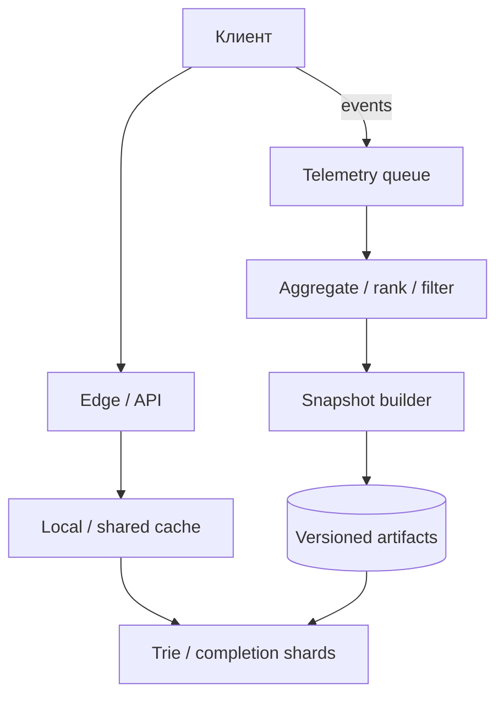
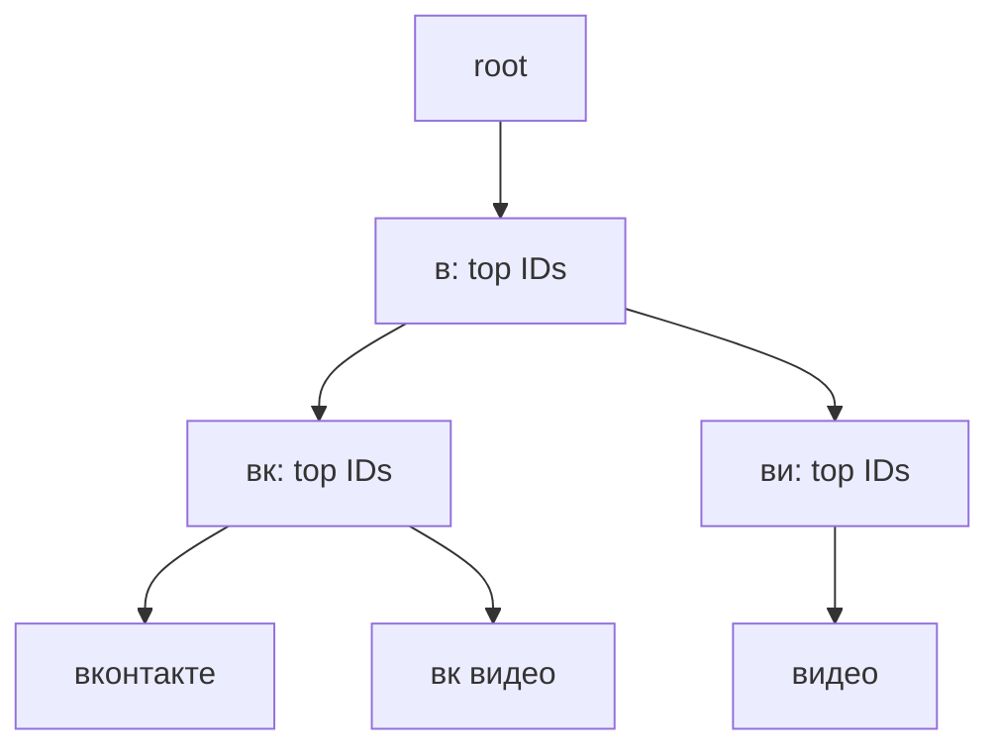
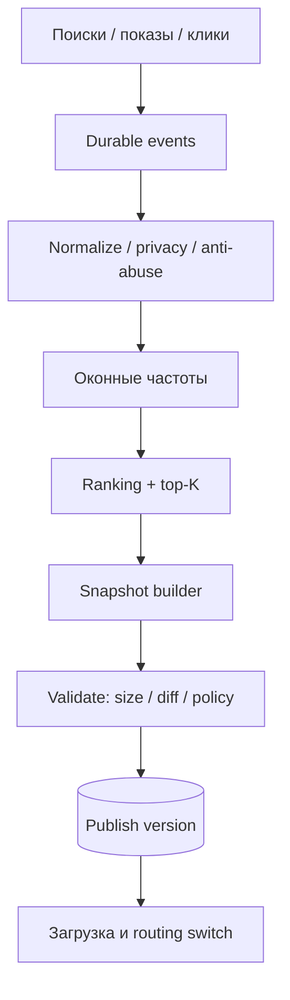
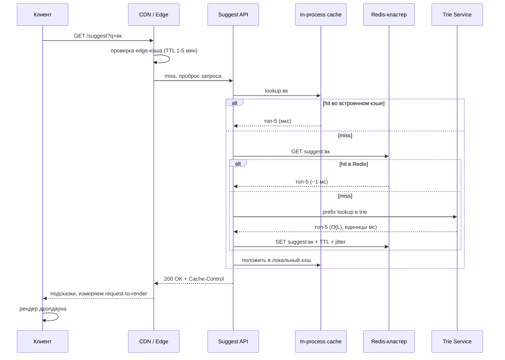

# Разбор задачи: поисковые подсказки (autocomplete / typeahead)

<!-- learning-nav:start -->
[← Все разделы](../README.md) · [Предыдущая тема](video-streaming.md) · [Следующая тема →](web-crawler.md)
<!-- learning-nav:end -->

> Классическая задача системного дизайна: «Спроектируй поисковые подсказки для Google / Яндекса / маркетплейса». Формулируется также как typeahead, search suggestions, «саджесты». Обманчиво простая снаружи, внутри — концентрат тем: структуры данных (trie), офлайн-пайплайны агрегации, кэширование горячих ключей, шардирование, персонализация и жёсткий latency-бюджет.

Задача любима интервьюерами, потому что за 45 минут проверяет сразу несколько компетенций: умеешь ли ты считать нагрузку, понимаешь ли разницу между online-путём (read path, <100 мс) и offline-путём (пересчёт топов), можешь ли выбрать между индексированным SQL, готовым completion-движком и собственной структурой под заданную нагрузку, и видишь ли узкие места до того, как тебя о них спросят.

---

## Как вести интервью: рамка

Опытные интервьюеры (в моках от тимлидов Яндекса и Ozon это звучит почти дословно) ожидают, что кандидат **сам ведёт процесс по шагам** и объявляет план вслух:

1. Формализация функциональных и нефункциональных требований.
2. Back-of-envelope оценка нагрузки (RPS, объём данных, трафик).
3. API (псевдокодом, без фреймворков).
4. High-level архитектура: компоненты и движение данных.
5. Модель данных: как физически хранятся подсказки.
6. Deep dive в 2–3 узких места по выбору кандидата или интервьюера.
7. (Бонус) Оценка железа и стоимости.

Два замечания из фидбэка на реальных моках, которые напрямую относятся к этой задаче:

- **Аргументируй каждый выбор технологии.** Фраза «возьмём Redis» без объяснения, почему именно Redis (in-memory, sorted sets, предсказуемая латентность), выглядит как гадание. Интервьюер специально давит: «а почему не PostgreSQL?» — и ждёт, что ты расскажешь про модель данных и её проблемы.
- **Сам озвучивай корнер-кейсы.** «А что будет, если один префикс станет мегапопулярным? А если кэш прогрет не будет? А если обновление trie упадёт посередине?» — если ты сам ставишь эти вопросы и тут же на них отвечаешь, это сильный сигнал seniority. Если ждёшь, пока спросят, — минус в карму.

---

## Уточняющие вопросы

Прежде чем рисовать первый прямоугольник, зафиксируй рамку. Хорошие вопросы (и зачем они):

- **Сколько подсказок показываем?** Обычно 5–10. От этого зависит, сколько топов хранить на узле trie.
- **Это глобальный поиск (Google) или вертикальный (маркетплейс, музыка, документы)?** У маркетплейса словарь на порядки меньше и есть категории; у глобального поиска — сотни миллионов уникальных запросов.
- **Матчинг строго по префиксу или нужны опечатки/fuzzy/матчинг в середине слова?** Префикс — одна задача (trie). «Содержит подстроку» и исправление опечаток — другая (n-gram индексы, SymSpell, FST с levenshtein-автоматами). В базовом разборе договорись: только префикс, fuzzy — опциональное расширение.
- **Персонализация нужна?** Сильно меняет дизайн: глобальный топ кэшируется идеально, персональный топ — почти не кэшируется.
- **Насколько свежими должны быть подсказки?** Допустим ли топ за вчера (daily batch) или нужны тренды за последний час (near-real-time)? Это определяет offline-пайплайн.
- **Мультиязычность?** Размер словаря зависит от запросов, а не только числа языков. Уточняем нормализацию, смешанные запросы и поведение IME до/после подтверждения ввода.
- **Какой масштаб?** DAU, поисков в день, география (один регион или мульти-DC).

Сильная формулировка: «Предлагаю начать с MVP: топ-5 подсказок строго по префиксу, глобальный топ без персонализации, свежесть — ежедневный пересчёт. Персонализацию и опечатки вынесу в расширения и вернусь к ним в deep dive, если останется время».

---

## Требования

### Функциональные

- По префиксу длиной от 1–2 символов возвращать топ-N (N=5..10) наиболее популярных запросов, начинающихся с этого префикса.
- Подсказки обновляются по мере набора текста (каждый новый символ — новый запрос, с debounce на клиенте).
- Популярность считается по истории реальных поисковых запросов пользователей.
- (Опционально) Персонализация: учёт истории самого пользователя.
- (Опционально) Тренды: повышенный вес свежим всплескам («зенит спартак сегодня»).
- Модерация и приватность: не публиковать персональные, чувствительные и запрещённые строки; срочное исключение должно работать быстрее daily rebuild.

### Нефункциональные

| Требование | Целевое значение | Почему |
|---|---|---|
| Latency (p99) | Цель < 100 мс request→render в выбранной сетевой когорте | Debounce и IME задержки считаем отдельно; backend budget, например 20 мс |
| Доступность | 99.9%+ | Read-only сервис, легко масштабируется репликами |
| Throughput | сотни тысяч RPS на пике | Запрос на каждый кейстрок |
| Свежесть данных | часы–сутки | Подсказки не обязаны быть real-time; топ запросов инертен |
| Консистентность | Версионированные снапшоты, eventual freshness | Срочное удаление и изоляция персональных данных требуют отдельного контракта |

Путь выдачи read-heavy: готовые топы читаются часто, обновление serving-артефакта происходит реже. Но ingestion пишет события каждого поиска/показа/клика — нельзя объявлять всю систему имеющей read:write 10 000:1, сравнивая разные единицы. Отделяем быстрый read path от агрегации и измеряем оба.

---

## Оценки нагрузки (back of envelope)

Считай вслух, округляй агрессивно, фиксируй допущения. Пример для «условного Google в одном регионе»:

**Запросы:**

- DAU = 100 млн, в среднем 5 поисковых сессий на пользователя в день → 500 млн поисков/день.
- Средний запрос 20 символов; принимаем 10 обращений на сессию после debounce и клиентского кэша. Это измеряемое допущение: trailing debounce 150 мс может вообще не сработать до конца быстрого непрерывного набора.
- Autocomplete RPS средний: `500 млн × 10 / 86 400 ≈ 60 000 RPS`.
- Пиковый коэффициент ×2–3 (вечерний прайм, новостные всплески) → **~150–200 тыс. RPS на пике**.

**Данные:**

- Принимаем 200 млн разрешённых кандидатов после frequency/privacy/moderation фильтров. Эти числа задаёт продукт и фактическая история, а не универсальное распределение поиска.
- 20 Unicode code points — не обязательно 20 байт: для кириллицы это часто ~40 байт UTF-8. Если на candidate приходится 64 байта текста/ID/score, payload словаря около 12.8 ГБ без allocator и индексов.
- Top-K в узлах может стоить больше словаря. Например, 500 млн узлов × 5 candidate IDs × 8 байт = 20 ГБ только IDs; score по 4 байта добавляет 10 ГБ. Плюс edges, offsets, строки, snapshots и serving overhead. Сжатие измеряем на реальном словаре, множитель ×3–5 заранее не гарантирован.
- Blue/green на одной машине требует памяти под старую и новую версии плюс кэш и запас; replicas умножают footprint. Если не помещается — грузим версию на отдельный пул и переключаем routing.

Короткие популярные префиксы — кандидаты для local/edge cache, но частотность и hit ratio проверяем по логам. Длинный префикс полезен для длинных запросов: произвольное отключение после 6–8 символов меняет продуктовый контракт, а не только экономит CPU.

---

## API

Два эндпоинта — один на получение подсказок, один служебный на телеметрию (не забудь его: без сбора сигналов система не обучается):

```text
GET /v1/suggest?q=вк&limit=5&lang=ru&region=...&model_version=...
→ 200 OK
{
  "query": "вк",
  "suggestions": [
    {"text": "вк", "score": 0.98},
    {"text": "вконтакте", "score": 0.91},
    {"text": "вк вход", "score": 0.74},
    {"text": "вк видео", "score": 0.61},
    {"text": "вк музыка", "score": 0.55}
  ],
  "cached": true,
  "took_ms": 8
}
```

```text
POST /v1/events        # телеметрия: показы и клики по подсказкам
{"session_id": "...", "shown": ["вк", ...], "clicked": "вк", "ts": ...}
```

Что проговорить интервьюеру про API:

- **Глобальный ответ кэшируем** по нормализованному prefix, locale/region, limit, model и policy version. Поля, меняющие выдачу, должны входить в cache key; персональную историю никогда не смешиваем с публичным cache.
- **`session_id`** связывает telemetry impressions/clicks. Персональный endpoint определяет пользователя по авторизованной сессии, имеет private/no-store cache policy; случайный session_id сам по себе авторизацией не является. Глобальный endpoint не включает session_id в публичный cache key.
- Версия API (`/v1/`) — подсказки будут A/B-тестироваться и меняться.
- Таймауты: если suggest-сервис не ответил за ~150 мс, клиент просто не показывает дропдаун. **Деградация graceful**: поиск работает и без подсказок. Это важная мысль — сервис не на критическом пути, что развязывает руки в дизайне.

---

## High-level design

Система распадается на два почти независимых контура: **online read path** (быстрый, тупой, read-only) и **offline data pipeline** (медленный, умный, пересчитывает топы). Такое разделение — главный архитектурный ответ этой задачи.



Проговори вслух:

- **Read path не содержит ничего умного.** Никаких вычислений топов в рантайме, никаких JOIN'ов. Запрос — это lookup по префиксу в заранее построенной структуре.
- **Offline path не влияет на latency пользователей.** Тяжёлая агрегация логов (сотни ГБ в день) идёт в Spark/Flink и выкатывается атомарно.
- **Обновление trie — blue/green**: новый снапшот загружается параллельно, переключение указателя — атомарно, старая версия выгружается. Падение сборки новой версии не трогает работающий сервис.

---

## Модель данных: trie и его эффективное хранение

### Почему trie

Trie хорошо соответствует prefix lookup: проход по рёбрам стоит `O(L)`, но сам поиск ещё не возвращает top-K бесплатно. Для этого храним готовый top либо обходим кандидатов. Сравниваем полную цену запроса, включая ranking и память:

| Структура | Механизм | Когда подходит |
|---|---|---|
| HashMap prefix → top-K | Предвычислить все нужные префиксы | Простой serving; большой объём ключей |
| B-tree SQL | Индексный prefix range + top по score | MVP или небольшой словарь; индекс/план зависит от collation |
| Completion suggester | Компактный специализированный индекс | Готовая эксплуатация, weights, fuzzy/contexts |
| Trie/radix/FST | Prefix traversal + готовые кандидаты | Контроль памяти, ranking и формата артефакта |

Обычный полнотекстовый запрос к Elasticsearch и его completion suggester — разные механизмы. В Elasticsearch есть специализированный completion API для autocomplete, поэтому отвергать весь движок как «не умеет префиксы» неверно. SQL с подходящим индексом и page cache тоже не означает обязательный disk I/O на каждый запрос. Сначала выбираем простейшее решение, которое выдерживает требуемый p99 на benchmark, затем усложняем.

### Trie с предвычисленным топом

Наивный trie хранит все запросы и частоты, а топ по поддереву считается на лету — это `O(размер поддерева)`, неприемлемо. Стандартный трюк: **в каждом узле храним предвычисленный топ-K (K=5–10) запросов из его поддерева**. Тогда ответ на запрос — спуститься по префиксу и вернуть готовый список: `O(L + K)`.



Топ в узле пересчитывается при каждой офлайн-сборке, поэтому в рантайме не нужно ничего сортировать.

### Проблема памяти и как её решают

Главный недостаток trie — «жадность» до памяти: каждый узел хранит map/массив указателей на детей (для кириллицы + латиницы + цифры — десятки указателей, большинство пустые). Приёмы по порядку применения:

1. **Ограничение глубины.** Не строим trie глубже ~30–50 символов: более длинные запросы — экзотика, которую можно отсечь или искать fallback'ом.
2. **Хранить топ выборочно.** Для остальных узлов задаём ограниченный обход/другой индекс либо явно возвращаем пустой ответ. Удалить top и сохранить обещание `O(L+K)` без другого механизма нельзя.
3. **Компактное представление детей**: sorted array вместо hash map (бинарный поиск по массиву из ~30 элементов быстрее, чем кажется, и не тратит память на бакеты).
4. **Radix tree (сжатое trie, Patricia)**: цепочки узлов с единственным ребёнком сливаются в одно ребро-строку (`в-к-о-н-т...` → одно ребро `"вконтакте"`). Экономию оцениваем на словаре и формате ссылок; встроенные top-K также могут доминировать в памяти.
5. **FST (Finite State Transducer)** — компактное представление словаря с outputs/weights, использующее общие эквивалентные пути. Конкретный builder и алгоритм top-K определяют память и скорость; не любой FST минимален и не любая реализация обязана быть immutable.
6. **Не хранить длинный хвост вообще.** При перекошенной популярности хвост может давать мало трафика; измеряем долю на своём корпусе. Запросы с частотой ниже порога не попадают в trie.

Сильная формулировка: «Материализую top-K ради дешёвого serving, а стоимость памяти, построения и частоту обновления оцениваю отдельно от потока телеметрии».

### Шардирование и репликация

- **По lexical ranges/prefix subtrees**: routing table распределяет поддеревья по измеренным размеру и QPS. Горячее поддерево можно разбить глубже; запрос короткого префикса, например «в», тогда требует заранее агрегированного top-K родителя либо fanout на дочерние shards. Consistent hashing сам по себе эту семантику не решает.
- **По candidate ID**: любой prefix query идёт на все shards, coordinator сливает local top-K. Это точный global top-K только при общем сопоставимом scoring и отсутствии поздней фильтрации, которая выбросит кандидатов. При дедупликации/разных бустах/персонализации нужны overfetch и проверка полноты candidate pool.
- **Репликация** увеличивает throughput чтения ценой памяти, доставки snapshots и прогрева. Горячий ключ распределяем между репликами и local caches; обычный hash-shard не разделяет нагрузку одного ключа.
- Routing table, normalization и snapshot version публикуются совместно. Иначе новый router спросит старый shard о диапазоне, которого тот ещё не обслуживает.

---

## Deep dive 1: офлайн-пайплайн сбора и пересчёта топов

Полная цепочка от сырого клика до новой версии подсказок:



Что важно рассказать на каждом шаге:

**Сбор сигналов.** Завершённый поиск — отдельное событие, ввод каждого префикса не равен намерению искать. Показы/клики содержат impression ID, позицию, model version и candidate IDs. CTR искажён позицией и текущим ranking: низкий CTR не доказывает бесполезность кандидата. Используем сглаживание, минимальный объём данных и контролируемые эксперименты, чтобы не зациклить усиление уже популярных подсказок.

**Нормализация.** Общая версионированная функция для ingestion и serving: валидный Unicode, выбранная NFC/NFKC, регистр по языковой политике и пробелы. Отдельно сохраняем display text. `ё/е`, исправление раскладки и transliteration — продуктовые правила, которые могут объединить разные строки; не включаем их вслепую. Фильтруем ботов, персональные данные и малые группы до публикации, а не только нецензурные слова.

**Частоты и окна.** Наивный подход — count за всё время — делает топ бессмертным: «вконтакте» не сдвинуть ничем. Поэтому:

- **Time decay**: `score = Σ count_i × w(t_i)`, где веса затухают экспоненциально (полураспад — недели). Новым всплескам легче пробиться в топ.
- **Оконная агрегация**: daily batch (Spark, полный пересчёт за 7–30 дней) + hourly micro-batch (Flink/Spark Streaming, инкремент за последний час) для трендов. Lambda-архитектура в миниатюре.
- **Тренды как отдельный сигнал**: `trend_score = (count_час + α) / (baseline_час + α)` с минимальным числом уникальных пользователей и ограничением boost. Запросы со всплеском («распродажа 11.11») временно доминируют в топе соответствующих префиксов.

**Top-K по префиксам.** Для каждого популярного запроса генерируем все его префиксы (запрос длиной L порождает L записей «префикс → запрос, score»), затем `GROUP BY prefix` + `TOP K BY score`. Это классическая MapReduce-задача, идеально параллелится.

**Сборка и выкатка.** Trie строится полностью офлайн (никаких инкрементальных апдейтов живого дерева — это источник багов и локов), валидируется (не опустел ли топ, нет ли запрещённых слов, разумный ли diff с прошлой версией), публикуется как иммутабельный артефакт и подхватывается шардами.

Частота пересчёта — честный trade-off:

| Режим | Latency обновления | Стоимость | Когда уместен |
|---|---|---|---|
| Daily full batch (Spark) | до 24 ч | Дёшево, просто отлаживать | Если допустима суточная свежесть |
| Hourly micro-batch | ~1 ч | Средне | Тренды, новостные всплески |
| Streaming агрегаты | секунды–минуты | Сложнее state, окна и late events; exact/approx по объёму | Для требований свежих трендов |

---

## Deep dive 2: latency < 100 мс и кэш горячих префиксов

Цель 100 мс задаём для request→render в конкретной сетевой когорте. Например, при RTT 50 мс, gateway 10 мс и render 10 мс остаётся около 30 мс на backend. В дальней мобильной сети RTT может уже превысить весь budget. Debounce 150 мс отдельно прибавляется к keypress→render; его нельзя спрятать внутри обещания 100 мс. Складывание отдельных p99 не вычисляет p99 всей цепочки — нужен end-to-end trace и нагрузочное измерение.



Уровни кэша и зачем каждый:

1. **Клиент (браузер/приложение).** Список top-5 для «вк» можно временно отфильтровать под «вко», но это не полный top-5 «вко»: подходящий кандидат мог быть шестым под «вк» и не попасть в ответ. Для точной выдачи делаем новый запрос; временный результат помечаем как provisional. Плюс HTTP-кэширование (`Cache-Control: max-age=60`) для глобальных подсказок.
2. **CDN/edge.** Глобальные (неперсонализированные) подсказки для мегапопулярных префиксов идентичны для всех пользователей региона — идеальный кандидат для edge-кэша с TTL в минуты. Срезает значительную долю трафика до своего DC — а с мобильных сетей это ещё и главный выигрыш в latency.
3. **In-process кэш** на инстансах suggest-сервиса: топ префиксов длины 1–2 (тысячи ключей, мегабайты памяти) — обслуживает огромную долю RPS за микросекунды.
4. **Redis** как общий кэш префиксов длины 2–4. KV-модель (`prefix → готовый топ-5 JSON`) — ни вычислений, ни сканов.
5. **Trie-сервис** — источник истины, in-memory, `O(L)`.

### Проблема горячих ключей (hot keys)

Это любимый follow-up интервьюеров, и здесь у autocomplete есть специфика: **каждый короткий префикс — потенциальный hot key**. Новостной всплеск («трамп», «олимпиада») способен дать миллионы RPS на один-два ключа — один Redis-шард не выдержит, даже если общий hit rate отличный. Стандартные приёмы (звучат на собеседованиях уровня staff):

- **Репликация горячих ключей**: кладём горячий префикс на все шарды/реплики кэша, приложение балансирует чтение между ними. Read-only данные — реплицировать дёшево.
- **Local fallback cache**: экстремально горячие ключи держим в памяти самого приложения, чтобы запросы вообще не доходили до Redis.
- **Детектирование**: метрики per-key QPS; ключи выше порога автоматически переводятся в «горячий» режим (репликация + локальный кэш).

### Cache stampede (thundering herd)

Вторая классическая ловушка: TTL горячего префикса истёк → тысячи конкурентных запросов одновременно пошли пересчитывать значение → trie-сервис задохнулся. Приёмы:

- **Request coalescing / singleflight**: при промахе только первый запрос идёт пересчитывать, остальные ждут его результат. В Go это `singleflight`, в Java — `CompletableFuture` на ключ.
- **TTL + jitter**: к TTL добавляем случайный разброс (например, 60с ± 10%), чтобы ключи не истекали синхронно.
- **Stale-while-revalidate**: можно временно отдать старый top, если его policy version ещё допустима. Для срочно запрещённой подсказки stale fallback запрещён: denylist проверяем после cache lookup.
- **Прогрев кэша**: при деплое/перезапуске или после падения кэш наполняется топом популярных префиксов до приёма трафика. Холодный кэш под полной нагрузкой — гарантированный stampede на trie-сервис.

### Деградация

Проговори явно: при перегрузке система деградирует вправо по диаграмме — сначала отключаем обращения к trie для длинных префиксов (отдаём только кэшированное), затем поднимаем TTL, в пределе — отдаём статичный предсобранный топ для коротких префиксов. Подсказки — не критичный путь: лучше отдать допустимый устаревший топ, чем не отдать ничего, но и «не отдать ничего» — приемлемый fallback (поиск-то работает).

---

## Deep dive 3: персонализация

Самый интересный архитектурный конфликт задачи: **персонализация убивает кэш**. Глобальный топ для префикса «вк» один на миллионы пользователей и кэшируется идеально; персональный топ у каждого свой — hit rate кэша рушится, а latency-бюджет никто не отменял.

Практичные решения по нарастанию сложности:

1. **Смешанная выдача (базовый вариант).** Берём глобальный топ-10 из кэша (без нового глобального ranking) и персональный мини-топ (2–3 кандидата) из отдельного персонального индекса, **мержим и реранжируем на лету**. Пользователь видит, скажем, 3 глобальных + 2 персональных подсказки.
2. **Персональный trie на пользователя** — не масштабируется (100 млн отдельных объектов trie обычно слишком дорого по overhead), но **персональная история последних запросов** в Redis (`user_id → последние 50 запросов`) — дёшево. Кандидат из истории добавляется в выдачу, если матчится по префиксу. «Я вчера искал "вк видео" — сегодня при наборе "вк" оно всплывёт выше».
3. **Когортная персонализация**: вместо «топ для конкретного Васи» — «топ для сегмента» (язык, регион, возрастная когорта, mobile/desktop). Сегментов сотни, а не миллионы — **кэш оживает**: ключ `suggest:ru:moscow:вк` вполне кэшируем. Это стандартный компромисс между качеством и стоимостью.
4. **ML-реранкинг**: кандидаты из глобального топа + персональных источников прогоняются через лёгкую модель (градиентный бустинг по фичам: глобальный score, кликал ли пользователь похожее, время суток, регион). Принцип из систем ранжирования: сначала дешёвый отбор кандидатов (сотни), потом точный реранкинг (десятки) — двухстадийная воронка держит latency, потому что тяжёлая модель работает только с верхушкой.

Что подчеркнуть интервьюеру: неперсонализированная выдача, идентичная для всех, — это не «недоделка», а осознанный baseline, на который персонализация наворачивается инкрементами. И у каждого инкремента своя цена по latency и кэшу. Сильный кандидат сам предлагает начать с когорт, а не с пер-юзерной модели.

Осторожно с корнер-кейсом: **персональная история чувствительна** (инкогнито, общие устройства, GDPR/152-ФЗ). Упомяни opt-out и TTL хранения истории — это дешёвые очки в глазах интервьюера.

---

## Trade-offs: сводная таблица

| Решение | За | Против | Вердикт для autocomplete |
|---|---|---|---|
| Trie in-memory | `O(L)` lookup, топ предвычислен | Память, пересборка целиком | Да, ядро read path |
| B-tree индекс в PostgreSQL | Просто, знакомо | Диск, неровная латентность, 200k RPS — дорого | Только для MVP/малого масштаба |
| Completion engine | Готовый completion/fuzzy/contexts | Эксплуатация и ограничения ranking | Полноценная альтернатива собственному trie |
| Глобальный топ + кэш | Максимальный hit rate, минимальный latency | Нет персонализации | Baseline |
| Пер-юзерная персонализация | Максимум релевантности | Убивает кэш, latency, приватность | Только через мердж с глобальным топом |
| Когортная персонализация | Кэш работает, заметный прирост релевантности | Грубее, чем пер-юзерная | Лучший баланс |
| Daily batch пересчёт | Просто, дёшево | Тренды запаздывают на сутки | Базовый вариант |
| Real-time top-K (Flink) | Тренды за минуты | Сложность, approximate алгоритмы | Только при доказанной ценности трендов |
| Хранить топ-K в узле trie | Чтение без сортировки | Память ×K на узел, пересчёт при апдейте | Да, K=5–10 |

---

## Красные флаги и типичные ошибки кандидатов

- **«Сохраним запросы в PostgreSQL и сделаем `LIKE 'prefix%'`»** — и на этом остановимся. Нужен план запроса, подходящая collation/индекс, ranking и измерения. Prefix range не даёт top по популярности автоматически; для substring бывают специализированные индексы, поэтому обещать неизбежный full scan тоже неверно.
- **Считать топ в рантайме.** «Пройдёмся по поддереву и отсортируем» — под узлом «в» живут миллионы запросов. Топ должен быть предвычислен офлайн.
- **Инкрементально обновлять живой trie на каждый поисковый запрос.** Локи, деградация, неконсистентность топов между узлами. Правильный паттерн: иммутабельный снапшот + blue/green переключение.
- **Игнорировать горячие ключи.** Кэш ≠ бесконечная масштабируемость: один мегапопулярный префикс убивает один шард. Интервьюеры целенаправленно давят на это, как только кандидат произнёс слово «кэш».
- **Забыть про клиента.** Debounce, отмена предыдущего запроса (race: ответ на «вк» пришёл позже ответа на «вко» и перезатёр дропдаун), локальное сужение списка, graceful degradation при таймауте — всё это часть дизайна, а не «фронтовые детали».
- **Персонализация в лоб** («построим trie на каждого пользователя») без разговора о кэше и стоимости.
- **Не посчитать нагрузку.** Если кандидат начал рисовать компоненты до оценки RPS и объёма словаря — интервьюер не знает, под какой масштаб он проектирует.
- **Неупомянутая модерация.** Подсказки генерируются из пользовательских запросов — без фильтрации топ по некоторым префиксам будет непечатным. Упоминание stop-list/модерации в пайплайне показывает production-опыт.

---

## Что спросят дополнительно (готовь ответы)

- **Как обновлять trie без даунтайма?** — Blue/green: новый снапшот грузится в память параллельно, атомарное переключение указателя, старый освобождается после завершения in-flight запросов. Для шардов routing закрепляет совместимую версию: обычный rolling update не обеспечивает общий snapshot.
- **Опечатки (fuzzy)?** — Отдельный механизм: SymSpell-словарь (удаление одного символа из всех популярных запросов), n-gram индекс, или Levenshtein-автомат поверх FST. Дороже по памяти и latency; включается с бюджетом кандидатов и минимальной длиной: слишком короткий fuzzy prefix даёт взрыв вариантов.
- **Мультиязычность?** — Отдельные языковые/региональные модели там, где это помогает ranking; mixed-language запросы требуют fallback. Unicode normalization и IME обрабатываем явно, раскладку не исправляем безусловно.
- **Как измерить качество подсказок?** — CTR подсказок, доля сессий, где подсказка была использована, экономия набранных символов (keystroke savings), MRR/nDCG по позиции кликнутой подсказки. Сигналы берутся из телеметрии `POST /events` — вот зачем он в API.
- **Zero-result префиксы?** — Negative cache с version/locale и коротким TTL. Монотонное «продолжение тоже пусто» верно только для строгого prefix match по тому же snapshot без дополнительных fallback/fuzzy и контекстных фильтров.
- **Борьба с накруткой?** — Дедупликация по сессии/пользователю в пайплайне, отсечение аномальных всплесков с одного источника, порог минимального числа уникальных пользователей для попадания в топ.
- **Мульти-региональность?** — Trie read-only и компактен: полная копия в каждом DC, сборка централизованная, доставка артефактов через object storage. Проблема только в трендах: они региональны — значит, scoring-пайплайн тоже региональный.
- **А если сделать подсказки для маркетплейса?** — Словарь меньше на 2 порядка, зато появляются категории («айфон» → предложить категорию «Смартфоны»), коммерческий буст (продвижение брендов в подсказках), инвентарь-фильтр (не подсказывать то, чего нет в наличии).

---

## Что говорить интервьюеру: шпаргалка сильных формулировок

- «Serving читает материализованные топы; отдельно считаю ingest событий, сборку артефакта и нагрузку выдачи».
- «Trie даёт `O(длина_префикса)`, независящий от размера словаря, и позволяет хранить предвычисленный топ прямо в узлах — чтение становится O(L + K)».
- «Сравниваю SQL prefix range, готовый completion suggester и собственный trie по ranking, памяти, p99 и стоимости эксплуатации».
- «Топ кэшируется по степенному закону: префиксы длины 1–2 — в процессе, 2–4 — в Redis, хвост — в trie. Горячие ключи реплицирую и выношу в локальный кэш, потому что один шард один мегапрефикс не выдержит».
- «TTL с jitter, request coalescing и stale-while-revalidate — потому что истечение TTL горячего префикса под 200k RPS без защиты устроит thundering herd».
- «Обновление — иммутабельный снапшот и blue/green: живой trie никто не мутирует».
- «Персонализация конфликтует с кэшированием, поэтому: глобальный топ как baseline, поверх — когорты или мердж с персональной историей, а ML — только реранкинг верхушки кандидатов».
- «Сервис не на критическом пути: при таймауте клиент просто не показывает дропдаун. Это позволяет быть агрессивным в кэшировании и спокойным в деградации».

---

## Вопросы и сценарии отказа

### 1. Почему одинаково выглядящие префиксы могут давать разный результат?

Unicode допускает разные последовательности code points с одинаковым видом: `é` может быть одним code point либо `e` с combining accent. Если builder нормализовал строки, а serving сравнивает сырые UTF-8 bytes, lookup расходится со словарём. Применяем одну версионированную normalization function к обучающим данным, запросу, cache key и shard routing; сохраняем исходную display form отдельно. NFC сохраняет canonical equivalence, NFKC дополнительно объединяет compatibility forms и может потерять нужные различия.

Code points, UTF-16 code units, UTF-8 bytes и видимые grapheme clusters — разные единицы длины. Emoji с modifier/ZWJ состоит из нескольких code points; разрезание по произвольному байтовому offset испортит строку. Ограничиваем bytes для безопасности API и отдельно определяем длину префикса для UX/индекса. Не считаем русский запрос из 20 символов автоматически 20-байтным.

Для IME не обязательно слать запрос на каждую промежуточную composition: согласуем поведение `compositionstart/update/end`, чтобы не нагружать сервис незавершённым вводом. Клиент передаёт sequence/query token и применяет ответ только к актуальному состоянию ввода: отменённый HTTP-запрос всё ещё может успеть вернуть ответ. Ошибка — исправить Unicode только на клиенте, оставив старые snapshots и cache keys в другом формате.

### 2. Как обновить шардированный индекс и срочно убрать запрещённую подсказку?

Snapshot имеет manifest: model version, normalizer version, shard ranges, checksums и policy version. Сначала загружаем и прогреваем все нужные shards нового поколения, проверяем completeness и capacity, затем переключаем routing. Запрос закрепляется за одним совместимым поколением; старое остаётся на время in-flight запросов и rollback. Local/Redis cache key включает model version, иначе новая модель продолжит читать старый top под прежним prefix.

Например, range «в» разделили между «вк» и «ви». Если router обновился первым, он отправит запрос на shard, у которого ещё старый layout. Если обновились только данные, короткий prefix может не собрать полный top. Manifest связывает layout и данные; short-prefix агрегаты строятся для того же поколения. При нехватке RAM blue/green запускаем на отдельном fleet, поскольку замена pointer не отменяет двойного footprint во время загрузки.

Срочное удаление не ждёт суточной пересборки: небольшой versioned denylist применяется после retrieval, включая cache hits и stale fallback. Берём K+reserve кандидатов или делаем bounded refill, иначе после фильтрации top-5 останется пустым, хотя ниже есть допустимые ответы. У denylist отдельный SLO распространения; rollback старой модели не откатывает запрет. Полные пересборки позже убирают кандидат из основного индекса.

### 3. На подумать: почему слияние локальных top-5 дало плохой глобальный top-5?

Два shards возвращают top-5 по глобальной частоте. Coordinator удаляет запрещённые строки и добавляет персональный boost. На первом shard первые пять запрещены, а шестой кандидат лучше всех результатов второго. Достаточно ли запросить только local top-5?

<details>
<summary>Разбор</summary>

При одинаковой итоговой функции score и отсутствии постфильтров каждый global top-K входит в local top-K своего shard: перед ним иначе находились бы K лучших глобальных кандидатов. Но здесь score изменяется после retrieval, а фильтрация убирает известных лидеров. Кандидат №6 вообще не дошёл до coordinator, поэтому точность потеряна.

Overfetch, например 50 кандидатов на shard, снижает риск, но сам по себе не доказывает exactness для произвольного boost и фильтра. Варианты: применять одинаковые фильтры/score на shards, использовать алгоритм с upper bounds и догрузкой либо честно ограничить качество candidate retrieval и измерять recall@K до reranking. Персональная модель не сможет поднять строку, которую ни один источник кандидатов не вернул. Опасный ответ — «top-K с каждого shard всегда достаточно», без условий о scoring и фильтрации.

</details>

---

<a id="источники-и-видео-по-теме"></a>

## Видео по теме

- [System Design Interview by Alex Xu](https://www.youtube.com/watch?v=YvIlYyp4Tgs) — обзор классических задач, включая autocomplete: trie, кэширование префиксов, ограничение длины, офлайн-обновление структуры из логов.
- [Algorithms You Should Know Before System Design Interviews](https://www.youtube.com/watch?v=xbgzl2maQUU) — trie как структура для префиксного поиска, стоимость памяти, radix/suffix-варианты.
- [Кэширование в интервью по системному проектированию с инженером Meta Staff](https://www.youtube.com/watch?v=1NngTUYPdpI) — hot keys и их репликация, local fallback cache, cache stampede / thundering herd, TTL и jitter, как говорить про кэш на интервью.
- [DB Indexing in System Design Interviews — B-tree, Geospatial, Inverted Index, and more!](https://www.youtube.com/watch?v=BHCSL_ZifI0) — почему B-tree годится для `starts with`, но не для `contains`; где место инвертированного индекса; как выбирать индекс под тип запроса.
- [Как построить систему ранжирования с нуля? Диванная аналитика #13](https://www.youtube.com/watch?v=QDLEL-L0Gb4) — поисковая воронка, клики как implicit-сигнал, путь от неперсонализированной выдачи к персонализации на исторических данных.
- [Теория кэширования — System Design](https://www.youtube.com/watch?v=Rk1w1ouzE58) — прогрев кэша после падения, инвалидация, уровни кэша (на русском).
- [Mock-собеседование по System Design от Team Lead из Яндекса](https://www.youtube.com/watch?v=9_8ShTF6aQA) — ожидания интервьюера: требования → нагрузка → API → архитектура → модель данных → железо; фидбек про аргументацию выбора технологий и самостоятельное озвучивание корнер-кейсов.
