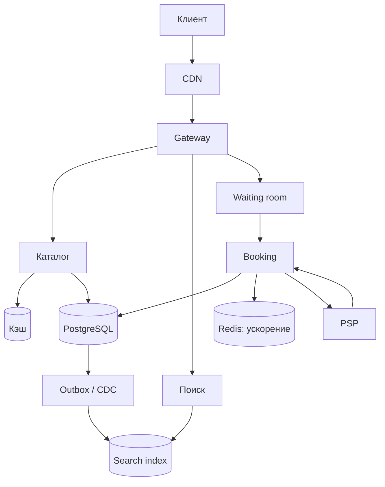
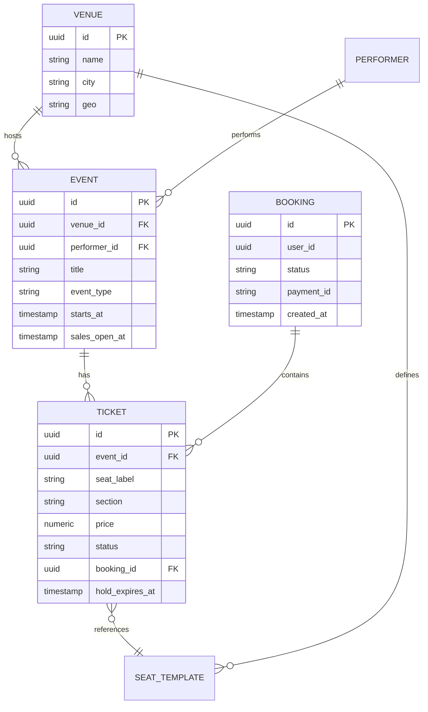
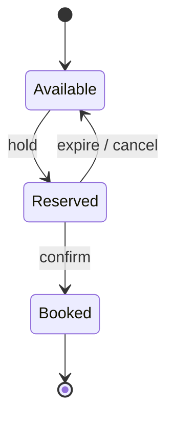
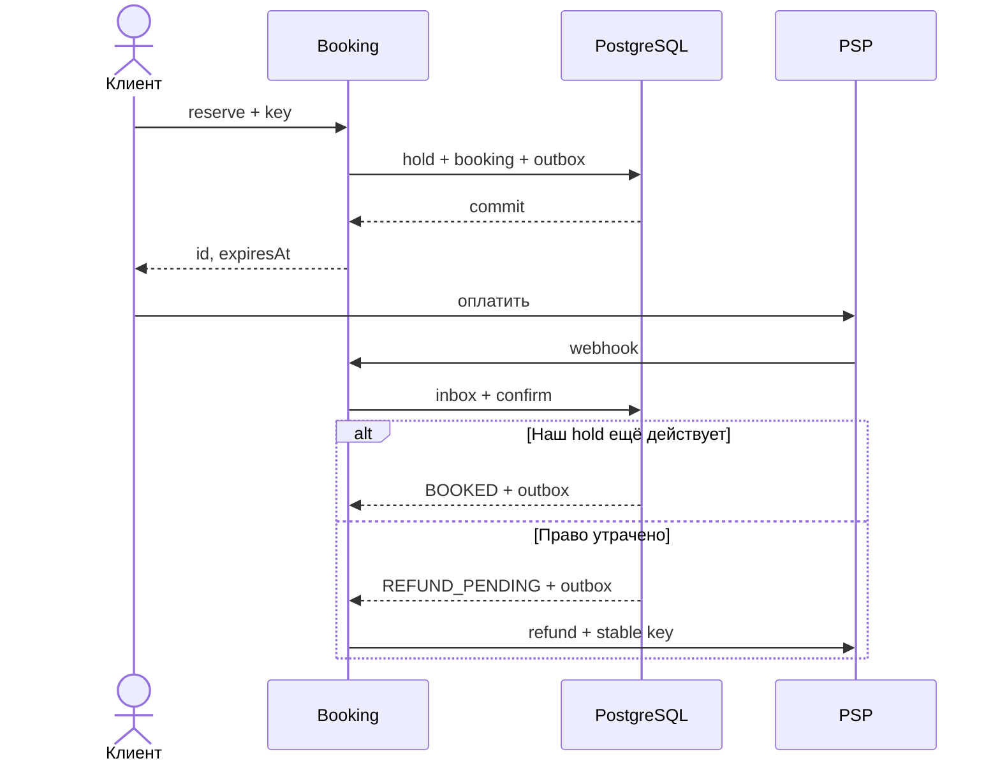
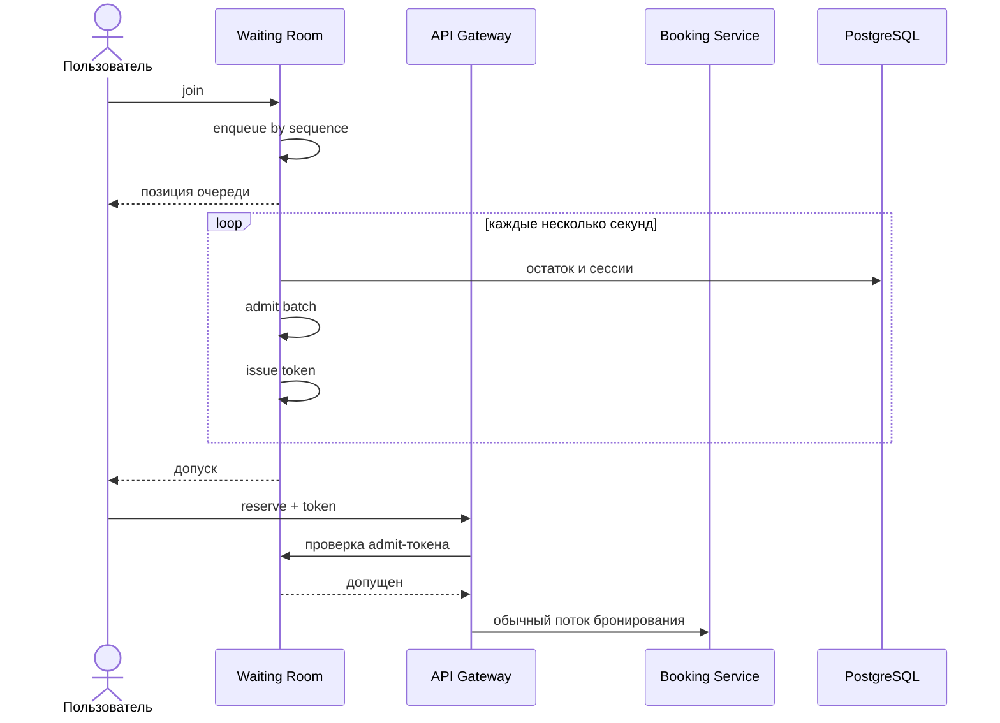

# Разбор задачи: бронирование билетов (Ticketmaster / кинотеатр)

<!-- learning-nav:start -->
[← Все разделы](../README.md) · [Предыдущая тема](ride-sharing.md) · [Следующая тема →](hotel-booking.md)
<!-- learning-nav:end -->

> Классическая задача на собеседованиях по System Design: спроектировать сервис бронирования билетов уровня Ticketmaster, Яндекс Афиши, Kassir.ru или BookMyShow. Она популярна у интервьюеров, потому что в одной системе собраны сразу несколько сложных тем: инвентарь с жёстким запретом на oversell, временные резервации (hold) с TTL, экстремальные пиковые нагрузки на старте продаж и виртуальные очереди ожидания. Здесь нельзя «просто накидать микросервисы» — надо уметь рассуждать о конкурентности и согласованности.

Задача звучит просто, но на деле это один из лучших способов проверить, понимает ли кандидат конкурентный доступ и консистентность. Хороший ответ уровня senior — это не перечисление технологий, а многослойная защита от двойного бронирования и честное обсуждение компромиссов.

---

## 1. Требования

### Уточняющие вопросы (задайте их первыми)

- Что за продукт: билеты в кино (тысячи сеансов, ~100–500 мест), концерты/стадионы (50 000+ мест, один ивент) или всё сразу?
- Пользователь выбирает конкретные места на карте зала или только категорию/количество?
- Можно ли бронировать несколько мест одним заказом? (Упростите: в рамках интервью часто договариваются, что места в одном заказе — из одной секции.)
- Нужен ли поиск событий (по названию, городу, дате, типу) или только страница события?
- Что происходит при неоплате резервации? Через какое время место возвращается в продажу?
- Какой масштаб: DAU, сколько событий, какой самый горячий сценарий (старт продаж на финал чемпионата мира)?
- Административные сценарии (добавление событий, площадок) — в scope или out of scope? Обычно out of scope: фокус на пользовательском пути.

### Functional requirements

В порядке пользовательского сценария:

1. Пользователи могут **искать события** (по ключевым словам, локации, типу, дате).
2. Пользователи могут **просматривать событие**: описание, площадка, исполнитель, карта мест с доступностью.
3. Пользователи могут **забронировать билет**: это двухфазный процесс — сначала резервация (hold) места на ~10 минут, затем оплата и подтверждение.

Сильный ход — сразу заметить, что бронирование двухфазное. Это знает любой, кто покупал билеты онлайн: выбираешь место → переходишь на оплату с таймером 10–15 минут → если не успел, место возвращается в продажу. Если кандидат рисует один endpoint «buy», интервьюер обычно сам подсказывает двухфазность — но лучше опередить его.

### Non-functional requirements

Главная ошибка кандидатов на этом шаге — выписать «масштабируемость, доступность, надёжность» и пойти дальше. Суть упражнения не в списке слов, а в том, **что делает именно эту систему сложной**:

- **Сильная согласованность на записи (booking path):** ни одно место не может быть продано дважды. Oversell недопустим — это бизнес-катастрофа, а не статистика в дашборде.
- **Высокая доступность на чтении (search/view path):** каталог и страницы событий могут быть eventually consistent. Событие, добавленное минуту назад, может не сразу попасть в выдачу — это нормально.
- **Резкие пики нагрузки:** старт продаж на популярное событие — десятки и сотни тысяч одновременных пользователей за тысячи мест. Обычный день и «час X» отличаются на порядки.
- **Соотношение чтение/запись ≈ 100:1 и выше:** смотрят и ищут на два-три порядка чаще, чем покупают.
- **Быстрый поиск:** p99 < 500 мс на поисковый запрос (зафиксируйте число — числовые SLA звучат сильнее абстракций).
- **Корректный жизненный цикл hold:** брошенная резервация обязана вернуться в продажу быстро (секунды, а не минуты) — каждая «зависшая» резервация на горячем ивенте это прямые потери.

При сетевом разделении резервировать имеет право только сторона с авторитетным инвентарём: лучше отказать, чем продать дважды. Кэш каталога может продолжать отвечать устаревшими данными. CAP описывает эту границу отказа, а не автоматически классифицирует любой SQL как CP, любой поиск как AP.

Out of scope (но упомянуть стоит — показывает широту мышления): возвраты и переносы билетов, динамическое ценообразование, антибот-защита, платёжный шлюз как отдельная система, email/push-уведомления, админка для организаторов.

---

## 2. Оценки нагрузки

Практический совет из моков: не делайте «оценки на салфетке» в начале интервью ради самих оценок — 5–10 минут умножений, после которых кандидат говорит «ну, система большая, надо масштабироваться». Это ничего не даёт ни интервьюеру, ни дизайну. Считайте тогда, **когда число влияет на решение**: нужен ли шардинг, поместится ли инвентарь в один Postgres, сколько инстансов Redis нужно.

Базовые цифры (возьмите как старт, скорректируйте по ответам интервьюера):

- 10 млн MAU, ~1 млн DAU; ~10 млн просмотров страниц событий/день → среднее ~120 RPS на чтение, пик ×10 ≈ **1–2k RPS на чтение** в обычный день.
- ~50k покупок/день → в среднем **< 1 RPS на запись**. Это число завершённых покупок: попыток hold, конфликтов, отмен и платежных событий будет больше.
- Хранилище: 100k активных событий × средний зал 2000 мест = **200 млн строк инвентаря мест**. Строка `seat`: ~100 байт → ~20 ГБ данных. Это ~20 ГБ только полезных данных: строки PostgreSQL, индексы, свободное место, WAL, реплики и бэкапы дадут больше. Сам объём не требует шардинга; throughput горячего события проверяем отдельно.
- Пиковый сценарий: старт продаж финала ЧМ. 80 000 мест, 1–2 млн желающих в первые минуты → **10–50k RPS на один ивент** на эндпоинтах карты мест и резервации. Вот ради этого сценария и существуют все интересные части дизайна.

Вывод из оценок, который надо озвучить: «Обычная нагрузка тривиальна, весь дизайн крутится вокруг двух вещей — запрещённого oversell и часовых пиков на горячих ивентах».

---

## 3. API

REST по умолчанию. Идём по функциональным требованиям — примерно один endpoint на требование:

```text
GET  /search?query=...&city=...&type=concert&date_from=...&date_to=...
     → список событий (все фильтры опциональны → query-параметры)

GET  /events/{eventId}
     → событие + площадка + исполнитель + карта мест со статусами

POST /bookings/reservations
     body: { ticketIds: [...] }
     header: Authorization: <JWT>          # userId берём из токена, НЕ из body
     → 201 { reservationId, expiresAt }  | 409 (место уже занято)

POST /bookings/{reservationId}/confirm
     body: { paymentId }                    # это ссылка, не доказательство оплаты
     → 200 { booking confirmed } | 410 (резервация истекла)

POST /payments/webhook                     # коллбек от платёжного провайдера
```

Два замечания, которые показывают зрелость:

- **userId не передаём в теле запроса.** Body можно подменить — тогда я бронирую «от имени» чужого userId. Идентичность — из JWT/session token в заголовке. На собеседовании это мелочь, но интервьюеры её замечают.
- Платёж — **фундаментально асинхронная** операция (внешние платёжные сети). Поэтому confirm часто реализуется через webhook: при создании платежа регистрируем callback URL, и провайдер сам дёргает нас по завершении. Webhook проверяем по подписи и привязке к нашему заказу, сумме, валюте; редирект клиента на success-page оплату не доказывает. При потере webhook запрашиваем статус PSP. Глубоко в устройство платёжного шлюза не ныряем — это отдельная задача (см. разбор Payment System).

---

## 4. High-level design



PostgreSQL хранит владельца hold и срок: Redis не является независимым реестром прав на место. На схеме платежный webhook идёт в Booking; приём и бизнес-обработка разделены надёжным inbox.

Логика построения на интервью: идём по API и добавляем компоненты.

- **Event Service** — по сути CRUD-читалка: join события + площадки + исполнителя + билетов, отдаёт страницу с картой мест. Редко меняющиеся данные (событие, площадка, исполнитель) — отличные кандидаты на кэш в Redis; динамическую часть кэшируем отдельно с коротким TTL/событийным обновлением и версией; её свежесть не даёт права на продажу.
- **Search Service** — преобразует фильтры в запрос к поисковому движку. В первом приближении можно показать «тупой» `SELECT ... WHERE name LIKE ...` по Postgres и честно сказать: «наивный full scan проверю по EXPLAIN/нагрузке; при необходимости добавлю FTS/pg_trgm или вынесу поиск». Такая осознанная отсрочка выглядит сильнее, чем молчаливая попытка всё сделать идеально сразу.
- **Booking Service** — stateless, горизонтально масштабируется; весь state (hold'ы, блокировки) выносим наружу, в Redis/БД. Нельзя хранить резервации в памяти инстанса: их несколько, и им нужен единый согласованный взгляд на инвентарь.
- **PostgreSQL** как основное хранилище: нужны ACID-транзакции и строгая целостность на пути записи, плюс связи один-ко-многим между сущностями. Спор «SQL vs NoSQL» здесь не разводим долго — обе семьи технологий сегодня умеют почти всё; аргументируем конкретными требованиями к транзакциям.
- **Waiting Room** — включается только для предзаданных горячих ивентов (подробнее в deep dive 4).

---

## 5. Data model



Ключевые проектные решения:

- **Билет — это экземпляр места на конкретное событие**, а не физическое кресло в зале. Одно и то же кресло C34 на разных ивентах — это разные билеты с разными id (естественный уникальный ключ: `(event_id, seat_label)`). Тогда «одно место = одна строка = один продавец», и инвариант «нет oversell» сводится к корректным переходам статуса одной строки.
- `status` у билета: `available → reserved → booked` (или `open → locked → booked` в терминах BookMyShow). `booked` — финал покупки; разрешённая отмена/перепродажа требует отдельного бизнес-процесса и версии билета.
- `hold_expires_at` — момент, когда резервация протухает. Появляется вместе со статусом `reserved` (см. deep dive 1).
- Уникальность продажи дополнительно страхуем констрейнтом: обычный `UNIQUE(event_id, seat_label)` для строки инвентаря ; если продажи хранятся отдельно, используем таблицу `sold_tickets(event_id, seat_label, booking_id)` с PK по `(event_id, seat_label)` — вторая вставка физически невозможна (см. deep dive 2).

---

## 6. Deep dive 1: hold / резервация с TTL

Проблема: пользователь выбрал место и ушёл на оплату. Статус `reserved` в БД проставлен. Пользователь бросил вкладку — что дальше? Без механизма возврата место останется зарезервированным навсегда, и на горячем ивенте это прямые убытки.

### Вариант A: cron-job (проходной уровень для middle)

Добавляем `hold_expires_at = now() + 10 минут`. Фоновая джоба раз в N минут делает:

```sql
UPDATE tickets
SET status = 'available', hold_expires_at = NULL, booking_id = NULL
WHERE status = 'reserved' AND hold_expires_at <= now();
```

Работает, но у senior-кандидата спросят про дельту: если место должно освободиться в 12:00, а джоба запускается в 12:04, то 4 минуты билет недоступен другим. На продаже стадиона за минуты — это тысячи зависших мест. Плюс сам cron ненадёжен: может опоздать, упасть, встать в очередь.

### Вариант B: неявная экспирация на чтении (lazily expired)

Истечение проверяется при новой попытке; cleanup-джоба для истории необязательна. Считаем место доступным, если:

```sql
SELECT * FROM tickets
WHERE event_id = $1
  AND (status = 'available'
       OR (status = 'reserved' AND hold_expires_at <= now()));
```

И резервация тоже идёт условным апдейтом:

```sql
UPDATE tickets
SET status = 'reserved', booking_id = $2, hold_expires_at = now() + interval '10 minutes'
WHERE id = $1
  AND (status = 'available'
       OR (status = 'reserved' AND hold_expires_at <= now()))
RETURNING id;
-- 0 строк → 409 Conflict: место уже занято
```

В примерах `now()` используется для краткости; в PostgreSQL это время начала транзакции. Для строгого deadline после ожидания блокировок берём актуальное время БД и фиксируем решение на сервере.

По сути это аналог «кэша с expiry»: протухшую блокировку трактуем как отсутствующую. Статус сам не меняется: следующий резервирующий атомарно перезаписывает владельца и срок. Финальное подтверждение обязано проверять того же владельца и неистёкший срок; одного `status <> booked` недостаточно. Минус подхода: модель данных становится неявной — «зарезервирован» теперь означает «status = reserved И hold_expires_at > now()», и эту связку двух полей надо держать в голове во всех запросах. В моке по BookMyShow именно это решение (метка времени `locked_at` вместо фоновой джобы) разобрали как основное — простое, без отдельных процессов и без отставания от реального времени.

### Вариант C: распределённая блокировка в Redis (distributed lock как hold)

Redis можно использовать для быстрого отказа или кэша hold, но для базового дизайна авторитетный hold остаётся в PostgreSQL. Устанавливаем короткий Redis lease с уникальным token:

```text
SET hold:{eventId}:{seatId} {token} NX EX 600
```

`NX` атомарен для этого ключа. TTL освобождает lease, но не отзывает уже исполняющийся код старого владельца. Потеря данных при failover, пауза процесса дольше TTL и подтверждение одновременно с expiry создают гонки даже без полного падения Redis. `DEL` без проверки token может удалить уже новый hold: используем атомарный compare-and-delete, а не отдельные GET и DEL.

В БД резервируем место условным UPDATE с `booking_id`, сроком и при необходимости версией. Только после коммита сообщаем об успешном резерве. Если Redis недоступен, можем работать через БД с ограничением admission rate либо временно запретить новые резервы; уже выданные DB-hold не исчезают. При падении после SQL-коммита повтор запроса находит ту же бронь по idempotency key.

Вариант **Redis-only hold** тоже возможен, если бизнес принимает утрату резервов и компенсации, но это осознанное ослабление обещания «держим место до expiresAt». Финальный SQL-инвариант исключает две продажи, но не исключает две оплаты. Авторизация с последующим capture уменьшает риск возвратов, не убирая необходимость разрешать неизвестный платёжный исход.

### Сравнение вариантов hold

| Подход | Точность возврата места | Сложность | Отказоустойчивость | Когда выбирать |
|---|---|---|---|---|
| Cron-job | до N минут опоздания | низкая | джоба — ещё один компонент, который надо следить | MVP, спокойные ивенты |
| Lazy expiry (SQL) | проверка по времени БД при захвате | низкая | зависит от доступности БД; cleanup не нужен для захвата | базовый вариант |
| Redis lease + SQL hold | быстрый отказ; срок проверяет БД | средняя | корректность сохраняется при потере Redis | только при измеренной пользе |

### Жизненный цикл места



При lazy expiry `Reserved → Available` логический: следующая транзакция может сразу переписать истёкший hold. Возврат после покупки — отдельный процесс, здесь не показан.

### Sequence: полный поток бронирования



Успешный confirm — одна транзакция: проверить подписанный результат/его привязку, заблокировать booking и все места в стабильном порядке, проверить `booking_id` и срок, продать весь набор, записать outbox. Повтор webhook возвращает прежний результат. Если refund только поставлен в очередь, пользователю сообщаем «возврат оформляется», а не «деньги возвращены».


---

## 7. Deep dive 2: защита от oversell (locks и optimistic concurrency)

Сценарий, который надо разобрать по кадрам: два запроса на одно место прилетают в одну миллисекунду. Оба делают `SELECT status`, оба видят `available`, оба делают `UPDATE` → двойная продажа. Классическая race condition. Сначала нужен корректный инвариант в БД; быстрый внешний слой добавляем при измеренной пользе.

### Слой 1: быстрый отказ на уровне приложения (Redis NX)

`SET ... NX EX` из deep dive 1 может отсеивать часть конкурирующих попыток до БД. Дёшево, быстро, но не является гарантией (сбой Redis, протухший ключ, ручное вмешательство).

### Слой 2: optimistic concurrency на уровне строки

Вместо пессимистичного `SELECT ... FOR UPDATE` — условный апдейт (compare-and-set в SQL):

```sql
-- вариант через статус
UPDATE tickets SET status='reserved', hold_expires_at=now()+interval '10 min'
WHERE id=$1 AND status='available';

-- вариант через версию
UPDATE tickets SET status='reserved', version=version+1
WHERE id=$1 AND version=$expected_version;
```

Ноль затронутых строк — условие уже не выполняется; проверяем replay той же команды и только затем возвращаем конфликт. Условный UPDATE всё равно берёт row lock и может ждать конфликтующую транзакцию. Критическая секция короткая, без PSP-вызовов; для набора мест возможны deadlocks, поэтому нужны стабильный порядок и retry всей транзакции.

### Слой 3: уникальный констрейнт как последний рубеж (non-negotiable)

Даже если вся логика выше дала сбой, БД должна физически запретить вторую продажу:

```sql
CREATE TABLE sold_tickets (
    event_id   uuid NOT NULL,
    seat_label text NOT NULL,
    booking_id uuid NOT NULL,
    sold_at    timestamptz NOT NULL DEFAULT now(),
    PRIMARY KEY (event_id, seat_label)
);
```

Вторая вставка → `duplicate key` → откат транзакции; refund нужен, если к этому моменту уже был подтверждён capture. Constraint — нормальный базовый механизм, а не костыль. Если инвентарь уже содержит единственную строку на место, условный переход и `UNIQUE(event_id, seat_label)` достаточны без дополнительной таблицы продаж. Если таблица продаж есть, её вставка и перевод инвентаря выполняются одной транзакцией. Redis добавляем по результатам измерений, а не как обязательный признак senior-ответа.

### Слой 4 (альтернативная школа): сериализация без локов — очередь на ивент

Из разбора BookMyShow есть иной подход к гонке: **убрать конкурентность физически**. Все запросы на бронирование маршрутизируются по `event_id` (например, `hash(event_id) mod N`) в партиции очереди, и каждая партиция обрабатывается последовательно, в один поток. Порядок снижает конкуренцию, но после rebalance, повторной доставки или паузы старого consumer возможны повторы/перекрытия. Нужны DB-инвариант, idempotency и при внешнем владении fencing; очередь сама по себе продажу не атомаризует.

Эволюция идеи (её полезно показать как ход рассуждения):

1. **Одна очередь на всё** — упорядочивает команды, но не обеспечивает exactly-once и может упереться в throughput: скорость обработки должна превышать скорость поступления, очередь растёт, запросы таймаутят, клиенты ретраят в хвост → коллапс. Single point of failure в придачу.
2. **Очередь-партиция на `event_id`** — параллелизм между ивентами, последовательность внутри ивента. DB-инвариант остаётся.
3. **Горячий ивент** (стадион, 80k мест): одна партиция всё равно горячая → шардируем дальше, по **секциям стадиона** (`(event_id, section)`). Продуктово это легально: на больших ивентах обычно нельзя купить места из разных секций одним заказом — и это ограничение продукта как раз даёт нам ключ шардирования. Хороший пример того, как продуктовое правило упрощает distributed-систему.
4. **Радикальный вариант** (как у IRCTC/железных дорог): забрать у пользователя выбор конкретных мест — система сама выделяет N мест в секции. Тогда борьба идёт за **счётчик остатка**, а не за конкретные id мест, нужен атомарный условный декремент `remaining >= N` и выделение конкретных мест в одной транзакции, плюс бонусом решается дефрагментация зала (система садит группы подряд). Для кино это неприемлемо, для стадиона — рабочая опция, и упоминание её показывает кругозор.

| Подход | Гарантия | Пропускная способность | Сложность | Подводные камни |
|---|---|---|---|---|
| Redis NX + констрейнт в БД | сильная (БД — истина) | высокая | средняя | окно двойных оплат при сбое Redis |
| Optimistic UPDATE (status/version) | сильная | высокая (короткая критическая секция в БД) | низкая | при экстремальной конкуренции за одну строку БД становится узким местом |
| `SELECT FOR UPDATE` (pessimistic) | сильная | ниже: длинные блокировки, риск deadlocks при мультиместных заказах | низкая | порядок захвата строк надо сортировать, иначе возрастает риск deadlock |
| Serializable isolation | сильная | низкая под конкуренцией: перезапуски транзакций | низкая | «перенесли проблему в Postgres» — законно, но медленнее |
| Очередь-партиция на event/section | сильная при DB-инварианте и dedup | высокая между партициями | высокая (инфраструктура, ребаланс при падении воркера) | горячая партиция, операционная сложность |

Замечание про deadlocks для мультиместных заказов: если резервируем несколько мест одним запросом с `FOR UPDATE`, всегда захватывайте строки **в отсортированном порядке id** — это снижает риск циклов при одинаковом порядке во всех путях. Дедлоки из других таблиц всё равно возможны: транзакцию надо уметь повторять.

---

## 8. Deep dive 3: virtual waiting room на старте продаж

Картина, которую стоит нарисовать интервьюеру: продажи на финал ЧМ открываются в 12:00. В 12:00:03 у системы 1 млн пользователей и 80 тысяч мест. Если всех пустить на карту мест, через секунды она посереет, 99% пользователей получат только фрустрацию (и DDoS нашему booking path устроят сами, тыкая «обновить»).

Решение — **виртуальная очередь ожидания (waiting room)** перед сервисом бронирования. И это место, где кандидату полезно «на минутку стать продакт-менеджером»: лучший ответ здесь не самый технически сложный, а тот, что чинит пользовательский опыт и снимает пик.



Детали реализации, которые стоит проговорить:

- **Очередь — Redis sorted set** с серверным порядковым номером входа. Часы разных клиентов/узлов и одинаковые timestamps не дают строгую справедливую очередь; номер выдаёт один авторитетный sequencer на событие. Для справедливости на старте часто добавляют рандомизацию: все, кто зашёл в первые N минут, перемешиваются — иначе очередь выигрывают боты с лучшим пингом.
- **Темп впуска** регулируется по состоянию системы: выпускаем следующую сотню, когда предыдущая довыбрала или когда число активных «допущенных» сессий упало ниже порога. Получаем управляемый, почти плоский профиль нагрузки на booking path вместо пика.
- **Допуск** — короткоживущий admit-токен (ключ в Redis с TTL ~10–15 минут), который Gateway проверяет перед пропуском запроса к карте мест и резервации.
- **Уведомление** пользователя — через SSE/long polling (см. deep dive 4): канал уже есть, переиспользуем.
- Waiting room включается **только для ивентов из заранее известного списка** (организатор помечает «ожидается ажиотаж» или система — по velocity продаж). Для киносеанса на вторник это бесполезная сложность.

Дополнительные барьеры на пике (упомянуть связкой):

- **Rate limiting на Gateway**: per-user лимиты на `/reservations` (например, N попыток/мин), чтобы ретраи и скрипты не добивали booking service.
- **Кэширование всего, что можно**: страница события, карта мест — через CDN/Redis с TTL в секунды (см. deep dive 4).
- **Деградация с честным UX**: лучше сказать «вы в очереди, позиция X», чем показать карту, на которой всё равно ничего не достанется.

---

## 9. Deep dive 4: пиковые нагрузки и чтение в реальном времени

### Проблема устаревшей карты мест

Пользователь открыл карту мест — данные актуальны на момент запроса. Через минуту половина «зелёных» мест уже зарезервирована другими. Пользователь кликает → 409. Неприятный UX, особенно на горячих ивентах, где состояние устаревает за секунды.

Варианты обновления карты:

| Подход | Задержка | Стоимость | Когда уместен |
|---|---|---|---|
| Ничего не делать (ошибка на клик) | — | ноль | спокойные ивенты; real-time оповещения всем зрителям карты добавляют fanout и могут мешать выбору |
| Long polling (30–60 сек висячий запрос) | близко к событию при немедленном ответе | постоянные запросы/соединения, нужны fanout и timeouts | пользователь на странице минуты — наш случай по умолчанию |
| SSE (Server-Sent Events) | < 1 сек | средне: постоянные соединения, stateful-сервис, тюнинг таймаутов на gateway/proxy | горячие ивенты, долгие сессии |
| WebSocket | < 1 сек | выше: двунаправленный канал, который нам не нужен | когда нужен канал клиент→сервер (не наш случай) |

Тонкий момент для интервью: поток данных здесь строго сервер→клиент, поэтому **SSE ложится лучше WebSocket** — не нужен двунаправленный протокол. Но любой постоянный канал делает сервис stateful (инстанс помнит, какие клиенты какой ивент смотрят, чтобы слать обновления только по нему) и требует, чтобы вся цепочка (gateway, LB, proxy) не рвала долгие соединения. На интервью достаточно назвать это, обозначить цену и не утонуть в деталях.

### Разгрузка чтения

Read:write ≈ 100:1, поэтому чтение разгоняем всеми слоями:

- **Redis-кэш событий**: `event:{id}` → событие+площадка+исполнитель. Меняются редко, инвалидируем при записи. Динамические статусы мест не кэшируем (или TTL 1–2 сек для горячих ивентов).
- **Поиск — Elasticsearch/OpenSearch**: инвертированный индекс по токенам названия/описания + гео-индексы + фильтры по дате/типу. Внутренний request cache движка закрывает частотные запросы сам.
- **Синхронизация Postgres → ES через CDC** (Debezium + consumer). Почему не «двойная запись из кода приложения»: надо самим разруливать гонки («первая запись упала — вторую не делаем», «вторая упала — ретраим или откатываем первую»). CDC читает журнал изменений БД и даёт однонаправленный, надёжный поток. Задержка секунды — допустимо, поиск у нас AP. Лимит на запись в ES здесь не страшен: события меняются редко (тысячи в день), batch/upsert выбираем по измерениям; consumer должен обрабатывать дубли и сохранять версию.
- **CDN для горячих GET**: результаты поиска и страниц событий кэшируются на 30–60 сек. Сверхпопулярные запросы («финал ЧМ») обслуживаются вообще с edge. Каверза: работает, пока мало вариантов запроса (город из списка, а не произвольные lat/lng) и нет персонализации выдачи — иначе cache hit rate схлопывается. Стоит озвучить интервьюеру несколько вариантов кэширования с их ограничениями — это производит впечатление сильнее, чем один «правильный» ответ.

### Про масштабирование записи

Если спросят «а как масштабируете БД?» — с числами из раздела 2: инвентарь ~20 ГБ, записей < 1 RPS в обычный день, пик — на один ивент, который шардирование не лечит (горячий ключ, а не горячий объём). Если всё же шардировать — ключ `event_id` (почти все запросы локальны ивенту) или `venue_id`/география, если запросы сильно геолокальны. Но правильный ответ обычно: **реплики на чтение + кэш, шардинг преждевременен**.

---

## 10. Trade-offs: сводная таблица

| Решение | За | Против | Вердикт для этой задачи |
|---|---|---|---|
| SQL (Postgres) как источник истины | ACID, уникальные констрейнты, условные апдейты из коробки | вертикальный потолок записи | да: объёмы и RPS записи это позволяют |
| Hold в Redis (NX/EX) | возврат мест в реальном времени, быстрый отказ | +1 компонент, окно риска при сбое | опциональная оптимизация поверх SQL hold |
| Очередь-партиции по event/section | снижает конкурентность, требует dedup и DB-инварианта | инфраструктурная сложность, горячая партиция | опция для стадионов; для кино избыточно |
| Serializable isolation | защита от аномалий изоляции, constraints и retries всё равно нужны | перезапуски транзакций, медленно под конкуренцией | законно упомянуть, не строить на этом систему |
| Waiting room | ровный профиль нагрузки, честный UX | сложность, нужен admit-механизм | да, но только для горячих ивентов |
| SSE для карты мест | актуальный UX | stateful-сервисы, настройка всей цепочки proxy | для горячих ивентов; иначе long polling |
| Кэш карты мест на CDN | снимает пик чтения | протухшие статусы мест | TTL в секунды, статусы доклеиваем отдельно |

---

## 11. Что спросят дополнительно (и куда это ведёт)

- **«Что если Redis упадёт посреди продаж?»** — SQL-hold сохраняется; снижаем admission и работаем через БД либо останавливаем новые hold. Redis-only вариант имеет другой SLA резервов и риск компенсаций.
- **«А если пользователь оплатил ровно в момент истечения TTL?»** — confirm и освобождение сериализуются в БД. При строгом deadline поздний успех идёт в refund. Grace period допустим, только если право на место заранее продлено атомарно до передачи новому владельцу; время начала оплаты само по себе не позволяет отнять чужой hold.
- **«Как защититесь от ботов/скальперов?»** — rate limits per user/IP, капча на входе в waiting room, рандомизация позиций в очереди, device fingerprinting. Сам по себе — отдельный deep dive.
- **«Идемпотентность резерваций?»** — ретрай клиента не должен создать второй hold: уникальный `(user_id, operation, idempotency_key)` связываем с booking и хэшем набора мест в одной транзакции. NX не идемпотентен как API: повтор вернёт отказ вместо прежнего успешного ответа, а после TTL создаст новый hold.
- **«Мультиместный заказ: частичный успех?»** — нет, все места одной транзакцией: либо весь набор зарезервирован, либо 409 целиком. Захват строк — в отсортированном порядке против deadlock.
- **«Как пользователь узнает, что его очередь подошла?»** — SSE/long polling, переиспользуем канал из deep dive 4.
- **«Возвраты билетов?»** — out of scope, но: обратный переход `booked → available` только административным действием с транзакцией, плюс событие для обновления кэшей/индексов.
- **«Почему не Redlock для надёжности блокировок?»** — Redlock не даёт бесплатных гарантий при network partitions и clock drift; в нашей схеме Redis-lock это оптимизация, а гарантия — констрейнт в БД, поэтому усложнять блокировочный слой нет смысла.

---

## 12. Красные флаги / типичные ошибки кандидатов

- **Один endpoint «купить билет».** Двухфазность (hold → confirm) — базовое знание домена; если не знаете, интервьюер подскажет, но минус к впечатлению.
- **Выписать «масштабируемость, надёжность, доступность» и пойти дальше.** Нужно сказать, *чем* эта система особенна: запрет oversell, пики на старте продаж, read-heavy профиль.
- **«Оценки на салфетке» в начале на 10 минут**, не влияющие на дизайн. Считайте там, где число меняет решение.
- **Проверить доступность SELECT'ом и затем UPDATE.** Это race condition по учебнику — ждут условный апдейт / лок / констрейнт, и точное объяснение инварианта.
- **Cron как единственный механизм expiry** без заданного SLA и восстановления после задержки.
- **Хранить резервации в памяти инстанса сервиса.** Инстансов несколько, state наружу.
- **Полагаться только на Redis-lock** как на гарантию от oversell: без констрейнта в БД у вас нет гарантии.
- **userId в теле запроса** — заметный минус по безопасности.
- **Kafka «потому что это мода»** на пути резервации: синхронный запрос-ответ здесь уместнее; очереди — для CDC, уведомлений и (опционально) сериализации запросов на горячие ивенты.
- **Шардировать БД «по привычке»** без чисел: 20 ГБ инвентаря не требуют шардинга, а горячий ивент он не лечит.
- **WebSocket для карты мест** без объяснения, зачем нужен двунаправленный канал (SSE достаточно).
- **Waiting room для всех ивентов подряд** — сложность без пользы; это инструмент для 0.1% горячих продаж.

---

## 13. Что говорить интервьюеру (сильные формулировки)

- «Разобью систему на два пути: read-path (поиск/просмотр) — высокая доступность, eventual consistency; write-path (бронирование) — сильная согласованность, лучше отказать, чем продать дважды».
- «Бронирование двухфазное: hold на 10 минут, затем подтверждение. Hold храню в SQL с владельцем и expiresAt; истёкший hold можно перезахватить условным UPDATE. Redis — ускорение».
- «Защиту от oversell делаю многослойной: Redis-lock для быстрого отказа, условный UPDATE как optimistic concurrency, и уникальный констрейнт в БД как финальную гарантию. БД — единственная точка истины».
- «Cron для истечения резерваций оставляет дельту в минуты — на старте продаж это тысячи зависших мест; поэтому экспирация ленивая на чтении или через TTL в Redis».
- «Пик на старте продаж не решается масштабированием booking path — он решается waiting room: впускаем пользователей партиями, профиль нагрузки становится управляемым».
- «Поток данных к клиенту однонаправленный, поэтому для живой карты мест возьму SSE, а не WebSocket — и честно назову цену: stateful-сервисы и настройку таймаутов на всей цепочке прокси».
- «Средняя нагрузка и 20 ГБ полезных данных сами по себе не требуют шардинга. Горячий event_id тоже не делится простым hash-sharding по event_id: сначала admission control и анализ конкуренции, затем возможное разбиение по секциям».
- «Для стадионов могу предложить радикальный вариант: система сама выделяет места в секции — боремся за счётчик остатка, а не за конкретные места, а стратегия выбора может уменьшать число одиночных пустых мест».

---

## 14. Практические вопросы и задачи на отказ

### 1. Как подтвердить заказ на три места и не получить частичную продажу?

В одной транзакции блокируем booking и три ticket в отсортированном порядке. Проверяем, что найдено ровно три разных места, все относятся к нужному событию, все принадлежат этому booking и hold не истёк. Дубли ID из тела запроса нормализуем до проверки количества. Проверяем сумму, валюту и provider payment ID по серверной записи, а не по присланному клиентом `paymentId`.

```sql
UPDATE tickets
SET status = 'booked', hold_expires_at = NULL
WHERE id = ANY(:ticket_ids)
  AND status = 'reserved'
  AND booking_id = :booking_id
  AND hold_expires_at > :decision_time
RETURNING id;
-- Ожидаем N строк. Иначе ROLLBACK всей транзакции.
-- Затем BOOKED у booking и запись outbox, COMMIT.
```

`decision_time` получаем из часов БД после захвата блокировок; старое время начала долго ожидавшей транзакции может неверно продлить hold. Успех HTTP или уведомление отправляем после коммита. Если PSP уже списал, а транзакция не может подтвердить весь набор, создаём единственный refund с собственным ключом; временная недоступность БД требует повторной проверки, а не немедленного вывода «мест нет».

Частая ошибка — три независимых UPDATE с autocommit или проверка только `status != booked`: это продаёт половину группы либо позволяет старому владельцу подтвердить новый чужой резерв.

### 2. На подумать: старый webhook после нового hold

A держал C34 до 12:10. В 12:10:01 B получил новый hold. В 12:10:02 пришёл успешный webhook платежа A, инициированного в 12:09. Можно ли продать место A и удалить Redis-ключ?

<details>
<summary>Разбор</summary>

Нет: право A уже закончилось. Подтверждение должно проверять booking owner и expiry в той же SQL-транзакции, где меняется место. Атомарный условный UPDATE A затронет ноль строк. Деньги A переводим в `REFUND_PENDING`; B сохраняет резерв. Прежний Redis token A не должен удалять token B — compare-and-delete проверяет владельца.

Если бизнес хочет больше времени на оплату, до истечения срока переводим бронь в ограниченное `PAYMENT_PROCESSING` с новым deadline и одновременно меняем право на места. Это не бесконечное продление: зависшая или неизвестная оплата требует заданной политики. Альтернатива — авторизация карты, commit продажи и затем capture; неуспешный capture потребует отмены продажи по бизнес-правилам. Ни один порядок шагов не создаёт общей атомарной транзакции с банком.

</details>

<a id="источники-и-видео-по-теме"></a>

## Видео по теме

- [System Design: проектируем Ticketmaster, систему бронирования билетов](https://www.youtube.com/watch?v=zxeR5bfsNOg)
- [System Design of a Ticket Booking System: BookMyShow](https://www.youtube.com/watch?v=ohdu6TUoE5s)
- [How to Prevent Duplicate Booking | System Design FAANG Interview | Redis Distributed Locks Explained](https://www.youtube.com/watch?v=KCVlt6Su_eQ)
