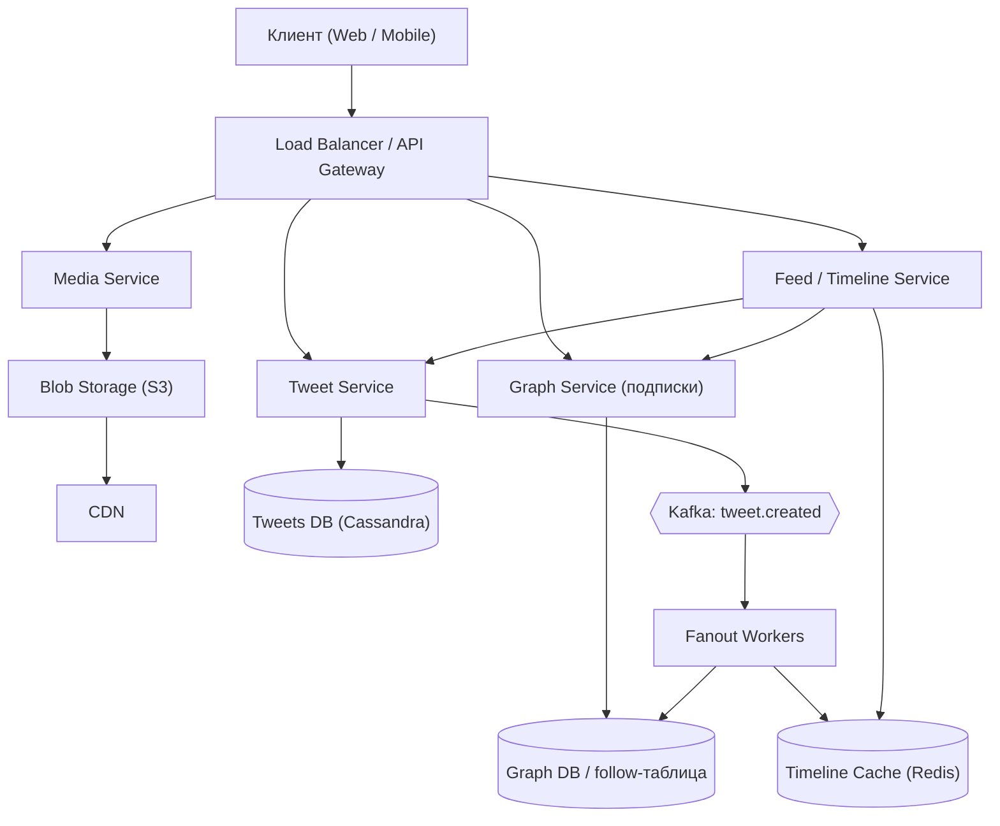
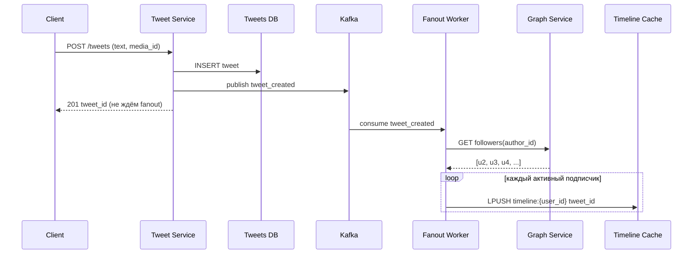
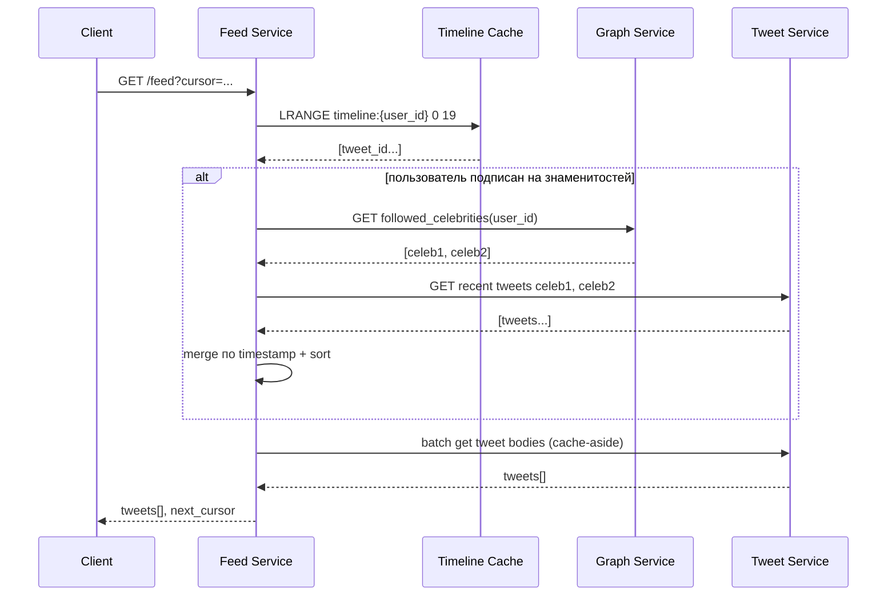
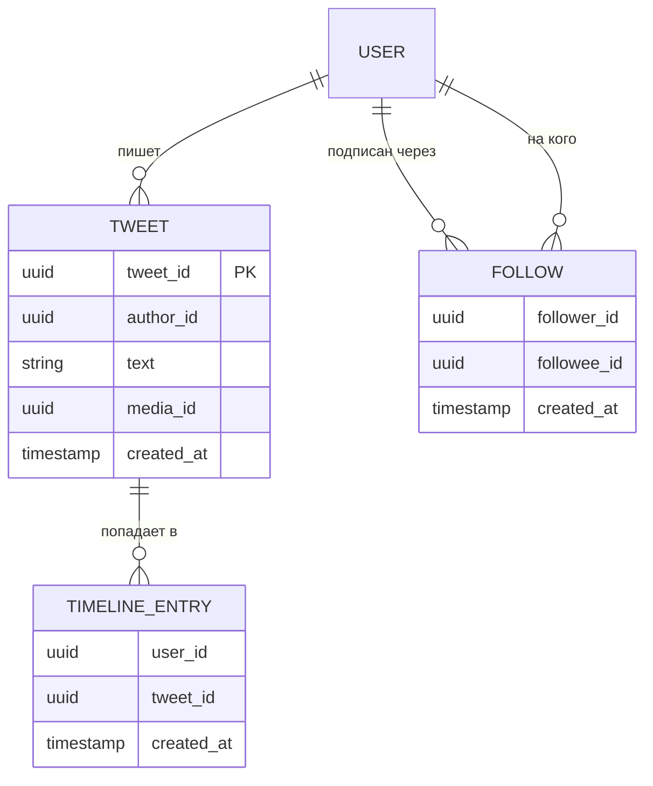
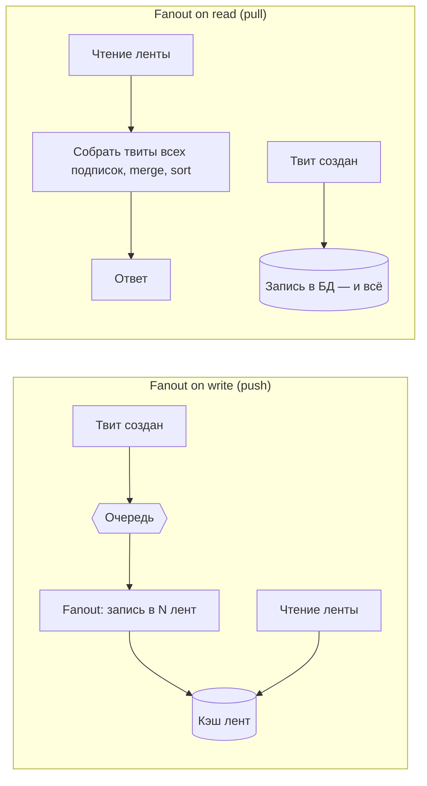
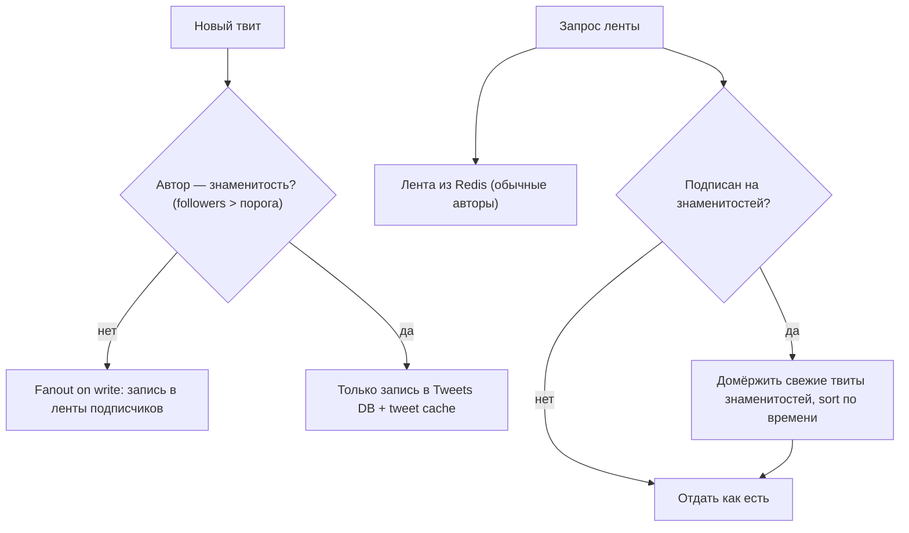

# Разбор задачи: лента новостей Twitter/X

> Классика system design интервью. Задача встречается в формулировках «спроектируй Twitter», «спроектируй ленту Instagram/VK», «спроектируй news feed». Ядро задачи одно и то же: **fanout on write vs fanout on read, celebrity problem, кэширование timelines**. Именно на этом сервисе генерации ленты вы проведёте большую часть интервью — интервьюеры прямо говорят, что на задачах про соцсети «застревают» именно здесь, и суммарная оценка строится по тому, как вы рассуждаете об узких местах, а не по тому, как красиво вы расписали CRUD API.

---

## Уточняющие вопросы (первые 5 минут)

Прежде чем рисовать хоть один квадратик, зафиксируйте рамку. Вопросы, которые стоит задать вслух:

- **Что входит в scope?** Публикация твитов + просмотр ленты. Лайки/ретвиты/комментарии/поиск — чаще всего выносим за скобки («предлагаю оставить за рамками и вернуться, если останется время»).
- **Какие виды ленты?** Home timeline (твиты тех, на кого подписан) — основной кейс; user timeline (профиль пользователя) — вторичный. Рекомендательную ленту «Для вас» на первом проходе упрощаем до «лента из подписок», чтобы не утонуть в ML.
- **Формат твита?** Текст до 280 символов + опционально одно медиа (картинка/видео). Кстати, хороший small talk: лимит в 140 символов исторически шёл от SMS (160 символов минус 20 на username).
- **Сколько пользователей?** Целимся в ~100–200 млн DAU.
- **Какая активность?** Важный подвох: люди читают в разы чаще, чем пишут. В моках кандидаты часто берут «10 твитов на пользователя в день» — интервьюер сразу поправляет: реалистичнее **1 твит в 5 дней** на среднего пользователя, и **~5 открытий ленты в день**. Отсюда read:write ≈ 25:1 — это главный вывод этапа оценок.
- **Требования к задержке?** Лента должна открываться за 1–2 секунды. Доставка нового твита в ленты подписчиков — **eventual consistency**, допустим лаг в ~5 секунд. Это ключевая уступка, которая разрешает асинхронный fanout.
- **Доступность?** 99.9–99.99% (от часов до ~часа простоя в год).
- **Гео?** Для простоты — один регион, мульти-регион оставляем как follow-up.
- **Хранение старых данных?** Храним всё; холодные твиты можно складывать на дешёвое железо — никто не листает ленту до пятилетней давности.

### Требования: итог

**Functional:**
- Пользователь может опубликовать твит (текст ≤ 280 символов + до 1 медиа).
- Пользователь может подписаться/отписаться от другого пользователя.
- Пользователь может просмотреть свою home timeline с пагинацией (пачки по ~20 твитов).

**Non-functional:**
- Read-heavy: чтений на порядки больше, чем записей.
- Низкая латентность чтения ленты: p99 < 1–2 с.
- Eventual consistency на доставку твита в ленты (≤ 5 с).
- Высокая доступность: 99.9%+; потеря твита недопустима, устаревшая лента — допустима.
- Масштабирование до сотен миллионов пользователей.

---

## Оценки нагрузки (back-of-the-envelope)

> **Важный совет из моков:** не считайте всё подряд. Типичная ошибка кандидата — «я помню формулы, сейчас посчитаю каждую метрику», а потом эти числа никак не используются. Считайте только то, что реально понадобится на этапе проектирования, и в конце покажите: «вот зачем нам было это число». Интервьюер скорее пометит бесполезные вычисления как избыточность, а вы ещё и потратите время.

Исходные допущения:

- DAU = 100 млн
- 1 твит на пользователя в 5 дней → 20 млн твитов/день
- 5 открытий ленты на пользователя в день, страница = 20 твитов
- Размер твита (id + author_id + текст + timestamp + media_id) ≈ 0.5 КБ
- Картинка в среднем ≈ 1 МБ; пусть ~10% твитов с медиа

**Запись:**

```
Твитов в день      = 100M × 1/5              = 20M/день
Write RPS (средн.) = 20M / 86 400            ≈ 230 RPS
Write RPS (пик)    = 230 × 2–3               ≈ 700 RPS
Трафик записи      = 230 × 0.5 КБ            ≈ 115 КБ/с (текст)
Хранилище          = 20M × 0.5 КБ            ≈ 10 ГБ/день ≈ 3.6 ТБ/год (текст)
Медиа              = 20M × 10% × 1 МБ        ≈ 2 ТБ/день
```

**Чтение:**

```
Открытий ленты/день = 100M × 5               = 500M/день
Read RPS (средн.)   = 500M / 86 400          ≈ 5 800 RPS (запросов страниц ленты)
Read RPS (пик)      ≈ 17 000 RPS
Трафик чтения       = 5 800 × 20 × 0.5 КБ    ≈ 58 МБ/с
```

**Выводы, которые нужно озвучить интервьюеру:**

1. Система **перекошена в сторону read**: ~5.8K RPS чтения против ~230 RPS записи (25:1). Значит, оптимизируем путь чтения — и это главное оправдание fanout on write.
2. 230 RPS записи — нагрузка смешная, любой один инстанс её выдержит. Проблема не в записи самой по себе, а в том, **сколько работы порождает одна запись** (fanout).
3. Текстовые данные компактны (ТБ в годы), медиа — отдельная история (blob storage + CDN).

---

## API

Ничего неожиданного, REST + CRUD. **Не расписывайте схемы до уровня полей SQL** — прямо уточните у интервьюера: «можем пропустить детальное описание API и перейти к сложным местам?» Оценка строится на fanout/celebrity, а не на REST-ручках.

```
POST   /v1/tweets                     { text, media_id? }           → tweet_id
POST   /v1/media                      (binary upload)               → media_id
GET    /v1/feed?cursor=<token>&limit=20                             → tweets[], next_cursor
POST   /v1/users/{id}/follow
DELETE /v1/users/{id}/follow
```

Детали, которые стоит упомянуть:

- **Двухэтапный постинг медиа**: сначала загружаем картинку отдельным запросом, получаем `media_id`, затем создаём твит со ссылкой на него. Стандартный паттерн: не блокирует публикацию на аплоаде, позволяет переиспользовать загруженное при ретраях.
- **Пагинация — cursor-based, не offset**. Offset-пагинация на живой ленте даёт дубли и пропуски (лента сдвигается под вами). Курсор = `(timestamp, tweet_id)` последнего отданного твита.

---

## High-level design



Компоненты:

- **Tweet Service** — source of truth для твитов. Владеет схемой и данными (Cassandra), даёт API `get by tweet_id`, `get tweets of user`. При создании твита пишет в БД и публикует событие в Kafka.
- **Graph Service** — хранит граф подписок: `follower_id → followee_id` и обратный индекс «кто мои подписчики». Именно к нему fanout-воркеры идут за списком получателей твита.
- **Fanout Workers** — консьюмеры Kafka. Для каждого нового твита: получить подписчиков автора → дописать `tweet_id` в начало timeline-кэша каждого подписчика.
- **Timeline Cache (Redis)** — прекомпьютed home timeline на каждого активного пользователя: список `tweet_id`, отсортированный по времени. Чтение ленты = один lookup.
- **Feed / Timeline Service** — сборка ленты на чтении: кэш + домёрживание твитов знаменитостей + fallback в Tweet Service.
- **Media Service + S3 + CDN** — бинарный контент. CDN разгружает origin и режет латентность на картинках.

Почему Kafka, а не синхронный вызов: очередь — это буфер, который сглаживает всплески (твиты часто создаются пачками), и даёт at-least-once доставку в fanout. Клиенту отвечаем сразу после записи твита в БД — fanout случится асинхронно, и это консистентно с нашим NFR на eventual consistency (≤ 5 с).

---

## Поток публикации твита (fanout on write)



Ключевые моменты, которые стоит проговорить:

- Ответ клиенту — **до** fanout. Лаг доставки твита в чужие ленты прячем в eventual consistency.
- Одна запись порождает N записей в кэш, где N — число подписчиков. При среднем N ≈ 200–500 это 230 RPS × N ≈ **50–100K обновлений кэша в секунду** — вот настоящая нагрузка системы, а не 230 RPS записи.
- Кэш храним не бесконечный: держим последние ~20–100 твитов (LRU/LTRIM). Пользователи редко уходят дальше первой страницы; те, кто долистал до 21-го твита, — редкий кейс, для него есть fallback (см. deep dive по кэшированию).

---

## Поток чтения ленты (гибрид: кэш + merge знаменитостей)



Заметьте: в кэше лежат только ID и timestamp, тела твитов добираем batch-запросом через cache-aside (кэш отдельных твитов полезен и для внешних встраиваний, и для просмотра твита с ответами).

---

## Модель данных



**Хранилище твитов.** Главный паттерн чтения — «твиты автора, отсортированные по времени» и «твит по id». Join'ы не нужны, объёмы — ТБ в год, write-heavy на вставку. Идеальный кандидат — **Cassandra** (или ScyllaDB): партиционируем по `author_id`, кластерный ключ `created_at DESC` (лучше — снежок-подобный `tweet_id`, который сам монотонен по времени). Реляционка с шардированием по `author_id` тоже честный вариант — в одном из разборов кандидат выбрал PostgreSQL + Mongo, и это приняли: важно обоснование, а не бренд БД.

**Граф подписок.** Можно начать с простой таблицы `follows(follower_id, followee_id)` с двумя индексами (в обе стороны: «мои подписки» и «мои подписчики»). Отдельная graph DB (Neo4j, или in-house решение) оправдана на масштабе: социальный граф — это ещё и фундамент для рекомендаций «кого почитать» и антифрода.

**Timeline cache (Redis).** На пользователя — список (или ZSET с score = timestamp) последних `tweet_id`, ключ `timeline:{user_id}`. Шардируем Redis по `user_id`. Оценка памяти: 200 млн активных пользователей × 100 ID × ~8 байт ≈ **160 ГБ** + оверхед структур — уже распределённый кластер, а не один инстанс. Поэтому храним таймлайны **только активных** пользователей (см. deep dive).

**Профили пользователей.** SQL: структурированные атрибуты, ACID, аналитика по джойнам — здесь реляционка уместна без вопросов.

**Холодные данные.** Твиты старше N лет — на дешёвое железо/объектное хранилище; скорость доступа к ним не критична.

---

## Deep dive 1: Fanout on write vs fanout on read

Это центральный trade-off задачи. Проговорите оба подхода **до** того, как интервьюер спросит.

**Fanout on read (pull):** лента собирается в момент запроса.

```
SELECT * FROM tweets WHERE author_id IN (SELECT followee_id FROM follows WHERE follower_id = :me)
ORDER BY created_at DESC LIMIT 20
```

Логически просто, но на 100+ млн DAU с тысячами подписок на пользователя это означает: на каждое открытие ленты — чтение списка подписок, fan-in по тысяче авторов, сортировка, мёрж. 5.8K таких запросов в секунду — БД не выдержит, латентность не уложится в NFR.

**Fanout on write (push):** при публикации твита асинхронно дописываем его ID в прекомпьютed ленту каждого подписчика. Чтение = O(1) lookup в кэш.



| Критерий | Fanout on write (push) | Fanout on read (pull) |
|---|---|---|
| Латентность чтения | O(1), один lookup в кэш — молниеносно | Тяжёлый запрос: fan-in + merge + sort |
| Стоимость записи | N обновлений кэша на твит (N = подписчики) | O(1) — просто INSERT |
| Celebrity | Катастрофа: 75–100 млн обновлений на один твит | Не проблема вообще |
| Мёртвая работа | Ленты считаются и для тех, кто не зайдёт | Работа только по факту запроса |
| Данные для неактивных | Зря занимают память в кэше | Ничего не храним |
| Сложность чтения | Простая | Сложная |
| Консистентность ленты | Лаг fanout (секунды) | Всегда свежая |

Сильная формулировка для интервью: «Наши оценки показали read:write ≈ 25:1, поэтому мы выбираем fanout on write как базовую стратегию — мы платим работой на записи, чтобы чтение было O(1). Но у push-модели есть известная дыра — celebrity problem, и мы закроем её гибридом».

Отметьте и обратную сторону push: если 60% пользователей не открывают ленту ежедневно, часть fanout — впустую. Это смягчается тем, что мы генерируем ленты только для активных (например, заходивших за последние 30 дней), но честно назовите это wasted work.

---

## Deep dive 2: Celebrity problem и гибридный подход

Проблема: у условного Илона или Дрейка десятки миллионов подписчиков (в разборах фигурируют 75 и 100 млн). Каждый их твит = **75–100 млн обновлений кэша** из одного события. Fanout-воркеры захлебнутся, лаг доставки для всех остальных пользователей вырастет на порядки. При этом большая часть этих подписчиков не откроет ленту сегодня — работа почти вся впустую.

**Решение — гибрид push + pull:**

- Для обычных пользователей — fanout on write (как раньше).
- Для знаменитостей (порог подписчиков, например > 10K–100K — настраиваемая граница) — **не делаем fanout вообще**. Их твиты лежат в Tweet Service (и кэше твитов — популярные твиты почти наверняка уже закэшированы).
- На чтении Feed Service мёржит: `лента из кэша (обычные авторы)` + `свежие твиты знаменитостей, на которых подписан юзер`, сортировка по timestamp.



Тонкости, за которые дают плюсы:

1. **Оптимизация флагом.** На чтении проверять «подписан ли юзер на кого-то из знаменитостей» — тоже запрос. Докрутка: при первой подписке на любую знаменитость ставить пользователю флаг `follows_celebrity = true`; кто не подписан — для них мёрж не делаем вовсе. Интервьюеры в моках отмечали это как «очень круто, что ты заметил».
2. **Таймстемп последнего мёржа.** Храним в кэше рядом с лентой метку `T(i)` — когда последний раз домёрживали знаменитостей. Если запрос пришёл через 5 секунд — можно смело отдать кэш без похода в Tweet Service; если прошло 5–10 минут — домёрживаем. Это гасит повторные запросы от скроллящих пользователей.
3. **Порог знаменитости — динамический.** Пользователь пересёк 10K подписчиков → переводим его в режим pull. Проблема переходного периода (его старые твиты уже в ленте подписчиков) решается сама собой: кэш живой, старые записи вымываются LTRIM.
4. **Альтернатива из моков — инвалидация вместо записи.** При твите знаменитости не писать в ленты, а инвалидировать кэш подписчиков; следующий читатель промахнётся в кэш и соберёт ленту сам. Слабое место: знаменитости постят чаще обычных, инвалидация порождает лавину cache miss'ей, и проверка «есть ли среди моих подписок знаменитость» при каждом чтении всё равно нужна. Гибрид с флагом чище.

**Где кандидаты ошибаются:** либо не видят проблему вообще (пока интервьюер не подсветит — «а что будет, если у пользователя миллион подписчиков?»), либо предлагают чистый pull для всех, убивая главное преимущество — быстрое чтение. Правильный ход — самостоятельно назвать проблему ещё на этапе требований («в системе есть проблема знаменитости, с ней надо что-то делать»), а решение показать в deep dive.

---

## Deep dive 3: Кэширование timelines

Сквозная тема, которая решает, уложимся ли мы в p99 < 1 с.

**Сегментация пользователей (из разбора Twitter-дизайна):**

- **Active** (заходили недавно, ~200 из 500 млн) — их ленты прекомпьютed и лежат в Redis. Fanout пишет только им.
- **Passive** (не заходили давно) — ленту не храним: зачем держать в памяти данные того, кто не придёт? Когда такой пользователь наконец заходит, Timeline Service собирает ленту на лету: Graph Service → список подписок → Tweet Service → их свежие твиты → merge по timestamp → **положить результат обратно в Redis** (пользователь стал активным) → отдать. Первый запрос медленный, последующие — из кэша.
- **Live** (онлайн прямо сейчас) — можно вообще не ждать, пока они запросят ленту: fanout-воркер, обновляя кэш живого пользователя, кидает событие обратно в Kafka → сервис нотификаций → WebSocket в приложение → «у вас новые твиты». Это UX-вишенка, упомяните в конце, если останется время.

**Сколько твитов держать в кэше:** 20–100 последних. Вопрос интервьюера из мока: «а что, если пользователь долистает до 21-го твита?» Ответ: идём в Tweet Service за следующей страницей по курсору (твиты подписок по хронологии) и докладываем в кэш. Таких запросов мало — подавляющее большинство не уходит дальше первой страницы.

**Эвикшн:** LRU. Важный нюанс из разбора: свежесть важнее популярности — твит с миллиардом просмотров, но годичной давности, никто не хочет в ленте.

**Чего кэш не решает сам по себе:** если 19 из 20 твитов страницы в кэше, а один — нет, мы всё равно идём на диск, и один «тормозящий» твит портит UX всей страницы. Поэтому кэшируем **целиком собранные страницы ленты** (списки ID), а не только отдельные твиты, а тела добираем batch'ем. Кэш снижает латентность, шардирование тоже снижает латентность (меньше данных на запрос) — это разные рычаги, не путайте их с рычагом пропускной способности (реплики на чтение).

**Событие follow/unfollow:** пользователь подписался на кого-то нового → его лента должна обновиться (домёржить свежие твиты нового автора). Тот же асинхронный механизм: событие в очередь → воркер обновляет кэш. Лаг в 5–10 секунд здесь допустим — проговорите это.

**Конкурентные обновления кэша:** два fanout-воркера пишут в одну ленту одновременно — потенциальные гонки. Решения: партиционирование Kafka по `user_id`-получателю (один консьюмер на партицию = последовательная обработка), либо идемпотентные операции (ZADD с score=timestamp вместо LPUSH — дубли не страшны). Это частый follow-up вопрос.

---

## Deep dive 4: Ранжирование ленты

На первом проходе договоритесь: **лента хронологическая**, merge по `created_at`. Это честный MVP, и интервьюеры его принимают. Но вопрос «а как бы вы ранжировали?» почти гарантирован — приготовьте ответ двумя уровнями.

**Уровень 1 — эвристический скоринг (то, что можно обосновать за минуту):**

```
score = w1 · freshness(tweet)        # экспоненциальное затухание по возрасту
      + w2 · engagement(tweet)       # лайки, ретвиты, ответы (нормированные, log-шкала)
      + w3 · affinity(reader, author) # как часто читатель взаимодействовал с автором
      + w4 · media_boost(tweet)      # видео/картинки удерживают дольше
```

Можно ранжировать прямо в Feed Service поверх кандидатов из кэша: взяли 100–500 последних ID, посчитали score, отдали топ-20. Счётчики engagement — отдельный сервис на Redis (INCR) с периодическим сбросом в БД.

**Уровень 2 — как это делается по-настоящему (упомянуть для strong senior-сигнала):**

- **Candidate generation**: из ~миллиардов твитов отбираем ~тысячу кандидатов — из подписок (in-network) и из рекомендаций (out-of-network, коллаборативная фильтрация по графу).
- **Heavy ranker**: ML-модель предсказывает P(лайк), P(ретвит), P(ответ), P(прочитает ответы) — итоговый score = взвешенная сумма вероятностей. (Реальный Twitter выложил свою систему в опенсорс в 2023 — именно такая двухстадийная схема.)
- Для собеседования ML-детали не нужны: важно показать, что вы понимаете архитектурный паттерн «грубый отбор кандидатов → тонкое ранжирование», и что ранжирование живёт **поверх** fanout-механики, а не вместо неё.

**Trade-off ранжированной ленты против хронологической:** ранжирование повышает engagement, но ломает простоту кэша (персонализированный порядок на каждый запрос дороже), ухудшает предсказуемость для пользователя («куда делся твит, который я видел?») и требует ML-инфраструктуры. Честно скажите: начал бы с хронологии, ранжирование — следующая итерация продукта.

---

## Trade-offs: сводная таблица

| Решение | Выбрали | Альтернатива | Чем платим |
|---|---|---|---|
| Доставка в ленты | Fanout on write | Fanout on read | Запись дороже на N подписчиков; wasted work на неактивных |
| Знаменитости | Гибрид (pull на чтении) | Чистый push / инвалидация кэша | Мёрж на чтении + флаг follows_celebrity |
| Консистентность | Eventual (≤ 5 с) | Синхронный fanout | Пользователь не сразу видит твит в чужой ленте |
| Хранилище твитов | Cassandra, шард по author_id | Шардированный PostgreSQL | Нет join'ов; событ. консистентность |
| Timeline | Redis, только активные | Полный pull на чтении | Память; холодный старт для passive |
| Порядок ленты | Хронология | ML-ранжирование | Меньше engagement из коробки |
| Пагинация | Cursor | Offset | Нельзя «прыгнуть на страницу N» |

---

## Отказоустойчивость и масштабирование (короткий блок в конце)

- **Сервисы stateless** → горизонтальное масштабирование новыми инстансами за балансировщиком.
- **БД шардируем** по `author_id` (твиты) и `user_id` (кэш лент), реплицируем; очередь реплицируется из коробки (Kafka replication factor 3).
- **Kafka как буфер**: всплеск публикаций не роняет fanout — воркеры разгребут с лагом.
- **CDN** разгружает S3 по медиа и режет латентность картинок.
- Рост 100M → 300M пользователей: добавляем шарды (consistent hashing, чтобы не ребалансировать всё), добавляем консьюмеров Kafka (перепартиционирование).

> **Где кандидаты плавают:** на вопрос «как будете шардировать и реплицировать БД?» многие отвечают неуверенно. Подготовьте внятный ответ: шард-ключ, consistent hashing / диапазонные шарды, read-реплики, лидер-фейловер. Отдельная тема — почитайте шпаргалку по шардированию.

---

## Красные флаги / типичные ошибки кандидатов

- **Считать все метрики подряд** и не использовать ни одну в дизайне. Каждое число должно где-то «выстрелить» (read:write → fanout on write; размер твита → оценка кэша).
- **Завышать write-нагрузку**: «10 твитов на юзера в день» — нереалистично; интервьюер поправит, и это будет выглядеть как отсутствие здравого смысла. Пользователи в основном читают и лайкают.
- **Расписывать CRUD API детально**, а на celebrity problem ответить «ну, запишем везде». Интервьюеру интереснее ваши рассуждения о сложном месте, чем схема полей. Прямо спросите: «можем пропустить детали API и перейти к главной проблеме?»
- **Не назвать celebrity problem самостоятельно.** Это известный маркер: сильный кандидат подсвечивает её ещё на требованиях.
- **Чистый pull для всех** («просто селектом соберём») — не пройдёт NFR по латентности на 100M DAU.
- **Кэшировать всё для всех**: ленты пассивных пользователей в Redis — сотни ГБ мёртвой памяти.
- **Offset-пагинация** на живой ленте.
- **Забыть про мусорное медиа**: пользователь загрузил картинку, отвлёкся, твит не опубликовал — файл висит вечно. Решения: временное стейджинг-хранилище с ежедневной зачисткой неприкреплённых (выбирайте его, если нет требования дедупликации) или reference counting (заодно даёт мгновенный «аплоад» дублей — в современном Twitter уже загруженная картинка прикрепляется мгновенно, потому что никуда не загружается). Если выбрали два стореджа — ответьте на follow-up: «клиент смотрит в оба, либо сторедж-сервис сам резолвит».
- **Забыть финальное резюме.** В конце подытожьте: «вот требования, вот главные проблемы — celebrity, eventual consistency, read-heavy; вот как решили; масштабирование обеспечили шардированием». Интервьюер мог отвлекаться, а резюме — это ваш вердикт самому себе.

---

## Что спросят дополнительно (follow-up вопросы)

- Как обновляется лента при **follow/unfollow**? (асинхронно через очередь, лаг 5–10 с)
- Как обеспечить **идемпотентность fanout** при ретраях Kafka? (партиционирование по получателю, ZADD вместо LPUSH, dedup по tweet_id)
- Что будет при **падении Redis**? (rebuild ленты pull-механизмом из Tweet Service — кэш не source of truth)
- Как хранить **счётчики лайков** на 100M DAU? (Redis INCR + шардирование по tweet_id, периодический flush)
- Как сделать **поиск по твитам**? (отдельный пайплайн: CDC → Elasticsearch/OpenSearch)
- Как устроить **мульти-регион**? (твиты реплицируются между DC, ленты считаются локально; гео-шардирование по пользователю)
- Как работает **ретвит**? (новая сущность-ссылка на tweet_id + автора, fanout как у обычного твита)
- Как бороться со **спамом/ботами** в fanout? (rate limiting на публикацию, фильтрация до fanout — спамный твит, разошедшийся на миллион лент, дорого отзывать)
- Как доставлять **нотификации live-пользователям**? (WebSocket/long-polling сервис, события из fanout)

---

## Источники и видео по теме

- [МОК-интервью по System Design / Проектируем ленту Twitter](https://www.youtube.com/watch?v=ZCDFbrpk3WM)
- [Дизайн Twitter — Интервью по системному проектированию](https://www.youtube.com/watch?v=o5n85GRKuzk)
- [Twitter System Design / System Design Interview Question](https://www.youtube.com/watch?v=EkudBdvbDhs)
- [System Design Interview Walkthrough: Design Twitter](https://www.youtube.com/watch?v=Nfa-uUHuFHg)
- [Designing INSTAGRAM: System Design of News Feed](https://www.youtube.com/watch?v=QmX2NPkJTKg)
