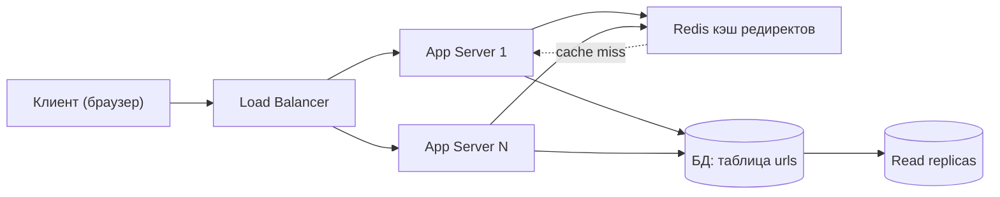
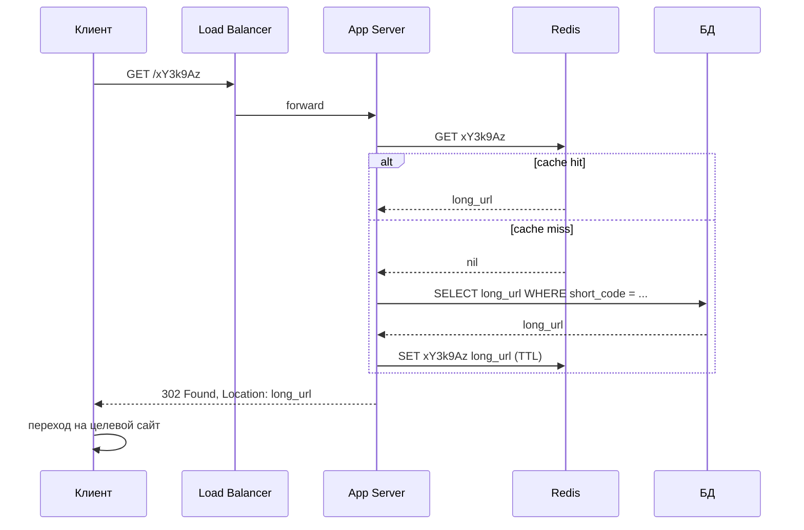
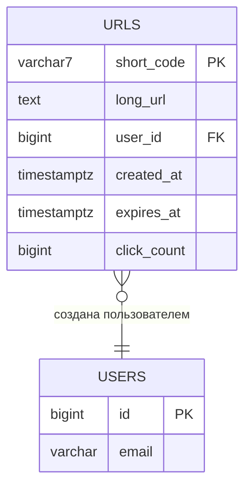
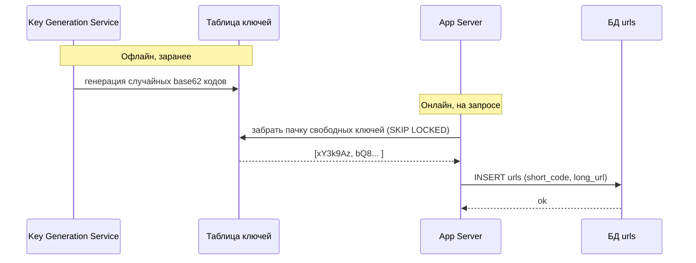
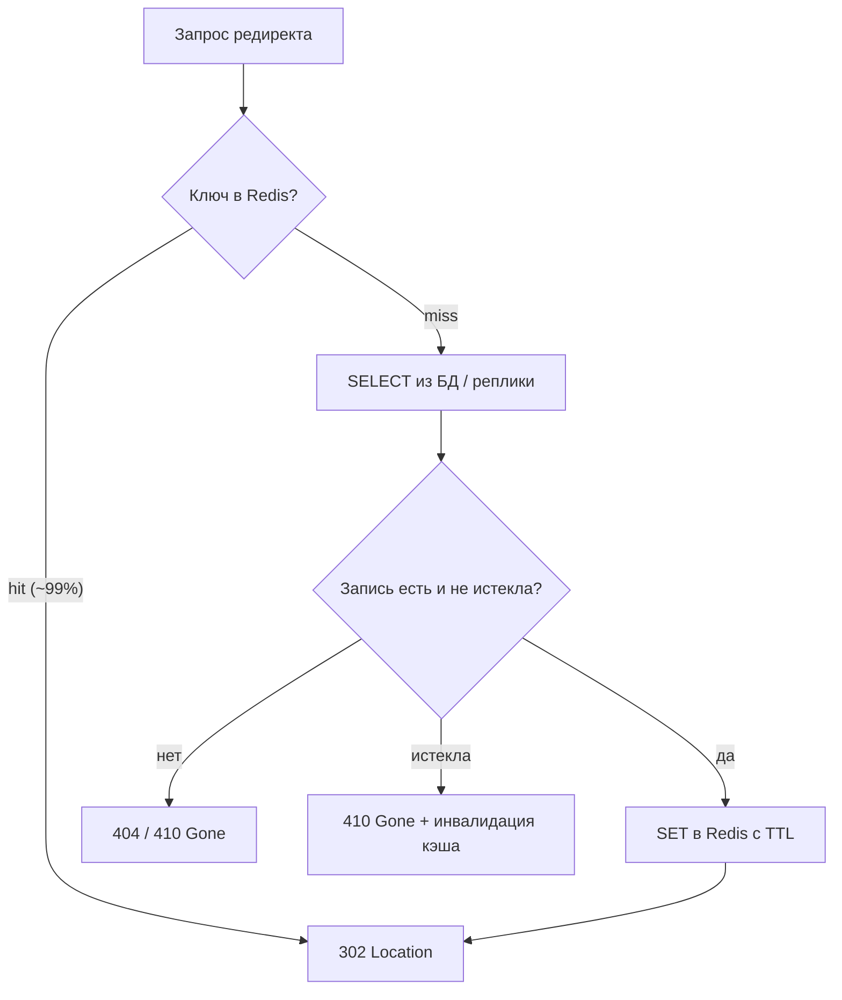
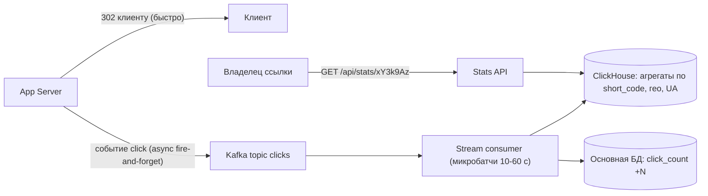

# Разбор задачи: URL Shortener (TinyURL / bit.ly)

URL shortener — это «Hello World» системного дизайна: задача почти гарантированно встречается на собеседованиях уровня Middle/Senior и используется интервьюерами как проверка базовой гигиены — умеете ли вы уточнять требования, считать нагрузку, обосновывать выбор хранилища и честно обсуждать trade-offs. Ошибка большинства кандидатов — не в том, что они не знают решение, а в том, что они выдают заученную схему, не привязав её к требованиям. Разбор ниже построен так, как стоит вести диалог на реальном интервью.

> **Главный тезис:** задача простая функционально, но богата узкими местами — генерация уникального короткого кода, кэширование горячих редиректов, выбор 301 vs 302 и асинхронная аналитика кликов. Именно в deep dive по этим четырём пунктам и отличают сильного кандидата.

---

## 1. Фреймворк ответа

Собеседование длится 35–45 минут. Рабочая последовательность (её же рекомендуют бывшие интервьюеры Meta/Google в разборах этой задачи):

1. **Требования** (functional + non-functional) — 5 минут.
2. **Ключевые сущности** (что вообще храним) — 2 минуты.
3. **API** — контракт клиент ↔ сервер — 3 минуты.
4. **High-level design** — коробки и стрелки, покрывающие functional requirements — 10 минут.
5. **Deep dive** — проходим по non-functional requirements и эволюционируем дизайн — 15 минут.
6. **Trade-offs и вопросы интервьюера** — остаток времени.

Важный нюанс из моков: back-of-the-envelope оценки в начале «ради галочки» часто выглядят бесполезно — кандидат умножает числа и делает вывод «это будет большая распределённая система», что и так было понятно. Сильная позиция: прямо сказать «я буду считать там, где результат расчёта меняет решение» — и действительно считать в моменты выбора (длина кода, размер кэша, шардинг).

---

## 2. Уточняющие вопросы

Не начинайте рисовать, пока не прояснили объём задачи. Вопросы, которые стоит задать вслух:

- Какой масштаб: сколько пользователей, сколько ссылок создаётся в день/месяц, сколько редиректов? (Частый ответ интервьюера: «порядка 100M DAU, миллиарды ссылок суммарно» — или вас попросят оценить самим.)
- Нужны ли **кастомные alias** (пользователь сам задаёт короткий код, например `/my-cv`)? Если да — что делать при конфликте имён?
- Нужно ли **время жизни ссылки** (expiration)? Что происходит с просроченной ссылкой: ошибка или переиспользование кода?
- Могут ли ссылки быть **изменены или удалены** после создания?
- Нужна ли **аналитика** (счётчик кликов, география, referer)? Входит в scope или «на вырост»?
- Это публичный сервис для анонимов или с авторизацией и привязкой ссылок к пользователю?
- Насколько критична **доступность редиректа**: что хуже — показать ошибку или отдать устаревшие данные?

Зафиксируйте ответы на доске списком — интервьюер должен видеть, что дизайн растёт из этих требований, а не из заученного шаблона.

---

## 3. Требования

### Functional requirements

Формулируйте как «пользователь может …»:

1. Пользователь может создать короткую ссылку из длинного URL.
2. Пользователь, перешедший по короткой ссылке, редиректится на оригинальный URL.
3. (Опционально) Пользователь может задать кастомный alias.
4. (Опционально) Пользователь может задать срок жизни ссылки; после истечения — ошибка.

### Non-functional requirements

Формулируйте как «система должна …» и сразу привязывайте к контексту задачи:

- **Низкая latency на редиректе** — целевой ориентир ~200 мс end-to-end (порог, который человек воспринимает как «мгновенно»). Редирект — главный путь системы, создание ссылки может быть медленнее.
- **Высокая доступность на чтение** — read-heavy система: соотношение чтений к записям порядка 100:1.
- **Уникальность коротких кодов** — коллизия означает, что пользователь попадёт не туда; это недопустимо.
- **Eventual consistency достаточна** — между созданием ссылки и её распространением по мессенджерам проходят секунды-минуты; если первый переход в первую секунду вернёт «ссылка ещё сохраняется», никто не пострадает. Strong read-after-write consistency не нужна — это не банкинг и не бронирование билетов. Отсюда по CAP выбираем **AP** с eventual consistency.
- **Масштаб**: сотни миллионов–миллиарды ссылок за время жизни системы.

---

## 4. Оценки нагрузки (back of the envelope)

Считаем там, где это влияет на решения. Опорные реальные цифры bit.ly (из публичных данных): ~600 млн создаваемых ссылок в месяц и ~10 млрд кликов в месяц. Для собеседования удобно округлить: **100M записей/мес, соотношение read:write = 100:1**.

### RPS

```
Записи:  100M / (30 дней × 86400 с) ≈ 40 записей/с  (пиковая ×5 → ~200)
Чтения:  40 × 100 ≈ 4 000 редиректов/с  (пиковая ×5 → ~20 000)
```

Вывод, который надо озвучить: нагрузка скромная. Чтения в тысячи RPS по простому ключу выдерживает даже один хорошо настроенный PostgreSQL с репликами, а с кэшем — тем более. Мы проектируем распределённую систему «с запасом», а не потому что без неё умрём завтра. Такая честность нравится интервьюерам больше, чем раздувание цифр.

### Хранилище

```
Одна запись ≈ 500 байт:
  short code   ~7 байт
  long URL     ~500 байт максимум (в среднем ~50–100)
  user_id      8 байт
  created_at   8 байт
  expires_at   8 байт
  + индексы и служебные поля

100M записей/мес × 500 байт ≈ 50 ГБ/мес ≈ 0.6 ТБ/год ≈ ~6 ТБ за 10 лет
```

### Длина короткого кода — здесь расчёт реально меняет решение

Алфавит base62: `[a-zA-Z0-9]` = 62 символа.

| Длина кода | Комбинаций (62ⁿ) | Хватит при 365M ссылок/год |
|---|---|---|
| 5 | ~916 млн | На ~2.5 года — мало |
| 6 | ~56.8 млрд | На ~155 лет |
| 7 | ~3.5 трлн | С огромным запасом |

**Вывод: 7 символов.** Это стандартная точка, где кандидат должен показать расчёт, а не назвать цифру по памяти.

### Кэш

Правило 80/20 (в разборах часто берут «1–20% ссылок генерируют большую часть трафика»): если 20% дневного трафика — это горячие ссылки, и мы кэшируем 20% от дневных чтений:

```
10 млрд чтений/мес ≈ 333M чтений/день; 20% ≈ 66M уникальных горячих ключей (верхняя оценка)
66M × ~100 байт (код + URL средней длины) ≈ ~7 ГБ
```

На практике горячих уникальных ссылок меньше, и **один узел Redis на 16–32 ГБ покрывает задачу**; Redis Cluster — если хотим запас и удобный шардинг.

---

## 5. API

Контракт минимален — два эндпоинта:

```
POST /api/v1/shorten
Body: {
  "long_url": "https://example.com/very/long/path?with=params",
  "custom_alias": "my-cv",          // optional
  "expires_at": "2026-09-01T00:00:00Z" // optional
}
→ 201 Created
{ "short_url": "https://sho.rt/xY3k9Az", "expires_at": "..." }
Ошибки: 409 Conflict (alias занят), 400 Bad Request (невалидный URL)

GET /{short_code}
→ 302 Found, Location: https://example.com/very/long/path?with=params
Ошибки: 404 Not Found, 410 Gone (истёк срок жизни)
```

Моменты, которые стоит проговорить:

- Редирект делаем через `GET /{code}` на нашем домене, а не через API-эндпоинт, возвращающий JSON, — браузер сам следует `Location`, лишний клиентский код не нужен.
- `410 Gone` для просроченных ссылок — осмысленнее, чем `404`, и это показывает внимание к HTTP-семантике.
- Если есть авторизация — создание ссылки за `POST /api/v1/shorten` с токеном, редирект остаётся публичным.
- Валидация `long_url` при создании (схема, длина, чёрные списки фишинга) — вопрос, которым интервьюер может проверить «security awareness».

---

## 6. High-level design

Минимальная система, покрывающая functional requirements: клиент, балансировщик, stateless application-серверы, кэш, БД.



Два потока данных:

**Создание ссылки (write path):** клиент → LB → app server → генерация короткого кода → запись в БД → возврат короткой ссылки. Write path можно не кэшировать (записи всего ~40 RPS), но имеет смысл сразу прогреть кэш свежесозданной ссылкой — первые переходы часто происходят в первые секунды (создатель проверяет ссылку сам).

**Редирект (read path):** клиент → LB → app server → проверка кэша → при miss чтение из БД (или реплики) и прогрев кэша → `302 Location`. Это паттерн **cache-aside (look-aside)**.



---

## 7. Data model

Сущность одна — `urls`. Не усложняйте: на этом этапе достаточно перечислить поля и ключевые индексы.

```sql
CREATE TABLE urls (
    short_code   VARCHAR(7)  PRIMARY KEY,      -- base62 код, он же shard key
    long_url     TEXT        NOT NULL,
    user_id      BIGINT,                       -- nullable, если сервис анонимный
    created_at   TIMESTAMPTZ NOT NULL DEFAULT now(),
    expires_at   TIMESTAMPTZ,                  -- NULL = бессрочная
    click_count  BIGINT      NOT NULL DEFAULT 0 -- если считаем синхронно (см. deep dive)
);

-- основной путь чтения: точечный lookup по PK — O(log n) по B-tree
-- если нужна выборка «ссылки пользователя»:
CREATE INDEX idx_urls_user ON urls (user_id, created_at DESC);
```



**SQL или NoSQL?** Честный ответ: обе справятся, объёмы (единицы ТБ, тысячи RPS) — не та лига, где выбор критичен. Аргументы, которые звучат сильно:

- **PostgreSQL**: B-tree по `short_code` даёт предсказуемый point lookup; single-leader репликация; зрелая экосистема. Для read-heavy задачи с простым ключом — отличный дефолт.
- **Cassandra / ScyllaDB (LSM)**: leaderless-запись «всегда доступна», горизонтально масштабируется из коробки, но eventual consistency изначальна и range-запросы не нужны — нам как раз нужен только lookup по ключу. Оправдана, если целимся в мультирегион и миллионы RPS.
- На собеседовании важно не «угадать правильную БД», а показать критерий выбора: тип индекса (B-tree vs LSM) и модель репликации (single-leader vs leaderless) под наш паттерн нагрузки.

---

## 8. Deep dive 1: генерация короткого кода

Центральный вопрос задачи. Три подхода, все стоит знать и уметь сравнивать.

### Вариант A: уникальный ID + base62 (счётчик / sequence)

Берём монотонно растущий уникальный ID (sequence в БД, auto-increment, снежинка-сервис) и кодируем его в base62. Это биекция: каждому ID — ровно один код, **коллизии невозможны по построению**, проверять их не нужно.

```python
ALPHABET = "0123456789abcdefghijklmnopqrstuvwxyzABCDEFGHIJKLMNOPQRSTUVWXYZ"

def to_base62(n: int) -> str:
    if n == 0:
        return ALPHABET[0]
    out = []
    while n:
        n, r = divmod(n, 62)
        out.append(ALPHABET[r])
    return "".join(reversed(out))

# 125 → "cb", 57_000_000_000 → "1lK7hS" (6 символов)
```

Проблема очевидна: **один глобальный счётчик — bottleneck и SPOF**. Решения:

- **Диапазоны ID на сервер** (ticket server / range allocation): выделенный сервис выдаёт каждому app server блок ID, например `[1..1M]`, `[1M+1..2M]`; сервер выдаёт ID из своего блока локально, без сетевых вызовов. Координатор диапазонов — ZooKeeper или отдельная маленькая БД с одной строкой-счётчиком. Реальные системы (Flickr ticket server) так и работают.
- **Redis INCR** как счётчик — атомарно, ~100K+ ops/s на узел, для наших 40 RPS — с огромным запасом.
- Признавайте ограничение вслух: исчерпание диапазона, падение координатора, переиспользование — всё это надо обработать, и это честная цена подхода.

Плюс для собеседования: ссылки получаются **предсказуемыми/перебираемыми** (`.../xY3k9A` → `.../xY3k9B` существует). Если это проблема (приватные ссылки), коды можно перемешивать обратимой функцией (например, умножением по модулю простого числа) или взять вариант B.

### Вариант B: хэш от длинного URL + обработка коллизий

`MD5(long_url)` → берём первые 43 бита → кодируем в base62 → 7 символов. Либо более дешёвый MurmurHash — криптостойкость не нужна.

Плюсы: нет координации, идемпотентность (один URL → один код, дедупликация бесплатно), равномерное распределение по ключевому пространству (удобно для шардинга по хэшу).

Минусы: **коллизии реальны из-за birthday paradox**. Сильный кандидат считает это вслух:

```
Пространство 62^7 ≈ 3.5 × 10^12
При n случайных кодов вероятность хотя бы одной коллизии ≈ n² / (2N)
n = 1 млрд: (10^9)² / (2 × 3.5 × 10^12) ≈ 10^18 / 7 × 10^12 ≈ 143 000 ожидаемых пар коллизий
```

То есть «вероятность мала» — недостаточный ответ; при миллиарде ссылок коллизии **гарантированы**, и нужна стратегия: при вставке ловим unique violation, добавляем соль/счётчик к входу и хэшируем заново (или probing к следующему коду). Плюс отдельный вопрос: два разных пользователя сокращают один URL — хотим ли мы выдать им один код (дедупликация, но сливает факт «кто-то уже сокращал этот URL») или разные (тогда хэшим `url + user_id`)?

### Вариант C: KGS — Key Generation Service (офлайн-предгенерация)

Отдельный сервис заранее генерирует случайные коды и складывает их в таблицу `unused_keys`. При создании ссылки app server забирает пачку ключей в локальный буфер и выдаёт по одному; использованные помечаются. Никакой координации на горячем пути: «взять свободный ключ» — это `UPDATE ... WHERE used = false LIMIT 1` с `FOR UPDATE SKIP LOCKED` в PostgreSQL, чтобы конкурентные транзакции не ждали друг друга, а просто брали следующие строки.

```sql
UPDATE keys
SET used = true, owner = :request_id
WHERE key = (
    SELECT key FROM keys
    WHERE used = false
    ORDER BY key
    LIMIT 1
    FOR UPDATE SKIP LOCKED
)
RETURNING key;
```



### Сравнение

| Критерий | Счётчик + base62 | Хэш URL | KGS (предгенерация) |
|---|---|---|---|
| Коллизии | Невозможны | Реальны (birthday paradox), нужен retry | Невозможны (уникальность при генерации) |
| Координация | Нужна (range allocation / ZooKeeper) | Не нужна | Минимальная (офлайн) |
| Предсказуемость кодов | Последовательные, перебираемые | Случайные | Случайные |
| Дедупликация одинаковых URL | Нет | Бесплатно | Нет |
| Сложность | Средняя | Низкая | Средняя (лишний сервис и таблица) |
| Горячий путь | Зависит от счётчика | Только вычисление хэша | Чтение из локального буфера |

**Что говорить интервьюеру:** «Я бы начал со счётчика + base62 с range allocation — это убирает проверку коллизий и тривиально масштабируется диапазонами. Если нужны непредсказуемые коды или дедупликация — перейду на хэш с обработкой коллизий через unique constraint и повторное хэширование с солью». Называние обоих подходов и осознанный выбор под требования — то, что отличает senior-ответ.

---

## 9. Deep dive 2: 301 vs 302 — вопрос-ловушка

Почти гарантированный follow-up: «какой статус вернём на редирект?»

| | 301 Moved Permanently | 302 Found (Temporary) |
|---|---|---|
| Кэширование браузером | Агрессивно кэширует, повторный клик **не доходит до нашего сервера** | Не кэширует (или слабо), каждый клик идёт к нам |
| Нагрузка на сервер | Минимальная | Полная — все клики |
| Аналитика кликов | **Слепнем**: часть кликов невидима | Полная видимость |
| Смена целевого URL / деактивация ссылки | Почти невозможно — клиенты закэшировали | Работает сразу |
| SEO | Передаёт «вес» страницы целевому URL | Не передаёт |

**Правильный ответ — не «302 лучше», а обоснование:** если бизнес живёт с аналитики кликов (bit.ly — именно так) или нужна возможность деактивировать/перенацелить ссылку — **302**, и мы платим за это полной нагрузкой редиректов. Если аналитика не нужна и важнее минимизировать нагрузку и latency — **301**. На собеседовании разумный дефолт — 302 с явным проговариванием цены решения. Это классический пример, где интервьюер проверяет, понимаете ли вы, что дизайн-решение следует из бизнес-требования, а не из учебника.

---

## 10. Deep dive 3: кэширование редиректов и горячие ключи

Профиль нагрузки реального сокращателя ссылок — сильно скошенный: подавляющее большинство ссылок кликают пару раз, а единицы (ссылка из поста крупного блогера) получают миллионы переходов. Горячий ключ заранее предсказать нельзя, поэтому выносить «популярные» ссылки на отдельную ноду не выйдет — нужен кэш.

Решения, которые стоит назвать:

- **Cache-aside (look-aside) с Redis**: читаем из кэша, при miss — из БД и прогрев. Простейшая и достаточная стратегия; БД остаётся source of truth, устаревание кэша не страшно (маппинг код → URL иммутабелен!).
- **Иммутабельность данных — наш главный козырь**: связка short code → long URL не меняется, значит проблема инвалидации кэша почти исчезает. Единственные причины инвалидации — удаление ссылки и истечение TTL. Поэтому **TTL в кэше ≤ TTL ссылки** (для expiring-ссылок), для бессрочных — LRU eviction.
- **Eviction: LRU** — вытесняем давно не использованные ключи; рабочее множество горячих ссылок само оседает в кэше.
- Размер: по оценке из раздела 4 — единицы-десятки ГБ, один узел Redis или небольшой Redis Cluster (шардинг по хэшу ключа из коробки).
- **Read-through** как альтернатива: кэш сам ходит в БД при miss — экономит round trip на прогрев, но требует своего кэширующего слоя (embedded cache), Redis так не умеет. Для нашей нагрузки — оверкилл, но упомянуть стоит.
- Кэширование **отсутствующих** ключей (negative caching) коротким TTL — защита от сканирования несуществующих кодов.



---

## 11. Deep dive 4: аналитика кликов

Требование «покажи пользователю, сколько раз кликнули его ссылку» выглядит безобидно, пока не посчитаешь: на 10 млрд кликов/мес наивный `UPDATE urls SET click_count = click_count + 1` на горячем пути — это:

1. Запись в БД на каждый редирект → latency редиректа растёт, БД из read-heavy превращается в write-heavy.
2. **Race condition и lock contention**: два конкурентных инкремента одной строки читают одно значение и затирают друг друга; а на горячей ссылке с сотнями тысяч кликов в минуту строка становится hotspot — блокировки душат всю таблицу.

Правильный паттерн — **вынести аналитику из горячего пути в асинхронный конвейер**:

- На редиректе app server публикует событие `{short_code, ts, ip, user_agent, referer}` в **Kafka** (или Kinesis). Почему log-based broker, а не in-memory (Redis Streams) и не запись в БД: Kafka пишет append-only лог на диск — это durable (события не потеряются при падении) и при этом выдерживает сотни тысяч записей/с. In-memory брокер быстрее, но при потере ноды теряем аналитику; синхронная запись в БД — медленно и возвращает нас к проблеме hotspot.
- Consumer: **микробатчинг** (Spark Streaming / Flink с window'ами или простой consumer, накапливающий агрегаты за 10–60 с) — группирует события по `short_code` и делает один `UPDATE ... SET click_count = click_count + 4823` вместо 4823 отдельных. Нагрузка на БД падает на 2–3 порядка.
- Готовые агрегаты — в аналитическое хранилище (**ClickHouse** — стандарт для таких витрин) или обратно в основную БД, если достаточно одного счётчика.
- Батч «раз в сутки» через S3 + ночной джоб — тоже валидный вариант, если продукт готов ждать; вопрос гранулярности аналитики — хороший повод уточнить требования у интервьюера.



Ключевая фраза для интервью: «пользователю не нужна strong consistency счётчика кликов — задержка аналитики в минуту незаметна, зато мы полностью убираем запись с горячего пути редиректа».

---

## 12. Масштабирование и надёжность (сводно)

- **Шардинг БД** по `short_code`: по хэшу кода (равномерно, но resharding болезнен) или по диапазонам (простой статический маппинг на app servers, но риск неравномерности). При честных цифрах (единицы ТБ) шардинг нужен «на вырост» — скажите это прямо.
- **Репликация**: single-leader + async read replicas. Риск потери нескольких свежих записей при failover — приемлем («it's just a URL shortener», durability здесь best-effort, в отличие от платежей). Stale reads с реплик не страшны — маппинг иммутабелен.
- **Multi-region**: app servers и read replicas в каждом регионе; лидеров шардов можно разнести по регионам, чтобы запись была локальной. Cross-region реплики отстают сильнее — опять же, допустимо.
- **Rate limiting** на `POST /shorten` (по IP/пользователю) — защита от злоупотреблений и фишинговых ферм. Вопрос безопасности почти наверняка прозвучит.
- **Custom alias**: проверка занятости через тот же unique PK (`INSERT ... ON CONFLICT`), плюс блок-лист зарезервированных слов (`api`, `admin`, `stats`).

---

## 13. Trade-offs: сводная таблица

| Решение | Выбрали | Альтернатива | Чем платим |
|---|---|---|---|
| Консистентность | AP / eventual | Strong consistency | Первые секунды ссылка может не находиться |
| Генерация кода | Счётчик + base62 (range allocation) | Хэш + retry, KGS | Координация диапазонов, предсказуемые коды |
| Редирект | 302 | 301 | Полная нагрузка кликов на сервер |
| Кэш | Cache-aside + LRU | Read-through, write-through | Один лишний round trip на miss |
| Аналитика | Kafka + микробатч | Синхронный UPDATE, ночной батч | Задержка аналитики ~минута, лишняя инфраструктура |
| БД | PostgreSQL (+реплики) | Cassandra, CockroachDB | Ручной шардинг «на вырост» |

---

## 14. Красные флаги и типичные ошибки кандидатов

- **Рисовать микросервисный зоопарк с первой минуты** — API gateway, service mesh, три брокера — для задачи с 40 записей/с. Сначала простая система, потом эволюция под non-functional requirements.
- **«Возьмём MD5 и обрежем» без слова о коллизиях** — интервьюер обязательно спросит; ответ «вероятность мала» без расчёта birthday paradox проваливает пункт.
- **Синхронный инкремент счётчика кликов на горячем пути** — показывает непонимание lock contention на горячих строках.
- **Выбор 301 «потому что быстрее»** без упоминания потери аналитики и невозможности деактивировать ссылку.
- **Оценки ради оценок**: перемножить числа в начале и не использовать их ни в одном решении. Каждый расчёт должен заканчиваться фразой «поэтому мы делаем X».
- **Игнорирование уточняющих вопросов**: custom alias, expiration, удаление ссылок — если не спросить, интервьюер вставит их в самый неудобный момент.
- **Забыть negative caching и rate limiting** — показывает отсутствие production-опыта.
- **Путать cache-aside с write-through** и не понимать, почему иммутабельность маппинга упрощает инвалидацию.

## 15. Что говорить интервьюеру: сильные формулировки

- «Прежде чем рисовать, зафиксирую требования — и скажу, какие из них считаю опциональными и почему».
- «Считать буду в моменты, когда число меняет решение: длина кода, размер кэша, число шардов».
- «Нагрузка честно скромная — распределённость здесь про надёжность и запас, а не про выживание завтра».
- «Выбираю eventual consistency, потому что read-after-write в первую секунду не критичен — ссылка физически не разойдётся мгновенно».
- «302, потому что аналитика кликов — это продукт; 301 сделал бы нас слепыми, и я явно плачу за это нагрузкой».
- «Маппинг иммутабелен, поэтому инвалидация кэша почти бесплатна — это ключевое свойство задачи».
- «Аналитику выношу в Kafka с микробатчингом: задержка в минуту для счётчика кликов никому не заметна, а запись с горячего пути уходит полностью».

## 16. Что спросят дополнительно

- Как сделать коды непредсказуемыми, оставив счётчик? (Обратимая перестановка: умножение по модулю большого простого, формат-preserving encryption.)
- Как поддержать удаление ссылки? (Soft delete + инвалидация кэша + `404`/`410`; что делать с браузерным кэшем 301?)
- Как отдавать аналитику в реальном времени? (Окна в Flink/Spark, ClickHouse materialized views, пред-агрегаты по минутам.)
- Что если одна ссылка получает 100K RPS? (Кэш выдержит; дальше — CDN edge-редиректы, дедупликация запросов к origin.)
- Как тестировать генератор ключей? (Property-based тесты на уникальность, нагрузочный тест на range allocator.)
- Как мигрировать с 6-символьных кодов на 7? (Пространство пересекается; версионируйте префиксом или выделенным диапазоном.)
- Вредоносные ссылки: как не стать рассадником фишинга? (Валидация, интеграция с Safe Browsing, блок-листы, ручная модерация по репортам.)

---

## Источники и видео по теме

- [Beginner System Design Interview: Design Bitly w/ a Ex-Meta Staff Engineer](https://www.youtube.com/watch?v=iUU4O1sWtJA) — фреймворк ответа, 301 vs 302, base62, счётчик vs хэш, birthday paradox.
- [Design a URL Shortener (TinyURL, Bit.ly) | Systems Design Questions 3.0 With Ex-Google SWE](https://www.youtube.com/watch?v=xFeWVugaouk) — реальные цифры bit.ly, оценка хранилища, `SKIP LOCKED`, B-tree vs LSM, Citus.
- [1: TinyURL + PasteBin / Вопросы для собеседования по системному проектированию с бывшим специалистом Amazon](https://www.youtube.com/watch?v=5V6Lam8GZo4) — race condition в счётчике кликов, Kafka + микробатчинг для аналитики.
- [Разработка системы сокращения URL-адресов / Разработка системы tinyurl / Разработка системы bitly](https://www.youtube.com/watch?v=JQDHz72OA3c) — диапазоны счётчиков, координация через ZooKeeper, проблемы распределённого счётчика.
- [URL Shortener System Design / Pastebin System Design / Grokking the System Design Interview](https://www.youtube.com/watch?v=_TsJizByBvE) — классический KGS (Key Generation Service) с офлайн-предгенерацией ключей.
