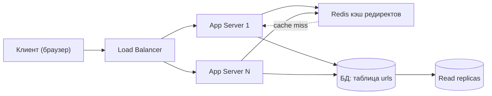
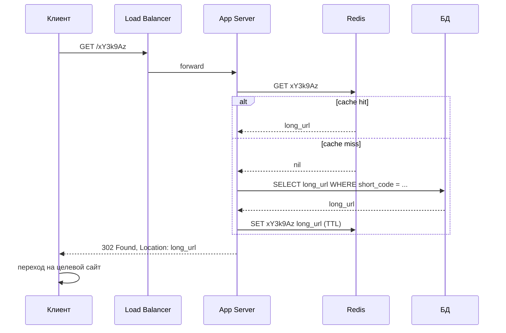
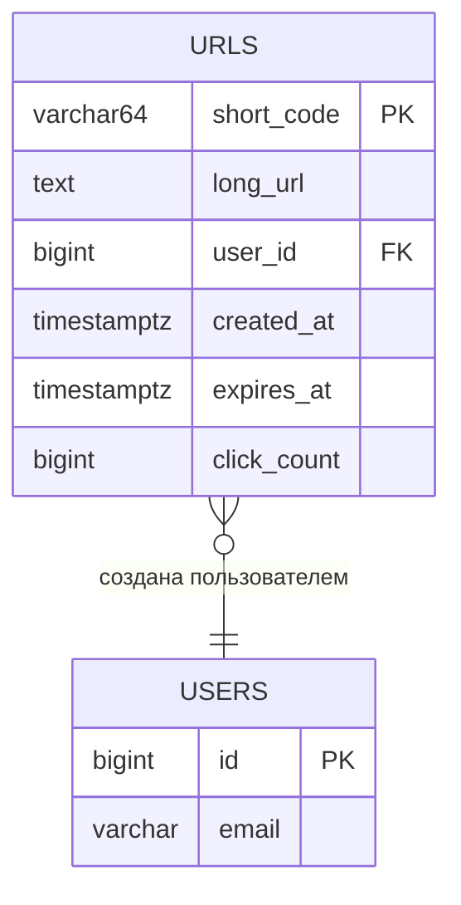
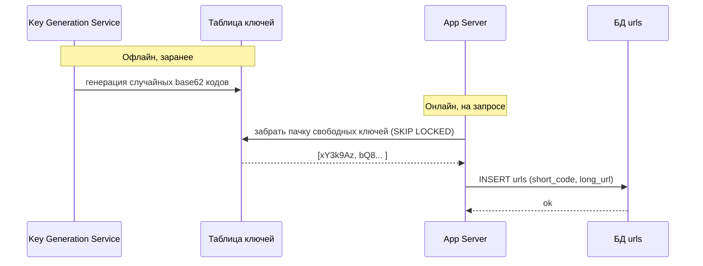
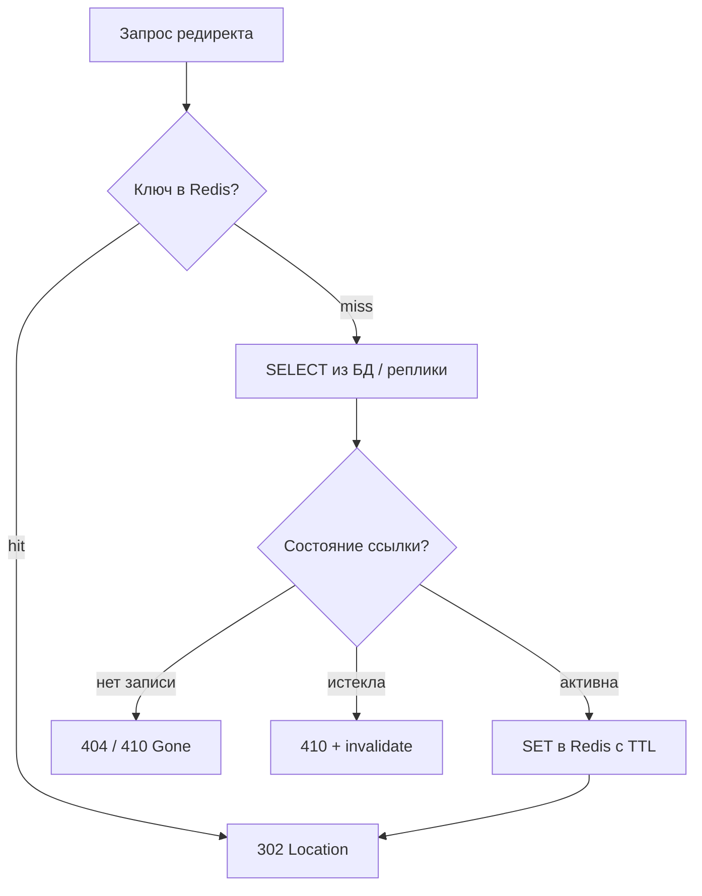
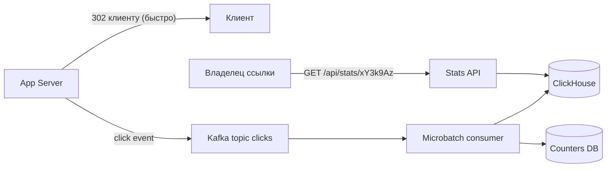

# Разбор задачи: URL Shortener (TinyURL / bit.ly)

<!-- learning-nav:start -->
[← Все разделы](../README.md) · [Предыдущая тема](../01-building-blocks/security-and-evolution.md) · [Следующая тема →](notification-system.md)
<!-- learning-nav:end -->

URL shortener — это «Hello World» системного дизайна: задача почти гарантированно встречается на собеседованиях уровня Middle/Senior и используется интервьюерами как проверка базовой гигиены — умеете ли вы уточнять требования, считать нагрузку, обосновывать выбор хранилища и честно обсуждать trade-offs. Ошибка большинства кандидатов — не в том, что они не знают решение, а в том, что они выдают заученную схему, не привязав её к требованиям. Разбор ниже построен так, как стоит вести диалог на реальном интервью.

> **Главный тезис:** задача простая функционально, но богата узкими местами — генерация уникального короткого кода, кэширование горячих редиректов, выбор 301 vs 302 и асинхронная аналитика кликов. Именно в deep dive по этим четырём пунктам и отличают сильного кандидата.

---

## 1. Фреймворк ответа

Собеседование длится 35–45 минут. Рабочая последовательность (её же рекомендуют бывшие интервьюеры Meta/Google в разборах этой задачи):

1. **Требования** (functional + non-functional) — 5 минут.
2. **Ключевые сущности** (что вообще храним) — 2 минуты.
3. **API** — контракт клиент ↔ сервер — 3 минуты.
4. **High-level design** — коробки и стрелки, покрывающие functional requirements — 10 минут.
5. **Deep dive** — проходим по non-functional requirements и эволюционируем дизайн — 15 минут.
6. **Trade-offs и вопросы интервьюера** — остаток времени.

Важный нюанс из моков: back-of-the-envelope оценки в начале «ради галочки» часто выглядят бесполезно — кандидат умножает числа и делает вывод «это будет большая распределённая система», что и так было понятно. Сильная позиция: прямо сказать «я буду считать там, где результат расчёта меняет решение» — и действительно считать в моменты выбора (длина кода, размер кэша, шардинг).

---

## 2. Уточняющие вопросы

Не начинайте рисовать, пока не прояснили объём задачи. Вопросы, которые стоит задать вслух:

- Какой масштаб: сколько пользователей, сколько ссылок создаётся в день/месяц, сколько редиректов? (Частый ответ интервьюера: «порядка 100M DAU, миллиарды ссылок суммарно» — или вас попросят оценить самим.)
- Нужны ли **кастомные alias** (пользователь сам задаёт короткий код, например `/my-cv`)? Если да — что делать при конфликте имён?
- Нужно ли **время жизни ссылки** (expiration)? Что происходит с просроченной ссылкой: ошибка или переиспользование кода?
- Могут ли ссылки быть **изменены или удалены** после создания?
- Нужна ли **аналитика** (счётчик кликов, география, referer)? Входит в scope или «на вырост»?
- Это публичный сервис для анонимов или с авторизацией и привязкой ссылок к пользователю?
- Насколько критична **доступность редиректа**: что хуже — показать ошибку или отдать устаревшие данные?

Зафиксируйте ответы на доске списком — интервьюер должен видеть, что дизайн растёт из этих требований, а не из заученного шаблона.

---

## 3. Требования

### Functional requirements

Формулируйте как «пользователь может …»:

1. Пользователь может создать короткую ссылку из длинного URL.
2. Пользователь, перешедший по короткой ссылке, редиректится на оригинальный URL.
3. (Опционально) Пользователь может задать кастомный alias.
4. (Опционально) Пользователь может задать срок жизни ссылки; после истечения — ошибка.

### Non-functional requirements

Формулируйте как «система должна …» и сразу привязывайте к контексту задачи:

- **Низкая latency на редиректе** — целевой ориентир ~200 мс end-to-end (порог, который человек воспринимает как «мгновенно»). Редирект — главный путь системы, создание ссылки может быть медленнее.
- **Высокая доступность на чтение** — read-heavy система: соотношение чтений к записям порядка 100:1.
- **Уникальность коротких кодов** — коллизия означает, что пользователь попадёт не туда; это недопустимо.
- **Согласованность определяется операцией.** После `201` создатель часто сразу проверяет ссылку: обеспечиваем read-after-write через leader/fallback, write-through кэш или routing token. Реплики для остальных переходов могут быть eventual, если это согласовано. Создание уникального alias требует атомарной проверки; блокировка опасной ссылки имеет отдельный срок распространения. Нельзя объявлять весь сервис AP только из-за простоты продукта.
- **Масштаб**: сотни миллионов–миллиарды ссылок за время жизни системы.

---

## 4. Оценки нагрузки (back of the envelope)

Считаем там, где это влияет на решения. Зафиксируем учебный сценарий: **100M создаваемых ссылок/мес, соотношение read:write = 100:1**. Это допущения для расчёта, а не актуальная статистика Bitly.

### RPS

```text
Записи:  100M / (30 дней × 86400 с) ≈ 40 записей/с  (пиковая ×5 → ~200)
Чтения:  40 × 100 ≈ 4 000 редиректов/с  (пиковая ×5 → ~20 000)
```

Вывод, который надо озвучить: нагрузка скромная. Чтения в тысячи RPS по простому ключу выдерживает даже один хорошо настроенный PostgreSQL с репликами, а с кэшем — тем более. Мы проектируем распределённую систему «с запасом», а не потому что без неё умрём завтра. Такая честность нравится интервьюерам больше, чем раздувание цифр.

### Хранилище

```text
Одна запись ≈ 500 байт:
  short code   ~7 байт
  long URL     средний размер задаём по профилю продукта; не «максимум 500 Б»
  user_id      8 байт
  created_at   8 байт
  expires_at   8 байт
  + индексы и служебные поля

100M записей/мес × 500 байт ≈ 50 ГБ/мес ≈ 0.6 ТБ/год ≈ ~6 ТБ за 10 лет
```

### Длина короткого кода — здесь расчёт реально меняет решение

Алфавит base62: `[a-zA-Z0-9]` = 62 символа.

| Длина кода | Комбинаций (62ⁿ) | При 1.2 млрд ссылок/год |
|---|---|---|
| 5 | ~916 млн | ~0.76 года до исчерпания |
| 6 | ~56.8 млрд | ~47 лет до исчерпания |
| 7 | ~3.52 трлн | ~2935 лет до исчерпания |

**Для последовательного ID уже 6 символов достаточно на десятилетия при выбранной скорости.** 7 можно выбрать как запас на рост/резервирование, но длина случайного кода дополнительно зависит от вероятности коллизий и требуемой непредсказуемости. Ёмкость пространства не равна вероятности отсутствия коллизий.

### Кэш

Размер кэша считается по числу **уникальных ключей рабочего множества**, а не по доле кликов. При 10 млрд редиректов/месяц получаем ~333 млн запросов/день, но это могут быть и миллион горячих ссылок, и сотни миллионов разных. Из одного RPS нельзя вывести RAM.

Например, измерили 5 млн ключей, покрывающих 90% запросов, и средние 250 Б на ключ, URL и Redis overhead: `5M × 250 Б ≈ 1.25 ГБ` первичных данных. Добавляем запас памяти, реплики и фактическую длину URL; проверяем hit ratio и p99 на trace нагрузки. Один горячий ключ требует репликации/L1-кэша, а не только шардинга: все обращения к нему иначе попадут на один Redis shard.

---

## 5. API

Контракт минимален — два эндпоинта:

```text
POST /api/v1/shorten
Body: {
  "long_url": "https://example.com/very/long/path?with=params",
  "custom_alias": "my-cv",          // optional
  "expires_at": "2027-09-01T00:00:00Z" // optional
}
→ 201 Created
{ "short_url": "https://sho.rt/xY3k9Az", "expires_at": "..." }
Ошибки: 409 Conflict (alias занят), 400 Bad Request (невалидный URL)

GET /{short_code}
→ 302 Found, Location: https://example.com/very/long/path?with=params
Ошибки: 404 Not Found, 410 Gone (истёк срок жизни)
```

Моменты, которые стоит проговорить:

- Редирект делаем через `GET /{code}` на нашем домене, а не через API-эндпоинт, возвращающий JSON, — браузер сам следует `Location`, лишний клиентский код не нужен.
- `410 Gone` для просроченных ссылок — осмысленнее, чем `404`, и это показывает внимание к HTTP-семантике.
- Если есть авторизация — создание ссылки за `POST /api/v1/shorten` с токеном, редирект остаётся публичным.
- Retry создания — отдельная задача: `Idempotency-Key` в scope владельца атомарно связываем с payload и результатом. Два сознательных создания одного URL могут иметь разные owner/expiration/analytics; дедупликация URL не заменяет идемпотентность запроса.
- Валидация `long_url` при создании (схема, длина, чёрные списки фишинга) — вопрос, которым интервьюер может проверить «security awareness».

---

## 6. High-level design

Минимальная система, покрывающая functional requirements: клиент, балансировщик, stateless application-серверы, кэш, БД.



Два потока данных:

**Создание ссылки (write path):** клиент → LB → app server → генерация короткого кода → запись в БД → возврат короткой ссылки. Write path можно не кэшировать (записи всего ~40 RPS), но имеет смысл сразу прогреть кэш свежесозданной ссылкой — первые переходы часто происходят в первые секунды (создатель проверяет ссылку сам).

**Редирект (read path):** клиент → LB → app server → проверка кэша → при miss чтение из БД (или реплики) и прогрев кэша → `302 Location`. Это паттерн **cache-aside (look-aside)**.



---

## 7. Data model

Сущность одна — `urls`. Не усложняйте: на этом этапе достаточно перечислить поля и ключевые индексы.

```sql
CREATE TABLE urls (
    short_code   VARCHAR(64) PRIMARY KEY,      -- generated code или custom alias; выбранный max length
    long_url     TEXT        NOT NULL,
    user_id      BIGINT,                       -- nullable, если сервис анонимный
    created_at   TIMESTAMPTZ NOT NULL DEFAULT now(),
    expires_at   TIMESTAMPTZ,                  -- NULL = бессрочная
    click_count  BIGINT      NOT NULL DEFAULT 0 -- если считаем синхронно (см. deep dive)
);

-- основной путь чтения: точечный lookup по PK — O(log n) по B-tree
-- если нужна выборка «ссылки пользователя»:
CREATE INDEX idx_urls_user ON urls (user_id, created_at DESC);
```



**SQL или NoSQL?** Честный ответ: обе справятся, объёмы (единицы ТБ, тысячи RPS) — не та лига, где выбор критичен. Аргументы, которые звучат сильно:

- **PostgreSQL**: B-tree по `short_code` даёт предсказуемый point lookup; single-leader репликация; зрелая экосистема. Для read-heavy задачи с простым ключом — отличный дефолт.
- **Cassandra / ScyllaDB (LSM)**: leaderless-репликация с настраиваемыми consistency levels, удобен горизонтальный рост. Доступность зависит от quorum и отказов, а глобальную уникальность alias и конфликт одновременных записей нужно решать отдельно. Оправдана, если целимся в мультирегион и миллионы RPS.
- На собеседовании важно не «угадать правильную БД», а показать критерий выбора: тип индекса (B-tree vs LSM) и модель репликации (single-leader vs leaderless) под наш паттерн нагрузки.

---

## 8. Deep dive 1: генерация короткого кода

Центральный вопрос задачи. Три подхода, все стоит знать и уметь сравнивать.

### Вариант A: уникальный ID + base62 (счётчик / sequence)

Берём монотонно растущий уникальный ID (sequence в БД, auto-increment, снежинка-сервис) и кодируем его в base62. Это биекция: каждому ID — ровно один код, кодирование не создаёт коллизий, **если исходные ID уникальны и не обрезаются**. Unique constraint всё равно защищает от повторно выданного диапазона, сбоя failover счётчика и конфликта с custom alias.

```python
ALPHABET = "0123456789abcdefghijklmnopqrstuvwxyzABCDEFGHIJKLMNOPQRSTUVWXYZ"

def to_base62(n: int) -> str:
    if n == 0:
        return ALPHABET[0]
    out = []
    while n:
        n, r = divmod(n, 62)
        out.append(ALPHABET[r])
    return "".join(reversed(out))

# 125 → "21", 57_000_000_000 → "10dwbQI" (7 символов)
```

Проблема очевидна: **счётчик требует доступного и надёжного владельца состояния**; при 40 writes/s его производительность сама по себе не bottleneck. Решения:

- **Диапазоны ID на сервер** (ticket server / range allocation): выделенный сервис выдаёт каждому app server блок ID, например `[1..1M]`, `[1M+1..2M]`; сервер выдаёт ID из своего блока локально, без сетевых вызовов. Координатор диапазонов — ZooKeeper или отдельная маленькая БД с одной строкой-счётчиком. Выданные диапазоны не возвращаем в пул после краха процесса; пропуски ID безопаснее повторного использования.
- **Redis INCR** атомарен на узле, но async failover может потерять подтверждённое увеличение. Для уникальности нужен продуманный durable allocator/эпоха; проверка PK остаётся последней защитой. При таком RPS sequence в БД обычно проще.
- Признавайте ограничение вслух: исчерпание диапазона, падение координатора, переиспользование — всё это надо обработать, и это честная цена подхода.

Плюс для собеседования: ссылки получаются **предсказуемыми/перебираемыми** (`.../xY3k9A` → `.../xY3k9B` существует). Если нужна непредсказуемость, используем криптографически случайные коды достаточной длины или криптографическую перестановку. Умножение по модулю скрывает последовательность косметически, но не создаёт криптостойкость. Ни один код не заменяет авторизацию для действительно приватных ресурсов.

### Вариант B: хэш от длинного URL + обработка коллизий

Хэш URL отображаем в пространство `[0, 62^7)`, затем кодируем с фиксированной длиной 7. Семь base62-символов дают ~41.68 бита: произвольные 43 бита туда не помещаются. Для учебного незащищённого индекса возможен некриптографический хэш; для непредсказуемого bearer-кода лучше CSPRNG, а не детерминированный хэш известного URL.

Плюсы: кандидата кода считаем локально, хэш обычно равномерно распределён. Но атомарная вставка координируется хранилищем; после разрешения коллизий стабильное соответствие URL → код нужно сохранять отдельно.

Минусы: **коллизии реальны из-за birthday paradox**. Сильный кандидат считает это вслух:

```text
Пространство 62^7 ≈ 3.5 × 10^12
Ожидаемое число пар коллизий λ = n(n−1)/(2N)
Вероятность хотя бы одной ≈ 1 − exp(−λ); ≈ λ лишь при λ ≪ 1
n = 1 млрд: (10^9)² / (2 × 3.5 × 10^12) ≈ 10^18 / (7 × 10^12) ≈ 143 000 ожидаемых пар коллизий
```

То есть «вероятность мала» — недостаточный ответ; при миллиарде ссылок вероятность хотя бы одной коллизии **практически 1**, и нужна стратегия: при вставке ловим unique violation, добавляем соль/счётчик к входу и хэшируем заново (или probing к следующему коду). Плюс отдельный вопрос: два разных пользователя сокращают один URL — хотим ли мы выдать им один код (дедупликация, но сливает факт «кто-то уже сокращал этот URL») или разные (тогда используем отдельный код/бизнес-ключ с владельцем, сроком и политикой доступа)?

### Вариант C: KGS — Key Generation Service (офлайн-предгенерация)

Отдельный сервис заранее генерирует случайные коды и складывает их в таблицу `unused_keys`. При создании ссылки app server забирает пачку ключей в локальный буфер и выдаёт по одному; использованные помечаются. Координация амортизируется на выдачу пачки: транзакция в таблице ключей эксклюзивно закрепляет её за сервером. `SKIP LOCKED` помогает конкурентно разобрать пул; это всё ещё online-координация. Уникальность случайно сгенерированных ключей обеспечивает constraint, а не сам генератор. После падения сервера выданную пачку безопаснее сжечь; повторная выдача требует доказательства, что ни один ключ не был использован.

```sql
UPDATE keys
SET used = true, owner = :request_id
WHERE key = (
    SELECT key FROM keys
    WHERE used = false
    ORDER BY key
    LIMIT 1
    FOR UPDATE SKIP LOCKED
)
RETURNING key;
```



### Сравнение

| Критерий | Счётчик + base62 | Хэш URL | KGS (предгенерация) |
|---|---|---|---|
| Защита уникальности | Уникальный ID + PK | PK + retry | PK пула + эксклюзивная выдача |
| Координация | Выдача диапазонов | Атомарная вставка | Выдача пачек из пула |
| Непредсказуемость | Нет без защиты | Не гарантирована | При CSPRNG и достаточной длине |
| Один код на URL | Отдельный индекс | Нужна политика и mapping | Отдельный индекс |
| Сложность | Средняя | Низкая | Средняя (лишний сервис и таблица) |
| Горячий путь | Зависит от счётчика | Только вычисление хэша | Чтение из локального буфера |

**Что говорить интервьюеру:** «Я бы начал со счётчика + base62 с range allocation — это уменьшает координацию на выдачу одного ID; сохраняю PK и не переиспользую выданные диапазоны. Если нужна непредсказуемость — выберу CSPRNG и PK + retry; дедупликацию URL реализую отдельным scoped индексом». Называние обоих подходов и осознанный выбор под требования — то, что отличает senior-ответ.

---

## 9. Deep dive 2: 301 vs 302 — вопрос-ловушка

Почти гарантированный follow-up: «какой статус вернём на редирект?»

`301` сообщает о постоянном переносе, `302` — о временном. Управление кэшем — отдельная ось: `301` допускает эвристическое кэширование, а `302` тоже можно кэшировать при явных freshness headers. Поэтому «302 всегда доходит до сервера» неверно. Для изменяемых ссылок и наблюдения запросов на origin разумен такой ответ:

```http
HTTP/1.1 302 Found
Location: https://example.com/target
Cache-Control: no-store
```

Если нужен edge-кэш, задаём его явно: например, `max-age=0, s-maxage=30` с подходящей политикой CDN. Тогда часть переходов обслуживается на edge, аналитика требует edge logs, а отзыв ссылки ограничен TTL и скоростью purge. `no-cache` разрешает хранение с обязательной проверкой перед reuse; `no-store` запрещает хранить ответ. Даже при `no-store` origin видит HTTP-запросы, а не гарантированно человеческие клики: preview-боты, prefetch и повторы требуют отдельной классификации.

Для неизменяемой публичной ссылки с допустимым долгим кэшем возможен `301` с явным `max-age`. Уже сохранённый клиентом редирект нельзя надёжно отозвать одним удалением Redis. Для запросов не-GET важны ещё `307`/`308`, сохраняющие метод; `301`/`302` исторически допускают смену POST на GET. В учебном shortener принимаем только GET/HEAD. SEO не выводим из одной цифры статуса: это поведение поисковых систем, не гарантия HTTP.

---

## 10. Deep dive 3: кэширование редиректов и горячие ключи

Профиль нагрузки реального сокращателя ссылок — сильно скошенный: подавляющее большинство ссылок кликают пару раз, а единицы (ссылка из поста крупного блогера) получают миллионы переходов. Новые горячие ключи появляются внезапно; автоматическое кэширование, rate limiting и наблюдаемость надёжнее ручного списка популярных ссылок.

Решения, которые стоит назвать:

- **Cache-aside (look-aside) с Redis**: читаем из кэша, при miss — из БД и прогрев. Простейшая и достаточная стратегия; БД остаётся source of truth, неизменяемый URL упрощает кэш, но `expires_at`, удаление и abuse-block меняют допустимость редиректа.
- **Иммутабельность данных — наш главный козырь**: связка short code → long URL не меняется, значит проблема инвалидации кэша почти исчезает. Удаление, abuse-block и смена URL (если разрешена) требуют инвалидации. В кэше храним `expires_at` и статус, проверяем срок при каждом hit. TTL записи задаём не дольше оставшегося срока ссылки; для бессрочных TTL свежести и eviction по памяти выбираются отдельно.
- **Eviction: LRU** — вытесняем давно не использованные ключи; рабочее множество горячих ссылок само оседает в кэше.
- Размер проверяем по реальному рабочему множеству. Для горячего ключа нужны L1/реплики или edge-кэш: Redis Cluster распределяет разные ключи, но не делит один ключ на несколько шардов.
- **Read-through** как альтернатива: кэш сам ходит в БД при miss — экономит round trip на прогрев, но требует своего кэширующего слоя (embedded cache), Redis так не умеет. Для нашей нагрузки — оверкилл, но упомянуть стоит.
- Удаление одного cache key не закрывает гонку stale fill: reader мог прочитать старый URL до блокировки и положить его после `DEL`. Нужны версии/tombstone с проверкой поколения, либо ограниченный TTL и отдельная актуальная denylist, если этого достаточно для SLO отзыва. Не переиспользуем истёкшие коды: старые сообщения/кэши могут отправить человека на URL нового владельца.
- Кэширование **отсутствующих** ключей (negative caching) коротким TTL — защита от сканирования несуществующих кодов.



---

## 11. Deep dive 4: аналитика кликов

Требование «покажи пользователю, сколько раз кликнули его ссылку» выглядит безобидно, пока не посчитаешь: на 10 млрд кликов/мес наивный `UPDATE urls SET click_count = click_count + 1` на горячем пути — это:

1. Запись в БД на каждый редирект → latency редиректа растёт, БД из read-heavy превращается в write-heavy.
2. **Lock contention**: атомарный `UPDATE ... SET click_count = click_count + 1` в PostgreSQL не теряет конкурентные инкременты: обновления одной строки сериализуются. Lost update возникает при раздельном `SELECT`, вычислении в приложении и `UPDATE count = :old_plus_one` без защиты. Здесь проблема — горячая строка, WAL и частота записей, а не некорректность атомарного инкремента.

Правильный паттерн — **вынести аналитику из горячего пути в асинхронный конвейер**:

- На редиректе app server публикует событие `{short_code, ts, ip, user_agent, referer}` в **Kafka** (или Kinesis). Надёжность зависит от подтверждений и persistence: Redis Streams тоже поддерживает сохранение/replication, а Kafka не делает fire-and-forget публикацию durable автоматически. Выбираем допустимую потерю: best-effort буфер для приблизительной аналитики или подтверждённый журнал для учёта с сильнее заданной полнотой. Это влияет на latency редиректа.
- Consumer: **микробатчинг** (Spark Streaming / Flink с window'ами или простой consumer, накапливающий агрегаты за 10–60 с) — группирует события по `short_code` и делает один `UPDATE ... SET click_count = click_count + 4823` вместо 4823 отдельных. Нагрузка на БД падает на 2–3 порядка.
- At-least-once consumer может повторно применить уже посчитанную пачку. Для точного счётчика сохраняем `batch_id`/диапазон offsets атомарно с агрегатом либо используем идемпотентный upsert накопленного результата; обычный `+4823` после рестарта удвоит вклад. При приблизительной аналитике допустимую погрешность задаём явно.
- Готовые агрегаты — в аналитическое хранилище (**ClickHouse** — стандарт для таких витрин) или обратно в основную БД, если достаточно одного счётчика.
- Батч «раз в сутки» через S3 + ночной джоб — тоже валидный вариант, если продукт готов ждать; вопрос гранулярности аналитики — хороший повод уточнить требования у интервьюера.



Ключевая фраза для интервью: «пользователю не нужна strong consistency счётчика кликов — задержка аналитики в минуту незаметна, зато мы полностью убираем запись с горячего пути редиректа».

---

## 12. Масштабирование и надёжность (сводно)

- **Шардинг БД** по `short_code`: по хэшу кода (равномерно, но resharding болезнен) или по диапазонам (простой статический маппинг на app servers, но риск неравномерности). При честных цифрах (единицы ТБ) шардинг нужен «на вырост» — скажите это прямо.
- **Репликация**: single-leader + read replicas; async failover может потерять подтверждённые ссылки, если у реплики не было WAL. Допустимость задаёт продукт, при необходимости ждём синхронную реплику. Miss свежего кода на replica повторяем у leader, а для удаления/блокировки задаём отдельный бюджет stale reads.
- **Multi-region**: app servers и read replicas в каждом регионе; лидеров шардов можно разнести по регионам, чтобы запись была локальной. Cross-region реплики могут сильнее отставать; допустимый лаг, read-after-write и отзыв ссылки согласуем отдельно.
- **Rate limiting** на `POST /shorten` (по IP/пользователю) — защита от злоупотреблений и фишинговых ферм. Вопрос безопасности почти наверняка прозвучит.
- **Custom alias**: проверка занятости через тот же unique PK (`INSERT ... ON CONFLICT`), плюс блок-лист зарезервированных слов (`api`, `admin`, `stats`).

---

## 13. Trade-offs: сводная таблица

| Решение | Выбрали | Альтернатива | Чем платим |
|---|---|---|---|
| Согласованность | Read-after-write + eventual replicas | Quorum/strong reads | Routing/fallback и цена репликации |
| Генерация кода | Счётчик + base62 (range allocation) | Хэш + retry, KGS | Координация диапазонов, предсказуемые коды |
| Редирект | 302 + cache policy | 301 для постоянных | TTL определяет отзыв и видимость запросов |
| Кэш | Cache-aside + LRU | Read-through, write-through | Один лишний round trip на miss |
| Аналитика | Kafka + микробатч | Синхронный UPDATE, ночной батч | Задержка аналитики ~минута, лишняя инфраструктура |
| БД | PostgreSQL (+реплики) | Cassandra, CockroachDB | Ручной шардинг «на вырост» |

---

## 14. Красные флаги и типичные ошибки кандидатов

- **Рисовать микросервисный зоопарк с первой минуты** — API gateway, service mesh, три брокера — для задачи с 40 записей/с. Сначала простая система, потом эволюция под non-functional requirements.
- **«Возьмём MD5 и обрежем» без слова о коллизиях** — интервьюер обязательно спросит; ответ «вероятность мала» без расчёта birthday paradox проваливает пункт.
- **Синхронный инкремент счётчика кликов на горячем пути** — показывает непонимание lock contention на горячих строках.
- **Выбор 301 «потому что быстрее»** без упоминания потери аналитики и невозможности деактивировать ссылку.
- **Оценки ради оценок**: перемножить числа в начале и не использовать их ни в одном решении. Каждый расчёт должен заканчиваться фразой «поэтому мы делаем X».
- **Игнорирование уточняющих вопросов**: custom alias, expiration, удаление ссылок — если не спросить, интервьюер вставит их в самый неудобный момент.
- **Забыть negative caching и rate limiting** — показывает отсутствие production-опыта.
- **Путать cache-aside с write-through** и не понимать, почему иммутабельность маппинга упрощает инвалидацию.

## 15. Что говорить интервьюеру: сильные формулировки

- «Прежде чем рисовать, зафиксирую требования — и скажу, какие из них считаю опциональными и почему».
- «Считать буду в моменты, когда число меняет решение: длина кода, размер кэша, число шардов».
- «Нагрузка честно скромная — распределённость здесь про надёжность и запас, а не про выживание завтра».
- «После 201 ссылка должна открываться у создателя; для этого нужен read-after-write путь, а остальные чтения можно вынести на реплики».
- «Выбираю 302 с явным Cache-Control; отдельно договариваюсь о latency, edge logs и времени отзыва ссылки».
- «Неизменяемый URL упрощает кэш, но блокировка и expiration всё равно требуют ограничить срок устаревания».
- «Аналитику выношу в Kafka с микробатчингом: задержка в минуту для счётчика кликов никому не заметна, а запись с горячего пути уходит полностью».

## 16. Что спросят дополнительно

- Как сделать коды непредсказуемыми, оставив счётчик? (Криптографическая перестановка/format-preserving encryption; простое умножение по модулю не даёт криптографической защиты.)
- Как поддержать удаление ссылки? (Soft delete + инвалидация кэша + `404`/`410`; что делать с браузерным кэшем 301?)
- Как отдавать аналитику в реальном времени? (Окна в Flink/Spark, ClickHouse materialized views, пред-агрегаты по минутам.)
- Что если одна ссылка получает 100K RPS? (Измеряем предел shard; L1/replicas или edge-редиректы, singleflight на cache miss. Для edge определяем TTL отзыва и сбор аналитики.)
- Как тестировать генератор ключей? (Property-based тесты на уникальность, нагрузочный тест на range allocator.)
- Как мигрировать с 6-символьных кодов на 7? (Строки длины 6 и 7 различны, если нет усечения/нормализации ведущих нулей. Сохраняем старые коды, расширяем валидатор; для числовых ID не переиспользуем диапазоны.)
- Вредоносные ссылки: как не стать рассадником фишинга? (Валидация, интеграция с Safe Browsing, блок-листы, ручная модерация по репортам.)

---

## Практические сценарии

### 17. Что произойдёт с уникальностью кодов при failover и multi-region?

Уникальность — свойство всего пути выдачи и вставки, а не base62. При одном leader БД sequence и PK дают простую модель. При диапазонах allocator атомарно закрепляет непересекающиеся блоки, не возвращает их после рестарта и защищается от старого лидера. Потерять неиспользованную часть блока безопасно; повторно выдать уже использованный блок — нет. У случайных кодов конфликт разрешается атомарным `INSERT`, а не предварительным `SELECT exists`.

В multi-region можно направлять создание в home region или выделить независимые пространства, например префикс региона и локальный ID. Это уменьшает конкуренцию генераторов, но custom alias остаётся общим именем: два региона не могут независимо успешно подтвердить `/sale` для разных URL. Нужен один владелец alias/consensus либо явная политика региональных namespace. Eventual replication с last-write-wins после двух `201` означает, что одна уже выданная ссылка сменила назначение.

На подумать: после async failover Redis-счётчик вернулся со 1200 на 1190. Достаточно ли base62, чтобы новые коды отличались?

<details>
<summary>Разбор</summary>

Нет: те же числа дадут те же строки. PK отклонит повторную вставку; нельзя делать overwrite или бесконечно ретраить тот же ID. Восстанавливаем high watermark/новую эпоху, прекращаем выдачу старому владельцу и сохраняем безопасный запас диапазона. Проверка уникальности в тестах не доказывает корректность failover: нужен разбор потери состояния и конкурирующих владельцев.

</details>

### 18. Как заблокировать опасную ссылку при горячем кэше и не открыть SSRF?

Сокращатель допускает внешний `Location` по самой функции продукта, но создание и управление ссылкой требуют ограничений: только разрешённые схемы HTTP/HTTPS, ограниченная длина, запрет управляющих символов, проверка прав владельца для изменения и просмотра статистики. Случайный короткий код затрудняет перебор, но не является полноценным контролем доступа. Перенаправленный пользователь может сам сохранить целевой URL; отзыв короткой ссылки не отзывает содержимое у внешнего сайта.

Если сервис только сохраняет URL и возвращает redirect, сервер не выполняет запрос к нему. SSRF появляется при добавлении preview, malware scan или проверки доступности: fetcher обязан ограничить egress, закрыть loopback/private/link-local/metadata endpoints, повторно проверять каждый redirect и фактический адрес соединения с учётом DNS rebinding. Тяжёлое сканирование выносят в изолированный контур; политика до готовности verdict — часть требований.

На подумать: Redis очищен после abuse-block, но CDN отвечает старым редиректом ещё сутки. Выполнено ли требование блокировки за минуту?

<details>
<summary>Разбор</summary>

Нет. Бюджет отзыва включает Redis, L1, CDN и browser cache. Нужны короткий явно заданный TTL, purge с наблюдаемым завершением и при необходимости проверка denylist перед edge redirect. Для уже закэшированного browser `301` сервер не может гарантированно отменить reuse. Поэтому требование минутного отзыва исключает выдачу долгоживущего клиентского redirect cache для таких ссылок. Negative cache также очищается при создании кода, иначе новый `201` временно ведёт на старый `404`.

</details>

<a id="источники-и-видео-по-теме"></a>

## Видео по теме

- [Beginner System Design Interview: Design Bitly w/ a Ex-Meta Staff Engineer](https://www.youtube.com/watch?v=iUU4O1sWtJA) — фреймворк ответа, 301 vs 302, base62, счётчик vs хэш, birthday paradox.
- [Design a URL Shortener (TinyURL, Bit.ly) | Systems Design Questions 3.0 With Ex-Google SWE](https://www.youtube.com/watch?v=xFeWVugaouk) — реальные цифры bit.ly, оценка хранилища, `SKIP LOCKED`, B-tree vs LSM, Citus.
- [1: TinyURL + PasteBin / Вопросы для собеседования по системному проектированию с бывшим специалистом Amazon](https://www.youtube.com/watch?v=5V6Lam8GZo4) — обсуждение счётчика кликов и асинхронной аналитики; атомарный SQL increment не теряет updates.
- [Разработка системы сокращения URL-адресов / Разработка системы tinyurl / Разработка системы bitly](https://www.youtube.com/watch?v=JQDHz72OA3c) — диапазоны счётчиков, координация через ZooKeeper, проблемы распределённого счётчика.
- [URL Shortener System Design / Pastebin System Design / Grokking the System Design Interview](https://www.youtube.com/watch?v=_TsJizByBvE) — классический KGS (Key Generation Service) с офлайн-предгенерацией ключей.
