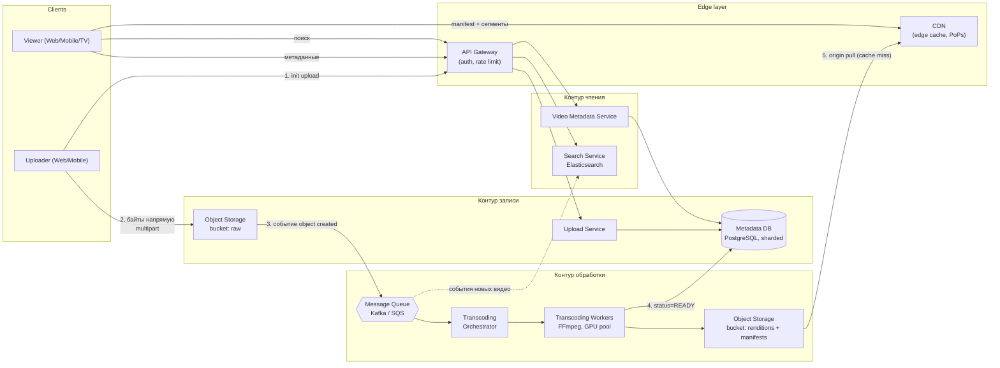
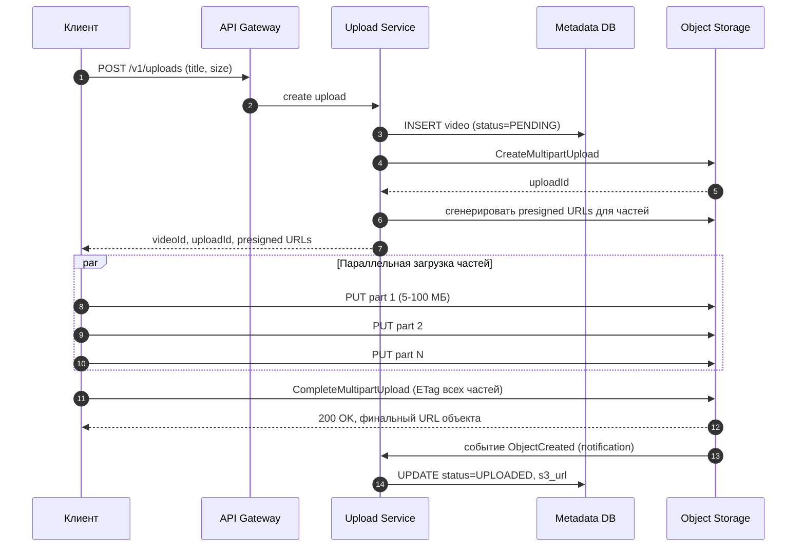
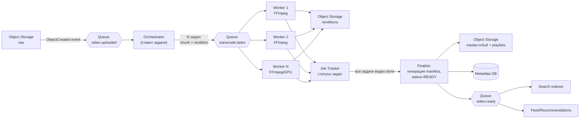
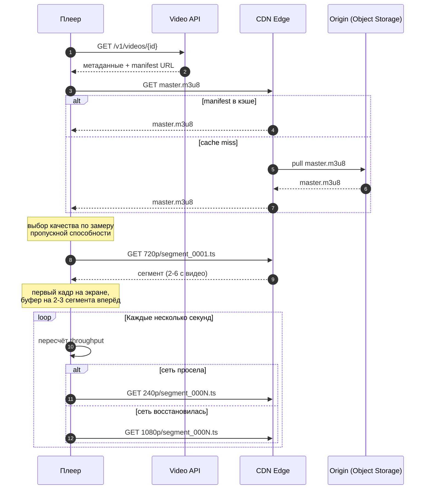
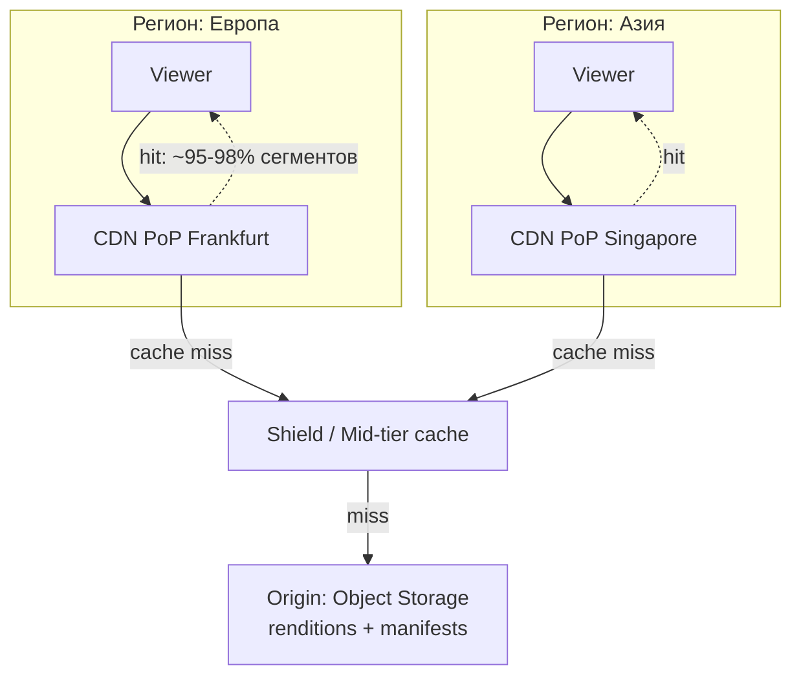
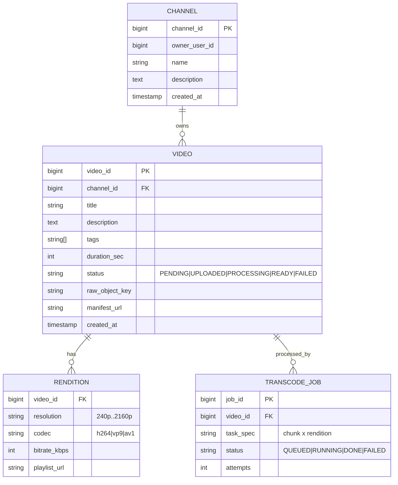
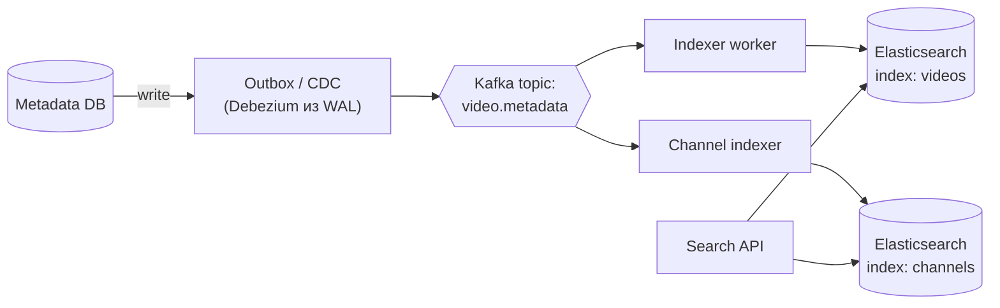

# Разбор задачи: видеоплатформа (YouTube / Netflix)

Классика system design собеседований и одна из самых «дорогих» по инфраструктуре задач. Здесь проверяют не столько знание конкретных технологий (HLS, FFmpeg), сколько умение работать с **огромными потоками бинарных данных**: загрузка гигабайтных файлов, асинхронная обработка через очередь, раздача петабайт трафика через CDN.

Типовая формулировка: «Спроектируй YouTube» / «Спроектируй Netflix». YouTube-вариант — пользовательская загрузка (UGC), длинный хвост контента, поиск. Netflix-вариант — профессиональный контент, акцент на pipeline транскодинга и DRM. В этом разборе берём YouTube-вариант как более общий, отличия Netflix отмечаем по ходу.

---

## 1. Уточняющие вопросы и требования

### Что спросить у интервьюера в первые 5 минут

Не начинайте рисовать, пока не зафиксировали рамку. Сильные вопросы для этой задачи:

- **Масштаб**: проектируем «YouTube в мире» (миллиарды пользователей) или региональный сервис? От этого зависит, нужен ли свой CDN или хватит внешнего.
- **Сценарии в скоупе**: загрузка + просмотр — обязательный минимум. Поиск? Лента рекомендаций? Комментарии/лайки? Каналы и подписки?
- **Live-стриминг рассматриваем?** Это принципиально другая задача (WebRTC/RTMP, задержка в секунды). Обычно выносят за скобку: «давайте только VOD».
- **Кто загружает**: любой пользователь (UGC, длинный хвост, модерация) или контент-партнёры (Netflix-модель)?
- **Ограничения на видео**: максимальный размер/длительность? Поддерживаем 4K?
- **Что выносим за скобки**: авторизация, монетизация, аналитика просмотров, DRM, модерация контента, превью-обложки (каждая — отдельный контур, на собеседовании честно сказать: «превью скипаю, иначе придётся рисовать ещё один контур хранения»).

### Functional requirements (в скоупе)

| # | Требование | Комментарий |
|---|-----------|-------------|
| F1 | Пользователь загружает видео (до нескольких ГБ) | Надёжно, с докачкой при обрыве |
| F2 | Пользователь смотрит видео по ссылке | Быстрый старт (< 1–2 с до первого кадра) |
| F3 | Воспроизведение адаптируется к пропускной способности клиента | Adaptive bitrate, без буферизации |
| F4 | Поиск видео по названию/описанию/тегам | Опционально, по договорённости |
| F5 | Метаданные: название, описание, статус обработки, счётчик просмотров | Минимум для UX |

### Non-functional requirements

| Требование | Целевое значение | Почему важно |
|-----------|------------------|--------------|
| Доступность чтения | 99.99%+ | Просмотр — core-сценарий, деградация недопустима |
| Задержка старта воспроизведения | < 500 мс – 2 с до первого кадра | Ключевая метрика UX (time to first frame) |
| Отсутствие буферизации | Битрейт потока ≤ доступной полосы клиента | Решается adaptive bitrate |
| Консистентность | Eventual consistency допустима | Задержка между загрузкой и появлением в ленте/поиске — минуты, это нормально |
| Масштаб данных | Петабайты хранилища, сотни Тбит/с трафика | Диктует object storage + CDN |
| Стоимость | Минимизировать стоимость хранения и исходящего трафика | При таких объёмах egress — главная статья расходов |

> **Что говорить интервьюеру**: «Для этой системы latency запросов метаданных — не главное. Главные нефункциональные требования — пропускная способность (bandwidth), доступность раздачи и стоимость хранения. Это не request-response система, а система потоковой обработки больших бинарных данных». Эта фраза сразу показывает, что вы понимаете специфику задачи.

---

## 2. Оценки нагрузки (back-of-envelope)

Цифры берём «как у YouTube» — интервьюер обычно их подтверждает или корректирует. Считайте вслух, округляйте, важен порядок величин, а не точность.

### Исходные допущения

| Параметр | Значение | Обоснование |
|----------|----------|-------------|
| Всего пользователей | ~2–4 млрд | MAU YouTube ≈ 2.5 млрд |
| DAU | 500 млн | ~20–25% от MAU |
| Просмотров на пользователя в день | 10 | Из публичной статистики |
| Средняя длительность видео | 20 мин | Оценка из головы, допустимо |
| Соотношение загрузок к просмотрам | 1 : 1000 | Контент-мейкеров на порядки меньше зрителей |

### Производные оценки

**Просмотры:**

```
5 млрд просмотров/день = 500 млн DAU × 10 видео
5×10⁹ / 86400 с ≈ 60 000 стартов воспроизведения в секунду (среднее)
Пик (×2–3 от среднего) ≈ 150–200 тыс. стартов/с
Одновременно смотрят: 60 000 стартов/с × 1200 с (20 мин) ≈ 72 млн сессий
```

**Загрузки (write path):**

```
5 млн новых видео/день (5 млрд просмотров / 1000)
5×10⁶ / 86400 ≈ 60 загрузок/с (среднее), пик ~200/с
```

**Хранилище.** Ключевой расчёт — сколько весит одно видео со всеми renditions:

```
Исходник 4K: битрейт ~45 Мбит/с → 20 мин = 1200 с → ~6.8 ГБ (сырой upload)
Renditions для раздачи (H.264/VP9): 4K 15 Мбит/с + 1080p 8 + 720p 5 + 480p 2.5 + 360p 1 + 240p 0.5
Сумма ≈ 32 Мбит/с → 1200 с × 32 Мбит/с / 8 ≈ 4.8 ГБ на видео во всех качествах
Правило большого пальца: все renditions ≈ исходник → ~10–12 ГБ на 20-минутное видео всего
```

```
Прирост хранилища: 5 млн видео/день × ~10 ГБ ≈ 50 ПБ/день
За 5 лет: ~90 ЭБ (до дедупликации и tiering'а)
```

**Трафик раздачи (самое важное число в задаче):**

```
72 млн одновременных сессий × средний битрейт ~4 Мбит/с (микс качеств)
≈ 288 Тбит/с средний исходящий трафик, пик ~600+ Тбит/с
```

**RPS по API метаданных** (не путать с трафиком видео): ~60 тыс. RPS средний — тривиально для stateless-сервисов за LB.

> **Красный флаг**: путать мегабиты и мегабайты (ошибка в 8 раз) и терять нули в степенях. Если получилось «720 ПБ записи в день» или «одно видео весит 144 ГБ» — остановитесь и перепроверьте: 20 мин × 45 Мбит/с — это ~6.8 ГБ, а не 68. Интервьюеры в моках специально смотрят, заметит ли кандидат неадекватный порядок результата. Второй красный флаг — уйти в арифметику на 10 минут: посчитали порядки, сказали «точное число тут не меняет дизайн, схема от этого не поменяется», пошли дальше.

---

## 3. API

REST поверх HTTPS. Сами байты видео через API **не идут** (см. deep dive 1) — API работает только с метаданными и выдачей ссылок.

```
POST   /v1/uploads                    # инициировать загрузку
       { title, description, tags[], sizeBytes, contentType }
       → { videoId, uploadId, parts: [{partNumber, url}, ...] }   # presigned URLs

POST   /v1/uploads/{videoId}/complete # завершить multipart (список ETag частей)
GET    /v1/uploads/{videoId}          # статус: PENDING / UPLOADED / PROCESSING / READY / FAILED

GET    /v1/videos/{videoId}           # метаданные + manifest URL (если READY)
GET    /v1/search?q=...&cursor=...    # поиск, курсорная пагинация
GET    /v1/videos/{videoId}/manifest  # → редирект на CDN: master.m3u8
```

Отдельные моменты, которые стоит проговорить:

- **Upload init отделён от загрузки байтов**: клиент сначала создаёт запись (метаданные + размер), получает presigned URLs и дальше работает напрямую с object storage.
- **Статусная модель** на видео — конечный автомат `PENDING → UPLOADED → PROCESSING → READY` (или `FAILED`). Клиент поллит `GET /v1/uploads/{videoId}` или получает webhook/WS-нотификацию о готовности.
- **Пагинация в поиске — курсорная**, не offset/limit: при постоянном притоке новых видео offset даёт дубли и пропуски.

---

## 4. High-level design

Три относительно независимых контура: **запись (upload)**, **обработка (transcoding pipeline)**, **чтение (streaming)**. Именно так и стоит вести рассказ: «разобьём систему на три контура и пройдём по каждому».



Ключевые решения на этой схеме, которые нужно уметь защитить:

- **Байты не проходят через наши сервисы.** Клиент загружает видео напрямую в object storage по presigned URLs и смотрит видео напрямую с CDN. Наши сервисы — только control plane. Это главная экономическая причина такого дизайна: проксирование петабайт через свои инстансы = платить за сеть и CPU дважды.
- **Object storage (S3 и аналоги) — единственное разумное место для бинарных данных.** Горизонтально масштабируется из коробки, дешёвое хранение, версионирование, lifecycle-политики (старые сырые исходники → cold storage / Glacier), встроенные события о записи объекта. Абстрагирует нас от дисков, серверов и директорий.
- **Очередь между записью и обработкой** — буфер, сглаживающий пики и развязывающий контуры (подробнее в deep dive 2).
- **CDN перед object storage на чтение** — object storage не рассчитан на раздачу горячего контента миллионам клиентов напрямую, это дорого и медленно географически.

---

## 5. Deep dive 1: загрузка — multipart и resumable upload

### Проблема

Видео — это гигабайты. Прогнать такой файл одним POST через API Gateway нельзя: у managed gateway лимиты тела запроса (у AWS API Gateway — 10 МБ), соединение с клиентом нестабильно (мобильная сеть), а обрыв на 99% означал бы загрузку заново.

### Решение: multipart upload напрямую в object storage

Паттерн, поддерживаемый всеми объектными хранилищами: S3 Multipart Upload, GCS Resumable Upload, аналоги у Yandex Object Storage / Azure Blob (block blobs). Файл режется на части по 5–100 МБ, части загружаются независимо и параллельно, хранилище склеивает их по команде `complete`.



### Что здесь важно проговорить на собеседовании

- **Presigned URL** — подписанный хранилищем URL с TTL, который даёт право сделать PUT конкретной части конкретного объекта без учётных данных. Сервис выдаёт пачку таких URL (по одному на часть), клиент грузит напрямую. Мы не проксируем байты — ноль сетевых расходов на наших инстансах.
- **Resumability бесплатно**: оборвалось соединение — клиент переспрашивает список загруженных частей (`ListParts`) и догружает только недостающие. Части идемпотентны по `(uploadId, partNumber)`.
- **Кто сообщает о завершении — не клиент.** Если статус `UPLOADED` проставляет клиентский запрос `complete`, мы доверяем клиенту, а клиент может соврать или умереть между загрузкой и запросом — получаем рассинхрон: байты есть, статуса нет. Правильно: **событие от хранилища** (S3 Event Notification → SQS/Lambda; аналог CDC, встроенный в хранилище). За консистентность отвечает storage, а не наш код.
- **Fallback, если событий хранилища нет** (self-hosted MinIO и т.п.): паттерн «pending-запись + сверка». Перед загрузкой пишем в БД запись `PENDING` с ожидаемым ключом; фоновый воркер периодически проверяет, появился ли объект в хранилище, и дожимает статус. Это вариация **outbox pattern**: состояние меняем в одной транзакции с записью о событии, доставку события делает отдельный процесс с ретраями. Дубли событий при этом неизбежны — все обработчики downstream обязаны быть идемпотентными.
- **Lifecycle для брошенных загрузок**: незавершённые multipart-сессии (клиент пропал навсегда) висят и стоят денег — включаем правило `AbortIncompleteMultipartUpload` через N дней.

### Отказ от «честного» проксирования

Альтернатива — грузить части через свой Upload Service, склеивать и класть в S3. Работает, но: двойной трафик, нужно хранить промежуточные части, сложная логика стичинга, сервис становится stateful по потоку. Прямая загрузка строго лучше; проксирование упоминаем только как то, от чего осознанно отказались.

---

## 6. Deep dive 2: пайплайн транскодинга через очередь

### Зачем асинхронность — это спросят обязательно

Вопрос интервьюера: «А зачем тут очередь? Давайте синхронно пережмём в Upload Service». Ответ по пунктам:

1. **Развязывание контуров**: загрузка завершилась — пользователь свободен, обработка случится «когда будут ресурсы». Пользователь не ждёт минуты/часы транскодинга.
2. **Сглаживание пиков**: очередь — буфер. Залили в 3 раза больше видео вечером — пережмём за следующие часы, не держа в 3 раза больший пул воркеров. Прямая экономия на инфраструктуре.
3. **Retry и отказоустойчивость**: воркер упал посреди 40-минутной задачи — сообщение вернётся в очередь (visibility timeout / redelivery), задачу подхватит другой.
4. **Независимое масштабирование**: воркеры транскодинга (CPU/GPU-тяжёлые) скейлим по длине очереди, а upload API — по RPS.

### Архитектура пайплайна



### Ключевые проектные решения

**Двухуровневый fanout задач.** Первое событие (`video.uploaded`) читает orchestrator и ставит не одну задачу «пережать видео», а **N задач «пережать чанк X в формат Y»**. Гранулярность задачи: `один чанк × один кодек × одно разрешение`. Число выходов — декартово произведение `форматы × разрешения` (например, 2 кодека × 6 разрешений = 12 renditions на чанк). Это даёт:

- параллелизм внутри одного видео (длинный фильм не ждёт один воркер часами);
- равномерную загрузку пула — нет «счастливчика», которому достался 3-часовой фильм целиком;
- дешёвые ретраи: упала задача на 30-секундном чанке — повторяем 30 секунд работы, а не час.

**Как резать на чанки.** Наивно — по фиксированной длительности (каждые 3 минуты): предсказуемо, но граница чанка может попасть на середину экшн-сцены, и переключение качества в этой точке даст артефакт. Правильно — **по keyframe'ам (GOP boundaries)**: сегмент начинается с IDR-кадра, иначе его нельзя декодировать независимо. Netflix идёт дальше: нарезка по сценам (shot detection, ~4-секундные «шоты») и per-shot оптимизация битрейта (per-title encoding) — статичная сцена получает меньше битов без потери качества. На собеседовании достаточно сказать: «режем по keyframe'ам, длина сегмента 2–10 секунд».

**Размерность задачи.** Транскодинг — CPU/GPU-bound: минута видео пережимается примерно за 0.5–2 минуты на ядро в зависимости от кодека (H.265/AV1 в 2–5 раз тяжелее H.264). При 5 млн видео/день × 20 мин × 12 renditions это порядка **десятков тысяч воркеров** — пул автоматически скейлится по lag очереди. GPU-инстансы ускоряют в разы, но дороже — типичный trade-off «стоимость vs latency обработки».

**Отслеживание завершения.** Job tracker хранит счётчик: «для видео V нужно 240 задач, выполнено 237». Последняя задача инкрементирует счётчик и триггерит finalize: сборка манифеста, статус `READY`, событие `video.ready` в очередь — его подхватывают индексатор поиска, лента рекомендаций, нотификации подписчикам. Это классический DAG/workflow — в индустрии для этого есть готовые движки (Temporal, Airflow, Netflix Conductor), на собеседовании можно обойтись очередью + таблицей статусов.

**Идемпотентность воркеров.** At-least-once доставка очереди означает, что одну задачу могут выполнить дважды. Выходная запись в object storage по детерминированному ключу (`videoId/resolution/segment_0042.ts`) делает повтор безвредным.

> **Что говорить интервьюеру**: «Транскодинг — типичный embarrassingly parallel workload. Единственная координация — join-точка в конце: когда все чанки всех renditions готовы, собираем манифест. Поэтому очередь + stateless-воркеры + таблица прогресса закрывают задачу без тяжёлого workflow-движка».

---

## 7. Deep dive 3: adaptive bitrate — HLS/DASH и сегментация

### От прогрессивного скачивания к ABR

Полезно показать эволюцию решения — интервьюеры любят, когда кандидат выводит дизайн из проблем, а не называет готовые аббревиатуры:

1. **Отдать MP4 целиком** — клиент ждёт загрузки всего файла перед стартом. Не годится.
2. **Прогрессивное скачивание (HTTP Range requests)** — клиент качает первые N мегабайт, начинает играть, докачивает фоном. Старт быстрый, но при просадке сети — буферизация: минуту смотрим, минуту ждём.
3. **Сегментация + несколько качеств + клиентский выбор сегмента** — это и есть adaptive bitrate streaming. Дальше остаётся назвать: эту работу за нас стандартизировали протоколы **HLS** (Apple, `.m3u8` плейлисты + `.ts`/`.fMP4` сегменты) и **MPEG-DASH** (открытый стандарт, `.mpd` манифест). Оба работают поверх обычного HTTP — то есть идеально ложатся на CDN.

### Два разных «chunking'а» — тонкость, которую почти никто не знает

В системе видео режется **дважды**, и это разные нарезки с разными целями:

| | Upload-чанки | Streaming-сегменты |
|---|---|---|
| Размер | 5–100 МБ | 2–10 секунд воспроизведения |
| Цель | минимизировать overhead HTTP-запросов при загрузке | быстрый старт, переключение качества на лету |
| Границы | произвольные байтовые офсеты | строго по keyframe'ам |
| Кто режет | клиентский SDK при загрузке | транскодер в пайплайне |

Если на собеседовании вы это различие проговорите — это сильный сигнал seniority.

### Как устроен манифест

`master.m3u8` — список variant-потоков (разрешение, битрейт, кодек), каждый указывает на свой media playlist с упорядоченным списком URL сегментов:

```
#EXTM3U
#EXT-X-STREAM-INF:BANDWIDTH=8000000,RESOLUTION=1920x1080,CODECS="avc1.640028"
  1080p/index.m3u8
#EXT-X-STREAM-INF:BANDWIDTH=1400000,RESOLUTION=1280x720
  720p/index.m3u8
#EXT-X-STREAM-INF:BANDWIDTH=400000,RESOLUTION=426x240
  240p/index.m3u8
```

### Поток воспроизведения



### Что проговорить

- **Решение о качестве принимает клиент**, а не сервер: плеер замеряет throughput последних сегментов и уровень буфера, выбирает следующий сегмент из нужного ladder'а. Серверная часть для этого — просто статика на CDN. Это делает ABR бесконечно масштабируемым.
- **Старт снизу вверх**: первый сегмент берём низкого качества (минимальный time-to-first-frame), дальше повышаем. Поэтому цель «< 500 мс до первого кадра» достижима даже на 3G.
- **Ladder битрейтов** — таблица соответствия разрешение↔битрейт; в проде её делают per-title (сложное видео получает больше битов — per-title encoding Netflix), на собеседовании достаточно фиксированного ladder'а из 5–6 ступеней.
- **HLS vs DASH**: HLS — обязателен для Apple-устройств, DASH — открытый стандарт с лучшей поддержкой кодеков (AV1) и DRM (Widevine). Прагматичный ответ: «генерируем оба из одного набора fMP4-сегментов (CMAF), чтобы не хранить два набора сегментов».
- **Знать HLS/DASH наизусть не обязательно** — важно показать понимание фундаментальных компонентов: асинхронная нарезка, транскодинг в ladder, манифест, адаптивный выбор на клиенте. Названия протоколов — вишенка.

---

## 8. Deep dive 4: раздача через CDN

### Почему нельзя раздавать из object storage напрямую

Три причины: (1) географическая задержка — пользователь в Новосибирске, бакет в `eu-central`, каждый сегмент ходит через полпланеты; (2) egress из object storage — самая дорогая операция в облаке, при ~300 Тбит/с это астрономический счёт; (3) object storage не проектировался как origin для миллионов одновременных читателей горячего объекта.

### Модель работы: pull-кэш



- **Cache miss** → edge тянет сегмент с origin (через промежуточный shield-кэш, чтобы тысячи PoP'ов не долбили origin по одному и тому же новому видео — защита от thundering herd).
- **Cache hit** → сегмент отдаётся локально. Для вирусного видео hit rate на edge ~95–98%: первые зрители региона «прогревают» кэш, остальные смотрят из него.
- **Что кэшируем**: манифесты (маленькие, TTL секунды-минуты) и сегменты (иммутабельны по URL → TTL дни/недели). Иммутабельность сегментов — важное свойство HLS/DASH: нет проблемы инвалидации кэша вообще.

### Распределение популярности и стратегия кэширования

Просмотры распределены по степенному закону: ~1–5% видео дают 80–90% трафика. Отсюда:

- **Горячий хвост** — сидит на edge-кэшах во всех регионах.
- **Длинный хвост** — миллионы видео с нулём просмотров в месяц: кэшировать бессмысленно, отдаём с origin или с regional mid-tier. Политика — LRU/LFU с учётом размера сегмента; реактивное вытеснение, никакого «проактивно зальём всё на edge».
- **Препозиционирование**: для предсказуемых событий (премьера у топ-блогера, Netflix — новый сезон сериала в полночь) контент заранее пушится на edge. Netflix так и работает: свои Open Connect Appliances в сетях ISP заполняются ночью в off-peak.

### Свой CDN vs внешний

| Вариант | Когда | Аргументы |
|---------|-------|-----------|
| Напрямую из object storage | MVP, низкий read | Ноль компонентов, но дорого и медленно при росте |
| Внешний CDN (CloudFront, Cloudflare, Akamai) | Стартап → большой сервис | Готовая геораспределённая сеть, платим за трафик |
| Свой CDN | Масштаб YouTube/Netflix | При сотнях Тбит/с свой edge дешевле + контроль (Netflix Open Connect) |

> **Что говорить интервьюеру**: «На нашем масштабе я бы взял внешний CDN как black box и оговорил, что при выходе на сотни Тбит/с экономика начнёт оправдывать свою edge-сеть — но проектировать её внутренности сейчас выходит за рамки часа». Не пытайтесь проектировать внутренности CDN, если вас не просят, — типичная ловушка по времени.

### Hot key на метаданных

Отдельная проблема — вирусное видео: миллионы RPS на `GET /videos/{id}` метаданных. Решается стандартно: in-memory кэш (Redis) + local cache на инстансах с коротким TTL; счётчик просмотров не инкрементим синхронно в БД — собираем события просмотров в очередь и агрегируем офлайн.

---

## 9. Data model и поиск

### Метаданные

Метаданные — реляционные данные с чёткой схемой и связями. Объём скромный относительно видео: ~5 млн новых строк/день в `videos`, при ~1–2 КБ на строку это ~10 ГБ/день метаданных. Подойдёт PostgreSQL/MySQL с шардированием **по `video_id`** (hash): все запросы по конкретному видео попадают на один шард. Шардировать по `channel_id` хуже — топовый канал создаст горячий шард, а видео одного канала запрашиваются списком редко.



```sql
-- Ключевые индексы
CREATE INDEX idx_videos_channel ON videos(channel_id, created_at DESC);  -- страница канала
CREATE INDEX idx_videos_status   ON videos(status) WHERE status != 'READY'; -- мониторинг пайплайна
```

Статусный автомат `videos.status` — это и есть контракт между контурами: Upload Service пишет `PENDING`, storage-event воркер — `UPLOADED`, orchestrator — `PROCESSING`, finalize — `READY`. Read API отдаёт видео в поиск/ленту только в статусе `READY`.

### Поиск

Требования: полнотекст по title/description/tags, морфология (русский + английский), опечатки, ранжирование. Реляционный `LIKE` здесь мёртв — нужен поисковый движок: **Elasticsearch / OpenSearch** (или Sphinx, Manticore).

Поток данных в индекс — через ту же очередь событий:



Почему CDC/outbox, а не «сервис пишет и в БД, и в Kafka» (dual write): dual write неатомарен — упали между двумя записями, и индекс навсегда расходится с БД. CDC читает закоммиченные изменения из WAL — консистентность гарантирует база, доставку — конвейер. Outbox pattern — тот же эффект без Debezium: событие пишется в outbox-таблицу в той же транзакции, что и данные, а отдельный ретраящийся релей тащит его в Kafka. Платим eventual consistency: видео появится в поиске через секунды-минуты после `READY` — для этой задачи приемлемо (мы это зафиксировали ещё в NFR).

Индексы для видео и каналов — **разные**: схемы и запросы различаются, смешивать не надо, хотя для пользователя это одна поисковая строка с табами. Ранжирование: BM25 по тексту + сигналы популярности (просмотры, CTR) из офлайн-агрегаций. Autocomplete/suggest — отдельный индекс с edge n-gram'ами.

---

## 10. Trade-offs — сводная таблица

| Решение | Выбрали | Альтернатива | Цена выбора |
|---------|---------|--------------|-------------|
| Загрузка байтов | Presigned URLs → прямо в object storage | Проксирование через свой сервис | Клиент видит storage API; нужна механика presign и событий |
| Узнать о завершении upload | События хранилища | Клиентский callback; polling | Зависимость от фич конкретного storage |
| Транскодинг | Асинхронно через очередь | Синхронно при загрузке | Видео доступно не мгновенно (минуты) |
| Гранулярность задач | chunk × rendition | Всё видео — одна задача | Сложнее координация (join + счётчики) |
| Стриминг | HLS/DASH поверх HTTP + CDN | Прогрессивный MP4; WebRTC | Задержка старта выше, чем у WebRTC; для live не годится |
| Раздача | Внешний CDN | Свой CDN; origin напрямую | Счёт за CDN-трафик; vendor lock-in |
| Метаданные | Sharded SQL | NoSQL (Cassandra/DynamoDB) | Джойны и схема vs гибкость; оба варианта защищаемы |
| Поиск | Elasticsearch через CDC | Поиск в SQL; dual write | Eventual consistency; операционная сложность ES-кластера |
| Хранение сырых исходников | Lifecycle → cold storage / удаление | Хранить вечно в hot tier | Риск невозможности пережать в новый кодек (AV1) |

Про последнюю строку: Netflix периодически **пере-энкодит весь каталог** новым кодеком (переход на AV1 экономит ~20–30% трафика) — поэтому сырые мастера не удаляют, а уводят в дешёвый холодный tier. Для UGC-платформы сырой исходник можно удалять после транскодинга — честный trade-off стоимости против будущей гибкости.

---

## 11. Красные флаги и типичные ошибки кандидатов

По мокам интервьюеры в этой задаче ловят на следующем:

- **Гнать байты видео через свои сервисы.** И на загрузке, и на раздаче. Сразу показывает непонимание экономики больших бинарных потоков. Control plane — наш, data plane — object storage и CDN.
- **Забыть про обрывы загрузки.** «POST /upload с файлом 10 ГБ» без multipart/resumable — минус в резюме интервью.
- **Доверять клиенту статус завершения.** Клиент может соврать или умереть. Источник истины — событие хранилища.
- **Синхронный транскодинг** в ответе на загрузку. Не масштабируется, не переживает пики, плохой UX.
- **Одна задача на всё видео** вместо fanout по чанкам × renditions. Длинное видео станет непараллелизуемым хвостом.
- **Раздавать из object storage напрямую** без CDN при заявленном масштабе в сотни Тбит/с.
- **Dual write в поиск** («пишем в Postgres и сразу в Elasticsearch из кода сервиса») без слов про консистентность. Ждите вопроса «а что будет, если сервис упал между записями?». Ответ — CDC/outbox.
- **Счётчик просмотров синхронным UPDATE** в реляционную базу на каждый просмотр — горячая строка, локи, смерть на вирусном видео. События → очередь → агрегация.
- **Арифметика вслепую**: потерянные нули и путаница Mbit/MB, и — хуже — отсутствие sanity check результата («720 ПБ в день, ну ок»).
- **Проектировать всё подряд**: рекомендации, комментарии, DRM, монетизация в оставшиеся 10 минут. Лучше глубоко закрыть upload→transcode→stream, чем поверхностно всё.
- **Прыгнуть в HLS/DASH-детали, не выведя потребность**: сначала проблема (сеть проседает → буферизация), потом решение (ABR), потом название протокола.

---

## 12. Что спросят дополнительно (направления развития диалога)

- **Live-стриминг**: RTMP/SRT на ingest, транскодинг на лету, LL-HLS / Low-Latency DASH, задержка 2–5 с; WebRTC для интерактива (< 1 с). Совсем другая задача — чат, донаты, зрительские пики в момент события.
- **Рекомендации и лента**: кандидат-генерация (collaborative filtering, two-tower модели) + ранжирование; для системного дизайна важен контур: события просмотров → feature store → офлайн-обучение → онлайн-инференс → кэш ленты.
- **Дедупликация загрузок**: перцептивные хэши (pHash) для поиска повторных заливок и copyright content ID.
- **DRM**: Widevine/FairPlay/PlayReady, шифрование сегментов (AES-128 в HLS), лицензионный сервис выдачи ключей.
- **Гео-ограничения и модерация**: pre-publish пайплайн (NSFW-детекторы, аудио-фингерпринтинг), блокировка по регионам через edge-правила.
- **Обсервабилити пайплайна**: метрики lag очереди транскодинга, время от upload до READY (SLO), процент failed-задач; QoE-метрики клиента: startup time, rebuffer ratio, средний битрейт сессии.
- **Мультирегиональность метаданных**: active-active запись, async-репликация, разрешение конфликтов last-write-wins для метаданных видео.

---

## 13. Шпаргалка: как вести рассказ (тайминг 45–60 мин)

1. **5 мин** — уточняющие вопросы, фиксируем скоуп (upload + watch + search), выносим live/монетизацию/рекомендации.
2. **5 мин** — оценки: DAU, просмотры, upload:watch 1:1000, ~50 ПБ/день хранилища, ~300 Тбит/с трафика. Зафиксировать: «главное — bandwidth и стоимость, не RPS».
3. **3 мин** — API + статусная модель видео.
4. **10 мин** — high-level: три контура (запись / обработка / чтение), байты мимо наших сервисов.
5. **20 мин** — deep dive: upload (presigned, multipart, события хранилища), транскодинг (очередь, fanout, join), ABR (манифест, сегменты по keyframe'ам), CDN (pull-кэш, hit rate, длинный хвост).
6. **5–10 мин** — trade-offs, масштабирование, ответы на дополнительные вопросы.

---

## Источники и видео по теме

- [System Design Youtube / TeamLead Avito](https://www.youtube.com/watch?v=L9Lt0KEPcDc) — русскоязычный мок: уточнение требований, сайзинг (DAU, соотношение 1:1000, расчёт хранилища и трафика), триггеры object storage, обоснование асинхронной очереди, fanout задач транскодинга по разрешениям, CDC/outbox для поиска, CDN vs object storage на чтение.
- [System Design Interview: Design YouTube w/ a Ex-Meta Staff Engineer](https://www.youtube.com/watch?v=IUrQ5_g3XKs) — полный разбор: presigned URLs и multipart upload, S3 notifications вместо доверия клиенту, два разных chunking'а (upload vs streaming), manifest-файл, adaptive bitrate на клиенте, CDN с популярными сегментами, зачем нужны HLS/DASH и что из них знать необязательно.
- [Разработка протокола потоковой передачи видео (HLS, DASH) / Проектирование системы](https://www.youtube.com/watch?v=v6qvrIY5Tgs) — вывод adaptive bitrate из первых принципов: прогрессивное скачивание → range requests → сегменты → выбор качества клиентом; почему заранее пережатые качества в хранилище, а не транскодинг на лету.
- [How NETFLIX onboards new content: Video Processing at scale](https://www.youtube.com/watch?v=x9Hrn0oNmJM) — пайплайн обработки: декартово произведение «форматы × разрешения», гранулярность задачи «один чанк — один формат — одно разрешение», переход от нарезки по таймеру к нарезке по сценам (shots), пере-энкодинг каталога новым кодеком.
