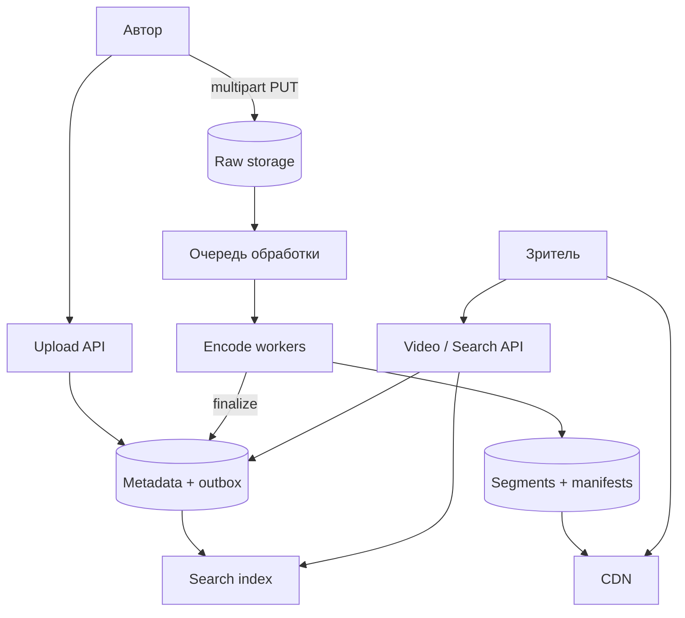
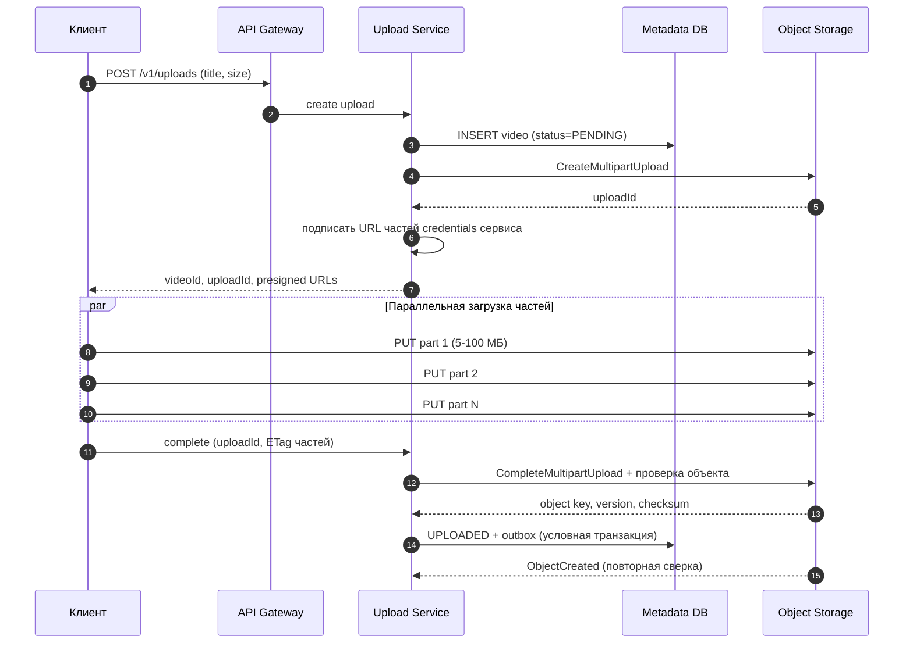
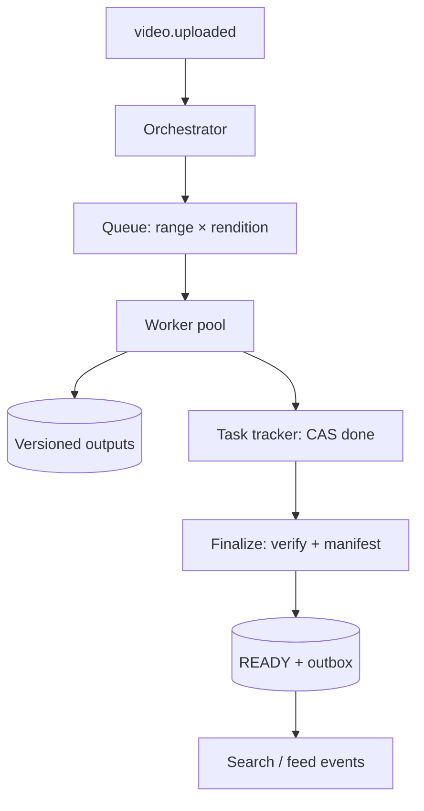
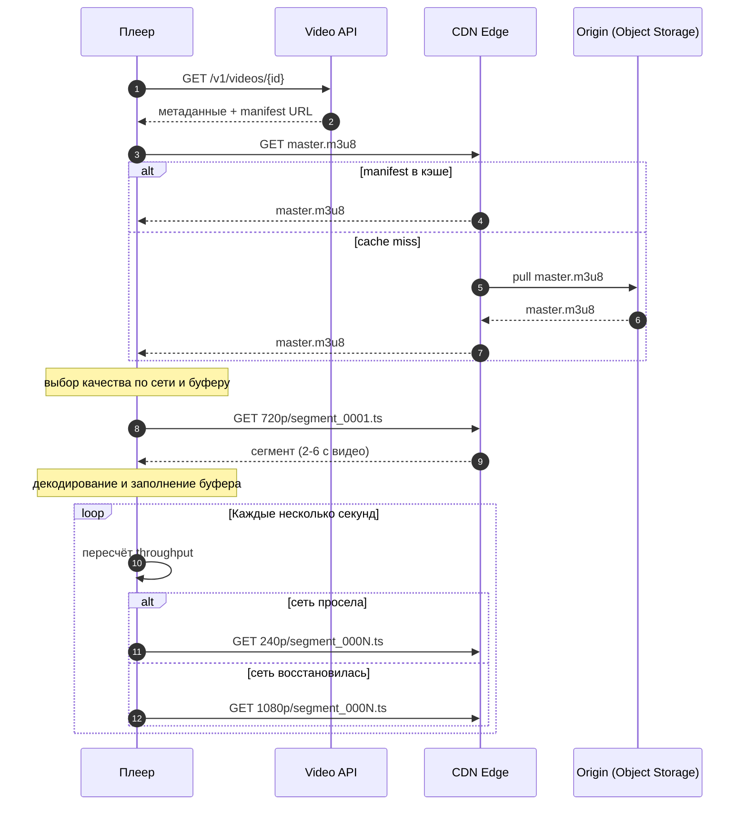
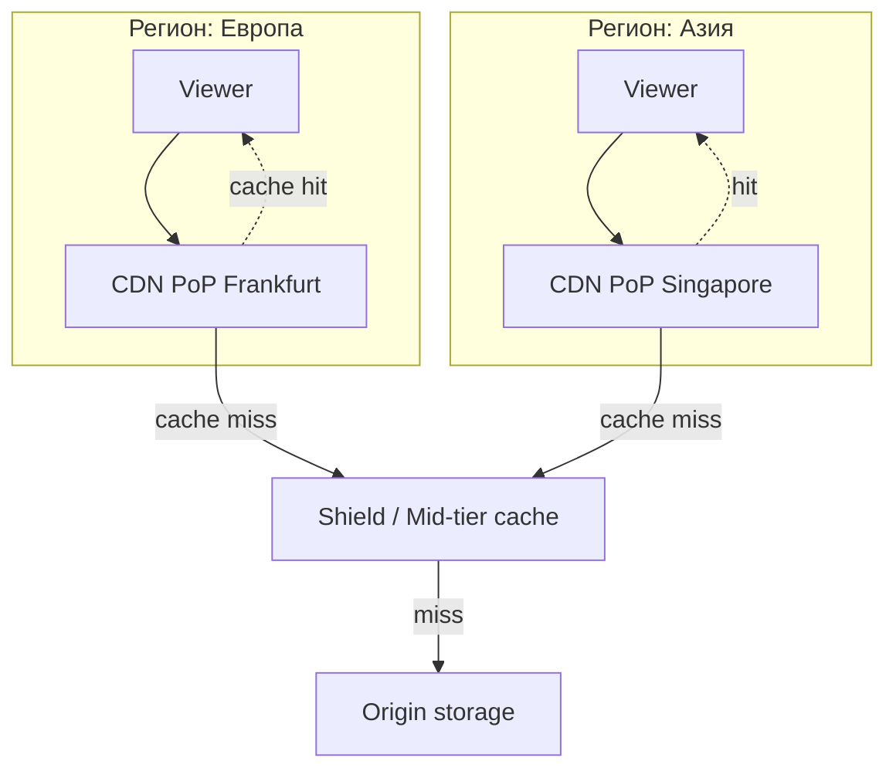
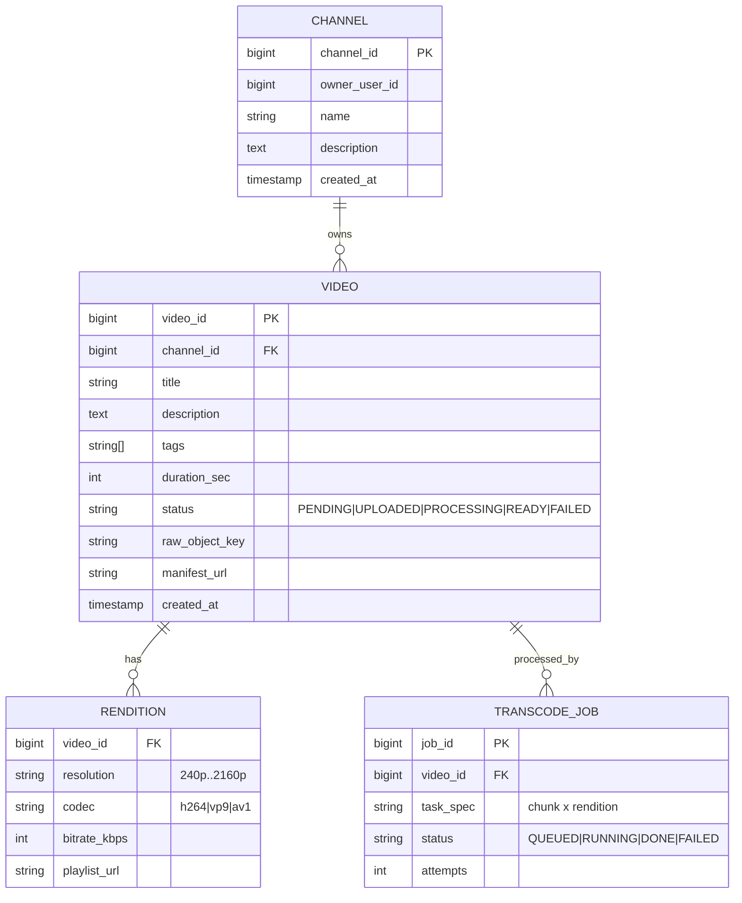
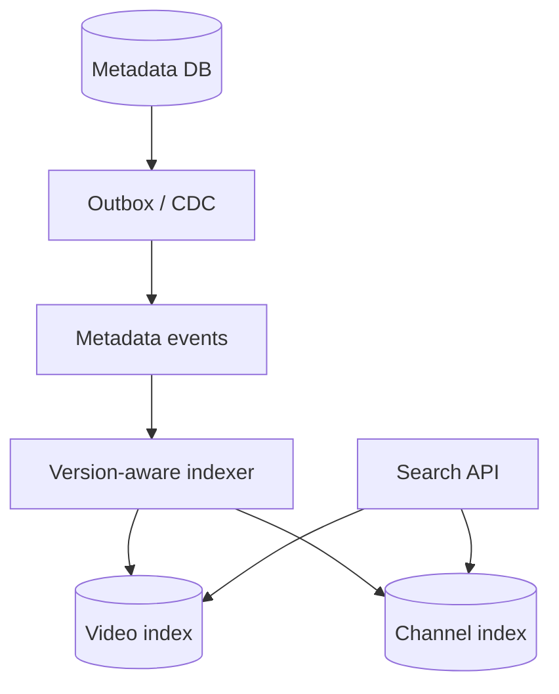

# Разбор задачи: видеоплатформа (YouTube / Netflix)

<!-- learning-nav:start -->
[← Все разделы](../README.md) · [Предыдущая тема](file-storage.md) · [Следующая тема →](search-autocomplete.md)
<!-- learning-nav:end -->

Классика system design собеседований и одна из самых «дорогих» по инфраструктуре задач. Здесь проверяют не столько знание конкретных технологий (HLS, FFmpeg), сколько умение работать с **огромными потоками бинарных данных**: загрузка гигабайтных файлов, асинхронная обработка через очередь, раздача петабайт трафика через CDN.

Типовая формулировка: «Спроектируй YouTube» / «Спроектируй Netflix». YouTube-вариант — пользовательская загрузка (UGC), длинный хвост контента, поиск. Netflix-вариант — профессиональный контент, акцент на pipeline транскодинга и DRM. В этом разборе берём YouTube-вариант как более общий, отличия Netflix отмечаем по ходу.

---

## 1. Уточняющие вопросы и требования

### Что спросить у интервьюера в первые 5 минут

Не начинайте рисовать, пока не зафиксировали рамку. Сильные вопросы для этой задачи:

- **Масштаб**: проектируем «YouTube в мире» (миллиарды пользователей) или региональный сервис? От этого зависит, нужен ли свой CDN или хватит внешнего.
- **Сценарии в скоупе**: загрузка + просмотр — обязательный минимум. Поиск? Лента рекомендаций? Комментарии/лайки? Каналы и подписки?
- **Live-стриминг рассматриваем?** Это принципиально другая задача (WebRTC/RTMP, задержка в секунды). Обычно выносят за скобку: «давайте только VOD».
- **Кто загружает**: любой пользователь (UGC, длинный хвост, модерация) или контент-партнёры (Netflix-модель)?
- **Ограничения на видео**: максимальный размер/длительность? Поддерживаем 4K?
- **Что выносим за скобки**: авторизация, монетизация, аналитика просмотров, DRM, модерация контента, превью-обложки (каждая — отдельный контур, на собеседовании честно сказать: «превью скипаю, иначе придётся рисовать ещё один контур хранения»).

### Functional requirements (в скоупе)

| # | Требование | Комментарий |
|---|-----------|-------------|
| F1 | Пользователь загружает видео (до нескольких ГБ) | Надёжно, с докачкой при обрыве |
| F2 | Пользователь смотрит видео по ссылке | Быстрый старт (< 1–2 с до первого кадра) |
| F3 | Воспроизведение адаптируется к пропускной способности клиента | Adaptive bitrate, уменьшение rebuffer ratio |
| F4 | Поиск видео по названию/описанию/тегам | Опционально, по договорённости |
| F5 | Метаданные: название, описание, статус обработки, счётчик просмотров | Минимум для UX |

### Non-functional requirements

| Требование | Целевое значение | Почему важно |
|-----------|------------------|--------------|
| Доступность чтения | 99.99%+ | Просмотр — core-сценарий, деградация недопустима |
| Задержка старта воспроизведения | < 500 мс – 2 с до первого кадра | Ключевая метрика UX (time to first frame) |
| Буферизация | Например rebuffer ratio < 1% в заданных сетях | ABR снижает риск, но не гарантирует непрерывную сеть |
| Консистентность | Eventual consistency допустима | Задержка между загрузкой и появлением в ленте/поиске — минуты, это нормально |
| Масштаб данных | Петабайты хранилища, сотни Тбит/с трафика | Диктует object storage + CDN |
| Стоимость | Минимизировать стоимость хранения и исходящего трафика | При таких объёмах egress — главная статья расходов |

> **Что говорить интервьюеру**: «Для этой системы latency запросов метаданных — не главное. Главные нефункциональные требования — пропускная способность (bandwidth), доступность раздачи и стоимость хранения. Это не request-response система, а система потоковой обработки больших бинарных данных». Эта фраза сразу показывает, что вы понимаете специфику задачи.

---

## 2. Оценки нагрузки (back-of-envelope)

Ниже учебный сценарий крупной UGC-платформы, а не измерения YouTube или Netflix. Считайте вслух, округляйте, важен порядок величин, а не точность.

### Исходные допущения

| Параметр | Значение | Обоснование |
|----------|----------|-------------|
| Всего пользователей | 2.5 млрд | Допущение для масштаба |
| DAU | 500 млн | ~20–25% от MAU |
| Просмотров на пользователя в день | 10 | Допущение |
| Средняя длительность видео | 20 мин | Для размера upload; watch time считаем отдельно |
| Соотношение загрузок к просмотрам | 1 : 1000 | Контент-мейкеров на порядки меньше зрителей |

### Производные оценки

**Просмотры:**

```text
5 млрд просмотров/день = 500 млн DAU × 10 видео
5×10⁹ / 86400 с ≈ 60 000 стартов воспроизведения в секунду (среднее)
Пик (×2–3 от среднего) ≈ 150–200 тыс. стартов/с
При watch time = полной длине: 57 870 стартов/с × 1200 с ≈ 69 млн сессий
Если в среднем смотрят только 5 мин: 57 870 × 300 ≈ 17 млн сессий
```

**Загрузки (write path):**

```text
5 млн новых видео/день (5 млрд просмотров / 1000)
5×10⁶ / 86400 ≈ 60 загрузок/с (среднее), пик ~200/с
```

**Хранилище.** Ключевой расчёт — сколько весит одно видео со всеми renditions:

```text
Исходник 4K: битрейт ~45 Мбит/с → 20 мин = 1200 с → ~6.8 ГБ (сырой upload)
Renditions для раздачи (H.264/VP9): 4K 15 Мбит/с + 1080p 8 + 720p 5 + 480p 2.5 + 360p 1 + 240p 0.5
Сумма ≈ 32 Мбит/с → 1200 с × 32 Мбит/с / 8 ≈ 4.8 ГБ на видео во всех качествах
Исходник + этот ladder ≈ 6.75 + 4.8 = 11.55 ГБ (без отдельных audio/subtitles и репликации)
Второй кодек — дополнительный набор данных, а не бесплатная замена первого
```

```text
Прирост: 5 млн видео/день × 11.55 ГБ ≈ 58 ПБ/день
За 5 лет без удаления и роста ≈ 105 ЭБ логических данных
Tiering меняет стоимость, но сам по себе не уменьшает число байтов
```

**Трафик раздачи (самое важное число в задаче):**

```text
69 млн сессий × 4 Мбит/с ≈ 278 Тбит/с при watch time 20 минут
17 млн сессий × 4 Мбит/с ≈ 69 Тбит/с при watch time 5 минут
Пик считаем отдельно по профилю регионов и времени суток
```

**RPS по API метаданных**: минимум один запрос на старт даёт ~58 тыс. RPS среднего, плюс лента, поиск и телеметрия. При 69 млн сессий и 6-секундных сегментах CDN обрабатывает порядка 11.5 млн segment GET/с только для видео; audio и повторы добавляют запросы. Маленький metadata API не означает маленький data plane.

> **Красный флаг**: путать мегабиты и мегабайты (ошибка в 8 раз) и терять нули в степенях. Если получилось «720 ПБ записи в день» или «одно видео весит 144 ГБ» — остановитесь и перепроверьте: 20 мин × 45 Мбит/с — это ~6.8 ГБ, а не 68. Интервьюеры в моках специально смотрят, заметит ли кандидат неадекватный порядок результата. Второй красный флаг — уйти в арифметику на 10 минут: посчитали порядки, сказали «точное число тут не меняет дизайн, схема от этого не поменяется», пошли дальше.

---

## 3. API

REST поверх HTTPS. Сами байты видео через API **не идут** (см. deep dive 1) — API работает только с метаданными и выдачей ссылок.

```text
POST   /v1/uploads                    # инициировать загрузку
       { title, description, tags[], sizeBytes, contentType }
       → { videoId, uploadId, parts: [{partNumber, url}, ...] }   # presigned URLs

POST   /v1/uploads/{videoId}/complete # завершить multipart (список ETag частей)
GET    /v1/uploads/{videoId}          # статус: PENDING / UPLOADED / PROCESSING / READY / FAILED

GET    /v1/videos/{videoId}           # метаданные + manifest URL (если READY)
GET    /v1/search?q=...&cursor=...    # поиск, курсорная пагинация
GET    /v1/videos/{videoId}/manifest  # → редирект на CDN: master.m3u8
```

Отдельные моменты, которые стоит проговорить:

- **Upload init отделён от загрузки байтов**: клиент сначала создаёт запись (метаданные + размер), получает presigned URLs и дальше работает напрямую с object storage.
- **Статусная модель** на видео — конечный автомат `PENDING → UPLOADED → PROCESSING → READY` (или `FAILED`). Клиент поллит `GET /v1/uploads/{videoId}` или получает webhook/WS-нотификацию о готовности.
- **Пагинация в поиске**: курсор содержит sort values и стабильный tie-breaker; для стабильной выдачи между страницами нужен snapshot/PIT. Один cursor без snapshot не исключает пропуски при изменении ранга.

---

## 4. High-level design

Три относительно независимых контура: **запись (upload)**, **обработка (transcoding pipeline)**, **чтение (streaming)**. Именно так и стоит вести рассказ: «разобьём систему на три контура и пройдём по каждому».



Ключевые решения на этой схеме, которые нужно уметь защитить:

- **Байты не проходят через наши сервисы.** Клиент загружает видео напрямую в object storage по presigned URLs и смотрит видео напрямую с CDN. Наши сервисы — только control plane. Это главная экономическая причина такого дизайна: проксирование петабайт через свои инстансы = платить за сеть и CPU дважды.
- **Object storage (S3 и аналоги) — базовый выбор для бинарных данных на этом масштабе.** Горизонтально масштабируется из коробки, дешёвое хранение, версионирование, lifecycle-политики (старые сырые исходники → cold storage / Glacier), встроенные события о записи объекта. Абстрагирует нас от дисков, серверов и директорий.
- **Очередь между записью и обработкой** — буфер, сглаживающий пики и развязывающий контуры (подробнее в deep dive 2).
- **CDN перед object storage на чтение** — снижает расстояние до зрителя, origin load и стоимость egress. Прямая раздача возможна; её экономику и пределы проверяем на нагрузке, а не объявляем storage неспособным обслуживать чтение.

---

## 5. Deep dive 1: загрузка — multipart и resumable upload

### Проблема

Видео — это гигабайты. Прогнать такой файл одним POST через API Gateway нельзя: у managed gateway лимиты тела запроса (у AWS API Gateway для обычного REST payload — 10 МБ), соединение с клиентом нестабильно (мобильная сеть), а обрыв на 99% означал бы загрузку заново.

### Решение: multipart upload напрямую в object storage

Для S3 multipart выбираем, например, parts 16–64 МиБ, вычисляя размер из лимита 10 000 parts и ограничения на файл. Parts загружаются независимо, storage собирает один объект по complete. У GCS resumable и Azure block blobs другие API и правила возобновления; переносим принцип, а не считаем протоколы взаимозаменяемыми.



### Что здесь важно проговорить на собеседовании

- **Presigned URL** подписывает приложение доступными ему credentials. Это ограниченное по времени право PUT конкретной part, а не секретные credentials клиента. URL можно использовать повторно до expiry; init/refresh требуют авторизации, квоты и привязки upload session к владельцу.
- **Возобновление**: клиент хранит `(uploadId, partNumber, ETag)`; backend сверяет состояние и при необходимости использует `ListParts` с пагинацией. Повтор part с тем же номером заменяет её: это безопасно только при тех же байтах/checksum. Потерянный ответ complete требует проверки результата, а не создания нового upload вслепую.
- **Завершение**: backend вызывает storage complete и проверяет фактический объект, размер, checksum и session, затем условно меняет статус. Клиент сообщает намерение закончить, но не является источником истины о байтах. ETag multipart не равен универсальному хэшу файла.
- **События storage** — удобный асинхронный сигнал, но не атомарная транзакция с Metadata DB. S3 доставляет их at-least-once и без гарантии порядка. Обработчик дедуплицирует по object version/session и не переводит READY назад в UPLOADED. Reconciler сверяет зависшие PENDING/UPLOADED с объектами и состоянием pipeline.
- **Брошенные upload**: TTL резерва квоты и session, правило `AbortIncompleteMultipartUpload`, уборка orphan-объектов. Для принятого исходника с ошибкой парсинга нужен terminal status с причиной; бесконечно повторять битый файл нельзя.

### Отказ от «честного» проксирования

Альтернатива — грузить части через свой Upload Service, склеивать и класть в S3. Работает, но: двойной трафик, нужно хранить промежуточные части, сложная логика стичинга, сервис становится stateful по потоку. Прямая загрузка упрощает масштабирование; прокси может понадобиться для обязательной проверки/преобразования потока или изоляции storage API. Его стоимость считаем отдельно.

---

## 6. Deep dive 2: пайплайн транскодинга через очередь

### Зачем асинхронность — это спросят обязательно

Вопрос интервьюера: «А зачем тут очередь? Давайте синхронно пережмём в Upload Service». Ответ по пунктам:

1. **Развязывание контуров**: загрузка завершилась — пользователь свободен, обработка случится «когда будут ресурсы». Пользователь не ждёт минуты/часы транскодинга.
2. **Сглаживание пиков**: очередь — буфер. Залили в 3 раза больше видео вечером — пережмём за следующие часы, не держа в 3 раза больший пул воркеров. Прямая экономия на инфраструктуре.
3. **Retry и отказоустойчивость**: воркер упал посреди 40-минутной задачи — сообщение вернётся в очередь (visibility timeout / redelivery), задачу подхватит другой.
4. **Независимое масштабирование**: воркеры транскодинга (CPU/GPU-тяжёлые) скейлим по длине очереди, а upload API — по RPS.

### Архитектура пайплайна



### Ключевые проектные решения

**Двухуровневый fanout задач.** Первое событие (`video.uploaded`) читает orchestrator и ставит не одну задачу «пережать видео», а **N задач «пережать чанк X в формат Y»**. Гранулярность задачи: `один чанк × один кодек × одно разрешение`. Число выходов — декартово произведение `форматы × разрешения` (например, 2 кодека × 6 разрешений = 12 renditions на чанк). Это даёт:

- параллелизм внутри одного видео (длинный фильм не ждёт один воркер часами);
- равномерную загрузку пула — нет «счастливчика», которому достался 3-часовой фильм целиком;
- дешёвые ретраи: упала задача на 30-секундном чанке — повторяем 30 секунд работы, а не час.

**Границы задач и сегментов.** Upload parts — произвольные байты, encode tasks — независимо обрабатываемые временные диапазоны, playback segments — единицы доставки плееру. Encode task может выпускать десятки сегментов. Входной декодер учитывает зависимости GOP, overlap и timestamps, а выходные ключевые кадры и временные границы должны совпадать между качествами. Простое копирование границ keyframes исходника этого не гарантирует. Per-title/per-shot подбор bitrate — отдельная оптимизация качества, а не обязательное условие параллелизма.

**Размерность вычислений.** При 5 млн × 20 мин × 12 выходов получается 1.2 млрд минут выходного видео в сутки. Если измеренная стоимость — одна core-minute на минуту одного выхода, нужно `1.2 млрд / 1440 ≈ 833 000` постоянно занятых core-equivalents, при утилизации 70% — около 1.2 млн. Это не «десятки тысяч воркеров» без уточнения: worker с 32 ядрами, GPU и совместное декодирование меняют расчёт. Benchmark делаем для кодека, preset, разрешения и требуемого качества; lag очереди не заменяет capacity plan.

**Join и публикация.** Job tracker хранит уникальные `(videoVersion, profileVersion, range, rendition)` и состояния задач. Переход task→DONE выполняется CAS; счётчик завершения увеличивается только при первом переходе. Иначе повтор сообщения может объявить видео готовым до появления всех сегментов. Для тяжёлых задач продлеваем lease/visibility timeout, вводим лимит попыток, DLQ и разные очереди для коротких/длинных видео.

**Идемпотентность.** Детерминированного object key недостаточно: старый worker может закончить после нового и перезаписать результат другой конфигурации. Пишем под версией исходника и encode profile, используем attempt/fencing token либо условную публикацию manifest. Finalize проверяет все обязательные объекты и playlists, затем публикует versioned master и CAS-переход READY с outbox-событием. До этого клиенты не видят неполный каталог. Допустима ранняя публикация baseline качества, но manifest перечисляет только готовые renditions.

> **Что говорить интервьюеру**: «Транскодинг — типичный embarrassingly parallel workload. Единственная координация — join-точка в конце: когда все чанки всех renditions готовы, собираем манифест. Поэтому очередь + stateless-воркеры + таблица прогресса закрывают задачу без тяжёлого workflow-движка».

---

## 7. Deep dive 3: adaptive bitrate — HLS/DASH и сегментация

### От прогрессивного скачивания к ABR

Полезно показать эволюцию решения — интервьюеры любят, когда кандидат выводит дизайн из проблем, а не называет готовые аббревиатуры:

1. **Скачать MP4 целиком перед playback** — выбранный режим заставляет ждать все байты; сам формат MP4 такого ожидания не требует.
2. **Прогрессивное скачивание (HTTP Range requests)** — клиент качает первые N мегабайт, начинает играть, докачивает фоном. Старт быстрый, но при просадке сети — буферизация: минуту смотрим, минуту ждём.
3. **Сегментация + несколько качеств + клиентский выбор сегмента** — это и есть adaptive bitrate streaming. Дальше остаётся назвать: эту работу за нас стандартизировали протоколы **HLS** (Apple, `.m3u8` плейлисты + `.ts`/`.fMP4` сегменты) и **MPEG-DASH** (открытый стандарт, `.mpd` манифест). Оба работают поверх обычного HTTP — то есть идеально ложатся на CDN.

### Два разных «chunking'а» — тонкость, которую почти никто не знает

В системе видео режется **дважды**, и это разные нарезки с разными целями:

| | Upload-чанки | Streaming-сегменты |
|---|---|---|
| Размер | 5–100 МБ | 2–10 секунд воспроизведения |
| Цель | минимизировать overhead HTTP-запросов при загрузке | быстрый старт, переключение качества на лету |
| Границы | произвольные байтовые офсеты | строго по keyframe'ам |
| Кто режет | клиентский SDK при загрузке | транскодер в пайплайне |

Если на собеседовании вы это различие проговорите — это сильный сигнал seniority.

### Как устроен манифест

`master.m3u8` — список variant-потоков (разрешение, битрейт, кодек), каждый указывает на свой media playlist с упорядоченным списком URL сегментов:

```m3u8
#EXTM3U
#EXT-X-STREAM-INF:BANDWIDTH=8000000,RESOLUTION=1920x1080,CODECS="avc1.640028"
1080p/index.m3u8
#EXT-X-STREAM-INF:BANDWIDTH=1400000,RESOLUTION=1280x720
720p/index.m3u8
#EXT-X-STREAM-INF:BANDWIDTH=400000,RESOLUTION=426x240
240p/index.m3u8
```

### Поток воспроизведения



### Что проговорить

- **Качество выбирает клиент** по throughput и буферу; CDN отдаёт подготовленные сегменты. Серверный путь прост, но его пределы — edge capacity, cache misses, авторизация и origin bandwidth.
- **Старт снизу вверх**: первый сегмент берём низкого качества (минимальный time-to-first-frame), дальше повышаем. Это улучшает старт, но не гарантирует 500 мс: учитываем DNS/TLS, RTT до API/CDN, последовательные manifest-запросы, init segment, DRM и decoder startup. SLO измеряем по сетевым когортам и cache hit/miss.
- **Ladder битрейтов** — таблица соответствия разрешение↔битрейт; в проде её делают per-title (сложное видео получает больше битов — per-title encoding Netflix), на собеседовании достаточно фиксированного ladder'а из 5–6 ступеней.
- **HLS vs DASH**: выбор зависит от target players, codecs и DRM. Один набор CMAF/fMP4 можно переиспользовать для обоих manifest при совместимых профилях, шифровании и поддержке плееров; это проверяемая матрица совместимости, а не универсальная гарантия.
- **Знать HLS/DASH наизусть не обязательно** — важно показать понимание фундаментальных компонентов: асинхронная нарезка, транскодинг в ladder, манифест, адаптивный выбор на клиенте. Названия протоколов — вишенка.

---

## 8. Deep dive 4: раздача через CDN

### Почему нельзя раздавать из object storage напрямую

CDN снижает RTT, число запросов к origin и стоимость выдачи популярных объектов. Сам object storage может масштабировать прямое чтение; сравниваем его цену, географию и rate limits с CDN по нашему трафику. На длинном хвосте miss rate выше, и origin всё равно должен выдерживать расчётную нагрузку.

### Модель работы: pull-кэш



- **Cache miss** → edge тянет сегмент с origin (через промежуточный shield-кэш, чтобы тысячи PoP'ов не долбили origin по одному и тому же новому видео — защита от thundering herd).
- **Cache hit** → сегмент отдаётся локально. Hit ratio измеряем отдельно по запросам и байтам: разные кодеки, качества, регионы и длинный хвост меняют результат; фиксированные 98% нельзя считать свойством CDN.
- **Что кэшируем**: versioned VOD manifests и segments можно хранить долго; изменяемый указатель на текущий manifest — с коротким TTL/revalidation. HLS/DASH не запрещают перезаписать URL: неизменяемость обеспечиваем нашим publish-протоколом. Для удаления/модерации нужны deny на edge и invalidation; CDN может держать старые байты после удаления origin.

### Распределение популярности и стратегия кэширования

Для учебного дизайна предполагаем перекошенное распределение популярности; конкретную долю горячего каталога измеряем. Отсюда:

- **Горячий хвост** — сидит на edge-кэшах во всех регионах.
- **Длинный хвост** — миллионы видео с нулём просмотров в месяц: кэшировать бессмысленно, отдаём с origin или с regional mid-tier. Политика — LRU/LFU с учётом размера сегмента; реактивное вытеснение, никакого «проактивно зальём всё на edge».
- **Препозиционирование**: для предсказуемых событий (премьера у топ-блогера, Netflix — новый сезон сериала в полночь) контент заранее пушится на edge. У Netflix Open Connect Appliances в сетях партнёров преимущественно заполняются в согласованное off-peak окно.

### Свой CDN vs внешний

| Вариант | Когда | Аргументы |
|---------|-------|-----------|
| Напрямую из object storage | MVP, низкий read | Ноль компонентов, но дорого и медленно при росте |
| Внешний CDN (CloudFront, Cloudflare, Akamai) | Стартап → большой сервис | Готовая геораспределённая сеть, платим за трафик |
| Свой CDN | Масштаб YouTube/Netflix | Возможна экономия при достаточной утилизации; свои PoP и эксплуатация |

> **Что говорить интервьюеру**: «На нашем масштабе я бы взял внешний CDN как black box и оговорил, что при выходе на сотни Тбит/с экономика начнёт оправдывать свою edge-сеть — но проектировать её внутренности сейчас выходит за рамки часа». Не пытайтесь проектировать внутренности CDN, если вас не просят, — типичная ловушка по времени.

### Hot key на метаданных

Отдельная проблема — вирусное видео: миллионы RPS на `GET /videos/{id}` метаданных. Решается стандартно: in-memory кэш (Redis) + local cache на инстансах с коротким TTL; счётчик просмотров не инкрементим синхронно в БД — собираем события просмотров в очередь и агрегируем офлайн.

---

## 9. Data model и поиск

### Метаданные

Метаданные — реляционные данные с чёткой схемой и связями. Объём скромный относительно видео: ~5 млн новых строк/день в `videos`, при ~1–2 КБ на строку это ~10 ГБ/день метаданных. Подойдёт PostgreSQL/MySQL с шардированием **по `video_id`** (hash): все запросы по конкретному видео попадают на один шард. Шардирование по `channel_id` даёт locality страницы канала, но создаёт перекосы; при shard key = video_id для списка канала нужен отдельный индекс/проекция по channel_id. Запросы списка нельзя объявить редкими без требований.



```sql
-- Ключевые индексы
CREATE INDEX idx_videos_channel ON videos(channel_id, created_at DESC);  -- страница канала
CREATE INDEX idx_videos_status   ON videos(status) WHERE status != 'READY'; -- мониторинг пайплайна
```

Статусный автомат `videos.status` — это и есть контракт между контурами: Upload Service пишет `PENDING`, storage-event воркер — `UPLOADED`, orchestrator — `PROCESSING`, finalize — `READY`. Read API отдаёт видео в поиск/ленту только в статусе `READY`.

### Поиск

Требования: полнотекст по title/description/tags, морфология (русский + английский), опечатки, ранжирование. `LIKE` не покрывает эти требования; для заданного масштаба берём поисковый движок: **Elasticsearch / OpenSearch** (или Sphinx, Manticore).

Поток данных в индекс — через ту же очередь событий:



Почему CDC/outbox, а не «сервис пишет и в БД, и в Kafka» (dual write): dual write неатомарен — упали между двумя записями, и индекс навсегда расходится с БД. CDC читает закоммиченные изменения из WAL — консистентность гарантирует база, доставку — конвейер. Outbox pattern — тот же эффект без Debezium: событие пишется в outbox-таблицу в той же транзакции, что и данные, а отдельный ретраящийся релей тащит его в Kafka. Платим eventual consistency: видео появится в поиске через секунды-минуты после `READY` — для этой задачи приемлемо (мы это зафиксировали ещё в NFR).

Индексы для видео и каналов — **разные**: схемы и запросы различаются, смешивать не надо, хотя для пользователя это одна поисковая строка с табами. Ранжирование: BM25 по тексту + сигналы популярности (просмотры, CTR) из офлайн-агрегаций. Autocomplete/suggest — отдельный индекс с edge n-gram'ами.

---

## 10. Trade-offs — сводная таблица

| Решение | Выбрали | Альтернатива | Цена выбора |
|---------|---------|--------------|-------------|
| Загрузка байтов | Presigned URLs → прямо в object storage | Проксирование через свой сервис | Клиент видит storage API; нужна механика presign и событий |
| Узнать о завершении upload | Backend complete + events + сверка | Только event/callback | Идемпотентная машина состояний и reconciler |
| Транскодинг | Асинхронно через очередь | Синхронно при загрузке | Видео доступно не мгновенно (минуты) |
| Гранулярность задач | chunk × rendition | Всё видео — одна задача | Сложнее координация (join + счётчики) |
| Стриминг | HLS/DASH поверх HTTP + CDN | Прогрессивный MP4; WebRTC | Для live нужны отдельные правила playlist и latency; WebRTC — другой компромисс |
| Раздача | Внешний CDN | Свой CDN; origin напрямую | Счёт за CDN-трафик; vendor lock-in |
| Метаданные | Sharded SQL | NoSQL (Cassandra/DynamoDB) | Джойны и схема vs гибкость; оба варианта защищаемы |
| Поиск | Elasticsearch через CDC | Поиск в SQL; dual write | Eventual consistency; операционная сложность ES-кластера |
| Хранение сырых исходников | Lifecycle → cold storage / удаление | Хранить вечно в hot tier | Риск невозможности пережать в новый кодек (AV1) |

Хранение исходника сохраняет возможность нового encode без повторной загрузки. Холодный tier имеет свою задержку и цену восстановления, поэтому batch-переэнкодирование планируем заранее. Экономию нового кодека измеряем при сопоставимом perceptual quality на нашем каталоге; фиксированный процент не универсален.

---

## 11. Красные флаги и типичные ошибки кандидатов

По мокам интервьюеры в этой задаче ловят на следующем:

- **Гнать байты видео через свои сервисы.** И на загрузке, и на раздаче. Сразу показывает непонимание экономики больших бинарных потоков. Control plane — наш, data plane — object storage и CDN.
- **Забыть про обрывы загрузки.** «POST /upload с файлом 10 ГБ» без multipart/resumable — минус в резюме интервью.
- **Доверять клиенту или одному событию статус завершения.** Истина — проверенный объект нужной версии и согласованный переход состояния.
- **Синхронный транскодинг** в ответе на загрузку. Не масштабируется, не переживает пики, плохой UX.
- **Одна задача на всё видео** вместо fanout по чанкам × renditions. Длинное видео станет непараллелизуемым хвостом.
- **Раздавать из object storage напрямую** без CDN при заявленном масштабе в сотни Тбит/с.
- **Dual write в поиск** («пишем в Postgres и сразу в Elasticsearch из кода сервиса») без слов про консистентность. Ждите вопроса «а что будет, если сервис упал между записями?». Ответ — CDC/outbox.
- **Счётчик просмотров синхронным UPDATE** в реляционную базу на каждый просмотр — горячая строка, локи, смерть на вирусном видео. События → очередь → агрегация.
- **Арифметика вслепую**: потерянные нули и путаница Mbit/MB, и — хуже — отсутствие sanity check результата («720 ПБ в день, ну ок»).
- **Проектировать всё подряд**: рекомендации, комментарии, DRM, монетизация в оставшиеся 10 минут. Лучше глубоко закрыть upload→transcode→stream, чем поверхностно всё.
- **Прыгнуть в HLS/DASH-детали, не выведя потребность**: сначала проблема (сеть проседает → буферизация), потом решение (ABR), потом название протокола.

---

## 12. Что спросят дополнительно (направления развития диалога)

- **Live-стриминг**: RTMP/SRT на ingest, транскодинг на лету, LL-HLS / Low-Latency DASH, задержка 2–5 с; WebRTC для интерактива (< 1 с). Совсем другая задача — чат, донаты, зрительские пики в момент события.
- **Рекомендации и лента**: кандидат-генерация (collaborative filtering, two-tower модели) + ранжирование; для системного дизайна важен контур: события просмотров → feature store → офлайн-обучение → онлайн-инференс → кэш ленты.
- **Дедупликация загрузок**: checksum для равенства байтов; perceptual/audio fingerprints для похожести. pHash не доказывает правообладание и не даёт безошибочный copyright detector.
- **DRM**: Widevine/FairPlay/PlayReady и лицензионный сервис. Простое AES-128-шифрование HLS с доступным ключом само по себе DRM не создаёт.
- **Гео-ограничения и модерация**: pre-publish пайплайн (NSFW-детекторы, аудио-фингерпринтинг), блокировка по регионам через edge-правила.
- **Обсервабилити пайплайна**: метрики lag очереди транскодинга, время от upload до READY (SLO), процент failed-задач; QoE-метрики клиента: startup time, rebuffer ratio, средний битрейт сессии.
- **Мультирегиональность**: home region или явно заданный multi-writer протокол. LWW допустим для некоторых текстовых полей, но не для отката READY, прав доступа и tombstone; failover проверяет доступность media version.

---

## 13. Шпаргалка: как вести рассказ (тайминг 45–60 мин)

1. **5 мин** — уточняющие вопросы, фиксируем скоуп (upload + watch + search), выносим live/монетизацию/рекомендации.
2. **5 мин** — оценки: DAU, просмотры, upload:watch 1:1000, ~58 ПБ/день логических данных, ~70–280 Тбит/с при разных watch time. Зафиксировать: «главное — bandwidth и стоимость, не RPS».
3. **3 мин** — API + статусная модель видео.
4. **10 мин** — high-level: три контура (запись / обработка / чтение), байты мимо наших сервисов.
5. **20 мин** — deep dive: upload (presigned, multipart, события хранилища), транскодинг (очередь, fanout, join), ABR (манифест, сегменты по keyframe'ам), CDN (pull-кэш, hit rate, длинный хвост).
6. **5–10 мин** — trade-offs, масштабирование, ответы на дополнительные вопросы.

---

## Вопросы и сценарии отказа

### 14. Как опубликовать видео, если два транскодера закончили одну задачу?

Уникальная task key включает версию исходника, encode profile, временной диапазон и rendition. Воркеры могут оба создать output, но только один CAS переводит задачу RUNNING→DONE. Счётчик join увеличивается в той же транзакции и только один раз. Старый lease не даёт права публиковать новую попытку: fencing token защищает от worker, который продолжил работу после сетевой паузы.

Допустим, нужно 240 задач, 239 завершены, а одна из них доставлена повторно. Наивный `completed++` даст 240 и READY, хотя последний сегмент отсутствует. Уникальная строка task и проверка полного набора обязательных задач предотвращают такой ранний publish. Finalizer сначала пишет playlists и versioned master, проверяет их ссылки, затем атомарно меняет metadata pointer и пишет outbox. Повтор finalize возвращает тот же результат.

При падении между записью master и metadata commit останется невидимый orphan, который уберёт GC. При обратном порядке зрители получат manifest 404. Если хотим начать playback до готовности 4K, объявляем минимальный набор ready-профилей и публикуем только их. Нельзя включать отсутствующее качество «оно скоро появится»: плеер может выбрать его сразу.

### 15. Почему правильного ABR недостаточно для старта за одну секунду?

Время до кадра складывается из нескольких последовательных этапов: получение metadata и playback capability, соединение с CDN, загрузка master и media playlist, init segment, достаточные байты первого media segment, при необходимости DRM license и инициализация декодера. При RTT 150 мс четыре последовательных round trips уже занимают 600 мс даже до передачи большого payload. Два p99 отдельных сервисов нельзя просто сложить и назвать p99 сессии — измеряем распределение end-to-end.

Например, 6-секундный сегмент на 1 Мбит/с весит около 0.75 МБ. Канал 2 Мбит/с передаст его целиком примерно за 3 с; конкретный player может декодировать раньше, но обещание «низкое качество значит <500 мс» не доказано. Для старта выбираем подходящий профиль и packaging, переиспользуем соединения, сокращаем лишние API hops и измеряем startup отдельно по сетям и cache hit/miss.

Метрики: time to first frame, доля неудачных стартов, rebuffer ratio, switch frequency и bitrate/quality. Нельзя улучшать startup ценой минут размытого видео и назвать это безусловным выигрышем. CDN miss требует origin capacity и request coalescing: ABR на клиенте не устраняет thundering herd.

### 16. На подумать: удалённое видео продолжает играть

Модератор заблокировал видео, объект удалён из origin, но зритель получает сегменты из CDN ещё час. Как изменить контракт удаления?

<details>
<summary>Разбор</summary>

Удаление origin не удаляет cached copies. Сначала metadata запрещает новые playback sessions и создаёт событие блокировки. Edge deny по video/version должен проверяться до отдачи cache hit, после чего invalidation очищает manifests и segments. Для ограниченного контента выдаём краткоживущие CDN URLs/cookies, а origin разрешает запросы только от CDN; подписи защищают и media segments, и manifests.

Если edge работает только с автономной подписью без актуального denylist, обещаем отзыв будущих запросов в пределах TTL capability, а не мгновенно. Старый manifest может содержать рабочие URL, поэтому блокировки только API недостаточно. Уже загруженные в буфер или сохранённые байты отозвать нельзя. Состояние takedown — монотонное относительно старых READY-событий: задержанный индексатор или транскодер не должен воскресить удалённое видео.

</details>

---

<a id="источники-и-видео-по-теме"></a>

## Видео по теме

- [System Design Youtube / TeamLead Avito](https://www.youtube.com/watch?v=L9Lt0KEPcDc) — русскоязычный мок: уточнение требований, сайзинг (DAU, соотношение 1:1000, расчёт хранилища и трафика), триггеры object storage, обоснование асинхронной очереди, fanout задач транскодинга по разрешениям, CDC/outbox для поиска, CDN vs object storage на чтение.
- [System Design Interview: Design YouTube w/ a Ex-Meta Staff Engineer](https://www.youtube.com/watch?v=IUrQ5_g3XKs) — полный разбор: presigned URLs и multipart upload, S3 notifications вместо доверия клиенту, два разных chunking'а (upload vs streaming), manifest-файл, adaptive bitrate на клиенте, CDN с популярными сегментами, зачем нужны HLS/DASH и что из них знать необязательно.
- [Разработка протокола потоковой передачи видео (HLS, DASH) / Проектирование системы](https://www.youtube.com/watch?v=v6qvrIY5Tgs) — вывод adaptive bitrate из первых принципов: прогрессивное скачивание → range requests → сегменты → выбор качества клиентом; почему заранее пережатые качества в хранилище, а не транскодинг на лету.
- [How NETFLIX onboards new content: Video Processing at scale](https://www.youtube.com/watch?v=x9Hrn0oNmJM) — пайплайн обработки: декартово произведение «форматы × разрешения», гранулярность задачи «один чанк — один формат — одно разрешение», переход от нарезки по таймеру к нарезке по сценам (shots), пере-энкодинг каталога новым кодеком.
