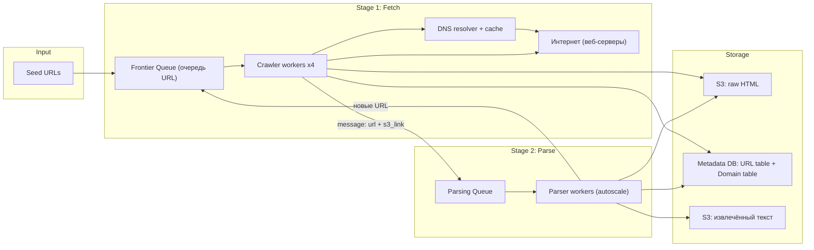
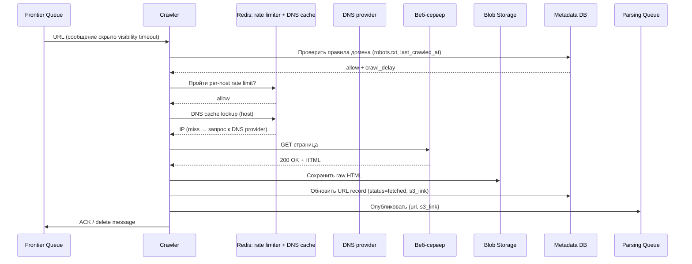
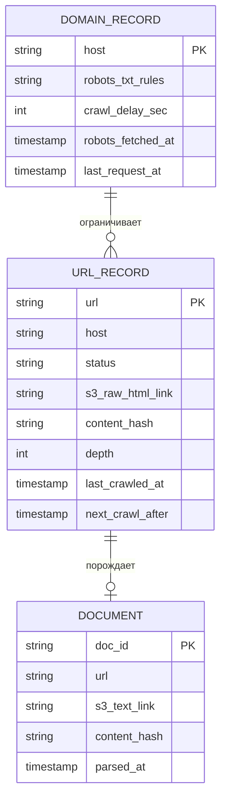
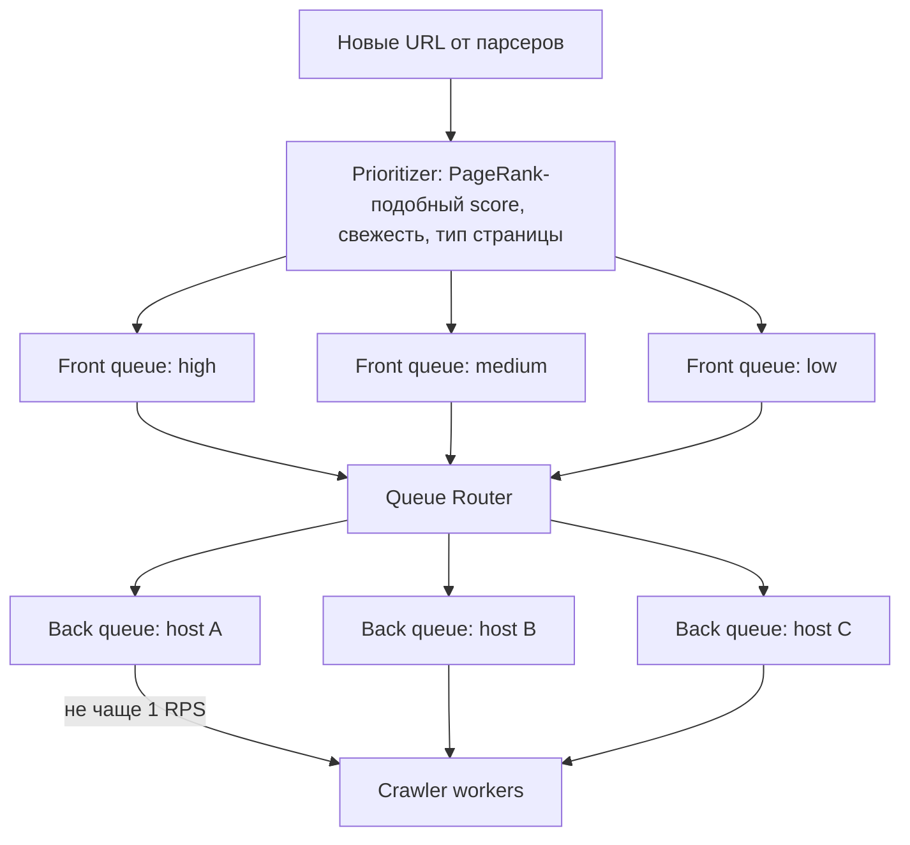
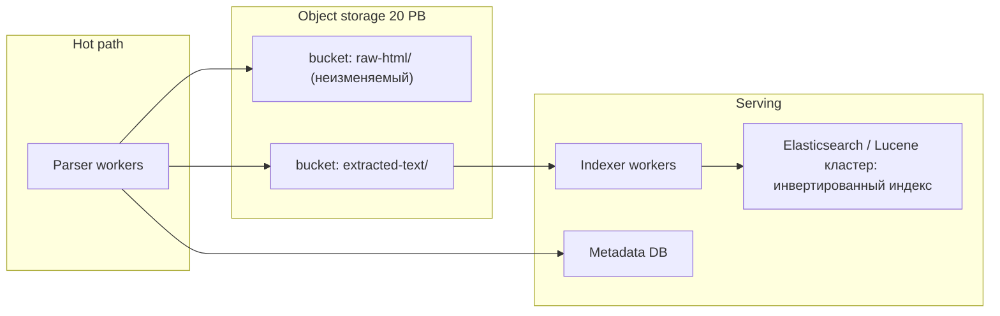
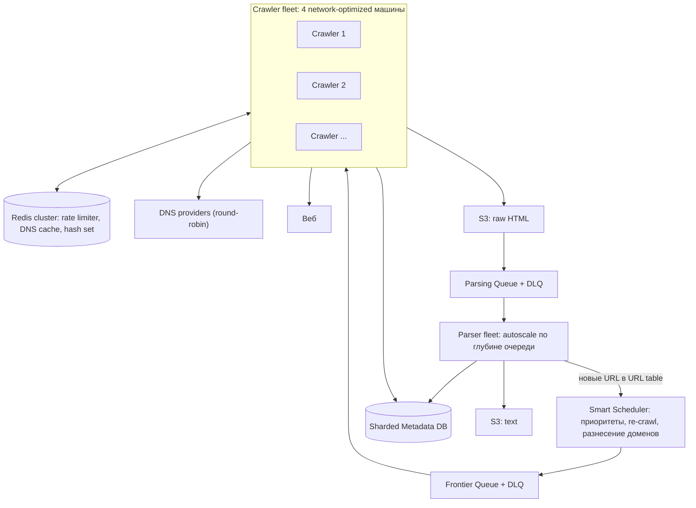

# Разбор задачи: поисковый веб-краулер

> Классическая infra-задача System Design: спроектировать систему, которая обходит веб,
> скачивает страницы, извлекает из них контент и складывает его в хранилище.
> Встречается в формулировках «design a web crawler», «спроектируй поисковый робот»,
> «собери корпус текстов для обучения LLM». Задача проверяет не знание алгоритмов,
> а умение строить отказоустойчивый data pipeline с очередями, rate limiting и дедупликацией.

## Что проверяет эта задача

- Умение декомпозировать пайплайн на независимо масштабируемые стадии (fetch → parse → index).
- Работу с очередями сообщений: семантика доставки, retries, dead letter queue.
- Понимание «вежливости» краулера: robots.txt, per-host rate limiting, politeness.
- Дедупликацию на масштабе миллиардов записей: hash set, вторичный индекс, bloom filter.
- Back-of-the-envelope оценки, которые **влияют на дизайн**, а не посчитаны «для галочки».

---

## Уточняющие вопросы

Первый вопрос, который стоит задать, — **зачем нужен краулер**. От ответа зависит половина дизайна:

| Назначение | Что меняет в дизайне |
|---|---|
| Индексация для поисковика (Google/Яндекс) | Нужен инвертированный индекс, периодический re-crawl, приоритизация страниц по «важности» |
| Сбор корпуса текстов для LLM | Одноразовый прогон, дедупликация контента критична, индекс не нужен |
| Мониторинг изменений на конкретных сайтах | Маленький frontier, акцент на свежесть и diff |
| Архивирование (Wayback Machine) | Храним сырой HTML навсегда, версионирование |

Дальше уточняем масштаб и ограничения:

- Сколько страниц нужно обойти? (Порядок: единицы миллиардов страниц в индексируемом вебе.)
- Есть ли дедлайн? (В мок-разборе от ex-Meta staff engineer используется жёсткое ограничение «10 млрд страниц за 5 дней» — оно превращает задачу в расчёт пропускной способности.)
- Нужно ли рендерить JavaScript (SPA на React/Angular), или достаточно статического HTML?
- Какой контент сохраняем: сырой HTML, извлечённый текст, метаданные?
- Нужен ли re-crawl (обход по кругу) или одноразовый прогон?
- Каковы ресурсные ограничения: «неограниченный бюджет в разумных пределах» или жёсткая экономия?

**Что говорить интервьюеру:** «Прежде чем проектировать, я бы зафиксировал назначение: краулер для поискового индекса и краулер для сбора датасета — это две разные системы. Давайте я возьму вариант с корпусом текстов для LLM: 10 млрд страниц, нужно уложиться в 5 дней, на выходе — очищенный текст в хранилище». Это показывает, что вы управляете scope, а не ждёте, пока вас поведут.

---

## Требования

### Функциональные

1. Обойти веб, начиная с набора seed URL, рекурсивно переходя по ссылкам.
2. Скачать HTML каждой страницы.
3. Извлечь текстовый контент и сохранить его.
4. Извлечь ссылки со страницы и добавить их в очередь обхода.
5. Не обрабатывать один и тот же URL и один и тот же контент дважды.

### Нефункциональные

| Требование | Почему важно именно здесь |
|---|---|
| **Fault tolerance** | Обход длится днями; падение воркера или всей стадии не должно терять прогресс |
| **Politeness** | Нельзя «заддосить» чужие сайты; нужно соблюдать robots.txt и crawl-delay |
| **Scalability** | 10 млрд страниц — пропускная способность достигается только горизонтальным масштабированием |
| **Efficiency** | Уложиться в дедлайн; не тратить ресурсы на дубли URL и дубли контента |

Важный приём: нефункциональные требования нужно **квантифицировать** («обойти 10 млрд страниц за 5 дней», «не более 1 RPS на хост»), а не писать абстрактное «быстро и надёжно».

---

## Оценки нагрузки

Типичная ошибка кандидата — посчитать в начале «10 млрд страниц × 2 МБ = 20 ПБ, ух ты, много» и идти дальше. Интервьюер из такого расчёта узнаёт только то, что вы умеете умножать. Сильный ход — сказать прямо: **«я отложу расчёты до момента, где они повлияют на решение»**. В этой задаче такой момент — выбор числа машин для обхода. Считаем там.

Входные данные:

- Страниц: `N = 10^10` (10 млрд).
- Средний размер страницы: `~2 МБ`.
- Дедлайн: `5 дней ≈ 4.3 × 10^5 с`.
- Требуемая средняя скорость: `10^10 / 4.3 × 10^5 ≈ 23 000 страниц/с`.

Сколько машин нужно? Верхняя граница по сети: топовый network-optimized инстанс в облаке — `400 Гбит/с`:

```
400 Гбит/с ÷ 8 = 50 ГБ/с
50 ГБ/с ÷ 2 МБ/страница ≈ 25 000 страниц/с   ← теоретический потолок одной машины
```

Но 100% полосы использовать невозможно: DNS-запросы, медленные серверы, crawl-delay, retries, наш собственный rate limiter. Реалистичная утилизация — 25–30%:

```
25 000 × 0.3 ≈ 7 500–10 000 страниц/с на машину (грубая прикидка)
10^10 страниц ÷ 10^4 страниц/с = 10^6 с ≈ 10 дней на одну машину
```

Чтобы уложиться в 5 дней, нужно минимум 2 такие машины; берём **4 с запасом** на сбои и неравномерность. Честная оговорка, которая звучит сильно: «В реальности я бы не считал это аналитически, а прогнал бы пилот на одной машине, измерил фактический throughput и экстраполировал».

Прочие оценки, которые понадобятся в deep dive:

- Метаданные URL: `10^10 записей × ~500 Б ≈ 5 ТБ` — шардируемая key-value БД.
- Хэши контента для дедупликации: `10^10 × 20 Б = 200 ГБ` — помещается в один большой Redis-инстанс (256 ГБ), что снимает необходимость в bloom filter «по бедности».
- Сырые данные: `10^10 × 2 МБ = 20 ПБ` — объектное хранилище (S3).

---

## API / интерфейс системы

У краулера нет user-facing API, поэтому вместо REST-контрактов фиксируем **границу системы**: вход и выход.

```
Вход:  seed URLs (список), конфигурация (max depth, лимиты, user-agent)
Выход: очищенный текст страниц + метаданные в хранилище
```

Core entities, которые гуляют по системе:

- **URL record** — URL, статус обхода, глубина, ссылка на сырой HTML, хэш контента, время последнего обхода.
- **Domain record** — домен, правила robots.txt (disallow, crawl-delay), время последнего обращения.
- **Document** — извлечённый текст, ссылка на источник.

---

## High-level design

Ключевое архитектурное решение: **не делать монолитного воркера**, который «скачал → распарсил → сохранил» в одном цикле. Если воркер упал посередине — потерян весь прогресс по URL; стадии нельзя масштабировать независимо; наблюдаемость нулевая. Правильный рефлекс на любую задачу про data pipeline: **разбить на стадии, соединённые очередями**.

Естественная граница — между fetch и parse: скачивание — самая хрупкая операция (сайты падают, таймаутят, rate-limit'ят), поэтому после неё сразу сохраняем сырой HTML в blob storage. Парсинг можно повторять сколько угодно раз по сохранённому HTML, не дёргая сеть повторно. Бонус: если завтра ML-команда попросит извлекать ещё и alt-текст картинок — обновляем только парсер и перезапускаем вторую стадию, без повторного обхода интернета.



Обратите внимание: в очереди кладём **указатель** (`url + s3_link`), а не сам HTML. Kafka по умолчанию ограничивает сообщение 1 МБ, SQS — 256 КБ, а средняя страница — 2 МБ. Очереди не предназначены для переноса больших payload'ов — для этого есть blob storage. Это стандартный паттерн «claim check».

### Поток данных по шагам



---

## Модель данных



Выбор хранилищ:

| Данные | Хранилище | Почему |
|---|---|---|
| Raw HTML, извлечённый текст | S3 / объектное хранилище | 20 ПБ, дёшево, высокая дурability, идеально для blob'ов |
| URL table, Domain table | Шардированная KV/NoSQL (DynamoDB, Cassandra) или PostgreSQL с шардированием | Точечные чтения/записи по ключу, сильных требований к консистентности нет |
| Rate limiting, DNS cache, content hash set | Redis | In-memory, десятки миллисекунд, рядом с воркерами в одном VPC |
| Поисковый индекс (если краулер для поисковика) | Elasticsearch / Lucene-кластер | Инвертированный индекс из коробки |

URL table шардируется по `url` (или по `host` — см. deep dive про frontier). Требований к сложным запросам нет, поэтому тип БД — не принципиален; не тратьте на это время интервью, скажите так прямо.

---

## Deep dive 1: Frontier и очередь URL

### Семантика «взял из очереди»

Фраза «воркер достал URL из очереди» на самом деле неточна, и умение это раскрыть — сильный сигнал. Сообщение **остаётся в очереди**, пока обработка не подтверждена:

- **Kafka**: сообщение идентифицируется offset'ом. Воркеры объединены в consumer group — одно сообщение читает ровно один воркер группы. После успешной обработки воркер коммитит offset. Удаление происходит по retention policy (по умолчанию 7 дней или по размеру партиции).
- **SQS**: сообщение скрывается на visibility timeout (по умолчанию 30 с). Если воркер упал — таймаут истекает, сообщение снова видимо и его заберёт другой воркер. После успеха воркер явно шлёт `DeleteMessage`.

Итог в обоих случаях: падение воркера = повторная обработка, а не потеря. Доставка **at-least-once** — отсюда требование идемпотентности: запись в S3 по детерминированному ключу и upsert в URL table безопасны при повторе.

### Retries и Dead Letter Queue

Интернет — грязное место: сайты лежат, отвечают 500, таймаутят. Наивное решение — `sleep(5)` в воркере и повторить — не работает: таймер в памяти умрёт вместе с воркером, а сайт через 5 секунд, скорее всего, не воскреснет.

Правильная стратегия — **exponential backoff с ограничением числа попыток**:

- В SQS это конфигурация из коробки: растущий visibility timeout (30 с → 2 мин → 15 мин...), а по достижении `ApproximateReceiveCount = 5` сообщение автоматически уезжает в **Dead Letter Queue**.
- В Kafka retries из коробки нет: придётся завести отдельный topic для failed URL, в тело сообщения класть `next_attempt_at`, а воркер — ждать наступления этого времени и увеличивать backoff экспоненциально. Работает, но заметно мессири.

Это место, где можно показать глубину по message queues — если она у вас есть. Если нет, ответ «нужен экспоненциальный backoff и DLQ» — уже нормальный senior-ответ.

### Структура frontier: почему одна FIFO-очередь — плохо

Ссылки со страницы чаще всего ведут на тот же домен. В простой очереди образуется «пачка» из сотен URL одного хоста подряд: воркеры хватают их, упираются в per-host rate limiter и кладут обратно — мёртвые циклы и потраченный CPU. Плюс приоритеты: свежие новостные страницы важнее архивных.

Решение — **двухуровневый frontier**: front queues (приоритет) + back queues (per-host вежливость). Это классическая схема из Mercator (Google) и описана у Алекса Сю:



- **Front queues** реализуют приоритет: URL получает score (важность домена, свежесть, глубина) и попадает в одну из K очередей приоритета.
- **Router** перемешивает URL по back queues, по одной на хост: очередь для хоста A отдаёт следующий URL не раньше, чем истёк crawl-delay по предыдущему.
- Back queues естественно реализуют politeness **без** отдельного rate limiter'а на горячем пути — интервал между обращениями к хосту задан самой структурой.

Более простая альтернатива, которую можно предложить первой: **smart scheduler**. Парсеры складывают новые URL не в очередь, а сразу в URL table со статусом `pending`; отдельный планировщик периодически выбирает пачку URL, раскладывает их так, чтобы разнести домены, и публикует во frontier queue. Это же решение закрывает и re-crawl: scheduler возвращает в очередь URL, у которых `now - last_crawled_at` превышает порог свежести.

---

## Deep dive 2: Politeness и per-host rate limiting

### robots.txt

Файл на каждом веб-сервере, описывающий правила обхода **на уровне домена**:

```
User-agent: *
Disallow: /private/
Crawl-delay: 10
```

- `User-agent` — к каким краулерам применяются правила (`*` — ко всем).
- `Disallow` — запрещённые пути.
- `Crawl-delay` — минимальная пауза между запросами к домену, в секундах.

Механика соблюдения:

1. При первом обращении к домену скачиваем его robots.txt и сохраняем в Domain table (`rules`, `crawl_delay_sec`, `robots_fetched_at`).
2. Перед каждым запросом: путь в `Disallow`? — ACK сообщения без скачивания (URL удаляем из очереди, краулить нельзя).
3. Проверяем `now - last_request_at >= crawl_delay`. Если пауза не выдержана — возвращаем URL в очередь с отложенной видимостью (в SQS — visibility timeout = crawl_delay).
4. robots.txt может меняться — даём записи TTL (например, сутки) и перезапрашиваем файл по истечении.

Чтение Domain table на горячем пути — кандидат на in-memory кэш в Redis; хотя система всё равно IO-bound на сетевых запросах, так что это оптимизация второго порядка.

### Per-host rate limiting

Даже если сайт не задал crawl-delay (большинство не задаёт), де-факто стандарт вежливости — **не более 1 запроса в секунду на хост**. Реализация: Redis как in-memory rate limiter с ключом = хост. Проверка занимает десятки миллисекунд — дёшево на фоне сетевого запроса.

Выбор алгоритма — тот же разбор, что и в задаче про rate limiter:

| Алгоритм | Плюсы | Минусы | Пригодность для краулера |
|---|---|---|---|
| Fixed window counter | Тривиален: hash-map `host → (counter, window_start)` | Boundary effect: 2x лимита на границе окна | Допустим: для politeness точность ±окно не критична |
| Sliding window log | Идеальная точность | Память: timestamp каждого запроса на хост | Избыточен |
| Sliding window counter | 2 числа на хост, сглаживает boundary effect | Аппроксимация, предполагает равномерность | Хороший баланс |
| Token bucket | Burst capacity + steady rate, 2 числа на хост | Нужно подобрать refill rate | Стандартный выбор |

**Jitter обязателен.** Без него 10 воркеров, одновременно упершихся в лимит по одному домену, вернут URL в очередь, одновременно достанут их снова и синхронно упрутся опять — пройдёт только один, цикл повторится. Случайная добавка к задержке (`timeout + random(0, jitter)`) рассинхронизирует воркеров.

### DNS — скрытый bottleneck

При 10–25 тыс. страниц/с столько же DNS-запросов. Сторонний DNS-провайдер имеет собственные rate limits, и краулер может упереться не в сеть, а в DNS. Решения:

- **DNS-кэш** в том же Redis-кластере: для одного домена резолвим один раз, дальше берём из кэша (с уважением TTL записи).
- **Несколько DNS-провайдеров с round-robin** между ними — простое и очень практичное решение: снимает и rate limit, и единую точку отказа. В моке от ex-Meta staff engineer эта идея от кандидата выделена как пример мышления уровня staff: не академический ответ из книжки, а именно то, что инженер предложил бы на реальном инциденте.

---

## Deep dive 3: Дедупликация

Дедупликация нужна на двух уровнях, и важно не путать их.

### Уровень 1: не обходить один URL дважды

Парсер извлекает со страницы ссылки, и с высокой вероятностью они уже встречались. Решение — проверка существования в URL table (первичный ключ — URL). Тонкость: если запись создаётся только после парсинга, то между «добавили в очередь» и «распарсили» один URL может попасть во frontier многократно. Поэтому запись создаём **при добавлении в очередь** (`status=pending`, `last_crawled_at=null`), а обновляем по факту обхода. Lookup по PK в шардированной KV — O(log n)/O(1), это не bottleneck.

### Уровень 2: не обрабатывать дублирующийся контент

Разные URL (иногда на разных доменах) несут идентичный контент — в интернете это встречается на удивление часто. Механика: краулер хэширует сырой HTML (SimHash/MD5 по нормализованному контенту), и перед постановкой в parsing queue проверяет: такой хэш уже видели?

Три варианта хранения `10^10` хэшей — и честный разбор trade-off'ов:

| Вариант | Стоимость lookup | Память/хранилище | Риски |
|---|---|---|---|
| Secondary index на `content_hash` в основной БД | O(log n), ~мс | Индекс рядом с данными, ничего нового | Медленнее in-memory; рост индекса |
| Redis set (20 Б × 10^10 = 200 ГБ) | O(1), десятки мс внутри VPC | Один инстанс на 256 ГБ — дорого, но помещается | Падение Redis → нужна persistence (AOF/RDB) и реплика |
| Bloom filter | O(1) | На 1–2 порядка компактнее: при p=1% на 10^10 элементов ≈ 12 ГБ | **False positives возможны**: откажемся от уникального контента, решив, что он уже есть |

Формула размера bloom filter: `m = -n·ln(p) / (ln 2)²` бит; для `n = 10^10`, `p = 0.01` — около 9.6 бит на элемент, т.е. ~12 ГБ против 200 ГБ полного набора хэшей.

**Важный инсайт из моков реальных интервью:** кандидаты массово кричат «bloom filter!», не обосновав, какую проблему решают. Интервьюер это считывает как регургитацию из книг (bloom filter фигурирует во всех методичках). Сильная подача выглядит так: «Bloom filter экономит память ценой false positives — мы потеряем часть уникальных страниц. Если бюджет позволяет Redis на 256 ГБ, детерминированный hash set или GSI честнее. Bloom filter я бы взял только при жёстком ограничении на память». Сначала constraints, потом структура данных — не наоборот.

### Crawler traps

Ловушки краулера — страницы, генерирующие бесконечные цепочки ссылок (календари с «следующий месяц», страницы, ссылающиеся сами на себя с разными query-параметрами). Без защиты воркеры будут бесконечно жевать один домен с нулевым контентом. Защита простая: поле `depth` у URL, парсер при добавлении ссылки пишет `depth = parent.depth + 1`, и при превышении порога (например, 20) URL в очередь не ставится. Дополнительно — лимит страниц на домен.

---

## Deep dive 4: Хранение документов и индексация

### Слои хранения



Принципы:

- **Raw HTML неизменяем** и пишется один раз — это ваш «источник истины» для повторных прогонов парсера.
- **Извлечённый текст** — отдельный бакет/префикс; потребители (поисковый индексатор, ML-команда) читают уже его.
- Метаданные маленькие и горячие — в шардированной БД; сами документы большие и холодные — в object storage. Не смешивайте: хранение 2 МБ blob'ов в реляционной БД — красный флаг.
- Под капотом и object storage, и шардированные KV-базы (Cassandra, DynamoDB, RocksDB-based) живут на **LSM-tree**: запись идёт последовательным append в memtable + WAL, периодически сливается в иммутабельные SSTable, compaction сливает файлы в фоне. Для write-heavy нагрузки краулера (сплошные вставки, почти нет апдейтов и range-чтений) LSM подходит идеально — в отличие от B+-tree, где вставки дают random I/O и дробление страниц.

### Инвертированный индекс (если строим поисковик)

Краулер сам по себе поиск не делает — он наполняет корпус. Поиск строится на **инвертированном индексе**: отображение `термин → список документов (posting list)`, часто с позициями термина и статистикой для ранжирования (TF-IDF / BM25).

```
Документ 1: "berries are fast and reliable"
Документ 2: "fast cars"

Индекс:
berries  → [1]
fast     → [1, 2]
reliable → [1]
cars     → [2]
```

Запрос «fast» мгновенно даёт пересечение posting lists. Именно так устроены Lucene/Elasticsearch и full-text search в PostgreSQL — на собеседовании достаточно сказать: «индексация — офлайн-процесс поверх корпуса, строим инвертированный индекс, шардируем по документам (по doc_id), реплицируем шарды для read throughput». Индекс шардируется **по документу**, а не по термину: запрос рассылается на все шарды, результаты мерджатся — это стандартный scatter-gather.

---

## Масштабирование кластера краулеров

Собираем всё вместе (финальная схема, которую имеет смысл дорисовать к концу интервью):



Ключевые принципы масштабирования:

- **Bottleneck — сеть на fetch-стадии**, всё остальное должно «успевать следом». Парсеры масштабируются автоматически по глубине parsing queue (EC2 Auto Scaling / Karpenter / Lambda): очередь растёт — добавляем воркеров.
- **Scalability обсуждаем последней.** Система эволюционирует в ходе интервью; если начать с «как масштабировать краулер», вы промасштабируете монолитного воркера, которого через 20 минут разделите на стадии. Сначала финальный дизайн, потом масштабирование узких мест.
- **Шардирование frontier по хосту** (back queues) одновременно решает politeness и равномерно раскидывает нагрузку по воркерам. Для партиционирования по хосту достаточно `hash(host) mod N`; consistent hashing понадобится, если число партиций/воркеров меняется динамически и мы хотим минимизировать перекладывание ключей.
- **Каждая стадия — stateless**, состояние вынесено в очереди, Redis и Metadata DB: любой воркер можно убить и перезапустить без потерь.

---

## Trade-offs: сводная таблица

| Решение | Выбрали | Альтернатива | Чем пожертвовали |
|---|---|---|---|
| Транспорт frontier | SQS (backoff, DLQ из коробки) | Kafka (дёшевле на гигантском потоке, replay) | Kafka даёт replay и порядок в партиции; SQS проще операционно |
| Payload в очереди | Указатель на S3 | Сам HTML в сообщении | Лишний сетевой хоп парсера vs лимиты размера сообщений |
| Дедуп контента | Redis set / GSI | Bloom filter | Точность vs память (200 ГБ vs 12 ГБ) |
| Politeness | Per-host back queues + Redis limiter | Только crawl-delay из robots.txt | Большинство сайтов не задают crawl-delay — нужен свой лимит |
| Рендеринг JS | Не делаем (статический HTML) | Headless browser (Puppeteer) | В разы медленнее, дороже и хрупче — только если бизнес требует SPA-контент |
| Хранение метаданных | NoSQL/KV | PostgreSQL | Простые KV-запросы не используют сильные стороны реляционки |
| Одна машина мощнее vs кластер | 4 network-optimized машины | Десятки слабых | Меньше машин — проще per-host координация, но крупнее blast radius |

---

## Что спросят дополнительно

- **«Как обрабатывать динамический контент (React/SPA)?»** — нужен headless browser (Puppeteer/Playwright) в fetch-стадии: рендерим JS, потом извлекаем DOM. Дорого, медленно, хрупко; обычно делают для подмножества важных сайтов.
- **«Очень большие страницы/файлы?»** — смотрим `Content-Length` в заголовках до скачивания и пропускаем/обрезаем всё, что больше порога.
- **«Как организовать непрерывный re-crawl?»** — smart scheduler поверх URL table: возвращаем в очередь URL по формуле свежести (`last_crawled_at` + приоритет страницы); новостные хосты — чаще, архивные — редко.
- **«Как мониторить здоровье системы?»** — метрики по стадиям (глубина каждой очереди, throughput fetch/parse, hit rate rate limiter'а, доля ошибок по HTTP-кодам, размер DLQ) в Datadog/Prometheus; рост DLQ — сигнал массового сбоя или бана нашего user-agent.
- **«Нас забанили по IP/user-agent — что делать?»** — пул egress IP / прокси, корректный User-Agent с контактом, строгое соблюдение robots.txt (честный ответ: агрессивный обход банов — юридическая и этическая серая зона).
- **«Exactly-once возможен?»** — нет в общем случае; проектируем at-least-once + идемпотентные записи (детерминированные ключи в S3, upsert в БД).

---

## Красные флаги и типичные ошибки

- **Монолитный воркер** «скачал-распарсил-сохранил» без разбиения на стадии — падает отказоустойчивость и независимое масштабирование.
- **«Используем bloom filter» без обоснования** — самый частый маркер заученного ответа. Сначала constraints (память? допустимы ли потери уникального контента?), потом структура данных.
- **Игнорирование politeness**: ни слова про robots.txt и per-host лимиты — краулер, который дудосит чужие сайты, в проде не живёт.
- **In-memory retry с `sleep()`** — таймер умирает вместе с воркером; нужен backoff, переживающий рестарт (конфигурация очереди или состояние в сообщении).
- **HTML прямо в очередь** — сообщения по 2 МБ упираются в лимиты брокеров; паттерн claim check с указателем на S3.
- **Расчёты «для галочки»** в начале интервью, которые ничего не решают. Считайте в точке принятия решения (число машин, размер Redis, шарды).
- **Забытый DNS** — на десятках тысяч RPS резолвер становится bottleneck'ом раньше сети.
- **Игнорирование дублей контента** — кандидаты помнят про дедуп URL, но забывают, что разные URL несут одинаковый текст.
- **Преждевременный разговор о масштабировании** — масштабировать нужно финальный дизайн, а не первый набросок.

## Что говорить интервьюеру: шпаргалка формулировок

- «Назначение краулера определяет дизайн: индексатор поисковика, сборщик датасета и монитор изменений — три разные системы. Какой вариант берём?»
- «Я отложу расчёты до момента, где число влияет на решение — сейчас оно ничего не решит».
- «Fetch — самая хрупкая операция, поэтому изолируем её: скачали → сырой HTML в S3 → дальше парсинг можно повторять бесплатно».
- «Доставка at-least-once, поэтому все записи идемпотентны: детерминированные ключи в S3 и upsert».
- «Robots.txt — правила уровня домена, поэтому состояние politeness живёт в Domain table, а не в URL table».
- «Bloom filter здесь не нужен: 200 ГБ хэшей помещаются в один Redis-инстанс, а false positives теряют уникальный контент. Если бы память была ограничена — тогда да».
- «В реальности я бы прогнал пилот на одной машине и экстраполировал измеренный throughput, а не считал аналитически».

---

## Источники и видео по теме

- [Design a Web Crawler System Design Interview w/ a Ex-Meta Staff Engineer](https://www.youtube.com/watch?v=krsuaUp__pM)
- [Design a Distributed Rate Limiter w/ a Ex-Meta Staff Engineer: System Design Breakdown](https://www.youtube.com/watch?v=MIJFyUPG4Z4)
- [DB Indexing in System Design Interviews - B-tree, Geospatial, Inverted Index, and more!](https://www.youtube.com/watch?v=BHCSL_ZifI0)
- [База по Базам Данных - Storage (Индексы, Paging, LSM, B+-Tree, R-Tree) / Влад Тен Систем Дизайн](https://www.youtube.com/watch?v=i-FFVM4cIXQ)
