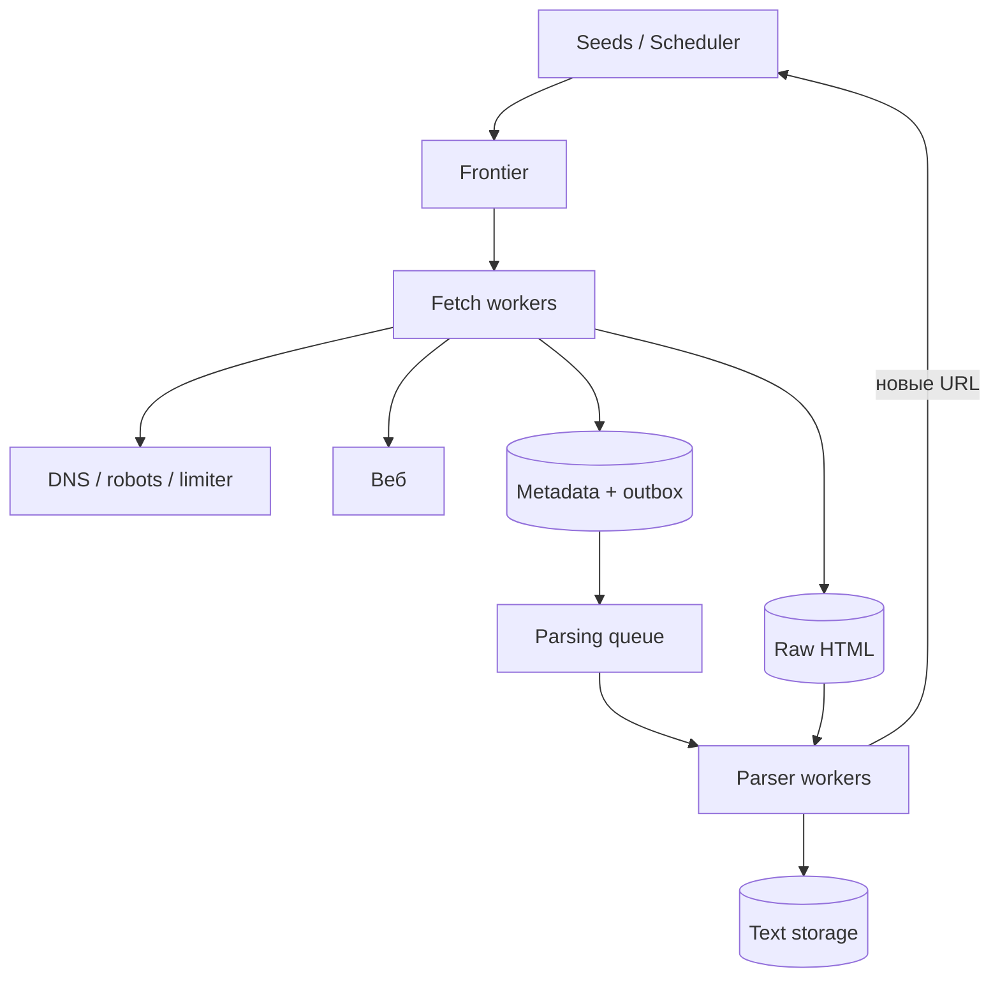
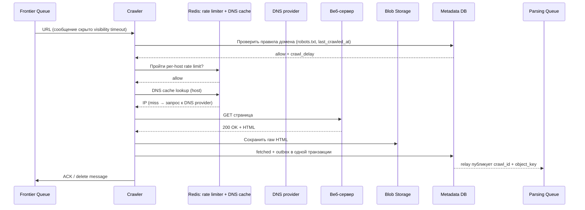
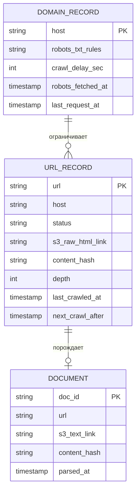
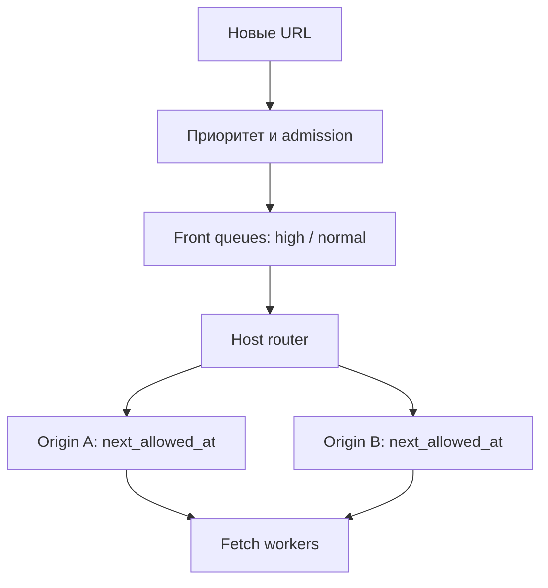
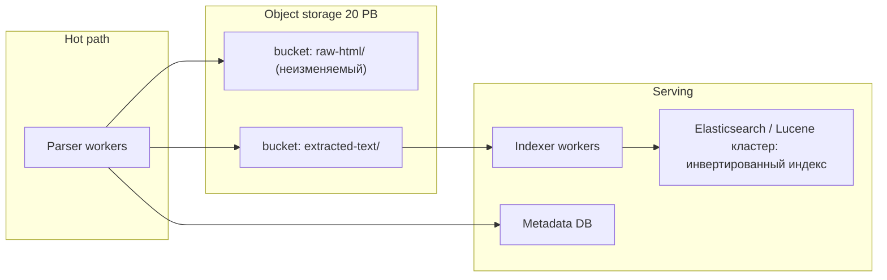
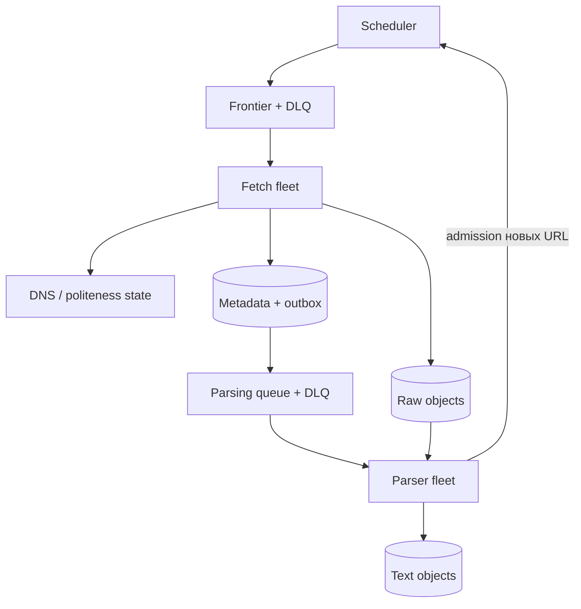

# Разбор задачи: поисковый веб-краулер

<!-- learning-nav:start -->
[← Все разделы](../README.md) · [Предыдущая тема](search-autocomplete.md) · [Следующая тема →](leaderboard.md)
<!-- learning-nav:end -->

> Классическая infra-задача System Design: спроектировать систему, которая обходит веб,
> скачивает страницы, извлекает из них контент и складывает его в хранилище.
> Встречается в формулировках «design a web crawler», «спроектируй поисковый робот»,
> «собери корпус текстов для обучения LLM». Задача проверяет не знание алгоритмов,
> а умение строить отказоустойчивый data pipeline с очередями, rate limiting и дедупликацией.

## Что проверяет эта задача

- Умение декомпозировать пайплайн на независимо масштабируемые стадии (fetch → parse → index).
- Работу с очередями сообщений: семантика доставки, retries, dead letter queue.
- Понимание «вежливости» краулера: robots.txt, per-host rate limiting, politeness.
- Дедупликацию на масштабе миллиардов записей: hash set, вторичный индекс, bloom filter.
- Back-of-the-envelope оценки, которые **влияют на дизайн**, а не посчитаны «для галочки».

---

## Уточняющие вопросы

Первый вопрос, который стоит задать, — **зачем нужен краулер**. От ответа зависит половина дизайна:

| Назначение | Что меняет в дизайне |
|---|---|
| Индексация для поисковика (Google/Яндекс) | Нужен инвертированный индекс, периодический re-crawl, приоритизация страниц по «важности» |
| Сбор корпуса текстов для LLM | Одноразовый прогон, дедупликация контента критична, индекс не нужен |
| Мониторинг изменений на конкретных сайтах | Маленький frontier, акцент на свежесть и diff |
| Архивирование (Wayback Machine) | Храним сырой HTML навсегда, версионирование |

Дальше уточняем масштаб и ограничения:

- Сколько доступных и разрешённых страниц требуется получить? Размер индексируемого веба не задаёт размер нашего корпуса.
- Есть ли дедлайн? (В мок-разборе от ex-Meta staff engineer используется жёсткое ограничение «10 млрд страниц за 5 дней» — оно превращает задачу в расчёт пропускной способности.)
- Нужно ли рендерить JavaScript (SPA на React/Angular), или достаточно статического HTML?
- Какой контент сохраняем: сырой HTML, извлечённый текст, метаданные?
- Нужен ли re-crawl (обход по кругу) или одноразовый прогон?
- Каковы ресурсные ограничения: «неограниченный бюджет в разумных пределах» или жёсткая экономия?

**Что говорить интервьюеру:** «Прежде чем проектировать, я бы зафиксировал назначение: краулер для поискового индекса и краулер для сбора датасета — это две разные системы. Давайте я возьму вариант с корпусом текстов для LLM: 10 млрд страниц, нужно уложиться в 5 дней, на выходе — очищенный текст в хранилище». Это показывает, что вы управляете scope, а не ждёте, пока вас поведут.

---

## Требования

### Функциональные

1. Обойти веб, начиная с набора seed URL, рекурсивно переходя по ссылкам.
2. Скачать HTML каждой страницы.
3. Извлечь текстовый контент и сохранить его.
4. Извлечь ссылки со страницы и добавить их в очередь обхода.
5. Уменьшать повторную полезную обработку URL/контента; повторные сетевые запросы при retries и re-crawl допустимы.

### Нефункциональные

| Требование | Почему важно именно здесь |
|---|---|
| **Fault tolerance** | Обход длится днями; падение воркера или всей стадии не должно терять прогресс |
| **Politeness** | Соблюдать robots.txt, согласованный interval и per-host concurrency; crawl-delay — расширение |
| **Scalability** | 10 млрд страниц — пропускная способность достигается только горизонтальным масштабированием |
| **Efficiency** | Уложиться в дедлайн; не тратить ресурсы на дубли URL и дубли контента |

Важный приём: нефункциональные требования нужно **квантифицировать** («обойти 10 млрд страниц за 5 дней», «не более 1 RPS на хост»), а не писать абстрактное «быстро и надёжно».

---

## Оценки нагрузки

Типичная ошибка кандидата — посчитать в начале «10 млрд страниц × 2 МБ = 20 ПБ, ух ты, много» и идти дальше. Интервьюер из такого расчёта узнаёт только то, что вы умеете умножать. Сильный ход — сказать прямо: **«я отложу расчёты до момента, где они повлияют на решение»**. В этой задаче такой момент — выбор числа машин для обхода. Считаем там.

Входные данные:

- Страниц: `N = 10^10` (10 млрд).
- Средний размер страницы: `~2 МБ`.
- Дедлайн: `5 дней ≈ 4.3 × 10^5 с`.
- Требуемая средняя скорость: `10^10 / 4.3 × 10^5 ≈ 23 000 страниц/с`.

При 2 МБ именно скачиваемого HTML, а не всей страницы с ресурсами, входной поток — `23 148 × 2 МБ ≈ 46 ГБ/с ≈ 370 Гбит/с`, суммарно 20 ПБ за обход. Сжатие HTTP и сохранение только текста меняют разные стороны этой оценки: сначала определяем единицу измерения. Retries и служебные запросы добавляют нагрузку.

Число машин нельзя вывести из паспортных 400 Гбит/с одной NIC. Ограничениями становятся число соединений, RTT/TLS, дескрипторы, CPU декомпрессии, DNS, дисковая/очередная запись и распределение URL по хостам. По закону Литтла при среднем fetch time 2 с потребуется примерно `23 148 × 2 ≈ 46 300` in-flight fetch. При лимите 1 start/с на origin нужно одновременно достаточно независимых origins; 10 млрд страниц с одного сайта за 5 дней такой политике не удовлетворяют ни на каком кластере.

Пилот измеряет устойчивые fetch/с на worker, p95/p99 длительности, ошибки и нагрузку parser/storage. Если worker на таком профиле даёт 200 страниц/с, минимум `ceil(23 148/200)=116` одновременно работающих workers; при целевой утилизации 70% — около 166, плюс capacity на отказы. 200 — пример результата benchmark, а не универсальный предел. Масштаб выбираем после измерений, не обещаем «4 машины» по одной сетевой характеристике.

Прочие оценки:

- URL metadata: `10¹⁰ × 500 Б ≈ 5 ТБ` payload, до индексов, реплик и истории.
- SHA-256: `10¹⁰ × 32 Б = 320 ГБ` только digest. Реальный hash set хранит таблицу, allocator/entry overhead, состояние и запас; реплика и persistence добавляют стоимость. Один Redis 256 ГБ не вмещает даже payload.
- Bloom filter при `p=1%`: около 12 ГБ для 10 млрд ключей. При положительном ответе проверяем точный индекс, чтобы false positive не терял страницу.
- 23 тыс. fetch/с — не число обнаруживаемых ссылок: при 50 ссылках/страницу admission path получает около 1.2 млн кандидатов/с до dedup.

---

## API / интерфейс системы

У краулера нет user-facing API, поэтому вместо REST-контрактов фиксируем **границу системы**: вход и выход.

```text
Вход:  seed URLs (список), конфигурация (max depth, лимиты, user-agent)
Выход: очищенный текст страниц + метаданные в хранилище
```

Core entities, которые гуляют по системе:

- **URL record** — URL, статус обхода, глубина, ссылка на сырой HTML, хэш контента, время последнего обхода.
- **Origin record** — scheme/host/port, robots rules, next_allowed_at и in-flight count; историческое имя Domain table ниже не меняет область ключа.
- **Document** — извлечённый текст, ссылка на источник.

---

## High-level design

Для заданного масштаба разделяем fetch и parse, чтобы повторять парсинг без нового HTTP-запроса и масштабировать стадии независимо. Небольшой краулер может начать с одного durable worker: сам по себе монолит не означает потерю прогресса или отсутствие метрик. Здесь отдельные очереди оправданы объёмом и разной стоимостью стадий.

Естественная граница — между fetch и parse: скачивание — самая хрупкая операция (сайты падают, таймаутят, rate-limit'ят), поэтому после неё сразу сохраняем сырой HTML в blob storage. Парсинг можно повторять сколько угодно раз по сохранённому HTML, не дёргая сеть повторно. Бонус: если завтра ML-команда попросит извлекать ещё и alt-текст картинок — обновляем только парсер и перезапускаем вторую стадию, без повторного обхода интернета.



В очереди передаём **указатель** (`crawl_id, url, object_key, checksum`), а не HTML. Большой payload раздувает брокер, replay и redelivery; лимиты зависят от сервиса/конфигурации. У SQS актуальный maximum — 1 МиБ, поэтому старое число 256 КБ здесь неприменимо. Claim check отделяет хранение байтов от доставки задания.

### Поток данных по шагам



---

## Модель данных



Выбор хранилищ:

| Данные | Хранилище | Почему |
|---|---|---|
| Raw HTML, извлечённый текст | S3 / объектное хранилище | 20 ПБ, Независимое масштабирование и lifecycle |
| URL table, Domain table | Шардированная KV/NoSQL (DynamoDB, Cassandra) или PostgreSQL с шардированием | Точечные запросы; atomic admission, lease и outbox требуют явных гарантий |
| Rate limiting, DNS cache, content hash set | Redis | Короткий lookup; задержку и память измеряем, exact hash index можно держать на диске |
| Поисковый индекс (если краулер для поисковика) | Elasticsearch / Lucene-кластер | Инвертированный индекс из коробки |

URL table шардируется по `url` (или по `host` — см. deep dive про frontier). Требований к сложным запросам нет, поэтому тип БД — не принципиален; не тратьте на это время интервью, скажите так прямо.

---

## Deep dive 1: Frontier и очередь URL

### Семантика «взял из очереди»

Фраза «воркер достал URL из очереди» на самом деле неточна, и умение это раскрыть — сильный сигнал. Сообщение **остаётся в очереди**, пока обработка не подтверждена:

- **Kafka**: сообщение идентифицируется offset'ом. Воркеры объединены в consumer group — partition назначена одному активному consumer группы; при rebalance/повторе возможна повторная обработка. После успешной обработки воркер коммитит offset. Удаление происходит по retention policy (по умолчанию 7 дней или по размеру партиции).
- **SQS**: сообщение скрывается на visibility timeout (по умолчанию 30 с). Если воркер упал — таймаут истекает, сообщение снова видимо и его заберёт другой воркер. После успеха воркер явно шлёт `DeleteMessage`.

Итог в обоих случаях: падение воркера = повторная обработка, а не потеря. Обрабатываем **at-least-once**: ключ сырого объекта включает `crawl_id`/версию обхода, а не только URL. Иначе повтор старого задания может перезаписать свежий fetch. Условные переходы состояния, lease/fencing и уникальный outbox event делают повтор безопасным; обычный upsert без проверки версии этого не гарантирует.

### Retries и Dead Letter Queue

Интернет — грязное место: сайты лежат, отвечают 500, таймаутят. Наивное решение — `sleep(5)` в воркере и повторить — не работает: таймер в памяти умрёт вместе с воркером, а сайт через 5 секунд, скорее всего, не воскреснет.

Классифицируем ошибки и сохраняем `attempt`, `next_attempt_at` и причину. Для timeout, 429 и части 5xx — ограниченный exponential backoff с jitter; учитываем корректный `Retry-After` и лимит на весь origin. 404/410 обычно завершают конкретный обход без немедленного retry; 401/403 не лечатся бесконечной сменой IP. Неисполняемая HTML-страница или неверный MIME — отдельный terminal outcome.

SQS даёт visibility timeout и redrive/DLQ, но экспоненциальное увеличение задержки за нас не вычисляет: приложение/планировщик меняет timeout либо хранит отложенную задачу. Срок visibility имеет предел, поэтому длинные задержки выносим в durable scheduler. В Kafka retry topics/time buckets позволяют не блокировать основную partition ожиданием одного URL; просто уснуть до `next_attempt_at` внутри consumer создаёт head-of-line blocking.

DLQ — карантин с причиной, метрикой возраста и процедурой повторного запуска после исправления. Retry budget ограничивает долю повторов при массовом сбое, иначе полезный трафик вытесняется лавиной попыток.

### Структура frontier: почему одна FIFO-очередь — плохо

Ссылки со страницы чаще всего ведут на тот же домен. В простой очереди образуется «пачка» из сотен URL одного хоста подряд: воркеры хватают их, упираются в per-host rate limiter и кладут обратно — мёртвые циклы и потраченный CPU. Плюс приоритеты: свежие новостные страницы важнее архивных.

Решение — **двухуровневый frontier**: front queues (приоритет) + back queues (per-host вежливость). Это классическая схема front/back queues:



- **Front queues** реализуют приоритет: URL получает score (важность домена, свежесть, глубина) и попадает в одну из K очередей приоритета.
- **Router** перемешивает URL по back queues, по одной на хост: очередь для хоста A отдаёт следующий URL не раньше, чем истёк crawl-delay по предыдущему.
- Планировщик хранит `next_allowed_at` и in-flight count origin. В распределённом варианте один lease-holder либо атомарная выдача разрешений предотвращают одновременный fetch двумя workers после failover. Отдельный limiter необязателен, координация обязательна.

Более простая альтернатива, которую можно предложить первой: **smart scheduler**. Парсеры складывают новые URL не в очередь, а сразу в URL table со статусом `pending`; отдельный планировщик периодически выбирает пачку URL, раскладывает их так, чтобы разнести домены, и публикует во frontier queue. Это же решение закрывает и re-crawl: scheduler возвращает в очередь URL, у которых `now - last_crawled_at` превышает порог свежести.

---

## Deep dive 2: Politeness и per-host rate limiting

### robots.txt

Правила получают с `/robots.txt` для origin `(scheme, host, port)`, а не по одной строке «домен». Применяются группа User-agent, `Allow`/`Disallow`, приоритет наиболее специфичного пути и правила percent-encoding. Используем проверенный REP parser, а не `startsWith` по случайной строке. Robots — просьба к краулеру, не механизм авторизации сайта.

```text
User-agent: *
Disallow: /private/
Crawl-delay: 10
```

`Crawl-delay` отсутствует в стандарте RFC 9309: это поддерживаемое некоторыми роботами расширение. Мы можем уважать его по собственной политике, но задаём собственный baseline interval и concurrency даже без него. Кэш robots обычно не старше 24 часов; для недоступности действуют специальные правила. При 5xx/сетевой недостижимости RFC требует временно считать обход запрещённым; при 4xx разрешает доступ. В собственной политике 429 трактуем консервативно как сигнал перегрузки, выдерживая Retry-After. Redirect robots имеет отдельные правила, а SSRF-проверка действует на каждом hop.

### Per-host rate limiting

Для baseline выбираем один старт HTTP-запроса в секунду на origin и не более одного in-flight fetch; это договорённость задачи, а не универсальная норма веба. Если средний ответ занимает 10 с, одного ограничения starts/с недостаточно: на сервере накопятся 10 наших соединений.

Обновление `next_allowed_at` должно быть атомарным между workers. Token bucket с capacity=1 либо scheduler с минимальным interval лучше описывает строгое расстояние между стартами, чем fixed window, который разрешит два запроса на границе секунды. Плюс нужны бюджеты по IP/registrable domain для множества hostname на одном сервере: нельзя заменить их одним грубым лимитом на весь shared hosting, но и игнорировать совокупную нагрузку нельзя.

Jitter разносит повторные попытки; fairness не даёт одному огромному сайту занять всю очередь. Rate-limit и robots получают собственные метрики и circuit breaker при росте ошибок origin.

### DNS — скрытый bottleneck

При 10–25 тыс. fetch/с DNS QPS зависит от числа новых origins, кэша, TTL и переиспользования соединений; равенство этих чисел не обязательно. Сторонний DNS-провайдер имеет собственные rate limits, и краулер может упереться не в сеть, а в DNS. Решения:

- **DNS-кэш** в том же Redis-кластере: для одного домена резолвим один раз, дальше берём из кэша (с уважением TTL записи).
- **Управляемый resolver pool**: задаём capacity, deadline, negative caching и отказоустойчивость. Случайное переключение провайдеров не снимает TTL и не гарантирует согласованные ответы. Проверяем все A/AAAA и фактический IP соединения для защиты от SSRF/rebinding.

---

## Deep dive 3: Дедупликация

Дедупликация нужна на двух уровнях, и важно не путать их.

### Уровень 1: не обходить один URL дважды

Парсер извлекает со страницы ссылки, и с высокой вероятностью они уже встречались. Решение — проверка существования в URL table (первичный ключ — URL). Тонкость: если запись создаётся только после парсинга, то между «добавили в очередь» и «распарсили» один URL может попасть во frontier многократно. Поэтому запись создаём **при добавлении в очередь** (`status=pending`, `last_crawled_at=null`), а обновляем по факту обхода. Вставка admission должна быть условной (`put-if-absent` по canonical URL), а постановка задания — восстанавливаемой через outbox/scheduler. При 1 млн кандидатов/с этот путь сам может стать bottleneck.

### Уровень 2: не обрабатывать дублирующийся контент

Разные URL могут содержать одинаковые байты или почти одинаковый полезный текст. Для exact dedup считаем SHA-256 представления с явно заданной версией нормализации. Для near-duplicate detection используем, например, SimHash/MinHash и порог сходства; это не замена криптографическому digest и не доказательство равенства.

Raw digest можно вычислить после fetch, а digest очищенного текста — только после parse. Нельзя обещать дедупликацию нормализованного текста до стадии, которая его нормализует. Даже если документ уже известен, ссылки и связь с новым source URL могут быть нужны: пропуск всего parse по совпадению текста теряет граф обхода. Повторяемость parser/normalizer фиксируем в `(crawl_id, parser_version)`.

| Вариант | Что хранит | Компромисс |
|---|---|---|
| Exact индекс на диске | Digest → canonical document | I/O и реплики, зато полная проверка |
| Шардированный RAM set | Тот же точный индекс | 320 ГБ digest плюс значительный overhead |
| Bloom + exact индекс | Компактный предварительный фильтр | Дополнительный lookup при positive |

Для Bloom `m = -n ln(p)/(ln 2)²`: при `n=10¹⁰, p=0.01` около 12 ГБ и примерно 7 hash probes. `negative` означает «точно нет» только в границах корректно заполненного фильтра; `positive` означает «возможно есть». Проверка exact store после positive сохраняет уникальные страницы. Если сознательно используем только Bloom и пропускаем positives, теряем полноту — доля потерь зависит от динамики заполнения и состава потока, а не равна автоматически ровно 1% корпуса.

### Crawler traps

Ловушки краулера — страницы, генерирующие бесконечные цепочки ссылок (календари с «следующий месяц», страницы, ссылающиеся сами на себя с разными query-параметрами). Без защиты воркеры будут бесконечно жевать один домен с нулевым контентом. Depth limit полезен, но не останавливает миллионы разных ссылок на одной глубине. Добавляем лимит URL/байтов/времени на origin, ограничения query combinations, длины URL, redirects и повторяющихся path patterns; отслеживаем полезный новый контент на fetch. Canonicalization не удаляет все query-параметры вслепую: для магазина они могут обозначать разные товары.

---

## Deep dive 4: Хранение документов и индексация

### Слои хранения



Принципы:

- **Raw HTML неизменяем** в рамках конкретной версии fetch — это ваш «источник истины» для повторных прогонов парсера.
- **Извлечённый текст** — отдельный бакет/префикс; потребители (поисковый индексатор, ML-команда) читают уже его.
- Метаданные маленькие и горячие — в шардированной БД; сами документы большие и холодные — в object storage. Не смешивайте: хранение 2 МБ blob'ов в реляционной БД — красный флаг.
- Для metadata оцениваем write amplification, conditional writes, compaction, hot shards и recovery. Cassandra/RocksDB используют LSM-подходы, но нельзя выводить внутреннее устройство любого managed object storage из названия API. B-tree также обслуживает write-heavy workload; решение принимаем по измеренному профилю, гарантиям и операционной сложности.

### Инвертированный индекс (если строим поисковик)

Краулер сам по себе поиск не делает — он наполняет корпус. Поиск строится на **инвертированном индексе**: отображение `термин → список документов (posting list)`, часто с позициями термина и статистикой для ранжирования (TF-IDF / BM25).

```text
Документ 1: "berries are fast and reliable"
Документ 2: "fast cars"

Индекс:
berries  → [1]
fast     → [1, 2]
reliable → [1]
cars     → [2]
```

Запрос «fast» получает один posting list; запрос «fast AND cars» пересекает два списка, а OR объединяет их. Именно так устроены Lucene/Elasticsearch и full-text search в PostgreSQL — на собеседовании достаточно сказать: «индексация — офлайн-процесс поверх корпуса, строим инвертированный индекс, шардируем по документам (по doc_id), реплицируем шарды для read throughput». Индекс шардируется **по документу**, а не по термину: запрос рассылается на все шарды, результаты мерджатся — это стандартный scatter-gather.

---

## Масштабирование кластера краулеров

Собираем всё вместе (финальная схема, которую имеет смысл дорисовать к концу интервью):



Ключевые принципы масштабирования:

- **Bottleneck определяется измерениями**: сеть, politeness, DNS, admission, CPU parse или запись. Вводим backpressure: Парсеры масштабируются автоматически по глубине parsing queue (EC2 Auto Scaling / Karpenter / Lambda): очередь растёт — добавляем воркеров.
- **Scalability обсуждаем последней.** Система эволюционирует в ходе интервью; если начать с «как масштабировать краулер», вы промасштабируете монолитного воркера, которого через 20 минут разделите на стадии. Сначала финальный дизайн, потом масштабирование узких мест.
- **Шардирование frontier по хосту** (back queues) одновременно решает politeness и равномерно раскидывает нагрузку по воркерам. Для партиционирования по хосту достаточно `hash(host) mod N`; consistent hashing понадобится, если число партиций/воркеров меняется динамически и мы хотим минимизировать перекладывание ключей.
- **Durable состояние вне workers**; потеря процесса допускает повтор. Результат не теряется, если переход состояния и отправка downstream восстанавливаемы, а повтор защищён идентификаторами crawl/task.

---

## Trade-offs: сводная таблица

| Решение | Выбрали | Альтернатива | Чем пожертвовали |
|---|---|---|---|
| Транспорт frontier | SQS (visibility, redrive/DLQ) | Kafka (дёшевле на гигантском потоке, replay) | Kafka даёт replay и порядок в партиции; SQS проще операционно |
| Payload в очереди | Указатель на S3 | Сам HTML в сообщении | Лишний сетевой хоп парсера vs лимиты размера сообщений |
| Дедуп контента | Redis set / GSI | Bloom filter | Exact store против фильтра; Bloom positive проверяем точно |
| Politeness | Per-host back queues + Redis limiter | Только crawl-delay из robots.txt | Большинство сайтов не задают crawl-delay — нужен свой лимит |
| Рендеринг JS | Не делаем (статический HTML) | Headless browser (Puppeteer) | В разы медленнее, дороже и хрупче — только если бизнес требует SPA-контент |
| Хранение метаданных | NoSQL/KV | PostgreSQL | Простые KV-запросы не используют сильные стороны реляционки |
| Размер fleet | По benchmark и запасу | По паспортной NIC | Учитываем in-flight, politeness и отказы |

---

## Что спросят дополнительно

- **«Как обрабатывать динамический контент (React/SPA)?»** — нужен headless browser (Puppeteer/Playwright) в fetch-стадии: рендерим JS, потом извлекаем DOM. Дорого, медленно, хрупко; обычно делают для подмножества важных сайтов.
- **«Очень большие страницы/файлы?»** — Content-Length только подсказка: ограничиваем реально прочитанные и распакованные байты, время, redirects и глубину декомпрессии. Chunked/сжатый ответ может превысить лимит без большого заголовка.
- **«Как организовать непрерывный re-crawl?»** — smart scheduler поверх URL table: возвращаем в очередь URL по формуле свежести (`last_crawled_at` + приоритет страницы); новостные хосты — чаще, архивные — редко.
- **«Как мониторить здоровье системы?»** — метрики по стадиям (глубина каждой очереди, throughput fetch/parse, hit rate rate limiter'а, доля ошибок по HTTP-кодам, размер DLQ) в Datadog/Prometheus; рост DLQ — сигнал массового сбоя или бана нашего user-agent.
- **«Нас забанили по IP/user-agent — что делать?»** — снижаем нагрузку, соблюдаем Retry-After и robots, представляемся корректным User-Agent с контактом, запрашиваем разрешение при необходимости. Бесконечная ротация адресов не исправляет politeness.
- **«Exactly-once возможен?»** — нет в общем случае; проектируем at-least-once + идемпотентные записи (детерминированные ключи в S3, upsert в БД).

---

## Красные флаги и типичные ошибки

- **Монолитный воркер** «скачал-распарсил-сохранил» без разбиения на стадии — падает отказоустойчивость и независимое масштабирование.
- **«Используем bloom filter» без обоснования** — самый частый маркер заученного ответа. Сначала constraints (память? допустимы ли потери уникального контента?), потом структура данных.
- **Игнорирование politeness**: ни слова про robots.txt и per-host лимиты — краулер, который дудосит чужие сайты, в проде не живёт.
- **In-memory retry с `sleep()`** — таймер умирает вместе с воркером; нужен backoff, переживающий рестарт (конфигурация очереди или состояние в сообщении).
- **HTML прямо в очередь** — сообщения по 2 МБ упираются в лимиты брокеров; паттерн claim check с указателем на S3.
- **Расчёты «для галочки»** в начале интервью, которые ничего не решают. Считайте в точке принятия решения (число машин, размер Redis, шарды).
- **Забытый DNS** — на десятках тысяч RPS резолвер становится bottleneck'ом раньше сети.
- **Игнорирование дублей контента** — кандидаты помнят про дедуп URL, но забывают, что разные URL несут одинаковый текст.
- **Преждевременный разговор о масштабировании** — масштабировать нужно финальный дизайн, а не первый набросок.

## Что говорить интервьюеру: шпаргалка формулировок

- «Назначение краулера определяет дизайн: индексатор поисковика, сборщик датасета и монитор изменений — три разные системы. Какой вариант берём?»
- «Я отложу расчёты до момента, где число влияет на решение — сейчас оно ничего не решит».
- «Fetch — самая хрупкая операция, поэтому изолируем её: скачали → сырой HTML в S3 → повтор parse не требует нового fetch».
- «Доставка at-least-once, поэтому все записи идемпотентны: детерминированные ключи в S3 и upsert».
- «Robots привязан к origin, а scheduler согласованно хранит next_allowed_at и in-flight; ограничения по shared IP считаю отдельно».
- «320 ГБ — только SHA-256 digest, без overhead. Bloom ставлю перед exact store: positive подтверждаю, уникальные страницы не теряю».
- «В реальности я бы прогнал пилот на одной машине и экстраполировал измеренный throughput, а не считал аналитически».

---

## Вопросы и сценарии отказа

### 1. Как не превратить краулер в SSRF-прокси во внутреннюю сеть?

Любая ссылка из внешнего HTML недоверенная. Разрешаем только необходимые `http/https`, запрещаем userinfo, неожиданные порты и неоднозначные URL; используем один parser для проверки и HTTP-клиента. IP literals и все A/AAAA проверяем на loopback, private, link-local, metadata endpoints и прочие непубличные диапазоны. Короткий список строковых исключений не заменяет классификацию разобранного адреса и проверку фактического назначения.

DNS rebinding ломает схему «проверили DNS, затем клиент резолвит ещё раз»: второй ответ может указывать внутрь сети. HTTP-клиент должен подключиться к проверенному адресу с корректными Host/SNI, а egress firewall не допускает внутренние назначения независимо от приложения. Каждый redirect проходит ту же проверку; у headless browser отдельно ограничены subresources, service workers и запросы JavaScript.

Политику переходов проверяют заглушкой транспорта: после разрешённой категории назначения поступает категория `UNLISTED_DESTINATION`, и новый сетевой вызов должен быть запрещён. Решение для первого URL не распространяется автоматически на следующий адрес. Статус robots allow ничего не меняет: robots не даёт разрешения ходить в сеть нашей инфраструктуры. Рендеринг и декомпрессию исполняем в sandbox с лимитами CPU, памяти, времени и выходной сети.

### 2. Что делать, если HTML сохранён, а публикация задания на parse не удалась?

Нельзя ACK frontier сразу после PUT и надеяться, что второй write в брокер успешен. Сначала пишем raw object под `(crawl_id, attempt)`, затем одной metadata-транзакцией фиксируем fetched, проверенный object key/checksum и outbox-задание. Relay доставляет outbox в parsing queue с повтором. Только после durable фиксации этой связи frontier-задание считается завершённым.

Crash после PUT, но до metadata commit оставит orphan: повтор fetch может переиспользовать проверенный объект или создать новую attempt, а GC позже уберёт лишнее. Crash после commit, но до ACK даст повтор frontier — conditional transition увидит fetched и не начнёт бесконечную цепочку новых parse jobs. Crash relay после publish, но до отметки outbox доставленным создаст дубль: parser дедуплицирует `(crawl_id, parser_version)`. Уже сохранённый текст не означает, что сохранены все исходящие ссылки: результат и admission новых URL тоже требуют восстанавливаемого протокола.

Для KV без транзакции между записями нужен эквивалент: атомарная смена state со встроенным pending event, change stream либо scheduler, который регулярно подбирает fetched-but-not-enqueued. Опасный ответ — «S3 events решат всё»: дубли, порядок и границы между storage, metadata и брокером остаются частью нашего контракта.

### 3. На подумать: почему после dedup исчезла половина страниц сайта?

Краулер удаляет все query-параметры при canonicalization и пропускает parse, если Bloom говорит «видели». На магазине `/item?id=17` и `/item?id=18` дают разные товары. Какие гарантии нарушены?

<details>
<summary>Разбор</summary>

Нормализация объединила разные URL в один ключ admission. Без знания семантики сайта допустимо убрать fragment для обычного HTTP fetch, привести host и default port к каноническому виду; произвольно выбрасывать query, менять регистр path и сортировать повторяющиеся параметры небезопасно. Храним исходный URL и версию canonicalizer, чтобы перепройти ошибочно объединённые ссылки.

Bloom positive требует exact lookup. При отсутствии digest в exact store страницу обрабатываем, а фильтр обновляем. Даже exact дубль текста не позволяет терять source mapping и новые исходящие ссылки. Отдельно проверяем, не вызвано ли падение покрытия общим шаблоном страниц: near-duplicate threshold мог счесть карточки с разными характеристиками одним документом. Метрики нужны по причинам отсечения, origin и версии обработки, а не только общий высокий dedup ratio — он может означать потерю полезного корпуса.

</details>

---

<a id="источники-и-видео-по-теме"></a>

## Видео по теме

- [Design a Web Crawler System Design Interview w/ a Ex-Meta Staff Engineer](https://www.youtube.com/watch?v=krsuaUp__pM)
- [Design a Distributed Rate Limiter w/ a Ex-Meta Staff Engineer: System Design Breakdown](https://www.youtube.com/watch?v=MIJFyUPG4Z4)
- [DB Indexing in System Design Interviews - B-tree, Geospatial, Inverted Index, and more!](https://www.youtube.com/watch?v=BHCSL_ZifI0)
- [База по Базам Данных - Storage (Индексы, Paging, LSM, B+-Tree, R-Tree) / Влад Тен Систем Дизайн](https://www.youtube.com/watch?v=i-FFVM4cIXQ)
