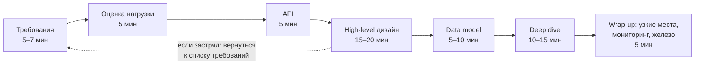
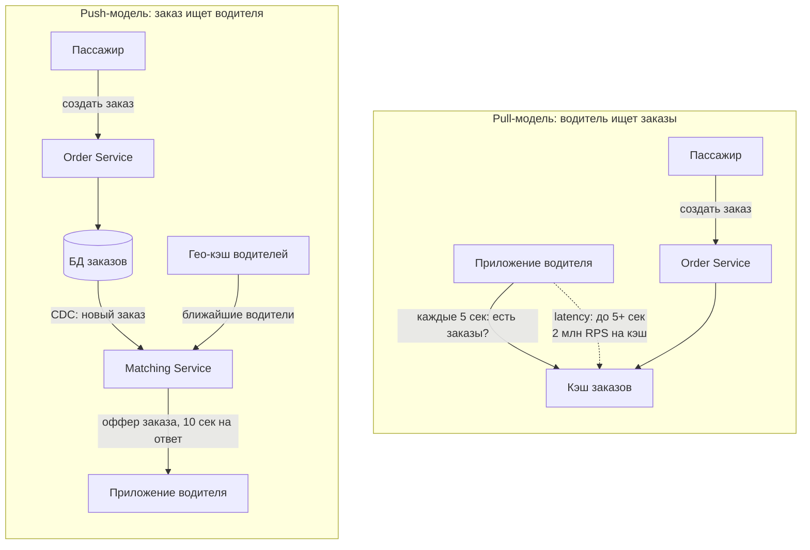
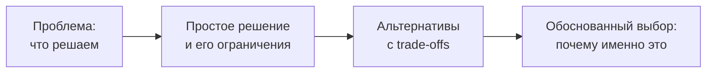
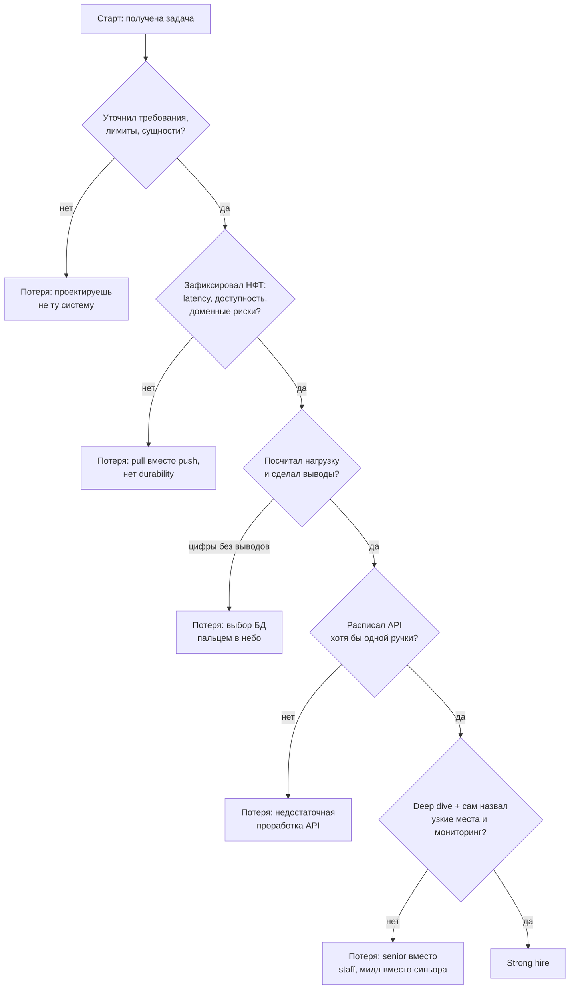

# Разборы реальных мок-собеседований: чему учат записи

Этот файл — синтез 15 публичных мок-собеседований по System Design (RU и EN):
моки от тимлидов Яндекса и Ozon, Podlodka, FaangTalk, karpov.courses,
а также англоязычные моки Exponent, IGotAnOffer-style разборы и @gkcs (sudocode).
Для каждого мока: какая задача была, где кандидат набирал баллы, где терял,
какой вердикт вынес интервьюер. В конце — сводные разделы «Топ-20 ошибок»
и «Что ценят интервьюеры», собранные из всех разборов сразу.

Зачем это читать: теорию (книги, курсы) все учат одинаково, а валятся кандидаты
на одних и тех же процессных ошибках, которые видны только в записи реального
диалога. Как заметил один из кандидатов после мока с тимлидом Ozon: «рисовать
у себя в голове или на доске наедине с собой — одно, а в коммуникации
с человеком — совсем иной опыт».

## Анатомия часа: что интервьюер ждёт по таймингу

Почти все интервьюеры в разобранных моках открывают сессию одним и тем же
планом. Тимлид из Яндекса формулирует его прямо в первую минуту:
«формализовать требования, оценить нагрузку, псевдокодом обрисовать API,
описать абстрактно архитектуру, проговорить дата-модель, и будет очень круто,
если в конце успеем оценить железо». Из разборов складывается такой бюджет
времени на 60 минут:

Три следствия из этого бюджета, повторяющиеся в фидбеке разных интервьюеров:

- Новички «засиживаются» на требованиях по 20 минут и набирают столько
  функциональности, что её невозможно успеть спроектировать (наблюдение
  Владимира Невзорова из Go-мока). Правильный ход — набрать чуть больше,
  чем нужно, и явно выделить core: «вот это MVP, остальное — если останется
  время». Так вы показываете, что понимаете бизнес и дедлайны.
- Кандидат, а не интервьюер, ведёт процесс. Все сильные кандидаты из разборов
  сами объявляли план и двигались по нему («сначала сделаем первое, второе,
  третье»), а интервьюер лишь челленджил. Вердикт ex-тимлида Яндекса:
  «ты вёл меня за ручку, показывал самостоятельность — это круто».
- Интервьюер в процессе ведёт пометки и в конце даёт структурированный
  фидбек. Всё, что вы говорите вслух, — фиксируется. Молчание — тоже.

## Разбор 1. Лента Instagram — мок от Team Lead из Яндекса

**Задача.** Спроектировать ленту Instagram: загрузка поста (фото + описание),
получение ленты, подписки/отписки. Лайки и комментарии кандидат сам предложил
«пометить звёздочкой» — и интервьюер это принял.

**Что пошло хорошо:**

- Кандидат вёл процесс по шагам сам, успел почти весь план за час.
- Формат «давай не будем делать X, если останется время — вернёмся» оценён
  как правильное управление скоупом.

**Где терял баллы (дословно из фидбека интервьюера):**

- На этапе требований не уточнил ограничения: будет ли лимит на количество
  подписок? Это критично для дизайна (celebrity-проблема), а «желательно
  сразу узнавать на этапе сбора требований».
- Не определил, что такое «пост»: «мы уже чуть ли не перешли к дизайну,
  а непонятно, что такое пост». Сущности, из которых строится система,
  надо проговорить до архитектуры.
- Баги в расчётах трафика: «постарайтесь считать как можно корректнее, потому
  что из-за этих расчётов будет определяться архитектура — архитектура для
  1000 RPS будет абсолютно другой».
- Выбор хранилищ «пальцем в небо»: выбрал Redis для ленты, не прикинув объём
  данных («может, там десятки терабайт — in-memory будет дорого»), выбрал
  Postgres и Neo4j без аргументации. Даже ответ «у меня есть экспертиза
  с этой технологией» — уже аргумент, но он не был озвучен.
- Не предвосхищал corner cases: интервьюеру пришлось самому спрашивать
  «а что будет, если у пользователя миллионы подписчиков?», «а что, если
  картинка загрузилась, а описание — нет?». Ожидание: кандидат сам держит
  в голове потенциальные проблемы и озвучивает их вместе с решением.

**Вердикт:** «В целом всё хорошо, интервью пройдено» — с оговоркой, что не
успели оценить железо, и система получилась местами с подсказками.

**Вывод для подготовки.** Проходной балл набирается процессом
(план → этапы → финиш), а отличный — деталями: лимиты в требованиях,
аргументированный выбор каждой технологии, самостоятельно озвученные
corner cases.

## Разбор 2. Сокращатель ссылок — мок от Team Lead из Ozon

**Задача.** URL shortener с расширенными требованиями: TTL у ссылок,
кастомные алиасы, rate limiting против злоупотреблений, сбор аналитики
переходов. Интервьюер сознательно выбрал «не очень большую» задачу, чтобы
посмотреть, как кандидат ведёт себя и «что забывает, что не забывает».

**Что пошло хорошо:**

- Всё посчитал: объёмы хранилища, сеть, бизнес-метрики. Разделил read- и
  write-трафик и клиентов на схеме — «это многие забывают».
- Сразу накинул high-level схему, не забыл DNS-балансировку.
- По ходу задевал кэширование, распределённые блокировки — «видно,
  что кругозор есть, и если интервьюер захочет углубиться — справится».
- Видит все точки отказа и подробно рассказывает, для чего служит
  каждый компонент.

**Где терял баллы:**

- Скорость изложения. «Ты три раза подробно рассказал про шардирование
  и реплики». Правильный приём из фидбека: один раз объяснил → дальше
  «мы про шардирование уже говорили, могу повторить, если нужно, или идём
  дальше?» Интервьюер сам скажет, если пропустил.
- Требования «обнаруживал по ходу», а не собрал в начале: что ссылки
  не удаляются — заметил практически в конце (спасло то, что заметил сам).
- После расчётов не описал API — пришлось возвращаться.

**Вердикт:** «У тебя хорошо прошло. Единственное — маленько скорость
увеличить, и всё будет замечательно».

**Вывод.** Тайминг — это тоже оцениваемый навык. Повторное разжёвывание
уже сказанного сжигает минуты, которых не хватит на deep dive. Тренируйте
фразу-маркер: «это я уже покрывал на этапе X, иду дальше».

## Разбор 3. Доставка еды — Go-мок с Владимиром Невзоровым

**Задача.** Сервис доставки еды (заказ из ресторана, показ времени доставки).
Бизнес-ограничение от интервьюера: запуск через 6 месяцев. Нагрузка после
челленджа: 50 тыс. заказов в день ≈ 8 RPS.

**Что пошло хорошо:**

- «Очень хорошо шёл по этапам, инициативил, без стопов, бодренько».
- Не бросился сразу в асинхронность: «сразу Kafka, Redis, CDN — так делать
  не надо, и Степан не делал». Начал с базовых сервисов и синхронного
  взаимодействия, усложнял по мере челленджей.
- На челлендж «оркестрация или хореография саги» уверенно разложил плюсы
  и минусы обоих паттернов с планом миграции от одного к другому по мере
  роста нагрузки.
- Упомянул long polling и WebSocket для статуса заказа.

**Где терял баллы:**

- Недожал требования: не выделил явно core-функционал; не проговорил
  нефункциональные требования как качества системы (масштабируемость,
  отказоустойчивость) — «это всё подразумевается, но хорошо проговорить».
- Цифры посчитал, но выводов из них мало. Ожидание для финального уровня:
  три характеристики — RPS, volume, сеть — и вывод вида «120k RPS один
  инстанс Postgres не вывезет», т.е. знание порядков величин для типовых
  компонентов.
- API проработан слабо: «хотя бы одну ручку, один endpoint нужно расписать» —
  query params, тело запроса, response codes, коды ошибок. Реальный пример
  из фидбека другого кандидата: написал «вопросик и три точки» вместо
  `?longitude=...&latitude=...` — получил «недостаточная проработка API».
- Не упомянул идемпотентность до конца.
- В финале на вопрос «что можно улучшить?» ждали мониторинг — и не услышали.
  Совет интервьюера: железные метрики (CPU), сетевые, бизнес-метрики,
  алертинг, Grafana + Prometheus как дефолтный стек — «разкидывать
  в интервью».

**Вердикт:** «Хорошее прохождение, близкое к реальному, но не хватило
проработки требований, API и мониторинга. Приходи через 2 месяца — подкачаешься
и пройдёшь». Для middle+ этот же ответ — уже проходной, «если добавить
мониторинг».

**Вывод.** Разница между «почти senior» и «senior» в этом разборе — не
архитектура, а гигиена: полный API хотя бы для одной ключевой ручки,
идемпотентность, мониторинг. Это дешёвые баллы, которые кандидаты не берут.

## Разбор 4. Tinder — мок от ex-Team Lead Яндекса

**Задача.** Приложение знакомств: профили, подбор анкет, свайпы, матчинг,
чат при матче. Кандидат честно сказал, что никогда не пользовался продуктом, —
и проектировал через уточняющие вопросы.

**Что пошло хорошо:**

- Вёл интервьюера «за ручку»: сам рассказывал флоу, сам рисовал компоненты.
- Декомпозиция: сразу разбил систему на независимые части, проработал каждую,
  потом «поженил» — интервьюер отметил это как контрпример типичной ошибке,
  когда кандидат «концентрируется на одном компоненте, детально его
  прорабатывает, а всё остальное бросает».
- Глубина в технологиях: нюансы SQL/NoSQL, тонкости Kafka — «отдельный
  жирный плюс».
- Без просьбы интервьюера сам прикинул ресурсы (CPU) — «я не успел за ходом
  мысли, как ты обсчитал, но это выглядело впечатляюще».

**Где терял баллы:**

- Не доуточнил нефункциональные требования: тайминги (как быстро надо
  отдавать пачку анкет) и отказоустойчивость. «Это максимум минута
  на интервью — спросить и уточнить».
- Дискуссионные решения (не ошибки, но места, где интервьюер видел
  альтернативы): концентрация нагрузки в matching DB (можно разделить лайки
  и дизлайки по разным хранилищам — матчатся только лайки); кэш пачек анкет
  с TTL 30 минут при часто перемещающихся пользователях; WebSocket там, где
  хватило бы REST.

**Вердикт:** «Прекрасно прошли интервью».

**Вывод.** Сильный кандидат отличается тем, что сам генерирует следующий шаг:
сам считает железо, сам предлагает альтернативы, сам называет слабые места
своего дизайна. Замечания интервьюера на таком уровне — уже не «исправь
ошибку», а «я бы посмотрел в другую сторону».

## Разбор 5. Uber / Яндекс Такси — мок уровня Middle+

**Задача.** Пользователь вводит точки А и Б, видит цену (актуальна 10 секунд),
делает заказ; система матчит водителя: водитель видит один заказ и имеет
10 секунд на принятие. НФТ: 10 млн водителей, 100 млн пользователей,
10 млн поездок в сутки ≈ 100 новых заказов/сек.

**Что пошло хорошо:**

- Кандидат оспорил исходные цифры: «10 млн водителей — это не в одном
  регионе и не все активны» → реальная нагрузка на регион сильно ниже.
  Интервьюер: «валидный поинт, ты прав».
- На челлендж «поллинг каждые 5 секунд даст пики» ответил, что естественный
  jitter уже есть: водители подключаются независимо, синхронизации нет.

**Где терял баллы:**

- Спроектировал pull-модель (водители каждые 5 секунд опрашивают кэш заказов),
  не зафиксировав требование по latency. По признанию самого кандидата:
  «я не зафиксировал latency в нефункциональных требованиях, а стоило».
  Интервьюер показал цену ошибки: от создания заказа до появления его
  у водителя — до 5+ секунд, и принятие это или нет — «зависит от бизнес-
  требований», которые и надо было спросить.
- Челлендж-инверсия от интервьюера: «а что, если заказ должен быть виден
  моментально?» → зеркальный flip схемы: не водители ищут заказы, а заказ
  ищет водителя (новый заказ через CDC попадает в матчинг-сервис, который
  сразу ищет ближайших водителей в гео-кэше).

**Вердикт:** формального «пройдено/не пройдено» не было (учебно-диалоговый
формат), но интервьюер довёл схему до рабочей и закрыл обе модели.

**Вывод.** Классическая ловушка: требование, которое вы не зафиксировали
(latency матчинга), определяет всю топологию системы (pull vs push).
Прежде чем рисовать — спросите, какая задержка приемлема для ключевого
действия.

## Разбор 6. Биржа — дизайн-сессия FaangTalk

**Задача.** Крипто/фондовая биржа: балансы пользователей, создание/отмена
ордеров, матчинг, стакан. Формат — коллективная дизайн-сессия с душнильными
вопросами из чата («мы тебя душнили не душнения ради, интереса ради»).

**Чему учит запись (это скорее эталон deep dive, чем классический мок):**

- Балансы: партиционирование потока событий по пользователю (ключ партиции —
  user ID) гарантирует, что все события одного пользователя обрабатываются
  последовательно одним воркером → нет гонок по балансу без распределённых
  блокировок. Масштабирование — увеличением числа партиций Kafka.
- Event sourcing + snapshots: баланс — это snapshot 15-минутной давности
  плюс накат событий из хранилища (в обсуждении — Cassandra, которая
  «бесплатно» сортирует события по ключу и отдаёт диапазон от нужного
  момента). После падения сервиса: читаем snapshot, накатываем события,
  продолжаем из памяти.
- Стакан (order book): в памяти, кастомная структура данных — кольцевой
  буфер на массиве, кэш-френдли доступ, возможна блокировка по сегментам;
  обсуждались lock-free коллекции и низкоуровневые оптимизации уровня
  трейдинговых систем.
- Прагматика: «когда у тебя есть дополнительные деньги, ты можешь
  разработать любую систему» — премиум-пользователю можно поднять отдельный
  топик/пайплайн с меньшей очередью. Не стесняйтесь предлагать продуктовые
  решения инженерных проблем.

**Вывод.** На senior+/staff задачах с экстремальными требованиями (биржа,
 matching engine) интервьюер ждёт спуска на уровень структур данных
и моделей конкурентности, а не очередного квадратика «Kafka». Подготовьте
2–3 таких deep dive заранее: order book, ring buffer, event sourcing,
партиционирование по сущности с гарантией порядка.

## Разбор 7. Главный экран Instagram — iOS-мок (Avito × крупный банк)

**Задача (мобильный system design).** Главный экран Instagram: лента
изображений и видео, лайки, комментарии, шеринг, Stories. Кандидат —
iOS-разработчик с 3+ годами опыта.

**Что пошло хорошо:**

- Техническая экспертиза «точно присутствует»: слои, модуляризация, DI.
- Сам, без подсказок, вспомнил про логирование и аналитику — «я ждал, ждал,
  и ты сам вспомнил, это круто».
- Сам пришёл к разделению, где какая аналитика живёт (клиент/бэкенд).

**Где терял баллы:**

- Начал сбор требований с нефункциональных и оценок — «ты сразу перешёл
  к оценке, как технарь». Правильный порядок: сначала функциональные
  требования и сценарии, потом НФТ.
- «Торопился показать техническую экспертизу» и из-за этого не до конца
  собрал требования. Интервьюеру (в роли продукта) пришлось самому
  подталкивать — а это уже «подсказка считается».
- Пагинация: показал `total: 100 000` в ответе API. Зачем, если клиент его
  нигде не показывает? Подсчёт total — дорогое сканирование; обсудить
  варианты: offset/limit vs cursor vs просто флаг `has_more`.
- Схема нечитаемая: «люди всё чаще смотрят на качество схемы как на
  документацию — завтра ты сам не поймёшь, что начертил». Показывать,
  что публично/что приватно, выносить функции внутрь блоков.
- Не упомянул тесты — для приложения, которое пишут 20–30 человек,
  интервьюер хотел услышать хотя бы вскользь.
- Нейминг дата-слоя: модели лучше называть контрактами/моделями слоя,
  а не «JSON».

**Вердикт:** Middle / Middle+. «Чувствуется опыт, не хватает практики
именно формата: понятность донесения и сбор требований».

**Вывод.** Мобильный system design оценивает те же процессные вещи, что
и бэкенд: требования → сценарии → API/контракты → компоненты → данные.
Плюс специфика: пагинация, кэширование на клиенте, аналитика, тестируемость
модулей.

## Разбор 8. Видеохостинг — мок с эталонным решением интервьюера

**Задача.** Загрузка и обработка видео (аналог YouTube в миниатюре):
клиент шлёт видео чанками, система транскодирует, генерирует обложки
и субтитры, отдаёт метаданные. В конце интервьюер сам показал своё
эталонное решение — редкий шанс свериться.

**Ключевые решения из эталона:**

- Метаданные — в SQL: «это тысячи записей в день, нет проблем положить
  в SQL и получить внешние ключи и гарантии».
- После сборки видео — сообщения в несколько Kafka-топиков: encoding,
  thumbnail, caption (нейросеть для субтитров). Число реплик обработчиков
  регулируется autoscaler'ом по глубине очереди (lag в топике): очередь
  сглаживает неравномерную нагрузку, необработанные задачи возвращаются.
- При росте нагрузки в 20 раз (2 ГБ/с на вход): один load balancer не вывозит
  → добавляется слой DNS-балансировки (несколько A-записей на разные LB,
  ~700 МБ/с на каждый).
- Чанки одного видео должны попадать на одну реплику → ключ распределения —
  ID видео (известен клиенту, хэшируется при каждом POST чанка).
- Redis для этого «подходит не очень» → Cassandra или DynamoDB: партиции
  из коробки, избыточность, изменение числа партиций.

**Вердикт:** «Решение кандидата близко к моему — на реальном собеседовании
считал бы секцию пройденной». И важная ремарка: «System Design не имеет
правильного ответа — проблему можно решить разными способами; через диалог
мы конкретизировали требования и спроектировали под них решение».

**Вывод.** Не существует единственно правильной схемы — существует схема,
согласованная с вашими требованиями и расчётами. Если ваш дизайн отличается
от «книжного», но каждый шаг аргументирован — это проходной ответ.

## Разбор 9. ML System Design: прогноз спроса на наличную валюту — Team Lead Яндекса

**Задача.** Банк с сетью обменных пунктов в двух городах: спрогнозировать
спрос на наличную валюту по пунктам, чтобы снизить избыточные стоки,
но не допустить неудовлетворённого спроса (банк зарабатывает на комиссии
и спреде).

**Что пошло хорошо:**

- Кандидат вытащил важную особенность домена: финансовые временные ряды
  ломаются о крупные события (чемпионат мира-2018 выглядел «как одна большая
  аномалия всё лето», COVID — аналогично) — такие периоды обрабатываются
  отдельно, годовая сезонность считается за вычетом этих эффектов.
- Дошёл до бэктеста и добавил тестирование на разных обменных пунктах.
- Рассмотрел вероятностную постановку: гарантия «с вероятностью 90% спрос
  будет покрыт» → квантильная функция потерь (pinball loss).

**Где терял баллы:**

- Архитектура моделей: одна модель на обменный пункт × на валюту — «моделей
  становится многовато». Предложение интервьюера: единая большая модель,
  потому что неизвестный фактор (общий спрос на наличку в городе/регионе)
  вносит вклад во все пункты и валюты; эффекты перетекают с крупных валют
  на мелкие. Условие: признаки в единой шкале (у валют разные номиналы).

**Мета-инсайт из фидбека, полезный всем:** «Ты всё классно прошёл, но учти —
реальный интервьюер не так много болтает, как я. Если интервьюер молчит
и слушает, осознание того, что валюту не только продают, но и покупают,
может прийти на предпоследней минуте — и будет разочарование». Вывод:
при молчаливом интервьюере кандидат обязан сам проговаривать и проверять
допущения о домене.

**Вердикт:** «Твоё решение и процесс обсуждения мне очень понравились».

**Вывод.** В ML system design оценивают: понимание данных (сезонность,
аномалии), разумную декомпозицию моделей (не плодить сотни мелких моделей),
способы валидации (бэктест) и связь метрики с деньгами (стоимость ошибки
в обе стороны: излишний сток vs неудовлетворённый спрос).

## Разбор 10. Платформа для конференций — публичное собеседование Podlodka

**Задача.** Платформа управления конференциями: загрузка записей докладов
(чанками), транскодирование в линейку качеств, раздача, живые трансляции
(WebRTC).

**Чему учит диалог (формат — совместное проектирование с взаимными
челленджами):**

- Синхронная интеграция между сервисами (например, WebRTC-нода → файловый
  сервис) — точка отказа: «если запрос отвалится и нода помрёт — будет
  грустненько; коммуникацию можно снести на очередь».
- S3 как бутылочное горлышко из личного продакшен-опыта: «несколько раз
  ловил на проде — S3 очень часто бутылочное горлышко, лучше его не
  нагружать и работать аккуратно». Опытные интервьюеры ценят такие
  ссылки на реальные инциденты — это отличает «начитанного» кандидата
  от боевого.
- Нефункциональное требование «видео доступно через 20 минут после
  загрузки» — кандидат честно признал: «не знаю, как его посчитать; мамой
  клянусь, система будет работать быстро». Честность лучше выдуманных цифр.
- Оптимизация хранения: зачем хранить 4K-версии? Разумная линейка
  480p → Full HD режет и объёмы, и время транскодирования.

**Вывод.** На открытых/дискуссионных форматах (а так часто проходят
собеседования в бигтехе РФ) ценится умение спорить по существу: признавать
узкие места своей схемы, ссылаться на боевой опыт, предлагать измеримые
упрощения.

## Разбор 11. Design TikTok — EN-мок с будущим Google TPM

**Задача.** Design TikTok. Кандидат честно начал с: «я никогда не пользовался
TikTok — дайте мне быстрый обзор и уточните, на какой части продукта
фокусируемся».

**Что пошло хорошо (по фидбеку интервьюера):**

- «Really clearly communicating all these ideas» — ясная коммуникация
  каждого решения.
- Проактивная глубина: кандидат сам добавлял знания по теме даже без
  follow-up вопросов — «you jumped in and showed mastery over these topics».
- Умение НЕ углубляться: «я не хочу зарываться в TikTok-специфичные
  алгоритмы рекомендаций; скажем, что этот сервис существует где-то,
  и мы его просто используем — для целей интервью этого достаточно».
  Осознанное управление глубиной — признак сильного кандидата.
- По итогу: API, структура БД, микросервисы, балансировка, precache-сервис
  ленты, sharding-сервис перед write-БД (простейшая стратегия — по региону).

**Вердикт:** «Awesome job... мог бы уйти на несколько слоёв глубже в любую
из тем — видно, что ты знаешь, о чём говоришь». Уверенный проход.

**Вывод.** Незнание продукта — не отказ, а повод показать умение собирать
требования с нуля. И симметрично: явно обозначать границы deep dive
(«здесь остановлюсь, дальше — детали реализации») выгоднее, чем барахтаться
в теме, которую не знаете.

## Разбор 12. Distributed LRU Cache — EN-мок со Sr. MAANG SWE (Exponent)

**Задача.** Распределённый LRU-кэш как сервис. Нет продуктового контекста —
«чисто теоретическая» инфраструктурная задача.

**Приёмы, которые сработали:**

- Start simple, then evolve: кандидат начал с реализации на одном сервере
  и пошагово эволюционировал в распределённый вариант. Его же совет
  для «не user-facing» задач: начинать с базового и наращивать дизайн,
  обсуждая направление с интервьюером.
- Готовый ответ на «what are the biggest limitations of this design?» —
  финальный вопрос почти любого интервьюера. Кандидат разложил:
  availability vs consistency (записи на master, чтения с реплик → жертвуем
  консистентностью; строгая консистентность → жертвуем latency), плюс
  операционные издержки (config service, реплики в разных ДЦ).
- Мониторинг и конфигурация (ZooKeeper-style) добавлены в финальную схему
  как обязательная часть «полного сервиса».

**Что сам кандидат записал себе в минус:**

- «Где-то в середине мне стоило периодически сверяться с интервьюером,
  что он следит за ходом мысли — это ответственность кандидата держать
  интервьюера вовлечённым». Интервьюеру приходилось его останавливать
  и переспрашивать.
- Забыл упомянуть consistent hashing для доступности — договорил уже после
  финала. Урок: чек-лист базовых приёмов (consistent hashing, replication,
  failover) должен быть в голове на каждую инфраструктурную задачу.

**Вердикт:** прошёл хорошо; дизайн удовлетворяет трём целям — scalable,
available, performant.

**Вывод.** Для инфраструктурных задач (кэш, очередь, rate limiter) работает
схема: одна нода → репликация → шардирование → отказоустойчивость →
эксплуатация (конфигурация, мониторинг). И всегда имейте заготовленный
разбор ограничений собственного дизайна.

## Разбор 13. Online Auction в Instagram — EN-мок уровня Staff (OpenAI/Meta)

**Задача.** Добавить в Instagram новый тип поста — аукцион: пользователи
делают ставки на товар с фото, аукцион завершается по таймеру, нужны
real-time обновления ставок. Задача реально частая на Meta.

**Что оценено как «literally all perfect»:** функциональные требования,
core entities, API, ясный high-level дизайн, взвешивание trade-offs,
доставка и коммуникация.

**Приём, названный лучшим в разборе** — шаблон обоснования каждого решения:

Пример из мока: «мне нужны real-time обновления ставок → polling — простое
решение, вот его ограничения → альтернативы: SSE, WebSocket → выбираю SSE,
потому что...». Интервьюер: «you did this in every place largely perfectly».

**Где кандидат недобрал до чистого staff:**

- Глубина в технологиях. Не «я использую Redis», а: «Redis однопоточный
  и поддерживает Lua-скрипты, которые выполняются как транзакция в одном
  потоке — поэтому я атомарно обновлю эти две структуры данных». Именно
  такой уровень детали интервьюер называет «this guy's been there, done
  that». Итоговая схема на доске может не измениться — меняется глубина
  рассказа о ней.
- Неявный НФТ: durability. Для аукциона это не «общее требование любой
  системы», а уникально критичное: worst case — ставка в миллион долларов
  потеряна, и спор о победителе разбирают юристы. Вывод: ищите НФТ,
  специфичный именно для этого домена, и называйте его.
- «Beige flag»: Kafka-топик на каждый auction ID → 10 млн топиков в день.
  Технического лимита нет, но партиции — это реальные лог-файлы на брокерах;
  правильнее партиционировать по `hash(auction_id) mod N`.
- Полезная философия от интервьюера: «на интервью не обязательно точно
  знать технологию — достаточно обоснованно знать, что что-то подобное
  существует: "RabbitMQ умеет scheduled jobs через плагин; уверен, у Kafka
  есть аналог — если нет, выберу очередь, которая умеет"».

**Вердикт:** «If you came in saying staff and this was a staff interview —
I would say hire». На senior — уверенный strong hire.

**Вывод.** Staff от senior отличается не шириной схемы, а глубиной в 2–3
критичных точках и умением называть доменно-специфичные риски (durability
ставок, hot auction, часы на серверах при завершении аукциона).

## Разбор 14. Design ChatGPT — мок с @gkcs (sudocode)

**Задача.** «Очень короткое требование»: спроектировать систему наподобие
ChatGPT — чат-бот, принимающий промпт и генерирующий ответ. Уточнения
скоупа в начале: только текст или генерация изображений? ретрейнинг модели
в скоупе? (Ответ: ретрейны раз в полгода — вне скоупа.)

**Приёмы, которые оценил интервьюер:**

- Честный black box. На вопрос «как вектора превращаются в английский
  ответ?» кандидат (сам автор курсов по System Design!) ответил: «я не знаю,
  как это работает внутри, и буду честно считать генератор чёрным ящиком».
  Это принято — важно обозначить границу своих знаний явно, а не блефовать.
- UX при долгой генерации: если ответ занимает >10 секунд — показывать
  индикатор («анализируем...», мигающая точка, как в реальном ChatGPT);
  первый запрос создаёт answer ID, UI поллит бэкенд каждые ~3 секунды
  и подхватывает сгенерированный кусок → стриминг ответа.
- Память под контекст чатов: 50 чатов на пользователя — сколько держим
  в памяти? LRU-политика per user (текущий чат горячий), многоуровневый
  кэш: in-memory → глобальный кэш.

**Вердикт:** «Дизайн достаточно детальный, по нему можно построить POC;
хороший раунд для отведённого времени».

**Вывод.** В LLM/ML-системах на собеседовании от вас ждут не знания
трансформеров, а системной обвязки: стриминг, состояние сессии, контекстное
окно как данные, rate limiting по API-ключам, деградация UX при долгих
ответах.

## Разбор 15. Design Instagram — эталонный прогон (EN)

**Задача.** Классический Instagram: загрузка фото, лента, подписки.
Формат — не диалог, а прогон эталонного ответа с комментариями стратегии.

**Что взять на вооружение:**

- Ритуал начала: «первое, что я делаю — останавливаюсь и убеждаюсь, что
  понял вопрос; потом брейншторм фич и масштаба». Минута на погружение
  в задачу — норма, а не пауза-провал.
- Feed generation как отдельный сервис: генерация ленты «на лету» для каждого
  запроса слишком дорога → фоновый сервис пересчитывает ленты по расписанию
  (например, раз в час) и кладёт в feed-кэш; чтение ленты — это чтение
  готового результата из кэша.
- CDN перед object storage для «last mile» латентности картинок; метаданные
  и медиа — раздельные пути (метаданные через app server + кэш, сами
  изображения — отдельным запросом из распределённого хранилища).

**Вывод.** Полезно сверить с разбором 1 (та же задача в Яндексе): оба
сходятся в том, что лента — предрасчитанная, а баллы теряются не на схеме,
а на требованиях, лимитах и обосновании выбора хранилищ.

## Сводная картина: где теряются баллы

По всем 15 разборам — типовой «путь потери баллов» выглядит так:

## Топ-20 ошибок кандидатов

Собрано из фидбеков всех разборов + наблюдений интервьюера с 250+ проведёнными
секциями System Design. Сгруппированы по этапам; почти каждая подтверждена
конкретным моком выше.

### Требования и скоуп

1. **Прыжок к решению без формализации требований** — или старт сразу
   с нефункциональных и оценок «как технарь», минуя функциональные сценарии
   (разбор 7).
2. **Не уточнить лимиты и ограничения**: максимум подписок, TTL, размеры
   сообщений, пики vs среднее (разбор 1). Лимиты определяют дизайн.
3. **Не определить ключевые сущности**: «мы уже перешли к дизайну,
   а непонятно, что такое пост» (разбор 1).
4. **Не зафиксировать доменно-критичный НФТ**: latency матчинга в Uber
   (разбор 5), durability ставок в аукционе (разбор 13). Это самые дорогие
   ошибки — они меняют топологию системы.
5. **Набрать слишком много требований** и не выделить core: новички
   «засиживаются на 20 минут и набирают себе требований, которые нельзя
   успеть реализовать» (разбор 3). Приём: MVP + «парковка» остального.
6. **Уплывание в своих мыслях**: цепляться за все идеи подряд («а давай ещё
   картинки, а давай ещё CDN») — контекст разрастается, интервью скатывается
   в «вспомнить, что же мы делаем». Приём: парковка идей списком + вопрос
   интервьюеру «идём дальше или углубляемся?».

### Расчёты

7. **Баги в арифметике** RPS и объёмов: «из этих расчётов определяется
   архитектура — для 1000 и для миллиона она абсолютно разная» (разбор 1).
8. **Цифры посчитаны, выводы не сделаны**: не сказано, read-heavy или
   write-heavy система, где нужна строгая консистентность, какая БД
   выдержит. «Посчитали RPS и как будто к ним не возвращаются» — одна
   из самых частых ошибок по наблюдению интервьюеров (разбор 3).
9. **Зависание в расчётах**: много деталей, но к концу часа «осознанного
   законченного решения нет — это минус» (разбор 3).
10. **Слепо принять цифры интервьюера**: 10 млн водителей ≠ 10 млн активных
    в одном регионе; уточнение режет нагрузку на порядки (разбор 5).

### API и модель данных

11. **Нет API вообще** или «вопросик и три точки» вместо query params.
    «Если не прописана опишка — вообще нет результата, непонятно, какие
    контракты покрыл» (разборы 2, 3, 15).
12. **API без response codes и кодов ошибок**, без тела запроса. Хотя бы одна
    ключевая ручка (создание заказа, загрузка файла, ставка) должна быть
    расписана полностью (разбор 3).
13. **Наивная пагинация**: `total: 100 000` там, где клиент его не показывает,
    offset/limit там, где нужен cursor (разбор 7).

### Архитектура

14. **Выбор технологий без аргументации** — «пальцем в небо»: Redis, не
    прикинув объём; Neo4j, потому что «изучу». Минимальный приемлемый
    аргумент — «у меня есть экспертиза с X»; сильный — модель данных
    и её ограничения (разбор 1).
15. **Overengineering с первой минуты**: «сразу асинхронщина, Kafka, Redis,
    CDN — так делать не надо». Сначала базовые сервисы и синхронность,
    усложнение — по мере челленджей (разбор 3).
16. **Kubernetes как волшебная палочка**: «ну, Kubernetes развернём,
    подов накинем — и нормально». Инфраструктуру упоминают сверху на
    готовый дизайн, а не вместо него (разбор 3).
17. **Не озвучивать corner cases самому**: celebrity-проблема, частичные
    сбои («картинка загрузилась, описание — нет»), гонки, опоздавшие ставки.
    Если их называет интервьюер — балл потерян (разборы 1, 13).
18. **Незаконченная или нечитаемая схема**: «вся схема похожа на бред
    сумасшедшего; возвращаешься к артефактам — а там два квадратика».
    Схема — это документ, который пошарят коллегам; доводите зарисовки
    до конца и вносите в них всё сказанное (разбор 7 + наблюдения
    интервьюера).

### Коммуникация и финиш

19. **Молча рисовать**: квадратик соединил, квадратик соединил — без
    размышлений вслух и обсуждения альтернатив. Интервьюер не может оценить
    ход мысли и вынужден останавливать (разбор 12 + наблюдения).
20. **Повторяться и не сверяться**: три раза рассказать про шардирование
    вместо «уже покрывал, иду дальше»; не возвращаться к списку требований
    («покрыл ли я это? да. это? да»); забыть в финале мониторинг и алертинг
    (разборы 2, 3).

## Что ценят интервьюеры

Собрано из похвал (не только замечаний) во всех фидбеках. Это то,
за что ставят «hire» и «strong hire».

| Сигнал | Как выглядит в реальном моке |
|---|---|
| Кандидат ведёт процесс | Сам объявляет план, сам двигается по этапам, сам решает, куда углубляться (разборы 1, 3, 4) |
| Структура обоснования | «Проблема → простое решение → его ограничения → альтернативы → выбор» на каждом решении (разбор 13) |
| Управление скоупом | «Лайки/комментарии пометим звёздочкой — если останется время»; явное MVP (разборы 1, 3) |
| Самостоятельное обнаружение проблем | Сам вспомнил аналитику, сам оспорил цифры, сам нашёл слабое место (разборы 5, 7) |
| Глубина в 2–3 точках | Redis = single-threaded + Lua-транзакции; Kafka: партиция = лог-файлы; order book в памяти на ring buffer (разборы 6, 13) |
| Знание порядков величин | «120k RPS один Postgres не вывезет»; 8 RPS — считаем не RPS, а volume и сеть (разбор 3) |
| Осознанное не-углубление | «Этот сервис существует, мы его используем; в детали алгоритма не пойду» (разбор 11) |
| Честный black box | «Не знаю, как это работает внутри — буду считать чёрным ящиком» вместо блефа (разбор 14) |
| Возврат к требованиям | Вслух: «покрыл ли я это? да. это? да» — держит контекст и успокаивает (разбор 3 + наблюдения) |
| Мониторинг в финале | Метрики (железо/сеть/бизнес), алертинг, Grafana + Prometheus — дефолтный стек называть самому (разбор 3) |
| Читаемая схема-артефакт | По схеме завтра поймёшь, что спроектировал; публичное/приватное разведено (разбор 7) |
| Ссылки на боевой опыт | «Ловил на проде: S3 — бутылочное горлышко» — отличает боевого кандидата от начитанного (разбор 10) |

### Сильные формулировки, которые звучат в проходных моках

- «Предлагаю такой план на час: требования → оценка → API → high-level →
  дата-модель; если останется время — оценим железо. Возражения?»
- «Это требование зафиксирую и предлагаю вынести в парковку — вернёмся,
  если останется время».
- «Прежде чем рисовать: какая задержка приемлема для ключевого действия?»
- «Здесь есть проблема X. Простое решение — Y, его ограничение — Z.
  Альтернативы — A и B. Выбираю B, потому что...»
- «Про шардирование я уже рассказывал на этапе проектирования — могу
  повторить, если нужно, или идём дальше?»
- «Я не работал с этой технологией, но понимаю её модель данных и её
  ограничения: ...»
- «RabbitMQ это умеет через плагин; уверен, у Kafka есть аналог — если нет,
  выберу решение, которое умеет».
- «Хочу свериться: вы следите за ходом мысли, или подробнее остановиться
  на этом блоке?»
- «Что можно улучшить в моём дизайне? Во-первых, мониторинг и алертинг —
  вот стек; во-вторых, ...» (отвечать на этот вопрос самому до того,
  как его задали).

### Как интервьюер читает ваши сигналы

Один из интервьюеров описывает свою работу так: он не фильтр с бинарными
проверками «да/нет», он пытается разговорить кандидата и комплексно оценить
знания — вплоть до наводящих сценариев («представь, пришёл запрос, как его
распределить на серверы?» — и кандидат сам доходит до round-robin). Из этого
следует практический вывод: диалог с интервьюером — не экзамен, а совместная
работа, и единственная невосполнимая ошибка — молчание.

## Как использовать записи моков при подготовке

- Смотрите мок со стоп-кадром: после постановки задачи поставьте на паузу,
  выпишите свои требования и оценки, потом сверьте с кандидатом и с фидбеком
  интервьюера.
- Выписывайте не схемы, а формулировки фидбека: именно они показывают,
  что фиксирует интервьюер в пометках.
- Проходите минимум несколько моков вслух (с напарником или самому себе):
  все кандидаты в разборах сходятся, что знание теории и умение говорить
  её вслух под таймером — разные навыки, и второй тренируется только так.
- Перед реальным собеседованием прогоните чек-лист из «Топ-20 ошибок»
  как pre-flight: лимиты? сущности? доменный НФТ? выводы из цифр? одна
  ручка API полностью? мониторинг?

## Источники и видео по теме

- [Mock-собеседование по System Design от Team Lead из Яндекса](https://www.youtube.com/watch?v=9_8ShTF6aQA)
- [Mock-собеседование по System Design от Team Lead из Ozon](https://www.youtube.com/watch?v=hCg4N-r_kF0)
- [Mock-собеседование Go-разработчика по System Design от Senior Backend](https://www.youtube.com/watch?v=hit35DWs0wM)
- [Mock-собеседование по System Design | Ex-Team Lead Яндекс](https://www.youtube.com/watch?v=qsEvKryZ5YA)
- [Проектируем Uber, Яндекс Такси | System Design Mock-интервью | Middle+](https://www.youtube.com/watch?v=A6lsDx4lXk0)
- [#FaangTalk 28 - Систем дизайн Мок-интервью - Биржа](https://www.youtube.com/watch?v=TVBF4bpfdbQ)
- [iOS Мок-собеседование по систем дизайну | Проектируем инстаграм с разработчиком из крупного банка](https://www.youtube.com/watch?v=1ooQg8q332E)
- [Mock собеседование - System Design](https://www.youtube.com/watch?v=_1PQ-Nn9s7A)
- [ML System Design | Mock-собеседование | Team Lead Яндекс](https://www.youtube.com/watch?v=zBRsgZgDeIk)
- [Публичное собеседование по System Design / Платформа для управления конференциями](https://www.youtube.com/watch?v=-i4dQ-eks1U)
- [System Design Mock Interview: Design TikTok ft. Google TPM](https://www.youtube.com/watch?v=Z-0g_aJL5Fw)
- [System Design Interview - Design a Distributed LRU Cache (Full mock interview with Sr. MAANG SWE)](https://www.youtube.com/watch?v=lZ5QuFLCVn0)
- [OpenAI & Meta Senior/Staff System Design Mock Interview: Design Online Auction](https://www.youtube.com/watch?v=o8nSXW-B7Rw)
- [System Design of ChatGPT | Mock interview @gkcs](https://www.youtube.com/watch?v=H9Qdm8_JBAs)
- [System Design Mock Interview: Design Instagram](https://www.youtube.com/watch?v=VJpfO6KdyWE)
- [Ошибки на system design interview: что допускают 90% кандидатов](https://www.youtube.com/watch?v=WzotXf9YAK8)
- [System Design Interview: казнить нельзя помиловать / Вл. Невзоров, Ал-др Поломодов, Филипп Дельгядо](https://www.youtube.com/watch?v=SclYSUn2CrI)
