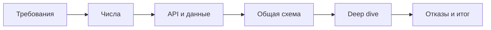
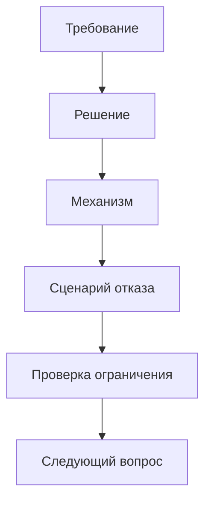

# Разборы реальных мок-собеседований: чему учат записи

<!-- learning-nav:start -->
[← Все разделы](../README.md) · [Предыдущая тема](../06-thinking-practice/architecture-review.md) · [Следующая тема →](../04-cheatsheets/interview-checklist.md)
<!-- learning-nav:end -->

Здесь собраны учебные разборы 15 публичных записей System Design на русском и английском. Ссылки на записи — в конце; названия разделов сохранены для навигации. Текст ниже — редакторский пересказ тем и выводов для подготовки, а не стенограмма, дословные реплики участников или подтверждённые hiring-вердикты. Технические оговорки отделены от конкретного выступления: удачный ответ в одном моке не устанавливает универсальную границу Middle/Senior/Staff.

Используйте запись как упражнение в принятии решений. Остановите её до решения, зафиксируйте собственные допущения, затем сравните альтернативы и проверьте гарантии по документации. Количество названных технологий и уверенность рассказчика не заменяют доказательства корректности.

## Анатомия часа: что интервьюер ждёт по таймингу

Возможный бюджет на 60 минут: 7 минут на scope и НФТ, 5 на оценки, 5 на ключевой API, 13 на общую схему, 20 на модель данных и два deep dive, 5 на отказы и эксплуатацию, 5 запаса. Это тренировочная рамка, не обязательный порядок каждого интервью. Data model часто удобнее обсуждать вместе с write/read path.

Если застряли, выберите один пользовательский сценарий и проведите его через схему до ответа. Вопросы без последствий для дизайна отложите. Во время deep dive полезно проверить бюджет времени; молчание интервьюера не означает согласия с допущениями, а уточняющий вопрос не означает провал.

## Разбор 1. Лента Instagram — мок от Team Lead из Яндекса

Центральный сценарий — публикация фото с описанием, чтение ленты и подписки. Сначала задайте сущность поста: идентификатор, автор, статус публикации, ссылки на медиа, время. Подписки и celebrity-перекос влияют на fan-out, а не только на выбор базы.

Полезное упражнение: медиа уже загружено в object storage, но commit метаданных завершился ошибкой. Пост не должен появиться с битой ссылкой; незавершённая загрузка остаётся в staging и позже удаляется GC. Обратный порядок тоже требует статуса pending и повторяемого перехода в published. Между SQL и object storage нет общей транзакции по умолчанию.

Для ленты сравните fan-out on write, on read и гибрид. Миллионы подписчиков делают массовую запись дорогой; редкий читатель делает предрасчёт расточительным. Посчитайте размер feed cache и стоимость обновления популярных авторов. Redis выбирают после оценки объёма и правил восстановления, графовую БД — только при запросах, которые оправдывают её модель. Один лишь знакомый продукт не доказывает выбор.

Для тренировки сформулируйте ограничение подписок, freshness ленты и поведение при удалении поста. Через эти требования сравнивайте решения записи, не пытаясь воспроизвести её схему по памяти.

## Разбор 2. Сокращатель ссылок — мок от Team Lead из Ozon

Задача включает создание короткой ссылки, переход, TTL, custom alias и аналитику. Разделите критический redirect path и асинхронный учёт переходов. Потеря аналитического события и редирект на неверный адрес имеют разную цену.

Custom alias требует атомарной уникальности: два одновременных INSERT должны дать одному успех, другому конфликт. Проверка SELECT перед INSERT сама не защищает от гонки. TTL на кэше не определяет срок действия ссылки: на redirect проверяется бизнес-expiration, а кэш не должен продолжать отдавать просроченный адрес.

Разберите отказ: событие клика отправлено в очередь, ответ redirect потерян и браузер повторил запрос. Это может быть два HTTP-перехода, а не технический дубль одного бизнес-события. Определите, что именно считает аналитика; idempotency key применим не к любому GET автоматически.

Тренировочный критерий — законченный read path: lookup, cache miss, expiry, 404/410, выбранный код редиректа и его cache semantics. После этого оцените QPS, число новых ссылок и retention. Повторять шардирование несколько раз полезно только тогда, когда меняется существенное условие.

## Разбор 3. Доставка еды — Go-мок с Владимиром Невзоровым

В доставке еды главный вопрос — состояние заказа и границы ответственности ресторана, оплаты и доставки. Начните с MVP, затем пройдите создание заказа, подтверждение и отмену. Мониторинг должен отражать не только CPU, но и заказы, застрявшие между состояниями.

Проверка арифметики: 50 000 заказов/сутки — **0,58 заказа/с в среднем**, а не 8. Восемь можно принять как отдельный пик, если коэффициент обоснован. Количество HTTP-запросов выше количества заказов из-за каталога, статусов и повторов. Из средней частоты создания заказа нельзя вывести верхний предел базы данных.

Конкретный отказ: деньги авторизованы, ресторан отказал. Нужна saga с компенсирующим снятием hold; компенсация тоже может упасть и должна повторяться по устойчивому ID. При retry создания заказа тот же idempotency key возвращает тот же заказ, а другой payload вызывает конфликт.

Для подготовки распишите один endpoint полностью: тело, ответ, ошибки, идемпотентность, переходы состояния. Оркестрация упрощает видимость шага и таймаутов; хореография ослабляет центральную связность, но требует общей картины процесса. Выбирайте по числу участников и операционным требованиям, а не по предполагаемому грейду.

## Разбор 4. Tinder — мок от ex-Team Lead Яндекса

В приложении знакомств есть независимые сценарии: профиль, выдача анкет, лайк, взаимный match и чат. Незнание интерфейса компенсируется уточнением пользовательского действия: что значит свайп, когда появляется match, кто может писать.

Гонка для deep dive: A и B одновременно лайкают друг друга на разных серверах. Проверка обратного лайка и создание match должны быть повторяемыми; уникальный ключ канонической пары `(min(userA,userB), max(...))` не даст два чата. Уведомление создаётся после commit через outbox. Потерянный ответ не должен создавать второй match.

Кэш анкет на 30 минут не является сам по себе ошибкой: это компромисс freshness, перемещения, блокировок и стоимости ranking. Заблокированного пользователя нужно фильтровать и при чтении/действии, а не ждать TTL. Для дистанции определите свежесть геолокации и допустимую погрешность.

Тренировочный результат — короткая сквозная схема и два углубления, например взаимный match и geo/ranking. Подсчёт CPU без стоимости одного запроса и модели нагрузки выглядит точным, но мало что обосновывает. Полезнее оценить QPS, размер candidate set и правила инвалидирования.

## Разбор 5. Uber / Яндекс Такси — мок уровня Middle+

Требование по задержке предложения заказа определяет способ доставки водителю. При polling раз в 5 секунд добавленная задержка до ближайшего опроса лежит примерно от 0 до 5 секунд, затем добавляются сеть и обработка. Если активны 10 млн водителей, один запрос каждые 5 секунд даёт 2 млн RPS; если активен только 1 млн — 200k. Регион и долю активности уточняют отдельно.

Независимые старты снижают синхронизацию, но reconnect после сбоя может создать herd. Jitter задают явно. Push через постоянное соединение сокращает ожидание опроса, но не гарантирует доставку оффера офлайн-клиенту: нужны ACK, expiry и повторный подбор.

Разберите гонку: два водителя приняли один заказ. Матчинг должен атомарно закрепить водителя за заказом и проверить, что предложение ещё действует; гео-кэш не является авторитетной записью назначения. Потерявший гонку получает отказ и новое состояние.

На тренировке свяжите latency с полным бюджетом: событие заказа, очередь, поиск кандидатов, reservation, доставка оффера, ответ. CDC — один из вариантов передачи события, но он сам добавляет lag и нуждается в восстановлении.

## Разбор 6. Биржа — дизайн-сессия FaangTalk

В биржевой задаче отдельно рассматривают ledger балансов, резервирование средств и matching engine по торговому инструменту. Упорядоченный поток по user ID уменьшает конкуренцию внутри одного счёта, но не делает перевод между двумя пользователями атомарным и не устраняет дубликаты при replay.

Для покупки резервируют доступные средства, затем исполняют ордер, затем отражают проводки. У каждого изменения есть устойчивый business ID; повторы не списывают баланс дважды. При rebalance consumer group старый владелец может ещё работать, поэтому нужны fencing и согласование offsets с записью результата.

Snapshot и replay сокращают восстановление. В snapshot должна быть позиция журнала: иначе непонятно, какие события уже учтены. Потеря snapshot допустима только при наличии полного журнала и подходящего RTO. Cassandra сортирует по clustering columns внутри partition, а не произвольно по всему набору данных.

Стакан требует упорядоченных ценовых уровней и очереди ордеров внутри уровня. Ring buffer полезен как очередь событий, но сам по себе не заменяет структуру order book. Для подготовки объясните приоритет price-time, отмену исполненного ордера и восстановление после падения. Низкоуровневая оптимизация полезна после определения этих инвариантов.

## Разбор 7. Главный экран Instagram — iOS-мок (Avito × крупный банк)

Мобильный System Design добавляет к backend-контрактам жизненный цикл экрана: pagination, offline cache, отмену запросов, image loading и аналитику. Начните с пользовательского действия, затем проведите ответ API через data layer к состоянию UI.

Для бесконечной ленты cursor обычно устойчивее offset при новых вставках, но cursor тоже требует определённого порядка и tie-break. `total` не обязателен, если UI его не использует. Он может быть дешёвым предрасчётом или дорогим точным подсчётом — это зависит от контракта, а не от самого имени поля.

Разберите гонку: пользователь обновил ленту, старый запрос страницы пришёл позже нового refresh. Ответы должны быть привязаны к generation/query key; отмена сетевого запроса не гарантирует, что старый callback не выполнится. Дедуп по post_id и явная state machine убирают дубли и скачки UI.

На схеме покажите публичные контракты модулей и владельца кэша. Название JSON описывает формат сериализации, но не доменную модель. Полезная проверка — разрыв сети посреди загрузки и повторный вход в экран: что пользователь видит и откуда берётся состояние. Эти критерии проверяемы без универсального вердикта о грейде участника.

## Разбор 8. Видеохостинг — мок с эталонным решением интервьюера

Видеохостинг удобно разложить на загрузку, хранение оригинала, обработку и публикацию производных файлов. Метаданные и статусы задач могут жить в SQL; тяжёлые медиа — в object storage. Клиент загружает части по upload ID с номером и checksum, повтор той же части безопасен.

Все части не обязаны попадать на одну реплику приложения. При multipart upload состояние частей хранит объектное хранилище, а API остаётся stateless. Affinity по video ID оправдана только при выбранной серверной сборке и создаёт собственную проблему отказа владельца.

После завершения загрузки outbox публикует задания encoding/thumbnail/captions. Обработчик пишет выход под детерминированным ключом и атомарно меняет статус версии: retry после записи файла не запускает двойную публикацию. Масштабирование по lag полезно, но учитывает CPU/GPU, размер видео и backpressure storage.

DNS-балансировка не даёт равномерного распределения по байтам и мгновенного failover из-за resolver caching. Нужность дополнительных LB определяется измеренной полосой и overhead. Для упражнения разберите исчезновение worker после транскодирования, но до ACK: файл уже существует, задача ещё видится незавершённой.

## Разбор 9. ML System Design: прогноз спроса на наличную валюту — Team Lead Яндекса

В прогнозировании спроса на наличную валюту цель — управлять запасом, а не минимизировать абстрактную ошибку предсказания. Стоимость недостатка наличности и избытка различается, поэтому квантильный прогноз/асимметричная функция потерь могут соответствовать бизнес-решению лучше среднего значения.

Временные ряды требуют backtest по времени: случайное перемешивание train/test способно дать leakage. Для каждого исторического решения доступны только те признаки, которые были известны тогда. Курс валют, праздничный календарь и фактический будущий спрос нельзя смешивать без проверки времени доступности.

Одна глобальная модель использует общие закономерности между пунктами и валютами; локальные модели проще персонализировать, но на малых данных нестабильны. Это гипотезы для проверки по сегментам. Изменение номиналов и масштаба признаков учитывают в preprocessing, а не объявляют достаточной причиной выбирать одну модель.

На подумать: интервал 90% хорошо покрывает обычные дни, но проваливается в кризис. Проверяйте calibration отдельно по периодам/пунктам, предусмотрите human override и ограничение риска. Переобучение не исправляет отсутствующий сигнал автоматически. После deployment меряют денежный эффект и unmet demand, а не только качество на offline test.

## Разбор 10. Платформа для конференций — публичное собеседование Podlodka

Платформа конференций объединяет VOD и live-сценарии; их задержки и пути отказа различаются. Для записей допустима очередь обработки, для трансляции важны непрерывность и ограниченный lag. Не нужно выбирать один протокол для обоих путей.

S3-подобное хранилище может оказаться узким местом по конкретным запросам, сетевой полосе или лимитам, но утверждение о его неизбежной медленности не заменяет измерение. Обозначьте число параллельных multipart uploads, размеры частей, requests/sec, backoff и CDN hit ratio.

Требование доступности видео через 20 минут проверяют бюджетом: очередь + download + транскодирование линейки + upload + публикация manifest. Средней скорости недостаточно — нужна p95/p99 с худшими длительностями и размерами. Уменьшение линейки качеств сокращает стоимость, если продукт принимает потерю качества.

Отказ для тренировки: live-нода исчезла, а последние сегменты не выгружены. Определите допустимую потерю, репликацию/буфер и переход на другой ingest. Очередь переносит управление и метаданные, но сама не восстанавливает отсутствующие медиа-байты. Честное неизвестное превращают в план замера и ограничение, а не в обещание скорости.

## Разбор 11. Design TikTok — EN-мок с будущим Google TPM

В TikTok-подобном продукте уточните границу: upload/playback, рекомендации, социальный граф или вся платформа. Рекомендатель можно обозначить black box с явным входом, выходом, latency и fallback, если ML не входит в scope. Это уменьшает ширину, но сохраняет проверяемый контракт.

Precache персональной ленты сокращает latency при чтении, но потребляет память и устаревает. Нужны fallback для нового пользователя, удаление запрещённых видео и invalidation при смене доступности. Медиадоставка идёт через CDN отдельно от ranking metadata.

Deep dive: ranking вернул список, но одно видео удалено до playback. Проверка видимости и доступа должна действовать при выдаче URL/manifest, а кэш результатов не даёт права показать удалённый объект. Если региональный CDN не отвечает, клиент переключает rendition/endpoint в пределах бюджета и показывает деградацию.

Шардирование по региону удобно для locality, но пользователь путешествует, аудитория ролика глобальна, регионы неравны по объёму. Сравните его с hash-шардами и региональными read replicas. Понимание этих ограничений полезнее утверждения, что конкретная схема означает уверенное прохождение любого интервью.

## Разбор 12. Distributed LRU Cache — EN-мок со Sr. MAANG SWE (Exponent)

Для распределённого кэша начните с одной ноды: hash map плюс двусвязный список обеспечивают локальный LRU с O(1) lookup/перемещением. После шардирования LRU обычно становится **локальным на каждом shard**, а не точным глобальным порядком всех ключей. Точный общий LRU потребовал бы координации почти на каждом чтении.

Consistent hashing уменьшает долю перемещённых ключей при смене состава узлов. Он не обеспечивает доступность данных сам: нужны реплики, health checking, маршрутизация и поведение при недоступности владельца. Виртуальные узлы сглаживают объём ключей, но не горячий ключ.

Разберите cache miss storm: shard упал и клиенты одновременно пошли в основную БД. Нужны лимит конкурирующих загрузок, request coalescing и ограниченный stale fallback там, где это допустимо. Слишком агрессивное восстановление кэша тоже может перегрузить origin.

Для записи с репликами уточните смысл подтверждения и чтения устаревшего значения. CAP касается доступности/согласованности при partition, а не универсального правила «consistency всегда медленная». Учебный ответ должен показать, чем кэш может пожертвовать, и почему источник истины переживёт его отказ.

## Разбор 13. Online Auction в Instagram — EN-мок уровня Staff (OpenAI/Meta)

В аукционе важны точный порядок ставок, deadline и сохранность принятого решения. Сначала определите, что означает принятая ставка: durable commit, ответ клиенту или попадание на экран. SSE/WebSocket влияет на отображение, но не выбирает победителя.

Для одного аукциона нужен последовательный/атомарный арбитр: проверка состояния, deadline и суммы вместе с записью принятой ставки. Redis Lua атомарна на своём узле/слоте, но не даёт SQL rollback при ошибке и не гарантирует сохранность при failover. Для дорогих ставок источник истины и журнал должны соответствовать RPO.

Поздний запрос: клиент отправил ставку до deadline, сервер получил после. Нельзя полагаться на произвольные часы клиента; правило приёма определяется серверным авторитетным временем/порядком и публикуется заранее. Повтор с тем же bid ID возвращает прежний результат.

Топик на каждый auction ID создаёт огромное количество partitions и metadata; проще фиксированный набор partitions с ключом auction ID, но hot auction ограничит параллелизм. Отложенное закрытие — явная scheduler-задача, а не предполагаемая встроенная функция любой очереди. На тренировке объясните failover арбитра и fencing прежнего владельца, затем UI fan-out.

## Разбор 14. Design ChatGPT — мок с @gkcs (sudocode)

Для чата с генератором текста разделите приём запроса, inference, сохранение ответа и доставку токенов. Генератор можно считать внешним компонентом, если контракт ясен: streaming protocol, timeout, cancellation, token budget и ошибка частичного ответа. Это не обещание внутреннего устройства конкретного продукта.

Запросу присваивают устойчивый ID и сохраняют статус. После разрыва stream клиент может запросить уже сохранённый ответ/часть и состояние; слепой повтор inference способен дать другой текст и повторную стоимость. Cancellation должна дойти до исполнителя, но остановка UI сама не прекращает генерацию.

История чата и контекст модели — разные данные. Хранение 50 чатов не означает, что все сообщения входят в каждый prompt: выбирают актуальные turns, summary/retrieval в пределах context/token budget. LRU ускоряет доступ, но не заменяет долговечную историю и проверку доступа.

В качестве упражнения посчитайте одновременные генерации по arrival rate и среднему времени, отдельно time-to-first-token и tokens/sec. При перегрузке очередь ограничивают, вводят per-tenant квоты и понятный статус ожидания. Отнесение этих решений к конкретным репликам участников требует проверки записи, поэтому здесь приводится самостоятельный технический разбор.

## Разбор 15. Design Instagram — эталонный прогон (EN)

Полезно сравнить этот прогон с разбором 1: одна формулировка Instagram допускает разные архитектуры при разных freshness и лимитах. Предрасчёт feed — вариант, а не единственно верный ответ. Пересчёт раз в час плохо подходит требованию увидеть новый пост за несколько секунд без дополнительного обновления хвоста.

Fan-out on write снижает стоимость чтения, но запись популярного автора дорого размножается. Fan-out on read экономит неиспользуемые ленты, но требует объединять кандидатов при каждом чтении. Гибрид оставляет celebrity-посты для read-time merge и заранее готовит обычные.

Сценарий отказа: пользователь отписался, а его feed cache ещё содержит посты автора. Контракт определяет, допустима ли краткая задержка; при блокировке/приватности фильтрация авторизации обычно нужна при чтении, независимо от TTL. Пагинация должна учитывать порядок, версии и возможные дубли между поколениями выдачи.

Разведите metadata API и media path через CDN/object storage. Наличие CDN не отменяет invalidation, подпись URL и origin protection. Для подготовки важнее связать эти решения с требованиями, чем назвать прогон эталоном, который нужно повторить слово в слово.

## Сводная картина: где теряются баллы

Используйте схему как проверку полноты рассуждения. Она не предсказывает hiring-решение: критерии конкретной компании, роль и взаимодействие с интервьюером различаются.

## Топ-20 ошибок кандидатов

Ниже — редакторский чек-лист для самопроверки, а не статистика частоты ошибок или универсальная шкала оценки.

### Требования и скоуп

1. Начать с выбора продукта, не назвав пользовательский сценарий.
2. Не задать лимиты: размер объекта, срок жизни, число подписок, максимальный fan-out.
3. Не определить сущности и состояния: что означает опубликованный пост или принятая ставка.
4. Не разделить latency, freshness, availability и durability.
5. Набрать функциональность без MVP и потратить на неё весь бюджет времени.
6. Менять допущения в середине ответа, не меняя расчёты и схему.

### Расчёты

7. Путать сутки и секунды, биты и байты, среднее и пик.
8. Считать объём без retention, реплик, индексов и headroom.
9. Назвать числовой потолок PostgreSQL/Kafka/Redis без workload и измерения.
10. Считать только обычную нагрузку, забыв backlog catch-up и восстановление после сбоя.

### API и модель данных

11. Не показать хотя бы один сквозной контракт запроса и ответа.
12. Пообещать retry без idempotency key, области уникальности и поведения при ином payload.
13. Не определить порядок пагинации, tie-break и изменение данных между страницами.

### Архитектура

14. Выбрать хранилище без связи с access patterns и инвариантами.
15. Обязать любую задачу иметь Kafka, Kubernetes и множество сервисов.
16. Считать репликацию, шардирование и резервное копирование взаимозаменяемыми.
17. Пропустить dual-write, частичный успех и повтор внешнего эффекта после таймаута.
18. Пообещать exactly-once без указания source/state/sink и протокола фиксации.

### Коммуникация и финиш

19. Показывать окончательное решение без объяснения выбора и его цены.
20. Не вернуться к требованиям, ограничениям, SLO и состоянию схемы в конце.

## Что ценят интервьюеры

Для самопроверки полезны наблюдаемые действия: кандидат связывает требование с механизмом, способен пройти запрос по схеме и объясняет конкретный отказ. Не нужно приписывать этим действиям гарантированный hire или определённый грейд. Полезная глубина определяется риском задачи: в аукционе — порядок и durability, в CI — trust boundary и retry, в метриках — cardinality и корректная агрегация.

### Сильные формулировки, которые звучат в проходных моках

Исторический заголовок сохранён; ниже **примеры для тренировки**, не цитаты из записей и не гарантированные проходные ответы:

- Предлагаю считать свежесть топа до 5 секунд; точный финальный результат зафиксируем отдельно.
- У этого решения есть окно двойной записи. Транзакция с outbox закрывает потерю события, а consumer остаётся идемпотентным.
- Этого свойства технологии я не помню. Зафиксирую нужный контракт и проверю его; без него выберу другой механизм.
- Этот запрос масштабируется по числу серий, поэтому одной оценки HTTP QPS недостаточно.
- Мы покрыли основной путь. Разберу падение после внешнего успеха, но до подтверждения.

### Как интервьюер читает ваши сигналы

По одной записи нельзя достоверно восстановить внутреннюю рубрику оценки. Подсказка может проверять реакцию на новое ограничение, а не исправлять ошибку; хороший фидбек может быть учебной поддержкой, а не оффером. Отделяйте наблюдаемый факт, собственную интерпретацию и техническую проверку.

Не выдумывайте личный production experience ради убедительности. Можно дать конкретный гипотетический инцидент, назвать сигнал и механизм восстановления. Он проверяет понимание лучше общего утверждения, что знакомая технология всё выдержит.

## Как использовать записи моков при подготовке

1. До просмотра решения запишите scope, три НФТ, оценки и один API.
2. Во время просмотра фиксируйте различия в допущениях, а не только названия компонентов.
3. После выберите один спорный механизм и проверьте по официальной документации.
4. Пройдите вслух один отказ: что уже зафиксировано, что повторится, что увидит клиент.
5. Повторите задачу под таймером с иными числами. Объясните, почему схема изменилась или осталась прежней.

### 1. На подумать: красивый ответ с ошибочной гарантией

Условие: кандидат последовательно рассказал про Kafka, consumer groups и Redis. На вопрос о потере ответа после списания денег ответил: очередь гарантирует exactly-once, повтор безопасен. Как разобрать это технически, не навешивая грейд?

Разбор

Уточните границу гарантии: commit offset не атомарен с внешним списанием. При повторе после неизвестного исхода банк/ledger должен принять тот же idempotency key или дать lookup по business ID. Если повтор создаёт новый charge, деньги спишутся дважды. В feedback фиксируется конкретная проблема и механизм её устранения; из одной ошибки нельзя вывести универсальный уровень человека. Затем измените условие: получатель поддерживает устойчивую идемпотентность — теперь retry может быть безопасным в её сроке и области действия.

## Видео по теме

- [Mock-собеседование по System Design от Team Lead из Яндекса](https://www.youtube.com/watch?v=9_8ShTF6aQA)
- [Mock-собеседование по System Design от Team Lead из Ozon](https://www.youtube.com/watch?v=hCg4N-r_kF0)
- [Mock-собеседование Go-разработчика по System Design от Senior Backend](https://www.youtube.com/watch?v=hit35DWs0wM)
- [Mock-собеседование по System Design | Ex-Team Lead Яндекс](https://www.youtube.com/watch?v=qsEvKryZ5YA)
- [Проектируем Uber, Яндекс Такси | System Design Mock-интервью | Middle+](https://www.youtube.com/watch?v=A6lsDx4lXk0)
- [#FaangTalk 28 - Систем дизайн Мок-интервью - Биржа](https://www.youtube.com/watch?v=TVBF4bpfdbQ)
- [iOS Мок-собеседование по систем дизайну | Проектируем инстаграм с разработчиком из крупного банка](https://www.youtube.com/watch?v=1ooQg8q332E)
- [Mock собеседование - System Design](https://www.youtube.com/watch?v=_1PQ-Nn9s7A)
- [ML System Design | Mock-собеседование | Team Lead Яндекс](https://www.youtube.com/watch?v=zBRsgZgDeIk)
- [Публичное собеседование по System Design / Платформа для управления конференциями](https://www.youtube.com/watch?v=-i4dQ-eks1U)
- [System Design Mock Interview: Design TikTok ft. Google TPM](https://www.youtube.com/watch?v=Z-0g_aJL5Fw)
- [System Design Interview - Design a Distributed LRU Cache (Full mock interview with Sr. MAANG SWE)](https://www.youtube.com/watch?v=lZ5QuFLCVn0)
- [OpenAI & Meta Senior/Staff System Design Mock Interview: Design Online Auction](https://www.youtube.com/watch?v=o8nSXW-B7Rw)
- [System Design of ChatGPT | Mock interview @gkcs](https://www.youtube.com/watch?v=H9Qdm8_JBAs)
- [System Design Mock Interview: Design Instagram](https://www.youtube.com/watch?v=VJpfO6KdyWE)
- [Ошибки на system design interview: что допускают 90% кандидатов](https://www.youtube.com/watch?v=WzotXf9YAK8)
- [System Design Interview: казнить нельзя помиловать / Вл. Невзоров, Ал-др Поломодов, Филипп Дельгядо](https://www.youtube.com/watch?v=SclYSUn2CrI)
