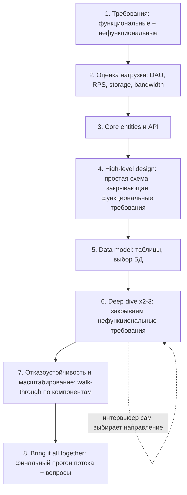
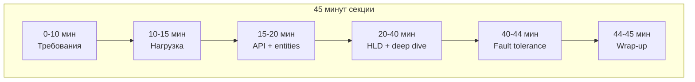
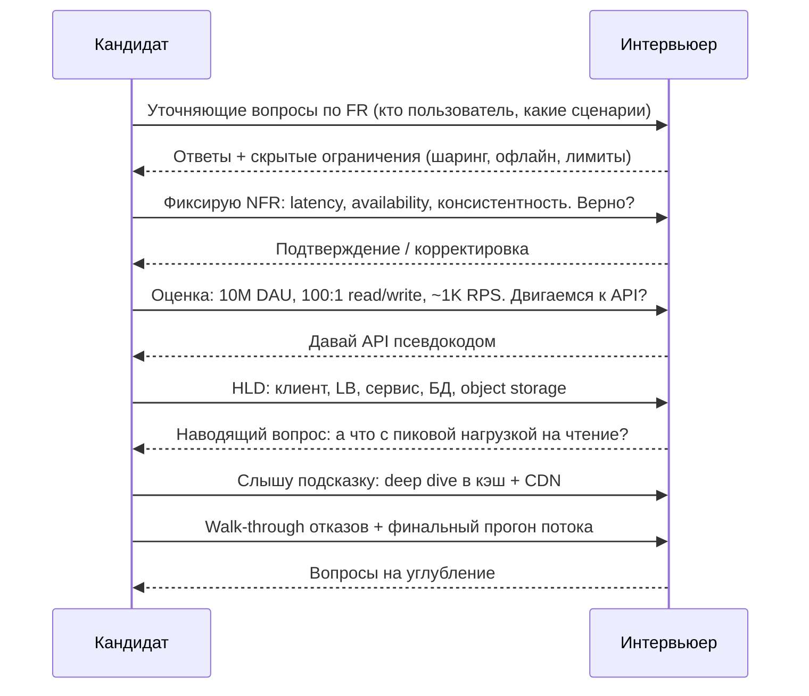

# Чек-лист подготовки и план на день собеседования

Файл-рабочая тетрадь: как распределить подготовку (2 недели или 3 дня), как вести себя
в день интервью, поминутный план 45 минут и заготовка структуры ответа, которую можно
механически воспроизвести на любом whiteboard / Miro / Excalidraw.

Главный принцип, который повторяют все интервьюеры из разобранных моков: **навык
проектирования систем ≠ навык прохождения system design интервью**. На работе вы
проектируете итеративно и в размеренном темпе; на интервью нужно за 45 минут вслух
построить систему, ведя диалог. Это отдельный тренируемый навык — и готовиться надо
именно к формату, а не только к теории.

---

## 1. Что на самом деле оценивает интервьюер

По итогам секции интервьюер заполняет матрицу оценки (в крупных компаниях — буквально
таблицу со взвешенными оценками по этапам). Критерии везде похожи:

| Критерий | Что проверяется | Как проявить |
|---|---|---|
| Problem solving | Умение выделить **главную** проблему системы и не расползтись | В Ticketmaster вы копаете booking flow, а не аутентификацию |
| Solution design | Связный high-level дизайн, закрывающий функциональные требования, с взвешенными trade-offs | Сначала простая рабочая схема, потом усложнение |
| Technical excellence | Глубина в 2–3 местах: конкретные технологии, узкие места, способы их починить | Deep dive по явно названным компонентам |
| Communication | Думаете вслух, ведёте диалог, реагируете на наводящие вопросы | Интервьюер всегда понимает, что и почему вы рисуете |

Два качества, которые интервьюеры выделяют отдельно (и которые реально тренируются):

1. **Умение слушать.** Если интервьюер дважды сказал «давай не будем это делать» — это
   не случайность. Наводящий вопрос = бесплатная подсказка; игнорировать его — один из
   самых частых провалов.
2. **Инициатива.** Примерно 80% интервью ведёт кандидат: задаёт вопросы, предлагает
   следующий шаг, сверяется («двигаемся дальше или углубимся сюда?»). Позиция senior
   предполагает лидерство: вы ведёте интервьюера за руку, а не спрашиваете «а что нам
   теперь делать?».

Важно: перед каждым крупным шагом **синхронизируйтесь** — «предлагаю набросать API,
или вы бы хотели сразу схему данных?». Интервьюер может хотеть посмотреть не то, что вы
планировали (например, не API, а модель данных или мониторинг), и услышать это — ваша
работа.

---

## 2. Заготовка структуры ответа (шаблон ведения дизайна)

Это «одна страница», которую опытные кандидаты держат перед глазами как safety net.
Последовательность одинакова для «спроектируй Instagram», «спроектируй rate limiter» и
почти любой другой задачи.



Ключевая логика шаблона (из фреймворка Hello Interview): **high-level design закрывает
функциональные требования, deep dive — нефункциональные**. Сначала рисуете самую простую
схему, на которой пользователь может выполнить целевое действие (забронировать билет,
отправить сообщение). Только потом отвечаете: «а как сделать это low latency? а как —
strongly consistent? а как — на миллион пользователей?».

### Болванка для доски (записать в первую минуту)

```text
FR: 1) ... 2) ... 3) ...           Out of scope: ...
NFR: availability 99.9% | latency p99 < 300ms | consistency: eventual/strong
Scale: 10M DAU, read:write = 100:1, ~1.2K RPS avg / 6K peak, 5 TB/год storage

Entities: User, Item, ...
API: POST /v1/... | GET /v1/...

[HLD — 4-6 прямоугольников]
[Deep dive 1: ...] [Deep dive 2: ...]
```

Правила работы с шаблоном:

- Требования записываются **на доску/в документ** (не держать в голове). Кандидаты без
  конспекта забывают требования и переспрашивают — прямая потеря минут. Периодически
  возвращайтесь к списку FR и проверяйте, что всё отражено в схеме: интервьюер молча
  напишет в фидбек «часть системы не реализована», но не напомнит.
- План важнее гибкости исполнения: интервьюеры описывают типичную картину — кандидат без
  плана тратит 15–20 минут только на формализацию задачи и дальше ничего не успевает.
- «Идеальной архитектуры не существует» — достаточно хорошая архитектура за 45 минут
  лучше идеальной, которую вы не успели нарисовать.

---

## 3. Поминутный план на 45 минут

Реальная секция длится 50–60 минут; вычтите знакомство (~5 мин) и ваши вопросы в конце
(~5 мин) — в сухом остатке ~45 минут на дизайн.

| Время | Этап | Что делать | Красный флаг |
|---|---|---|---|
| 0:00–0:10 | Требования | 3–5 ключевых FR, остальное — out of scope; NFR: availability, latency, consistency, масштаб | Прыгнуть рисовать сразу («сервис фотографий» окажется сервисом RAW-фото для фотографов — совсем другая система) |
| 0:10–0:15 | Оценка нагрузки | DAU → RPS, read/write ratio, storage, bandwidth. Порядки, не битики | Арифметическая ошибка на порядок (100 RPS vs 10K RPS = другая архитектура) |
| 0:15–0:20 | API + entities | REST-эндпоинты псевдокодом (спросить разрешение: «могу псевдокодом, чтобы сэкономить время?»), основные сущности | Детальное расписывание схем запросов/ответов |
| 0:20–0:40 | HLD + data model + deep dive | Простая схема → модель данных → 2–3 deep dive по самому нагруженному / сложному | Уйти в один компонент и «закопаться» |
| 0:40–0:44 | Отказоустойчивость | Быстрый walk-through: «что если этот узел упадёт?», stateless vs stateful, реплики | Теоретизирование дольше 5 минут |
| 0:44–0:45 | Финал | Прогнать end-to-end поток по схеме, свериться со списком FR | Закончить на полуслове без walk-through |



Замечания к плану:

- **Расчёт железа** (сколько серверов/дисков нужно) делают не везде — спрашивайте заранее.
  Если просят (бывает, например, в Яндексе): считайте только самый нагруженный ресурс,
  абстрактно, за оставшиеся 4–5 минут.
- **Таймер.** На тренировках ставьте таймер перед глазами и сверяйте этапы; на боевом
  интервью периодически смотрите на часы. Перерасход на одном этапе почти всегда означает
  «не собрал целостную картину» — а это хуже, чем поверхностный deep dive.
- **Диалог в приоритете.** Если интервьюер тянет в сторону («давайте подробнее про
  мониторинг») — план корректируется, план не догма. Но возвращайтесь к нему явно:
  «хорошо, тогда deep dive по кэшированию пропустим, вернусь к отказоустойчивости».

Как выглядит здоровый диалог по этому плану:



---

## 4. План подготовки на 2 недели

Оптимальный сценарий, если интервью назначено заранее. Принцип 20/80 из разобранных
материалов: ~20% тем закрывают ~80% интервью. База, без которой нет смысла зубрить моки:
кэширование, балансировка нагрузки, базы данных, очереди сообщений, репликация,
партиционирование/шардирование, микросервисная архитектура, CAP. Не «как устроена БД под
капотом», а как «кирпичики», которые вы уверенно ставите в схему.

| День | Тема | Практика |
|---|---|---|
| 1 | Формат интервью, фреймворк, критерии оценки | Выписать свой шаблон из раздела 2; посмотреть 1 мок целиком |
| 2 | Оценки нагрузки: latency numbers, формулы RPS/storage/bandwidth | 5 расчётов на бумаге (DAU → RPS → storage/год) |
| 3 | Хранилища: SQL vs NoSQL, ACID vs BASE, индексы, выбор БД под access pattern | Таблица «когда Postgres, когда Cassandra, когда Redis, когда S3» |
| 4 | Масштабирование: vertical/horizontal, sharding, партиционирование, consistent hashing | Разобрать шардирование на примере ленты соцсети |
| 5 | Кэширование и CDN: стратегии, инвалидация, hot keys | Deep dive-кейс: кэш для read-heavy системы |
| 6 | Очереди сообщений, async processing, outbox, fanout | Разобрать fanout на примере мессенджера |
| 7 | Надёжность: репликация, failover, CAP, отказоустойчивость stateless/stateful | Walk-through «что если упал компонент X» для 2 систем |
| 8 | **Мок 1** (с напарником/ботом/платным сервисом), таймер 45 мин | Записать на диктофон, разобрать ошибки |
| 9 | Сети для интервью: REST vs GraphQL vs gRPC, WebSockets/SSE, TCP/UDP | Когда что выбирать — по 3 примера |
| 10 | Case study: транзакционная система (бронирование/платежи) | Полный прогон по шаблону, вслух, с таймером |
| 11 | Case study: соцсеть / лента новостей | Полный прогон, вслух, с таймером |
| 12 | Case study: мессенджер / real-time | Полный прогон, вслух, с таймером |
| 13 | **Мок 2**, разбор; добить слабые места из фидбека | Повторить темы, где «поплыл» |
| 14 | Лёгкий день: чек-лист из раздела 8, формулы, сон | Без новых тем |

Почему именно эти три кейса: по опросам кандидатов чаще всего встречаются **транзакционные
системы** (банковские, бронирование), **соцсети** и **мессенджеры** — они и дают те самые
80% задач. Остальное (rate limiter, web crawler, ad aggregator) — производные тех же
кирпичиков.

Как тренироваться (по возрастанию цены):

1. Самостоятельно: лист бумаги / Miro / Excalidraw + таймер. Засекаете час, переносите
   мысли на доску. Первый раз почти всегда провальный — это нормально, формат надо
   «набить».
2. Мок с напарником: peer-to-peer боты и сообщества, где вам находят такого же кандидата
   (бесплатно).
3. Платные мок-сервисы с опытным интервьюером.
4. Реальные собеседования в компаниях «не мечты» — но обязательно **с рефлексией**:
   просите фидбек, записывайте себя (для себя), разбирайте, где теряли время.

---

## 5. План на 3 дня (аврал)

Когда интервью послезавтра. Цель — не выучить теорию, а не провалиться по формату.

**День 1 — фреймворк и база:**
- Выпишите шаблон из раздела 2 на одну страницу — это ваш safety net.
- Повторите «кирпичики» по чек-листу из раздела 8 (только поверхностно, до уровня
  «знаю, зачем и когда»).
- Выучите формулы оценок: секунд в сутках ~100K (86400), `RPS = DAU × запросов/день / 100K`,
  пик ≈ 2–5× среднего, storage = записей/день × размер × 365 × годы × реплики.
- Посмотрите один мок (Яндекс/Ozon — из списка в конце), следя, как кандидат ведёт время.

**День 2 — два полных прогона:**
- Утром: транзакционная система (бронирование билетов/отелей) по шаблону, вслух, 45 мин,
  с таймером. Запишите себя.
- Вечером: соцсеть или мессенджер. Сравните с разбором, выпишите 3 главные ошибки.
- Ночью: перечитайте список типичных ошибок (раздел 9) — половина из них убирается
  одним осознанием.

**День 3 — полировка:**
- Один лёгкий прогон (30 мин) или разбор слабого этапа из вчерашнего.
- Подготовьте 3–4 вопроса интервьюеру (раздел 10).
- Проверьте технику (камера, доска, маркер), лягте вовремя. Новые темы в этот день
  не открывать — неусыпленный мозг дороже ещё одного кейса.

---

## 6. День интервью

**Утром:**
- Прогрейте «речевой аппарат»: 10 минут проговорите вслух любой дизайн (даже вчерашний) —
  первые минуты говорить тяжелее всего, лучше сломяться дома, а не на секции.
- Перечитайте свою одностраничную заготовку (шаблон + тайминг + формулы). Не учите новое.
- Проверьте: стабильный интернет, камера, зарядка, вода, доска/блокнот открыты, таймер
  под рукой, уведомления выключены.

**За 15 минут:**
- Настройтесь на диалог: вы ведёте, интервьюер — ваш союзник и источник подсказок,
  а не экзаменатор.

**Во время:**
- Первые 10 минут — самые ценные: правило «1-10-100» (ошибка в требованиях дешевле
  ошибки в архитектуре; на интервью валюта — минуты, переделка схемы стоит дороже
  уточняющих вопросов).
- Рисуете — комментируете. Молча рисующий кандидат для интервьюера — чёрный ящик:
  невозможно понять ход мысли, а именно его оценивают.
- Застряли больше чем на минуту — попросите помощи. Интервьюер не отличает «думает» от
  «застрял», молчание жжёт ваше время.
- В конце — свои вопросы (5 минут обычно оставляют): «как у вас устроен процесс
  проектирования? кто владеет архитектурой? как принимаете trade-off решения?» —
  это и интерес, и плюс к communication.

---

## 7. Банк уточняющих вопросов (первые 10 минут)

Не задавать всё подряд — выбрать 5–7 под задачу. Цель: найти критическую
функциональность и вынести остальное за скобки.

**Функциональные:**
- Кто пользователи и какой главный сценарий? («что система делает» — FR)
- Какие операции обязательны, что можно вынести в out of scope?
- Нужна ли синхронизация между устройствами / шаринг / совместная работа?
- Какие ограничения на входные данные (максимальный размер файла, длина сообщения)?
- Нужны ли модерация, поиск, уведомления — или это второй этап?

**Нефункциональные («как система ведёт себя»):**
- Сколько пользователей: DAU/MAU? Регионы — один ДЦ или глобально?
- Соотношение read:write?
- Требования к latency (p50/p99) и availability (99.9% — 8.7 часов даунтайма в год)?
- Консистентность: где допустим eventual, где нужна strong? (Это и есть CAP-выбор —
  зафиксируйте его здесь и дальше держите.)
- Есть ли пики (сезонность, релизы, flash sales)?

**Организационные (задать один раз):**
- «Рисуем API подробно или псевдокодом?»
- «Фокус на high-level или есть компонент, который хотите разобрать глубоко?»
- «Нужен расчёт железа в конце?»

---

## 8. Темы для повторения (со ссылками на материалы репозитория)

Минимальный набор «кирпичиков» — 20% тем, закрывающих ~80% интервью:

- [ ] [Кэширование и CDN](../01-building-blocks/caching.md) — cache-aside, write-through,
  инвалидация, hot keys, TTL
- [ ] [Балансировка нагрузки](../01-building-blocks/load-balancing.md) — L4/L7,
  алгоритмы, health checks, sticky sessions
- [ ] [Выбор базы данных](../01-building-blocks/databases.md) — SQL vs NoSQL, ACID vs
  BASE, индексы, access patterns
- [ ] [Репликация и шардирование](../01-building-blocks/sharding.md) —
  leader-follower, failover, ключ шардирования, resharding
- [ ] [Consistent hashing](../01-building-blocks/sharding.md) — виртуальные
  узлы, равномерность, горячие партиции
- [ ] [Очереди сообщений](../01-building-blocks/message-queues.md) — Kafka/RabbitMQ,
  at-least-once, outbox, DLQ, backpressure
- [ ] [CAP-теорема](../01-building-blocks/cap-and-consistency.md) — CP vs AP, PACELC, выбор под
  NFR
- [ ] [Rate limiting](../01-building-blocks/rate-limiting.md) — token bucket, sliding
  window, распределённый лимитер
- [ ] [API-дизайн](../01-building-blocks/api-design.md) — REST vs GraphQL vs gRPC,
  идемпотентность, пагинация, версионирование
- [ ] [Числа для оценок](./numbers.md) — latency numbers, формулы RPS/storage,
  размеры единиц

Тренировочные кейсы (три самых частотных типа задач + классика):

- [ ] [Бронирование билетов (Ticketmaster)](../02-case-studies/ticket-booking.md) —
  транзакционная система, strong consistency, холды
- [ ] [Лента Twitter](../02-case-studies/twitter-feed.md) — fanout on write vs
  on read, celebrities problem
- [ ] [Мессенджер (WhatsApp)](../02-case-studies/chat-messenger.md) — WebSockets,
  доставка, ordering сообщений
- [ ] [Uber / такси](../02-case-studies/ride-sharing.md) — геопоиск, matching, location
  updates
- [ ] [Сокращатель ссылок](../02-case-studies/url-shortener.md) — разминочный
  кейс на весь шаблон за 20 минут

Формат и разборы:

- [ ] [Как проходит интервью: формат и критерии](../00-how-to-pass/interview-framework.md)
- [ ] [Разборы реальных мок-собеседований](../03-mock-breakdowns/mock-analysis.md) —
  в т.ч. система хранения файлов и лента Twitter

---

## 9. Типичные ошибки (собрано из разборов моков)

16 ошибок, которые интервьюеры видят раз за разом. Половина из них — не про знания,
а про поведение:

**Про требования и скоуп:**
1. **Проектирование без уточнения требований.** «Сервис хранения фотографий» через
   20 минут оказывается сервисом для профессиональных фотографов с RAW по 50 МБ —
   другая архитектура, минус 20 минут.
2. **Попытка сделать всё сразу.** Аутентификация, авторизация, админка, «и всё, что на
   -ация заканчивается» — за скобки, если интервьюер не просил.
3. **Зацикливание на одном компоненте.** Детально проработанный один сервис + несобранная
   система = проваленное интервью. Лучше готовая абстрактная архитектура, чем один
   идеальный узел.
4. **Только happy path.** Подсветите 1–2 corner case / exceptional flow (потерялось
   соединение при бронировании — пользователь получил две брони; машина заехала в туннель
   и не шлёт координаты) — это сильно выделяет кандидата.

**Про оценки:**
5. **Ошибка на порядок.** 100 RPS вместо 10K — и вся архитектура не та. Перепроверяйте
   арифметику вслух.
6. **Битики и байтики.** Никому не интересны точные байты — важны порядки. «~5 ТБ/год»
   лучше трёх минут подсчёта «4.73 ТБ».

**Про выбор решений:**
7. **Выбор без обоснования.** «Возьму Postgres, поехали дальше» — минус баллы. Даже «у
   меня больше экспертизы с Postgres, а требованиям он удовлетворяет» — уже обоснование.
8. **Варианты вместо решения.** «Можно Mongo, можно Postgres» — и не выбрано. Решение
   принимать обязательно, в условиях неопределённости — с явным trade-off.
9. **Зазубренные архитектуры.** Один наводящий вопрос в сторону — и «плотность льда»
   проверяется. Учите принципы построения мессенджеров/соцсетей, а не картинки.
10. **Монолит для миллионов пользователей.** Если не оговорено low-latency/стартап —
    ждут декомпозицию на сервисы (осознанную, с обоснованием границ).

**Про коммуникацию:**
11. **Размышление в голове.** Интервьюер не ясновидящий: молча нарисованная схема не
    показывает ни рассуждений, ни trade-offs.
12. **Игнор наводящих вопросов.** Если интервьюер второй раз спрашивает про одно и то же —
    он вас спасает, а не проверяет на упрямство.
13. **Отсутствие конспекта.** Забытое требование = нереализованная часть системы в фидбеке.
14. **Страх попросить помощи.** Застряли — скажите вслух. Молчание сжигает время и выглядит
    хуже, чем честный вопрос.
15. **Вид «я всё знаю».** Нормально: «слышал, читал, но в проде не использовал». Плюс:
    там, где экспертиза есть — расскажите тонкости, не скромничайте.
16. **Нет вопросов в конце.** 2–3 подготовленных вопроса о процессах команды — бесплатный
    плюс к впечатлению.

---

## 10. Что говорить интервьюеру: сильные формулировки

Фразы-скелеты, которые структурируют ответ и показывают зрелость:

- «Прежде чем рисовать, зафиксирую требования. Предлагаю взять три главных сценария,
  остальное выносим в out of scope — согласны?»
- «Прикину нагрузку по порядкам: если 10M DAU и 100 запросов на пользователя в день, это
  ~10K RPS в среднем, пик — раза в три выше. Это меняет выбор БД? Нет — тогда держим в
  голове как NFR.»
- «Нарисую минимальную схему, которая просто работает, а потом будем усложнять под
  нефункциональные требования.»
- «Здесь два варианта: fanout on write — быстрое чтение, дорогая запись и проблема
  знаменитостей; fanout on read — наоборот. Для нашего read:write = 100:1 беру первый,
  а для celebrities сделаю гибрид.»
- «Осознанный trade-off: жертвуем strong consistency ради availability — для ленты это
  приемлемо, для платежей я бы так не делал.»
- «Слышу, вы хотите копнуть сюда — тогда deep dive по кэшированию, остальное оставим
  абстрактным.»
- «Тут я знаю теорию, но в проде не эксплуатировал — предложу решение по аналогии с X.»
- «Давайте проверю схему на отказы: если падает этот сервис — он stateless, реплики за
  балансировщиком подхватят; если падает БД — есть replica с автоматическим failover,
  потеряем до N секунд репликации.»
- «Пробегусь по списку требований и сверю со схемой… Пункт 3 не закрыт — добавлю
  notification-сервис, чтобы не перегружать upload-сервис.»

---

## Источники и видео по теме

- [Как пройти System Design интервью: взгляд со стороны интервьювера и кандидата](https://www.youtube.com/watch?v=P3im7VW0mnw) — этапы и тайминги, 16 типичных ошибок, план подготовки, самые частотные типы задач
- [Как пройти System Design Интервью? 4 этапа, 2 важных качества кандидата](https://www.youtube.com/watch?v=KhfeYD0VBOY) — 4 этапа интервью, инициатива кандидата, синхронизация с интервьюером
- [Как подготовиться и пройти System Design Interview. Александр Поломодов](https://www.youtube.com/watch?v=jUbOm0B-eKQ) — почему нужен план, цена молчаливого рисования, вопросы в конце
- [How to Prepare for System Design Interviews w/ Meta Staff Engineer](https://www.youtube.com/watch?v=Ru54dxzCyD0) — фреймворк «requirements → entities → API → HLD → deep dives», критерии оценки, 6 фундаментальных тем
- [How to Answer Any System Design Interview (My 7-Step FAANG Framework)](https://www.youtube.com/watch?v=sngWrkymU-c) — одностраничный фреймворк как safety net, walk-through в финале
- [MergeConf. Доклад «Архитектура web-приложений. Подготовка к сложному интервью»](https://www.youtube.com/watch?v=7GIa6X7n6g4) — роль диалога и уточняющих вопросов, обоснование выбора технологий
