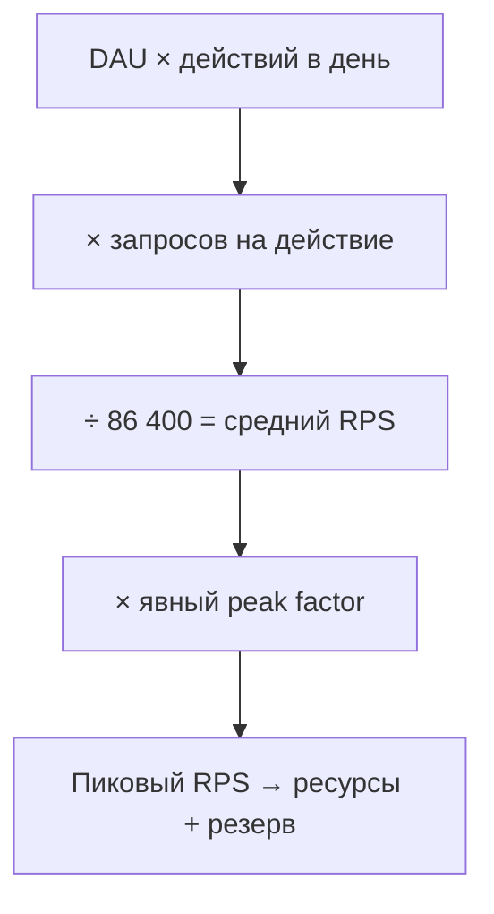

# Числа, которые нужно знать наизусть

<!-- learning-nav:start -->
[← Все разделы](../README.md) · [Предыдущая тема](interview-checklist.md) · [Следующая тема →](tradeoffs.md)
<!-- learning-nav:end -->

> Шпаргалка для секции System Design: задержки, пропускные способности, порядки QPS и DAU,
> типовые размеры данных и быстрые конверсии. Всё, что нужно, чтобы за 10–15 минут
> на интервью прикинуть нагрузку и не поплыть в арифметике.

Главный принцип: интервьюер не ждёт точных цифр — он ждёт **правильных порядков** и уверенной
арифметики в столбик. На реальных моках (Яндекс, Ozon, Авито) кандидата, который говорит
«помню порядки, точные формулы не помню, но этого достаточно», это не топит. Топит тот,
кто путает микросекунды с миллисекундами или не может перевести «миллион событий в день» в RPS.

---

## 1. Latency numbers every programmer should know (Jeff Dean)

Исторические latency numbers полезны для масштаба мышления, но не являются
паспортом современного сервера. Ниже — **порядки для учебной оценки**, не benchmark.
Для конкретного hardware/workload уточняют размер операции, queue depth, кэши,
нагрузку и percentile. `100 нс на обращение RAM` нельзя переносить на HTTP-запрос.

| Операция | Учебный порядок | Что именно сравниваем |
|---|---|---|
| L1/L2 cache | единицы наносекунд | Небольшое локальное обращение CPU |
| RAM | десятки–сотни наносекунд | Задержка доступа, не чтение мегабайта |
| SSD random read | десятки–сотни микросекунд | Малый блок без попадания в cache, зависит от устройства |
| HDD seek | единицы–десятки миллисекунд | Позиционирование головки, не sequential bandwidth |
| RTT внутри DC | сотни микросекунд–единицы миллисекунд | Между выбранными hosts; tails при нагрузке выше |
| Межконтинентальный RTT | десятки–сотни миллисекунд | География и маршрут, не универсальные «150 мс» |

Малое чтение SSD может быть быстрее сетевого RTT, HDD seek — медленнее него.
Поэтому пирамида, где **любой диск всегда медленнее сети**, вводит в заблуждение.
Отдельно считайте latency одной операции и bandwidth большого потока: чтение
1 МБ с SSD со скоростью 5 ГБ/с требует около 0.2 мс только на передачу байтов,
плюс накладные расходы; 100 нс RAM reference не означает 1 МБ за 100 нс.

### Как это использовать на интервью

- Когда интервьюер спрашивает «какая будет задержка у эндпоинта?» — раскладывайте её на бюджет:
  1 сетевой RTT до балансировщика + 1–2 внутренних RTT + 1 обращение к кэшу (~1 мс с сетью)
  или 1 чтение с диска (~1–10 мс). Итого «условный GET из кэша — единицы миллисекунд,
  GET с диска — десятки миллисекунд».
- Для N последовательных внутренних RPC при **принятом допущении** RTT 0.5 мс
  сеть добавит около N × 0.5 мс, плюс обработка и очередь. Это оценка, не физический
  минимум. Параллельный fanout ждёт максимум задержек зависимостей; его p99 тоже
  нельзя получить простым сложением или усреднением их p99.

---

## 2. Пропускная способность: HDD / SSD / RAM / сеть

| Медиум | Sequential read/write | Random IOPS | Комментарий для собеса |
|---|---|---|---|
| HDD 7200 rpm | 100–200 МБ/с | 100–200 IOPS | seek ~10 мс убивает random access |
| SATA SSD | ~500 МБ/с | 50–100 тыс. IOPS | нет механического seek; I/O latency остаётся |
| NVMe SSD | например, 3–7 ГБ/с | например, 0.5–1 млн IOPS | зависит от поколения, блока, QD и read/write mix |
| RAM (DDR4/DDR5) | 25–100+ ГБ/с | — | на 1–2 порядка быстрее NVMe |
| Сеть 1 Gbps | ~125 МБ/с | — | ~10 мкс на килобайтный пакет |
| Сеть 10 Gbps | ~1.25 ГБ/с | — | типичная нода в DC |
| Сеть 25/40/100 Gbps | 3–12 ГБ/с | — | кросс-DC линки и storage-фабрики |

В таблице — иллюстративные порядки для отдельного устройства/линка. Max sequential
throughput и max IOPS часто достигаются в разных тестах, их нельзя одновременно
считать рабочей ёмкостью. `IOPS × размер блока` даёт bandwidth только для выбранного
профиля. Бит/с переведите в байт/с делением на 8, затем вычтите протокольный overhead.

Практические следствия:

- **Диск vs сеть**: чтение 1 МБ с локального HDD (например, ~10 мс при 100 МБ/с, плюс seek) медленнее передачи его по 10 Gbps
  сети (~0.8 мс сериализации + RTT). Поэтому «всё положим на одну машину с большим диском» не всегда выигрышно.
- **Sequential vs random**: HDD читает последовательно 100+ МБ/с, но рандомно — 100 IOPS,
  т.е. ~0.4 МБ/с блоками по 4 КБ. Разница ~2 порядка. Отсюда — append-only логи, WAL, LSM.
- **Сеть не бесплатна**: через 1 Gbps линк вы физически не пропихнёте больше ~125 МБ/с.
  Если ваш сервис раздаёт видео 10 000 RPS по 1 МБ — это 10 ГБ/с = 80 Gbps,
  т.е. десятки машин только на отдачу трафика (и именно поэтому существуют CDN).

---

## 3. Быстрые конверсии величин — базовая арифметика собеседования

Это та таблица, которую стоит вызубрить до автоматизма. Как отмечают интервьюеры на моках:
числа часто дают в DAU/MAU или «событий в день», и ждут, что вы за секунды переведёте это в TPS.

### Время

| Величина | Значение | Мнемоника |
|---|---|---|
| Секунд в сутках | 86 400 ≈ **100 000 (10⁵)** | округление 86 400 вверх на 15.7%; QPS получится ниже на 13.6% |
| Секунд в месяце (30 дн.) | 2 592 000 ≈ **2.5 млн** | «месяц — два с половиной миллиона секунд» |
| Секунд в году | ~31.5 млн ≈ **π × 10⁷** | красивая шпаргалка, легко запомнить |

### Степени тысячи в байтах

| Единица | Байт | Пример «предмета» |
|---|---|---|
| 1 КБ = 10³ | 1 000 | короткий текст, пара абзацев |
| 1 МБ = 10⁶ | 1 000 000 | минута аудио, небольшое фото |
| 1 ГБ = 10⁹ | 1 000 000 000 | ~час видео в низком качестве |
| 1 ТБ = 10¹² | 10¹² | диск ноутбука |
| 1 ПБ = 10¹⁵ | 10¹⁵ | суточный прирост логов крупного сервиса |

> На собеседовании **не делайте разницы между 1024 и 1000** — говорите вслух «считаю в степенях
> десятки для простоты». Это показывает, что вы контролируете допущения, а не ошиблись.

### Конверсия «события в день → QPS»

Главная формула секции:

```text
QPS ≈ (событий в день) / 10⁵
```

- 1 млн событий/день ≈ **10 QPS**
- 10 млн/день ≈ **100 QPS**
- 100 млн/день ≈ **1 000 QPS**
- 1 млрд/день ≈ **10 000 QPS**

Пиковый коэффициент выбирайте по условию/профилю трафика. Для упражнения можно
принять ×3 и явно сказать об этом; это не универсальная оценка распродажи.
Односекундный burst, дневной пик и средняя минута — разные масштабы времени.

DAU → QPS (правило большого пальца):

```text
QPS ≈ DAU × (действий на пользователя в день) / 10⁵
```

Пример: 10 млн DAU, в среднем 10 действий на пользователя → 10⁷ × 10 / 10⁵ = **1 000 QPS** в среднем,
~3 000 в пике при коэффициенте ×3. DAU сам по себе не задаёт QPS: различаются
число действий и число backend-запросов на действие, retries и fanout.



---

## 4. Порядки QPS и DAU известных сервисов

Название сервиса не заменяет условия задачи. Не стоит заучивать разновременные
цифры MAU, неподтверждённые «RPS Twitter» и переносить их на свой дизайн. Одинаковый
DAU может означать чат с постоянными соединениями, поиск с десятками запросов
или видео с огромным потоком байтов при небольшом числе HTTP-операций.

Ниже — **условные сценарии**, а не текущая статистика компаний:

| Сценарий | Явные исходные данные | Производная нагрузка |
|---|---|---|
| Лента | 10 млн DAU × 50 открытий/день | ~5.8k открытий/с в среднем до API fanout |
| Поиск | 10 млн DAU × 10 поисков/день | ~1.2k поисков/с в среднем |
| Чат | 100 млн DAU × 100 сообщений/день | ~116k новых сообщений/с до fanout и ACK |
| Видео | 1 млн одновременных зрителей × 3 Mbps | ~3 Tbps исходящего трафика |
| Upload | 500 часов видео/мин × 3 ГБ/час | ~2.16 ПБ/день сырых файлов |

MAU нельзя подставлять вместо DAU в суточную формулу. Если дан только MAU,
запросите DAU/MAU или введите допущение: например, 200 млн MAU × 0.5 = 100 млн
DAU. Сам коэффициент зависит от продукта, а не является нормой для всех соцсетей.
Для числа соединений отдельно нужны одновременно online-пользователи, число
устройств/соединений на пользователя и средняя длительность сессии.

---

## 5. Типовые размеры данных

Это допущения для упражнений, не стандартные размеры. Для медиа считайте
`size_bytes = bitrate_bits_per_second × duration_seconds / 8`. Кодек, контент
и preset могут менять размер при том же разрешении. Индексы, metadata, compression
и репликацию добавляйте отдельно.

| Объект | Размер | Детали |
|---|---|---|
| Твит / короткий пост | 280 ASCII символов ≈ 280 Б; UTF-8 может занимать больше, с metadata примем ~1 КБ | символы не равны байтам |
| Сообщение в чате | ~100–200 Б текст, ~0.5–1 КБ с обвязкой | |
| URL (для shortener) | в среднем **~100 Б** | число из мока с ex-Amazon инженером; уточняйте у интервьюера |
| Запись «короткая ссылка → длинная» | ~0.5 КБ с индексами | 100 млн ссылок ≈ 50 ГБ |
| Профиль пользователя | ~1 КБ | |
| Фото (смартфон, сжатое) | **1–3 МБ** (JPEG), оригиналы до 5–10 МБ | + превью 3 размеров по 50–200 КБ |
| Фото-превью / thumbnail | 50–200 КБ | именно их раздаёт лента |
| Минута аудио (128 kbps) | ~0.96 МБ | 128 000 × 60 / 8 |
| Минута видео 480p | ~5–10 МБ | |
| Минута видео 1080p | ~50–100 МБ | ~1 МБ/с на 8 Mbps битрейте |
| Минута видео 4K | ~300–700 МБ | |
| Час видео при 8 Mbps | ~3.6 ГБ | renditions считают по сумме их битрейтов |
| Страница текста | ~2 КБ | 500 страниц ≈ 1 МБ — «книга» |
| Лог-запись | ~0.5–1 КБ | миллион RPS логов ≈ ТБ в час |

Обратная связка — быстрые оценки storage:

- 1 млрд объектов по 1 КБ = **1 ТБ**. «Миллиард килобайтных записей — терабайт» — запомнить.
- 100 млн фото по 2 МБ = 200 ТБ оригиналов; с превью и репликацией ×3 — под петабайт.
- Видеоплатформа: 500 часов/мин × 1440 мин/день × 3 ГБ/час ≈ **2.16 ПБ/день**
  до транскодинга и репликации. Часы/мин нужно сначала перевести в часы/сутки.

---

## 6. Методика расчёта нагрузки на собеседовании (по мокам RU-бигтеха)

Собрано из моков: расчёт нагрузки для «Авито-подобного» сервиса, открытое собеседование
в бигтех, мок от Team Lead из Ozon, собес в Яндекс.

### Шаг 1. Исходные данные — получите их, а не выдумывайте молча

Спросите или зафиксируйте допущения вслух:

- DAU/MAU. Если не дают — предложите сами: «возьмём 7–10 млн DAU, как у крупного RU-маркетплейса».
- **Характер действий пользователя.** Сильный приём из открытого бигтех-собеса: интервьюер сам
  дал профиль — «стандартный пользователь читает 10 статей в день и ищет 5 раз в день».
  Если не даёт — предложите свой: «пусть средний пользователь делает 50 поисков и 100 просмотров».
- Конверсии. На собесе в Яндекс кандидат заложил «10% пользователей пишут отзыв» —
  и проговорил, что это допущение с запасом на пики.

### Шаг 2. Разделите read и write — и считайте отдельно

Это не формальность: запись и чтение масштабируются по-разному (реплики читают, но не пишут),
и сервер держит их неодинаково. Правило из моков: **чтений на 1–2 порядка больше, чем записей**,
но это зависит от workload: аналитический read бывает дороже простого insert. Не
переносите read:write соцсети на телеметрию или write-heavy pipeline.

### Шаг 3. Посчитайте средние RPS

Рабочий пример из урока по расчёту нагрузки (маркетплейс уровня Авито):

- 7 млн DAU, ~7 write-действий на пользователя в день → **50 млн записей/день**
- 50 млн / 86 400 ≈ **580 write RPS** в среднем
- 150 read-действий на пользователя в день → **~1 млрд чтений/день** → **~12 000 read RPS**

### Шаг 4. Пики и запас

- Пик ×2–3: 580 → **~1 800 write RPS**, 12 000 → **~36 000 read RPS**.
- Рост, рабочую загрузку и отказ считайте раздельно. N+1 — один дополнительный
  узел, а не резерв целого дата-центра. При равных 3 AZ и требовании пережить
  потерю одной зоны остающиеся две должны вместить пик: ёмкость флота минимум
  1.5× потребности без учёта прочего запаса. Для двух регионов 50/50, каждый из
  которых должен принять весь трафик, требуется уже 2× общая ёмкость.

### Шаг 5. Переведите RPS в машины

Пусть нагрузочный тест показал на **одном типовом инстансе при целевом p99**
200 RPS записей либо 1000 RPS чтений. Это два изолированных теста; их результаты
нельзя считать независимыми ресурсами одного общего пула.

- Отдельные read/write-пулы: `ceil(1800/200) + ceil(36000/1000) = 45` инстансов.
- Общий пул с общей CPU-ёмкостью: приблизительно складываем нормированную
  работу, `1800/200 + 36000/1000 = 45`, затем проверяем смешанным тестом.
- `max(9,36)=36` допустим только если доказано, что нагрузки упираются в
  независимые ресурсы и могут совместно утилизировать инстанс. По умолчанию это
  занижает оценку общего пула.

Резерв на отказ/рост добавляют после определения безопасной рабочей ёмкости,
избегая двойного учёта. Отдельно проверяют БД, сеть, соединения и очередь.

### Шаг 6. Storage и bandwidth — только если критично

В 45-минутной секции начните с 3–5 минут оценок; дополнительные вычисления делайте,
когда они меняют архитектурное решение: посчитали RPS,
пропорцию read/write, и трафик по сети — если он критичен (медиа, файлы). Не уходите в расчёт
размера каждой таблицы, пока не спроектировали систему.

Проверка размерности: 20 млн DAU × 10% авторов × один отзыв/день = 2 млн
отзывов/день ≈ 23 write RPS. При пике ×3 получим около 70 write RPS; если
округлили до 100, не умножайте второй раз на тот же пик. Число чтений нужно
задать отдельно — доля пишущих пользователей его не определяет.

---

## 7. Что говорить интервьюеру — готовые сильные формулировки

- «Я буду считать в степенях десятки: в сутках ~10⁵ секунд, погрешность около 16% нас устроит —
  нам важен порядок.»
- «Разделю нагрузку на read и write: они масштабируются по-разному, и пропорция read:write
  определит половину дизайна — кэш, реплики, CDN.»
- «В нашем примере записей на порядок меньше; проверю их стоимость. В single-primary
  топологии read replicas не увеличивают write capacity — отдельно проверю primary».
- «Округляю вверх: получилось 23 RPS — скажу 100 RPS, заложив пик и рост. Дизайн от этого
  не изменится, а запас появится.» *(Ровно так рассуждал кандидат на собесе в Яндекс:
  «несколько десятков RPS, кажется немного — пусть 100».)*
- «Для оценки latency разложу запрос на бюджет: RTT до нас, N внутренних хопов по ~0.5 мс,
  обращение к кэшу ~1 мс или к диску ~10 мс.»
- «Для p99 нельзя сложить средние или p99 компонентов и получить точный p99
  ответа; проверю end-to-end распределение и бюджет критического пути».
- «Это допущения учебного сценария; назову их явно и пересчитаю, если требования изменятся».

## 8. Уточняющие вопросы перед расчётами

1. Сколько пользователей: DAU, MAU? Есть ли сезонность / дневной профиль нагрузки?
2. Соотношение чтения и записи? (Для лент — ~100:1, для чатов — ближе к 1:1–10:1,
   для логов/телеметрии — write-heavy.)
3. Средний размер сущности? (URL ~100 Б, пост ~1 КБ, фото ~2 МБ — уточните, не угадывайте молча.)
4. Сколько хранить данные: 30 дней? 10 лет? вечно? (Для shortener на моке Ozon это решало
   объём: 12 млн ссылок/год × 10 лет — всё ещё «не очень много».)
5. Какой SLA по latency и доступности — от этого зависит, нужны ли кэш и multi-DC.
6. Где аудитория географически — один регион или весь мир (CDN, межконтинентальный RTT 150 мс)?

## 9. Красные флаги и типичные ошибки

- **Путать 10³ и 10⁶, микро- и миллисекунды.** Ошибка на 3 порядка в оценке — это не «неточность»,
  это провал секции. Проговаривайте размерность вслух.
- **Застревать в арифметике.** Умножаете 7.2 × 4.8 минуту — интервьюер зевает. Округлите:
  «7 × 5 = 35, возьму 40». Кандидатам на реальных моках прямо говорят: «в арифметике можно
  поплыть — округляй».
- **Считать только среднее без профиля пиков.** Среднее нужно для storage/стоимости,
  пик — для ёмкости. Коэффициент и длительность пика задаются явно, не всегда ×3.
- **Не разделять read/write.** Если вы посчитали «всего RPS» одним числом — вы потеряли главный
  вывод оценки (read:write ratio).
- **Точность без порядка.** «У нас будет 47 832 RPS» — звучит хуже, чем «порядка 50 тысяч RPS»:
  показывает, что вы не понимаете природу оценки.
- **Игнорировать bandwidth и storage там, где они определяют дизайн.** Для YouTube/фото-сервиса
  посчитать только QPS и не посчитать трафик — пропустить главное.
- **Заложить 100% конверсию.** «Каждый пользователь каждый день постит 10 фото» — нет.
  Берите реалистичные доли (1–10% активных создателей контента) и оговаривайте.
- **Считать нагрузку на фронтенд.** Нагрузку считают на backend: статику раздаёт CDN,
  а бэкенд ходит в БД — вот где узкое место.

## 10. Deep dive: откуда берутся ограничения «200 RPS на запись / 1000 на чтение»

Это допущения примера, а не минимальная/максимальная ёмкость сервера. Ни
100 нс RAM, ни 100 мкс fsync сами по себе не дают TPS приложения. В транзакции
есть CPU, WAL, индексы, locks, group commit, очереди и иногда synchronous replicas.
Чтение тоже включает parsing, visibility checks, cache misses и передачу ответа.

Для оценки сначала измеряют безопасный throughput при целевом p99 и профиле
запросов. Затем проверяют CPU, память, сеть, IOPS, hot keys и общие зависимости.
Даже 100 дорогих RPS могут перегрузить БД, тогда как десятки тысяч простых
чтений бывают допустимы. Горячий ключ обычное шардирование не распределит:
понадобится изменить доступ или модель данных. Сам порог RPS решение не определяет.

### Latency, concurrency и хвосты

Для устойчивой системы закон Литтла связывает **средние**: `L = λ × W`.
При 1000 RPS и среднем времени в системе 0.2 с одновременно около 200
запросов. При росте времени до 2 с — около 2000 даже без роста RPS. Нельзя
без оговорок подставлять p99 вместо W или использовать формулу как гарантию
для произвольного burst. Для backlog отдельно считайте скорость прихода и
обслуживания: `рост очереди = arrival_rate - service_rate`, если она положительна.

При параллельном fanout в 100 независимых сервисов, каждый из которых
укладывается в порог с вероятностью 0.99, вероятность уложиться **всем** —
`0.99^100 ≈ 36.6%`. Это пример независимых одинаковых распределений, а не
универсальная модель продакшена. Общая dependency добавляет корреляцию.
p99 разных инстансов нельзя усреднять: агрегируйте наблюдения/гистограммы,
а успешные и ошибочные ответы отслеживайте раздельно.


---

## 11. Мини-тренажёр: проверьте себя

1. 50 млн заказов в день — сколько средний и пиковый write QPS?
   *(~500 средний, ~1 500 пиковый.)*
2. 200 млн MAU, stickiness 0.5, 20 действий/день — read QPS?
   *(100 млн DAU × 20 = 2 млрд/день → ~20 000 средний, ~60 000 пиковый.)*
3. Сервис хранит 3 года логов: 100 тыс. событий/с по 1 КБ. Объём?
   *(10⁵ × 10³ Б × 10⁸ с ≈ 10¹⁶ Б = 10 ПБ до репликации.)*
4. Можно ли отдавать 5 000 RPS фотографий по 500 КБ с одной ноды 10 Gbps?
   *(Нет: 2.5 ГБ/с = 20 Gbps payload. Две 10 Gbps ноды уже заняты на 100% без overhead,
   нужен запас и резерв; для популярного контента стоит рассмотреть CDN.)*
5. Запрос делает 6 последовательных вызовов к внутренним сервисам. Оцените вклад сети при RTT 0.5 мс на вызов.
   *(Около 3 мс плюс обработка/очереди; это допущение, не физический минимум.)*

---

<a id="источники-и-видео-по-теме"></a>

## Видео по теме

- [Урок 17. Расчет нагрузки на IT систему / Most important System Design for Project manager / Интервью](https://www.youtube.com/watch?v=CGDDXfhRqEU)
- [Открытое собеседование в бигтех: секция System Design (Авито, Ozon, Wildberries, Яндекс, Сбер)](https://www.youtube.com/watch?v=ND2Qfdg5bVc)
- [Собес в Яндекс на Java-разработчика \\ System Design интервью](https://www.youtube.com/watch?v=lVlJRzyFR3c)
- [Mock-собеседование по System Design от Team Lead из Ozon](https://www.youtube.com/watch?v=hCg4N-r_kF0)
- [Проектирование системы: Сокращение URL-адресов, например TinyURL (совместно со старшим инженером)](https://www.youtube.com/watch?v=tm-SWO9gUAU)
- [База по Базам Данных - Storage (Индексы, Paging, LSM, B+-Tree, R-Tree) / Влад Тен Систем Дизайн](https://www.youtube.com/watch?v=i-FFVM4cIXQ)
- [System Design. База. Разбор книги "Высоконагруженные приложения". Глава 1](https://www.youtube.com/watch?v=owjrIB_5go8)
