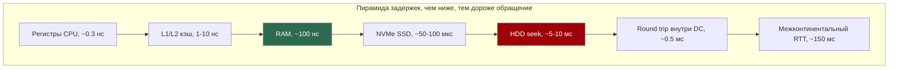
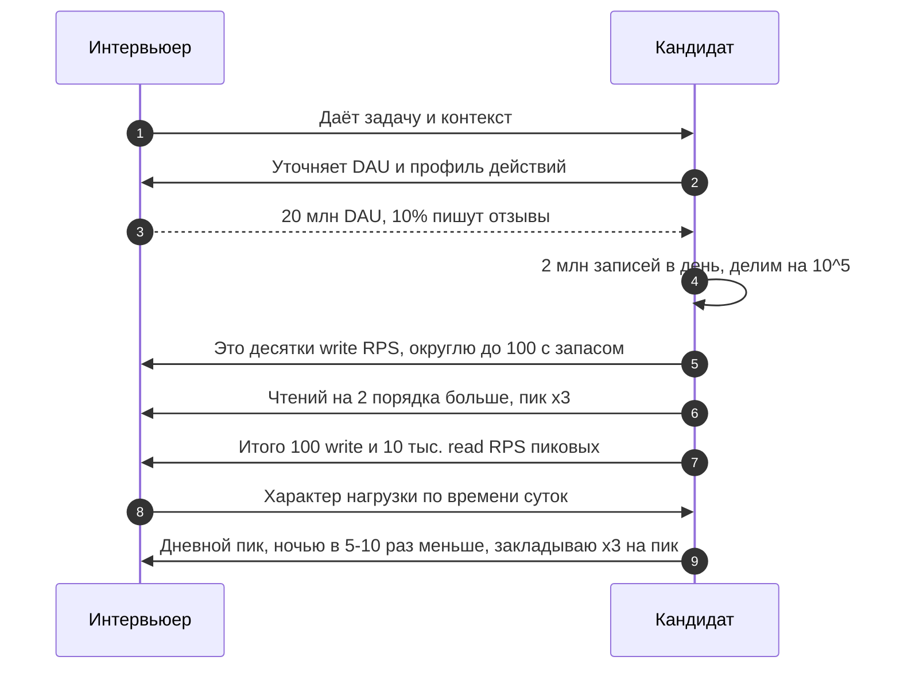

# Числа, которые нужно знать наизусть

> Шпаргалка для секции System Design: задержки, пропускные способности, порядки QPS и DAU,
> типовые размеры данных и быстрые конверсии. Всё, что нужно, чтобы за 10–15 минут
> на интервью прикинуть нагрузку и не поплыть в арифметике.

Главный принцип: интервьюер не ждёт точных цифр — он ждёт **правильных порядков** и уверенной
арифметики в столбик. На реальных моках (Яндекс, Ozon, Авито) кандидата, который говорит
«помню порядки, точные формулы не помню, но этого достаточно», это не топит. Топит тот,
кто путает микросекунды с миллисекундами или не может перевести «миллион событий в день» в RPS.

---

## 1. Latency numbers every programmer should know (Jeff Dean)

Классическая таблица, которую Джефф Дин предлагал знать каждому инженеру. Оригинальные числа —
2009–2010 годы, ниже даны и «осовремененные» прикидки (по данным PlanetScale ~2025,
которые разбирает Влад Тен в лекции по Storage).

| Операция | Классика (Dean, ~2010) | Современные порядки | В пересчёте на «человеческий» масштаб (1 нс = 1 сек) |
|---|---|---|---|
| L1 cache reference | 0.5 нс | ~1 нс | 1 сек |
| Branch mispredict | 5 нс | ~5 нс | 5 сек |
| L2 cache reference | 7 нс | ~3–10 нс | 7 сек |
| Mutex lock/unlock | 25 нс | ~25 нс | 25 сек |
| Main memory reference (RAM) | 100 нс | ~100 нс | 1.5–2 мин |
| Compress 1 KB (Zippy/Snappy) | 3 мкс | ~2–3 мкс | ~50 мин |
| Send 1–2 KB over 1 Gbps | 10–20 мкс | ~10 мкс | часы |
| Read 1 MB sequentially from RAM | 250 мкс | ~10–25 мкс | дни |
| Round trip внутри дата-центра | 500 мкс | ~100–500 мкс | ~6 суток |
| Read 1 MB sequentially from SSD | 1 мс | ~50–100 мкс | ~12 суток |
| Disk seek (HDD) | 10 мс | 5–10 мс | месяцы |
| Read 1 MB sequentially from HDD | 20–30 мс | ~1–10 мс | год |
| Пакет CA → Netherlands → CA | 150 мс | ~100–150 мс | ~5 лет |

Что реально стоит заучить (минимум, который спрашивают):

- **RAM ~100 нс, диск ~50–100 мкс (SSD) / ~10 мс seek (HDD)** — разрыв память/диск это 3–5 порядков.
  Как формулируют в разборах: «пока вы что-то достанете с диска, в памяти всё уже давно закончилось».
- **Round trip внутри дата-центра ~0.5 мс** — из этого складывается бюджет задержки запроса.
- **Round trip через планету ~100–150 мс** — поэтому геораспределённая strong consistency дорогая,
  а CDN экономит именно эту сотню миллисекунд.
- **Чтение 1 МБ с HDD ~20 мс** — последовательное чтение с диска быстрее, чем random access,
  на 2–3 порядка; на этом построены LSM-деревья, WAL и весь Kafka-дизайн.



> Заметьте: RTT внутри DC на диаграмме ниже HDD — по времени они сравнимы (сотни мкс против
> миллисекунд), и именно поэтому сетевые вызовы к соседнему сервису иногда «дешевле»,
> чем чтение с локального диска. Вывод для дизайна: кэш в памяти соседнего сервера (Redis)
> может быть быстрее локального холодного чтения с диска.

### Как это использовать на интервью

- Когда интервьюер спрашивает «какая будет задержка у эндпоинта?» — раскладывайте её на бюджет:
  1 сетевой RTT до балансировщика + 1–2 внутренних RTT + 1 обращение к кэшу (~1 мс с сетью)
  или 1 чтение с диска (~1–10 мс). Итого «условный GET из кэша — единицы миллисекунд,
  GET с диска — десятки миллисекунд».
- Если вы предлагаете схему с N последовательными сетевыми вызовами — умножайте N на 0.5 мс
  минимум. Fanout к 10 сервисам последовательно = уже ~5+ мс только сеть.

---

## 2. Пропускная способность: HDD / SSD / RAM / сеть

| Медиум | Sequential read/write | Random IOPS | Комментарий для собеса |
|---|---|---|---|
| HDD 7200 rpm | 100–200 МБ/с | 100–200 IOPS | seek ~10 мс убивает random access |
| SATA SSD | ~500 МБ/с | 50–100 тыс. IOPS | seek практически бесплатен |
| NVMe SSD | 3–7 ГБ/с | 0.5–1 млн IOPS | стандарт современных БД-нод |
| RAM (DDR4/DDR5) | 25–100+ ГБ/с | — | на 1–2 порядка быстрее NVMe |
| Сеть 1 Gbps | ~125 МБ/с | — | ~10 мкс на килобайтный пакет |
| Сеть 10 Gbps | ~1.25 ГБ/с | — | типичная нода в DC |
| Сеть 25/40/100 Gbps | 3–12 ГБ/с | — | кросс-DC линки и storage-фабрики |

Практические следствия, которые любят проверять:

- **Диск vs сеть**: чтение 1 МБ с локального HDD (~20 мс) медленнее, чем получить его по 10 Gbps
  сети (~1 мс + RTT). Поэтому «всё положим на одну машину с большим диском» не всегда выигрышно.
- **Sequential vs random**: HDD читает последовательно 100+ МБ/с, но рандомно — 100 IOPS,
  т.е. ~0.4 МБ/с блоками по 4 КБ. Разница ~2 порядка. Отсюда — append-only логи, WAL, LSM.
- **Сеть не бесплатна**: через 1 Gbps линк вы физически не пропихнёте больше ~125 МБ/с.
  Если ваш сервис раздаёт видео 10 000 RPS по 1 МБ — это 10 ГБ/с = 80 Gbps,
  т.е. десятки машин только на отдачу трафика (и именно поэтому существуют CDN).

---

## 3. Быстрые конверсии величин — базовая арифметика собеседования

Это та таблица, которую стоит вызубрить до автоматизма. Как отмечают интервьюеры на моках:
числа часто дают в DAU/MAU или «событий в день», и ждут, что вы за секунды переведёте это в TPS.

### Время

| Величина | Значение | Мнемоника |
|---|---|---|
| Секунд в сутках | 86 400 ≈ **100 000 (10⁵)** | «сутки — сто тысяч секунд», ошибка 14% — несущественна |
| Секунд в месяце (30 дн.) | 2 592 000 ≈ **2.5 млн** | «месяц — два с половиной миллиона секунд» |
| Секунд в году | ~31.5 млн ≈ **π × 10⁷** | красивая шпаргалка, легко запомнить |

### Степени тысячи в байтах

| Единица | Байт | Пример «предмета» |
|---|---|---|
| 1 КБ = 10³ | 1 000 | короткий текст, пара абзацев |
| 1 МБ = 10⁶ | 1 000 000 | минута аудио, небольшое фото |
| 1 ГБ = 10⁹ | 1 000 000 000 | ~час видео в низком качестве |
| 1 ТБ = 10¹² | 10¹² | диск ноутбука |
| 1 ПБ = 10¹⁵ | 10¹⁵ | суточный прирост логов крупного сервиса |

> На собеседовании **не делайте разницы между 1024 и 1000** — говорите вслух «считаю в степенях
> десятки для простоты». Это показывает, что вы контролируете допущения, а не ошиблись.

### Конверсия «события в день → QPS»

Главная формула секции:

```
QPS ≈ (событий в день) / 10⁵
```

- 1 млн событий/день ≈ **10 QPS**
- 10 млн/день ≈ **100 QPS**
- 100 млн/день ≈ **1 000 QPS**
- 1 млрд/день ≈ **10 000 QPS**

Пиковая нагрузка: умножайте среднюю на **2–3** (суточный цикл). Для событийных пиков
(чёрная пятница, релиз, спортивный матч) — на 5–10, и это отдельный разговор с интервьюером.

DAU → QPS (правило большого пальца):

```
QPS ≈ DAU × (действий на пользователя в день) / 10⁵
```

Пример: 10 млн DAU, в среднем 10 действий на пользователя → 10⁷ × 10 / 10⁵ = **1 000 QPS** в среднем,
~3 000 в пике. Полезная эвристика «в лоб»: пиковый QPS ≈ DAU / 1000 при типичной вовлечённости.


---

## 4. Порядки QPS и DAU известных сервисов

> **Важная оговорка:** это публичные оценки и порядки на разные годы, а не точные цифры.
> На собеседовании говорите именно так: «порядки такие-то, точные цифры меняются, но для дизайна
> важен порядок». Интервьюеру важно, что вы отличаете систему на 10⁴ RPS от системы на 10⁶ RPS —
> как сказано в разборе открытого бигтех-собеса: «проектирование на 10 000 RPS и на миллион RPS
> очень сильно отличается».

| Сервис / система | Порядок нагрузки | Что запомнить |
|---|---|---|
| Twitter/X — постинг твитов | ~5–10 тыс. твитов/с (пики ~150 тыс.) | write-нагрузка скромная |
| Twitter/X — чтение таймлайнов | ~300 тыс. RPS | read:write ≈ 100:1 и выше |
| Google Search | ~100 тыс. поисков/с | read-only, кэшируемо |
| YouTube — загрузка видео | ~500 часов видео/мин | входной трафик сотни ТБ/день |
| YouTube — просмотры | ~1 млрд часов/день | раздача = CDN-задача |
| WhatsApp/Telegram — сообщения | ~100 млрд сообщений/день ≈ 1 млн/с | long-lived соединения, fanout |
| Instagram — фото | ~100 млн фото/день ≈ 1 тыс./с | write невелик, медиа — в object storage |
| Крупный e-commerce (Ozon/Avito масштаб) | 10–40 тыс. RPS на чтение, сотни–тысячи на запись | см. расчёт ниже |
| «Высоконагруженный внутренний сервис» | 10–20 тыс. RPS | типичный порог «надо думать о шардировании» |
| «Низконагруженный сервис» | 5–10 RPS | один инстанс + реплика, не изобретайте велосипед |

Ориентиры для DAU/MAU (порядки, публичные данные разных лет):

| Сервис | MAU | DAU | Заметка |
|---|---|---|---|
| Facebook/Meta | ~3 млрд | ~2 млрд | DAU/MAU ≈ 0.65 — очень липкий продукт |
| YouTube | ~2.5 млрд | ~120+ млн «постоянных» | много анонимного трафика |
| WhatsApp | ~2.5–3 млрд | ~2 млрд | ежедневная утилита |
| Instagram | ~2 млрд | ~1 млрд | |
| Twitter/X | ~0.5 млрд | ~250 млн | |
| Telegram | ~1 млрд | ~0.5 млрд | |

Связка, которую стоит проговаривать: **DAU/MAU (stickiness)** у соцсетей обычно 0.5–0.65,
у утилит ниже. Если интервьюер дал только MAU — делите на 2–4, чтобы получить DAU, и говорите,
что это ваше допущение.

---

## 5. Типовые размеры данных

Знать, чтобы считать storage и bandwidth.

| Объект | Размер | Детали |
|---|---|---|
| Твит / короткий пост | ~280 символов ≈ **0.3 КБ**, с метаданными ~1 КБ | метаданные (id, author, ts, counters) дороже текста |
| Сообщение в чате | ~100–200 Б текст, ~0.5–1 КБ с обвязкой | |
| URL (для shortener) | в среднем **~100 Б** | число из мока с ex-Amazon инженером; уточняйте у интервьюера |
| Запись «короткая ссылка → длинная» | ~0.5 КБ с индексами | 100 млн ссылок ≈ 50 ГБ |
| Профиль пользователя | ~1 КБ | |
| Фото (смартфон, сжатое) | **1–3 МБ** (JPEG), оригиналы до 5–10 МБ | + превью 3 размеров по 50–200 КБ |
| Фото-превью / thumbnail | 50–200 КБ | именно их раздаёт лента |
| Минута аудио (подкаст, 128 kbps) | ~1 МБ | |
| Минута видео 480p | ~5–10 МБ | |
| Минута видео 1080p | ~50–100 МБ | ~1 МБ/с на 8 Mbps битрейте |
| Минута видео 4K | ~300–700 МБ | |
| Час видео 1080p | ~2–4 ГБ | после транскодинга в несколько качеств — ×3–5 |
| Страница текста | ~2 КБ | 500 страниц ≈ 1 МБ — «книга» |
| Лог-запись | ~0.5–1 КБ | миллион RPS логов ≈ ТБ в час |

Обратная связка — быстрые оценки storage:

- 1 млрд объектов по 1 КБ = **1 ТБ**. «Миллиард килобайтных записей — терабайт» — запомнить.
- 100 млн фото по 2 МБ = 200 ТБ оригиналов; с превью и репликацией ×3 — под петабайт.
- Видеоплатформа: 500 часов/мин × 3 ГБ/час ≈ **~130 ТБ входящего в день** до транскодинга.

---

## 6. Методика расчёта нагрузки на собеседовании (по мокам RU-бигтеха)

Собрано из моков: расчёт нагрузки для «Авито-подобного» сервиса, открытое собеседование
в бигтех, мок от Team Lead из Ozon, собес в Яндекс.

### Шаг 1. Исходные данные — получите их, а не выдумывайте молча

Спросите или зафиксируйте допущения вслух:

- DAU/MAU. Если не дают — предложите сами: «возьмём 7–10 млн DAU, как у крупного RU-маркетплейса».
- **Характер действий пользователя.** Сильный приём из открытого бигтех-собеса: интервьюер сам
  дал профиль — «стандартный пользователь читает 10 статей в день и ищет 5 раз в день».
  Если не даёт — предложите свой: «пусть средний пользователь делает 50 поисков и 100 просмотров».
- Конверсии. На собесе в Яндекс кандидат заложил «10% пользователей пишут отзыв» —
  и проговорил, что это допущение с запасом на пики.

### Шаг 2. Разделите read и write — и считайте отдельно

Это не формальность: запись и чтение масштабируются по-разному (реплики читают, но не пишут),
и сервер держит их неодинаково. Правило из моков: **чтений на 1–2 порядка больше, чем записей**,
но запись «тяжелее».

### Шаг 3. Посчитайте средние RPS

Рабочий пример из урока по расчёту нагрузки (маркетплейс уровня Авито):

- 7 млн DAU, ~7 write-действий на пользователя в день → **50 млн записей/день**
- 50 млн / 86 400 ≈ **580 write RPS** в среднем
- 150 read-действий на пользователя в день → **~1 млрд чтений/день** → **~12 000 read RPS**

### Шаг 4. Пики и запас

- Пик ×2–3: 580 → **~1 800 write RPS**, 12 000 → **~36 000 read RPS**.
- Заложите рост (×2 за год) и N+1/N+2 резерв на отказ дата-центра — «в горячем резерве
  столько же серверов».

### Шаг 5. Переведите RPS в машины

Эмпирика из того же урока (грубая, но рабочая для прикидки):

- один средний сервер: **~200 RPS на запись, ~1 000 RPS на чтение** (зависит от тяжести запроса —
  оговорите это);
- считайте по **большему** из чисел: max(1800/200, 36000/1000) = max(9, 36) = **36 машин** + резерв.

### Шаг 6. Storage и bandwidth — только если критично

Совет из разбора бигтех-собеса: на всю секцию оценок — **10–15 минут максимум**: посчитали RPS,
пропорцию read/write, и трафик по сети — если он критичен (медиа, файлы). Не уходите в расчёт
размера каждой таблицы, пока не спроектировали систему.



---

## 7. Что говорить интервьюеру — готовые сильные формулировки

- «Я буду считать в степенях десятки: в сутках ~10⁵ секунд, точность до 15% нас устроит —
  нам важен порядок.» *(Интервьюер из мока с ex-Amazon: число «100 000 секунд в день» прямо
  рекомендует держать в голове для мгновенной конверсии DAU→TPS.)*
- «Разделю нагрузку на read и write: они масштабируются по-разному, и пропорция read:write
  определит половину дизайна — кэш, реплики, CDN.»
- «Записей на порядок-два меньше, но они тяжелее и их нельзя разнести по репликам — write path
  будет моим узким местом.»
- «Округляю вверх: получилось 23 RPS — скажу 100 RPS, заложив пик и рост. Дизайн от этого
  не изменится, а запас появится.» *(Ровно так рассуждал кандидат на собесе в Яндекс:
  «несколько десятков RPS, кажется немного — пусть 100».)*
- «Для оценки latency разложу запрос на бюджет: RTT до нас, N внутренних хопов по ~0.5 мс,
  обращение к кэшу ~1 мс или к диску ~10 мс.»
- «Точные формулы по квантилям не помню, но порядки помню — для дизайна их достаточно.»
  *(Фраза из мока Ozon — интервьюер принял без вопросов.)*
- «Эти цифры публичные оценки на разные годы — важен порядок, а не третья значащая цифра.»

## 8. Уточняющие вопросы перед расчётами

1. Сколько пользователей: DAU, MAU? Есть ли сезонность / дневной профиль нагрузки?
2. Соотношение чтения и записи? (Для лент — ~100:1, для чатов — ближе к 1:1–10:1,
   для логов/телеметрии — write-heavy.)
3. Средний размер сущности? (URL ~100 Б, пост ~1 КБ, фото ~2 МБ — уточните, не угадывайте молча.)
4. Сколько хранить данные: 30 дней? 10 лет? вечно? (Для shortener на моке Ozon это решало
   объём: 12 млн ссылок/год × 10 лет — всё ещё «не очень много».)
5. Какой SLA по latency и доступности — от этого зависит, нужны ли кэш и multi-DC.
6. Где аудитория географически — один регион или весь мир (CDN, межконтинентальный RTT 150 мс)?

## 9. Красные флаги и типичные ошибки

- **Путать 10³ и 10⁶, микро- и миллисекунды.** Ошибка на 3 порядка в оценке — это не «неточность»,
  это провал секции. Проговаривайте размерность вслух.
- **Застревать в арифметике.** Умножаете 7.2 × 4.8 минуту — интервьюер зевает. Округлите:
  «7 × 5 = 35, возьму 40». Кандидатам на реальных моках прямо говорят: «в арифметике можно
  поплыть — округляй».
- **Считать без пикового коэффициента.** Средний RPS никого не интересует — систему проектируют
  под пик ×2–3 минимум.
- **Не разделять read/write.** Если вы посчитали «всего RPS» одним числом — вы потеряли главный
  вывод оценки (read:write ratio).
- **Точность без порядка.** «У нас будет 47 832 RPS» — звучит хуже, чем «порядка 50 тысяч RPS»:
  показывает, что вы не понимаете природу оценки.
- **Игнорировать bandwidth и storage там, где они определяют дизайн.** Для YouTube/фото-сервиса
  посчитать только QPS и не посчитать трафик — пропустить главное.
- **Заложить 100% конверсию.** «Каждый пользователь каждый день постит 10 фото» — нет.
  Берите реалистичные доли (1–10% активных создателей контента) и оговаривайте.
- **Считать нагрузку на фронтенд.** Нагрузку считают на backend: статику раздаёт CDN,
  а бэкенд ходит в БД — вот где узкое место.

## 10. Deep dive: откуда берутся ограничения «200 RPS на запись / 1000 на чтение»

Числа из RU-урока по расчёту нагрузки — не догма, а точка отсчёта для «среднего» сервера
и «среднего» запроса. Разложите их, если спросят:

- **Write в реляционную БД** — это fsync на диск (WAL). На NVMe fsync ~50–100 мкс, теоретический
  потолок — десятки тысяч commit/с, но с реальной логикой, индексами и конкуренцией
  рабочая планка одной ноды — сотни–тысячи write TPS. Дальше — шардирование.
- **Read** — обслуживается из buffer pool / page cache (RAM, ~100 нс) и легко разносится
  по репликам; одна нода отдаёт тысячи–десятки тысяч простых GET/с. Отсюда и эвристика 1:5.
- **Кэш (Redis/Memcached)** — сотни тысяч простых GET/SET в секунду на ноду, latency ~0.5–1 мс
  по сети. Если ваши 36 000 read RPS — это «горячие» ключи (одна короткая ссылка, которую
  открывают миллионы — кейс из мока Ozon про hot partition), кэш снимает с БД 90%+ нагрузки.
- **Сеть** — килобайтный ответ на 10 Gbps = теоретически ~1 млн RPS трафика; на практике
  упрётесь в CPU и соединения раньше.

Вывод для интервью: порядок «сервер = сотни write / тысячи read RPS» — безопасная консервативная
база. Если ваш расчёт даёт запас ×10 от этого — не раздувайте архитектуру.

## 11. Мини-тренажёр: проверьте себя

1. 50 млн заказов в день — сколько средний и пиковый write QPS?
   *(~500 средний, ~1 500 пиковый.)*
2. 200 млн MAU, stickiness 0.5, 20 действий/день — read QPS?
   *(100 млн DAU × 20 = 2 млрд/день → ~20 000 средний, ~60 000 пиковый.)*
3. Сервис хранит 3 года логов: 100 тыс. событий/с по 1 КБ. Объём?
   *(10⁵ × 10³ Б × 10⁸ с ≈ 10¹⁶ Б = 10 ПБ до репликации.)*
4. Можно ли отдавать 5 000 RPS фотографий по 500 КБ с одной ноды 10 Gbps?
   *(Нет: 2.5 ГБ/с = 20 Gbps трафика — минимум 2–3 ноды только по сети, а правильнее — CDN.)*
5. Запрос делает 6 последовательных вызовов к внутренним сервисам. Оцените минимальную latency.
   *(≥ 6 × 0.5 мс ≈ 3 мс сеть + время обработки; параллелить или агрегировать.)*

---

## Источники и видео по теме

- [Урок 17. Расчет нагрузки на IT систему / Most important System Design for Project manager / Интервью](https://www.youtube.com/watch?v=CGDDXfhRqEU)
- [Открытое собеседование в бигтех: секция System Design (Авито, Ozon, Wildberries, Яндекс, Сбер)](https://www.youtube.com/watch?v=ND2Qfdg5bVc)
- [Собес в Яндекс на Java-разработчика \\ System Design интервью](https://www.youtube.com/watch?v=lVlJRzyFR3c)
- [Mock-собеседование по System Design от Team Lead из Ozon](https://www.youtube.com/watch?v=hCg4N-r_kF0)
- [Проектирование системы: Сокращение URL-адресов, например TinyURL (совместно со старшим инженером)](https://www.youtube.com/watch?v=tm-SWO9gUAU)
- [База по Базам Данных - Storage (Индексы, Paging, LSM, B+-Tree, R-Tree) / Влад Тен Систем Дизайн](https://www.youtube.com/watch?v=i-FFVM4cIXQ)
- [System Design. База. Разбор книги "Высоконагруженные приложения". Глава 1](https://www.youtube.com/watch?v=owjrIB_5go8)
