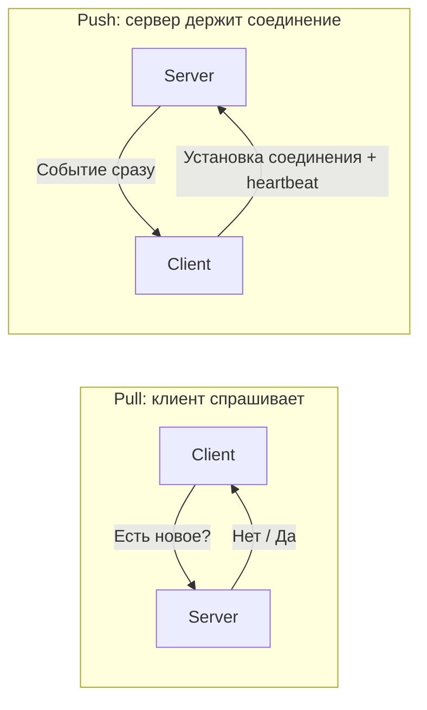
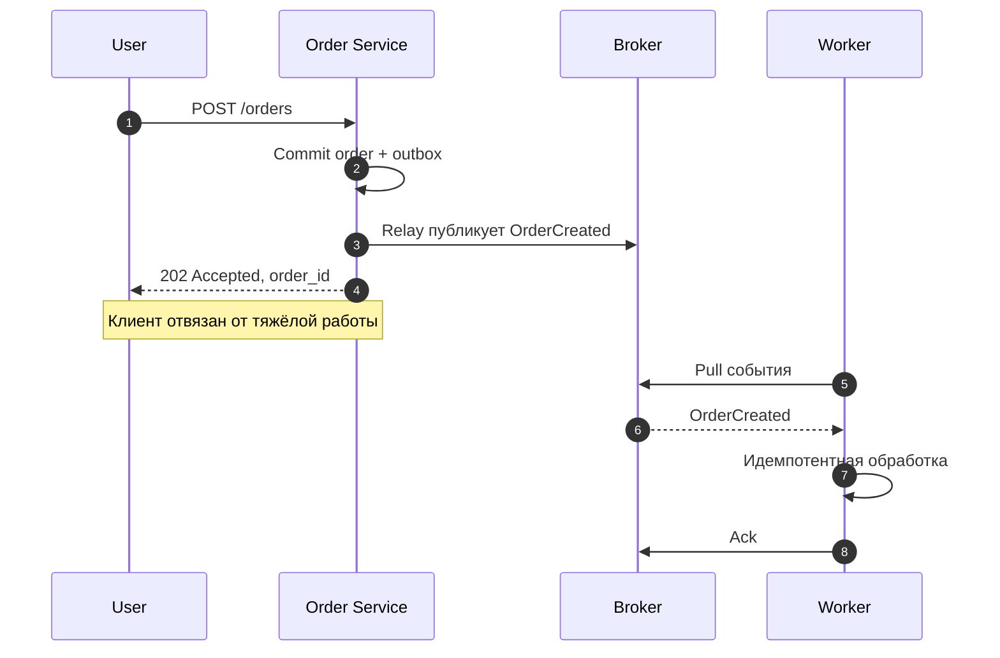
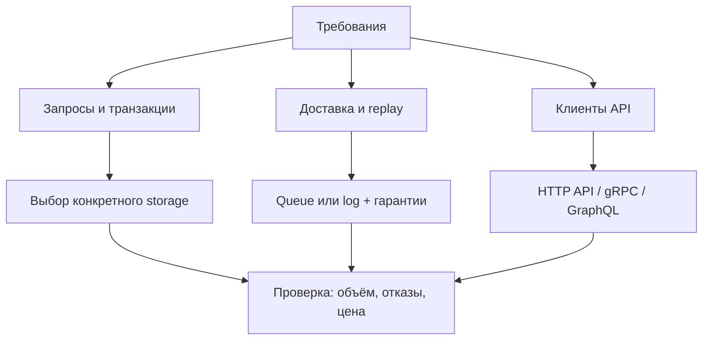

# Большие таблицы trade-off'ов: что выбрать и как это обосновать

<!-- learning-nav:start -->
[← Все разделы](../README.md) · [Предыдущая тема](numbers.md)
<!-- learning-nav:end -->

Шпаргалка для System Design собеседования. Главное правило, которое нужно усвоить до того, как открывать любую из таблиц ниже: **интервьюер оценивает не сам выбор, а обоснование**. Фраза «я возьму Kafka» без контекста нагрузки, гарантий и паттернов доступа к данным — красный флаг. Фраза «я возьму Kafka, потому что нам нужен replay событий и порядок внутри агрегата, и я готов заплатить за это операционной сложностью» — это то, что отличает senior от middle.

Поэтому каждая таблица здесь снабжена блоком «Что сказать интервьюеру» — готовыми формулировками, которые показывают, что вы мыслите trade-off'ами, а не названиями технологий.

## Содержание

<!-- toc:start -->

Показать темы и вопросы

- [Общий принцип: выбор = функция от требований](#общий-принцип-выбор--функция-от-требований)
- [SQL vs NoSQL](#sql-vs-nosql)
- [Redis vs Memcached](#redis-vs-memcached)
- [Kafka vs RabbitMQ vs SQS](#kafka-vs-rabbitmq-vs-sqs)
- [REST vs gRPC vs GraphQL](#rest-vs-grpc-vs-graphql)
- [Push vs Pull](#push-vs-pull)
- [Sync vs Async](#sync-vs-async)
- [Strong vs Eventual Consistency](#strong-vs-eventual-consistency)
- [Универсальные красные флаги](#универсальные-красные-флаги)
- [Видео по теме](#видео-по-теме)

<!-- toc:end -->

---

## Общий принцип: выбор = функция от требований

Прежде чем открывать рот с предложением технологии, прогнозируйте её через фильтр из пяти вопросов (интервьюеры сами оценивают кандидата примерно по этим осям — масштабируемость, отказоустойчивость, обработка ошибок и ретраи, производительность, политика хранения/эксплуатации):

1. **Паттерн доступа к данным.** OLTP (много мелких транзакций) или OLAP (тяжёлые аналитические запросы)? Read-heavy или write-heavy?
2. **Объёмы.** RPS, размер сообщения/записи, объём хранения и retention. Throughput одного брокера зависит от hardware, replication, batching и размера сообщения; у него нет универсальной «ёмкости 1 ТБ». Реплики могут быть нужны ради доступности даже при 10 RPS. Отделяйте кластер для HA от шардинга ради throughput.
3. **Гарантии.** Что хуже: потерять данные, продублировать данные или показать устаревшие данные?
4. **Порядок.** Нужен ли порядок событий глобально, внутри сущности (пользователь, заказ) или не нужен вообще?
5. **Кто эксплуатирует.** Есть ли команда, способная жить с self-hosted решением, или managed — единственный реалистичный вариант?

Главная формула, которую стоит произнести вслух хотя бы раз за интервью:

> «Let your queries define your schema» — пусть паттерн чтения определяет модель хранения, а не наоборот. Сначала я смотрю, как система читает данные, и от этого выбираю хранилище.

---

## SQL vs NoSQL

### Главная матрица

| Критерий | SQL (PostgreSQL, MySQL) | NoSQL (Cassandra, DynamoDB, MongoDB) |
|---|---|---|
| Модель данных | Таблицы и связи; нормализация или осознанная денормализация | Документы, key-value, wide-column и другие разные модели |
| Консистентность | Зависит от isolation, репликации и read path; ACID не равно linearizability | Зависит от продукта: есть strong reads и транзакции, есть eventual и quorum |
| Масштабирование | Вертикальное, replicas, sharding; distributed SQL может управлять им сам | Часто встроено; partition key, hot spots и rebalance всё равно проектируют |
| Схема | Явная; стоимость миграции зависит от изменения | Гибкая в части продуктов; версии документов и миграции кода остаются |
| Запросы | JOIN, ad-hoc, агрегации и индексы | От key lookup до богатых агрегаций; ограничения зависят от продукта |
| Денормализация | Допустима при понятной выгоде и протоколе обновления | Часто нужна для access patterns, с той же ценой согласования копий |
| Цена ошибки | Перевод денег со списанием без зачисления — недопустим | Устаревший счётчик лайков — допустим |
| Типичные кейсы | Платежи, бронирование, инвентарь, биллинг | Ленты, каталоги, сессии, телеметрия, IoT |

SQL/NoSQL — слишком широкие категории для выбора гарантии. Сравнивайте конкретные
системы и операции. Например, DynamoDB
поддерживает strongly consistent reads таблиц и local secondary indexes, но не GSI.
Это NoSQL, поэтому «NoSQL = eventual» неверно.

### Пример, который стоит уметь рассказать

Платёжная система vs лента соцсети:

- **Платежи (SQL, нормализация).** Таблицы `users`, `accounts`, `transactions`. Email пользователя хранится в одном месте — меняется одним UPDATE. Перевод денег — ACID-транзакция: списание и зачисление либо оба проходят, либо оба откатываются. Никаких «грязных» промежуточных состояний.
- **Лента (NoSQL, денормализация).** Пост, имя автора, аватар и первые комментарии лежат в одном документе. Имя автора продублировано в каждом его посте — да, это избыточно, но лента отдаётся **одним чтением** без единого JOIN. Это может уменьшить число чтений, но выигрыш зависит от индексов, объёма и workload; обновление имени потребует пересборки копий или отдельной политики свежести.

### Подматрица: виды NoSQL (если интервьюер копнёт глубже)

| Тип | Представители | Когда брать |
|---|---|---|
| Key-Value | Redis, DynamoDB, Memcached | Сессии, кэш, rate limiting, простые lookup по ключу |
| Document | MongoDB, Couchbase | Каталоги, профили, контент с эволюционирующей структурой |
| Wide-column | Cassandra, HBase, ScyllaDB | Огромная запись, time-series, телеметрия, write-heavy |
| Graph | Neo4j, Neptune | Социальные графы, рекомендации, fraud detection |

### Что сказать интервьюеру

- «Мои запросы — это N чтений профиля по id на M чтений связанных сущностей, поэтому я начну с PostgreSQL: ACID для заказов, а read replicas закроют read-heavy часть. NoSQL я возьму, только когда упрёмся в шардинг или паттерн чтения стабилизируется настолько, что денормализация окупится».
- «По умолчанию начну с PostgreSQL, если запросы и требуемые транзакции ему подходят; гарантию isolation и read path назову отдельно, а масштабирование проверю по нагрузке. Переход на NoSQL я обосную конкретными цифрами нагрузки».
- «Денормализация — это не бесплатно: мы покупаем скорость чтения ценой сложности записи и риска рассинхронизации дублей. Для имени автора в посте это приемлемо, для баланса счёта — нет».

### Красные флаги

- «Возьму MongoDB, она быстрая» — без анализа паттернов запросов.
- Денормализация данных, у которых есть требование консистентности (деньги, остатки на складе).
- Шардинг без доказанного ограничения: сначала проверьте запросы, индексы, вертикальный рост, replicas и кэш; затем стоимость межшардовых запросов и транзакций выбранной СУБД.

### Уточняющие вопросы перед выбором

- Какое соотношение read/write? (read-heavy 100:1 и write-heavy 1:1 — разные миры)
- Нужны ли транзакции, затрагивающие несколько сущностей? (перевод денег — да; лайк — нет)
- Нужны ли ad-hoc запросы аналитиков, или все access patterns известны заранее?
- Какой объём данных через год: сотни ГБ или сотни ТБ? (один инстанс PostgreSQL с репликами комфортно живёт в первом случае)
- Насколько часто меняется схема данных и кто ей владеет?

### Опорные числа

- Одна нода PostgreSQL/MySQL на нормальном железе: тысячи–десятки тысяч TPS на простых запросах по индексу.
- Read replicas масштабируют только чтение; запись всегда упирается в primary — отсюда и растёт потребность в шардинге при write-heavy нагрузке.
- При шардинге cross-shard JOIN/транзакции могут стать дороже или требовать поддержки распределённой СУБД. Это не автоматическая потеря всех JOIN и не обязательный переход на саги: зависит от продукта и расположения данных.

---

## Redis vs Memcached

| Критерий | Redis | Memcached |
|---|---|---|
| Модель | Data structure server: strings, lists, sets, sorted sets, hashes, streams, bitmaps | Только key-value (строки) |
| Потоки | Обычно последовательное исполнение команд, отдельные I/O/фоновые потоки; детали зависят от версии | Многопоточная обработка; масштабирование проверяют своим workload |
| Персистентность | RDB-снапшоты + AOF (append-only file) | Нет, только in-memory |
| Репликация / HA | Replication, Sentinel, Redis Cluster | Нет из коробки (consistent hashing на клиенте) |
| TTL и eviction | TTL на ключ, политики: LRU, LFU, allkeys-* , volatile-* | TTL, только LRU |
| Pub/Sub, очереди | Есть (pub/sub, streams, list как очередь) | Нет |
| Транзакции / скрипты | MULTI/EXEC, WATCH, Lua; без SQL rollback | CAS для одного элемента; нет многошаговых Lua/транзакций |
| Типичные кейсы | Rate limiter, leaderboard (ZSET), сессии, distributed lock, геопоиск, кэш | Тупой кэш рендеров/объектов, где нужен максимум простоты и RAM |

### Что сказать интервьюеру

- «Redis — это не "быстрый Memcached", это сервер структур данных. Если мне нужен rate limiter на INCR + EXPIRE, топ-N на sorted set или распределённый лок SET NX PX — это Redis. Если нужен просто горячий кэш объектов без состояния — Memcached проще и дешевле в эксплуатации».
- «Последовательное исполнение Redis упрощает атомарные изменения одного shard. CPU всё равно может стать bottleneck: большой SMEMBERS или тяжёлый Lua задержит соседние запросы. Несколько отдельных команд не образуют атомарную бизнес-операцию, пока мы явно не согласовали их».
- Про кэш всегда добавляйте стратегию: «Cache-aside: читаем из кэша, при промахе идём в БД и кладём в кэш с TTL. Свежесть определю по операции: TTL для допустимого лага, надёжная инвалидация для обновляемого кэша, критический инвариант проверю в источнике истины».

### Красные флаги

- Использовать Redis как единственное хранилище критичных данных без понимания, что AOF/RDB — это тоже trade-off (можно потерять последние секунды записей).
- Distributed lock на Redis без обсуждения fencing token / Redlock-оговорок.
- Кэш без TTL и без стратегии eviction — классический источник «а почему у нас вчерашние данные».

---

## Kafka vs RabbitMQ vs SQS

Сначала уточните модель: Kafka — partitioned log; ниже RabbitMQ сравнивается
в режиме classic/quorum queues, SQS — standard/FIFO. У RabbitMQ есть и
Streams с retention и повторным чтением:
фраза «RabbitMQ никогда не умеет replay» неверна.

| Критерий | Kafka | RabbitMQ | SQS (AWS) |
|---|---|---|---|
| Модель | Append-only лог, топики делятся на партиции (партиция = упорядоченный файл на диске) | Очередь + exchange с гибкой маршрутизацией (direct, topic, fanout, headers) | Полностью managed очередь (standard / FIFO) |
| Хранение | Сообщения хранятся retention-период (дни, или compaction по ключу) | Сообщение удаляется после ack | Хранится до обработки, до 14 дней retention |
| Replay | Да: offset можно отмотать и перечитать историю | Нет: после ack сообщение исчезло | Нет (только до удаления) |
| Порядок | Внутри partition; параллельная обработка может изменить порядок эффектов | FIFO выдачи с оговорками о redelivery, priority и конкуренции | FIFO внутри MessageGroupId, не глобально между группами |
| Модель потребления | Consumer pull'ит по offset'у; consumer groups масштабируют чтение по партициям | Broker push'ит в consumer'а; competing consumers | Pull (long polling); невидимость через visibility timeout |
| Throughput | Зависит от bytes/s, partition, replication и batching | Зависит от queue type, durability, prefetch и payload | Standard масштабируется; FIFO зависит от high-throughput mode, групп, batching и квот региона |
| Гарантии доставки | Producer acks и consumer offset совместно задают потери/повторы; Kafka transactions покрывают Kafka→Kafka | Confirms для publish и manual ack для consumer; при retry возможны дубли | Standard допускает дубли; FIFO дедуплицирует send, но бизнес-эффект consumer всё равно защищают |
| Маршрутизация | Примитивная: ключ → партиция | Очень гибкая: routing keys, bindings, DLX | Примитивная; маршрутизация — через SNS fanout |
| Эксплуатация | Controller quorum, partitions, replication, lag; managed уменьшает часть ops | Queue topology, quorum, flow control, disk/memory alarms | Managed infrastructure; клиент отвечает за visibility, retry, DLQ и квоты |
| Типичные кейсы | Event streaming, CDC, логи, метрики, event sourcing, агрегация кликов, «перечитать вчерашнее» | Task queues, RPC поверх очереди, сложная маршрутизация, отложенные задачи | Развязка микросервисов в AWS, job queue, fanout через SNS |

### Числа для оценок на интервью

- Сначала считайте `messages/s × средний размер = bytes/s`, затем retention, replication и запас. При 100k msg/s по 1 КБ — около 100 МБ/с и 8.64 ТБ/сутки логического потока до compression/replication. Это не означает, что один брокер его выдержит.
- Размер сообщения в Kafka держите **меньше 1 МБ** — иначе проседает производительность. Классическая ошибка кандидата: положить сам видеофайл в сообщение. Правильно: файл в S3, в Kafka — только `video_id` и URL.
- Replication factor = 3 (лидер + 2 follower'а) — стандарт. `acks=all` — все in-sync реплики подтвердили запись, прежде чем producer получил OK.

### Что сказать интервьюеру

- «Нам нужен replay событий и потоковая обработка — поэтому Kafka, а не очередь. Если бы это был просто фоновый job queue с хитрой маршрутизацией по типам задач — взял бы RabbitMQ. Если бы мы уже в AWS и задача — просто развязать сервисы без ops-команды — SQS».
- Про горячие партиции (любимый вопрос): «Ключ партиционирования выбираю я, и это главное решение. Если ключить агрегацию кликов по `ad_id`, одна крупная кампания перегрузит партицию. Варианты: убрать ключ, если порядок не нужен; составной ключ `ad_id + random(1..10)` — раскидывает горячий ключ по 10 партициям ценой потери полного порядка; либо backpressure на producer'е».
- Про надёжность: «При RF=3 выберу `acks=all`, `min.insync.replicas=2` и безопасную политику выбора лидера, если потеря события недопустима. При недостатке ISR запись остановится — это цена. `acks=1` может потерять подтверждённые записи при failover; допустимость потери метрик тоже надо согласовать».
- Про managed: «Даже если я говорю Confluent Cloud / AWS MSK, ключ партиционирования и семантику consumer group всё равно проектирую я — managed снимает ops, но не архитектуру».

### Красные флаги

- «Kafka как очередь задач» без понимания, что из лога нельзя удалить отдельное сообщение и нет per-message ack — head-of-line blocking при «застрявшем» сообщении решается отдельно (retry-топики, DLQ).
- «Exactly-once везде» — Kafka transactions могут атомарно фиксировать выходные Kafka records и offsets при правильном isolation consumer. Внешний платёж/SQL commit в эту транзакцию автоматически не входит. У SQS FIFO send-dedup тоже не исключает повтор бизнес-эффекта после visibility timeout.
- Большие сообщения в Kafka (файлы, блобы).
- Выбирать или отвергать брокер только по бренду, без типа очереди/stream, payload, retention и теста ёмкости.

---

## REST vs gRPC vs GraphQL

| Критерий | REST (HTTP/JSON) | gRPC | GraphQL |
|---|---|---|---|
| Контракт | Ресурсы + HTTP-методы, слабо формализован (OpenAPI опционально) | Строгий: .proto файлы, codegen клиентов и серверов | Строгая схема типов, один endpoint |
| Формат | Часто JSON; размер зависит от полей и compression | Обычно Protobuf; коэффициент экономии и скорость требуют измерения | Обычно JSON |
| Транспорт | HTTP/1.1, HTTP/2 или HTTP/3 | Обычно HTTP/2: unary и streaming | HTTP: POST, query может идти через GET |
| Fetching | Фиксированные ответы: over-fetching и under-fetching (N+1 запросов) | Фиксированные методы | Клиент запрашивает ровно нужные поля — нет over/under-fetching |
| Версионирование | Явное: /v1/, /v2/ | Эволюция proto (номера полей, обратная совместимость) | Эволюция схемы без версий: deprecate полей |
| Браузер / публичный API | Идеально | Плохо без grpc-web и прокси | Хорошо |
| Tooling / отладка | curl, OpenAPI; HTTP cache при корректной политике | Codegen, grpcurl; инфраструктура должна понимать gRPC | GET/persisted queries допускают CDN cache; нужны query cost и корректный cache key |
| Типичные кейсы | Публичные API, интеграции, простые CRUD | Внутренний service-to-service, low-latency, стриминг | Мобильные клиенты, агрегация из многих сервисов (BFF), гибкие фронты |

### Что сказать интервьюеру

- «По умолчанию публичный API — REST: его понимает весь мир, он кэшируется на уровне HTTP и отлаживается curl'ом. Для внутреннего трафика между микросервисами, где важны latency и строгий контракт, — gRPC поверх protobuf: меньше байт по сети, типизация на этапе компиляции, стриминг из коробки».
- «GraphQL беру, когда один агрегирующий слой (BFF) кормит разные клиенты — мобайл хочет 3 поля, десктоп 30, и каждый REST-эндпоинт кем-то недобирает или перебирает. Плачу за это сложностью кэширования и необходимостью лимитировать глубину и стоимость запросов, иначе клиент одним запросом положит БД».
- Про версионирование: «REST я версионирую явно через /v1/, GraphQL эволюционирует через deprecation полей, protobuf — через правила совместимости номеров полей: никогда не переиспользуем удалённый номер».

### Красные флаги

- gRPC наружу в браузер без grpc-web.
- GraphQL без depth limiting / query cost — самодельная DoS-уязвимость.
- «REST — это когда JSON по HTTP» без понимания ресурсов, идемпотентности методов и статус-кодов.

---

## Push vs Pull

Двусмысленная тема: «push vs pull» встречается в двух контекстах — доставка обновлений клиенту и модель потребления из брокера. Умейте оба.

### Контекст 1: доставка обновлений клиенту (чат, лента, нотификации)

| Критерий | Short polling | Long polling | SSE | WebSocket |
|---|---|---|---|---|
| Направление | Pull, клиент спрашивает периодически | Pull: запрос висит, пока нет данных | Push: сервер → клиент, одно направление | Push: полный дуплекс |
| Протокол | HTTP | HTTP | HTTP | Upgrade поверх HTTP, дальше свой протокол |
| Нагрузка на сервер | Высокая: тысячи пустых запросов | Средняя: висячие соединения | Одно соединение на клиента | Одно соединение на клиента |
| Реальное время | Плохо (задержка = интервал) | Нормально | Хорошо | Отлично |
| Сложность | Тривиально | Просто | Просто (auto-reconnect из коробки) | Сложно: heartbeat, reconnect, stateful-ноды, балансировка |
| Кейсы | Некритичные обновления раз в минуту | Простые чаты, дашборды | Нотификации, лента, стримы LLM-ответов | Чат, игры, совместное редактирование, торги |

### Контекст 2: consumer pull vs broker push в брокерах

- **Kafka — pull:** consumer сам решает, когда и сколько читать, двигает offset. Плюс: естественный backpressure, batching, replay. Минус: нужно следить за lag.
- **RabbitMQ — push:** брокер проталкивает сообщения в consumer'а. Плюс: минимальная latency. Минус: быстрый брокер может завалить медленного consumer'а — спасает prefetch count.

### Что сказать интервьюеру

- «Для ленты с требованием "обновления в течение секунд" WebSocket — оверкилл: возьму SSE, это push по HTTP с браузерным автореконнектом. Открытое соединение, buffering, heartbeat и replay всё равно нужно учитывать. WebSocket оправдан, когда нужен двусторонний канал — чат, где клиент тоже постоянно шлёт события».
- Про чат-масштаб: «WebSocket живёт на одной gateway-ноде до разрыва; reconnect может прийти на другую, а маршрутизацию сообщений между нодами делаю через брокер/pub-sub — иначе пользователь на ноде A не получит сообщение пользователю на ноде B».
- Про fanout в ленте (классический развилочный вопрос): «Push-модель (fanout on write): при публикации поста пишу его в ленты всех подписчиков — чтение заранее собранной страницы дешёвое, но у селебрити с 10M подписчиков это 10M записей на твит. Pull-модель (fanout on read): читаю и мержу при открытии ленты — запись дешёвая, чтение дорогое. Продакшн-ответ — гибрид: push для обычных пользователей, pull для селебрити».

---

## Sync vs Async

| Критерий | Sync (request/response) | Async (через брокер/очередь) |
|---|---|---|
| Связанность | Сервисы связаны по времени: оба должны быть живы | Развязаны: producer и consumer живут независимо |
| Latency для клиента | Ждёт всю цепочку | Быстрый ack, тяжёлая работа — фоном |
| Устойчивость к сбоям | Каскадные отказы: упал downstream — упали все | Брокер буферизует: consumer упал — сообщения подождут |
| Пики нагрузки | Пик бьёт прямо в downstream | Очередь сглаживает пик (load leveling) |
| Отладка | Просто: один trace через HTTP-вызовы | Сложно: нужны trace-id через сообщения, мониторинг lag, DLQ |
| Результат | Ответ может подтверждать завершение операции; timeout оставляет неопределённость | Ack обычно подтверждает принятие, а не завершение; статус и гарантию эффекта задаёт контракт |
| Кейсы | Чтение данных для ответа пользователю, валидации, платёжный авторизационный запрос | Отправка email/push, перекодирование видео, генерация отчётов, инвалидация кэшей, CDC |

Ментальная модель из реального мира: синхронное взаимодействие — это курьер, который стоит у вашей двери и ждёт, пока вы спуститесь и заберёте заказ; асинхронное — бесконтактная доставка: курьер оставил заказ и поехал дальше, вы заберёте, когда будете готовы. Второй вариант масштабируется, первый — прост и предсказуем.

### Что сказать интервьюеру

- «Всё, что пользователь должен увидеть в ответе прямо сейчас, — синхронно. Всё, что можно сделать потом, — асинхронно через очередь: это режет latency на критическом пути и даёт буфер против пиков и падений downstream».
- «Асинхронность не бесплатна: я покупаю развязанность ценой eventual consistency, необходимости DLQ, идемпотентных consumer'ов и мониторинга lag. Для каждого async-хопа я отвечаю на вопрос: что произойдёт, если сообщение обработается дважды?»
- Про надёжную запись: «Нельзя просто сделать `db.commit(); kafka.send()` — между ними можно упасть, и событие потеряно. Поэтому outbox pattern: пишу событие в ту же БД в одной транзакции с бизнес-данными, а релей (CDC/Debezium) перекладывает его в брокер».

---

## Strong vs Eventual Consistency

| Критерий | Strong consistency | Eventual consistency |
|---|---|---|
| Гарантия | Здесь: linearizability для объекта — чтения после завершённой записи видят её или более новую запись | При прекращении изменений и успешном разрешении конфликтов реплики сходятся |
| Как достигается | Корректный протокол записи и чтения, например consensus leader + безопасные reads | Репликация и определённые правила conflict resolution/repair |
| Latency записи | Зависит от write/ack protocol и географии; координация реплик может добавлять RTT | Тоже зависит от write/ack protocol; ослабление чтений может уменьшить задержку чтения, но не обещает локальный write/ack |
| Доступность при partition | Нельзя сохранять linearizability и обслуживать все разделённые стороны: часть операций отклоняется, majority может продолжать работу | Можно спроектировать AP, но eventual convergence сама не гарантирует доступность: её задают quorum/leader/conflict protocol |
| Ограничения | Не заменяет транзакции/serializability над несколькими объектами | Возможны stale/non-monotonic reads; правила зависят от read path |
| Кейсы | Деньги, остатки склада, бронирования, лидер-элекшн | Лайки, счётчики просмотров, ленты, DNS, корзина |

Ослабление чтений и доступность записи — разные решения. Например, в etcd
`serializable` reads
могут вернуть устаревшие данные без live consensus, но
minority при partition
не может подтверждать изменения кластера; после восстановления сети догоняет
majority. Из разрешения stale reads нельзя вывести AP-гарантию записи.

Промежуточные варианты, за которые дают плюс:

- **Read-your-writes** — сессия видит свои записи; **monotonic reads** — не возвращается к более старой версии после уже увиденной. Это разные гарантии. LSN/version token с ожиданием реплики или fallback на leader может помочь; закрепление за случайной отстающей репликой само по себе недостаточно.
- **Causal consistency** — соблюдается причинно-следственный порядок (ответ на комментарий не появится раньше самого комментария).
- **Quorum intersection**: `W + R > N` означает пересечение выбранных write/read quorums при фиксированном наборе реплик. Само по себе это не доказывает linearizability: важны конкурентные/неполные записи, версии, membership и read protocol. Cassandra LWT использует отдельный протокол для linearizable compare-and-set; у managed DynamoDB клиент выбирает поддерживаемый consistency mode, а не числа W/R напрямую.

### Что сказать интервьюеру

- «CAP — это не "выбери два из трёх": при partition linearizability несовместима с доступностью операций на всех разделённых сторонах. CP-система может продолжать работу в majority, отклоняя операции minority; AP-дизайн сохраняет доступность ценой ослабления гарантий. Вне partition PACELC помогает отдельно обсудить цену consistency по latency».
- «Для баланса счёта — strong consistency и синхронная репликация, я готов платить latency. Для счётчика просмотров — eventual, eventual, ещё раз eventual: никто не заметит, что 1 000 003 просмотра отображаются как 1 000 001 ещё секунду».
- «Eventual consistency я всегда дополняю вопросом: а как пользователь переживёт рассинхронизацию? Если ответ "заметит и будет больно" — это не eventual-зона, какой бы выгодной ни казалась такая модель».

---

## Универсальные красные флаги

То, за что снимают баллы независимо от темы вопроса:

- **Технология без контекста.** «Возьму Kafka/Cassandra/gRPC» без цифр нагрузки и паттернов доступа.
- **Отсутствие цены выбора.** Любое решение имеет стоимость; если вы её не назвали, вы её не видели.
- **Silver bullet.** «X всегда лучше Y» — сигнал, что кандидат читал хедлайны, а не эксплуатировал системы.
- **Игнорирование эксплуатации.** Self-hosted Kafka кластер для стартапа из трёх человек — такой же архитектурный просчёт, как и недопроектированная база.
- **Преждевременное усложнение.** Шардинг, кластер и exactly-once там, где достаточно одной ноды, — честно проговаривайте: «на текущих объёмах одного инстанса достаточно, масштабирование добавлю, когда упрёмся, и вот точка расширения».

### Карта принятия решений

Карта задаёт вопросы, а не автоматически выбирает продукт. «Один документ за
запрос» не означает обязательный NoSQL, replay не уникален для Kafka, а
внутренний сервис не обязан использовать gRPC.

---

## Видео по теме

- [«Битва брокеров сообщений: Kafka, RabbitMQ, SQS»](https://www.youtube.com/watch?v=ZPDn7tdP6Rk)
- [Kafka для собеседований по System Design](https://www.youtube.com/watch?v=lDRx5dqQltA)
- [SQL vs NoSQL | Database Sharding & Scalability System Design](https://www.youtube.com/watch?v=eOdxMGXRiR0)
- [System Design Was HARD - Until You Knew the Trade-Offs](https://www.youtube.com/watch?v=1nENigGr-a0)
- [How to Design APIs Like a Senior Engineer (REST, GraphQL, Auth, Security)](https://www.youtube.com/watch?v=7iHl71nt49o)
- [Глубокое погружение в Redis с бывшим старшим менеджером Meta](https://www.youtube.com/watch?v=fmT5nlEkl3U)
- [Data Consistency and Tradeoffs in Distributed Systems](https://www.youtube.com/watch?v=m4q7VkgDWrM)
- [How Key value Stores Work (Redis, DynamoDB, Memcached)?](https://www.youtube.com/watch?v=Dwt8R0KPu7k)
